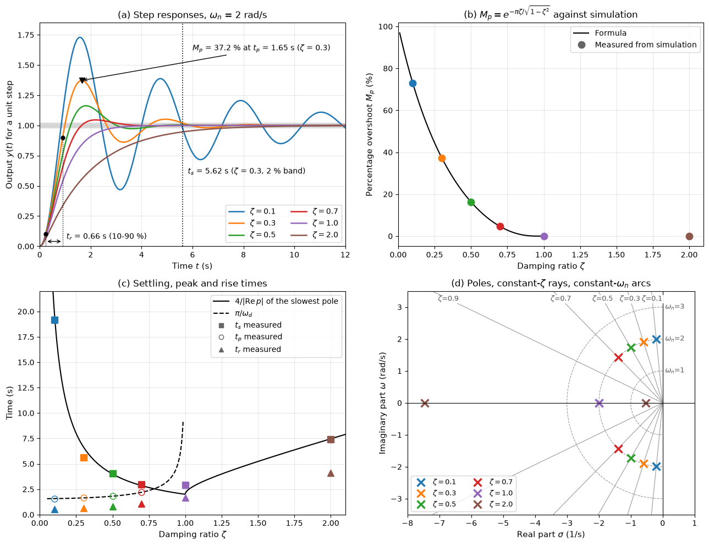

# Introduction to Control Systems

A control system makes a physical quantity, such as a speed, a level, a temperature or an attitude angle, follow a desired value despite disturbances and imperfect knowledge of the machine. This note defines the parts of a control loop, compares open-loop and closed-loop operation, lists the specifications a design must meet, states the linear time-invariant assumption behind the classical methods, and maps the other notes of this section. The examples used throughout are a car cruise control, a pump-fed tank level loop and the pitch attitude of an aircraft.

## Problem Statement

Given a plant (the machine or process) with a measurable output $y(t)$, an input $u(t)$ that an actuator can adjust, and disturbances $d(t)$ that cannot be adjusted, find a control law that produces $u$ from the reference $r(t)$ and the measurement $y_m(t)$ so that:

1. the closed loop is stable;
2. $y$ follows $r$ with a specified speed and damping (rise time, overshoot, settling time) and a bounded or zero steady-state error;
3. the effect of $d$ and of sensor noise $n$ on $y$ is small;
4. the requirements hold when the plant parameters differ from their nominal values, and $u$ stays within the actuator limits.

The classical methods of this section assume a linear time-invariant (LTI) plant described by a transfer function $G(s)$, or a set of state equations, obtained from the physics and linearized about an operating point. The general model is a set of ordinary differential equations

$$
\dot{\mathbf{x}} = \mathbf{f}(\mathbf{x}, u, d),
\qquad y = h(\mathbf{x})
$$

and the controller is itself a dynamic system, written $C(s)$ in the linear case.

## Elements of a Control Loop


The figure shows the standard single-loop structure. The error $e = r - y_m$ is formed at the left summing junction; the disturbance enters at the plant input, and the noise corrupts the measurement. Each element corresponds to hardware:

| Element | Role | Cruise control | Tank level | Aircraft pitch attitude |
| --- | --- | --- | --- | --- |
| Reference $r$ | Desired value of the output | Set speed | Set level | Commanded pitch angle |
| Controller $C(s)$ | Computes the command from the error | Engine control unit | PLC running a PI law | Flight control computer |
| Actuator | Converts the command into a physical input, within limits | Throttle and engine (drive force) | Pump and motor (inflow) | Elevator servo (elevator angle) |
| Plant $G(s)$ | The dynamics being controlled | Car mass, aerodynamic and rolling drag | Tank volume and outflow | Short-period and phugoid dynamics |
| Disturbance $d$ | Unwanted input acting on the plant | Road grade, headwind | Change in draw-off flow | Gust |
| Sensor $H(s)$ | Measures the output, with lag and noise $n$ | Wheel-speed sensor | Pressure or ultrasonic level sensor | Attitude and rate gyros |

The longitudinal dynamics of the aircraft example, including the short-period mode that a pitch controller acts on, are treated in [Airplane Stability](../transportation/airplanes/airplane_stability.md).

## Open-Loop and Closed-Loop Control

An open-loop controller computes $u$ from $r$ alone, using a model of the plant; a microwave timer and a fixed throttle setting are examples. It cannot react to a disturbance or to a model error, because it never sees the output. A closed-loop (feedback) controller computes $u$ from the error between $r$ and the measured output.

For the loop in the figure, with $C(s)$, $G(s)$ and $H(s)$ in the paths shown, the output is

$$
Y(s) = \frac{C G}{1 + C G H} R(s) + \frac{G}{1 + C G H} D(s) - \frac{C G}{1 + C G H}
N(s)
$$

The product $L(s) = C(s)G(s)H(s)$ is the loop transfer function. Where $|L(j\omega)|$ is large, the output follows $R/H$ and the disturbance is divided by roughly $|L|$; but the noise passes almost unattenuated, and a large loop gain can make the loop unstable. These three effects, worked out in [Feedback Control](./feedback_control.md), are the trade-off at the centre of every design.

### Example: Cruise Control on a Grade

A car of mass $m = 1200$ kg travels at $v_0 = 25$ m/s. Linearizing the aerodynamic drag $\tfrac{1}{2}\rho C_d A v^2$ about $v_0$ with $\rho = 1.2$ kg/m³ and $C_d A = 0.66$ m² gives a damping coefficient $b = \rho C_d A v_0 = 19.8$ N s/m. The speed deviation $v$ obeys

$$
m \dot{v} + b v = F + d
$$

where $F$ is the change in drive force and $d$ the change in external force. A 2% grade adds $d = -m g \times 0.02 = -235$ N.

With a fixed throttle (open loop, $F = 0$) the car slows by $d/b = -11.9$ m/s, with a time constant $m/b = 61$ s. With proportional feedback $F = -K_p v$ and $K_p = 600$ N/(m/s), the steady speed loss is $d/(b + K_p) = -0.38$ m/s and the time constant drops to $m/(b + K_p) = 1.9$ s. Feedback makes the response 31 times faster and the error 31 times smaller, but does not remove it; adding integral action does, as shown in [PID Controllers](./pid_controllers.md).

## Performance Specifications

Specifications are stated for a step in the reference, because a step contains all frequencies and is easy to apply in a test.

| Specification | Definition | Typical requirement |
| --- | --- | --- |
| Rise time $t_r$ | Time from 10% to 90% of the final value | Set by the required speed |
| Peak time $t_p$ | Time of the first maximum |  |
| Overshoot $M_p$ | $(y_{\max} - y_\infty)/y_\infty$, in percent | 5–20% for servos, 0% for many processes |
| Settling time $t_s$ | Time after which $\lvert y - y_\infty\rvert$ stays within 2% (sometimes 5%) of $y_\infty$ |  |
| Steady-state error $e_{ss}$ | $\lim_{t\to\infty}(r - y)$ for a step, ramp or parabola | Zero for a step in most loops |
| Disturbance rejection | Peak and integrated error after a step disturbance |  |
| Gain and phase margins | Distance from instability in the frequency domain | $GM \geq 6$ dB, $PM \geq 45^\circ$ |
| Bandwidth $\omega_{BW}$ | Frequency at which the closed-loop gain falls 3 dB below its DC value | Below the sensor noise and unmodelled resonances |

For the standard second-order system with natural frequency $\omega_n$ and damping ratio $\zeta$, the time-domain specifications have closed forms derived in [System Modeling](./system_modeling.md):

$$
M_p = e^{-\pi\zeta/\sqrt{1-\zeta^2}},
\qquad t_p = \frac{\pi}{\omega_n\sqrt{1-\zeta^2}},
\qquad t_s \approx \frac{4}{\zeta\omega_n}
$$



Panel (a) shows how the overshoot grows and the oscillation lasts longer as $\zeta$ falls; panel (b) confirms the overshoot formula against the simulated responses; panel (d) shows that a specification on $M_p$ is a ray of constant $\zeta$ in the $s$-plane and a specification on $t_s$ a vertical line $\mathrm{Re}(s) = -4/t_s$. Higher-order loops are designed by placing a pair of dominant poles where these formulas give the required response, keeping the other poles at least five times farther from the imaginary axis.

## The Linear Time-Invariant Assumption

Transfer functions, poles, root loci, Bode plots and the Nyquist criterion all rest on two properties of the plant and controller. Linearity means superposition holds: the response to $a u_1 + b u_2$ is $a y_1 + b y_2$, so the response to any input follows from the response to an impulse or a sinusoid. Time invariance means the coefficients do not change, so a delay in the input delays the output by the same amount.

Real machines satisfy these only approximately:

1. Nonlinear physics (aerodynamic drag $\propto v^2$, outflow $\propto \sqrt{h}$) is linearized about an operating point. The linear model holds for small deviations, and its parameters change with the operating point, which is why an autopilot schedules its gains with speed and altitude.
2. Actuators saturate, have rate limits, dead zones and backlash. Saturation is the most common cause of a well-tuned linear design misbehaving, through integrator windup.
3. Transport delay $e^{-sT}$ is linear and time-invariant but not a rational function; it is handled exactly in the frequency domain ([Frequency Response](./frequency_response.md)).
4. Digital controllers sample the signals; the continuous-time analysis holds when the sampling frequency is well above the closed-loop bandwidth.

## Map of the Notes

1. [System Modeling](./system_modeling.md): differential equations of mechanical, electrical, fluid and thermal systems, transfer functions, first- and second-order responses, state-space form, linearization and block-diagram algebra.
2. [Stability Analysis](./stability_analysis.md): BIBO and internal stability, pole locations, the Routh–Hurwitz criterion and the root locus.
3. [Frequency Response](./frequency_response.md): Bode plots, the Nyquist criterion, gain and phase margins, bandwidth, time delay and loop shaping.
4. [Feedback Control](./feedback_control.md): closed-loop transfer functions, sensitivity and complementary sensitivity, disturbance and noise, steady-state error and system type, lead and lag compensation.
5. [PID Controllers](./pid_controllers.md): the P, I and D actions, controller forms, derivative filtering, windup, tuning rules and discrete implementation.

State feedback (pole placement, LQR), observers, robust and model predictive control are not covered; Franklin, Powell and Emami-Naeini and Åström and Murray treat them.

## Key Takeaways

- A loop consists of a reference, controller, actuator, plant, sensor, and the disturbance and noise that act on it; the loop transfer function $L = CGH$ governs its behaviour.
- Feedback reduces the effect of disturbances and plant variations by the factor $1 + L$, at the price of a stability question and of passing sensor noise to the output.
- Specifications are set on the step response ($t_r$, $M_p$, $t_s$, $e_{ss}$) or in the frequency domain (margins, bandwidth); for a dominant second-order pair they map to $\zeta$ and $\omega_n$.
- The classical tools assume an LTI model, valid near an operating point and within the actuator limits.

## Related Scripts

- [Control Loop Block Diagram](../../../scripts/plots/control_block_diagram/): draws the standard single-loop feedback structure with reference, controller, actuator, input disturbance, plant, sensor and measurement noise, and names the matching parts of a car cruise control.
- [Second-Order Step Response](../../../scripts/algorithms/control_second_order_response/): simulates the step response of the standard second-order system for six damping ratios, measures rise time, peak time, overshoot and settling time, and compares them with the closed-form formulas and the pole locations.

## Exercises

**Exercise 1.** A plant $G(s) = \frac{10}{s+1}$ is operated (a) open loop and (b) inside a unity-feedback loop. Find the DC gain from input to output in each case, and the percentage change in that gain when the plant gain drops by 20% (from 10 to 8). What does the comparison show?

<details>
<summary>Answer</summary>

(a) Open loop: the DC gain is $G(0) = 10$, which falls to 8, a change of $`-20\%`$.

(b) Closed loop: $T(0) = \frac{10}{1 + 10} = 0.909$, which falls to $\frac{8}{1+8} = 0.889$, a change of $`-2.2\%`$.

Feedback makes the output about $1 + G(0) = 11$ times less sensitive to plant variation. The price is that the closed-loop DC gain is not exactly 1 (a 9% steady-state error for a step), which integral action would remove.

</details>

**Exercise 2.** A mass-spring-damper has $m = 2$ kg, $c = 8$ N s/m and $k = 50$ N/m. Find $\omega_n$, $\zeta$, the poles, the percentage overshoot of the step response and the 2% settling time.

<details>
<summary>Answer</summary>

$\omega_n = \sqrt{k/m} = 5$ rad/s and $\zeta = \frac{c}{2\sqrt{km}} = \frac{8}{20} = 0.4$. The poles are the roots of $2s^2 + 8s + 50 = 0$: $s = -2 \pm 4.58j$.

Overshoot: $M_p = e^{-\pi\zeta/\sqrt{1-\zeta^2}} = e^{-1.371} = 0.254$, i.e. 25.4%. Settling time: $t_s \approx \frac{4}{\zeta\omega_n} = 2.0$ s.

</details>

**Exercise 3.** In the cruise-control example, what proportional gain keeps the speed loss on the 2% grade below 0.1 m/s? What happens to the drive force demanded when the car meets the grade, and why might the actuator not deliver it?

<details>
<summary>Answer</summary>

The steady speed loss is $\lvert d\rvert/(b + K_p) = 235/(19.8 + K_p) < 0.1$, so $K_p > 2335$ N/(m/s).

At steady state the controller must supply $F = -d = 235$ N extra drive force whatever the gain; what the gain changes is how fast the force builds up. Immediately after a speed error appears, the demanded force change is $K_p v$, which for $K_p = 2335$ N/(m/s) and a 1 m/s error is 2.3 kN. An engine near full throttle cannot deliver that, so the actuator saturates and the loop no longer behaves linearly.

</details>

**Exercise 4.** A specification asks for at most 10% overshoot and a 2% settling time of at most 2 s. Translate it into a region of the $s$-plane for a dominant pole pair, and give the slowest pair that meets both.

<details>
<summary>Answer</summary>

Inverting $M_p = e^{-\pi\zeta/\sqrt{1-\zeta^2}}$ gives

```math
\zeta = \frac{-\ln M_p}{\sqrt{\pi^2 + \ln^2 M_p}} = \frac{2.303}{\sqrt{9.870 + 5.302}} = 0.591
```

so the poles must lie inside the sector $\lvert\arg(-s)\rvert \leq \arccos 0.591 = 53.8^\circ$ about the negative real axis. The settling time requires $\zeta\omega_n \geq 4/2 = 2$ s⁻¹, so they must lie to the left of $\mathrm{Re}(s) = -2$.

The slowest pair is at the corner: $\zeta\omega_n = 2$, $\omega_n = 2/0.591 = 3.38$ rad/s, $\omega_d = \omega_n\sqrt{1-\zeta^2} = 2.73$ rad/s, so $s = -2 \pm 2.73j$.

</details>

## References

- K. Ogata, *Modern Control Engineering*, 5th ed., Prentice Hall, 2010.
- N. S. Nise, *Control Systems Engineering*, 8th ed., Wiley, 2019.
- G. F. Franklin, J. D. Powell, A. Emami-Naeini, *Feedback Control of Dynamic Systems*, 8th ed., Pearson, 2019.
- K. J. Åström, R. M. Murray, *Feedback Systems: An Introduction for Scientists and Engineers*, Princeton University Press, 2008.
- T. D. Gillespie, *Fundamentals of Vehicle Dynamics*, SAE International, 1992.
