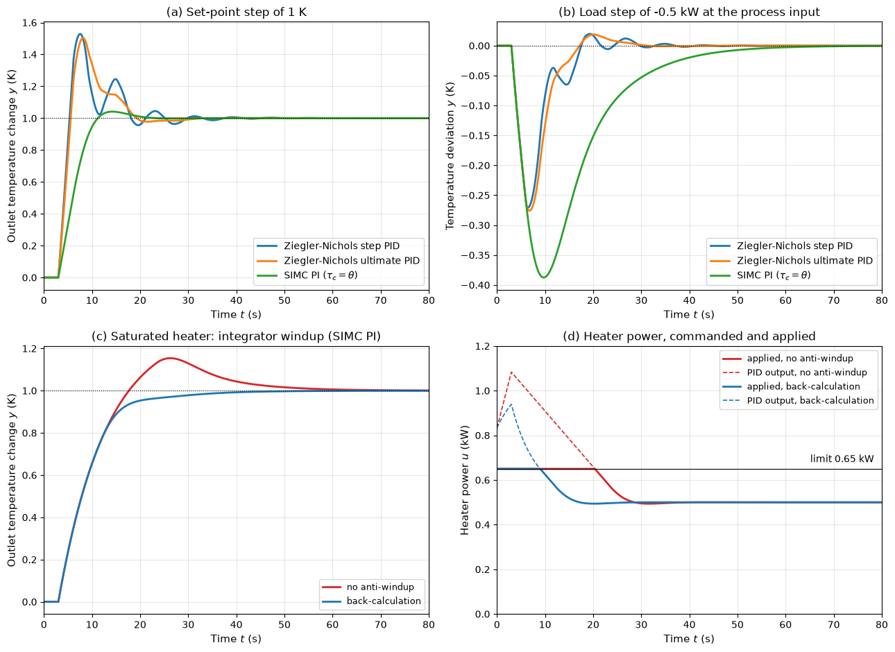

# PID Controllers

The proportional-integral-derivative (PID) controller acts on the present error, its accumulated past and its rate of change. Its three parameters are enough for the large majority of loops in process plants, drives, vehicles and test rigs, and most of those loops in fact use only the P and I terms. This note explains what each action does to the closed-loop poles and errors, compares the controller forms found in textbooks and products, treats derivative filtering and integrator windup, gives the classical and model-based tuning rules (Ziegler–Nichols, Cohen–Coon, IMC and SIMC) and compares them on a first-order-plus-dead-time process, and ends with the discrete-time implementation.

## Problem Statement

Given a plant, either as a model (typically first-order plus dead time, FOPDT, identified from a step test)

$$
G(s) = \frac{K e^{-\theta s}}{\tau s + 1}
$$

with process gain $K$, time constant $\tau$ (s) and dead time $\theta$ (s), or as the ultimate gain $K_u$ and ultimate period $T_u$ measured at the stability limit, together with the actuator limits and the controller sample time $T_s$, find the controller parameters (gain $K_c$, integral time $T_i$, derivative time $T_d$, derivative filter factor $N$ and anti-windup tracking time $T_t$) such that the closed loop:

1. is stable with a margin, typically $M_s \leq 2$, $GM \geq 2$ and $PM \geq 45^\circ$;
2. has zero steady-state error to steps in the set-point and in load disturbances;
3. rejects load disturbances quickly, with a small integrated error;
4. behaves well when the actuator saturates and when the measurement is noisy.

The controller is

```math
u(t) = K_c\left(e(t) + \frac{1}{T_i}\int_0^t e(\tau')\, d\tau' + T_d
\frac{de}{dt}\right),
\qquad e = r - y
```

## The Three Actions

### Proportional Action

A proportional controller $u = K_c e$ reacts to the present error. In a type-0 loop it leaves a steady-state error $1/(1 + K_cK)$ to a set-point step and $K/(1 + K_cK)$ per unit of load disturbance; raising $K_c$ reduces both and speeds up the response, but moves the closed-loop poles towards the imaginary axis in any loop of order three or more, or with delay, until the loop oscillates at the ultimate gain $K_u$.

### Integral Action

Integral action adds a pole at the origin, raising the system type by one, so a constant error cannot persist: the integral would keep growing. It removes the steady-state error to steps in both the set-point and the load. It also adds up to $90^\circ$ of phase lag below the frequency $1/T_i$, which reduces the phase margin; the PI zero at $s = -1/T_i$ adds overshoot to the set-point response.

For the cruise control of the [introduction](./intro.md), $m\dot{v} + bv = F + d$ with $m = 1200$ kg and $b = 19.8$ N s/m, a PI controller $`F = -(K_p v + K_i\int v\,dt)`$ gives the closed-loop characteristic polynomial $ms^2 + (b + K_p)s + K_i$. Placing the poles at $\zeta = 0.8$, $\omega_n = 0.5$ rad/s requires $K_p = 2\zeta\omega_n m - b = 940$ N/(m/s) and $K_i = m\omega_n^2 = 300$ N/m. On a 2% grade ($d = -235$ N) the speed now dips by at most 0.17 m/s and returns to the set speed, where a P controller with the same $K_p$ would leave a permanent 0.25 m/s error. The set-point response overshoots by 17%, not the 1.5% that $\zeta = 0.8$ alone would give, because the PI zero at $-K_i/K_p = -0.32$ s⁻¹ lies close to the poles.

### Derivative Action

Derivative action $`K_cT_d\,de/dt`$ predicts the error about $T_d$ seconds ahead. It adds a zero, and so phase lead, which increases damping and allows a higher gain. It does nothing at steady state. Its gain grows without bound with frequency, so it amplifies measurement noise and must always be filtered, and a step in the set-point produces an impulse in $u$ (derivative kick) unless the derivative acts on the measurement only.

| Increasing | Rise time | Overshoot | Settling time | Steady-state error | Stability margin |
| --- | --- | --- | --- | --- | --- |
| $K_c$ | Shorter | Larger | Little change | Smaller (type 0) | Smaller |
| $1/T_i$ (more integral action) | Shorter | Larger | Longer | Removed | Smaller |
| $T_d$ (moderate amounts) | Little change | Smaller | Shorter | No effect | Larger |

The table is a guide for typical well-damped plants; for plants with long dead time or lightly damped modes the effects can reverse.

## Controller Forms

The same controller appears in three parameterizations, and tuning rules are stated for a specific one:

| Form | Transfer function | Used in |
| --- | --- | --- |
| Ideal (standard, ISA) | $K_c\left(1 + \frac{1}{T_i s} + T_d s\right)$ | Most tuning rules, many industrial controllers |
| Parallel | $K_p + \frac{K_i}{s} + K_d s$ | Textbooks, software libraries |
| Series (interacting) | $K_c'\left(1 + \frac{1}{T_i' s}\right)(1 + T_d' s)$ | Older pneumatic and many current process controllers; SIMC rules |

The conversions are $K_p = K_c$, $K_i = K_c/T_i$, $K_d = K_cT_d$ between ideal and parallel, and from series to ideal

$$
K_c = K_c' \frac{T_i' + T_d'}{T_i'},
\qquad T_i = T_i' + T_d',
\qquad T_d = \frac{T_i'T_d'}{T_i' + T_d'}
$$

The series form always has real zeros; the ideal form can have complex zeros when $T_i < 4T_d$. Applying the settings of one form to a controller built in another changes the loop, by a large factor when $T_d$ is comparable to $T_i$.

## Derivative Filtering and Set-Point Weighting

A practical derivative term limits its high-frequency gain with a first-order filter:

$$
D(s) = \frac{K_cT_d s}{1 + (T_d/N)s}
$$

Below the corner $N/T_d$ it acts as a derivative; above it the gain levels off at $NK_c$. Values of $N$ between 5 and 20 are common; $N = 10$ is a typical default.

Set-point weighting separates the response to the set-point from the response to disturbances:

```math
u = K_c\left(br - y\right) + \frac{K_c}{T_i}\int_0^t (r - y)\, d\tau' + K_cT_d
\frac{d(cr - y)}{dt}
```

The integral always acts on the true error, so the steady state is unchanged. With $c = 0$ there is no derivative kick, and $b < 1$ (often 0.5 or less) reduces the overshoot to set-point steps without changing the disturbance response, since $b$ and $c$ do not appear in the loop transfer function.

## Integrator Windup and Anti-Windup

When the actuator saturates, the loop is broken: further changes in $u$ have no effect, but the integrator keeps accumulating the error. When the output finally reaches the set-point, the integral is far larger than the value needed at steady state, and the output overshoots until an equal error of the opposite sign has unwound it.

Two remedies are common. Conditional integration (clamping) stops the integration while the actuator is saturated and the error would drive it further into saturation. Back-calculation feeds the difference between the saturated and unsaturated controller outputs back into the integrator,

$$
\frac{dI}{dt} = \frac{K_c}{T_i}e + \frac{1}{T_t}\left(u_{\mathrm{sat}} - u\right)
$$

so that the integral is pulled back with time constant $T_t$ until $u$ sits just at the limit. A common choice is $T_t = \sqrt{T_iT_d}$ for a PID and a fraction of $T_i$ (here $T_i/2$) for a PI controller; $T_t$ must be shorter than $T_i$, and longer than $T_d$ to avoid resetting the integrator on noise.



Panels (c) and (d) show a 1 K set-point step on the heated water stream described below, with the heater limited to 0.65 kW while the new steady state needs 0.5 kW. Without anti-windup the PI output keeps rising to 1.08 kW while the heater is at its limit, the temperature overshoots by 15.4% and settles (2%) after 47.7 s; with back-calculation the output is held near the limit, there is no overshoot and the response settles in 30.9 s. Without saturation the same controller overshoots by only 4.1%: the extra overshoot is caused entirely by windup.

## Tuning Rules

### Identifying an FOPDT Model

An open-loop step test of size $\Delta u$ gives the process gain $K = \Delta y_\infty/\Delta u$. The two-point method reads the times $t_{28}$ and $t_{63}$ at which the response reaches 28.3% and 63.2% of its final change, and sets

```math
\tau = 1.5\,(t_{63} - t_{28}),
\qquad \theta = t_{63} - \tau
```

which is exact for an FOPDT process ($t_{28} = \theta + \tau/3$, $t_{63} = \theta + \tau$). The older tangent method draws the tangent at the inflection point: its intersection with the initial level gives $\theta$, and the time it takes to rise to the final level gives $\tau$. Higher-order plants are approximated by an FOPDT model whose dead time includes the effect of the smaller lags.

### Ziegler–Nichols Rules

Ziegler and Nichols (1942) gave two sets of rules, both designed for a quarter-amplitude decay ratio, in which each oscillation peak is one quarter of the previous one. The step-response (reaction-curve) rules use the FOPDT parameters:

| Controller | $K_c$ | $T_i$ | $T_d$ |
| --- | --- | --- | --- |
| P | $\tau/(K\theta)$ |  |  |
| PI | $`0.9\,\tau/(K\theta)`$ | $`3.33\,\theta`$ |  |
| PID | $`1.2\,\tau/(K\theta)`$ | $`2\,\theta`$ | $`0.5\,\theta`$ |

The ultimate-gain rules use $K_u$, the proportional gain at which the closed loop oscillates with constant amplitude, and $T_u$, the period of that oscillation:

| Controller | $K_c$ | $T_i$ | $T_d$ |
| --- | --- | --- | --- |
| P | $`0.5\,K_u`$ |  |  |
| PI | $`0.45\,K_u`$ | $T_u/1.2$ |  |
| PID | $`0.6\,K_u`$ | $T_u/2$ | $T_u/8$ |

$K_u$ and $T_u$ can be found from a model with the Routh array or from the phase crossover, or measured. Driving a running plant to the edge of instability is risky, so the relay test of Åström and Hägglund replaces the controller by an on-off relay of amplitude $d$: the loop settles into a limit cycle at the ultimate period $T_u$ with amplitude $a$, and the describing-function approximation gives $K_u \approx 4d/(\pi a)$.

The quarter-decay target corresponds to a damping ratio of about 0.2 and gives poor robustness ($M_s$ of 2.5 to 4 on the example below); Ziegler–Nichols settings are a starting point to be detuned.

### Cohen–Coon Rules

Cohen and Coon (1953) derived rules for the FOPDT model that account for the ratio $\theta/\tau$; for a PID controller

```math
K_c = \frac{1}{K} \frac{\tau}{\theta}\left(\frac{4}{3} + \frac{\theta}{4\tau}\right),
\qquad T_i = \theta\, \frac{32 + 6\theta/\tau}{13 + 8\theta/\tau},
\qquad T_d = \theta\, \frac{4}{11 + 2\theta/\tau}
```

They also aim at quarter-decay responses and share the robustness problem of the Ziegler–Nichols rules.

### IMC and Lambda Tuning

Internal model control (IMC) designs the controller that makes the closed loop follow a first-order response with a chosen time constant $\lambda$ (the single tuning parameter), and approximates it by a PID controller. For the FOPDT model, the lambda-tuning PI rule and the IMC PID rule (with a first-order Padé approximation of the delay, ideal form) of Rivera, Morari and Skogestad (1986) are

$$
\text{PI:}\quad K_c = \frac{\tau}{K(\lambda + \theta)}, \quad T_i = \tau;
\qquad \text{PID:}\quad K_c = \frac{2\tau + \theta}{K(2\lambda + \theta)}, \quad
T_i = \tau + \frac{\theta}{2}, \quad T_d = \frac{\tau\theta}{2\tau + \theta}
$$

A small $\lambda$ gives a fast, aggressive loop; $\lambda$ between $\theta$ and $\tau$ is a common range. Setting $T_i = \tau$ cancels the process pole, which gives a sluggish response to load disturbances when $\tau$ is long compared with the desired closed-loop time constant.

### SIMC Rules

Skogestad (2003) modified the IMC rules to fix that weakness. For a process $K e^{-\theta s}/[(\tau_1 s + 1)(\tau_2 s + 1)]$ the SIMC settings, in series form, are

$$
K_c' = \frac{\tau_1}{K(\tau_c + \theta)},
\qquad T_i' = \min\left(\tau_1,\ 4(\tau_c + \theta)\right),
\qquad T_d' = \tau_2
$$

with $\tau_2 = 0$ for an FOPDT process (a PI controller). The closed-loop time constant $\tau_c$ is the tuning parameter, and $\tau_c = \theta$ is recommended as a good compromise between speed and robustness. The upper limit $4(\tau_c + \theta)$ on $T_i'$ keeps integral action effective for lag-dominant processes; for an integrating process $K'e^{-\theta s}/s$ the same rule gives $K_c' = 1/[K'(\tau_c + \theta)]$, $T_i' = 4(\tau_c + \theta)$.

### Comparison on a Heated Water Stream

The process of [System Modeling](./system_modeling.md) is an electrically heated water stream whose outlet temperature responds to heater power with $K = 2$ K/kW, $\tau = 10$ s and a transport delay $\theta = 3$ s to the sensor. Its ultimate gain is $K_u = 2.945$ kW/K with $T_u = 10.82$ s (from $\arctan(\omega\tau) + \omega\theta = \pi$). The script simulates each tuning with a filtered derivative ($N = 10$) acting on the measurement:

| Tuning | $K_c$ (kW/K) | $T_i$ (s) | $T_d$ (s) | $GM$ | $PM$ | $M_s$ | Set-point overshoot | Settling time (2%) | Peak load deviation | Load IAE (K s) |
| --- | --- | --- | --- | --- | --- | --- | --- | --- | --- | --- |
| Ziegler–Nichols step PID | 2.00 | 6.00 | 1.50 | 1.34 | $44.3^\circ$ | 3.94 | 52.9% | 28.7 s | $-0.271$ K | 1.71 |
| Ziegler–Nichols ultimate PID | 1.77 | 5.41 | 1.35 | 1.62 | $42.8^\circ$ | 2.65 | 50.3% | 22.6 s | $-0.276$ K | 1.77 |
| SIMC PI, $\tau_c = \theta$ | 0.833 | 10.0 |  | 3.14 | $61.4^\circ$ | 1.59 | 4.1% | 18.2 s | $-0.388$ K | 6.00 |

The load disturbance is a step of $-0.5$ kW at the process input. Panel (a) of the figure shows the oscillatory set-point responses of both Ziegler–Nichols tunings and the nearly critically damped SIMC response; panel (b) shows that the Ziegler–Nichols controllers reject the load faster, at the price of a gain margin below 2 and a peak sensitivity near 4: a 34% increase in process gain would destabilize the first of them. For a PI controller with zero final error the integrated error after a load step $d$ equals $\lvert d\rvert T_i/K_c$ exactly, and because the SIMC response does not cross zero its IAE is the same, $0.5 \times 10/0.833 = 6.0$ K s. This shows why the integral gain $K_c/T_i$, not $K_c$ alone, sets the disturbance rejection. Every tuning reaches the set-point with zero steady-state error.

## Discrete Implementation

A digital controller samples $y$ every $T_s$ seconds and holds $u$ constant between samples. The position form computes $u[k]$ directly, with the integral as a running sum:

```math
u[k] = K_c e[k] + I[k] + D[k], \qquad I[k+1] = I[k] + \frac{K_cT_s}{T_i}e[k], \qquad D[k] = \frac{T_f}{T_f + T_s}D[k-1] - \frac{K_cT_d}{T_f + T_s}\left(y[k] - y[k-1]\right)
```

with $T_f = T_d/N$; the derivative uses the backward difference of the filtered derivative of the measurement. The velocity (incremental) form computes the change of the output instead,

```math
\Delta u[k] = K_c\left(e[k] - e[k-1]\right) + \frac{K_cT_s}{T_i}e[k] + \frac{K_cT_d}{T_s}\left(e[k] - 2e[k-1] + e[k-2]\right)
```

and the actuator, or the next stage of software, adds it to the previous output: $u[k] = u_{\mathrm{sat}}[k-1] + \Delta u[k]$. Because no integral state is stored, there is nothing to wind up when $u[k-1]$ is the saturated value, and switching from manual to automatic is bumpless, since the controller starts from whatever output is applied.

The sample time should be short compared with the closed-loop response; rules of thumb in the digital-control literature put the sampling frequency between about 10 and 40 times the closed-loop bandwidth. A zero-order hold behaves like a delay of $T_s/2$, which costs $\omega_{gc}T_s/2$ of phase margin. A position-form update with back-calculation, as used in the comparison script:

```python
def pid_step(state, r, y, kc, ti, td, n, t_track, ts, u_min, u_max):
    """One sample of a PID with filtered derivative on y and back-calculation."""
    e = r - y
    tf = td / n
    state["d"] = (tf * state["d"] - kc * td * (y - state["y_prev"])) / (tf + ts)
    u = kc * e + state["i"] + state["d"]
    u_sat = min(max(u, u_min), u_max)
    state["i"] += kc * ts / ti * e + ts / t_track * (u_sat - u)
    state["y_prev"] = y
    return u_sat
```

## Worked Examples

### Example 1: Ziegler–Nichols Settings for the Heated Stream

With $K = 2$ K/kW, $\tau = 10$ s and $\theta = 3$ s, the step-response PID rule gives

```math
K_c = \frac{1.2 \times 10}{2 \times 3} = 2.0 \ \text{kW/K}, \qquad T_i = 2 \times 3 = 6 \ \text{s}, \qquad T_d = 0.5 \times 3 = 1.5 \ \text{s}
```

or, in parallel form, $K_i = K_c/T_i = 0.333$ kW/(K s) and $K_d = K_cT_d = 3.0$ kW s/K. The SIMC PI rule with $\tau_c = \theta = 3$ s gives $K_c = 10/(2 \times 6) = 0.833$ kW/K and $T_i = \min(10, 24) = 10$ s.

### Example 2: Relay Tuning

A relay of amplitude $d = 1$ produces a limit cycle of amplitude $a = 0.5$ and period $T_u = 4$ s. Then $K_u = 4d/(\pi a) = 2.55$, and the Ziegler–Nichols PID settings are $K_c = 0.6K_u = 1.53$, $T_i = T_u/2 = 2.0$ s and $T_d = T_u/8 = 0.5$ s, that is $K_i = 0.765$ s⁻¹ and $K_d = 0.765$ s in parallel form.

### Example 3: PID for a Third-Order Servo

For the plant $G(s) = 1/[s(s+1)(s+2)]$ the specification asks for less than 20% overshoot, a 2% settling time below 4 s and zero steady-state error to steps. A dominant pair with $\zeta \geq 0.46$ and $\zeta\omega_n \geq 1$ s⁻¹ would meet it. With a parallel PID the closed-loop characteristic polynomial is

$$
s^4 + 3s^3 + (2 + K_d)s^2 + K_p s + K_i
$$

Its $s^3$ coefficient, minus the sum of the four poles, is fixed at 3 whatever the gains, so the poles cannot all be moved to the left: pushing the dominant pair far left drags the others towards the right. A numerical search with a stability check gives $K_p = 4$, $K_i = 0.25$ s⁻¹ and $K_d = 10$ s, with dominant poles $-1.32 \pm 3.05j$ and two slow real poles at $-0.27$ and $-0.08$. The slow poles lie close to the controller zeros (the roots of $10s^2 + 4s + 0.25$, at $-0.33$ and $-0.08$), so they contribute only a small, slow tail. The simulated step response has 16.4% overshoot and a 2% settling time of 2.8 s.

## Key Takeaways

- P action sets the speed, I action removes steady-state error to steps (at the cost of phase), D action adds damping (at the cost of noise); D must be filtered and is best applied to the measurement.
- State which form (ideal, parallel, series) a set of PID parameters belongs to before using it.
- Any loop with an actuator limit needs anti-windup; back-calculation or the velocity form provide it.
- Ziegler–Nichols and Cohen–Coon rules aim at quarter-decay responses and give $M_s$ of 2.5–4; IMC and SIMC rules with $\tau_c = \theta$ give $M_s$ near 1.6 with one interpretable tuning parameter.
- For load disturbances the integral gain $K_c/T_i$ sets the integrated error, $\lvert d\rvert T_i/K_c$.

## Related Scripts

- [PID Tuning and Windup](../../../scripts/algorithms/control_pid_tuning/): tunes a PID controller for a first-order-plus-dead-time process with the Ziegler–Nichols and SIMC rules, compares the set-point and load responses and the stability margins, and shows integrator windup under actuator saturation with and without back-calculation.
- [Bode and Nyquist Margins](../../../scripts/algorithms/control_bode_nyquist/): computes the Bode magnitude and phase with straight-line asymptotes, the gain, phase and delay margins, the Nyquist plot and its encirclements of $-1$, the sensitivity functions and the closed-loop step response of a tank level loop with and without a transport delay.

## Exercises

**Exercise 1.** A parallel PID controller has $K_p = 4$, $K_i = 2$ s⁻¹ and $K_d = 0.5$ s. Convert it to the ideal form. If the closed-loop response overshoots too much, which changes does the table of effects suggest?

<details>
<summary>Answer</summary>

$K_c = 4$, $T_i = K_p/K_i = 4/2 = 2$ s and $T_d = K_d/K_p = 0.5/4 = 0.125$ s.

To reduce overshoot, increase $T_d$ (more damping), or reduce the integral action (larger $T_i$) and/or $K_c$. Less integral action slows the removal of steady-state error and the rejection of load disturbances; a lower gain slows the response. Set-point weighting with $b < 1$ reduces the set-point overshoot without changing the disturbance response.

</details>

**Exercise 2.** For unity feedback with $G(s) = \frac{K}{s(s+1)(s+3)}$, use the Routh array to find the ultimate gain $K_u$ and ultimate period $T_u$, then apply the Ziegler–Nichols PID rules and express the result in parallel form.

<details>
<summary>Answer</summary>

The characteristic equation is $s^3 + 4s^2 + 3s + K = 0$:

```math
\begin{array}{c|cc}
s^3 & 1 & 3 \\
s^2 & 4 & K \\
s^1 & \frac{12 - K}{4} & 0 \\
s^0 & K &
\end{array}
```

Stability requires $0 < K < 12$, so $K_u = 12$. At $K = 12$ the auxiliary equation $4s^2 + 12 = 0$ gives $s = \pm j\sqrt{3}$, so $\omega_u = 1.732$ rad/s and $T_u = 2\pi/\omega_u = 3.63$ s.

Ziegler–Nichols PID: $K_c = 0.6K_u = 7.2$, $T_i = T_u/2 = 1.81$ s and $T_d = T_u/8 = 0.454$ s, that is $K_i = K_c/T_i = 3.97$ s⁻¹ and $K_d = K_cT_d = 3.26$ s.

</details>

**Exercise 3.** Apply the Cohen–Coon PID rules to the heated stream ($K = 2$ K/kW, $\theta = 3$ s, $\tau = 10$ s) and compare with the Ziegler–Nichols and SIMC settings above.

<details>
<summary>Answer</summary>

With $\theta/\tau = 0.3$:

```math
K_c = \frac{1}{2} \times 3.333 \times (1.333 + 0.075) = 2.35 \ \text{kW/K}, \qquad T_i = 3 \times \frac{33.8}{15.4} = 6.58 \text{ s}, \qquad T_d = 3 \times \frac{4}{11.6} = 1.03 \text{ s}
```

Ziegler–Nichols gave $K_c = 2.0$, $T_i = 6$ s and $T_d = 1.5$ s. Cohen–Coon uses about 17% more gain, a similar integral time and less derivative action; both aim at quarter-decay responses. SIMC uses less than half the gain ($K_c = 0.833$, $T_i = 10$ s), and trades slower load rejection for a margin that tolerates a tripling of the process gain.

</details>

**Exercise 4.** A filtered derivative term $D(s) = \frac{K_cT_d s}{1 + (T_d/N)s}$ is used with $K_c = 2$, $T_d = 0.5$ s and $N = 10$. Find the filter corner frequency and $\lvert D(j\omega)\rvert$ at $\omega = 1$ rad/s and $\omega = 200$ rad/s. Compare with an ideal derivative $K_cT_d s$.

<details>
<summary>Answer</summary>

$K_cT_d = 1$ s. The filter time constant is $T_d/N = 0.05$ s, so the corner is at 20 rad/s.

```math
\lvert D(j1)\rvert = \frac{1}{\sqrt{1 + 0.05^2}} = 0.999 \ (\text{ideal: } 1.0), \qquad \lvert D(j200)\rvert = \frac{200}{\sqrt{1 + 10^2}} = 19.9 \ (\text{ideal: } 200)
```

Well below the corner the filter acts as a true derivative. At high frequency its gain levels off at $NK_c = 20$ instead of growing without bound and amplifying noise.

</details>

**Exercise 5.** A velocity-form PID with $K_c = 2$, $K_c/T_i = 0.5$ s⁻¹, $K_cT_d = 0.1$ s and $T_s = 0.1$ s has error samples $e[k-2] = 1.0$, $e[k-1] = 0.8$ and $e[k] = 0.5$. Compute $\Delta u[k]$, and explain why the velocity form needs no separate anti-windup when it adds the increment to the saturated previous output.

<details>
<summary>Answer</summary>

```math
\Delta u[k] = 2(0.5 - 0.8) + 0.5 \times 0.1 \times 0.5 + \frac{0.1}{0.1}(0.5 - 1.6 + 1.0) = -0.6 + 0.025 - 0.1 = -0.675
```

The controller outputs an increment that is added to the previous applied value. If $u[k-1]$ is the saturated actuator value, no integral state keeps growing beyond the limit, and as soon as the error changes sign the increments move the output back off the limit, so there is no stored windup to unwind.

</details>

## References

- K. J. Åström, T. Hägglund, *Advanced PID Control*, ISA, 2006.
- J. G. Ziegler, N. B. Nichols, "Optimum settings for automatic controllers", *Transactions of the ASME*, 64, 759–768, 1942.
- G. H. Cohen, G. A. Coon, "Theoretical consideration of retarded control", *Transactions of the ASME*, 75, 827–834, 1953.
- D. E. Rivera, M. Morari, S. Skogestad, "Internal model control. 4. PID controller design", *Industrial & Engineering Chemistry Process Design and Development*, 25(1), 252–265, 1986.
- S. Skogestad, "Simple analytic rules for model reduction and PID controller tuning", *Journal of Process Control*, 13(4), 291–309, 2003.
- K. Ogata, *Modern Control Engineering*, 5th ed., Prentice Hall, 2010.
- G. F. Franklin, J. D. Powell, A. Emami-Naeini, *Feedback Control of Dynamic Systems*, 8th ed., Pearson, 2019.
