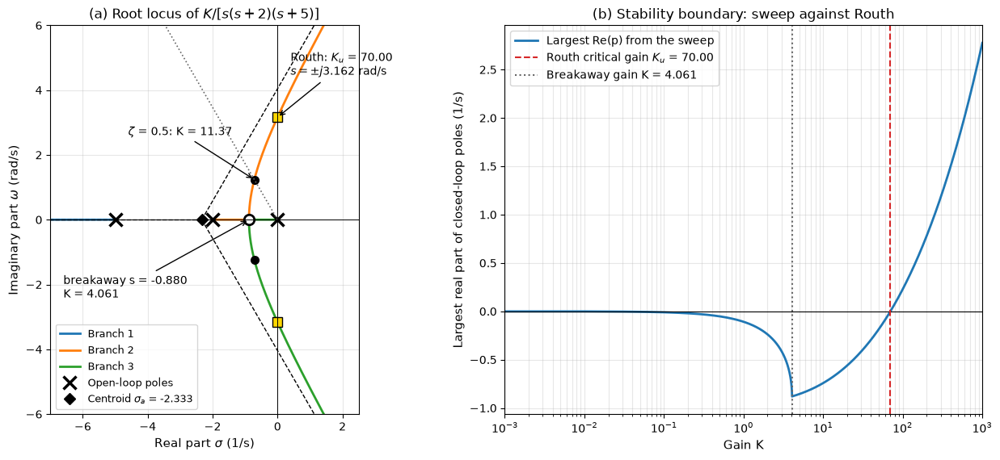

# Stability Analysis

A feedback loop that is unstable is useless whatever its other qualities, and feedback itself is what can make a stable plant unstable: a gain that is too high or a delay that is too long turns a corrective action into a growing oscillation. This note defines bounded-input bounded-output and internal stability, relates stability to the pole locations, and presents two algebraic tools that work from the characteristic polynomial: the Routh–Hurwitz criterion, which counts right-half-plane roots without computing them, and the root locus, which follows the closed-loop poles as a gain varies. The frequency-domain tests (Nyquist criterion, gain and phase margins) are in [Frequency Response](./frequency_response.md).

## Problem Statement

Given a closed loop whose characteristic polynomial is

$$
P(s) = a_n s^n + a_{n-1}s^{n-1} + \dots + a_1 s + a_0
$$

where the coefficients may depend on a design parameter such as a controller gain $K$, determine:

1. whether every root of $P(s)$ lies in the open left half-plane $\mathrm{Re}(s) < 0$;
2. if not, how many roots lie in the right half-plane;
3. the range of $K$ for which the loop is stable, the critical gain at the boundary and the frequency of the oscillation there;
4. how the closed-loop poles move as $K$ varies, so that $K$ can be chosen for a required damping.

For a unity-feedback loop with loop transfer function $L(s) = KN(s)/D(s)$ the characteristic polynomial is $P(s) = D(s) + KN(s)$; for a state-space model it is $\det(s\mathbf{I} - \mathbf{A})$. The model is assumed linear, time-invariant and rational (a time delay requires the methods of the frequency-response note).

## BIBO and Internal Stability

A system is bounded-input bounded-output (BIBO) stable if every bounded input produces a bounded output. For an LTI system with impulse response $g(t)$ this holds if and only if

```math
\int_0^\infty \lvert g(t)\rvert\, dt < \infty
```

which for a rational $G(s)$ means that every pole lies in the open left half-plane.

A feedback loop is internally stable if every signal in it stays bounded for bounded inputs injected anywhere: at the reference, at the plant input as a disturbance, and at the sensor as noise. With the plant $P$ and controller $C$ in unity feedback this requires all four transfer functions

$$
\frac{1}{1 + PC},
\qquad \frac{P}{1 + PC},
\qquad \frac{C}{1 + PC},
\qquad \frac{PC}{1 + PC}
$$

to be stable. They have the same denominator unless a pole of $P$ is cancelled by a zero of $C$ or the reverse, and such a cancellation in the right half-plane hides an unstable mode. For example, with $P = 1/(s - 1)$ and $C = (s - 1)/(s + 1)$ the loop transfer function is $1/(s + 1)$ and the reference response $1/(s + 2)$ looks perfect, but the response of the output to a disturbance at the plant input is

$$
\frac{P}{1 + PC} = \frac{s + 1}{(s - 1)(s + 2)}
$$

which has a pole at $s = 1$. Any small disturbance, or a slight mismatch between the zero and the pole, makes the output grow. Unstable poles must be stabilized by feedback, never cancelled.

## Pole Locations

Each pole $p = \sigma + j\omega$ contributes a mode $e^{\sigma t}(\cos\omega t, \sin\omega t)$ to the response.

| Pole location | Mode | Classification |
| --- | --- | --- |
| Open left half-plane, $\sigma < 0$ | Decays as $e^{\sigma t}$; time constant $1/\lvert\sigma\rvert$ | Stable |
| Simple pole on the imaginary axis, $\sigma = 0$ | Constant (at $s = 0$) or sustained oscillation | Marginally stable; not BIBO stable, since an input at that frequency gives a growing output |
| Repeated pole on the imaginary axis | Grows as $t^k$ | Unstable |
| Right half-plane, $\sigma > 0$ | Grows as $e^{\sigma t}$ | Unstable |

Within the stable region, poles close to the imaginary axis decay slowly and dominate the response. The damping ratio of a complex pair is $\zeta = -\sigma/\lvert p\rvert$, constant along rays from the origin, as panel (d) of the second-order figure in [System Modeling](./system_modeling.md) shows.

## Routh–Hurwitz Criterion

All roots of $P(s)$ lie in the left half-plane only if all coefficients $a_i$ are nonzero and of the same sign. The condition is also sufficient for $n \leq 2$, but not for higher orders. The Routh array decides the general case. Its first two rows hold the coefficients alternately; each further row is computed from the two above it:

```math
\begin{array}{c|cccc}
s^n     & a_n     & a_{n-2} & a_{n-4} & \cdots \\
s^{n-1} & a_{n-1} & a_{n-3} & a_{n-5} & \cdots \\
s^{n-2} & b_1     & b_2     & b_3     & \cdots \\
s^{n-3} & c_1     & c_2     & \cdots  &        \\
\vdots  & \vdots  &         &         &        \\
s^0     & \cdot   &         &         &
\end{array}
```

```math
b_1 = \frac{a_{n-1}a_{n-2} - a_n a_{n-3}}{a_{n-1}}, \quad b_2 = \frac{a_{n-1}a_{n-4} - a_n a_{n-5}}{a_{n-1}}, \quad c_1 = \frac{b_1 a_{n-3} - a_{n-1}b_2}{b_1}, \quad c_2 = \frac{b_1 a_{n-5} - a_{n-1}b_3}{b_1}
```

The number of sign changes in the first column equals the number of roots in the right half-plane. The polynomial is stable if and only if every first-column entry is positive (for $a_n > 0$).

### Example: Critical Gain of a Position Servo

A DC-motor position servo with an amplifier lag has the loop transfer function $L(s) = K/[s(s + 2)(s + 5)]$, so $P(s) = s^3 + 7s^2 + 10s + K$:

```math
\begin{array}{c|cc}
s^3 & 1 & 10 \\
s^2 & 7 & K \\
s^1 & (70 - K)/7 & 0 \\
s^0 & K &
\end{array}
```

The loop is stable for $0 < K < 70$. At the critical gain $K_u = 70$ the $s^1$ row vanishes, and the row above it gives the auxiliary polynomial $7s^2 + 70 = 0$, whose roots $s = \pm j\sqrt{10} = \pm 3.162j$ are the closed-loop poles on the imaginary axis: at $K_u$ the loop oscillates at 3.162 rad/s, a period of 1.99 s.

### Special Cases

A zero first-column entry in a row that is not entirely zero is replaced by a small positive $\varepsilon$, and the array is completed in the limit $\varepsilon \to 0^+$. For $P(s) = s^5 + 2s^4 + 2s^3 + 4s^2 + 11s + 10$:

```math
\begin{array}{c|ccc}
s^5 & 1 & 2 & 11 \\
s^4 & 2 & 4 & 10 \\
s^3 & \varepsilon & 6 & \\
s^2 & (4\varepsilon - 12)/\varepsilon \approx -12/\varepsilon & 10 & \\
s^1 & \approx 6 & & \\
s^0 & 10 & &
\end{array}
```

The first column has signs $+, +, +, -, +, +$: two sign changes, so two right-half-plane roots (they are $0.90 \pm 1.46j$).

An entire row of zeros means that the polynomial has roots placed symmetrically about the origin ($\pm j\omega$, $\pm\sigma$ or quartets $\pm\sigma \pm j\omega$). They are the roots of the auxiliary polynomial $A(s)$ formed from the row above, which divides $P(s)$. The zero row is replaced by the coefficients of $dA/ds$ and the array is completed; sign changes below that row count the right-half-plane roots, and roots of $A(s)$ on the imaginary axis must be checked separately. For $P(s) = s^3 + 2s^2 + 4s + 8$ the $s^1$ row is $(2 \cdot 4 - 1 \cdot 8)/2 = 0$; the auxiliary polynomial $2s^2 + 8$ gives $dA/ds = 4s$, so the $s^1$ row becomes $4$ and the first column $1, 2, 4, 8$ has no sign change. The roots of $A$, $s = \pm 2j$, are on the imaginary axis, so the system is marginally stable; indeed $P(s) = (s + 2)(s^2 + 4)$.

### Relative Stability

To require every pole to lie to the left of $\mathrm{Re}(s) = -\sigma_0$ (a decay rate of at least $\sigma_0$, which by the $4/\sigma$ rule bounds the settling time), substitute $s = \hat{s} - \sigma_0$ and apply the criterion to the polynomial in $\hat{s}$. Exercise 4 applies this to the servo above.

## Root Locus

The root locus is the path of the roots of $D(s) + KN(s) = 0$ in the $s$-plane as $K$ increases from 0 to $\infty$. A point $s$ is on the locus when $KN(s)/D(s) = -1$, which splits into an angle condition, independent of $K$, and a magnitude condition that gives $K$ at that point:

$$
\angle \frac{N(s)}{D(s)} = \pm 180^\circ(2q + 1),
\qquad K = \left\lvert \frac{D(s)}{N(s)}\right\rvert
$$

With $n$ open-loop poles and $m$ zeros, the angle condition implies the sketching rules:

1. There are $n$ branches; they start at the open-loop poles ($K = 0$) and end at the $m$ zeros or at infinity.
2. A point of the real axis is on the locus if the number of real poles and zeros to its right is odd.
3. The $n - m$ branches that go to infinity follow asymptotes at angles $(2q + 1)180^\circ/(n - m)$, which radiate from the centroid $\sigma_a = \left(\sum p_i - \sum z_j\right)/(n - m)$.
4. Branches leave or join the real axis at breakaway points, where $dK/ds = 0$ with $K = -D(s)/N(s)$, that is where $N D' - N' D = 0$.
5. Crossings of the imaginary axis are found from the Routh array, as above, or by substituting $s = j\omega$.
6. A branch leaves a complex pole at the angle that satisfies the angle condition at a point just next to that pole.

### Example: Root Locus of the Position Servo

For $L(s) = K/[s(s + 2)(s + 5)]$ there are three poles and no zeros. The real-axis segments on the locus are $[-2, 0]$ and $(-\infty, -5]$. The three asymptotes leave the centroid $\sigma_a = (0 - 2 - 5)/3 = -2.333$ at $60^\circ$, $180^\circ$ and $300^\circ$. The breakaway condition $\frac{d}{ds}(s^3 + 7s^2 + 10s) = 3s^2 + 14s + 10 = 0$ has roots $-0.880$ and $-3.786$; only the first lies on a locus segment, and there $K = -(s^3 + 7s^2 + 10s) = 4.061$.



In panel (a) the two branches from $0$ and $-2$ meet at the breakaway point, become complex, bend towards the $60^\circ$ and $300^\circ$ asymptotes and cross the imaginary axis at $\pm 3.162j$; the third branch runs from $-5$ to $-\infty$. Panel (b) plots the largest real part of the closed-loop poles from the gain sweep: it crosses zero at $K = 70.000$, the Routh critical gain, to the precision of the bisection. The gain that places the complex pair on the line $\zeta = 0.5$ is $K = 11.37$, with poles $-0.714 \pm 1.237j$ and $-5.571$. The real pole is 7.8 times farther from the imaginary axis than the pair, so the step response is close to that of a second-order system with $\zeta = 0.5$ and $\omega_n = 1.43$ rad/s, which would give 16.3% overshoot and a settling time of about $4/0.714 = 5.6$ s. The simulated third-order response has 15.7% overshoot and settles to within 2% in 5.8 s.

The root locus shows what a single gain can achieve. To make the loop both faster and well damped, the locus itself must be moved, by adding zeros and poles with a compensator, which is the subject of [Feedback Control](./feedback_control.md).

## Key Takeaways

- Stability of an LTI loop means every closed-loop pole lies in the open left half-plane; internal stability also forbids cancelling an unstable pole with a zero.
- Positive coefficients are necessary but not sufficient above second order; the Routh array counts the right-half-plane roots exactly.
- The Routh array gives the critical gain in closed form, and the auxiliary polynomial at that gain gives the oscillation frequency.
- The root locus follows the closed-loop poles as one gain varies; its asymptotes, breakaway points and axis crossings follow from the open-loop poles and zeros.
- For loops with time delay, or when only measured frequency-response data are available, use the Nyquist criterion.

## Related Scripts

- [Root Locus and Routh–Hurwitz](../../../scripts/algorithms/control_root_locus/): computes the root locus of a third-order position servo by sweeping the gain, marks the asymptotes, breakaway point and damping-ratio design point, and checks that the gain where the locus crosses the imaginary axis equals the Routh–Hurwitz critical gain.
- [Second-Order Step Response](../../../scripts/algorithms/control_second_order_response/): simulates the step response of the standard second-order system for six damping ratios, measures rise time, peak time, overshoot and settling time, and compares them with the closed-form formulas and the pole locations.

## Exercises

**Exercise 1.** Use the Routh array to determine how many roots of $P(s) = s^4 + 2s^3 + 3s^2 + 4s + 5$ lie in the right half-plane. Is the necessary condition (all coefficients positive) sufficient?

<details>
<summary>Answer</summary>

```math
\begin{array}{c|ccc}
s^4 & 1 & 3 & 5 \\
s^3 & 2 & 4 & \\
s^2 & 1 & 5 & \\
s^1 & -6 & & \\
s^0 & 5 & &
\end{array}
```

where $b_1 = (2 \cdot 3 - 1 \cdot 4)/2 = 1$, $b_2 = (2 \cdot 5)/2 = 5$ and $c_1 = (1 \cdot 4 - 2 \cdot 5)/1 = -6$. The first column $1, 2, 1, -6, 5$ changes sign twice, so there are two right-half-plane roots (numerically $s = 0.29 \pm 1.42j$). Positive coefficients are necessary but not sufficient.

</details>

**Exercise 2.** For unity feedback with $G(s) = \frac{K}{(s+1)(s+2)(s+3)}$, find the range of $K > 0$ for stability and the frequency at which the root locus crosses the imaginary axis.

<details>
<summary>Answer</summary>

The characteristic equation is $s^3 + 6s^2 + 11s + (6 + K) = 0$. The $s^1$ entry of the Routh array is $\frac{66 - (6 + K)}{6} = \frac{60 - K}{6}$, and the $s^0$ entry is $6 + K$. Hence $0 < K < 60$.

At $K = 60$ the auxiliary polynomial is $6s^2 + 66 = 0$, so the crossing is at $s = \pm j\sqrt{11} = \pm 3.32j$ rad/s.

</details>

**Exercise 3.** For $L(s) = \frac{K(s+4)}{s(s+1)(s+2)(s+6)}$, find the number of asymptotes, their angles and centroid, and the real-axis segments of the root locus.

<details>
<summary>Answer</summary>

$n = 4$ poles and $m = 1$ zero, so $n - m = 3$ asymptotes at $60^\circ$, $180^\circ$ and $300^\circ$.

```math
\sigma_a = \frac{(0 - 1 - 2 - 6) - (-4)}{3} = -\frac{5}{3} = -1.67
```

A real-axis point lies on the locus if an odd number of poles and zeros lie to its right: the segments are $[-1, 0]$, $[-4, -2]$ and $(-\infty, -6]$.

</details>

**Exercise 4.** For the position servo $P(s) = s^3 + 7s^2 + 10s + K$, find the range of $K$ for which every closed-loop pole has a real part below $-0.5$ s⁻¹.

<details>
<summary>Answer</summary>

Substituting $s = \hat{s} - 0.5$ and expanding:

```math
(\hat{s} - 0.5)^3 + 7(\hat{s} - 0.5)^2 + 10(\hat{s} - 0.5) + K = \hat{s}^3 + 5.5\hat{s}^2 + 3.75\hat{s} + (K - 3.375)
```

The Routh array in $\hat{s}$ has first column $1$, $5.5$, $(5.5 \times 3.75 - (K - 3.375))/5.5$ and $K - 3.375$. Both of the last two are positive when $3.375 < K < 24.0$. Below $K = 3.375$ the real pole that starts at the origin is still slower than $-0.5$; above $K = 24$ the complex pair has moved to the right of $-0.5$. A numerical check gives a largest real part of $-0.481$ at $K = 3.3$ and $-0.499$ at $K = 24.1$.

</details>

**Exercise 5.** A plant $P(s) = \frac{1}{s(s - 2)}$ is controlled by $C(s) = \frac{K(s - 2)}{s + 5}$, chosen so that the loop transfer function is $\frac{K}{s(s + 5)}$. Show that the reference response is stable for every $K > 0$, and explain why the loop must nevertheless not be built.

<details>
<summary>Answer</summary>

The reference-to-output transfer function is

```math
\frac{PC}{1 + PC} = \frac{K}{s^2 + 5s + K}
```

which is stable for every $K > 0$. The response to a disturbance at the plant input is

```math
\frac{P}{1 + PC} = \frac{1/(s(s-2))}{1 + K/(s(s+5))} = \frac{s + 5}{(s - 2)(s^2 + 5s + K)}
```

which has a pole at $s = 2$: any disturbance, or any initial condition of the plant, produces an output that grows as $e^{2t}$. The controller zero cancels the unstable plant pole only in the reference path, so the loop is not internally stable. An unstable plant must be stabilized by moving its pole with feedback.

</details>

## References

- K. Ogata, *Modern Control Engineering*, 5th ed., Prentice Hall, 2010.
- N. S. Nise, *Control Systems Engineering*, 8th ed., Wiley, 2019.
- G. F. Franklin, J. D. Powell, A. Emami-Naeini, *Feedback Control of Dynamic Systems*, 8th ed., Pearson, 2019.
- K. J. Åström, R. M. Murray, *Feedback Systems: An Introduction for Scientists and Engineers*, Princeton University Press, 2008.
- E. J. Routh, *A Treatise on the Stability of a Given State of Motion*, Macmillan, 1877.
