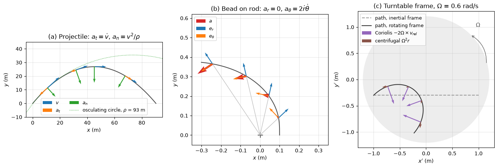

# Kinematics of Particles

Kinematics describes motion without asking what causes it: given how a point moves, find its position, velocity and acceleration, or the reverse. A body can be treated as a particle when its rotation does not matter for the question asked, as for a vehicle on a route, a projectile, a satellite or a fluid particle followed along a pathline. This note covers rectilinear motion, curvilinear motion in Cartesian, normal–tangential and polar coordinates, and relative motion between translating frames. Rotating frames, which bring in the Coriolis acceleration, are treated with rigid bodies in [Rigid Body Kinematics](rigid_body_kinematics.md), and the forces that produce the accelerations in [Kinetics of Particles](kinetics_particles.md).

## Problem Statement

A particle $P$ moves relative to a reference frame that is taken as fixed. Given one of

- the position as a function of time, $\mathbf{r}(t)$, or a path $y = f(x)$ with the speed along it;
- the acceleration as a function of time, velocity or position, with initial conditions $\mathbf{r}(0) = \mathbf{r}_0$ and $\mathbf{v}(0) = \mathbf{v}_0$;
- the motion of another point and the motion of $P$ relative to it,

find the velocity $\mathbf{v} = d\mathbf{r}/dt$, the acceleration $\mathbf{a} = d\mathbf{v}/dt$, the path, and derived quantities such as range, stopping distance, time of flight or radius of curvature. The particle has no extent, and the reference frame is not rotating unless stated. The governing relations are the definitions

$$
\mathbf{v} = \frac{d\mathbf{r}}{dt},
\qquad \mathbf{a} = \frac{d\mathbf{v}}{dt} = \frac{d^2\mathbf{r}}{dt^2}
$$

written in whichever set of unit vectors suits the problem. Lengths are in m, times in s, velocities in m/s and accelerations in m/s².

## Position, Velocity and Acceleration

The position vector from a fixed origin $O$ is $\mathbf{r}(t) = x\mathbf{i} + y\mathbf{j} + z\mathbf{k}$. Over an interval $\Delta t$ the displacement is $\Delta\mathbf{r} = \mathbf{r}(t + \Delta t) - \mathbf{r}(t)$, which differs from the distance travelled along the path, $\Delta s$, unless the motion is straight and in one direction. The velocity is tangent to the path and its magnitude is the speed, $v = |\mathbf{v}| = ds/dt$. The acceleration is in general not tangent to the path: it has a component along the path that changes the speed and a component normal to it that changes the direction.

Because $\mathbf{i}$, $\mathbf{j}$, $\mathbf{k}$ are constant, Cartesian components differentiate term by term:

$$
\mathbf{v} = \dot{x}\mathbf{i} + \dot{y}\mathbf{j} + \dot{z}\mathbf{k},
\qquad \mathbf{a} = \ddot{x}\mathbf{i} + \ddot{y}\mathbf{j} + \ddot{z}\mathbf{k}
$$

In the other coordinate systems below the unit vectors move with the particle, and their time derivatives produce the extra acceleration terms.

## Rectilinear Motion

For motion along a straight line with coordinate $s$, $v = \dot{s}$ and $a = \dot{v} = \ddot{s}$. Eliminating $dt$ between them gives a third relation that is used whenever the acceleration depends on position:

```math
a\, ds = v\, dv
```

### Constant Acceleration

Integrating $a = \text{const}$ from $s_0$, $v_0$ at $t = 0$ gives

$$
v = v_0 + at,
\qquad s = s_0 + v_0t + \tfrac{1}{2}at^2,
\qquad v^2 = v_0^2 + 2a(s - s_0)
$$

These hold only for constant acceleration. Free fall near the Earth's surface with negligible air resistance is the standard case, with $a = -g = -9.81$ m/s² for $s$ measured upward.

A ball thrown upward at $v_0 = 20$ m/s from $s_0 = 0$ stops at the top, $v = 0$, after $t = v_0/g = 2.04$ s, at height $s = v_0^2/(2g) = 20.4$ m. It returns to $s = 0$ when $t(v_0 - gt/2) = 0$, at $t = 2v_0/g = 4.08$ s.

### Acceleration Given as a Function

When $a$ is not constant, the kinematic relations are integrated with the variable that $a$ depends on:

| Given | Integrate | Result |
| --- | --- | --- |
| $a(t)$ | $`dv = a\,dt`$, then $`ds = v\,dt`$ | $v(t)$, then $s(t)$ |
| $a(v)$ | $dt = dv/a(v)$, or $`ds = v\,dv/a(v)`$ | $t(v)$ or $s(v)$ |
| $a(s)$ | $`v\,dv = a(s)\,ds`$ | $`v^2 = v_0^2 + 2\int_{s_0}^{s}a\,ds`$ |

For example, a particle starting from rest at the origin with $a = 2 + 3t$ m/s² has $v = 2t + 1.5t^2$ and $s = t^2 + 0.5t^3$, so at $t = 4$ s it moves at 32 m/s and has travelled 48 m. A resisting acceleration $a = -kv$ (linear drag) is of the second type, and a spring acceleration $a = -\omega^2s$ is of the third.

## Curvilinear Motion in Cartesian Coordinates

When the components of the acceleration are independent, as for a projectile in uniform gravity without drag, each Cartesian component is a rectilinear problem. A projectile launched from the origin with speed $v_0$ at angle $\theta_0$ above the horizontal has $a_x = 0$ and $a_y = -g$, so

```math
x = v_0\cos\theta_0\, t,
\qquad y = v_0\sin\theta_0\, t - \tfrac{1}{2}gt^2
```

Eliminating $t$ gives the parabolic path

```math
y = x\tan\theta_0 - \frac{g\,x^2}{2v_0^2\cos^2\theta_0}
```

On level ground the time of flight, maximum height and range are

$$
T = \frac{2v_0\sin\theta_0}{g},
\qquad H = \frac{v_0^2\sin^2\theta_0}{2g},
\qquad R = \frac{v_0^2\sin 2\theta_0}{g}
$$

so the range is greatest at $\theta_0 = 45^\circ$ and is the same for complementary angles. For $v_0 = 100$ m/s at $45^\circ$: $R = 1019$ m, $H = 255$ m and $T = 14.4$ s. These results ignore air resistance, which for most real projectiles is far from negligible: a baseball launched at 40 m/s travels about 97 m instead of 163 m, and its best launch angle is about $41^\circ$ (see [Kinetics of Particles](kinetics_particles.md#projectile-with-air-drag)).

## Normal and Tangential Coordinates

When the path is known, the natural unit vectors are $\mathbf{e}_t$, tangent to the path in the direction of motion, and $\mathbf{e}_n$, normal to it and pointing toward the centre of curvature. The velocity is $`\mathbf{v} = v\,\mathbf{e}_t`$. As the particle moves a distance $ds$, the tangent turns through $d\phi = ds/\rho$, where $\rho$ is the radius of curvature, so $`d\mathbf{e}_t/dt = (v/\rho)\,\mathbf{e}_n`$. Differentiating $\mathbf{v}$ then gives

```math
\mathbf{a} = \dot{v}\,\mathbf{e}_t + \frac{v^2}{\rho}\,\mathbf{e}_n
```

The tangential component $`a_t = \dot{v} = v\,dv/ds`$ changes the speed, and the normal component $a_n = v^2/\rho$ changes the direction and always points toward the centre of curvature. A particle moving at constant speed on a curve accelerates; a particle moving on a straight line ($\rho \to \infty$) has no normal acceleration.

For a plane path $y = f(x)$,

$$
\rho = \frac{\left[1 + (dy/dx)^2\right]^{3/2}}{\left|d^2y/dx^2\right|}
$$

and for a motion known in Cartesian form, $\rho = v^3/|\mathbf{v} \times \mathbf{a}|$.

For a circle of radius $R$ traversed at angular rate $\omega = \dot{\theta}$, $v = R\omega$, $a_t = R\alpha$ with $\alpha = \dot{\omega}$, and $a_n = v^2/R = R\omega^2$. A car on a circular track of radius 200 m that speeds up uniformly from 20 to 30 m/s in 10 s has $a_t = 1$ m/s²; its normal acceleration rises from $20^2/200 = 2$ m/s² to $30^2/200 = 4.5$ m/s², so at the end of the interval $|\mathbf{a}| = \sqrt{1^2 + 4.5^2} = 4.61$ m/s².

## Polar and Cylindrical Coordinates

When the motion is described by a distance $r$ from a fixed point and an angle $\theta$, as for a rotating arm, a radar track or an orbit, the unit vectors are $`\mathbf{e}_r`$ along the radius and $`\mathbf{e}_\theta`$ perpendicular to it in the direction of increasing $\theta$. Both turn with the radius:

```math
\dot{\mathbf{e}}_r = \dot{\theta}\,\mathbf{e}_\theta,
\qquad \dot{\mathbf{e}}_\theta = -\dot{\theta}\,\mathbf{e}_r
```

Differentiating $`\mathbf{r} = r\,\mathbf{e}_r`$ twice gives

```math
\mathbf{v} = \dot{r}\,\mathbf{e}_r + r\dot{\theta}\,\mathbf{e}_\theta,
\qquad \mathbf{a} = (\ddot{r} - r\dot{\theta}^2)\,\mathbf{e}_r +
(r\ddot{\theta} + 2\dot{r}\dot{\theta})\,\mathbf{e}_\theta
```

The term $-r\dot{\theta}^2$ is the centripetal acceleration of the rotation, and $2\dot{r}\dot{\theta}$ is the Coriolis acceleration that appears when the radius changes while the line rotates. Cylindrical coordinates add $z\mathbf{k}$ to the position, $\dot{z}\mathbf{k}$ to the velocity and $\ddot{z}\mathbf{k}$ to the acceleration.

A collar slides outward along an arm that rotates at a constant $\dot{\theta} = 2$ rad/s. At the instant when $r = 0.6$ m, $\dot{r} = 0.5$ m/s and $\ddot{r} = 0$:

$$
a_r = 0 - 0.6 \times 2^2 = -2.4 \text{ m/s}^2,
\qquad a_\theta = 0 + 2 \times 0.5 \times 2 = 2.0 \text{ m/s}^2
$$

so $|\mathbf{a}| = 3.12$ m/s². The collar accelerates toward the axis even though it is moving away from it, and the arm must push it sideways with a force $m a_\theta$.



Panel (a) shows the drag-free projectile: gravity splits into $a_t$, which opposes the velocity on the way up and vanishes at the apex, and $a_n$, which points into the curve; the osculating circle at the first marked point has $\rho = 93$ m. Panel (b) shows a bead on a frictionless rod rotating at 3 rad/s, $r = r_0\cosh\omega t$, for which $\ddot{r} = r\dot{\theta}^2$, so the radial acceleration vanishes and the whole acceleration is the transverse Coriolis term. Panel (c) is discussed in [Rigid Body Kinematics](rigid_body_kinematics.md#rotating-reference-frames).

### Choosing Coordinates

| Description of the motion | Coordinates | Typical problems |
| --- | --- | --- |
| Components independent, fixed directions | Cartesian | projectiles, motion on straight guides |
| Path known, speed along it known | normal–tangential | vehicles on curves, roller coasters, cams |
| Distance and angle from a fixed point | polar or cylindrical | rotating arms, radar tracking, orbits, robot joints |
| Motion relative to a moving body | relative motion | boats in a current, aircraft in wind, docking |

## Relative Motion with Translating Axes

Let $\mathbf{r}_A$ and $`\mathbf{r}_B`$ be the positions of two particles in a fixed frame, and attach to $`A`$ a set of axes that translate with it but do not rotate. The position of $`B`$ relative to $`A`$ is $`\mathbf{r}_{B/A} = \mathbf{r}_B - \mathbf{r}_A`$, and since the axes do not rotate,

$$
\mathbf{v}_B = \mathbf{v}_A + \mathbf{v}_{B/A},
\qquad \mathbf{a}_B = \mathbf{a}_A + \mathbf{a}_{B/A}
$$

A boat that moves at 5 m/s relative to the water crosses a river 100 m wide with a current of 3 m/s. Aimed straight across, its velocity relative to the bank is $3\mathbf{i} + 5\mathbf{j}$ m/s: it crosses in $100/5 = 20$ s and lands $3 \times 20 = 60$ m downstream. To land directly opposite, it must head upstream at $\theta$ with $5\sin\theta = 3$, or $\theta = 36.9^\circ$ from the crossing line; its speed across is then $5\cos\theta = 4$ m/s and the crossing takes 25 s.

When the moving axes also rotate, as for a point on a turbine blade observed from the rotor or a fluid particle observed in a rotating machine, the relations acquire Coriolis and centripetal terms. They are derived in [Rigid Body Kinematics](rigid_body_kinematics.md#rotating-reference-frames).

## Common Mistakes

1. Using the constant-acceleration formulas when $a$ varies with time, speed or position.
2. Confusing distance travelled with displacement, for instance after a reversal of direction.
3. Dropping the normal acceleration of a particle moving at constant speed on a curve.
4. Differentiating polar components as if $`\mathbf{e}_r`$ and $`\mathbf{e}_\theta`$ were constant, which loses $-r\dot{\theta}^2$ and $2\dot{r}\dot{\theta}$.
5. Adding relative velocities from a rotating frame with the translating-frame formula.

## Key Takeaways

- Velocity is tangent to the path; acceleration has a tangential part $\dot{v}$ and a normal part $v^2/\rho$ toward the centre of curvature.
- $`a\,ds = v\,dv`$ is the relation to integrate when the acceleration depends on position.
- In polar coordinates the moving unit vectors produce the centripetal term $-r\dot{\theta}^2$ and the Coriolis term $2\dot{r}\dot{\theta}$.
- Projectile formulas hold only without air resistance; with drag the motion has to be integrated numerically.
- Relative velocities and accelerations add as vectors only for translating, non-rotating axes.

## Related Scripts

- [Path, Polar and Rotating-Frame Coordinates](../../../scripts/plots/dynamics_path_coordinates/): draws the acceleration of three moving particles resolved in the coordinate system that suits each of them: normal–tangential components along a projectile path, radial–transverse components for a bead on a rotating rod, and Coriolis and centrifugal terms for a puck seen from a rotating turntable.
- [Projectile with Quadratic Drag](../../../scripts/algorithms/dynamics_projectile_drag/): integrates Newton's second law for a projectile with quadratic air drag and compares it with the drag-free parabola.
- [Charged Particle Dynamics in a Magnetic Field](../../../scripts/simulations/charged_particle_dynamics_in_a_magnetic_field_using_runge_kutta_methods/): integrates the motion of a charged particle in a uniform magnetic field with the classical fourth-order Runge–Kutta (RK4) method and animates the resulting helical trajectory in 3D.

## Exercises

**Exercise 1.** A car travelling at 25 m/s brakes with a constant deceleration of 6 m/s². Find the stopping time and stopping distance.

<details>
<summary>Answer</summary>

$t = v_0/|a| = 25/6 = 4.17$ s. From $v^2 = v_0^2 + 2a(s - s_0)$ with $v = 0$:

```math
s - s_0 = \frac{25^2}{2 \times 6} = 52.1 \text{ m}
```

</details>

**Exercise 2.** A stone is thrown horizontally at 15 m/s from the top of a 45 m cliff. Find the time of flight, the horizontal distance travelled, and the speed and direction at impact.

<details>
<summary>Answer</summary>

$t = \sqrt{2h/g} = \sqrt{90/9.81} = 3.03$ s and $x = 15 \times 3.03 = 45.4$ m.

At impact $v_x = 15$ m/s and $v_y = gt = 29.7$ m/s downward, so $v = \sqrt{15^2 + 29.7^2} = 33.3$ m/s, directed $\arctan(29.7/15) = 63.2^\circ$ below the horizontal.

</details>

**Exercise 3.** Show that the range on level ground, $R = v_0^2\sin 2\theta_0/g$, is greatest at $\theta_0 = 45^\circ$ and that complementary angles give the same range. Evaluate $R$ and $H$ for $v_0 = 50$ m/s at $30^\circ$ and at $60^\circ$.

<details>
<summary>Answer</summary>

$\sin 2\theta_0$ has its maximum value 1 at $2\theta_0 = 90^\circ$. Also $\sin(2(90^\circ - \theta_0)) = \sin(180^\circ - 2\theta_0) = \sin 2\theta_0$, so $\theta_0$ and $90^\circ - \theta_0$ give the same range.

For both angles $R = 2500 \times 0.866/9.81 = 220.7$ m. The heights differ: $H_{30} = (50\sin 30^\circ)^2/(2g) = 31.9$ m and $H_{60} = (50\sin 60^\circ)^2/(2g) = 95.6$ m.

</details>

**Exercise 4.** A particle moving in a straight line has a resisting acceleration $a = -kv$ with $k = 0.5$ s⁻¹, and $v_0 = 20$ m/s at $s = 0$. Find $v(t)$, $v(s)$ and the total distance travelled.

<details>
<summary>Answer</summary>

From $dv/dt = -kv$: $v(t) = v_0e^{-kt} = 20e^{-0.5t}$ m/s.

Using $`a = v\,dv/ds = -kv`$ gives $dv/ds = -k$, so $v(s) = v_0 - ks$.

The particle stops at $s = v_0/k = 40$ m. It approaches this distance only as $t \to \infty$, because the speed decays exponentially.

</details>

**Exercise 5.** A car drives through a dip shaped as $y = x^2/200$ (in metres). At the lowest point its speed is 20 m/s and it is accelerating along the path at 2 m/s². Find the radius of curvature and the magnitude of the total acceleration there.

<details>
<summary>Answer</summary>

At $x = 0$, $dy/dx = 0$ and $d^2y/dx^2 = 1/100$ m⁻¹, so

```math
\rho = \frac{\left[1 + (dy/dx)^2\right]^{3/2}}{|d^2y/dx^2|} = \frac{1}{1/100} = 100 \text{ m}
```

$a_n = v^2/\rho = 400/100 = 4$ m/s², directed upward toward the centre of curvature. With $a_t = 2$ m/s², $|\mathbf{a}| = \sqrt{2^2 + 4^2} = 4.47$ m/s².

</details>

## References

- R. C. Hibbeler, *Engineering Mechanics: Dynamics*, 14th ed., Pearson, 2016.
- J. L. Meriam, L. G. Kraige and J. N. Bolton, *Engineering Mechanics: Dynamics*, 9th ed., Wiley, 2018.
- F. P. Beer, E. R. Johnston, P. J. Cornwell and B. P. Self, *Vector Mechanics for Engineers: Dynamics*, 12th ed., McGraw-Hill, 2019.
- J. H. Ginsberg, *Engineering Dynamics*, Cambridge University Press, 2008.
