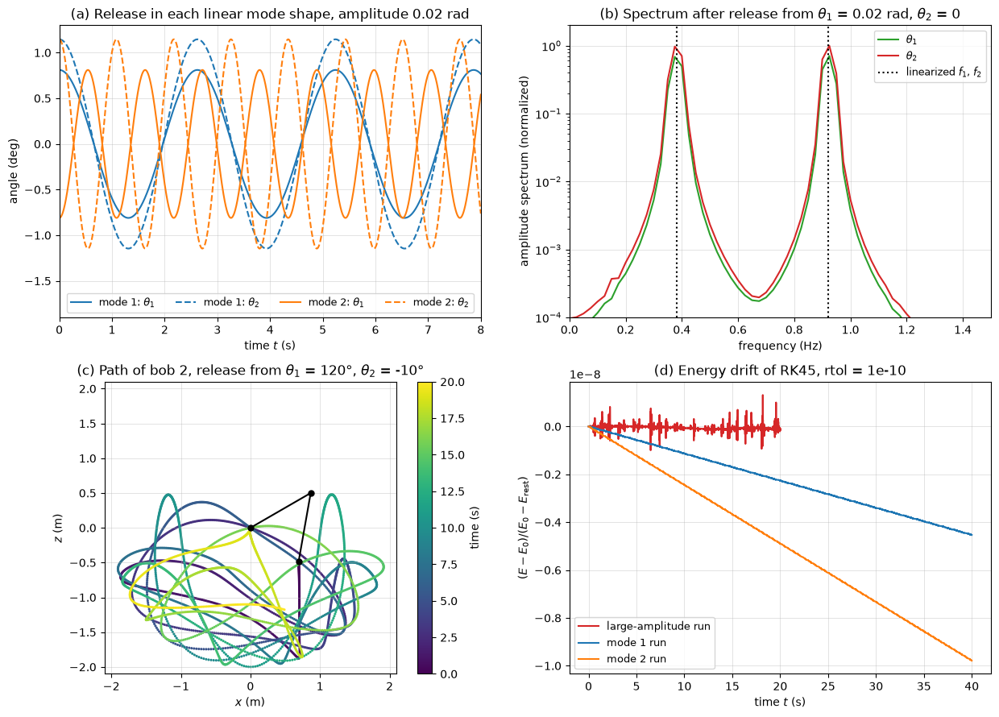

# Lagrangian Mechanics

Lagrange's equations derive the equations of motion of a constrained system from two scalar functions, the kinetic and potential energies, written in any set of independent coordinates. Constraint forces that do no work, such as pin reactions, normal forces of smooth guides and the tension of inextensible links, never appear, so a mechanism with several bodies gives its equations without free-body diagrams of each part. The same energies, expanded to second order about an equilibrium, give the mass and stiffness matrices of [Mechanical Vibrations](vibrations.md), and the method underlies multibody simulation codes and the variational formulation of the finite element method. This note defines generalized coordinates and forces, derives Lagrange's equations from d'Alembert's principle and virtual work, adds Rayleigh's dissipation function, and works through the cart–pendulum, the double pendulum and the linearization about equilibrium.

## Problem Statement

A system of particles and rigid bodies is connected by ideal constraints (pins, sliders, rolling without slip, inextensible cords) and acted on by gravity, springs, viscous dampers and applied forces. Given the geometry, the masses and moments of inertia, the spring and damper constants and the applied forces, find the equations of motion in a minimal set of coordinates; then find the equilibrium positions, their stability, and the matrices $\mathbf{M}$, $\mathbf{C}$, $\mathbf{K}$ of the small motions about a stable equilibrium, or integrate the nonlinear equations numerically. The constraints are holonomic (expressible as relations between the coordinates, possibly with time) and workless, and dissipation is viscous. The governing equations are, for each generalized coordinate $q_j$,

$$
\frac{d}{dt}\left(\frac{\partial L}{\partial\dot{q}_j}\right) -
\frac{\partial L}{\partial q_j} + \frac{\partial D}{\partial\dot{q}_j} = Q_j,
\qquad L = T - V,
\qquad j = 1, \dots, n
$$

with $T$ the kinetic energy, $V$ the potential energy, $D$ Rayleigh's dissipation function and $Q_j$ the generalized forces of the remaining non-conservative forces.

## Generalized Coordinates and Constraints

A system of $N$ particles in space needs $3N$ coordinates. Each holonomic constraint, such as a fixed rod length $|\mathbf{r}_1 - \mathbf{r}_2| = l$ or a bead confined to a wire, removes one, leaving $n = 3N - (\text{number of constraints})$ degrees of freedom. A set of $n$ independent quantities $q_1, \dots, q_n$ that fixes the position of every particle, $\mathbf{r}_i = \mathbf{r}_i(q_1, \dots, q_n, t)$, is a set of generalized coordinates. They can be lengths, angles or any other parameters, and choosing them well, typically one per joint, is most of the modelling work.

| System | Degrees of freedom | Natural coordinates |
| --- | --- | --- |
| simple pendulum | 1 | angle $\theta$ |
| slider-crank | 1 | crank angle |
| cart with a pendulum | 2 | cart position $x$, pendulum angle $\theta$ |
| planar double pendulum | 2 | angles $\theta_1$, $\theta_2$ from the vertical |
| rigid body in the plane | 3 | $x_G$, $y_G$, rotation $\theta$ |
| rigid body in space | 6 | $\mathbf{r}_G$ and three Euler angles |

## Lagrange's Equations

### Virtual Work and d'Alembert's Principle

A virtual displacement $\delta\mathbf{r}_i$ is an infinitesimal change of configuration consistent with the constraints at a fixed instant. Ideal constraints do no work in any virtual displacement: a smooth guide pushes normal to the allowed motion and a rigid link pushes along itself. D'Alembert's principle writes Newton's law as the equilibrium of the applied forces $\mathbf{F}_i$, the constraint forces and the inertia forces $-m_i\ddot{\mathbf{r}}_i$, and the principle of virtual work (see [Virtual Work](../statics/virtual_work.md)) then eliminates the constraint forces:

$$
\sum_i\left(\mathbf{F}_i - m_i\ddot{\mathbf{r}}_i\right)\cdot\delta\mathbf{r}_i = 0
$$

### Transformation to Generalized Coordinates

With $`\delta\mathbf{r}_i = \sum_j(\partial\mathbf{r}_i/\partial q_j)\,\delta q_j`$, the applied-force term becomes $`\sum_jQ_j\,\delta q_j`$ with the generalized forces

$$
Q_j = \sum_i\mathbf{F}_i\cdot \frac{\partial\mathbf{r}_i}{\partial q_j}
$$

which have units of force for a length coordinate and of moment for an angle. For the inertia term, two identities follow from $\dot{\mathbf{r}}_i = \sum_j(\partial\mathbf{r}_i/\partial q_j)\dot{q}_j + \partial\mathbf{r}_i/\partial t$:

$$
\frac{\partial\dot{\mathbf{r}}_i}{\partial\dot{q}_j} = \frac{\partial\mathbf{r}_i}{\partial q_j},
\qquad
\frac{d}{dt}\left(\frac{\partial\mathbf{r}_i}{\partial q_j}\right) = \frac{\partial\dot{\mathbf{r}}_i}{\partial q_j}
$$

Using them,

$$
\sum_im_i\ddot{\mathbf{r}}_i\cdot
\frac{\partial\mathbf{r}_i}{\partial q_j} = \frac{d}{dt}\left(\sum_im_i\dot{\mathbf{r}}_i\cdot \frac{\partial\dot{\mathbf{r}}_i}{\partial\dot{q}_j}\right) - \sum_im_i\dot{\mathbf{r}}_i\cdot \frac{\partial\dot{\mathbf{r}}_i}{\partial q_j} = \frac{d}{dt}\left(\frac{\partial T}{\partial\dot{q}_j}\right) - \frac{\partial T}{\partial q_j}
$$

with $T = \tfrac{1}{2}\sum_im_i\dot{\mathbf{r}}_i\cdot\dot{\mathbf{r}}_i$. D'Alembert's principle becomes $\sum_j\left[\frac{d}{dt}(\partial T/\partial\dot{q}_j) - \partial T/\partial q_j - Q_j\right]\delta q_j = 0$, and because the $\delta q_j$ are independent, each bracket vanishes:

$$
\frac{d}{dt}\left(\frac{\partial T}{\partial\dot{q}_j}\right) -
\frac{\partial T}{\partial q_j} = Q_j
$$

The derivation extends to rigid bodies by treating them as collections of particles, with $T = \tfrac{1}{2}mv_G^2 + \tfrac{1}{2}I_G\omega^2$ in plane motion.

### Potential Energy and Dissipation

If part of the applied forces derives from a potential, $Q_j^{c} = -\partial V/\partial q_j$, and since $V$ does not depend on the velocities it can be moved into the Lagrangian $L = T - V$. Linear viscous dampers give generalized forces $-\partial D/\partial\dot{q}_j$ with Rayleigh's dissipation function

```math
D = \tfrac{1}{2}\sum_kc_k\,\dot{\delta}_k^2
```

where $\dot{\delta}_k$ is the rate of extension of damper $k$ written in terms of the $\dot{q}_j$; $2D$ is the power dissipated. The remaining forces, such as actuator forces, friction and fluid loads, enter through $Q_j$. This gives the form in the problem statement.

### Procedure

1. Count the degrees of freedom and choose generalized coordinates.
2. Write the position of each mass centre in terms of the $q_j$, differentiate, and form $T$, including $\tfrac{1}{2}I_G\omega^2$ for each rigid body.
3. Form $V$ from gravity and springs, and $D$ from the dampers.
4. Find the generalized forces of the remaining forces from $Q_j = \sum\mathbf{F}\cdot\partial\mathbf{r}/\partial q_j$, or from the virtual work $`\delta W = \sum_jQ_j\,\delta q_j`$.
5. Evaluate the derivatives in Lagrange's equation for each $q_j$; the time derivative is total and acts on every $q$ and $\dot{q}$ in $\partial L/\partial\dot{q}_j$.
6. Check by a limiting case: freeze one coordinate, set a mass to zero, or linearize.

### First Integrals

When $L$ does not contain a coordinate $q_k$ (a cyclic coordinate) and $Q_k = 0$, Lagrange's equation gives the conserved generalized momentum

$$
p_k = \frac{\partial L}{\partial\dot{q}_k} = \text{constant}
$$

which is a linear or angular momentum of the system. When $L$ does not depend explicitly on time, the constraints do not move, and there is no dissipation or applied force, the total energy $T + V$ is conserved.

## Worked Examples

### Spring–Mass–Damper

For one mass on a spring and a damper with coordinate $x$, $T = \tfrac{1}{2}m\dot{x}^2$, $V = \tfrac{1}{2}kx^2$, $D = \tfrac{1}{2}c\dot{x}^2$ and $Q = F$. Then $d(m\dot{x})/dt + kx + c\dot{x} = F$, the SDOF equation of [Mechanical Vibrations](vibrations.md).

For the chain ground–$`k_1`$, $c_1$–$`m_1`$–$`k_2`$, $c_2$–$`m_2`$, the dissipation function is $D = \tfrac{1}{2}c_1\dot{x}_1^2 + \tfrac{1}{2}c_2(\dot{x}_2 - \dot{x}_1)^2$, and $\partial D/\partial\dot{x}_1 = (c_1 + c_2)\dot{x}_1 - c_2\dot{x}_2$, $\partial D/\partial\dot{x}_2 = -c_2\dot{x}_1 + c_2\dot{x}_2$: the damping matrix is the Hessian of $D$, with the same pattern as the stiffness matrix obtained from $V$.

### Cart and Pendulum

A cart of mass $M$ moves along a horizontal track under a force $F$, and a pendulum of mass $m$ on a massless rod of length $l$ hangs from it. With the cart position $x$ and the pendulum angle $\theta$ from the downward vertical, the bob is at $(x + l\sin\theta,\ -l\cos\theta)$, so

$$
T = \tfrac{1}{2}(M + m)\dot{x}^2 + ml\dot{x}\dot{\theta}\cos\theta +
\tfrac{1}{2}ml^2\dot{\theta}^2,
\qquad V = -mgl\cos\theta
$$

The virtual work of $F$ is $`F\,\delta x`$, so $Q_x = F$ and $Q_\theta = 0$. Lagrange's equations give

```math
\begin{aligned}
  (M + m)\ddot{x} + ml\left(\ddot{\theta}\cos\theta - \dot{\theta}^2\sin\theta\right) &= F \\
  ml\ddot{x}\cos\theta + ml^2\ddot{\theta} + mgl\sin\theta &= 0
\end{aligned}
```

With $F = 0$ the coordinate $x$ is cyclic, and $p_x = (M + m)\dot{x} + ml\dot{\theta}\cos\theta$, the horizontal momentum of cart and bob, is conserved. The pin force between cart and pendulum never had to be found. The same equations with $\theta$ measured from the upward vertical describe the inverted pendulum on a cart, the standard example of an unstable system stabilized by feedback (see [System Modeling](../control_systems/system_modeling.md)).

### Double Pendulum

Two point masses $m_1$, $m_2$ on massless rods $l_1$, $l_2$ have positions $(l_1\sin\theta_1,\ -l_1\cos\theta_1)$ and $(l_1\sin\theta_1 + l_2\sin\theta_2,\ -l_1\cos\theta_1 - l_2\cos\theta_2)$. With $\delta = \theta_1 - \theta_2$,

$$
T = \tfrac{1}{2}(m_1 + m_2)l_1^2\dot{\theta}_1^2 +
\tfrac{1}{2}m_2l_2^2\dot{\theta}_2^2 + m_2l_1l_2\dot{\theta}_1\dot{\theta}_2\cos\delta,
\qquad V = -(m_1 + m_2)gl_1\cos\theta_1 - m_2gl_2\cos\theta_2
$$

and Lagrange's equations, divided by $l_1$ and by $m_2l_2$ respectively, are

```math
\begin{aligned}
  (m_1 + m_2)l_1\ddot{\theta}_1 + m_2l_2\cos\delta\,\ddot{\theta}_2 + m_2l_2\sin\delta\,\dot{\theta}_2^2 + (m_1 + m_2)g\sin\theta_1 &= 0 \\
  l_1\cos\delta\,\ddot{\theta}_1 + l_2\ddot{\theta}_2 - l_1\sin\delta\,\dot{\theta}_1^2 + g\sin\theta_2 &= 0
\end{aligned}
```

They are linear in the accelerations, so at each instant a 2 × 2 system gives $\ddot{\theta}_1$ and $\ddot{\theta}_2$, and the first-order system in $(\theta_1, \theta_2, \dot{\theta}_1, \dot{\theta}_2)$ can be integrated with any ODE solver.

## Linearization About Equilibrium

An equilibrium $\mathbf{q}_0$ satisfies $\partial V/\partial q_j = 0$ for all $j$. For small motions $\mathbf{q} = \mathbf{q}_0 + \boldsymbol{\eta}$ about it, with time-independent constraints, expanding $T$ and $V$ to second order in $\boldsymbol{\eta}$ and $\dot{\boldsymbol{\eta}}$ gives

```math
T \approx \tfrac{1}{2}\dot{\boldsymbol{\eta}}^T\mathbf{M}\dot{\boldsymbol{\eta}},
\qquad V \approx V_0 + \tfrac{1}{2}\boldsymbol{\eta}^T\mathbf{K}\boldsymbol{\eta},
\qquad M_{ij} = \left.
\frac{\partial^2T}{\partial\dot{q}_i\,\partial\dot{q}_j}\right|_{\mathbf{q}_0}, \quad
K_{ij} = \left. \frac{\partial^2V}{\partial q_i\,\partial q_j}\right|_{\mathbf{q}_0}
```

and, in the same way, $C_{ij} = \partial^2D/\partial\dot{q}_i\partial\dot{q}_j$. Lagrange's equations then become $\mathbf{M}\ddot{\boldsymbol{\eta}} + \mathbf{C}\dot{\boldsymbol{\eta}} + \mathbf{K}\boldsymbol{\eta} = \mathbf{Q}$, and the natural frequencies and modes follow from $\mathbf{K}\boldsymbol{\phi} = \omega^2\mathbf{M}\boldsymbol{\phi}$. The equilibrium is stable when $\mathbf{K}$ is positive definite, so that $V$ has a minimum there (the Lagrange–Dirichlet theorem); a negative eigenvalue of $\mathbf{K}$ gives an imaginary frequency and exponential growth, and a zero eigenvalue a rigid-body mode.

For the cart and pendulum about $\theta = 0$,

```math
\mathbf{M} = \begin{bmatrix} M + m & ml \\ ml & ml^2 \end{bmatrix},
\qquad
\mathbf{K} = \begin{bmatrix} 0 & 0 \\ 0 & mgl \end{bmatrix}
```

$\det(\mathbf{K} - \omega^2\mathbf{M}) = 0$ gives $\omega = 0$, the free translation of the whole system, and

```math
\omega^2 = \frac{g}{l}\, \frac{M + m}{M}
```

The pendulum swings faster than on a fixed support because the cart recoils: in this mode $(M + m)x + ml\theta = 0$, the horizontal momentum stays zero, and the bob swings about a point between its pivot and itself.

For the double pendulum about $\theta_1 = \theta_2 = 0$,

```math
\mathbf{M} = \begin{bmatrix} (m_1 + m_2)l_1^2 & m_2l_1l_2 \\ m_2l_1l_2 & m_2l_2^2 \end{bmatrix},
\qquad
\mathbf{K} = \begin{bmatrix} (m_1 + m_2)gl_1 & 0 \\ 0 & m_2gl_2 \end{bmatrix}
```

which for equal masses and lengths gives $\omega^2 = (g/l)(2 \mp \sqrt{2})$ with mode shapes $\theta_2/\theta_1 = \pm\sqrt{2}$: the lower mode swings both rods the same way, the upper mode in opposition. For $l = 1$ m these are 2.397 and 5.787 rad/s.



The figure integrates the nonlinear Lagrange equations with RK45 for 1 kg masses on 1 m rods. Released at 0.02 rad in each mode shape (panel a), the system oscillates in a single harmonic at 2.39716 and 5.78521 rad/s, within 0.04% of the linearized values. A release from $\theta_1 = 0.02$ rad with $\theta_2 = 0$ excites both modes, and its spectrum (panel b) has two lines at the linearized frequencies. Released from $\theta_1 = 120^\circ$, $\theta_2 = -10^\circ$ (panel c), the motion is chaotic and the linearization says nothing about it. The total energy, which the exact equations conserve, drifts by less than $1.4\times10^{-9}$ of the energy above the rest state over 20 s (panel d), a check that the equations and the integration are consistent.

## Common Mistakes

1. Choosing coordinates that are not independent, or too few to fix the configuration.
2. Forgetting the cross term $ml\dot{x}\dot{\theta}\cos\theta$ in $T$ when velocities are added vectorially.
3. Taking $d/dt$ of $\partial L/\partial\dot{q}_j$ as a partial derivative and losing the terms from $\dot{q}$ inside trigonometric factors.
4. Including a workless constraint force in $Q_j$, or omitting the generalized force of a non-conservative force such as friction.
5. Linearizing the equations by dropping terms after differentiating, instead of expanding $T$ and $V$ to second order; both give the same result only if done consistently.

## Key Takeaways

- Lagrange's equations follow from d'Alembert's principle and virtual work; ideal constraint forces drop out.
- Only $T$, $V$, $D$ and the virtual work of the remaining forces are needed, in any set of independent coordinates.
- Cyclic coordinates give conserved momenta, and a time-independent conservative system conserves $T + V$.
- At an equilibrium, $\mathbf{M}$, $\mathbf{K}$ and $\mathbf{C}$ are the Hessians of $T$, $V$ and $D$; positive-definite $\mathbf{K}$ means stability.
- The nonlinear equations are integrated numerically; energy conservation and the linearized frequencies are the standard checks.

## Related Scripts

- [Double Pendulum from Lagrange's Equations](../../../scripts/algorithms/dynamics_double_pendulum_lagrange/): integrates the Lagrange equations of a planar double pendulum and compares its small-amplitude motion with the normal modes of the linearized equations.
- [Two-DOF Normal Modes and Tuned Mass Damper](../../../scripts/algorithms/dynamics_two_dof_modes/): solves the generalized eigenproblem of a two-degree-of-freedom spring–mass chain and uses it to explain the tuned mass damper.
- [SDOF Vibration Response](../../../scripts/algorithms/dynamics_sdof_response/): computes the free and forced response of a single-degree-of-freedom mass–spring–damper and checks the Newmark-β integrator against the closed-form free response.

## Exercises

**Exercise 1.** Two masses $m_1 = 6$ kg and $m_2 = 4$ kg hang on a cord over a pulley of moment of inertia 0.045 kg·m² and radius 0.15 m; the cord does not slip. Using the downward displacement $x$ of $m_1$ as the only coordinate, derive the equation of motion with Lagrange's equation and find the acceleration.

<details>
<summary>Answer</summary>

$m_2$ rises by $x$ and the pulley turns by $x/R$, so

```math
T = \tfrac{1}{2}\left(m_1 + m_2 + \frac{I}{R^2}\right)\dot{x}^2,
\qquad
V = -m_1gx + m_2gx
```

Lagrange's equation gives $(m_1 + m_2 + I/R^2)\ddot{x} = (m_1 - m_2)g$, so $\ddot{x} = 19.62/12 = 1.635$ m/s², the result of the pulley example in [Rigid Body Kinetics](rigid_body_kinetics.md#pulley-with-two-masses), obtained without the two cord tensions.

</details>

**Exercise 2.** For the cart and pendulum with $M = 2$ kg, $m = 0.5$ kg and $l = 0.4$ m, the system is released from rest with $\theta = 30^\circ$ and no force on the cart. Find the speed of the cart and the angular speed of the pendulum when the pendulum passes the vertical.

<details>
<summary>Answer</summary>

$x$ is cyclic, so $p_x = (M + m)\dot{x} + ml\dot{\theta}\cos\theta = 0$ throughout. At $\theta = 0$, $\dot{x} = -ml\dot{\theta}/(M + m)$. Energy conservation gives

```math
\tfrac{1}{2}(M + m)\dot{x}^2 + ml\dot{x}\dot{\theta} + \tfrac{1}{2}ml^2\dot{\theta}^2 = \tfrac{1}{2}ml^2\dot{\theta}^2\left(1 - \frac{m}{M + m}\right) = mgl(1 - \cos 30^\circ) = 0.263 \text{ J}
```

so $\dot{\theta} = 2.87$ rad/s and $\dot{x} = -0.229$ m/s: the cart moves opposite to the bob, which moves at $\dot{x} + l\dot{\theta} = 0.917$ m/s relative to the ground.

</details>

**Exercise 3.** For the same cart and pendulum, find the small-oscillation frequency and the mode shape of the non-zero mode, and compare it with the frequency of the pendulum on a fixed pivot.

<details>
<summary>Answer</summary>

```math
\omega = \sqrt{\frac{g}{l}\,\frac{M + m}{M}} = \sqrt{\frac{9.81}{0.4} \times \frac{2.5}{2}} = 5.54 \text{ rad/s} \;(0.881 \text{ Hz})
```

against $\sqrt{g/l} = 4.95$ rad/s on a fixed pivot. The first row of $(\mathbf{K} - \omega^2\mathbf{M})\boldsymbol{\phi} = \mathbf{0}$ gives $(M + m)x + ml\theta = 0$, so $x/\theta = -ml/(M + m) = -0.08$ m/rad: for every radian of swing the cart moves 80 mm the other way.

</details>

**Exercise 4.** The cart of Exercise 3 is now attached to a wall by a spring $k = 200$ N/m. Find $\mathbf{M}$, $\mathbf{K}$, the two natural frequencies and the mode shapes, and compare them with the frequencies of the cart with the pendulum locked, $\sqrt{k/(M + m)}$, and of the pendulum on a fixed pivot.

<details>
<summary>Answer</summary>

The spring adds $\tfrac{1}{2}kx^2$ to $V$, so

```math
\mathbf{M} = \begin{bmatrix} 2.5 & 0.2 \\ 0.2 & 0.08 \end{bmatrix},
\qquad
\mathbf{K} = \begin{bmatrix} 200 & 0 \\ 0 & 1.962 \end{bmatrix},
\qquad
0.16\,\omega^4 - 20.905\,\omega^2 + 392.4 = 0
```

so $\omega^2 = 22.72$ and $107.9$ rad²/s², $\omega_1 = 4.77$ rad/s (0.759 Hz) and $\omega_2 = 10.39$ rad/s (1.65 Hz). The mode shapes are $\theta/x = 31.5$ rad/m, mostly pendulum swing with a small cart motion in the same direction as the bob, and $-3.24$ rad/m, the cart and the pendulum swinging in opposition. The uncoupled values are 8.94 and 4.95 rad/s; coupling pushes the two frequencies apart, as in any two-degree-of-freedom system.

</details>

**Exercise 5.** A bead of mass $m$ slides without friction on a circular hoop of radius $R = 0.2$ m that spins at a constant $\Omega = 10$ rad/s about its vertical diameter. With $\theta$ the angle of the bead from the bottom of the hoop, derive the equation of motion, find the equilibrium positions and their stability, and find the frequency of small oscillations about the stable off-axis position.

<details>
<summary>Answer</summary>

The bead moves at $R\dot{\theta}$ along the hoop and $R\Omega\sin\theta$ around the axis, so

```math
L = \tfrac{1}{2}mR^2\left(\dot{\theta}^2 + \Omega^2\sin^2\theta\right) + mgR\cos\theta,
\qquad
\ddot{\theta} = \sin\theta\left(\Omega^2\cos\theta - \frac{g}{R}\right)
```

The constraint moves with time, so $T + V$ is not conserved (the motor driving the hoop does work), but $L$ does not depend on $t$, so the Jacobi integral $\tfrac{1}{2}mR^2(\dot{\theta}^2 - \Omega^2\sin^2\theta) - mgR\cos\theta$ is.

Equilibria are $\theta = 0$, $\theta = \pi$ and, when $\Omega^2 > g/R$, $\cos\theta_0 = g/(R\Omega^2) = 9.81/20 = 0.4905$, so $\theta_0 = 60.6^\circ$. Linearizing, $f'(\theta) = \Omega^2\cos 2\theta - (g/R)\cos\theta$. At $\theta = 0$, $f'(0) = \Omega^2 - g/R = 51$ s⁻² > 0, so the bottom is unstable at this speed (it is stable only for $\Omega < \sqrt{g/R} = 7.00$ rad/s). At $\theta_0$, $f'(\theta_0) = -\Omega^2\sin^2\theta_0$, so the off-axis position is stable with

```math
\omega = \Omega\sin\theta_0 = 10 \times 0.871 = 8.71 \text{ rad/s}
```

</details>

## References

- D. T. Greenwood, *Principles of Dynamics*, 2nd ed., Prentice Hall, 1988.
- L. Meirovitch, *Methods of Analytical Dynamics*, McGraw-Hill, 1970.
- H. Goldstein, C. P. Poole and J. L. Safko, *Classical Mechanics*, 3rd ed., Addison-Wesley, 2002.
- J. H. Ginsberg, *Advanced Engineering Dynamics*, 2nd ed., Cambridge University Press, 1998.
- S. S. Rao, *Mechanical Vibrations*, 6th ed., Pearson, 2017.
- T. R. Kane and D. A. Levinson, *Dynamics: Theory and Applications*, McGraw-Hill, 1985.
