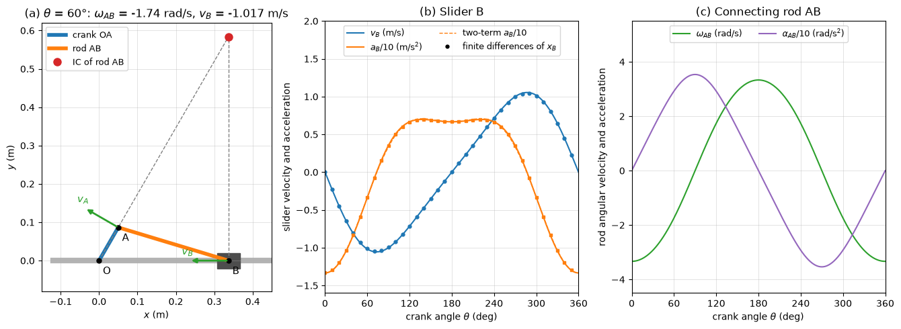

# Rigid Body Kinematics

A rigid body keeps the distance between any two of its points fixed, so its motion is fixed by the motion of one point and its rotation. Different points of the body then have different velocities and accelerations, and the relations between them are what mechanism analysis, wheel and gear kinematics and the motion of machine parts rest on. This note covers translation, rotation about a fixed axis and general plane motion, the instantaneous centre of zero velocity, relative acceleration with the angular velocity $\omega$ and angular acceleration $\alpha$, and the motion of a point relative to a rotating frame, which introduces the Coriolis acceleration. The forces and moments that produce these motions are in [Rigid Body Kinetics](rigid_body_kinetics.md).

## Problem Statement

A rigid body, or a mechanism of rigid bodies connected by pins, sliders and rolling contacts, moves in a plane (or, for the rotating-frame results, in space). Given the geometry, the constraints and the motion of some input, such as a crank turning at a known $\omega$ and $\alpha$, a wheel rolling at a known centre speed, or a frame rotating at a known rate, find the angular velocity and angular acceleration of every body and the velocity and acceleration of any point, at a given instant or over a cycle. The bodies do not deform, joints have no clearance, and rolling is without slipping unless stated. The governing relations for two points $A$ and $B$ of the same body are

$$
\mathbf{v}_B = \mathbf{v}_A + \boldsymbol{\omega} \times \mathbf{r}_{B/A},
\qquad \mathbf{a}_B = \mathbf{a}_A + \boldsymbol{\alpha} \times \mathbf{r}_{B/A} +
\boldsymbol{\omega} \times (\boldsymbol{\omega} \times \mathbf{r}_{B/A})
$$

and, for a point moving relative to a rotating frame, the same relations with the relative velocity and acceleration and the Coriolis term $2\boldsymbol{\Omega} \times \mathbf{v}_{\mathrm{rel}}$ added. Angles are in rad, $\omega$ in rad/s and $\alpha$ in rad/s².

## Types of Motion

| Motion | Description | Kinematics |
| --- | --- | --- |
| translation | every line in the body keeps its direction; rectilinear or curvilinear | all points have the same $\mathbf{v}$ and $\mathbf{a}$ |
| rotation about a fixed axis | points move on circles centred on the axis | $\mathbf{v} = \boldsymbol{\omega} \times \mathbf{r}$ |
| general plane motion | translation plus rotation in one plane, e.g. a rolling wheel or a connecting rod | relative-motion equations or the instantaneous centre |
| rotation about a fixed point | spinning top, gimbal, robot wrist | $\boldsymbol{\omega}$ changes direction; $\boldsymbol{\alpha} = \dot{\boldsymbol{\omega}}$ includes the turning of the axis |
| general motion | aircraft, spacecraft, vehicle on a road | point of reference plus 3D rotation |

## Rotation About a Fixed Axis

The angular position $\theta$ of any line in the body perpendicular to the axis defines the rotation, with angular velocity $\omega = \dot{\theta}$ and angular acceleration $`\alpha = \dot{\omega} = \omega\,d\omega/d\theta`$. These are related exactly as $s$, $v$ and $a$ in rectilinear motion; for constant $\alpha$,

$$
\omega = \omega_0 + \alpha t,
\qquad \theta = \theta_0 + \omega_0t + \tfrac{1}{2}\alpha t^2,
\qquad \omega^2 = \omega_0^2 + 2\alpha(\theta - \theta_0)
$$

A point at position $\mathbf{r}$ from any point on the axis moves on a circle of radius $r$ (its distance from the axis) with

$$
\mathbf{v} = \boldsymbol{\omega} \times \mathbf{r},
\qquad \mathbf{a} = \boldsymbol{\alpha} \times \mathbf{r} + \boldsymbol{\omega} \times
(\boldsymbol{\omega} \times \mathbf{r})
$$

so $v = \omega r$, $a_t = \alpha r$ and $a_n = \omega^2r$ toward the axis.

A disk of radius 0.5 m starts from rest with $\alpha = 4$ rad/s². After 3 s, $\omega = 12$ rad/s, so a rim point moves at $v = 6$ m/s with $a_t = 2$ m/s² and $a_n = 72$ m/s²; the total acceleration, 72.0 m/s², is almost entirely centripetal.

## General Plane Motion

### Relative Velocity

For two points of the same body, $`\mathbf{r}_B = \mathbf{r}_A + \mathbf{r}_{B/A}`$, and $`\mathbf{r}_{B/A}`$ has constant length, so it can only rotate with the body: $`\dot{\mathbf{r}}_{B/A} = \boldsymbol{\omega} \times \mathbf{r}_{B/A}`$. Hence

$$
\mathbf{v}_B = \mathbf{v}_A + \boldsymbol{\omega} \times \mathbf{r}_{B/A}
$$

The motion of $B$ seen from axes translating with $A$ is a rotation about $A$. In the plane, with $\boldsymbol{\omega} = \omega\mathbf{k}$ and $`\mathbf{r}_{B/A} = (x, y)`$, the components are $`v_{Bx} = v_{Ax} - \omega y`$ and $v_{By} = v_{Ay} + \omega x$. One vector equation gives two scalar equations, enough for two unknowns such as $\omega$ of a connecting rod and the speed of a slider.

### Instantaneous Centre of Zero Velocity

At any instant of plane motion with $\omega \neq 0$ there is a point $C$, in the body or in its extension, with zero velocity. Every point then moves as if the body were rotating about $C$: $`v_P = \omega\,d_P`$, perpendicular to the line from $C$ to $P$, where $d_P$ is its distance from $C$. The centre is found from two known velocity directions:

1. If the directions of $\mathbf{v}_A$ and $\mathbf{v}_B$ are known and not parallel, $C$ is where the perpendiculars to them through $A$ and $B$ intersect.
2. If $\mathbf{v}_A$ and $\mathbf{v}_B$ are parallel and perpendicular to $AB$, $C$ lies on the line $AB$ at distances proportional to the speeds: between $A$ and $B$ for opposite senses, outside the segment for the same sense.
3. If $\mathbf{v}_A$ and $\mathbf{v}_B$ are parallel and equal, $C$ is at infinity, $\omega = 0$ and the body translates at that instant.

A wheel of radius $R$ rolling without slipping has its centre $C$ at the contact point. With centre speed $v_G$, $\omega = v_G/R$, and the top of the wheel, at $2R$ from $C$, moves at $2v_G$. For $R = 0.4$ m and $v_G = 2$ m/s, $\omega = 5$ rad/s and the top moves at 4 m/s.

The instantaneous centre has zero velocity but not, in general, zero acceleration, and its position changes from instant to instant. It must not be used as a pivot for accelerations.

### Relative Acceleration

Differentiating the relative-velocity equation,

$$
\mathbf{a}_B = \mathbf{a}_A + \boldsymbol{\alpha} \times \mathbf{r}_{B/A} +
\boldsymbol{\omega} \times (\boldsymbol{\omega} \times \mathbf{r}_{B/A})
$$

In plane motion the last term is $`-\omega^2\mathbf{r}_{B/A}`$: a normal component of magnitude $`\omega^2r_{B/A}`$ directed from $B$ toward $A$, while $`\boldsymbol{\alpha} \times \mathbf{r}_{B/A}`$ is the tangential component of magnitude $`\alpha r_{B/A}`$. Rolling without slipping on a flat surface gives $v_G = \omega R$ and $a_G = \alpha R$, and the contact point has acceleration $\omega^2R$ directed toward the centre (Exercise 4).

## Worked Example: Slider-Crank

A crank $OA$ of length $r = 0.1$ m turns counterclockwise at a constant $\omega = 10$ rad/s and drives a connecting rod $AB$ of length $l = 0.3$ m whose end $B$ slides along the line through $O$. With $A$ at $r(\cos\theta, \sin\theta)$, the slider is at $x_B = r\cos\theta + \sqrt{l^2 - r^2\sin^2\theta}$, and the rod vector is $\mathbf{r}_{B/A} = (b_x, b_y)$ with $b_x = l\cos\phi$, $b_y = -r\sin\theta$.

1. Velocity of the crank pin: $\mathbf{v}_A = \omega\mathbf{k} \times \mathbf{r}_A = r\omega(-\sin\theta, \cos\theta)$.
2. Relative velocity: $`v_B\mathbf{i} = \mathbf{v}_A + \omega_{AB}\mathbf{k} \times \mathbf{r}_{B/A}`$. The $`\mathbf{j}`$ component gives $`\omega_{AB} = -r\omega\cos\theta/b_x`$, and the $\mathbf{i}$ component gives $v_B = -r\omega\sin\theta - \omega_{AB}b_y$.
3. Acceleration of the crank pin: $`\mathbf{a}_A = -\omega^2\mathbf{r}_A`$, since $`\alpha_{OA} = 0`$.
4. Relative acceleration: $`a_B\mathbf{i} = \mathbf{a}_A + \alpha_{AB}\mathbf{k} \times \mathbf{r}_{B/A} - \omega_{AB}^2\mathbf{r}_{B/A}`$. The $`\mathbf{j}`$ component gives $`\alpha_{AB}`$, and the $\mathbf{i}$ component gives $a_B$.

At $\theta = 90^\circ$, $b_x = \sqrt{0.09 - 0.01} = 0.283$ m and $\cos\theta = 0$, so $\omega_{AB} = 0$ and $v_B = -r\omega = -1$ m/s: the rod translates instantaneously and the piston moves at the crank-pin speed, toward $O$. At $\theta = 60^\circ$, $b_x = 0.2872$ m, $\omega_{AB} = -1.74$ rad/s (clockwise) and $v_B = -0.866 - 0.151 = -1.02$ m/s. At the dead centres $\theta = 0$ and $180^\circ$, $v_B = 0$ and $a_B = \mp r\omega^2(1 \pm r/l)$, which is $-13.3$ and $+6.67$ m/s².



Panel (a) locates the instantaneous centre of the rod at $60^\circ$, where the line $OA$ extended (perpendicular to $`\mathbf{v}_A`$) meets the vertical through $`B`$ (perpendicular to $`\mathbf{v}_B`$). Panel (b) shows the slider velocity and acceleration over a revolution from the relative-motion equations, with finite differences of $`x_B`$ as markers; the acceleration at the inner dead centre is twice that at the outer one for $`r/l = 1/3`$, which the two-term series $`a_B \approx -r\omega^2(\cos\theta + (r/l)\cos 2\theta)`$ captures. Panel (c) gives $`\omega_{AB}`$ and $`\alpha_{AB}`$, which are needed for the inertia forces of the rod.

## Rotating Reference Frames

Many problems are easier to describe from a rotating body: a collar sliding along a rotating arm, a fluid particle in a pump impeller, a pendulum on the rotating Earth. Let axes $xyz$ have origin at $A$ and rotate with angular velocity $\boldsymbol{\Omega}$ relative to fixed axes $XYZ$. Any vector $\mathbf{Q}$ expressed in the rotating axes changes both because its components change and because the axes turn:

$$
\left(\frac{d\mathbf{Q}}{dt}\right)_{XYZ} = \left(\frac{d\mathbf{Q}}{dt}\right)_{xyz} +
\boldsymbol{\Omega} \times \mathbf{Q}
$$

Applying this to $`\mathbf{r}_B = \mathbf{r}_A + \mathbf{r}_{B/A}`$, and once more to the result, gives the velocity and acceleration of a point $B$ that moves relative to the rotating axes:

$$
\mathbf{v}_B = \mathbf{v}_A + \boldsymbol{\Omega} \times \mathbf{r}_{B/A} +
\mathbf{v}_{\mathrm{rel}}
$$

$$
\mathbf{a}_B = \mathbf{a}_A + \dot{\boldsymbol{\Omega}} \times \mathbf{r}_{B/A} +
\boldsymbol{\Omega} \times (\boldsymbol{\Omega} \times \mathbf{r}_{B/A}) +
2\boldsymbol{\Omega} \times \mathbf{v}_{\mathrm{rel}} + \mathbf{a}_{\mathrm{rel}}
$$

where $`\mathbf{v}_{\mathrm{rel}}`$ and $`\mathbf{a}_{\mathrm{rel}}`$ are measured by an observer moving with $xyz$. The first three acceleration terms are the acceleration of the point of the frame that $B$ occupies at that instant. The term $`2\boldsymbol{\Omega} \times \mathbf{v}_{\mathrm{rel}}`$ is the Coriolis acceleration; it is perpendicular to both $\boldsymbol{\Omega}$ and $`\mathbf{v}_{\mathrm{rel}}`$, and it vanishes only when the point is at rest in the rotating frame or moves parallel to $`\boldsymbol{\Omega}`$. When $B$ is fixed in the body, $`\mathbf{v}_{\mathrm{rel}} = \mathbf{a}_{\mathrm{rel}} = \mathbf{0}`$ and the rigid-body relations of the previous sections are recovered.

For the collar of [Kinematics of Particles](kinematics_particles.md#polar-and-cylindrical-coordinates) on an arm rotating at $\Omega = 2$ rad/s, with $r = 0.6$ m and $v_{\mathrm{rel}} = 0.5$ m/s outward along the arm, the rotating-frame terms are $\Omega^2r = 2.4$ m/s² toward the axis and $2\Omega v_{\mathrm{rel}} = 2.0$ m/s² perpendicular to the arm, the same as $a_r$ and $a_\theta$ from polar coordinates.

On the Earth, $\Omega = 7.29\times10^{-5}$ rad/s about the polar axis. A train running north along a straight track at 30 m/s at latitude $45^\circ$ has $\mathbf{a}_{\mathrm{rel}} = \mathbf{0}$, but its absolute acceleration contains the horizontal Coriolis term $2\Omega v\sin 45^\circ = 3.1\times10^{-3}$ m/s², directed west. The rails must supply the corresponding force, about 0.3 kN per 100 t of train, through the flanges pressing on the east rail; seen from the ground, the train tends to drift to the right of its direction of travel. The same term deflects winds and ocean currents and is included as a body force in flow solvers that work in a rotating frame, together with the centrifugal term (see [Governing Equations for CFD](../../numerical/cfd/governing_equations.md)).

Panel (c) of the figure in [Kinematics of Particles](kinematics_particles.md#polar-and-cylindrical-coordinates) shows a puck moving in a straight line over a turntable that rotates counterclockwise at 0.6 rad/s. Seen from the turntable it curves to the right; with $\mathbf{a} = \mathbf{0}$, its relative acceleration is exactly $-2\boldsymbol{\Omega} \times \mathbf{v}_{\mathrm{rel}} + \Omega^2\mathbf{r}$.

## Common Mistakes

1. Using one angular velocity for two bodies connected by a pin; each body has its own $\omega$ and $\alpha$.
2. Using the instantaneous centre to compute accelerations.
3. Dropping the normal term $-\omega^2\mathbf{r}_{B/A}$ when $\alpha = 0$.
4. Omitting the Coriolis term when a point moves along a rotating link, or doubling it by also adding $2\dot{r}\dot{\theta}$ from polar coordinates.
5. Writing $a_G = \alpha R$ for a wheel that slips, or for a wheel rolling on a curved surface without accounting for the path of its centre.

## Key Takeaways

- Two points of a rigid body differ in velocity by $`\boldsymbol{\omega} \times \mathbf{r}_{B/A}`$ and in acceleration by $`\boldsymbol{\alpha} \times \mathbf{r}_{B/A} - \omega^2\mathbf{r}_{B/A}`$ in plane motion.
- The instantaneous centre gives velocities quickly, but it has its own acceleration and cannot be used for accelerations.
- A rolling wheel's contact point is at rest and accelerates toward the centre at $\omega^2R$.
- Relative to a rotating frame, accelerations gain the Coriolis term $2\boldsymbol{\Omega} \times \mathbf{v}_{\mathrm{rel}}$ and the centripetal term of the frame.
- Mechanism kinematics reduces to one vector loop per closed chain, solved for the unknown angular rates and slider motions.

## Related Scripts

- [Slider-Crank Kinematics](../../../scripts/algorithms/dynamics_slider_crank_kinematics/): solves the velocity and acceleration of a slider-crank mechanism with the rigid-body relative-motion equations and checks the results against finite differences of the exact slider position.
- [Path, Polar and Rotating-Frame Coordinates](../../../scripts/plots/dynamics_path_coordinates/): draws the acceleration of three moving particles resolved in the coordinate system that suits each of them: normal–tangential components along a projectile path, radial–transverse components for a bead on a rotating rod, and Coriolis and centrifugal terms for a puck seen from a rotating turntable.
- [Four-Bar Linkage Kinematics](../../../scripts/algorithms/mechanisms_four_bar_linkage/): solves the position, velocity and acceleration of a four-bar linkage over a full crank revolution by vector loop closure, using the Freudenstein equation for position and two linear 2 × 2 systems for the velocities and accelerations.

## Exercises

**Exercise 1.** A flywheel turning at 1800 rpm decelerates uniformly to rest in 30 s. Find its angular acceleration and the number of revolutions it makes while stopping.

<details>
<summary>Answer</summary>

$\omega_0 = 1800 \times 2\pi/60 = 188.5$ rad/s, so $\alpha = -188.5/30 = -6.28$ rad/s².

```math
\theta = \frac{\omega_0 t}{2} = \frac{188.5 \times 30}{2} = 2827 \text{ rad} = 450 \text{ rev}
```

</details>

**Exercise 2.** A wheel of radius 0.3 m rolls without slipping to the right with centre speed 3 m/s. Use the instantaneous centre to find the velocity of the point on the front of the rim level with the centre.

<details>
<summary>Answer</summary>

$\omega = v_G/R = 10$ rad/s clockwise, with the instantaneous centre at the contact point. The point is at $(R, R)$ relative to it, a distance $\sqrt{2}R = 0.424$ m away, so $v = \omega\sqrt{2}R = 4.24$ m/s.

The velocity is perpendicular to the line from the contact point: $45^\circ$ below the horizontal, forward and down, with components $(3, -3)$ m/s.

</details>

**Exercise 3.** For the slider-crank of the worked example, find $v_B$ and $\omega_{AB}$ at $\theta = 0$, when $A$ lies on the line $OB$.

<details>
<summary>Answer</summary>

$\mathbf{v}_A$ is perpendicular to $OA$, vertical with magnitude 1 m/s, and $\mathbf{v}_B$ is horizontal. The perpendicular to $\mathbf{v}_A$ through $A$ is the line $OB$ itself, and the perpendicular to $\mathbf{v}_B$ through $B$ is vertical; they meet at $B$, which is therefore the instantaneous centre of the rod.

Hence $v_B = 0$ (dead centre) and $|\omega_{AB}| = v_A/AB = 1/0.3 = 3.33$ rad/s, clockwise for a counterclockwise crank.

</details>

**Exercise 4.** A wheel of radius $R = 0.4$ m rolls without slipping. At an instant its centre has $v_G = 2$ m/s and $a_G = 1.2$ m/s², both to the right. Find the accelerations of the top point and of the contact point.

<details>
<summary>Answer</summary>

$\omega = v_G/R = 5$ rad/s and $\alpha = a_G/R = 3$ rad/s², both clockwise. Using $`\mathbf{a}_P = \mathbf{a}_G + \boldsymbol{\alpha} \times \mathbf{r}_{P/G} - \omega^2\mathbf{r}_{P/G}`$:

- top point, $\mathbf{r} = R\mathbf{j}$: $`\mathbf{a} = (1.2 + \alpha R)\mathbf{i} - \omega^2R\,\mathbf{j} = 2.4\mathbf{i} - 10\mathbf{j}`$ m/s², magnitude 10.3 m/s²;
- contact point, $\mathbf{r} = -R\mathbf{j}$: $`\mathbf{a} = (1.2 - \alpha R)\mathbf{i} + \omega^2R\,\mathbf{j} = 10\mathbf{j}`$ m/s², toward the centre.

The contact point has zero velocity but an acceleration of 10 m/s², which is why the instantaneous centre cannot be used for accelerations.

</details>

**Exercise 5.** For the slider-crank of the worked example, differentiate $x_B = r\cos\theta + \sqrt{l^2 - r^2\sin^2\theta}$ to obtain $v_B(\theta)$. Evaluate $v_B$ and $\omega_{AB}$ at $\theta = 60^\circ$ and check the formula at $\theta = 90^\circ$.

<details>
<summary>Answer</summary>

With $\dot{\theta} = \omega$:

```math
v_B = -r\omega\sin\theta - \frac{r^2\omega\sin\theta\cos\theta}{\sqrt{l^2 - r^2\sin^2\theta}}
```

At $\theta = 60^\circ$, $\sqrt{0.09 - 0.0075} = 0.2872$ m, so $v_B = -0.866 - 0.151 = -1.017$ m/s, that is 1.02 m/s toward $O$.

The rod angle $\phi$ below the horizontal satisfies $l\sin\phi = r\sin\theta$, so $\dot{\phi} = r\omega\cos\theta/(l\cos\phi) = 0.1 \times 10 \times 0.5/0.2872 = 1.74$ rad/s, clockwise. At $\theta = 90^\circ$ the second term of $v_B$ vanishes, giving $v_B = -r\omega = -1$ m/s and $\omega_{AB} = 0$, as in the worked example.

</details>

## References

- R. C. Hibbeler, *Engineering Mechanics: Dynamics*, 14th ed., Pearson, 2016.
- J. L. Meriam, L. G. Kraige and J. N. Bolton, *Engineering Mechanics: Dynamics*, 9th ed., Wiley, 2018.
- F. P. Beer, E. R. Johnston, P. J. Cornwell and B. P. Self, *Vector Mechanics for Engineers: Dynamics*, 12th ed., McGraw-Hill, 2019.
- J. J. Uicker, G. R. Pennock and J. E. Shigley, *Theory of Machines and Mechanisms*, 5th ed., Oxford University Press, 2017.
- J. H. Ginsberg, *Engineering Dynamics*, Cambridge University Press, 2008.
