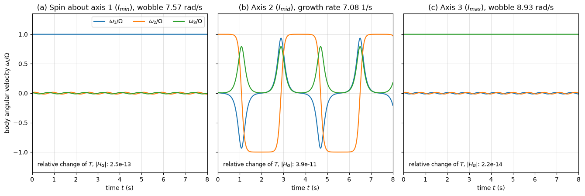

# Rigid Body Kinetics

Rigid body kinetics relates the forces and moments on a body of finite size to its translation and rotation. Two equations do this: the mass centre accelerates as a particle under the resultant force, and the moment about the mass centre equals the rate of change of angular momentum, which for plane motion is $I_G\alpha$. This note covers mass moments of inertia and the parallel-axis theorem, the three equations of plane motion and their special cases, rolling with and without slip, and, briefly, Euler's equations for rotation in three dimensions with the stability of spin about principal axes and gyroscopic moments. Kinematics of the same bodies is in [Rigid Body Kinematics](rigid_body_kinematics.md); integrated forms are in [Work and Energy Methods](work_energy.md) and [Impulse and Momentum](impulse_momentum.md).

## Problem Statement

A rigid body of mass $m$ (kg) with known geometry and mass distribution, alone or connected to other bodies by pins, cords and contacts, moves under known applied forces and couples, gravity and support reactions. Given the forces, find the linear acceleration of the mass centre $\mathbf{a}_G$ and the angular acceleration $\alpha$; or, given the motion, find the reactions, cord tensions, friction forces and driving torques needed to produce it. The body does not deform, and for plane motion it is symmetric about the plane of motion (or that plane is a plane of mass symmetry), so the angular momentum is parallel to $\boldsymbol{\omega}$. The governing equations of plane motion are

$$
\sum F_x = m(a_G)_x,
\qquad \sum F_y = m(a_G)_y,
\qquad \sum M_G = I_G\alpha
$$

and in three dimensions $\sum\mathbf{F} = m\mathbf{a}_G$ and $\sum\mathbf{M}_G = \dot{\mathbf{H}}_G$, which in principal axes are Euler's equations. Forces are in N, moments in N·m and moments of inertia in kg·m².

## Mass Moment of Inertia

The moment of inertia about an axis is

```math
I = \int_m r^2\, dm
```

where $r$ is the perpendicular distance of the element $dm$ from the axis. It measures resistance to angular acceleration about that axis, as mass measures resistance to linear acceleration, and it depends on the axis chosen. The radius of gyration $k = \sqrt{I/m}$ is the distance at which the whole mass would have the same moment of inertia.

| Body | Axis | $I$ |
| --- | --- | --- |
| slender rod, length $L$ | through centre, perpendicular to rod | $\tfrac{1}{12}mL^2$ |
| slender rod, length $L$ | through one end, perpendicular to rod | $\tfrac{1}{3}mL^2$ |
| thin ring or hoop, radius $R$ | central axis | $mR^2$ |
| solid disk or cylinder, radius $R$ | central axis | $\tfrac{1}{2}mR^2$ |
| solid cylinder, radius $R$, length $L$ | through centre, perpendicular to axis | $\tfrac{1}{12}m(3R^2 + L^2)$ |
| solid sphere, radius $R$ | diameter | $\tfrac{2}{5}mR^2$ |
| thin spherical shell, radius $R$ | diameter | $\tfrac{2}{3}mR^2$ |
| rectangular plate or box, sides $a$, $b$ | through centre, perpendicular to $a$ and $b$ | $\tfrac{1}{12}m(a^2 + b^2)$ |

### Parallel-Axis Theorem

If $I_G$ is the moment of inertia about an axis through the mass centre, the moment about a parallel axis at distance $d$ is

$$
I = I_G + md^2
$$

The cross term $`2d\int x\,dm`$ vanishes because $x$ is measured from the mass centre. $I_G$ is therefore the smallest moment of inertia among all parallel axes. For a thin plate, the perpendicular-axis theorem $I_z = I_x + I_y$ also holds, with $z$ normal to the plate.

### Composite Bodies

The moment of inertia of a body made of simple parts is the sum of the parts' moments about the same axis, each moved there with the parallel-axis theorem; holes count as negative mass. A pendulum made of a uniform 2 kg rod of length 1 m pivoted at one end, with a 1 kg disk of radius 0.1 m centred at the other end, has

```math
I_O = \tfrac{1}{3}(2)(1)^2 + \left[\tfrac{1}{2}(1)(0.1)^2 + (1)(1)^2\right] = 0.667 + 1.005 = 1.672 \text{ kg·m}^2
```

and its mass centre is $d = (2 \times 0.5 + 1 \times 1)/3 = 0.667$ m below the pivot.

## Equations of Plane Motion

For a slab in plane motion the angular momentum about the mass centre is $H_G = I_G\omega$, and the moment equation $\sum M_G = \dot{H}_G$ becomes $\sum M_G = I_G\alpha$. Combined with the motion of the mass centre, this gives three scalar equations. Moments may be taken about any point $P$ instead, provided the moment of $m\mathbf{a}_G$ is included:

$$
\sum M_P = I_G\alpha + \left(\mathbf{r}_{G/P} \times m\mathbf{a}_G\right)\cdot\mathbf{k}
$$

This is the statement that the moments of the external forces about $P$ equal the moments of the kinetic diagram ($m\mathbf{a}_G$ at $G$ plus the couple $I_G\alpha$) about $P$. Choosing $P$ at an unknown reaction removes that reaction from the equation.

### Procedure

1. Draw the free-body diagram with all external forces and couples, and the kinetic diagram with $m(a_G)_x$, $m(a_G)_y$ at $G$ and $I_G\alpha$.
2. Write the three equations, taking moments about $G$ or about a point that eliminates unknowns.
3. Relate $\mathbf{a}_G$ and $\alpha$ by kinematics: a fixed pivot, rolling without slipping, or a cord that does not stretch.
4. Solve, then check assumed conditions: friction below $\mu_sN$, cords in tension, normal forces positive.

### Special Cases

| Motion | Equations |
| --- | --- |
| translation, $\omega = \alpha = 0$ | $\sum\mathbf{F} = m\mathbf{a}_G$, $\sum M_G = 0$; moments about other points are not zero |
| rotation about a fixed axis through $O$ | $\sum M_O = I_O\alpha$ with $I_O = I_G + md^2$; $(a_G)_t = \alpha d$, $(a_G)_n = \omega^2d$ give the pin reactions |
| rolling without slipping on a flat surface | $a_G = \alpha R$; friction is unknown and must satisfy $F \le \mu_sN$ |
| rolling with slipping | $a_G$ and $\alpha$ independent; $F = \mu_kN$ opposing the slip velocity of the contact point |

For a body rolling without slipping, moments about the contact point $C$ give $\sum M_C = I_C\alpha$ only if $G$ is at the centre of a round body rolling on a flat surface, because then $\mathbf{a}_C$ points through $G$; in general the full expression above is needed.

## Worked Examples

### Rolling Cylinder on an Incline

A solid cylinder ($m = 8$ kg, $R = 0.2$ m, $I_G = \tfrac{1}{2}mR^2 = 0.16$ kg·m²) rolls without slipping down a $25^\circ$ incline. Along the slope, $mg\sin 25^\circ - F = ma_G$, and about $G$, $FR = I_G\alpha = I_Ga_G/R$, so $F = 4a_G$. Then

$$
33.17 - 4a_G = 8a_G \quad\Rightarrow\quad a_G = 2.76 \text{ m/s}^2 = \tfrac{2}{3}g\sin
25^\circ,
\qquad F = 11.06 \text{ N}
$$

The normal force is $N = mg\cos 25^\circ = 71.1$ N, so rolling without slipping requires $\mu_s \ge 11.06/71.1 = 0.155$. A block sliding without friction would accelerate at $g\sin 25^\circ = 4.15$ m/s²; the cylinder is slower because part of the work of gravity goes into rotation.

### Rod Released from Horizontal

A uniform rod ($m = 3$ kg, $L = 1.2$ m) pivoted at one end has $I_O = \tfrac{1}{3}mL^2 = 1.44$ kg·m². Released from rest in the horizontal position, $\sum M_O = mgL/2 = I_O\alpha$ gives $\alpha = 17.66/1.44 = 12.26$ rad/s², or $3g/(2L)$. The mass centre accelerates downward at $\alpha L/2 = \tfrac{3}{4}g$, so the pin carries only $\tfrac{1}{4}mg$ at that instant (Exercise 3). When the rod reaches the vertical, energy conservation gives $mgL/2 = \tfrac{1}{2}I_O\omega^2$, so $\omega = 4.95$ rad/s.

### Pulley with Two Masses

A solid disk pulley ($m_p = 4$ kg, $R = 0.15$ m, $I_p = 0.045$ kg·m²) carries $m_1 = 6$ kg and $m_2 = 4$ kg on a cord that does not slip. With $a$ the downward acceleration of $m_1$ and $\alpha = a/R$:

$$
m_1g - T_1 = m_1a,
\qquad T_2 - m_2g = m_2a,
\qquad (T_1 - T_2)R = I_p \frac{a}{R}
$$

Adding the three equations, with $I_p/R^2 = 2$ kg,

$$
a = \frac{(m_1 - m_2)g}{m_1 + m_2 + I_p/R^2} = \frac{19.62}{12} = 1.635 \text{ m/s}^2
$$

and $T_1 = 49.05$ N, $T_2 = 45.78$ N. The tensions differ because the cord must accelerate the pulley's rotation; with a massless pulley they would be equal.

## Three-Dimensional Rotation

### Angular Momentum and the Inertia Tensor

For a body rotating with $\boldsymbol{\omega}$, the angular momentum about the mass centre is

```math
\mathbf{H}_G = \mathbf{I}_G\,\boldsymbol{\omega},
\qquad
\mathbf{I}_G = \begin{bmatrix} I_{xx} & -I_{xy} & -I_{xz} \\ -I_{xy} & I_{yy} & -I_{yz} \\ -I_{xz} & -I_{yz} & I_{zz} \end{bmatrix}
```

with $`I_{xx} = \int(y^2 + z^2)\,dm`$ and products of inertia $`I_{xy} = \int xy\,dm`$. In general $\mathbf{H}_G$ is not parallel to $\boldsymbol{\omega}$. The tensor is symmetric, so there are three orthogonal principal axes in which the products vanish; their moments $I_1$, $I_2$, $I_3$ are the eigenvalues of $\mathbf{I}_G$. A shaft whose rotation axis is not a principal axis is dynamically unbalanced: $\mathbf{H}_G$ rotates with it and the bearings must supply a rotating moment even at constant speed (see [Rotating Machinery](../mechanical_systems/rotating_machinery.md)).

### Euler's Equations

Writing $\mathbf{H}_G$ in axes fixed in the body, which rotate with $\boldsymbol{\omega}$, the rotating-frame derivative of [Rigid Body Kinematics](rigid_body_kinematics.md#rotating-reference-frames) gives $`\sum\mathbf{M}_G = (\dot{\mathbf{H}}_G)_{\mathrm{body}} + \boldsymbol{\omega} \times \mathbf{H}_G`$. In principal axes this is

```math
\begin{aligned}
  \sum M_1 &= I_1\dot{\omega}_1 - (I_2 - I_3)\,\omega_2\omega_3 \\
  \sum M_2 &= I_2\dot{\omega}_2 - (I_3 - I_1)\,\omega_3\omega_1 \\
  \sum M_3 &= I_3\dot{\omega}_3 - (I_1 - I_2)\,\omega_1\omega_2
\end{aligned}
```

The equations are nonlinear and coupled even with no applied moment. For a plane slab rotating about axis 3 with $\omega_1 = \omega_2 = 0$ the first two give zero moment and the third reduces to $\sum M_G = I_G\alpha$.

### Stability of Spin About a Principal Axis

With $\sum\mathbf{M}_G = \mathbf{0}$, a steady spin $\Omega$ about any principal axis is a solution. Perturbing a spin about axis 1 and linearizing gives

```math
\ddot{\omega}_2 = \Omega^2\, \frac{(I_3 - I_1)(I_1 - I_2)}{I_2I_3}\,\omega_2
```

The coefficient is negative, giving a bounded wobble, when $I_1$ is the largest or the smallest moment, and positive, giving exponential growth, when it is the intermediate one.



The figure integrates Euler's equations for a 0.5 kg box of 200 × 100 × 30 mm spun at 10 rad/s with a 1% disturbance. About the axes of smallest and largest inertia (panels a and c) the disturbance wobbles at 7.6 and 8.9 rad/s. About the intermediate axis (panel b) it grows at 7.1 s⁻¹ and the spin reverses about every 1.8 s, the motion seen when a book or a tennis racket is tossed spinning about its middle axis. Kinetic energy and $|\mathbf{H}_G|$ stay constant throughout; a body that slowly loses energy while keeping its angular momentum, as a satellite with flexible appendages does, drifts to spin about its axis of largest inertia.

### Gyroscopic Moment

A rotor spinning at $\omega_s$ about its axis with moment of inertia $I_s$, whose axis is turned at a rate $\Omega_p$ perpendicular to it, has an angular momentum vector $I_s\omega_s$ that changes direction at the rate $\Omega_p$. Steady precession therefore needs a moment

```math
M = I_s\,\omega_s\,\Omega_p
```

about the axis perpendicular to both the spin and the precession. A jet-engine rotor with $I_s = 20$ kg·m² at $\omega_s = 1000$ rad/s in an aircraft pitching at 0.5 rad/s exerts a yawing moment of 10 kN·m on its mounts.

## Common Mistakes

1. Using $I_G$ in $\sum M_O = I\alpha$ for a fixed-axis rotation about $O \neq G$.
2. Summing moments about an accelerating point without including the moment of $m\mathbf{a}_G$.
3. Assuming the friction force at a rolling contact equals $\mu_sN$, or forgetting to check it against $\mu_sN$.
4. Taking the two tensions on either side of a pulley with inertia as equal.
5. Using $\sum\mathbf{M}_G = \mathbf{I}_G\dot{\boldsymbol{\omega}}$ in 3D without the term $\boldsymbol{\omega} \times \mathbf{H}_G$.

## Key Takeaways

- The resultant force accelerates the mass centre; the moment about the mass centre changes the angular momentum, $I_G\alpha$ in plane motion.
- Moments about any other point must include the moment of $m\mathbf{a}_G$; about a fixed pivot they reduce to $I_O\alpha$.
- $I = I_G + md^2$ moves a moment of inertia between parallel axes; composite bodies add part by part.
- Rolling without slipping links $a_G = \alpha R$ and requires the friction force to stay within $\mu_sN$.
- Euler's equations in principal axes govern 3D rotation; spin about the intermediate axis is unstable, and turning a spinning rotor needs a gyroscopic moment $I_s\omega_s\Omega_p$.

## Related Scripts

- [Torque-Free Rigid Body Rotation](../../../scripts/algorithms/dynamics_torque_free_rigid_body/): integrates Euler's equations for a rigid box spinning with no applied moment and shows that rotation about the axis of intermediate moment of inertia is unstable.
- [Slider-Crank Kinematics](../../../scripts/algorithms/dynamics_slider_crank_kinematics/): solves the velocity and acceleration of a slider-crank mechanism with the rigid-body relative-motion equations and checks the results against finite differences of the exact slider position.

## Exercises

**Exercise 1.** A uniform slender rod of mass 2 kg and length 1.5 m rotates about a perpendicular axis 0.25 m from its centre. Find its moment of inertia and radius of gyration about that axis.

<details>
<summary>Answer</summary>

```math
I = \tfrac{1}{12}mL^2 + md^2 = \tfrac{1}{12}(2)(2.25) + 2(0.25)^2 = 0.375 + 0.125 = 0.5 \text{ kg·m}^2
```

and $k = \sqrt{I/m} = \sqrt{0.25} = 0.5$ m.

</details>

**Exercise 2.** Show that a round body with radius of gyration $k_G$ rolling without slipping down an incline has $a_G = g\sin\theta/(1 + k_G^2/R^2)$. Evaluate $a_G$ on a $25^\circ$ incline for a thin hoop, a solid cylinder and a solid sphere, and find the minimum $\mu_s$ for the cylinder.

<details>
<summary>Answer</summary>

Along the slope $mg\sin\theta - F = ma_G$, and about $G$, $FR = mk_G^2a_G/R$, so $F = mk_G^2a_G/R^2$. Substituting gives the stated result.

- Hoop, $k_G^2/R^2 = 1$: $a_G = 2.07$ m/s².
- Solid cylinder, $1/2$: $a_G = 2.76$ m/s², as in the worked example.
- Solid sphere, $2/5$: $a_G = 2.96$ m/s².

For the cylinder $F = \tfrac{1}{3}mg\sin\theta$ and $N = mg\cos\theta$, so rolling requires $\mu_s \ge \tfrac{1}{3}\tan 25^\circ = 0.155$.

</details>

**Exercise 3.** For the rod released from horizontal in the worked example, find the pin reaction immediately after release.

<details>
<summary>Answer</summary>

Just after release $\omega = 0$, so the mass centre has only its tangential, vertical acceleration, $a_G = \alpha L/2 = 12.26 \times 0.6 = 7.36$ m/s² $= \tfrac{3}{4}g$ downward.

Vertically, $mg - R_y = ma_G$, so $R_y = \tfrac{1}{4}mg = 7.36$ N upward. With $\omega = 0$ there is no normal acceleration, so the horizontal reaction is zero.

</details>

**Exercise 4.** A 5 kg mass hangs from a cord wrapped around a solid disk pulley (10 kg, radius 0.2 m) on a frictionless fixed axle. Find the acceleration of the mass and the cord tension. Then find the small-oscillation period of the composite pendulum of the section on composite bodies.

<details>
<summary>Answer</summary>

Mass: $mg - T = ma$. Pulley: $TR = \tfrac{1}{2}MR^2(a/R)$, so $T = \tfrac{1}{2}Ma$. Combining,

```math
a = \frac{mg}{m + M/2} = \frac{5 \times 9.81}{10} = 4.91 \text{ m/s}^2,
\qquad
T = \tfrac{1}{2}(10)(4.905) = 24.5 \text{ N}
```

For the pendulum, $\sum M_O = -m_{\mathrm{tot}}gd\sin\theta = I_O\ddot{\theta}$, so for small angles $\omega_n = \sqrt{m_{\mathrm{tot}}gd/I_O} = \sqrt{3 \times 9.81 \times 0.667/1.672} = 3.43$ rad/s and the period is $2\pi/\omega_n = 1.83$ s.

</details>

**Exercise 5.** A uniform crate 2 m tall and 1 m deep in the direction of travel sits on a truck bed with enough friction to prevent sliding. Find the truck acceleration at which the crate starts to tip.

<details>
<summary>Answer</summary>

On the point of tipping the normal force and friction act at the rear bottom edge, and the crate translates with the truck. Taking moments about that edge, the weight acts at $b/2 = 0.5$ m in front of it and $m\mathbf{a}_G$ acts forward at height $h/2 = 1$ m:

```math
mg\frac{b}{2} = ma\frac{h}{2}
\quad\Rightarrow\quad
a = g\frac{b}{h} = 9.81 \times \frac{1}{2} = 4.91 \text{ m/s}^2
```

Above this acceleration the crate tips backward, provided $\mu_s > a/g = 0.5$ so that it does not slide first.

</details>

## References

- R. C. Hibbeler, *Engineering Mechanics: Dynamics*, 14th ed., Pearson, 2016.
- J. L. Meriam, L. G. Kraige and J. N. Bolton, *Engineering Mechanics: Dynamics*, 9th ed., Wiley, 2018.
- F. P. Beer, E. R. Johnston, P. J. Cornwell and B. P. Self, *Vector Mechanics for Engineers: Dynamics*, 12th ed., McGraw-Hill, 2019.
- D. T. Greenwood, *Principles of Dynamics*, 2nd ed., Prentice Hall, 1988.
- L. D. Landau and E. M. Lifshitz, *Mechanics*, 3rd ed., Butterworth-Heinemann, 1976.
