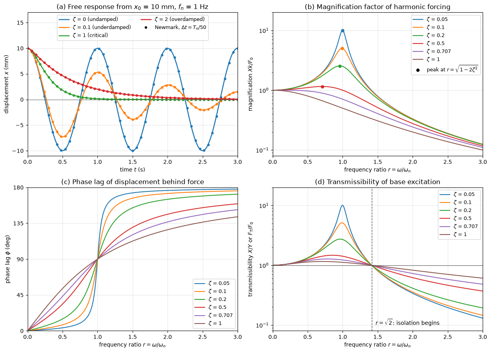

# Mechanical Vibrations

A vibration is an oscillation of a system about an equilibrium position. Machines vibrate because of rotating unbalance and impacts, vehicles because of road roughness, and structures because of wind, waves, earthquakes and vortex shedding; designing them means keeping the operating frequencies away from the natural frequencies, adding damping where they cannot be separated, and isolating sources from their surroundings. This note treats the single-degree-of-freedom (SDOF) oscillator in free and forced vibration, damping regimes and their measurement, the frequency response and the transmissibility of base excitation, and multi-degree-of-freedom (MDOF) systems through the generalized eigenproblem, with the tuned mass damper as an application. Equations of motion for more complicated systems are derived most easily with [Lagrangian Mechanics](lagrangian_mechanics.md), and vibration driven by flow is treated in [Flow-Induced Vibrations](../fluid_loading/flow_induced_vibrations.md).

## Problem Statement

A mechanical system with mass, stiffness and damping is displaced from a stable equilibrium or driven by a time-varying force or support motion. Given the mass $m$ (kg), the stiffness $k$ (N/m) and the viscous damping coefficient $c$ (N·s/m), or the matrices $\mathbf{M}$, $\mathbf{K}$, $\mathbf{C}$ of an $n$-degree-of-freedom model, together with the initial conditions or the excitation, find the natural frequencies and mode shapes, the free response and its decay, the steady-state amplitude and phase under harmonic excitation, and the force or motion transmitted to the support. The system is linear: displacements are small enough that springs obey Hooke's law, damping is viscous, and the equations are written about the static equilibrium. The governing equations are

$$
m\ddot{x} + c\dot{x} + kx = F(t)
$$

for one degree of freedom, and

$$
\mathbf{M}\ddot{\mathbf{x}} + \mathbf{C}\dot{\mathbf{x}} +
\mathbf{K}\mathbf{x} = \mathbf{F}(t)
$$

for $n$ degrees of freedom. Frequencies are given in rad/s ($\omega$) or Hz ($f = \omega/2\pi$).

## The Single-Degree-of-Freedom Oscillator

### Equation of Motion

A mass on a spring and a viscous damper, with $x$ measured from the static equilibrium position, feels the spring force $-kx$, the damping force $-c\dot{x}$ and the applied force $F(t)$; the weight is balanced by the static spring force $k\delta_{\mathrm{st}} = mg$ and drops out. Newton's second law gives $m\ddot{x} + c\dot{x} + kx = F(t)$. Two parameters describe the free motion,

$$
\omega_n = \sqrt{\frac{k}{m}},
\qquad \zeta = \frac{c}{c_c} = \frac{c}{2\sqrt{km}} = \frac{c}{2m\omega_n}
$$

the natural frequency and the damping ratio, where $c_c = 2\sqrt{km}$ is the critical damping coefficient. Dividing by $m$, $\ddot{x} + 2\zeta\omega_n\dot{x} + \omega_n^2x = F(t)/m$.

Because $k\delta_{\mathrm{st}} = mg$, the natural frequency of a mass on a vertical spring follows from its static deflection alone, $\omega_n = \sqrt{g/\delta_{\mathrm{st}}}$.

### Equivalent Systems

Many systems reduce to the same equation with an equivalent mass and stiffness.

| System | Coordinate | $m_{\mathrm{eq}}$ | $k_{\mathrm{eq}}$ | $\omega_n$ |
| --- | --- | --- | --- | --- |
| springs $k_1$, $k_2$ in parallel | $x$ | $m$ | $k_1 + k_2$ | $\sqrt{(k_1 + k_2)/m}$ |
| springs in series | $x$ | $m$ | $k_1k_2/(k_1 + k_2)$ |  |
| simple pendulum, length $L$ | $\theta$ | $mL^2$ | $mgL$ | $\sqrt{g/L}$ |
| compound pendulum, pivot $O$, mass centre at $d$ | $\theta$ | $I_O$ | $mgd$ | $\sqrt{mgd/I_O}$ |
| cantilever with tip mass, massless beam | tip deflection | $m$ | $3EI/L^3$ | $\sqrt{3EI/(mL^3)}$ |
| disk on a torsion shaft | $\theta$ | $I$ | $GJ/L$ | $\sqrt{GJ/(IL)}$ |

When the motion is described by a single coordinate $q$, the kinetic and potential energies take the forms $T = \tfrac{1}{2}m_{\mathrm{eq}}\dot{q}^2$ and $V = \tfrac{1}{2}k_{\mathrm{eq}}q^2$, and $\omega_n = \sqrt{k_{\mathrm{eq}}/m_{\mathrm{eq}}}$. This energy method, and its extension to assumed shapes (Rayleigh's method), is the quickest way to the natural frequency of a system with distributed mass.

## Free Vibration

### Undamped

With $c = 0$ and $F = 0$ the solution is

$$
x(t) = x_0\cos\omega_nt +
\frac{\dot{x}_0}{\omega_n}\sin\omega_nt = A\cos(\omega_nt - \psi),
\qquad A = \sqrt{x_0^2 + (\dot{x}_0/\omega_n)^2}
$$

with period $\tau_n = 2\pi/\omega_n$. A 4 kg block on a 900 N/m spring released from rest at 50 mm has $\omega_n = 15$ rad/s, $f_n = 2.39$ Hz, $\tau_n = 0.419$ s and a maximum speed of $A\omega_n = 0.75$ m/s.

### Damped

Substituting $x = e^{st}$ gives $s^2 + 2\zeta\omega_ns + \omega_n^2 = 0$, with roots $s_{1,2} = \left(-\zeta \pm \sqrt{\zeta^2 - 1}\right)\omega_n$. The damping ratio decides their nature.

| Regime | Roots | Free response |
| --- | --- | --- |
| underdamped, $\zeta < 1$ | complex, $-\zeta\omega_n \pm i\omega_d$ | $`e^{-\zeta\omega_nt}\left[x_0\cos\omega_dt + \frac{\dot{x}_0 + \zeta\omega_nx_0}{\omega_d}\sin\omega_dt\right]`$ |
| critically damped, $\zeta = 1$ | real, double, $-\omega_n$ | $e^{-\omega_nt}\left[x_0 + (\dot{x}_0 + \omega_nx_0)t\right]$ |
| overdamped, $\zeta > 1$ | real, distinct, negative | $C_1e^{s_1t} + C_2e^{s_2t}$ |

The underdamped system oscillates at the damped natural frequency $\omega_d = \omega_n\sqrt{1 - \zeta^2}$ inside an envelope that decays with time constant $1/(\zeta\omega_n)$. The critically damped system returns to equilibrium fastest without overshoot, which is the target for instrument movements and door closers; an overdamped system creeps back more slowly. Structures have $\zeta \approx 0.01$ to 0.05, rubber mounts 0.05 to 0.15 and vehicle suspensions 0.2 to 0.4.



Panel (a) shows the free response of a 1 Hz oscillator released from 10 mm for $\zeta = 0$, 0.1, 1 and 2, with the closed form as lines and the Newmark average-acceleration method at 50 steps per period as markers. The two agree to within 2.3% of $x_0$ over three periods; the remaining error in the undamped case is the period elongation of about $`(\omega_n\Delta t)^2/12 = 0.13\%`$ per cycle that this unconditionally stable, non-dissipative scheme introduces. Newmark's method is the standard time integrator of structural dynamics and finite element codes, because it is implicit and stays stable for the stiff systems that a fine mesh produces.

### Logarithmic Decrement

For an underdamped system, the ratio of two successive peaks one period $\tau_d = 2\pi/\omega_d$ apart is constant, and its logarithm

$$
\delta = \ln
\frac{x_k}{x_{k+1}} = \zeta\omega_n\tau_d = \frac{2\pi\zeta}{\sqrt{1 - \zeta^2}}
\quad\Leftrightarrow\quad \zeta = \frac{\delta}{\sqrt{4\pi^2 + \delta^2}}
$$

gives the damping ratio from a recorded free decay; over $j$ cycles, $\delta = (1/j)\ln(x_k/x_{k+j})$. For small damping $\delta \approx 2\pi\zeta$. A 5 kg mass on a 500 N/m spring with $c = 30$ N·s/m has $\omega_n = 10$ rad/s, $c_c = 100$ N·s/m, $\zeta = 0.3$, $\omega_d = 9.54$ rad/s and $\delta = 1.976$; released from 40 mm, its peak after five cycles is $40e^{-5\delta}$ mm $= 0.002$ mm.

## Harmonic Forcing

### Steady-State Response

For $F(t) = F_0\sin\omega t$ the response is the free (transient) solution plus a particular solution at the forcing frequency. Damping removes the transient, leaving the steady state $x_p = X\sin(\omega t - \phi)$. Substituting, or writing $F_0e^{i\omega t}$ and $Xe^{i(\omega t - \phi)}$, gives $(k - m\omega^2 + ic\omega)Xe^{-i\phi} = F_0$. With the frequency ratio $r = \omega/\omega_n$,

$$
\frac{X}{F_0/k} = \frac{1}{\sqrt{(1 - r^2)^2 + (2\zeta r)^2}},
\qquad \tan\phi = \frac{2\zeta r}{1 - r^2}
$$

The first ratio is the magnification factor: the dynamic amplitude over the static deflection $F_0/k$. Its three regions have a physical reading:

| Region | Magnification | Phase | Force balanced mainly by |
| --- | --- | --- | --- |
| $r \ll 1$ | $\approx 1$ | $\approx 0$ | spring: quasi-static response |
| $r = 1$ | $1/(2\zeta)$ | $90^\circ$ | damper: resonance |
| $r \gg 1$ | $\approx 1/r^2$ | $\approx 180^\circ$ | inertia: the mass barely moves |

The magnification has its maximum at

$$
r_{\mathrm{peak}} = \sqrt{1 - 2\zeta^2},
\qquad \left(\frac{X}{F_0/k}\right)_{\max} = \frac{1}{2\zeta\sqrt{1 - \zeta^2}}
$$

for $\zeta < 1/\sqrt{2}$; above that value there is no peak. Panels (b) and (c) of the figure above show the curves for $\zeta$ from 0.05 to 1, with the peaks marked: for $\zeta = 0.1$ the peak is at $r = 0.990$ with height 5.03. At resonance the amplitude is limited only by damping, so a lightly damped structure driven at its natural frequency can reach amplitudes tens of times its static deflection. The width of the resonance peak between the points where the amplitude is $1/\sqrt{2}$ of the peak (the half-power points) is $\Delta\omega \approx 2\zeta\omega_n$ for small damping, so the quality factor $Q = \omega_n/\Delta\omega \approx 1/(2\zeta)$.

A system with $m = 10$ kg, $k = 4000$ N/m and $c = 40$ N·s/m ($\omega_n = 20$ rad/s, $\zeta = 0.1$) driven by $100\sin 18t$ N has $r = 0.9$, a magnification of 3.82, an amplitude of $0.025 \times 3.82 = 95.5$ mm and a phase lag of $43.5^\circ$ (Exercise 3).

### Rotating Unbalance

A machine of total mass $m$ with an unbalanced mass $m_u$ at radius $e$ rotating at $\omega$ is driven by $m_ue\omega^2\sin\omega t$, a force that grows with speed. Its steady amplitude is

$$
\frac{mX}{m_ue} = \frac{r^2}{\sqrt{(1 - r^2)^2 + (2\zeta r)^2}}
$$

which tends to 1 at high speed: the mass centre of the whole machine then stays still and the machine body orbits around it.

## Base Excitation and Transmissibility

When the support moves as $y = Y\sin\omega t$, the spring and damper act on the relative motion, $m\ddot{x} + c(\dot{x} - \dot{y}) + k(x - y) = 0$, so the base acts on the mass through $ky + c\dot{y}$. The ratio of the absolute amplitude of the mass to that of the base is the displacement transmissibility

$$
T = \frac{X}{Y} = \frac{\sqrt{1 + (2\zeta r)^2}}{\sqrt{(1 - r^2)^2 + (2\zeta r)^2}}
$$

The same expression gives the force transmissibility $F_T/F_0$ of a machine on a mount, the ratio of the force reaching the floor through the spring and damper to the force applied to the machine. Panel (d) of the figure above shows its features:

- $T > 1$ for $r < \sqrt{2}$: the mount amplifies the motion or force, most at resonance;
- $T = 1$ at $r = \sqrt{2}$ for every damping ratio;
- $T < 1$ for $r > \sqrt{2}$: isolation, improving as $r$ grows; there, more damping means less isolation.

An isolator is therefore a soft mount whose natural frequency is well below the forcing frequency, typically $r = 2.5$ to 5, with enough damping to limit the motion while the machine runs up through resonance.

### Isolator Design

A 200 kg machine runs at 1200 rpm ($\omega = 125.7$ rad/s) with a 500 N force amplitude. To transmit only 15% of it with an undamped mount, $T = 1/(r^2 - 1) = 0.15$ gives $r^2 = 7.67$, $r = 2.77$, and

$$
\omega_n = \frac{125.7}{2.77} = 45.4 \text{ rad/s},
\qquad k = m\omega_n^2 = 200 \times 45.4^2 = 412 \text{ kN/m}
$$

The mount deflects $g/\omega_n^2 = 4.8$ mm under the machine's weight and transmits 75 N. Exercise 5 adds damping.

## Multi-Degree-of-Freedom Systems

### Equations of Motion and Normal Modes

A system described by $n$ coordinates has $n$ coupled equations, $\mathbf{M}\ddot{\mathbf{x}} + \mathbf{C}\dot{\mathbf{x}} + \mathbf{K}\mathbf{x} = \mathbf{F}$, with symmetric mass and stiffness matrices obtained from Newton's law on each mass or, more systematically, from the energies (see [Lagrangian Mechanics](lagrangian_mechanics.md)). For free undamped vibration, the trial solution $\mathbf{x} = \boldsymbol{\phi}\cos(\omega t - \psi)$, in which every coordinate moves in phase at one frequency, gives the generalized eigenproblem

$$
\mathbf{K}\boldsymbol{\phi} = \omega^2\mathbf{M}\boldsymbol{\phi},
\qquad \det(\mathbf{K} - \omega^2\mathbf{M}) = 0
$$

Its $n$ eigenvalues $\omega_j^2$ are the squared natural frequencies and its eigenvectors $\boldsymbol{\phi}_j$ the mode shapes, defined up to a scale factor. Because $\mathbf{M}$ and $\mathbf{K}$ are symmetric, the modes are orthogonal with respect to both,

$$
\boldsymbol{\phi}_i^T\mathbf{M}\boldsymbol{\phi}_j = 0,
\qquad \boldsymbol{\phi}_i^T\mathbf{K}\boldsymbol{\phi}_j = 0,
\qquad i \neq j
$$

and with the mass normalization $\boldsymbol{\phi}_j^T\mathbf{M}\boldsymbol{\phi}_j = 1$, $\boldsymbol{\phi}_j^T\mathbf{K}\boldsymbol{\phi}_j = \omega_j^2$.

### Modal Superposition

Writing $\mathbf{x} = \sum_j\boldsymbol{\phi}_jq_j(t)$ and premultiplying by $\boldsymbol{\phi}_i^T$ uncouples the undamped equations into $n$ SDOF oscillators in the modal coordinates,

$$
\ddot{q}_j + 2\zeta_j\omega_j\dot{q}_j +
\omega_j^2q_j = \boldsymbol{\phi}_j^T\mathbf{F}(t)
$$

provided the damping is also diagonalized by the modes, which holds for proportional (Rayleigh) damping $\mathbf{C} = a\mathbf{M} + b\mathbf{K}$ and is assumed when modal damping ratios $\zeta_j$ are specified. Each SDOF result above then applies mode by mode, and the response to harmonic forcing is a sum of resonance peaks, one per mode. Large finite element models of structures are analysed this way: a few tens of modes from $\mathbf{K}\boldsymbol{\phi} = \omega^2\mathbf{M}\boldsymbol{\phi}$ represent the response over the frequency range of interest (see [Finite Element Method](../../numerical/fem/intro.md)).

### Two Masses and the Tuned Mass Damper

For the chain ground–$`k_1`$–$`m_1`$–$`k_2`$–$`m_2`$,

```math
\mathbf{M} = \begin{bmatrix} m_1 & 0 \\ 0 & m_2 \end{bmatrix},
\qquad
\mathbf{K} = \begin{bmatrix} k_1 + k_2 & -k_2 \\ -k_2 & k_2 \end{bmatrix},
\qquad
m_1m_2\,\omega^4 - \left[m_1k_2 + m_2(k_1 + k_2)\right]\omega^2 + k_1k_2 = 0
```

With a 1000 kg primary mass on a 2 Hz spring and a 50 kg absorber tuned to the same frequency ($\mu = m_2/m_1 = 0.05$, $k_2 = 7896$ N/m), the two natural frequencies are 1.789 Hz and 2.236 Hz, with mode shapes $\phi_2/\phi_1 = +5$ (in phase) and $-4$ (out of phase).

For a harmonic force on $m_1$ and an undamped absorber,

```math
X_1 = \frac{(k_2 - m_2\omega^2)\,F_0}{\det(\mathbf{K} - \omega^2\mathbf{M})}
```

vanishes at $\omega = \sqrt{k_2/m_2}$: the primary mass stands still and the absorber spring force $k_2X_2 = -F_0$ cancels the applied force. This antiresonance is the principle of the vibration absorber, which works for a single forcing frequency. To suppress a resonance over a band of frequencies, as for a building in wind or a footbridge under pedestrians, the absorber is damped and detuned slightly, with Den Hartog's optimum

$$
\frac{\omega_a}{\omega_1} = \frac{1}{1 + \mu},
\qquad \zeta_a = \sqrt{\frac{3\mu}{8(1 + \mu)^3}}
$$


Panel (a) draws the two modes of the tuned system. Panel (b) shows the receptance of the primary mass: the single resonance of the primary alone (peak 50 with 1% damping) becomes two resonances on either side of the antiresonance at 2.00 Hz when the undamped absorber is added, and the optimally damped absorber ($f_a/f_1 = 0.952$, $\zeta_a = 0.127$) flattens the response to a peak of 5.9. Panel (c) shows the stroke of the absorber relative to the primary mass, about 20 times the static deflection, which sets the space the device needs.

## Common Mistakes

1. Including the weight in the equation of motion when $x$ is measured from the static equilibrium, or omitting it when $x$ is measured from the unstretched spring.
2. Mixing rad/s and Hz, or rpm and rad/s, when forming $r = \omega/\omega_n$.
3. Taking the peak of the magnification at $r = 1$ for heavily damped systems; it is at $\sqrt{1 - 2\zeta^2}$.
4. Adding damping to an isolator to improve isolation; above $r = \sqrt{2}$ it does the opposite.
5. Reading a mode shape as an amplitude; it is a shape, and only its ratios are fixed.

## Key Takeaways

- $\omega_n = \sqrt{k/m} = \sqrt{g/\delta_{\mathrm{st}}}$ and $\zeta = c/(2\sqrt{km})$ characterize an SDOF system; $\zeta < 1$ oscillates at $\omega_n\sqrt{1 - \zeta^2}$.
- The logarithmic decrement $\delta = 2\pi\zeta/\sqrt{1 - \zeta^2}$ measures damping from a free decay.
- Harmonic forcing gives a magnification $1/\sqrt{(1 - r^2)^2 + (2\zeta r)^2}$, peaking near $r = 1$ at about $1/(2\zeta)$, with the phase passing $90^\circ$ at resonance.
- Isolation requires $r > \sqrt{2}$; above it damping reduces isolation but limits the resonant response during run-up.
- MDOF systems have one natural frequency and one mode per degree of freedom from $\mathbf{K}\boldsymbol{\phi} = \omega^2\mathbf{M}\boldsymbol{\phi}$, and the modes uncouple the equations; a tuned absorber creates an antiresonance at $\sqrt{k_2/m_2}$.

## Related Scripts

- [SDOF Vibration Response](../../../scripts/algorithms/dynamics_sdof_response/): computes the free and forced response of a single-degree-of-freedom mass–spring–damper and checks the Newmark-β integrator against the closed-form free response.
- [Two-DOF Normal Modes and Tuned Mass Damper](../../../scripts/algorithms/dynamics_two_dof_modes/): solves the generalized eigenproblem of a two-degree-of-freedom spring–mass chain and uses it to explain the tuned mass damper.
- [Double Pendulum from Lagrange's Equations](../../../scripts/algorithms/dynamics_double_pendulum_lagrange/): integrates the Lagrange equations of a planar double pendulum and compares its small-amplitude motion with the normal modes of the linearized equations.
- [Jeffcott Rotor and Campbell Diagram](../../../scripts/algorithms/rotor_jeffcott_campbell/): computes the unbalance response of a Jeffcott rotor, amplitude and phase against speed for several damping ratios, and the Campbell diagram of an overhung disk whose gyroscopic moment splits each whirl mode into a forward and a backward branch.

## Exercises

**Exercise 1.** A machine resting on springs compresses them by 5 mm under its own weight. Find the natural frequency of vertical vibration in rad/s and Hz.

<details>
<summary>Answer</summary>

At static equilibrium $k\delta_{\mathrm{st}} = mg$, so

```math
\omega_n = \sqrt{\frac{g}{\delta_{\mathrm{st}}}} = \sqrt{\frac{9.81}{0.005}} = 44.3 \text{ rad/s},
\qquad
f_n = \frac{44.3}{2\pi} = 7.05 \text{ Hz}
```

</details>

**Exercise 2.** In a free-vibration test the displacement peaks fall from 12 mm to 3 mm over 4 cycles. Estimate the logarithmic decrement and the damping ratio.

<details>
<summary>Answer</summary>

$\delta = \tfrac{1}{4}\ln(12/3) = \tfrac{1}{4}\ln 4 = 0.347$, and

```math
\zeta = \frac{\delta}{\sqrt{4\pi^2 + \delta^2}} = 0.0551
```

The small-damping approximation $\delta/(2\pi) = 0.0552$ is almost identical.

</details>

**Exercise 3.** A system with $m = 10$ kg, $k = 4000$ N/m and $c = 40$ N·s/m is driven by $F_0\sin\omega t$ with $F_0 = 100$ N and $\omega = 18$ rad/s. Find the steady-state amplitude and phase lag.

<details>
<summary>Answer</summary>

$\omega_n = 20$ rad/s, $\zeta = 40/(2 \times 10 \times 20) = 0.1$ and $r = 0.9$, so $2\zeta r = 0.18$ and $1 - r^2 = 0.19$.

```math
\frac{X}{F_0/k} = \frac{1}{\sqrt{0.19^2 + 0.18^2}} = 3.82,
\qquad
X = 0.025 \times 3.82 = 95.5 \text{ mm},
\qquad
\phi = \arctan\frac{0.18}{0.19} = 43.5^\circ
```

</details>

**Exercise 4.** Two 10 kg masses are connected to each other and to two fixed walls by three springs of 1000 N/m in a line (wall–$`k`$–$`m`$–$`k`$–$`m`$–$`k`$–wall). Find the natural frequencies and mode shapes.

<details>
<summary>Answer</summary>

```math
\mathbf{M} = \begin{bmatrix} 10 & 0 \\ 0 & 10 \end{bmatrix},
\qquad
\mathbf{K} = \begin{bmatrix} 2000 & -1000 \\ -1000 & 2000 \end{bmatrix},
\qquad
\det(\mathbf{K} - \omega^2\mathbf{M}) = (2000 - 10\omega^2)^2 - 1000^2 = 0
```

so $10\omega^2 = 2000 \mp 1000$: $\omega_1 = \sqrt{k/m} = 10$ rad/s (1.59 Hz) with $\boldsymbol{\phi}_1 = (1, 1)$, the masses moving together so the middle spring is not stretched, and $\omega_2 = \sqrt{3k/m} = 17.3$ rad/s (2.76 Hz) with $\boldsymbol{\phi}_2 = (1, -1)$, the masses moving in opposition. Check: $\boldsymbol{\phi}_1^T\mathbf{M}\boldsymbol{\phi}_2 = 10 - 10 = 0$.

</details>

**Exercise 5.** The isolator of the design example is built with rubber mounts giving $\zeta = 0.1$ at the same stiffness. Recompute the transmissibility at the operating speed and the transmitted force, and find $T$ at resonance during run-up. What does this show about damping in isolators?

<details>
<summary>Answer</summary>

With $r = 2.769$, $r^2 = 7.667$ and $2\zeta r = 0.554$:

```math
T = \frac{\sqrt{1 + 0.554^2}}{\sqrt{(1 - 7.667)^2 + 0.554^2}} = \frac{1.143}{6.690} = 0.171
```

The transmitted force is $0.171 \times 500 = 85$ N, against 75 N without damping. At resonance $T = \sqrt{1 + 0.04}/0.2 = 5.1$, where an undamped mount would be unbounded.

Above $r = \sqrt{2}$ damping slightly worsens isolation, but it is needed to limit the response while the machine passes through resonance on start-up and shut-down.

</details>

## References

- S. S. Rao, *Mechanical Vibrations*, 6th ed., Pearson, 2017.
- D. J. Inman, *Engineering Vibration*, 4th ed., Pearson, 2014.
- W. T. Thomson and M. D. Dahleh, *Theory of Vibration with Applications*, 5th ed., Prentice Hall, 1998.
- J. P. Den Hartog, *Mechanical Vibrations*, 4th ed., McGraw-Hill, 1956.
- A. K. Chopra, *Dynamics of Structures*, 5th ed., Pearson, 2017.
- N. M. Newmark, "A method of computation for structural dynamics", *Journal of the Engineering Mechanics Division, ASCE*, 85(EM3), 67–94, 1959.
- R. D. Blevins, *Flow-Induced Vibration*, 2nd ed., Van Nostrand Reinhold, 1990.
