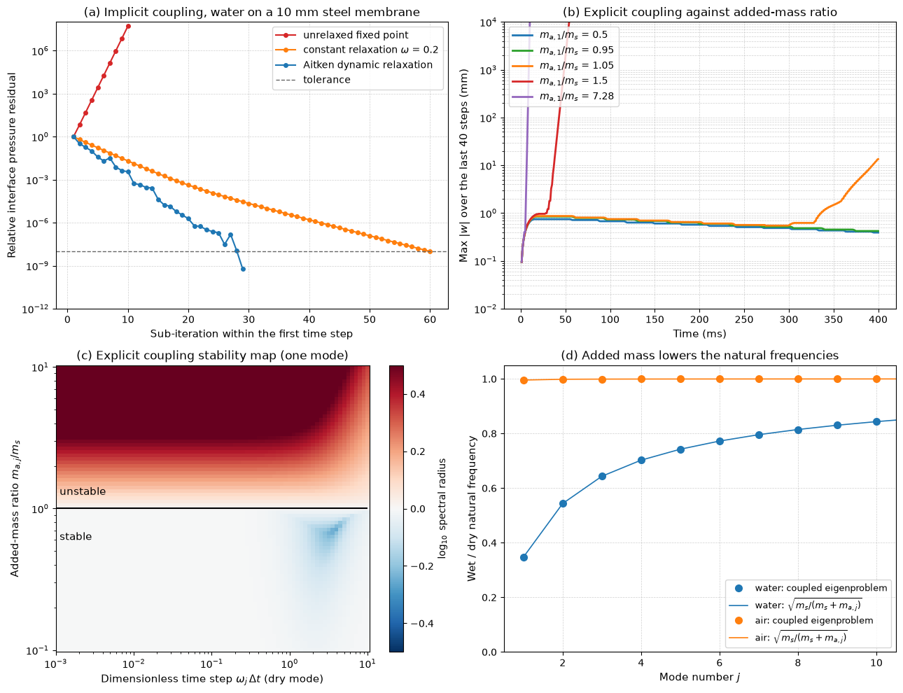

# Hydroelastic Applications

Hydroelasticity is the part of fluid loading in which the deformation of a structure changes the fluid load enough that the two must be solved together. In water the effect is strong because the fluid is dense: the water that moves with a vibrating structure can weigh as much as, or more than, the structure itself. This note develops the added mass of submerged bodies and its effect on natural frequencies, and then treats the main applications: ship hull springing and whipping, propeller blades, flexible risers and pipes conveying fluid, and sloshing in tanks. It ends with the modelling approaches, from added-mass corrections to coupled CFD and finite-element analysis.

## Problem Statement

Given an elastic structure (a beam, plate, shell or hull) fully or partly immersed in, or containing, a liquid of density $\rho$, with known structural mass, stiffness and damping, find its wet natural frequencies and mode shapes and its response to wave, flow, impact or machinery excitation. The structure is linear elastic with small deflections, and the fluid is usually taken as inviscid and incompressible, with irrotational motion and linearised free-surface conditions. After discretisation the coupled equations take the form

$$
\left[\mathbf{M}_s + \mathbf{A}(\omega)\right]\ddot{\mathbf{x}} +
\left[\mathbf{C}_s + \mathbf{B}(\omega)\right]\dot{\mathbf{x}} +
\left[\mathbf{K}_s + \mathbf{K}_h\right]\mathbf{x} = \mathbf{F}_{\mathrm{exc}}(t)
$$

where $\mathbf{M}_s$, $\mathbf{C}_s$ and $\mathbf{K}_s$ are the structural matrices, $\mathbf{A}(\omega)$ the hydrodynamic added mass, $\mathbf{B}(\omega)$ the radiation damping (energy carried away by the waves the structure makes), $`\mathbf{K}_h`$ the hydrostatic restoring stiffness and $`\mathbf{F}_{\mathrm{exc}}`$ the excitation by incident waves, flow or impacts. The three fluid terms are proportional to acceleration, velocity and displacement respectively. In a frequency-domain analysis they are evaluated at each frequency; in the time domain their frequency dependence becomes a convolution (memory) integral.

## Added Mass

### Potential-Flow Derivation for a Circular Cylinder

A circular cylinder of radius $a$ moving with velocity $U(t)$ through fluid at rest is, in the frame of the fluid, a doublet of strength $Ua^2$ with velocity potential

$$
\phi = -\frac{Ua^2\cos\theta}{r}
$$

which satisfies $\partial\phi/\partial r = U\cos\theta$ on $r = a$ and decays far away ([Potential Flow Theory](../../fluid_mechanics/inviscid_flow/potential_flow.md)). The kinetic energy of the fluid per unit length is

```math
T = \frac{\rho}{2}\int\left|\nabla\phi\right|^2dA = \frac{\rho}{2}\int_a^\infty\int_0^{2\pi} \frac{U^2a^4}{r^4}\, r\, d\theta\, dr = \frac12\left(\rho\pi a^2\right)U^2
```

The work done to accelerate the cylinder must supply this energy as well as the cylinder's own, so the fluid opposes the acceleration with a force $-m_a\dot{U}$, with added mass per unit length

$$
m_a = \rho\pi a^2 = \rho \frac{\pi D^2}{4}
$$

exactly the mass of the displaced fluid, so $C_a = m_a/(\rho\pi D^2/4) = 1$. The added mass is not a particular lump of water that moves with the body; it is the inertia of the whole disturbed flow field, expressed per unit acceleration of the body.

| Body and motion | Added mass | Reference |
| --- | --- | --- |
| Circular cylinder, any transverse direction | $\rho\pi D^2/4$ per unit length ($C_a = 1$) | Displaced fluid |
| Sphere, any direction | $\tfrac12\rho\frac{4}{3}\pi a^3$ ($C_a = 0.5$) | Displaced fluid |
| Flat plate of width $b$, normal to itself | $\rho\pi b^2/4$ per unit length | Circle of diameter $b$ |
| Cylinder of radius $a$ concentric in a rigid tube of radius $b$ | $`\rho\pi a^2\,(b^2 + a^2)/(b^2 - a^2)`$ per unit length | Displaced fluid |
| Any body moving along its own thin plane | approximately 0 |  |

Confinement raises the added mass sharply: a cylinder in a tube with $b/a = 1.4$ has $C_a = 3.1$. A free surface or a nearby wall also changes it, and for floating bodies the added mass depends on the oscillation frequency because the body radiates waves. Values for general shapes come from boundary-element (panel) computations or from tabulations such as Blevins (1979).

### Effect on Natural Frequencies

For a single-degree-of-freedom structure of mass $m_s$ and stiffness $k$,

$$
f_{\mathrm{wet}} = \frac{1}{2\pi} \sqrt{\frac{k}{m_s + m_a}} = f_{\mathrm{dry}}
\sqrt{\frac{m_s}{m_s + m_a}}
$$

For a continuous structure each mode has its own modal added mass, and higher modes, with shorter wavelengths, disturb the fluid less and have smaller added mass. The figure shows this for a 10 mm steel membrane on a 0.2 m layer of water, a model problem from the partitioned-coupling script: the first mode keeps only 35% of its dry frequency, because its added mass is 7.3 times the plate mass, while the tenth mode keeps 84%. In air the change is below 1%.



Panel (d) compares the coupled eigenvalue solution with $\sqrt{m_s/(m_s + m_{a,j})}$, mode by mode. The other three panels concern the numerical coupling of the two solvers and are discussed in [Fluid–Structure Interaction: Coupling Methods](./fluid_structure_interaction.md): the same ratio $m_a/m_s$ that lowers the frequencies also makes loosely coupled simulations unstable.

### Worked Example: Subsea Module on a Crane Wire

A subsea module of $3 \times 3 \times 2$ m with mass 15 000 kg is lowered on a crane wire of stiffness $k = 500$ kN/m. A panel computation gives a heave added-mass coefficient $C_a = 0.68$ based on the displaced volume of 18 m³ of seawater:

```math
m_a = 0.68 \times 1025 \times 18 = 12\,546 \text{ kg},
\qquad T_n = 2\pi \sqrt{\frac{15\,000 + 12\,546}{500\,000}} = 1.47 \text{ s}
```

In air the period would be 1.09 s. The added mass nearly doubles the inertia and moves the heave resonance towards the periods of vessel motion, so lifting analyses through the splash zone and heave-compensator settings must use wet properties.

## Ship Hull Hydroelasticity

A ship's hull girder is a free–free beam floating in water, and large, slender ships have low vertical bending frequencies. Treating the two-node vertical bending mode of a uniform hull of length $L$, flexural rigidity $EI$, mass per unit length $m$ and added mass per unit length $m_a$ as that of a free–free beam,

$$
f_{2} = \frac{4.730^2}{2\pi L^2} \sqrt{\frac{EI}{m + m_a}}
$$

For a 300 m container ship with $EI = 8 \times 10^{13}$ N·m², $m = 333$ t/m and a strip-theory added mass of 450 t/m, the dry frequency is 0.61 Hz and the wet frequency 0.40 Hz. Two kinds of hydroelastic response follow.

Springing is the steady resonant vibration of the hull girder by wave components at the two-node frequency, through linear excitation by short waves at high encounter frequency or by nonlinear (sum-frequency) wave forces. In head seas the encounter frequency is $\omega_e = \omega + \omega^2U/g$: at 12 m/s a 6 s wave is encountered at 0.38 Hz, close to the wet two-node frequency of the example. Springing adds many small stress cycles and can contribute a large part of the fatigue damage of large ships.

Whipping is the transient vibration of the hull girder after an impulsive load: bow-flare and bottom slamming, stern slamming, and green water on deck. It decays over a few tens of cycles but adds to the wave bending moment of the same wave, and for large container ships whipping can raise the extreme vertical bending moment by tens of per cent. Slam pressures are short and local and depend on the deadrise angle of the impacting section; their prediction is a free-surface CFD problem, and the hull response requires coupling the slam load with a hull girder model.

Analysis methods for ship hydroelasticity, in increasing order of cost:

1. Two-dimensional strip theory for the hydrodynamic coefficients with a Timoshenko beam for the hull, in the frequency domain.
2. Three-dimensional linear potential flow (panel methods) coupled with the wet modes of a finite-element hull model, the hydroelasticity theory of Bishop and Price (1979).
3. Nonlinear time-domain potential flow with slamming models.
4. Free-surface CFD (volume of fluid) coupled two-way with a finite-element or modal hull model, for slamming and green water.

## Propeller and Turbine Blades

Marine propeller and tidal-turbine blades are thin, and their wet natural frequencies are much lower than their dry ones because the added mass of a thin lifting surface in bending is of the order of $\rho\pi c^2/4$ per unit span for chord $c$. Their excitation comes from the non-uniform wake behind the hull, at the blade-passing frequency and its harmonics, and from vortex shedding at the trailing edge, which can lock onto a blade mode and produce a tonal noise ("singing"); a modified trailing-edge bevel breaks the coherence of the shedding. Composite and flexible blades are designed to bend and twist under load, so their hydrodynamic performance must be computed on the deformed shape, a two-way coupled problem.

## Flexible Risers and Pipes Conveying Fluid

Risers and flowlines combine external flow-induced vibration ([Flow-Induced Vibrations](./flow_induced_vibrations.md)) with the effect of the internal flow. For a pipe of flexural rigidity $EI$ and mass $m_s$ per unit length conveying fluid of mass $m_f = \rho_fA_i$ per unit length at speed $U$, the transverse motion obeys

```math
EI \frac{\partial^4y}{\partial x^4} + m_fU^2 \frac{\partial^2y}{\partial x^2} + 2m_fU
\frac{\partial^2y}{\partial x\,\partial t} + (m_s + m_f)
\frac{\partial^2y}{\partial t^2} = 0
```

The $m_fU^2$ term acts like a compressive axial force from the centrifugal effect of the fluid following the curved pipe, and the $2m_fU$ term is a Coriolis (gyroscopic) term. For a pipe supported at both ends the fluid force lowers the natural frequencies until, at

$$
U_{cr} = \frac{\pi}{L} \sqrt{\frac{EI}{m_f}}
$$

the first frequency reaches zero and the pipe buckles (divergence). A cantilevered pipe, such as a hose discharging freely, loses stability by flutter instead, because the gyroscopic term does work on the oscillation. Pressure and internal flow also enter the effective tension, which controls the global configuration and natural frequencies of a riser.

### Worked Example: Divergence of a Steel Pipe

A simply supported steel pipe 6 m long with outer diameter 0.15 m and wall thickness 10 mm carries water. Then $A_i = \pi(0.13)^2/4 = 0.01327$ m², $I = \pi(0.15^4 - 0.13^4)/64 = 1.083 \times 10^{-5}$ m⁴, $EI = 2.274 \times 10^6$ N·m², $m_f = 13.27$ kg/m and

$$
U_{cr} = \frac{\pi}{6} \sqrt{\frac{2.274 \times 10^6}{13.27}} = 0.524 \times 414 = 217
\text{ m/s}
$$

far above any pipeline velocity. Divergence becomes a practical concern only for soft hoses and very long unsupported spans.

## Sloshing

A liquid with a free surface in a partly filled tank has its own natural modes. For a rectangular tank of length $L_t$ filled to depth $h$, linear potential theory gives the longitudinal sloshing frequencies

$$
\omega_n^2 = g \frac{n\pi}{L_t}\tanh\left(\frac{n\pi h}{L_t}\right),
\qquad n = 1, 2, \dots
$$

A cargo tank 40 m long filled to 10 m has a first sloshing period of 8.8 s, within the range of ship roll and pitch periods. Resonant sloshing produces impact pressures on the tank walls and roof, which are short, very high and statistically scattered, and the liquid's motion couples with the ship's roll through the shift of its centre of mass. Membrane LNG carriers therefore restrict the fill levels at which they may sail, and tanks are fitted with baffles that change the sloshing frequencies and add damping. Sloshing in fuel tanks of aircraft and launch vehicles couples with the attitude control system in the same way. Impact pressures are computed with free-surface CFD and calibrated against model tests (Faltinsen and Timokha 2009).

## Modelling Approaches

| Approach | Fluid model | Suits | Limitations |
| --- | --- | --- | --- |
| Added-mass correction | Potential-flow or tabulated $C_a$ | Natural frequencies of submerged members, first estimates | No damping, no excitation, constant $C_a$ |
| Acoustic or potential fluid elements in FE | Linear, incompressible or acoustic fluid meshed around the structure | Wet modes of tanks, hulls, dams under earthquake | Linear, no flow, no free-surface waves in the simplest form |
| Strip theory or panel method with modal structure | Linear potential flow with free surface | Ship and offshore hydroelasticity in waves | Small motions, no slamming or breaking |
| Partitioned CFD with FE | Navier–Stokes with free surface (VOF) | Slamming, green water, sloshing impacts, flexible blades | Expensive; added-mass instability of loosely coupled schemes |

The first two rows are one-way corrections built into the structural model; the last two are two-way coupled analyses whose numerical treatment is the subject of [Fluid–Structure Interaction: Coupling Methods](./fluid_structure_interaction.md). The [FSI theory note](../../fluid_mechanics/specialized_topics/fluid_structure_interaction.md) gives the general field equations and interface conditions.

## Key Takeaways

- Added mass is the inertia of the disturbed fluid; for a circular cylinder it equals the displaced mass, $\rho\pi D^2/4$ per unit length.
- Wet natural frequencies are $f_{\mathrm{dry}}\sqrt{m_s/(m_s + m_a)}$ mode by mode; low modes and thin, light structures in water are affected most.
- Large ships have two-node frequencies low enough to be excited by waves (springing) and by slamming (whipping).
- Internal flow softens a pipe and can make it diverge or flutter; external flow causes VIV.
- Sloshing frequencies of partly filled tanks can coincide with vessel motions and produce impact loads.

## Related Scripts

- [Partitioned Fluid–Structure Coupling and the Added-Mass Instability](../../../scripts/algorithms/fluid_loading_partitioned_fsi/): couples a structure solver and a fluid solver through their interface in the Dirichlet–Neumann way used by partitioned FSI codes, and shows that explicit coupling becomes unstable once the added mass of the fluid exceeds the structural mass, whatever the time step, while implicit coupling with Aitken relaxation converges to the monolithic solution.
- [Ship Hull in Water](../../../scripts/plots/ship_hull_in_water/): draws a side-view sketch of a ship hull sitting in a sinusoidal free-surface wave and annotates it with the Froude number $Fr = U/\sqrt{gL}$.

## Exercises

**Exercise 1.** A steel pipe of outer diameter 0.5 m with sealed ends has structural mass 150 kg/m and vibrates transversely in seawater ($\rho = 1025$ kg/m³). With $C_a = 1$, find the added mass per unit length and the reduction of the natural frequency compared with air.

<details>
<summary>Answer</summary>

```math
m_a = C_a\rho\frac{\pi D^2}{4} = 1025 \times \frac{\pi \times 0.25}{4} = 201 \text{ kg/m}
```

```math
\frac{f_{\mathrm{wet}}}{f_{\mathrm{dry}}} = \sqrt{\frac{150}{150 + 201}} = 0.653
```

The natural frequency drops by 35%.

</details>

**Exercise 2.** A rectangular cargo tank is 40 m long. Find the first sloshing period at fill depths of 10 m and 20 m. If the ship's pitch period is about 8 s, which filling is more critical?

<details>
<summary>Answer</summary>

With $k = \pi/40 = 0.0785$ rad/m:

```math
h = 10 \text{ m}: \quad \omega_1 = \sqrt{9.81 \times 0.0785 \tanh(0.785)} = 0.711 \text{ rad/s}, \quad T_1 = 8.8 \text{ s}
```

```math
h = 20 \text{ m}: \quad \omega_1 = \sqrt{9.81 \times 0.0785 \tanh(1.571)} = 0.841 \text{ rad/s}, \quad T_1 = 7.5 \text{ s}
```

Both are close to 8 s, so both fillings are critical: 8 s lies between the two periods. Partial fills in this range are what fill-level restrictions forbid.

</details>

**Exercise 3.** For the pipe of the divergence example, how long would a simply supported span have to be for the divergence velocity to fall to 10 m/s?

<details>
<summary>Answer</summary>

```math
L = \frac{\pi}{U_{cr}}\sqrt{\frac{EI}{m_f}} = \frac{\pi}{10} \times 414 = 130 \text{ m}
```

An unsupported 130 m steel span is unrealistic, so divergence does not govern stiff steel piping. It governs soft hoses, where $EI$ is orders of magnitude smaller.

</details>

**Exercise 4.** A heaving wave-energy converter at resonance is driven by an excitation force of amplitude $|F_{\mathrm{exc}}|$ and has radiation damping $b_r$. A power take-off adds linear damping $b_p$. Show that the mean absorbed power is largest when $b_p = b_r$ and equals $|F_{\mathrm{exc}}|^2/(8b_r)$. Evaluate it for $|F_{\mathrm{exc}}| = 500$ kN and $b_r = 200$ kN·s/m.

<details>
<summary>Answer</summary>

At resonance the inertia and stiffness terms cancel, so the velocity amplitude is $V = |F_{\mathrm{exc}}|/(b_r + b_p)$ and the mean absorbed power is

```math
P = \frac12 b_pV^2 = \frac12\frac{b_p|F_{\mathrm{exc}}|^2}{(b_r + b_p)^2}
```

Setting $dP/db_p = 0$ gives $(b_r + b_p) - 2b_p = 0$, so $b_p = b_r$, and then $P_{\max} = |F_{\mathrm{exc}}|^2/(8b_r)$:

```math
P_{\max} = \frac{(5 \times 10^5)^2}{8 \times 2 \times 10^5} = 156 \text{ kW}
```

Radiation damping is a hydroelastic quantity in its own right: a body that absorbs wave energy well must also radiate waves well.

</details>

**Exercise 5.** For the subsea module of the worked example (effective mass 27 546 kg in water), what crane-wire stiffness keeps the heave natural period below 1.0 s? What period would the submerged system have if the wire had been sized using the dry mass?

<details>
<summary>Answer</summary>

```math
k \ge \frac{4\pi^2m_{\mathrm{eff}}}{T_n^2} = 39.48 \times 27\,546 = 1.09 \text{ MN/m}
```

The dry mass of 15 000 kg would suggest $k = 0.59$ MN/m. With that wire the submerged module would have a period of $`2\pi\sqrt{27\,546/592\,000} = 1.36`$ s, 36% longer than intended.

</details>

## References

- Bishop, R. E. D., & Price, W. G., *Hydroelasticity of Ships*, Cambridge University Press, 1979.
- Newman, J. N., *Marine Hydrodynamics*, MIT Press, 1977.
- Faltinsen, O. M., *Sea Loads on Ships and Offshore Structures*, Cambridge University Press, 1990.
- Faltinsen, O. M., & Timokha, A. N., *Sloshing*, Cambridge University Press, 2009.
- Païdoussis, M. P., *Fluid-Structure Interactions: Slender Structures and Axial Flow*, Vol. 1, Academic Press, 1998.
- Blevins, R. D., *Formulas for Natural Frequency and Mode Shape*, Van Nostrand Reinhold, 1979.
- Sumer, B. M., & Fredsøe, J., *Hydrodynamics Around Cylindrical Structures*, revised ed., World Scientific, 2006.
- Rao, S. S., *Mechanical Vibrations*, 6th ed., Pearson, 2017.
