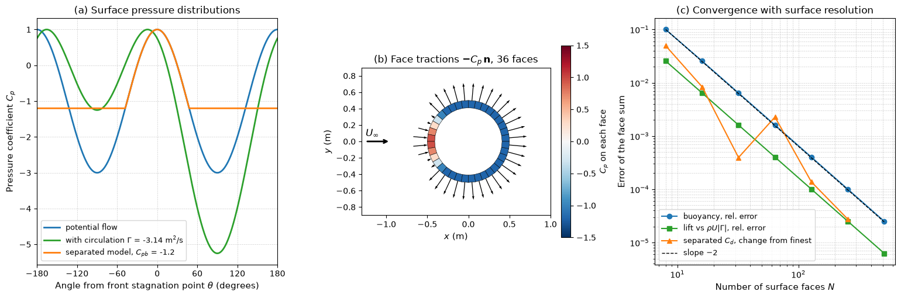

# Pressure Forces on Structures

A fluid acts on a structure through the pressure and the shear stress on its wetted surface, and every fluid load in this section is an integral of those two quantities. This note treats the cases that can be integrated by hand, hydrostatic pressure on plane and curved surfaces with their centres of pressure, buoyancy and the stability of floating bodies, and then the general case of a flowing fluid: the pressure coefficient, and the integration of a surface field computed by CFD into forces and moments. The same face sum is what a CFD code evaluates when it reports a drag coefficient, so the second half of the note is where structural loading and [CFD post-processing](../../numerical/cfd/cfd_process.md) meet.

## Problem Statement

Given a rigid surface $S$ in contact with a fluid, with outward unit normal $\mathbf{n}$ (pointing from the body into the fluid), and the pressure $p$ and wall shear stress $\boldsymbol{\tau}_w$ on it, find the resultant force, the resultant moment about a chosen point, and the line of action of the resultant. The fluid is either at rest, in which case $p$ follows from hydrostatics, or moving, in which case $p$ and $\boldsymbol{\tau}_w$ come from potential-flow theory, measurement or a CFD solution. The governing relations are

```math
\mathbf{F} = \int_S \left(-p\,\mathbf{n} + \boldsymbol{\tau}_w\right) dA,
\qquad \mathbf{M}_O = \int_S \mathbf{r} \times
\left(-p\,\mathbf{n} + \boldsymbol{\tau}_w\right) dA
```

where $\mathbf{r}$ is the position relative to $O$. In a fluid at rest $\boldsymbol{\tau}_w = \mathbf{0}$ and

```math
\nabla p = \rho\,\mathbf{g} \quad\Longrightarrow\quad p = p_0 + \rho g h
```

with $p_0$ the pressure at the free surface and $h$ the depth below it. The structure is assumed rigid for the purpose of computing the load; if its deformation changes the pressure, the problem becomes a coupled one ([Fluid–Structure Interaction: Coupling Methods](./fluid_structure_interaction.md)).

## Hydrostatic Pressure

When the atmosphere acts on both sides of a wall, $p_0$ cancels and only the gauge pressure $p = \rho g h$ produces a net load. The pressure increases linearly with depth, at $\rho g = 9.81$ kPa per metre in fresh water and $10.06$ kPa per metre in seawater ($\rho = 1025$ kg/m³). A constant pressure acting on all of a closed surface produces no net force, because $`\oint_S \mathbf{n}\,dA = \mathbf{0}`$; this is why gauge pressure is enough for submerged bodies and for CFD force integration, but not for a plate or shell loaded on one side only, where the reference pressure on the dry side must be stated. The [hydrostatics note](../../fluid_mechanics/fluid_statics/hydrostatics.md) derives the pressure distribution and treats manometry.

## Plane Surfaces

### Resultant Force

Take a plane surface of area $A$ inclined at angle $\theta$ to the free surface. Measure $y$ along the plane from the line where the plane meets the free surface, so that a point at distance $y$ is at depth $h = y\sin\theta$. The force on an element is $`dF = \rho g y\sin\theta\,dA`$, and integrating gives

```math
F = \rho g\sin\theta\int_A y\, dA = \rho g\sin\theta\,\bar{y}A = \rho g\bar{h}A
```

where $\bar{y}$ is the distance of the centroid along the plane and $\bar{h} = \bar{y}\sin\theta$ its depth. The resultant equals the pressure at the centroid times the area, whatever the shape.

### Centre of Pressure

The resultant does not act at the centroid, because the pressure is larger on the deeper part of the surface. Equating the moment of the resultant about the free-surface line with the moment of the distributed pressure,

```math
F y_{cp} = \rho g\sin\theta\int_A y^2\, dA = \rho g\sin\theta\, I_{x}
```

and using the parallel-axis theorem $I_x = I_{xc} + A\bar{y}^2$,

$$
y_{cp} = \bar{y} + \frac{I_{xc}}{\bar{y}A}
$$

where $I_{xc}$ is the second moment of area of the surface about its centroidal axis parallel to the free-surface line. The centre of pressure is always below the centroid, and the offset $I_{xc}/(\bar{y}A)$ shrinks as the surface is submerged deeper. For a surface without a vertical axis of symmetry the lateral position is $x_{cp} = \bar{x} + I_{xyc}/(\bar{y}A)$, with $I_{xyc}$ the centroidal product of area.

| Shape | Area $A$ | $I_{xc}$ |
| --- | --- | --- |
| Rectangle, width $b$, height $d$ | $bd$ | $bd^3/12$ |
| Circle, diameter $D$ | $\pi D^2/4$ | $\pi D^4/64$ |
| Triangle, base $b$, height $d$ (axis parallel to base) | $bd/2$ | $bd^3/36$ |
| Semicircle, radius $R$ (axis parallel to diameter) | $\pi R^2/2$ | $0.1098R^4$ |

The formula assumes gauge pressure is zero at the free surface. If the surface of the liquid is pressurised (a closed tank), replace the actual free surface by an imaginary one at height $p_0/(\rho g)$ above it.

### Worked Example: Dam Wall

A vertical rectangular gate 30 m wide and 12 m high retains fresh water to its top. With $\bar{h} = 6$ m and $A = 360$ m²,

$$
F = 1000 \times 9.81 \times 6 \times 360 = 21.19 \text{ MN}
$$

and with $I_{xc} = 30 \times 12^3/12 = 4320$ m⁴,

$$
y_{cp} = 6 + \frac{4320}{6 \times 360} = 8 \text{ m}
$$

below the surface, that is 4 m above the base. This is the general result for a rectangle that reaches the surface: the triangular pressure distribution acts at two thirds of the depth.

### Worked Example: Circular Gate

A vertical circular gate of diameter 2 m is hinged along its top edge, with its centre 5 m below the surface. Then $A = \pi$ m², $I_{xc} = \pi/4$ m⁴ and

$$
F = 1000 \times 9.81 \times 5 \times \pi = 154.1 \text{ kN},
\qquad y_{cp} = 5 + \frac{\pi/4}{5\pi} = 5.05 \text{ m}
$$

The hinge is at 4 m depth, so the moment the gate actuator must resist is $154.1 \times 1.05 = 161.8$ kN·m. Using the centroid instead of the centre of pressure would give 154.1 kN·m, 5% low; for a gate near the surface the error is much larger.

## Curved Surfaces

On a curved surface the pressure acts in a different direction on every element, so the components are found separately from equilibrium of a block of fluid.

1. The horizontal component $F_H$ equals the force on the vertical projection of the surface onto a plane normal to that component, $`F_H = \rho g\bar{h}_{vp}A_{vp}`$, and acts through the centre of pressure of the projection.
2. The vertical component $F_V$ equals the weight of the fluid between the surface and the free surface (real or imaginary), $F_V = \rho g\mathcal{V}$, and acts through the centroid of that volume. If the fluid is below the surface, $F_V$ points upward and equals the weight of the fluid that would fill the space up to the free surface.
3. The resultant is $F_R = \sqrt{F_H^2 + F_V^2}$ at $\alpha = \arctan(F_V/F_H)$ to the horizontal. For a circular-arc surface every elementary force passes through the centre of the arc, so the resultant does too.

Tainter (radial) gates are shaped this way on purpose: the water load passes through the trunnion, so it produces no moment about the pivot and the hoist only lifts the weight of the gate and overcomes friction.

## Buoyancy and Floating Stability

Applying the curved-surface rule to a closed submerged body gives Archimedes' principle: the horizontal components cancel and the net vertical force is the weight of the displaced fluid, $F_B = \rho_f g\mathcal{V}_{\mathrm{disp}}$, acting through the centroid $B$ of the displaced volume. A floating body settles at the draft where $F_B$ equals its weight.

For small heel angles $\phi$ the centre of buoyancy moves sideways, and the line of action of the buoyant force crosses the centreline at the metacentre $M$, a height

$$
BM = \frac{I_{wp}}{\mathcal{V}_{\mathrm{disp}}}
$$

above $B$, where $I_{wp}$ is the second moment of the waterplane area about the heel axis. The restoring moment is $W\cdot GM\sin\phi$ with metacentric height $GM = KB + BM - KG$, measured from the keel $K$. The body is stable when $GM > 0$, neutral when $GM = 0$ and capsizes from the upright position when $GM < 0$. $GM$ also sets the roll stiffness $W\cdot GM$ that, with the roll inertia including added mass, fixes the roll natural period ([Hydroelastic Applications](./hydroelastic_applications.md)).

### Worked Example: Barge

A rectangular barge 20 m long and 8 m wide has mass 200 t with its centre of gravity 1.8 m above the keel, in seawater. The draft is $`T = m/(\rho LB) = 200\,000/(1025 \times 20 \times 8) = 1.22`$ m, so $KB = 0.61$ m. The waterplane gives $I_{wp} = LB^3/12 = 853.3$ m⁴ and $\mathcal{V}_{\mathrm{disp}} = 195.1$ m³, hence $BM = 4.37$ m and

$$
GM = 0.61 + 4.37 - 1.80 = 3.18 \text{ m}
$$

The barge is stable. Because $BM \propto B^2/T$, a wide, shallow hull is very stiff in roll, and stacking deck cargo high (raising $KG$) is what erodes the margin.

## Pressure in a Moving Fluid

In steady, incompressible flow without losses, Bernoulli's equation along a streamline relates the local pressure to the local speed $V$:

$$
p + \tfrac12\rho V^2 = p_\infty + \tfrac12\rho U^2
$$

where $p_\infty$ and $U$ are the free-stream values ([Bernoulli's Equation](../../fluid_mechanics/inviscid_flow/bernoulli.md)). The dynamic pressure $q = \tfrac12\rho U^2$ is the natural pressure scale, and the pressure coefficient

$$
C_p = \frac{p - p_\infty}{\tfrac12\rho U^2} = 1 - \left(\frac{V}{U}\right)^2
$$

is $+1$ at a stagnation point, $0$ where the local speed equals the free stream and negative where the flow accelerates. The second equality holds only where Bernoulli applies; in a separated wake $C_p$ is set by the separated flow, not by the local speed. For potential flow past a circular cylinder the surface speed is $2U\sin\theta$ ([Potential Flow Theory](../../fluid_mechanics/inviscid_flow/potential_flow.md)), so $C_p = 1 - 4\sin^2\theta$, with $\theta$ measured from the front stagnation point, and the minimum $C_p = -3$ occurs at the shoulders. Wind and wave loads are written in terms of $q$ and coefficients: $p = C_p q$ on a surface, $F = C_D q A$ for a whole body.

## Integrating a Surface Field into Forces and Moments

A CFD solution provides $p$ and $\boldsymbol{\tau}_w$ at the centres of the boundary faces $f$, each with area $A_f$, outward unit normal $\mathbf{n}_f$ and centroid $\mathbf{r}_f$. The integrals of the problem statement become sums:

```math
\mathbf{F} = \sum_f \left(-p_f\,\mathbf{n}_f + \boldsymbol{\tau}_{w,f}\right) A_f,
\qquad \mathbf{M}_O = \sum_f \left(\mathbf{r}_f - \mathbf{r}_O\right) \times
\left(-p_f\,\mathbf{n}_f + \boldsymbol{\tau}_{w,f}\right) A_f
```

The first term is the pressure (form) force and the second the friction force. Projected on the free-stream direction they give pressure drag and friction drag; their ratio separates streamlined bodies, where friction dominates, from bluff bodies, where pressure drag dominates ([Understanding Drag](../../fluid_mechanics/viscous_flow/drag.md)). The coefficients are

$$
C_D = \frac{F_x}{qA_{\mathrm{ref}}},
\qquad C_L = \frac{F_y}{qA_{\mathrm{ref}}},
\qquad C_M = \frac{M_z}{qA_{\mathrm{ref}}L_{\mathrm{ref}}}
$$

with a reference area $A_{\mathrm{ref}}$ (frontal area for bluff bodies, plan area for wings, diameter times length for cylinders) and reference length $L_{\mathrm{ref}}$ that must be reported with every coefficient.

The figure applies the face sum to a cylinder of radius 0.5 m on an inscribed polygon of $N$ faces, with three pressure fields. Potential flow gives zero drag on every mesh, d'Alembert's paradox, and potential flow with circulation gives the Kutta–Joukowski lift $\rho U|\Gamma|$ to 0.0006% on 512 faces. The third field is an illustrative separated flow: the potential-flow $C_p$ is followed until it falls to a base pressure $C_{pb} = -1.2$ and stays there over the rear. The front–rear pressure imbalance gives $C_d = 1.088$, close to measured values at subcritical Reynolds numbers.



In panel (b), pressure pushes on the front faces while suction pulls on the sides and the rear. Panel (c) shows that the face sum converges at second order: for a linear (hydrostatic) field it is exact on the polygon, so the whole error in the buoyancy comes from approximating the circle by flat faces.

### Worked Example: Drag from a Pressure Distribution

For the separated-flow model the pressure is $C_p = 1 - 4\sin^2\theta$ for $\theta < \theta_s$ and $C_p = C_{pb}$ beyond, with $\sin^2\theta_s = (1 - C_{pb})/4$. On a cylinder of diameter $2a$, the drag per unit length is $`\int_0^{2\pi} p\cos\theta\,a\,d\theta`$ (the outward normal has a component $-\cos\theta$ along the stream), so

```math
C_d = \frac{1}{2}\int_0^{2\pi} C_p\cos\theta\,
d\theta = \left[s - \frac{4}{3}s^3\right] - C_{pb}\, s,
\qquad s = \sin\theta_s
```

With $C_{pb} = -1.2$, $s = \sqrt{0.55} = 0.742$, $\theta_s = 47.9^\circ$ and $C_d = 0.742 - 0.544 + 0.890 = 1.088$, which is the value the face sum converges to. The base pressure contributes 0.89 of it: drag on a bluff body is mostly the suction on its rear, and anything that raises the base pressure (a splitter plate, base bleed, a tapered tail) lowers the drag.

## Common Mistakes

- Using the centroid instead of the centre of pressure for moments about a hinge or base.
- Mixing absolute and gauge pressure on a one-sided surface, or forgetting a pressurised gas cushion above a liquid.
- Integrating CFD pressure with inward-pointing normals, which flips the sign of every force component. A quick check is the force on the body in a uniform-pressure field, which must be zero.
- Leaving out the friction term for a streamlined body, or comparing coefficients built on different reference areas.
- Reporting the moment about an unstated point. Moments transfer between points as $`\mathbf{M}_{O'} = \mathbf{M}_O + (\mathbf{r}_O - \mathbf{r}_{O'}) \times \mathbf{F}`$.
- Averaging $C_D$ over an unconverged or too short unsteady record, when vortex shedding makes the instantaneous force oscillate.

## Key Takeaways

- The hydrostatic force on a plane surface is the centroid pressure times the area; it acts at $y_{cp} = \bar{y} + I_{xc}/(\bar{y}A)$, below the centroid.
- Curved surfaces are handled by components: the force on the vertical projection and the weight of the fluid above.
- In moving fluids, loads scale with $q = \tfrac12\rho U^2$ and are expressed by $C_p$, $C_D$, $C_L$ and $C_M$ with stated reference area and length.
- Every fluid load is the surface integral of $`-p\,\mathbf{n} + \boldsymbol{\tau}_w`$; a CFD code evaluates it as a face sum, which converges at second order with surface resolution.
- On bluff bodies the drag is mostly base suction, which potential flow cannot predict.

## Related Scripts

- [Surface Force Integration over Boundary Faces](../../../scripts/algorithms/fluid_loading_surface_force_integration/): integrates a surface pressure and wall-shear field over the flat faces of a body into a force and a moment, the same face sum a CFD code uses to report drag, lift and moment coefficients.
- [Pressure Variation with Depth](../../../scripts/plots/pressure_variation_with_depth/): plots how hydrostatic pressure increases linearly with depth below the free surface of a fluid at rest.

## Exercises

**Exercise 1.** A vertical rectangular gate 2 m wide and 3 m tall has its top edge 1.5 m below the free surface of fresh water. Find the resultant force and the depth of the centre of pressure.

<details>
<summary>Answer</summary>

The centroid depth is $\bar{h} = 1.5 + 1.5 = 3$ m and $A = 6$ m².

```math
F = \rho g\bar{h}A = 1000 \times 9.81 \times 3 \times 6 = 176.6 \text{ kN}
```

```math
y_{cp} = \bar{y} + \frac{I_{xc}}{\bar{y}A} = 3 + \frac{2 \times 3^3/12}{3 \times 6} = 3 + 0.25 = 3.25 \text{ m}
```

</details>

**Exercise 2.** A rectangular plate 1.5 m wide and 2 m long, measured along its slope, lies in a plane inclined at $30^\circ$ to the horizontal, with its top edge 1 m below the surface of fresh water. Find the resultant force and the position of the centre of pressure along the incline.

<details>
<summary>Answer</summary>

Along the incline the top edge is $1/\sin 30^\circ = 2$ m from the surface line, so $\bar{y} = 3$ m and $\bar{h} = 3\sin 30^\circ = 1.5$ m. The area is $A = 3$ m².

```math
F = 1000 \times 9.81 \times 1.5 \times 3 = 44.1 \text{ kN}
```

```math
I_{xc} = \frac{1.5 \times 2^3}{12} = 1.0 \text{ m}^4, \qquad y_{cp} = 3 + \frac{1.0}{3 \times 3} = 3.11 \text{ m}
```

The centre of pressure is 3.11 m from the surface line along the incline, 1.11 m below the top edge.

</details>

**Exercise 3.** A gate has the shape of a quarter circle of radius $R = 2$ m and is 4 m wide. Water lies above the gate, filling the quarter-circle region between the curved surface and the free surface, which is level with the top of the gate. Find the horizontal and vertical force components and the resultant.

<details>
<summary>Answer</summary>

The vertical projection is 2 m high and 4 m wide, with centroid at 1 m depth:

```math
F_H = 1000 \times 9.81 \times 1 \times 8 = 78.5 \text{ kN}
```

The water above the gate occupies a quarter disc of area $\pi R^2/4 = \pi$ m², so

```math
F_V = \rho g\mathcal{V} = 9810 \times 4\pi = 123.3 \text{ kN}
```

```math
F_R = \sqrt{78.5^2 + 123.3^2} = 146.1 \text{ kN}, \qquad \alpha = \arctan\frac{123.3}{78.5} = 57.5^\circ
```

The resultant passes through the centre of the circle.

</details>

**Exercise 4.** A solid wooden cube of side 0.5 m and density 600 kg/m³ floats in fresh water with one face horizontal. Find its draft and metacentric height. Is this orientation stable?

<details>
<summary>Answer</summary>

The draft is $T = 0.5 \times 600/1000 = 0.3$ m, so $KB = 0.15$ m and $KG = 0.25$ m.

```math
BM = \frac{I_{wp}}{\mathcal{V}_{\mathrm{disp}}} = \frac{0.5^4/12}{0.5 \times 0.5 \times 0.3} = \frac{0.005208}{0.075} = 0.069 \text{ m}
```

```math
GM = KB + BM - KG = 0.15 + 0.069 - 0.25 = -0.031 \text{ m}
```

$GM < 0$, so the upright orientation is unstable and the cube heels over to a tilted equilibrium.

</details>

**Exercise 5.** A CFD solution of flow past a cylinder gives a pressure distribution that is well approximated by the separated-flow model of this note, but with a base pressure $C_{pb} = -0.9$. Find the separation angle of the model and its pressure drag coefficient. A colleague integrates the absolute pressure $p_\infty + qC_p$ instead of the gauge pressure; does that change the result?

<details>
<summary>Answer</summary>

$s^2 = \sin^2\theta_s = (1 + 0.9)/4 = 0.475$, so $s = 0.689$ and $\theta_s = 43.6^\circ$.

```math
C_d = s - \frac{4}{3}s^3 - C_{pb}\,s = 0.689 - 0.436 + 0.620 = 0.873
```

The less negative base pressure lowers the drag by 20% compared with $C_{pb} = -1.2$. Adding a constant $p_\infty$ changes nothing, because $`\oint\mathbf{n}\,dA = \mathbf{0}`$ on the closed surface of the cylinder. It would matter for a surface open to a different pressure on its other side, such as a cladding panel with internal pressure behind it.

</details>

## References

- White, F. M., *Fluid Mechanics*, 7th ed., McGraw-Hill, 2011.
- Munson, B. R., Rothmayer, A. P., Okiishi, T. H., & Huebsch, W. W., *Fundamentals of Fluid Mechanics*, 7th ed., Wiley, 2013.
- Rawson, K. J., & Tupper, E. C., *Basic Ship Theory*, 5th ed., Butterworth-Heinemann, 2001.
- Anderson, J. D., *Fundamentals of Aerodynamics*, 6th ed., McGraw-Hill, 2017.
- Ferziger, J. H., Perić, M., & Street, R. L., *Computational Methods for Fluid Dynamics*, 4th ed., Springer, 2020.
- Zdravkovich, M. M., *Flow Around Circular Cylinders, Volume 1: Fundamentals*, Oxford University Press, 1997.
