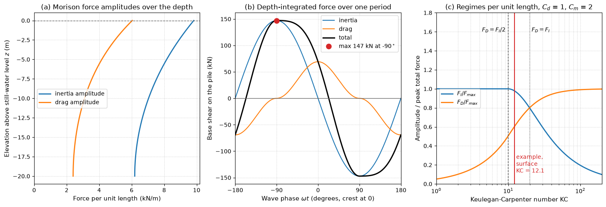

# Wave Loading on Offshore Structures

Surface waves are the dominant environmental load on fixed and floating offshore structures, offshore wind turbine foundations, piers, breakwaters and subsea pipelines. A wave load calculation has three parts: a wave theory that gives the water particle velocity and acceleration, a force model that turns those kinematics into a load on the structure (the Morison equation for slender members, diffraction theory for large bodies), and a statistical description of the sea, through a wave spectrum, that says which waves to use. This note develops linear (Airy) wave theory, the Morison equation and its regimes, the MacCamy–Fuchs diffraction correction and the standard spectra, with a worked monopile example.

## Problem Statement

Given a structure of characteristic member diameter $D$ in water of depth $h$, with drag and inertia coefficients $C_d$ and $C_m$ for its members, and a sea state described either by a regular design wave (height $H$, period $T$) or by a spectrum (significant height $H_s$, peak period $T_p$), find the distributed load on each member, the total base shear and overturning moment over a wave cycle, and their maxima, or their statistics in an irregular sea.

The fluid is inviscid and incompressible with irrotational wave motion, the wave steepness $H/L$ and the relative height $H/h$ are small (linear theory), and the seabed is flat. The kinematics follow from a velocity potential $\phi$ with

$$
\nabla^2\phi = 0 \quad (-h < z < 0),
\qquad \frac{\partial\phi}{\partial z} = 0 \quad (z = -h)
$$

and the linearised free-surface conditions at $z = 0$,

$$
\frac{\partial\eta}{\partial t} = \frac{\partial\phi}{\partial z},
\qquad \frac{\partial\phi}{\partial t} + g\eta = 0
$$

where $\eta(x, t)$ is the surface elevation and $z$ is measured upward from the still-water level. The load on a slender fixed member then follows from the Morison equation,

```math
f = \tfrac12\rho C_dD\,|u|\, u + \rho C_m \frac{\pi D^2}{4}\,\dot{u}
```

per unit length, with $u$ and $\dot{u}$ the undisturbed horizontal particle velocity and acceleration at the member axis.

## Linear Wave Theory

### Dispersion Relation

A progressive wave $\eta = a\cos(kx - \omega t)$ with amplitude $a = H/2$, wave number $k = 2\pi/L$ and angular frequency $\omega = 2\pi/T$ satisfies the boundary conditions with $\phi \propto \cosh k(z + h)\sin(kx - \omega t)$ only if

$$
\omega^2 = gk\tanh(kh)
$$

For a given period this is an implicit equation for $k$. Newton's method on $f(k) = gk\tanh(kh) - \omega^2$ converges in three or four steps from the starting value $k_0/\sqrt{\tanh(k_0h)}$ with $k_0 = \omega^2/g$, which is within a few per cent of the root at any depth. The phase speed is $c = \omega/k$ and the energy travels at the group velocity $c_g = nc$, with $n = \tfrac12[1 + 2kh/\sinh(2kh)]$.

| Regime | Condition | Dispersion | Phase speed | Group velocity |
| --- | --- | --- | --- | --- |
| Deep water | $h/L > 0.5$ ($kh > \pi$) | $\omega^2 = gk$, $L_0 = gT^2/(2\pi)$ | $gT/(2\pi)$ | $c/2$ |
| Intermediate | $0.05 < h/L < 0.5$ | full relation | $\sqrt{(g/k)\tanh kh}$ | $nc$ |
| Shallow water | $h/L < 0.05$ ($kh < \pi/10$) | $\omega = k\sqrt{gh}$ | $\sqrt{gh}$ | $c$ |

Deep-water waves are dispersive (long waves travel faster), while shallow-water waves all travel at $\sqrt{gh}$, which is the speed seen in the [shallow-water ripples simulation](../../../scripts/simulations/shallow_water_ripples/).

### Particle Kinematics and Pressure

Under the wave $\eta = a\cos(kx - \omega t)$ the horizontal and vertical velocities, the horizontal acceleration and the dynamic pressure are

$$
u = a\omega \frac{\cosh k(z + h)}{\sinh kh}\cos(kx - \omega t),
\qquad w = a\omega \frac{\sinh k(z + h)}{\sinh kh}\sin(kx - \omega t)
$$

$$
\dot{u} = a\omega^2 \frac{\cosh k(z + h)}{\sinh kh}\sin(kx - \omega t),
\qquad p_d = \rho ga \frac{\cosh k(z + h)}{\cosh kh}\cos(kx - \omega t)
$$

Particles move on ellipses that shrink with depth; in deep water they are circles of radius $ae^{kz}$, so the motion has almost died out half a wavelength down. The horizontal velocity peaks under the crest and trough, and the acceleration a quarter period earlier and later, at the zero crossings of the surface. Linear theory gives kinematics only up to $z = 0$; to load the part of a member between the still-water level and the crest, stretching methods (Wheeler stretching, for example) map the profile onto the instantaneous water column. Steep waves need nonlinear theories, Stokes fifth order in deep and intermediate water, cnoidal theory in shallow water and stream-function theory in general, which give higher, sharper crests and larger crest velocities.

## Force Regimes

Three dimensionless groups decide which force model applies.

| Group | Definition | What it controls |
| --- | --- | --- |
| Diffraction parameter | $D/L$ (or $ka = \pi D/L$) | Whether the body disturbs the incident wave; Morison is valid for $D/L < 0.2$ |
| Keulegan–Carpenter number | $\mathrm{KC} = u_mT/D$ | Orbit size relative to the diameter, $\mathrm{KC} = 2\pi\times$ orbit amplitude $/D$; flow separation and the drag share |
| Reynolds number | $Re = u_mD/\nu$ | Boundary-layer state and $C_d$, often combined as $\beta = Re/\mathrm{KC} = D^2/(\nu T)$ |

Large-volume bodies (gravity-base structures, caissons, ship hulls) have small KC and large $D/L$: the flow does not separate, drag is negligible and the load is inertia corrected for diffraction. Slender members (jacket braces, risers, piles) have $D/L < 0.2$ and KC from a few to over 100: Morison applies, with a drag share that grows with KC.

## The Morison Equation

### Origin of the Two Terms

For a fixed cylinder in an oscillating flow, the inertia term has two parts. The pressure gradient that accelerates the undisturbed fluid, $-\partial p/\partial x = \rho\dot{u}$, acting on the cylinder volume gives the Froude–Krylov force $\rho(\pi D^2/4)\dot{u}$. The disturbance of the flow by the body adds a force $C_a\rho(\pi D^2/4)\dot{u}$, with $C_a$ the added-mass coefficient, 1 for a circular cylinder in potential flow ([Hydroelastic Applications](./hydroelastic_applications.md)). Hence

$$
C_m = 1 + C_a
$$

which is 2 in potential flow. The drag term is the steady drag law written with the instantaneous velocity, $|u|u$ keeping the sign of the force with the flow. For a member that moves with velocity $\dot{x}$, the drag and added-mass parts act on the relative motion while the Froude–Krylov part does not:

```math
f = \rho \frac{\pi D^2}{4}\dot{u} + C_a\rho
\frac{\pi D^2}{4}\left(\dot{u} - \ddot{x}\right) + \tfrac12\rho C_dD\,|u -
\dot{x}|\left(u - \dot{x}\right)
```

The $-C_a\rho(\pi D^2/4)\ddot{x}$ term is the added mass of the structure, and the relative-velocity drag gives hydrodynamic damping. For a moving member the load depends on the motion, which is the simplest form of two-way coupling.

### Coefficients

$C_d$ and $C_m$ are empirical functions of KC, $\beta$ (or $Re$) and the relative roughness $k_s/D$, measured in oscillating-flow tunnels and U-tubes (Sarpkaya and Isaacson 1981). For design, smooth cylinders at high Reynolds numbers are usually given $C_d$ of about 0.6–0.7 and rough, marine-fouled cylinders about 1.0–1.1, with $C_m$ between about 1.2 and 2.0. Marine growth also increases the diameter used in both terms. The coefficients are not universal constants, and a Morison calculation is only as good as the coefficients chosen for its KC and Reynolds number.

### Drag and Inertia Shares

Per unit length, with amplitudes $f_D = \tfrac12\rho C_dDu_m^2$ and $f_I = \rho C_m(\pi D^2/4)\omega u_m$, the force over a cycle is

```math
f(\phi) = f_D|\cos\phi|\cos\phi - f_I\sin\phi,
\qquad \frac{f_D}{f_I} = \frac{C_d\,\mathrm{KC}}{\pi^2C_m}
```

with $\phi = \omega t$. Setting $df/d\phi = 0$ on the branch $\cos\phi > 0$ gives $\sin\phi = -f_I/(2f_D)$, which exists only when $f_D \ge f_I/2$. The peak is therefore

```math
f_{\max} = \begin{cases} f_I & f_D \le f_I/2 \\ f_D + \dfrac{f_I^2}{4f_D} & f_D > f_I/2 \end{cases}
```

With $C_d = 1$ and $C_m = 2$, drag starts to raise the peak at $\mathrm{KC} = \pi^2C_m/(2C_d) = 9.9$, and the drag amplitude exceeds the inertia amplitude above $\mathrm{KC} = 19.7$. This is the origin of the usual rule that members with KC below about 10 are inertia-dominated and members with KC above about 25 are drag-dominated.

### Depth-Integrated Load on a Pile

For a vertical pile from the seabed to the still-water level the depth profiles integrate in closed form, $`\int_{-h}^0\cosh k(z+h)\,dz = \sinh(kh)/k`$ and $`\int_{-h}^0\cosh^2 k(z+h)\,dz = \sinh(2kh)/(4k) + h/2`$, so the base-shear amplitudes are

```math
F_I = \rho C_m \frac{\pi D^2}{4} \frac{a\omega^2}{k},
\qquad F_D = \tfrac12\rho C_dD\,(a\omega)^2 \frac{\sinh(2kh)/(4k) + h/2}{\sinh^2 kh}
```

and the peak follows from the same formula as per unit length.

### Worked Example: Monopile

A monopile of diameter $D = 2$ m stands in $h = 20$ m of seawater ($\rho = 1025$ kg/m³) under a regular wave with $H = 6$ m and $T = 10$ s, with $C_d = 1$ and $C_m = 2$.

1. With $\omega = 0.628$ rad/s, Newton's method gives $k = 0.0518$ rad/m, $L = 121.2$ m and $kh = 1.04$: intermediate depth. $D/L = 0.017$, so Morison applies.
2. At the surface, $u_m = a\omega/\tanh kh = 2.43$ m/s and $\dot{u}_m = a\omega^2/\tanh kh = 1.53$ m/s², so $\mathrm{KC} = 2.43 \times 10/2 = 12.1$.
3. The depth integrals give $F_I = 147.2$ kN and $F_D = 69.2$ kN.
4. $F_D < F_I/2$, so the peak base shear is $F_I = 147.2$ kN, a quarter period before the crest passes. The peak overturning moment about the seabed is 1.59 MN·m.



Panel (a) shows that drag decays faster with depth than inertia, because it varies as $\cosh^2$. At the surface the local KC of 12.1 is above the threshold of 9.9 in panel (c), yet the depth-integrated force is inertia-dominated, because most of the pile sits deeper, where KC is smaller.

## Diffraction: The MacCamy–Fuchs Solution

When $D/L$ exceeds about 0.2 the scattered wave changes the pressure on the body, and the undisturbed kinematics no longer give the load. For a vertical circular cylinder of radius $a$ in linear waves, the incident and scattered potentials can be written as series of Bessel functions, and the force per unit length (MacCamy and Fuchs 1954) can be put into Morison inertia form with an effective coefficient

```math
C_m^{\mathrm{eff}} = \frac{4}{\pi(ka)^2\,|H_1^{(1)\prime}(ka)|},
\qquad |H_1^{(1)\prime}|^2 = J_1'^2 + Y_1'^2
```

together with a phase lead. As $ka \to 0$, $|H_1^{(1)\prime}(ka)| \to 2/(\pi(ka)^2)$ and $C_m^{\mathrm{eff}} \to 2$, the potential-flow value.

| $ka$ | 0.1 | 0.25 | 0.5 | 0.75 | 1.0 | 1.5 | 2.0 |
| --- | --- | --- | --- | --- | --- | --- | --- |
| $C_m^{\mathrm{eff}}$ | 2.02 | 2.06 | 2.01 | 1.73 | 1.37 | 0.84 | 0.56 |

Beyond $ka \approx 0.5$ the effective inertia coefficient falls quickly, so using $C_m = 2$ for a large body overestimates the load. Bodies of arbitrary shape are analysed with boundary-element (panel) methods that solve the same linear potential problem with a free-surface Green's function and also give the added mass and radiation damping needed for floating-body motions.

## Irregular Seas and Wave Spectra

A real sea is a superposition of components of many frequencies and directions, described by a spectrum $S(\omega)$ whose moments $`m_n = \int_0^\infty\omega^nS\,d\omega`$ give the significant wave height $H_s = 4\sqrt{m_0}$ and the mean zero-crossing period $T_z = 2\pi\sqrt{m_0/m_2}$. For a fully developed sea the Pierson–Moskowitz spectrum, written with $H_s$ and the peak frequency $\omega_p = 2\pi/T_p$, is

```math
S_{PM}(\omega) = \frac{5}{16}H_s^2\omega_p^4\,\omega^{-5}\exp\left[-\frac54\left(\frac{\omega_p}{\omega}\right)^4\right]
```

and the JONSWAP spectrum of a fetch-limited, growing sea sharpens its peak:

```math
S_J(\omega) = A_\gamma\,
S_{PM}(\omega)\,\gamma^{\exp\left[-(\omega - \omega_p)^2/(2\sigma^2\omega_p^2)\right]}
```

with peak-enhancement factor $\gamma$ (3.3 on average in the JONSWAP measurements), $\sigma = 0.07$ for $\omega \le \omega_p$ and 0.09 above, and $A_\gamma \approx 1 - 0.287\ln\gamma$ keeping $H_s$ fixed.


At equal $H_s = 4$ m and $T_p = 9$ s the peak density doubles from 2.05 to 4.44 m² s between $\gamma = 1$ and 3.3, and $T_z$ rises from 6.39 to 7.00 s. The random-phase record in panel (b) is a sample of the $\gamma = 3.3$ sea; its $4\sigma_\eta$ is 4.006 m.

Wave heights in a narrow-band sea follow a Rayleigh distribution, and the most probable largest of $N$ waves is $H_s\sqrt{\ln N/2}$, which for $N = 1000$ waves (about three hours) is $1.86H_s$. This is the basis of the deterministic design-wave method, in which a single regular wave of height $1.86H_s$ for the design storm, with an associated period, is stepped past the structure to find the maximum load.

### Spectral Force Calculation

When the load is linear in the wave amplitude (inertia-dominated members, or drag linearised about the expected velocity), each spectral component produces a force through a transfer function $H_F(\omega)$, and

```math
S_F(\omega) = |H_F(\omega)|^2S(\omega),
\qquad \sigma_F^2 = \int_0^\infty S_F\, d\omega
```

The most probable maximum in a storm of duration $T_{st}$ is approximately $\sigma_F\sqrt{2\ln(f_0T_{st})}$, where $f_0 = \sqrt{m_{2F}/m_{0F}}/(2\pi)$ is the mean zero-crossing frequency of the force. For the monopile of the worked example, the inertia transfer function $H_F = \rho C_m(\pi D^2/4)\omega^2/k(\omega)$ in the JONSWAP sea of the figure gives $\sigma_F = 55.2$ kN and $f_0 = 0.150$ Hz. In three hours that is 1620 force cycles, and the most probable maximum is $55.2\sqrt{2\ln 1620} = 212$ kN.

## Wave Loads from CFD

Morison and potential-flow methods are fast enough to run thousands of sea states for fatigue. CFD with a free-surface method (volume of fluid or level set) is used where they fail: breaking-wave slamming on monopiles and decks, green water, run-up, steep nonlinear waves and wave-in-deck loads. It needs a numerical wave tank that generates the target waves at the inlet and absorbs reflections at the outlet (relaxation zones or active absorption), enough cells per wave height and wavelength to keep numerical damping of the wave small, and a check that the undisturbed wave at the structure location matches the target before the structure is added ([Verification and Validation](../../numerical/cfd/verification_and_validation.md)).

## Common Mistakes

- Applying deep- or shallow-water formulas at intermediate depth; the error in wavelength is 20% at $h/L = 0.18$.
- Adding the drag and inertia maxima, which occur a quarter period apart.
- Using $C_m = 2$ for a body with $ka > 0.5$, or Morison for $D/L > 0.2$.
- Leaving out the part of the member between the still-water level and the crest, or extrapolating Airy kinematics above $z = 0$ without stretching.
- Using drag coefficients from steady flow at the wrong Reynolds number, or ignoring marine growth.

## Key Takeaways

- Solve $\omega^2 = gk\tanh kh$ for the wave number; deep and shallow formulas only hold in their limits.
- The Morison equation adds a drag term in $|u|u$ and an inertia term with $C_m = 1 + C_a$; the two peak a quarter period apart.
- KC sets the drag share: $f_D/f_I = C_d\mathrm{KC}/(\pi^2C_m)$, so drag matters above KC of about 10.
- Large bodies need diffraction theory; MacCamy–Fuchs gives an effective $C_m$ that falls below 2 for $ka > 0.5$.
- Irregular seas are described by spectra with $H_s = 4\sqrt{m_0}$; extremes follow from Rayleigh statistics or spectral force analysis.

## Related Scripts

- [Morison Wave Force on a Vertical Pile](../../../scripts/algorithms/fluid_loading_morison_wave_force/): computes the wave force on a vertical pile by integrating the Morison equation over the depth with linear (Airy) wave kinematics.
- [Pierson–Moskowitz and JONSWAP Wave Spectra](../../../scripts/plots/fluid_loading_wave_spectra/): plots the Pierson–Moskowitz and JONSWAP spectra of an irregular sea with the same significant wave height and peak period, and synthesises a random-phase time series of the surface elevation from the JONSWAP spectrum.
- [Raindrops on a Pond: Shallow-Water Ripples](../../../scripts/simulations/shallow_water_ripples/): simulates raindrops falling on a square basin of still water by solving the 2D shallow-water equations with a conservative finite-volume scheme, and animates the free surface as shaded relief.
- [Ship Hull in Water](../../../scripts/plots/ship_hull_in_water/): draws a side-view sketch of a ship hull sitting in a sinusoidal free-surface wave and annotates it with the Froude number $Fr = U/\sqrt{gL}$.
- [Froude Number vs. Flow Velocity](../../../scripts/plots/froude_number/): plots the length-based Froude number $Fr = U/\sqrt{gL}$ against speed for hulls of 5, 10, 15, and 20 m, with reference lines at hull speed and at the approximate start of planing.

## Exercises

**Exercise 1.** For a wave of period $T = 8$ s, find the deep-water wavelength and phase speed, and check whether a water depth of 60 m counts as deep water.

<details>
<summary>Answer</summary>

```math
L_0 = \frac{gT^2}{2\pi} = \frac{9.81 \times 64}{2\pi} = 99.9 \text{ m}, \qquad c = \frac{L_0}{T} = 12.5 \text{ m/s}
```

$h/L_0 = 60/99.9 = 0.60 > 0.5$, so the deep-water approximation holds.

</details>

**Exercise 2.** The same 8 s wave travels into water 15 m deep. Solve the dispersion relation for $k$ and $L$, classify the depth, and compare with the deep-water and shallow-water estimates.

<details>
<summary>Answer</summary>

With $\omega = 0.785$ rad/s and $h = 15$ m, Newton's method gives $k = 0.0768$ rad/m and $L = 81.8$ m. Then $h/L = 0.18$, between 0.05 and 0.5, so the depth is intermediate. The deep-water value (99.9 m) and the shallow-water value $T\sqrt{gh} = 97.0$ m overestimate the wavelength by 22% and 19%.

</details>

**Exercise 3.** A deep-water wave has $H = 4$ m and $T = 8$ s. Find the surface particle velocity amplitude and the Keulegan–Carpenter number for a 1 m diameter leg and a 0.3 m diameter brace. Which force component dominates on each, for $C_d = 1$ and $C_m = 2$?

<details>
<summary>Answer</summary>

In deep water $\cosh k(z+h)/\sinh kh \to 1$ at the surface, so $u_m = \pi H/T = 1.57$ m/s.

The leg has $\mathrm{KC} = 1.57 \times 8/1 = 12.6$, just above the value 9.9 at which drag starts to add to the peak, so both terms matter. The brace has $\mathrm{KC} = 41.9$, with $f_D/f_I = 41.9/19.7 = 2.1$, so it is drag-dominated.

</details>

**Exercise 4.** For the 1 m leg of Exercise 3 at the still-water level ($C_m = 2$, $C_d = 1$, $\rho = 1025$ kg/m³), find the inertia and drag amplitudes per unit length and the peak Morison force, and the phase at which it occurs.

<details>
<summary>Answer</summary>

$\dot{u}_m = 2\pi^2H/T^2 = 1.234$ m/s², so

```math
f_I = 1025 \times \frac{\pi}{4} \times 2 \times 1.234 = 1986 \text{ N/m}, \qquad f_D = 0.5 \times 1025 \times 1 \times 1.571^2 = 1265 \text{ N/m}
```

Since $f_D > f_I/2$,

```math
f_{\max} = f_D + \frac{f_I^2}{4f_D} = 1265 + 780 = 2045 \text{ N/m}
```

at $|\sin\phi| = f_I/(2f_D) = 0.785$, that is $51.8^\circ$ from the instant of maximum velocity towards the instant of maximum acceleration. The peak is only 3% above the inertia amplitude.

</details>

**Exercise 5.** A spectral analysis gives a force standard deviation $\sigma_F = 40$ kN with mean zero-crossing frequency $f_0 = 0.15$ Hz. Estimate the most probable maximum force in a 3-hour storm. What deterministic design wave height corresponds to $H_s = 6$ m?

<details>
<summary>Answer</summary>

```math
F_{\max} \approx 40\sqrt{2\ln(0.15 \times 10\,800)} = 40\sqrt{2 \times 7.39} = 40 \times 3.84 = 154 \text{ kN}
```

The design wave is $H_{\max} \approx 1.86H_s = 11.2$ m.

</details>

## References

- Sarpkaya, T., & Isaacson, M., *Mechanics of Wave Forces on Offshore Structures*, Van Nostrand Reinhold, 1981.
- Chakrabarti, S. K., *Hydrodynamics of Offshore Structures*, Computational Mechanics Publications, 1987.
- Dean, R. G., & Dalrymple, R. A., *Water Wave Mechanics for Engineers and Scientists*, World Scientific, 1991.
- Faltinsen, O. M., *Sea Loads on Ships and Offshore Structures*, Cambridge University Press, 1990.
- Sumer, B. M., & Fredsøe, J., *Hydrodynamics Around Cylindrical Structures*, revised ed., World Scientific, 2006.
- Morison, J. R., O'Brien, M. P., Johnson, J. W., & Schaaf, S. A., "The force exerted by surface waves on piles," *Petroleum Transactions, AIME*, 189, 149–154, 1950.
- MacCamy, R. C., & Fuchs, R. A., "Wave forces on piles: a diffraction theory," Technical Memorandum No. 69, Beach Erosion Board, U.S. Army Corps of Engineers, 1954.
- Pierson, W. J., & Moskowitz, L., "A proposed spectral form for fully developed wind seas based on the similarity theory of S. A. Kitaigorodskii," *Journal of Geophysical Research*, 69(24), 5181–5190, 1964.
- Hasselmann, K., et al., "Measurements of wind-wave growth and swell decay during the Joint North Sea Wave Project (JONSWAP)," *Ergänzungsheft zur Deutschen Hydrographischen Zeitschrift*, Reihe A, Nr. 12, 1973.
