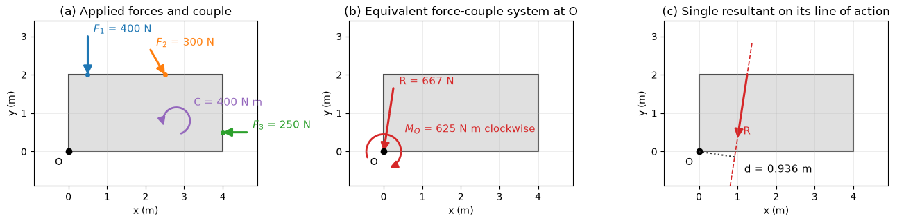

# Force Systems and Resultants

A structure or machine is usually loaded by many forces at once: self-weight, wheel loads, cable tensions, wind pressure, contact forces. For the external behaviour of a rigid body (its equilibrium or its overall motion) only two things about such a system matter, its resultant force and its resultant moment about some point. This note classifies force systems, shows how each reduces to the simplest equivalent system (a single force, a force and a couple, or a wrench), and replaces distributed loads, including fluid pressure computed by CFD, by their resultants. Moments are developed in [Moments and Couples](./moments_couples.md) and the equilibrium of bodies in [Rigid Body Equilibrium](../statics/rigid_body_equilibrium.md).

## Problem Statement

Given a set of forces $\mathbf{F}_i$ with points of application $\mathbf{r}_i$, couples $\mathbf{C}_j$, and distributed loads of known intensity (per unit length, area or volume) acting on a rigid body, find:

1. the resultant force $\mathbf{R}$ and the resultant moment $\mathbf{M}_O^R$ about a chosen point $O$;
2. the simplest system equivalent to the given one: a single force on a definite line of action, a single couple, or a wrench (a force and a couple parallel to it);
3. for a distributed load, the magnitude and line of action of its resultant.

The governing relations are

```math
\mathbf{R} = \sum_i \mathbf{F}_i + \int \mathbf{f}\, dV,
\qquad \mathbf{M}_O^R = \sum_i \mathbf{r}_i \times \mathbf{F}_i + \sum_j \mathbf{C}_j +
\int \mathbf{r} \times \mathbf{f}\, dV
```

where $\mathbf{f}$ is a load per unit volume (or per unit length or area, with $dV$ replaced by $dx$ or $dA$). Two systems are equivalent for a rigid body when they have the same $\mathbf{R}$ and the same $\mathbf{M}_O^R$ about one point; they then have the same moment about every point. Equivalent systems produce the same reactions and the same motion of a rigid body, but not the same internal forces or deformations.

## Forces

A force is the action of one body on another. It is a vector, measured in newtons, with a point of application, or for a rigid body a line of action along which it may be slid. Forces on a body divide into external forces, applied by other bodies, and internal forces between parts of the same body, which cancel in pairs by Newton's third law and do not appear in the resultant.

| Kind | Acts | Examples | Direction |
| --- | --- | --- | --- |
| Contact, normal | On a surface | Support reaction, smooth contact, bearing pressure | Normal to the contact surface |
| Contact, tangential | On a surface | Friction, viscous wall shear | In the contact plane; friction opposes slip |
| Tension in a cable or rope | Along the cable | Hoist, guy wire | Away from the body, along the cable |
| Body force | Throughout the volume | Weight $m\mathbf{g}$, inertial forces in an accelerating frame | Gravity downward, $g = 9.81$ m/s² |
| Distributed surface force | Over an area | Hydrostatic and aerodynamic pressure, snow, wind | Pressure normal to the surface, pushing inward |

## Classification of Force Systems

| System | Definition | Independent resultant components | Simplest equivalent |
| --- | --- | --- | --- |
| Concurrent | All lines of action pass through one point | 3 in 3D ($R_x, R_y, R_z$); 2 in a plane | A single force through the common point |
| Coplanar | All forces lie in one plane | 3 ($R_x, R_y, M_z$) | A single force, or a couple if $\mathbf{R} = \mathbf{0}$ |
| Parallel | All forces parallel to one direction | 3 ($R_z, M_x, M_y$) for forces along $z$ | A single force, or a couple if $\mathbf{R} = \mathbf{0}$ |
| General | Arbitrary forces in space | 6 ($R_x, R_y, R_z, M_x, M_y, M_z$) | A wrench |

The number of independent components equals the number of independent equilibrium equations for that system, which fixes how many unknowns a body loaded that way can have and still be statically determinate.

## Concurrent Forces

When all forces pass through one point, their moments about that point vanish and the system is equivalent to the single force

$$
\mathbf{R} = \sum_i \mathbf{F}_i = \left(\sum F_{ix}\right)\mathbf{i} +
\left(\sum F_{iy}\right)\mathbf{j} + \left(\sum F_{iz}\right)\mathbf{k}
$$

acting through the common point, with magnitude $R = \sqrt{R_x^2 + R_y^2 + R_z^2}$ and direction cosines $R_x/R$, $R_y/R$, $R_z/R$. Graphically this is the head-to-tail polygon of the forces, closed by $\mathbf{R}$. A particle, or a pin joint of a truss, is in equilibrium when this polygon closes on itself, $\mathbf{R} = \mathbf{0}$; that case is treated in [Particle Equilibrium](../statics/particle_equilibrium.md).

### Example: Two Cables on a Hook

Two cables pull on a hook at $A$. The first carries 500 N along $(4, 6, -3)$, the second 400 N along $(-2, 3, -6)$. The unit vectors are $(4, 6, -3)/\sqrt{61}$ and $(-2, 3, -6)/7$, so

```math
\mathbf{T}_1 = (256.1, 384.1, -192.1) \text{ N}, \qquad \mathbf{T}_2 = (-114.3, 171.4, -342.9) \text{ N}
```

and $\mathbf{R} = (141.8, 555.5, -534.9)$ N with $R = 784$ N. The direction angles are $79.6^\circ$, $44.9^\circ$ and $133.0^\circ$. The resultant is less than the sum of the magnitudes, 900 N, because the cables are not aligned.

## Equivalent Force–Couple Systems

A force $\mathbf{F}$ acting at $A$ can be moved to any other point $O$ if a couple equal to its moment about $O$, $\mathbf{r}_{OA}\times\mathbf{F}$, is added. Applying this to every force of a system gives the force–couple system at $O$:

$$
\mathbf{R} = \sum_i \mathbf{F}_i,
\qquad \mathbf{M}_O^R = \sum_i \mathbf{r}_{OA_i} \times \mathbf{F}_i + \sum_j
\mathbf{C}_j
$$

The resultant force is the same for every choice of $O$. The resultant moment depends on $O$ through the transfer rule

$$
\mathbf{M}_P^R = \mathbf{M}_O^R + \mathbf{r}_{PO} \times \mathbf{R}
$$

so it is the same about every point only when $\mathbf{R} = \mathbf{0}$, in which case the system is a pure couple. Engineers use force–couple systems routinely: the loads transmitted through a bolted joint, the base shear and overturning moment of a building, and the force and moment coefficients that a wind tunnel balance or a CFD solver reports about a chosen moment reference point are all force–couple systems at a point.

## Coplanar Systems and the Single Resultant

For forces in the $xy$ plane, $\mathbf{R}$ lies in the plane and $\mathbf{M}_O^R = M_O\mathbf{k}$ is perpendicular to it, so the two are always perpendicular. If $\mathbf{R} \neq \mathbf{0}$, the couple can be absorbed by moving $\mathbf{R}$ sideways until its own moment about $O$ equals $M_O$. The single resultant then acts along the line

$$
x R_y - y R_x = M_O
$$

at perpendicular distance $d = |M_O|/R$ from $O$, on the side that gives $M_O$ the correct sense. Setting $y = 0$ gives the point where the line crosses the $x$ axis, $x = M_O/R_y$.



### Example: Plate with Three Forces and a Couple

The 4 m × 2 m plate in the figure carries $F_1 = 400$ N downward at $(0.5, 2)$ m, $F_2 = 300$ N at $60^\circ$ below the $+x$ axis at $(2.5, 2)$ m, $F_3 = 250$ N in the $-x$ direction at $(4, 0.5)$ m, and a counterclockwise couple $C = 400$ N·m. Components:

| Force | $F_x$ (N) | $F_y$ (N) | $xF_y - yF_x$ (N·m) |
| --- | --- | --- | --- |
| $F_1$ | 0 | $-400.0$ | $-200.0$ |
| $F_2$ | 150.0 | $-259.8$ | $-949.5$ |
| $F_3$ | $-250.0$ | 0 | 125.0 |
| $C$ |  |  | 400.0 |
| Sum | $-100.0$ | $-659.8$ | $-624.5$ |

So $\mathbf{R} = (-100.0, -659.8)$ N, $R = 667.3$ N directed $98.6^\circ$ clockwise from $+x$, and $M_O = -624.5$ N·m (clockwise). The single resultant lies at $d = 624.5/667.3 = 0.936$ m from $O$ and crosses the bottom edge at $x = (-624.5)/(-659.8) = 0.947$ m and the top edge at $x = 1.250$ m. Panel (c) of the figure shows that this line passes to the right of $O$, as it must for a downward force to produce a clockwise moment about $O$.

## Parallel Force Systems

For forces $F_i\mathbf{k}$ parallel to $z$ acting at $(x_i, y_i)$, the resultant is $R = \sum F_i$ along $z$, and equating its moments about the $y$ and $x$ axes to those of the system locates it at

$$
\bar{x} = \frac{\sum F_i x_i}{\sum F_i},
\qquad \bar{y} = \frac{\sum F_i y_i}{\sum F_i}
$$

This is the same weighted average that defines the centre of gravity, where the forces are the weights of the parts of a body ([Center of Mass and Centroids](../statics/center_of_mass.md)). If $\sum F_i = 0$ but the moments do not vanish, the system is a couple.

### Example: Loads on a Slab

A 4 m × 3 m slab with a corner at the origin carries downward column loads of 20 kN at $(0, 0)$, 30 kN at $(4, 0)$, 10 kN at $(4, 3)$ and 40 kN at $(0, 3)$ m. The resultant is 100 kN downward at

$$
\bar{x} = \frac{30(4) + 10(4)}{100} = 1.6 \text{ m},
\qquad \bar{y} = \frac{10(3) + 40(3)}{100} = 1.5 \text{ m}
$$

The resultant is 0.4 m from the centre of the slab in $x$, so a foundation centred under the slab would be loaded eccentrically.

## General Systems and the Wrench

In 3D, $\mathbf{R}$ and $\mathbf{M}_O^R$ are generally not perpendicular, and the couple cannot be absorbed completely. Split the moment into parts parallel and perpendicular to $\mathbf{R}$:

```math
\mathbf{M}_\parallel = \frac{\mathbf{R}\cdot\mathbf{M}_O^R}{R^2}\,\mathbf{R},
\qquad \mathbf{M}_\perp = \mathbf{M}_O^R - \mathbf{M}_\parallel
```

The perpendicular part is removed by moving $\mathbf{R}$ to a line through the point

$$
\mathbf{r}_P = \frac{\mathbf{R} \times \mathbf{M}_O^R}{R^2}
$$

measured from $O$, which leaves $\mathbf{R}$ together with the couple $\mathbf{M}_\parallel$ along the same line, the **wrench**. Its line is the central axis of the system, and its pitch

$$
p = \frac{\mathbf{R}\cdot\mathbf{M}_O^R}{R^2}
$$

is a length; the wrench is positive (like a right-handed screw being driven) when $p > 0$. The scalar $\mathbf{R}\cdot\mathbf{M}_O^R$ is the same for every $O$, so a system reduces to a single force exactly when $\mathbf{R}\cdot\mathbf{M}_O^R = 0$, which is always the case for concurrent, coplanar and parallel systems.

### Example: Reducing a 3D System to a Wrench

A bracket carries $\mathbf{F}_1 = -400\mathbf{k}$ N at $(1, 0, 0)$ m, $\mathbf{F}_2 = 300\mathbf{i}$ N at $(0, 2, 0)$ m and $\mathbf{F}_3 = 200\mathbf{j}$ N at $(0, 0, 1.5)$ m. The moments about $O$ are $400\mathbf{j}$, $-600\mathbf{k}$ and $-300\mathbf{i}$ N·m, so

$$
\mathbf{R} = (300, 200, - 400) \text{ N},
\qquad \mathbf{M}_O^R = (-300, 400, - 600) \text{ N·m}
$$

with $R^2 = 2.9 \times 10^5$ N² and $`\mathbf{R}\cdot\mathbf{M}_O^R = 2.3 \times 10^5`$ N²·m. The pitch is $`p = 0.793`$ m, the couple of the wrench is $`|\mathbf{M}_\parallel| = pR = 427`$ N·m in the sense of $\mathbf{R}$, and the central axis passes through $\mathbf{r}_P = (0.138, 1.034, 0.621)$ m. As a check, $`\mathbf{r}_P \times \mathbf{R} + \mathbf{M}_\parallel`$ reproduces $\mathbf{M}_O^R$.

## Distributed Loads

### Line Loads

A load of intensity $w(x)$ (N/m) along a beam is equivalent to a single force equal to the area under the load curve, acting through the centroid of that area:

```math
R = \int_0^L w(x)\, dx,
\qquad \bar{x} = \frac{1}{R}\int_0^L x\, w(x)\, dx
```

| Load shape | Resultant | Location |
| --- | --- | --- |
| Uniform, $w$ over $L$ | $wL$ | $L/2$ |
| Triangular, $0$ to $w_{\max}$ over $L$ | $\tfrac{1}{2}w_{\max}L$ | $2L/3$ from the zero end |
| Trapezoidal, $w_0$ to $w_1$ over $L$ | $\tfrac{1}{2}(w_0 + w_1)L$ | $L(w_0 + 2w_1)/(3(w_0 + w_1))$ from the $w_0$ end |

Replacing a distributed load by its resultant is valid for reactions and for the equilibrium of the whole body. For internal shear forces and bending moments, the beam must first be cut and only the part of the load on the segment replaced ([Shear Force and Bending Moment Diagrams](../strength_materials/shear_moment.md)).

### Surface Loads and Fluid Pressure

A fluid at rest or in motion exerts on a surface element $dA$ with outward unit normal $\mathbf{n}$ (pointing out of the body, into the fluid) the force $`(-p\,\mathbf{n} + \boldsymbol{\tau}_w)\,dA`$, where $p$ is the pressure and $\boldsymbol{\tau}_w$ the wall shear stress. The resultant force and moment on the body are

```math
\mathbf{F} = \oint_S \left(-p\,\mathbf{n} + \boldsymbol{\tau}_w\right) dA, \qquad \mathbf{M}_O = \oint_S \mathbf{r} \times \left(-p\,\mathbf{n} + \boldsymbol{\tau}_w\right) dA
```

A uniform pressure on a closed surface gives no resultant, so $p$ may be replaced by the gauge pressure $p - p_\infty$. For a vertical rectangular gate of width $b$ holding water of depth $h$, the gauge pressure $\rho g y$ increases linearly with the depth $y$, and the resultant is

```math
F = \int_0^h \rho g y\, b\, dy = \frac{\rho g b h^2}{2}
```

acting at depth $2h/3$, the centroid of the triangular pressure distribution. For $b = 2$ m, $h = 3$ m and $\rho = 1000$ kg/m³, $F = 88.3$ kN at 1 m above the bottom. The general theory, including curved surfaces and buoyancy, is in [Hydrostatics](../../fluid_mechanics/fluid_statics/hydrostatics.md).

A CFD solver stores $p$ and $\boldsymbol{\tau}_w$ at the centroid of each wall face $f$ of area $A_f$, with outward normal $\mathbf{n}_f$ and centroid $\mathbf{r}_f$, and evaluates the integrals as sums:

```math
\mathbf{F} \approx \sum_f \left(-p_f\,\mathbf{n}_f + \boldsymbol{\tau}_{w,f}\right) A_f, \qquad \mathbf{M}_O \approx \sum_f \mathbf{r}_f \times \left(-p_f\,\mathbf{n}_f + \boldsymbol{\tau}_{w,f}\right) A_f
```

This is the step that turns a flow solution into structural loads: the drag and lift of a car or a wing are components of $\mathbf{F}$, the pitching moment is a component of $\mathbf{M}_O$, and the face forces themselves can be mapped onto a finite element model ([Pressure Forces on Structures](../fluid_loading/pressure_forces.md)).

## Equilibrium as a Zero Resultant

A rigid body is in equilibrium when the force system acting on it, reactions included, is equivalent to zero:

$$
\mathbf{R} = \mathbf{0},
\qquad \mathbf{M}_O^R = \mathbf{0}
$$

By the transfer rule, if both vanish for one point $O$ they vanish for every point. This gives six scalar equations in 3D and the numbers in the classification table for the special systems: three for a coplanar system, two for coplanar concurrent forces, three for a parallel system in space. Solving them for unknown reactions, and deciding when they are enough, is the subject of [Rigid Body Equilibrium](../statics/rigid_body_equilibrium.md).

## Common Mistakes

| Mistake | Correct approach |
| --- | --- |
| Moving a force to a new point without adding its moment as a couple | Every transfer adds $\mathbf{r}\times\mathbf{F}$ |
| Assuming the single resultant passes through the reduction point | It passes through $O$ only if $\mathbf{M}_O^R = \mathbf{0}$ |
| Placing the resultant of a triangular load at midspan | It acts at the centroid, $L/3$ from the large end |
| Using one resultant for a whole distributed load when computing internal forces | Replace only the part of the load on the free body being analysed |
| Integrating pressure with the normal pointing into the body and a plus sign | With $\mathbf{n}$ out of the body, the pressure force is $`-p\,\mathbf{n}\,dA`$ |
| Mixing kN and N or mm and m in one sum | Convert every term to one consistent set of units first |

## Key Takeaways

- Any force system acting on a rigid body is equivalent to its resultant force at a chosen point plus the resultant couple about that point.
- Concurrent, coplanar and parallel systems reduce further to a single force (or a couple when $\mathbf{R} = \mathbf{0}$); a general 3D system reduces to a wrench with pitch $p = \mathbf{R}\cdot\mathbf{M}_O^R/R^2$.
- The resultant of a distributed load is the area under the load curve, acting at its centroid.
- Fluid forces on a body are the integrals of $`-p\,\mathbf{n} + \boldsymbol{\tau}_w`$ over its surface, evaluated in CFD as sums over wall faces.
- Equivalent systems give the same reactions and rigid-body motion, but not the same internal forces.

## Related Scripts

- [Coplanar Force Resultant](../../../scripts/plots/fundamentals_force_resultant/): reduces a coplanar system of forces and a couple acting on a plate to an equivalent force–couple system at a point and then to a single resultant force on its line of action.
- [Support Reactions in 2D](../../../scripts/plots/fundamentals_support_reactions/): draws the standard planar supports and connections next to the reactions they exert on a body, as a reference chart for drawing free-body diagrams.

## Exercises

**Exercise 1.** Three concurrent coplanar forces act at a point: 300 N at $0^\circ$, 400 N at $90^\circ$ and 250 N at $225^\circ$ (angles measured counterclockwise from the $+x$ axis). Find the magnitude and direction of the resultant.

<details>
<summary>Answer</summary>

$R_x = 300 + 250\cos 225^\circ = 300 - 176.8 = 123.2$ N and $R_y = 400 + 250\sin 225^\circ = 400 - 176.8 = 223.2$ N.

```math
R = \sqrt{123.2^2 + 223.2^2} = 255 \text{ N at } \tan^{-1}(223.2/123.2) = 61.1^\circ
```

</details>

**Exercise 2.** A fifth downward load of 20 kN is added to the slab of the parallel-force example. Where must it be placed so that the resultant of all five loads passes through the centre of the slab, $(2, 1.5)$ m?

<details>
<summary>Answer</summary>

The new resultant is 120 kN. For it to act at $(2, 1.5)$ m the first moments must be $\sum F_i x_i = 120 \times 2 = 240$ kN·m and $\sum F_i y_i = 120 \times 1.5 = 180$ kN·m. The four existing loads give 160 and 150 kN·m, so $20x_5 = 80$ and $20y_5 = 30$: the load goes at $(4, 1.5)$ m, at the midpoint of the right edge.

</details>

**Exercise 3.** A beam carries a distributed load $w(x) = 2 + x^2$ kN/m for $0 \le x \le 3$ m. Find the resultant force and its location.

<details>
<summary>Answer</summary>

```math
R = \int_0^3 (2 + x^2)\,dx = 6 + 9 = 15 \text{ kN}, \qquad \bar{x} = \frac{1}{15}\int_0^3 x(2 + x^2)\,dx = \frac{9 + 20.25}{15} = 1.95 \text{ m}
```

</details>

**Exercise 4.** A ring at the origin supports a 600 N weight and is held by three cables to anchor points $A(-2, -1, 4)$ m, $B(2, -1, 4)$ m and $C(0, 2, 4)$ m. Find the cable tensions from the condition that the concurrent system of four forces has zero resultant.

<details>
<summary>Answer</summary>

The unit vectors from the ring are $\hat{\mathbf{u}}_A = (-2, -1, 4)/4.583$, $\hat{\mathbf{u}}_B = (2, -1, 4)/4.583$ and $\hat{\mathbf{u}}_C = (0, 2, 4)/4.472$. Setting $T_A\hat{\mathbf{u}}_A + T_B\hat{\mathbf{u}}_B + T_C\hat{\mathbf{u}}_C - 600\mathbf{k} = \mathbf{0}$:

- $x$: $(-2T_A + 2T_B)/4.583 = 0$, so $T_A = T_B$.
- $y$: $-2T_A/4.583 + 2T_C/4.472 = 0$.
- $z$: $8T_A/4.583 + 4T_C/4.472 = 600$.

Solving: $T_A = T_B = 229$ N and $T_C = 224$ N. Each cable carries 200 N of the vertical load.

</details>

**Exercise 5.** A force–couple system at $O$ consists of $\mathbf{R} = 500\mathbf{k}$ N and $\mathbf{M}_O^R = (300, -200, 400)$ N·m. Reduce it to a wrench: find the pitch, the couple of the wrench and a point on its central axis.

<details>
<summary>Answer</summary>

$`\mathbf{R}\cdot\mathbf{M}_O^R = 500 \times 400 = 2 \times 10^5`$ N²·m and $`R^2 = 2.5 \times 10^5`$ N², so $`p = 0.8`$ m and $`\mathbf{M}_\parallel = p\mathbf{R} = 400\mathbf{k}`$ N·m.

```math
\mathbf{r}_P = \frac{\mathbf{R}\times\mathbf{M}_O^R}{R^2} = \frac{(1 \times 10^5, 1.5 \times 10^5, 0)}{2.5 \times 10^5} = (0.4, 0.6, 0) \text{ m}
```

The wrench is a 500 N force along the vertical line through $(0.4, 0.6, 0)$ m with a 400 N·m couple about that line in the same sense. Check: $`\mathbf{r}_P\times\mathbf{R} = (300, -200, 0)`$ N·m, and adding $`\mathbf{M}_\parallel`$ gives $\mathbf{M}_O^R$.

</details>

## References

- Hibbeler, R. C., *Engineering Mechanics: Statics*, 14th ed., Pearson, 2016.
- Beer, F. P., Johnston, E. R., Mazurek, D. F., & Eisenberg, E. R., *Vector Mechanics for Engineers: Statics and Dynamics*, 12th ed., McGraw-Hill, 2019.
- Meriam, J. L., Kraige, L. G., & Bolton, J. N., *Engineering Mechanics: Statics*, 9th ed., Wiley, 2018.
- White, F. M., *Fluid Mechanics*, 8th ed., McGraw-Hill, 2016.
- Anderson, J. D., *Fundamentals of Aerodynamics*, 6th ed., McGraw-Hill, 2017.
