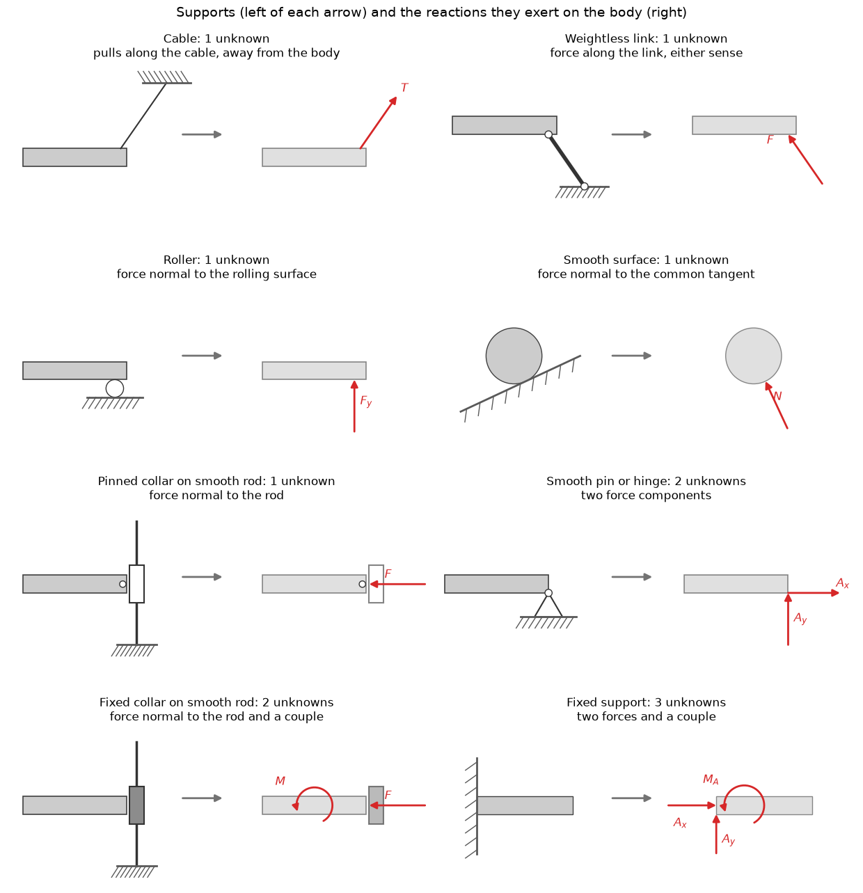
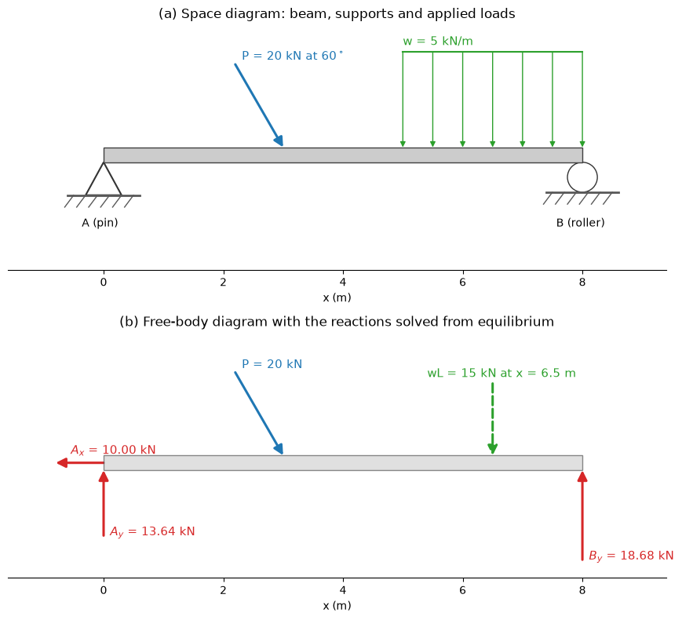

# Free-Body Diagrams

A free-body diagram (FBD) is a sketch of a body, or part of one, cut free from everything it touches, with every external force and couple acting on it drawn in. It is the step between the physical problem and the equations: the equilibrium equations and the equations of motion are statements about the forces on a free-body diagram, so an error in the diagram makes every later step wrong however carefully it is done. This note gives the procedure, the reactions that standard supports and connections exert in 2D and 3D, two-force and three-force members, the counting of unknowns that decides whether a problem is statically determinate, and the cut that exposes internal forces.

## Problem Statement

Given a body or assembly with its geometry, applied loads (concentrated forces, distributed loads, couples, weight) and the supports and connections that hold it, construct a diagram that:

1. isolates a chosen body or subsystem;
2. shows every external force and couple acting on it, including unknown support reactions with assumed senses, and no internal forces of the chosen system;
3. gives the dimensions, angles and coordinate axes needed to write $\sum\mathbf{F} = \mathbf{0}$ and $\sum\mathbf{M}_O = \mathbf{0}$ (or $\sum\mathbf{F} = m\mathbf{a}_G$ and $\sum\mathbf{M}_G = d\mathbf{H}_G/dt$ in dynamics).

The bodies are rigid, joints are idealized (frictionless pins, rollers, perfectly fixed ends) unless friction is stated, and members are weightless unless their weight is given. From the diagram, count the unknowns $r$ and the independent equations $n$ (3 for a planar body, 6 in 3D) and decide whether the problem is determinate before solving it.

## Procedure

1. Decide which body or group of bodies to isolate. The choice decides which forces are external, and so which unknowns appear in the equations.
2. Draw the outline of the body cut free from its supports and from every other body, with its essential dimensions.
3. Draw the known loads where they act: point loads with magnitude and direction, distributed loads as given (replace them by resultants only when writing equations for the whole body), couples as curved arrows, and the weight at the centre of gravity.
4. At every place where a support or another body was removed, draw the reactions that connection can exert, from the tables below. Give each unknown a symbol and an assumed sense.
5. Add a coordinate system and the angles needed to resolve forces.
6. Count unknowns and equations. Then write the equations, choosing moment centres where several unknowns act.
7. Interpret signs: a negative result means the actual sense is opposite to the assumed one. Keep the same assumed sense when a force reappears on another diagram, reversed as required by Newton's third law.

## Supports and Connections in 2D

A support exerts a force in each direction in which it prevents translation, and a couple if it prevents rotation. The chart shows the common planar supports and the reactions that replace them on a free-body diagram.



| Support or connection | Reactions on the body | Unknowns |
| --- | --- | --- |
| Cable, rope, chain | Tension along the cable, away from the body | 1 |
| Weightless link (two-force member) | Force along the link, either sense | 1 |
| Roller, rocker, smooth surface | Force normal to the surface | 1 |
| Pinned collar or slider on a smooth rod | Force normal to the rod | 1 |
| Smooth pin or hinge | Two force components, $A_x$ and $A_y$ | 2 |
| Fixed collar on a smooth rod | Force normal to the rod and a couple | 2 |
| Rough surface (with friction) | Normal force and friction force | 2 |
| Fixed (built-in) support | $A_x$, $A_y$ and a couple $M_A$ | 3 |

The sense of every reaction except a cable tension is unknown in advance; draw it either way and let the sign of the result decide. A roller or smooth surface can only push; if the solution needs it to pull, the body lifts off and the assumed support condition is wrong.

## Supports and Connections in 3D

In space a body has six degrees of freedom, and the supports are correspondingly richer.

| Support | Reactions | Unknowns |
| --- | --- | --- |
| Cable | Tension along the cable | 1 |
| Smooth surface or roller on a surface | Normal force | 1 |
| Ball and socket | Three force components | 3 |
| Single journal (radial) bearing | Two forces perpendicular to the shaft, two couples perpendicular to the shaft | 4 |
| Single thrust bearing | Three forces, two couples perpendicular to the shaft | 5 |
| Single smooth pin or hinge | Three forces, two couples perpendicular to the pin axis | 5 |
| Fixed support | Three forces, three couples | 6 |

The couples listed for bearings, pins and hinges are developed only when that single connection must stop the body rotating about axes perpendicular to the shaft or pin. When a shaft or door is held by two or more properly aligned bearings or hinges, those rotations are prevented by pairs of force reactions instead, and the couples are omitted from the diagram; keeping them would make the problem appear indeterminate.

## Two-Force and Three-Force Members

A body acted on by forces at only two points, with no couples, is a two-force member. Equilibrium of forces requires the two forces to be equal and opposite, and equilibrium of moments about one of the points requires the other force to pass through it. The forces are therefore collinear, along the line joining the two points, whatever the shape of the member. The members of a pin-jointed truss loaded only at its joints, links in mechanisms, and struts and hydraulic cylinders pinned at both ends are two-force members. Recognising one replaces two unknown components at each end by a single unknown magnitude along a known line.

A body acted on by exactly three forces, with no couples, is a three-force member. Taking moments about the intersection of two of the lines of action shows that the third must pass through the same point: the three forces are concurrent, or else all parallel. This fixes the direction of an unknown pin reaction graphically.

## Static Determinacy and Proper Constraint

For a planar rigid body, $n = 3$ independent equilibrium equations are available. With $r$ unknown reactions:

| Count | Situation | Consequence |
| --- | --- | --- |
| $r < 3$ | Partially constrained | The body can move; equilibrium only under special loads |
| $r = 3$, properly arranged | Statically determinate | Reactions follow from statics alone |
| $r > 3$ | Statically indeterminate of degree $r - 3$ | Deformation and stiffness are needed ([Axial Loading](../strength_materials/axial_loading.md), [Bending of Beams](../strength_materials/beam_bending.md)) |

The count is necessary but not sufficient. The constraints are improper if the reactions are all parallel (no resistance to motion perpendicular to them) or all concurrent at one point (no resistance to rotation about it), even when $r \ge 3$. A beam on three vertical rollers has $r = 3$ but cannot resist a horizontal load. For a structure of several bodies, apply the count to the whole assembly, with $n = 3$ per body and the internal pin forces counted as unknowns ([Trusses, Frames and Machines](../statics/trusses_frames.md)).

## Internal Forces and the Method of Sections

Internal forces become external when the body is cut. Cutting a beam at a section and drawing the free-body diagram of either part exposes, in 2D, a normal force $N$ along the axis, a shear force $V$ across it and a bending moment $M$; in 3D, three forces and three moments. The two faces of the cut carry equal and opposite internal actions by Newton's third law.

The usual beam sign convention takes $N$ positive in tension, $V$ positive when it acts downward on the right-hand face of the left segment (rotating the segment clockwise), and $M$ positive when it causes sagging (compression on top). The procedure is to find the support reactions from the FBD of the whole beam, cut at the section, and apply equilibrium to the part with fewer loads. Repeating the cut along the beam gives the shear and moment diagrams in [Shear Force and Bending Moment Diagrams](../strength_materials/shear_moment.md).

## Worked Example: A Pin-Roller Beam

An 8 m beam has a pin at $A$ ($x = 0$) and a roller at $B$ ($x = 8$ m). It carries a 20 kN load at $x = 3$ m inclined at $60^\circ$ below the horizontal and pointing to the right, and a uniform load of 5 kN/m from $x = 5$ m to $x = 8$ m. Find the reactions.



On the FBD (lower panel), the pin becomes $A_x$ and $A_y$, the roller becomes $B_y$, the inclined load becomes components $P_x = 20\cos 60^\circ = 10$ kN to the right and $P_y = 20\sin 60^\circ = 17.32$ kN down, and the uniform load becomes its resultant $5 \times 3 = 15$ kN at $x = 6.5$ m. There are three unknowns and three equations.

```math
\sum M_A = 0: \quad 8B_y - 17.32(3) - 15(6.5) = 0 \implies B_y = 18.68 \text{ kN}
```

```math
\sum F_y = 0: \quad A_y + B_y - 17.32 - 15 = 0 \implies A_y = 13.64 \text{ kN}
```

```math
\sum F_x = 0: \quad A_x + 10 = 0 \implies A_x = -10 \text{ kN}
```

The negative $A_x$ means the pin pulls the beam to the left, against the horizontal component of the load. Check with moments about $B$: $-8(13.64) + 5(17.32) + 1.5(15) = -109.1 + 86.6 + 22.5 = 0$.

## Worked Example: A Fixed L-Frame

An L-shaped frame is fixed at $A$. Member $AB$ is horizontal and 4 m long, member $BC$ vertical and 3 m long, and a horizontal force $F = 10$ kN acts at $C$ in the $+x$ direction. The fixed support exerts $A_x$, $A_y$ and $M_A$.

```math
\sum F_x = 0: \; A_x + 10 = 0 \implies A_x = -10 \text{ kN}, \qquad \sum F_y = 0: \; A_y = 0
```

$C$ is at $(4, 3)$ m relative to $A$, so the force has moment $xF_y - yF_x = -30$ kN·m about $A$ (clockwise), and

```math
\sum M_A = 0: \quad M_A - 30 = 0 \implies M_A = 30 \text{ kN·m (counterclockwise)}
```

The 4 m horizontal length does not enter because the force is horizontal: only the 3 m height is its moment arm about $A$.

## Worked Example: A Truss Joint

At joint $C$ of a truss, member $CA$ runs up and to the left at $45^\circ$, member $CB$ runs horizontally to the right, and a 50 kN load hangs from the joint. Both members are two-force members, so each exerts a force along its own axis on the joint. Draw both as tensions, pulling away from the joint:

```math
\sum F_y = 0: \quad F_{CA}\sin 45^\circ - 50 = 0 \implies F_{CA} = 70.7 \text{ kN}
```

```math
\sum F_x = 0: \quad -F_{CA}\cos 45^\circ + F_{CB} = 0 \implies F_{CB} = 50.0 \text{ kN}
```

Both results are positive, so both members are in tension. The same procedure applied joint by joint solves a whole truss ([Trusses, Frames and Machines](../statics/trusses_frames.md)).

## Common Mistakes

| Mistake | Correct approach |
| --- | --- |
| Omitting the weight, or a load applied to a part of the body | List every load on the space diagram and tick it off on the FBD |
| Giving a support more or fewer reactions than it can exert | Use the support tables; ask which motions the support prevents |
| Drawing forces that act on a neighbouring body | Draw only forces exerted on the isolated body |
| Showing internal forces of the isolated system | Internal forces cancel in pairs; they appear only when the system is cut |
| Drawing both a load and its reaction on the same diagram | Each appears on the diagram of the body it acts on |
| Using different senses for the same pin force on two connected bodies | Equal and opposite on the two bodies, with one symbol |
| Treating a two-force member as having two unknown components at each end | Its force lies along the line joining its two pins |
| Replacing a distributed load by its total resultant before cutting a section | Cut first, then replace the part of the load on each segment |

## Key Takeaways

- A free-body diagram shows one isolated body with every external force and couple on it, and nothing else.
- Each support exerts a force for every translation it prevents and a couple for every rotation it prevents.
- Two-force members carry a force along the line joining their two points of load; three non-parallel forces in equilibrium are concurrent.
- Count unknowns before solving: $r = 3$ properly arranged reactions make a planar body determinate; parallel or concurrent reactions are improper whatever their number.
- Internal forces appear only when a body is cut; the two faces of a cut carry equal and opposite actions.

## Related Scripts

- [Support Reactions in 2D](../../../scripts/plots/fundamentals_support_reactions/): draws the standard planar supports and connections next to the reactions they exert on a body, as a reference chart for drawing free-body diagrams.
- [Free-Body Diagram of a Beam](../../../scripts/plots/fundamentals_free_body_diagram/): turns a loaded, supported beam into its free-body diagram and solves the three planar equilibrium equations for the support reactions.

## Exercises

**Exercise 1.** Classify each planar beam as statically determinate, statically indeterminate (give the degree) or improperly constrained: (a) pin at one end, roller at the other; (b) fixed at one end, roller at the other; (c) pins at both ends; (d) three vertical rollers; (e) a pin at one end and a link at the other whose line of action passes through the pin.

<details>
<summary>Answer</summary>

A planar rigid body has 3 equilibrium equations.

(a) 2 + 1 = 3 unknowns, not parallel or concurrent: determinate.

(b) 3 + 1 = 4 unknowns: indeterminate to the first degree.

(c) 2 + 2 = 4 unknowns: indeterminate to the first degree; statics cannot separate the two horizontal reactions.

(d) 3 unknowns, but all parallel: improperly constrained, no resistance to horizontal load.

(e) 3 unknowns, but all three lines of action pass through the pin: improperly constrained, no resistance to rotation about the pin.

</details>

**Exercise 2.** A 6 m ladder weighing 200 N (acting at its midpoint) leans against a smooth vertical wall at $60^\circ$ to a rough floor. Draw the FBD, count the unknowns, and find all reactions and the minimum floor friction coefficient.

<details>
<summary>Answer</summary>

Unknowns: the floor normal force $N_A$, the floor friction $F_A$, and the wall normal force $N_B$ (a smooth wall gives no friction). Three unknowns, three equations: determinate.

Moments about the foot $A$:

```math
N_B(6\sin 60^\circ) = 200(3\cos 60^\circ) \implies N_B = 57.7 \text{ N}
```

Horizontal: $F_A = N_B = 57.7$ N. Vertical: $N_A = 200$ N. Minimum friction coefficient: $\mu_s = F_A/N_A = 0.289$.

</details>

**Exercise 3.** A 4 m cantilever is fixed at its left end $A$. It carries a uniform load of 3 kN/m over its full length and a 5 kN point load at the free end. Find the reactions at $A$.

<details>
<summary>Answer</summary>

Replace the distributed load by a 12 kN resultant at 2 m.

- $\sum F_x = 0$: $A_x = 0$.
- $\sum F_y = 0$: $A_y = 12 + 5 = 17$ kN (upward).
- $\sum M_A = 0$: $M_A - 12(2) - 5(4) = 0$, so $M_A = 44$ kN·m (counterclockwise).

</details>

**Exercise 4.** For the pin-roller beam of the worked example, cut the beam at $x = 2$ m and at $x = 4$ m, and use the FBD of the left segment to find $N$, $V$ and $M$ at each section with the sign convention of this note.

<details>
<summary>Answer</summary>

At $x = 2$ m the left segment carries only the pin reactions, $A_x = 10$ kN to the left and $A_y = 13.64$ kN up:

```math
N - 10 = 0 \implies N = 10 \text{ kN (tension)}, \qquad V = 13.64 \text{ kN}, \qquad M = 13.64(2) = 27.3 \text{ kN·m}
```

At $x = 4$ m the segment also carries the inclined load, whose 10 kN horizontal component cancels $A_x$:

```math
N = 0, \qquad 13.64 - 17.32 - V = 0 \implies V = -3.68 \text{ kN}, \qquad M = 13.64(4) - 17.32(1) = 37.2 \text{ kN·m}
```

The part of the beam between the pin and the load is in tension; beyond the load there is no axial force because the roller takes no horizontal force.

</details>

**Exercise 5.** A horizontal boom $AB$ of length 3 m is pinned to a wall at $A$ and held by a cable from $B$ to point $C$ on the wall 2 m directly above $A$. A 10 kN load hangs from $B$; neglect the boom weight. Find the cable tension and the pin reactions, and explain the result using the two-force member concept.

<details>
<summary>Answer</summary>

The cable makes angle $\theta = \tan^{-1}(2/3) = 33.7^\circ$ with the boom, so $\sin\theta = 0.555$.

Moments about $A$: $T\sin\theta(3) = 10(3)$, so $T = 18.0$ kN.

Horizontal: $A_x = T\cos\theta = 15.0$ kN (pushing the boom away from the wall). Vertical: $A_y = 10 - T\sin\theta = 0$.

The cable and the load both act at $B$, so the boom is loaded only at its two ends: it is a two-force member, and the reaction at $A$ must act along the boom. That is why $A_y = 0$. The boom is in 15 kN compression.

</details>

## References

- Hibbeler, R. C., *Engineering Mechanics: Statics*, 14th ed., Pearson, 2016.
- Beer, F. P., Johnston, E. R., Mazurek, D. F., & Eisenberg, E. R., *Vector Mechanics for Engineers: Statics and Dynamics*, 12th ed., McGraw-Hill, 2019.
- Meriam, J. L., Kraige, L. G., & Bolton, J. N., *Engineering Mechanics: Statics*, 9th ed., Wiley, 2018.
- Gere, J. M., & Goodno, B. J., *Mechanics of Materials*, 9th ed., Cengage Learning, 2018.
