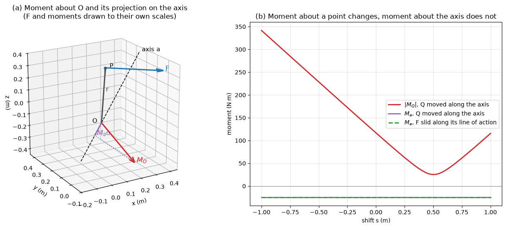

# Moments and Couples

A force tends to translate a body along its line of action and to rotate it about any point not on that line. The rotational tendency is measured by the moment of the force. Moments determine the reactions of beams and frames, the torque on a shaft, the bending moment that sizes a beam, the hinge moment on a control surface, and the pitching moment of a wing or car body that a CFD solver reports. This note defines the moment about a point and about an axis, proves Varignon's theorem, treats couples, and shows how a force is moved to another point by adding a couple, which is the basis of the reductions in [Force Systems and Resultants](./force_systems.md).

## Problem Statement

Given a force $\mathbf{F}$ (N) with a known line of action, a point $O$, or an axis defined by a point $A$ and a direction $\hat{\mathbf{u}}$, find:

1. the moment $\mathbf{M}_O$ of $\mathbf{F}$ about $O$ (a vector, N·m) and its scalar value in 2D problems;
2. the moment $M_a$ of $\mathbf{F}$ about the axis (a scalar, N·m), which is what turns a body mounted on bearings or hinges;
3. for a pair of equal and opposite forces, the couple moment and the couples equivalent to it;
4. the force–couple system at another point equivalent to $\mathbf{F}$.

The body is rigid. The governing definitions are

$$
\mathbf{M}_O = \mathbf{r}_{OA} \times \mathbf{F},
\qquad M_a = \hat{\mathbf{u}} \cdot (\mathbf{r}_{AP} \times \mathbf{F})
$$

where $`\mathbf{r}_{OA}`$ runs from $`O`$ to any point $A$ on the line of action, and $`\mathbf{r}_{AP}`$ from any point $`A`$ on the axis to any point $P$ on the line of action.

## Moment About a Point

The moment of $\mathbf{F}$ about $O$ is $\mathbf{M}_O = \mathbf{r}\times\mathbf{F}$. Its magnitude is

$$
M_O = rF\sin\theta = Fd
$$

where $\theta$ is the angle between $\mathbf{r}$ and $\mathbf{F}$ and $d = r\sin\theta$ is the perpendicular distance from $O$ to the line of action, the moment arm. Its direction, by the right-hand rule, is the axis through $O$ about which $\mathbf{F}$ tends to rotate the body. Any point on the line of action may be used: if $\mathbf{r}' = \mathbf{r} + \lambda\mathbf{F}$, then $\mathbf{r}'\times\mathbf{F} = \mathbf{r}\times\mathbf{F}$, which is the principle of transmissibility in vector form. A force whose line of action passes through $O$ has no moment about $O$.

### Scalar Form in 2D

For forces in the $xy$ plane, the moment about $O$ points along $\pm\mathbf{k}$ and is treated as a scalar, positive counterclockwise. For a force $(F_x, F_y)$ acting at $(x, y)$ relative to $O$,

$$
M_O = xF_y - yF_x
$$

which is the $z$ component of $\mathbf{r}\times\mathbf{F}$. In hand calculations it is often quicker to take each component times its own perpendicular distance and assign the sign by inspection.

### Vector Form in 3D

```math
\mathbf{M}_O = \begin{vmatrix} \mathbf{i} & \mathbf{j} & \mathbf{k} \\ r_x & r_y & r_z \\ F_x & F_y & F_z \end{vmatrix} = (r_yF_z - r_zF_y)\mathbf{i} - (r_xF_z - r_zF_x)\mathbf{j} + (r_xF_y - r_yF_x)\mathbf{k}
```

The component $M_x = r_yF_z - r_zF_y$ is the moment about the $x$ axis through $O$, and similarly for $M_y$ and $M_z$. Two checks catch most arithmetic errors: $\mathbf{M}_O\cdot\mathbf{F} = 0$ and $\mathbf{M}_O\cdot\mathbf{r} = 0$.

### Example: Moment on a Bracket

The force $\mathbf{F} = (100\mathbf{i} - 200\mathbf{j} + 50\mathbf{k})$ N acts at $P(0.3, 0.4, 0.2)$ m. With $\mathbf{r} = (0.3, 0.4, 0.2)$ m,

```math
M_x = 0.4(50) - 0.2(-200) = 60, \quad M_y = -[0.3(50) - 0.2(100)] = 5, \quad M_z = 0.3(-200) - 0.4(100) = -100
```

so $\mathbf{M}_O = (60\mathbf{i} + 5\mathbf{j} - 100\mathbf{k})$ N·m and $`|\mathbf{M}_O| = \sqrt{13\,625} = 116.7`$ N·m. Check: $\mathbf{M}_O\cdot\mathbf{F} = 6000 - 1000 - 5000 = 0$.

## Varignon's Theorem

The moment of a force about a point equals the sum of the moments of its components about the same point. If $\mathbf{F} = \mathbf{F}_1 + \mathbf{F}_2 + \cdots$, all acting at the same point, the distributive property of the cross product gives

$$
\mathbf{r}\times\mathbf{F} = \mathbf{r}\times\mathbf{F}_1 +
\mathbf{r}\times\mathbf{F}_2 + \cdots
$$

The theorem lets a force be resolved into components whose moment arms are easy to see, and it is why $M_O = xF_y - yF_x$ works.

### Example: Torque on a Wrench

A 200 N force acts at the end of a 0.30 m wrench. Perpendicular to the handle it gives $M = 200(0.30) = 60$ N·m. If it acts at $60^\circ$ to the handle, resolve it into a component along the handle, $200\cos 60^\circ = 100$ N, which passes through the bolt and has no moment, and a component perpendicular to it, $200\sin 60^\circ = 173.2$ N, with arm 0.30 m:

$$
M = 173.2 \times 0.30 = 52.0 \text{ N·m}
$$

Equivalently, the moment arm of the whole force is $d = 0.30\sin 60^\circ = 0.26$ m.

## Moment About an Axis

A body mounted on bearings or hinges can only rotate about their common axis, and only the component of a moment along that axis turns it. The moment of $\mathbf{F}$ about an axis through $A$ with unit vector $\hat{\mathbf{u}}$ is the projection of $\mathbf{M}_A$ on the axis,

```math
M_a = \hat{\mathbf{u}}\cdot(\mathbf{r}_{AP}\times\mathbf{F}) = \begin{vmatrix} u_x & u_y & u_z \\ r_x & r_y & r_z \\ F_x & F_y & F_z \end{vmatrix}
```

The result does not depend on which point $A$ of the axis or which point $P$ of the line of action is used: moving $A$ along the axis by $s\hat{\mathbf{u}}$ changes $\mathbf{M}_A$ by $`-s\,\hat{\mathbf{u}}\times\mathbf{F}`$, which is perpendicular to $\hat{\mathbf{u}}$. A positive $M_a$ turns the body counterclockwise when viewed from the tip of $\hat{\mathbf{u}}$ looking back along the axis. The vector moment about the axis is $M_a\hat{\mathbf{u}}$.

Resolving $\mathbf{F}$ into a component parallel to the axis and one perpendicular to it shows what contributes: the parallel component has no moment about the axis, and neither does any force whose line of action intersects the axis. Only the part of $\mathbf{F}$ perpendicular to the axis, times its shortest distance to the axis, produces $M_a$. For the coordinate axes this gives the familiar scalar results: the moment about the $z$ axis is $xF_y - yF_x$, unaffected by $F_z$.



For the bracket force of the previous example and the axis through $O$ with direction $(2, 1, 2)$, $\hat{\mathbf{u}} = (2, 1, 2)/3$ and

$$
M_a = \hat{\mathbf{u}}\cdot\mathbf{M}_O = \frac{2(60) + 1(5) + 2(-100)}{3} = -25
\text{ N·m}
$$

If the body turns on bearings along this axis, only 25 N·m of the 116.7 N·m moment about $O$ tends to turn it. The rest of $\mathbf{M}_O$, a component of magnitude 114.0 N·m perpendicular to the axis, is carried by the bearings as reactions. Panel (b) of the figure shows that $|\mathbf{M}_Q|$ about points $Q$ on the axis varies between 25.3 and 342 N·m over a 2 m stretch, while $M_a$ stays at $-25$ N·m.

## Couples

A couple is a pair of forces $\mathbf{F}$ and $-\mathbf{F}$ with parallel, non-coincident lines of action. Its resultant force is zero, so it produces rotation only. With $\mathbf{F}$ at $A$ and $-\mathbf{F}$ at $B$, the moment about an arbitrary point $O$ is

$$
\mathbf{M} = \mathbf{r}_{OA}\times\mathbf{F} +
\mathbf{r}_{OB}\times(-\mathbf{F}) = (\mathbf{r}_{OA} -
\mathbf{r}_{OB})\times\mathbf{F} = \mathbf{r}_{BA}\times\mathbf{F}
$$

which does not involve $O$. The couple moment is therefore a free vector: it has the same value about every point and can be applied anywhere on a rigid body. Its magnitude is $M = Fd$, with $d$ the perpendicular distance between the two lines of action, and its direction is normal to their plane by the right-hand rule.

Two couples are equivalent when their moment vectors are equal. A couple may thus be rotated in its plane, moved to a parallel plane, or replaced by another pair of forces with the same product $Fd$ and the same sense, without changing its effect on a rigid body. Couples add as vectors, $\mathbf{M}_R = \sum\mathbf{M}_j$. Couples occur directly as torques in shafts and motors, and as the applied moments $C$ drawn as curved arrows on free-body diagrams.

### Example: Steering Wheel

A driver turns a 380 mm diameter steering wheel by pushing up with 50 N with one hand and pulling down with 50 N with the other, at opposite ends of a diameter. The forces are 0.38 m apart, so the couple is $50 \times 0.38 = 19$ N·m. One hand would have to apply 100 N at the rim to give the same torque about the column, but it would also load the column bearings sideways with 100 N, which the couple does not.

## Moving a Force: The Force–Couple System

A force $\mathbf{F}$ acting at $A$ is equivalent to the same force acting at another point $O$ together with a couple

$$
\mathbf{M} = \mathbf{r}_{OA}\times\mathbf{F}
$$

To see this, add the self-cancelling pair $\mathbf{F}$ and $-\mathbf{F}$ at $O$; the original force and $-\mathbf{F}$ at $O$ form a couple of moment $\mathbf{r}_{OA}\times\mathbf{F}$, and $\mathbf{F}$ at $O$ remains. The construction can also be run backwards: a force $\mathbf{F}$ at $O$ and a couple $\mathbf{M}$ perpendicular to it combine into the single force $\mathbf{F}$ displaced by $d = M/F$. Applying it to every force of a system gives the reduction to a resultant force and couple at one point, carried through in [Force Systems and Resultants](./force_systems.md).

The couple that appears when a force is moved is physical: an eccentric load on a column produces bending in addition to compression, and a lift force that does not act at the moment reference point of a wing produces a pitching moment about that point.

### Example: Reactions from Moments

A simply supported beam of span 6 m carries 10 kN at 2 m and 15 kN at 4 m from the left support $A$. Taking moments about $A$ eliminates both reactions at $A$:

$$
\sum M_A = 0: \quad 6R_B - 10(2) - 15(4) = 0 \implies R_B = 13.33 \text{ kN}
$$

and vertical equilibrium gives $R_A = 25 - 13.33 = 11.67$ kN. Moments about $B$ give an independent check: $6R_A - 10(4) - 15(2) = 70 - 70 = 0$. Choosing the moment centre at a point where unknowns act is the main use of moments in statics ([Rigid Body Equilibrium](../statics/rigid_body_equilibrium.md)).

## Common Mistakes

| Mistake | Correct approach |
| --- | --- |
| Using the distance to the point of application instead of the perpendicular distance | $M = Fd$ with $d$ perpendicular to the line of action, or use $\mathbf{r}\times\mathbf{F}$ |
| Computing $\mathbf{F}\times\mathbf{r}$ | The order is $\mathbf{r}\times\mathbf{F}$; the reverse flips the sign |
| Taking $\mathbf{r}$ from the force to the moment centre | $\mathbf{r}$ runs from the moment centre to the line of action |
| Moving a force without adding the couple | Add $\mathbf{r}_{OA}\times\mathbf{F}$ |
| Treating a couple as if it had a point of application | A couple moment is a free vector |
| Reporting the magnitude of $\mathbf{M}_O$ as the moment about an axis through $O$ | Project onto the axis: $M_a = \hat{\mathbf{u}}\cdot\mathbf{M}_O$ |

## Key Takeaways

- The moment of a force about a point is $\mathbf{r}\times\mathbf{F}$, with magnitude force times perpendicular distance; any point on the line of action may be used.
- Varignon's theorem lets a force be split into components whose moments are easy to compute.
- The moment about an axis is the scalar triple product $\hat{\mathbf{u}}\cdot(\mathbf{r}\times\mathbf{F})$; forces parallel to or intersecting the axis contribute nothing.
- A couple has zero resultant force and the same moment $Fd$ about every point.
- Moving a force to a new point requires adding a couple equal to its moment about that point.

## Related Scripts

- [Moment of a Force About a Point and an Axis](../../../scripts/algorithms/fundamentals_moment_about_axis/): computes the moment of a 3D force about a point as a cross product and about an axis as a scalar triple product, and shows numerically which of the two depends on the choice of reference point.
- [Coplanar Force Resultant](../../../scripts/plots/fundamentals_force_resultant/): reduces a coplanar system of forces and a couple acting on a plate to an equivalent force–couple system at a point and then to a single resultant force on its line of action.

## Exercises

**Exercise 1.** A 500 N force directed $30^\circ$ above the $+x$ axis acts at the point $(2, 1)$ m. Find its moment about the origin using $M_O = xF_y - yF_x$, and the perpendicular distance from the origin to its line of action.

<details>
<summary>Answer</summary>

$F_x = 500\cos 30^\circ = 433.0$ N and $F_y = 500\sin 30^\circ = 250$ N.

```math
M_O = 2(250) - 1(433.0) = 67.0 \text{ N·m (counterclockwise)}, \qquad d = \frac{M_O}{F} = \frac{67.0}{500} = 0.134 \text{ m}
```

</details>

**Exercise 2.** Two opposite parallel forces of 80 N act 0.25 m apart. What is the couple moment? What pair of forces 0.4 m apart forms an equivalent couple?

<details>
<summary>Answer</summary>

$M = Fd = 80 \times 0.25 = 20$ N·m. An equivalent couple needs the same $Fd$ and sense: $F = 20/0.4 = 50$ N, in the same or a parallel plane.

</details>

**Exercise 3.** A force $\mathbf{F} = (-40, 60, -80)$ N acts at $P(1.5, 2, 0.5)$ m on a pipe assembly that can rotate only about the axis through $A(0, 0, 0)$ and $B(3, 0, 4)$ m. Find the moment of $\mathbf{F}$ about the axis, and confirm the result using $B$ instead of $A$ as the point on the axis.

<details>
<summary>Answer</summary>

$\hat{\mathbf{u}} = (3, 0, 4)/5 = (0.6, 0, 0.8)$. With $\mathbf{r}_{AP} = (1.5, 2, 0.5)$ m,

```math
\mathbf{r}_{AP}\times\mathbf{F} = (2(-80) - 0.5(60),\; 0.5(-40) - 1.5(-80),\; 1.5(60) - 2(-40)) = (-190, 100, 170) \text{ N·m}
```

so $M_a = 0.6(-190) + 0.8(170) = 22$ N·m. With $`\mathbf{r}_{BP} = (-1.5, 2, -3.5)`$ m, $`\mathbf{r}_{BP}\times\mathbf{F} = (50, 20, -10)`$ N·m and $M_a = 0.6(50) + 0.8(-10) = 22$ N·m, the same, although the two moment vectors differ.

</details>

**Exercise 4.** A beam $AB$ carries 10 kN downward at 1 m from $A$, 6 kN upward at 3 m, 8 kN downward at 5 m, and a 12 kN·m counterclockwise couple. Reduce the system to a force–couple system at $A$, then to a single resultant force, and give its location.

<details>
<summary>Answer</summary>

$R = -10 + 6 - 8 = -12$ kN (12 kN downward).

Counterclockwise positive: $M_A = -10(1) + 6(3) - 8(5) + 12 = -20$ kN·m (20 kN·m clockwise).

A single 12 kN downward force at distance $x$ to the right of $A$ produces a clockwise moment $12x$ about $A$, so $12x = 20$ gives $x = 1.67$ m.

</details>

**Exercise 5.** Show that the moment of a couple is the same about every point. Then evaluate it for $\mathbf{F} = 30\mathbf{k}$ N acting at $A(1, 0, 0)$ m and $-\mathbf{F}$ acting at $B(0, 2, 0)$ m, and find the perpendicular distance between the two forces.

<details>
<summary>Answer</summary>

About an arbitrary point $O$: $`\mathbf{M} = \mathbf{r}_{OA}\times\mathbf{F} + \mathbf{r}_{OB}\times(-\mathbf{F}) = (\mathbf{r}_{OA} - \mathbf{r}_{OB})\times\mathbf{F} = \mathbf{r}_{BA}\times\mathbf{F}`$, which does not depend on $O$.

Here $\mathbf{r}_{BA} = (1, -2, 0)$ m:

```math
\mathbf{M} = (1, -2, 0)\times(0, 0, 30) = (-60, -30, 0) \text{ N·m}, \qquad |\mathbf{M}| = 67.1 \text{ N·m}
```

Both forces are vertical and $`\mathbf{r}_{BA}`$ is horizontal, so the distance between them is $`|\mathbf{r}_{BA}| = \sqrt{5} = 2.24`$ m, and $Fd = 30 \times 2.24 = 67.1$ N·m as a check.

</details>

## References

- Hibbeler, R. C., *Engineering Mechanics: Statics*, 14th ed., Pearson, 2016.
- Beer, F. P., Johnston, E. R., Mazurek, D. F., & Eisenberg, E. R., *Vector Mechanics for Engineers: Statics and Dynamics*, 12th ed., McGraw-Hill, 2019.
- Meriam, J. L., Kraige, L. G., & Bolton, J. N., *Engineering Mechanics: Statics*, 9th ed., Wiley, 2018.
- Anderson, J. D., *Fundamentals of Aerodynamics*, 6th ed., McGraw-Hill, 2017.
