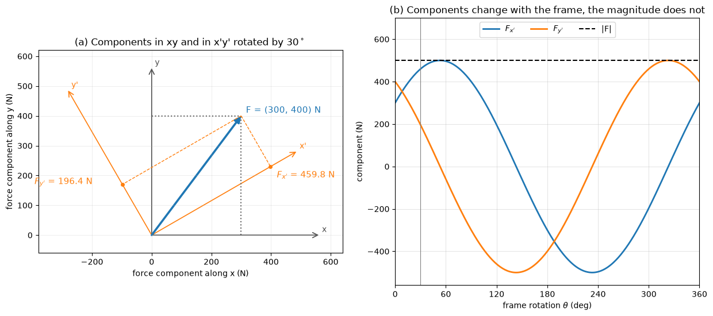

# Vector Analysis in Mechanics

Forces, moments, positions, velocities and accelerations are vectors, and nearly every calculation in statics and dynamics is a sequence of vector operations: writing a force along a cable as components, projecting it onto a member, taking its moment about a point or an axis, and changing from one coordinate frame to another. This note collects those operations in the form used in the rest of the section, with each one tied to the mechanics it serves.

## Problem Statement

Given points in space, directions defined by angles or by two points, and vector magnitudes (a cable tension, a force, a displacement), the tasks are to:

1. express each vector in Cartesian components in a chosen right-handed frame $(\mathbf{i}, \mathbf{j}, \mathbf{k})$;
2. combine vectors by addition, scaling, dot product and cross product to obtain resultants, projections, angles, work and moments;
3. transform components between frames that are rotated relative to one another.

The vectors are free (no point of application) unless stated; the moment of a force additionally needs a point on its line of action. Lengths are in m, forces in N, moments in N·m.

## Vectors and Components

A vector has a magnitude and a direction; a scalar has magnitude only. In a right-handed Cartesian frame a vector is written in terms of its rectangular components,

$$
\mathbf{A} = A_x\mathbf{i} + A_y\mathbf{j} + A_z\mathbf{k}
$$

where $\mathbf{i}$, $\mathbf{j}$, $\mathbf{k}$ are the unit vectors along $x$, $y$, $z$, ordered so that $\mathbf{i} \times \mathbf{j} = \mathbf{k}$. Its magnitude is

$$
A = |\mathbf{A}| = \sqrt{A_x^2 + A_y^2 + A_z^2}
$$

Addition and scalar multiplication act component by component: $\mathbf{A} + \mathbf{B} = (A_x + B_x)\mathbf{i} + (A_y + B_y)\mathbf{j} + (A_z + B_z)\mathbf{k}$ and $c\mathbf{A} = cA_x\mathbf{i} + cA_y\mathbf{j} + cA_z\mathbf{k}$. Addition is commutative and associative; it is the parallelogram law written in components. A negative $c$ reverses the direction.

A force, unlike a free vector, also has a line of action. For a rigid body a force may be slid along its line of action without changing its external effect (the principle of transmissibility), but not moved off it; for a deformable body even sliding changes the internal forces.

## Unit Vectors and Direction Cosines

The unit vector in the direction of $\mathbf{A}$ is

```math
\hat{\mathbf{u}}_A = \frac{\mathbf{A}}{A} = \cos\alpha\,\mathbf{i} +
\cos\beta\,\mathbf{j} + \cos\gamma\,\mathbf{k}
```

where $\alpha$, $\beta$, $\gamma$ are the angles between $\mathbf{A}$ and the positive $x$, $y$, $z$ axes, each between $0^\circ$ and $180^\circ$. Their cosines, the direction cosines, are $\cos\alpha = A_x/A$, $\cos\beta = A_y/A$, $\cos\gamma = A_z/A$, and since $|\hat{\mathbf{u}}_A| = 1$,

$$
\cos^2\alpha + \cos^2\beta + \cos^2\gamma = 1
$$

Only two direction angles are independent; given two, the third follows up to the sign of its cosine, which the geometry must decide.

## Position Vectors and Forces Along a Line

The position vector of a point $P(x, y, z)$ from the origin is $\mathbf{r} = x\mathbf{i} + y\mathbf{j} + z\mathbf{k}$. The position of $B$ relative to $A$ is

$$
\mathbf{r}_{AB} = \mathbf{r}_B - \mathbf{r}_A = (x_B - x_A)\mathbf{i} +
(y_B - y_A)\mathbf{j} + (z_B - z_A)\mathbf{k}
$$

The direction of a cable, strut or member is usually given by two points on it. A force of magnitude $F$ directed from $A$ towards $B$ is then

```math
\mathbf{F} = F\,\hat{\mathbf{u}}_{AB} = F\, \frac{\mathbf{r}_{AB}}{|\mathbf{r}_{AB}|}
```

A cable always pulls on the body it is attached to, so on the body at $A$ the force points from $A$ towards the anchor $B$.

### Example: Cable Tension as a Vector

A cable runs from $A(1, 0, 3)$ m to $B(5, 6, 0)$ m with tension $T = 500$ N. The relative position is $`\mathbf{r}_{AB} = 4\mathbf{i} + 6\mathbf{j} - 3\mathbf{k}`$ m with $`|\mathbf{r}_{AB}| = \sqrt{61} = 7.81`$ m, so

```math
\hat{\mathbf{u}}_{AB} = 0.512\mathbf{i} + 0.768\mathbf{j} - 0.384\mathbf{k},
\qquad
\mathbf{T} = 500\,\hat{\mathbf{u}}_{AB} = (256\mathbf{i} + 384\mathbf{j} -
192\mathbf{k}) \text{ N}
```

The direction angles are $\alpha = 59.2^\circ$, $\beta = 39.8^\circ$ and $\gamma = 112.6^\circ$; the last exceeds $90^\circ$ because the cable runs downwards.

## Dot Product

The dot product of two vectors is a scalar,

$$
\mathbf{A} \cdot \mathbf{B} = AB\cos\theta = A_xB_x + A_yB_y + A_zB_z
$$

where $\theta$ ($0 \le \theta \le 180^\circ$) is the angle between them. It is commutative and distributive, $\mathbf{A}\cdot\mathbf{A} = A^2$, and $\mathbf{A}\cdot\mathbf{B} = 0$ for perpendicular vectors. In mechanics it gives:

| Use | Formula |
| --- | --- |
| Angle between two lines | $\theta = \cos^{-1}\left(\mathbf{A}\cdot\mathbf{B}/(AB)\right)$ |
| Component of $\mathbf{A}$ along a direction $\hat{\mathbf{u}}$ | $A_\parallel = \mathbf{A}\cdot\hat{\mathbf{u}}$ |
| Vector projection and perpendicular part | $`\mathbf{A}_\parallel = (\mathbf{A}\cdot\hat{\mathbf{u}})\hat{\mathbf{u}}`$, $`\mathbf{A}_\perp = \mathbf{A} - \mathbf{A}_\parallel`$ |
| Work of a constant force over a displacement $\mathbf{d}$ | $W = \mathbf{F}\cdot\mathbf{d}$ |
| Axial force in a member along $\hat{\mathbf{u}}$ | $F_{\mathrm{axial}} = \mathbf{F}\cdot\hat{\mathbf{u}}$ |

The component $A_\parallel$ is negative when $\mathbf{A}$ has a sense opposite to $\hat{\mathbf{u}}$. The magnitude of the perpendicular part is $\sqrt{A^2 - A_\parallel^2}$.

### Example: Work and Angle

The force $\mathbf{F} = (30\mathbf{i} - 40\mathbf{j} + 20\mathbf{k})$ N moves its point of application through $\mathbf{d} = (5\mathbf{i} + 2\mathbf{j} - 3\mathbf{k})$ m. The work is $W = 150 - 80 - 60 = 10$ J. With $|\mathbf{F}| = \sqrt{2900} = 53.85$ N and $|\mathbf{d}| = \sqrt{38} = 6.16$ m, the angle between them is $\cos^{-1}(10/(53.85 \times 6.16)) = 88.3^\circ$: the force is nearly perpendicular to the displacement and does almost no work.

## Cross Product

The cross product of two vectors is a vector perpendicular to both,

```math
\mathbf{A} \times \mathbf{B} = AB\sin\theta\,\hat{\mathbf{n}}
```

with $\hat{\mathbf{n}}$ given by the right-hand rule (fingers from $\mathbf{A}$ to $\mathbf{B}$, thumb along $\hat{\mathbf{n}}$). In components,

```math
\mathbf{A} \times \mathbf{B} = \begin{vmatrix} \mathbf{i} & \mathbf{j} & \mathbf{k} \\ A_x & A_y & A_z \\ B_x & B_y & B_z \end{vmatrix} = (A_yB_z - A_zB_y)\mathbf{i} - (A_xB_z - A_zB_x)\mathbf{j} + (A_xB_y - A_yB_x)\mathbf{k}
```

The cross product is anti-commutative, $\mathbf{A}\times\mathbf{B} = -\mathbf{B}\times\mathbf{A}$, distributive over addition and not associative. $\mathbf{A}\times\mathbf{B} = \mathbf{0}$ for parallel vectors, and $|\mathbf{A}\times\mathbf{B}|$ is the area of the parallelogram spanned by them. For the unit vectors, $\mathbf{i}\times\mathbf{j} = \mathbf{k}$, $\mathbf{j}\times\mathbf{k} = \mathbf{i}$, $\mathbf{k}\times\mathbf{i} = \mathbf{j}$, and reversing the order changes the sign.

### Moment as a Cross Product

The moment of a force $\mathbf{F}$ about a point $O$ is

$$
\mathbf{M}_O = \mathbf{r} \times \mathbf{F}
$$

where $\mathbf{r}$ runs from $O$ to any point on the line of action of $\mathbf{F}$. Its magnitude $rF\sin\theta = Fd$ is the force times its perpendicular distance $d$ from $O$, and its direction is the axis about which $\mathbf{F}$ tends to turn the body. Choosing a different point on the line of action adds a vector parallel to $\mathbf{F}$ to $\mathbf{r}$, which contributes nothing to the cross product. [Moments and Couples](./moments_couples.md) develops this in full.

For $\mathbf{F} = (4\mathbf{i} - 3\mathbf{j} + 5\mathbf{k})$ kN acting at $P(2, 1, -1)$ m,

```math
\mathbf{M}_O = \begin{vmatrix} \mathbf{i} & \mathbf{j} & \mathbf{k} \\ 2 & 1 & -1 \\ 4 & -3 & 5 \end{vmatrix} = (5 - 3)\mathbf{i} - (10 + 4)\mathbf{j} + (-6 - 4)\mathbf{k} = (2\mathbf{i} - 14\mathbf{j} - 10\mathbf{k}) \text{ kN·m}
```

with magnitude $\sqrt{300} = 17.3$ kN·m.

## Triple Products

The scalar triple product

```math
\mathbf{A} \cdot (\mathbf{B} \times \mathbf{C}) = \begin{vmatrix} A_x & A_y & A_z \\ B_x & B_y & B_z \\ C_x & C_y & C_z \end{vmatrix}
```

is the signed volume of the parallelepiped spanned by the three vectors. It is unchanged by a cyclic permutation, $\mathbf{A}\cdot(\mathbf{B}\times\mathbf{C}) = \mathbf{B}\cdot(\mathbf{C}\times\mathbf{A}) = \mathbf{C}\cdot(\mathbf{A}\times\mathbf{B})$, changes sign when two vectors are swapped, and vanishes when the vectors are coplanar. Its main use in mechanics is the moment of a force about an axis with unit vector $\hat{\mathbf{u}}_a$,

$$
M_a = \hat{\mathbf{u}}_a \cdot (\mathbf{r} \times \mathbf{F})
$$

The vector triple product obeys $\mathbf{A}\times(\mathbf{B}\times\mathbf{C}) = \mathbf{B}(\mathbf{A}\cdot\mathbf{C}) - \mathbf{C}(\mathbf{A}\cdot\mathbf{B})$. It appears in rigid-body dynamics in the centripetal acceleration $\boldsymbol{\omega}\times(\boldsymbol{\omega}\times\mathbf{r})$.

## Coordinate Transformations

The components of a vector depend on the frame; the vector itself does not. Let a second right-handed frame have unit vectors $\mathbf{e}'_1$, $\mathbf{e}'_2$, $\mathbf{e}'_3$, and write $\mathbf{e}_1 = \mathbf{i}$, $\mathbf{e}_2 = \mathbf{j}$, $\mathbf{e}_3 = \mathbf{k}$. Each new component is the projection of the vector on a new unit vector, $A'_i = \mathbf{A}\cdot\mathbf{e}'_i$, which gives

$$
\mathbf{A}' = Q\mathbf{A},
\qquad Q_{ij} = \mathbf{e}'_i \cdot \mathbf{e}_j
$$

Row $i$ of $Q$ holds the direction cosines of the new axis $i$ in the old frame. Because both frames are orthonormal, $Q$ is orthogonal, $QQ^{\mathsf{T}} = I$, so the inverse transformation is $\mathbf{A} = Q^{\mathsf{T}}\mathbf{A}'$; for two right-handed frames $\det Q = +1$. Lengths, angles, dot products and cross products computed in either frame agree.

For a frame rotated by $\theta$ about $z$ (counterclockwise seen from $+z$),

```math
Q_z(\theta) = \begin{bmatrix} \cos\theta & \sin\theta & 0 \\ -\sin\theta & \cos\theta & 0 \\ 0 & 0 & 1 \end{bmatrix}
```

and similarly for rotations about $x$ and $y$. A general orientation is a product of such rotations, for example $`Q = Q_x(\phi)\,Q_y(\theta)\,Q_z(\psi)`$ for successive rotations about $z$, then the new $y$, then the newest $x$; the order matters because matrix products do not commute. Transformations are needed whenever loads are given in one frame and resistance in another: wind forces given in a building's principal axes, gear forces in a frame aligned with the tooth, aerodynamic forces in the wind frame and the aircraft body frame ([Airplane Stability and Control](../transportation/airplanes/airplane_stability.md)). Second-order tensors such as stress transform as $\sigma' = Q\sigma Q^{\mathsf{T}}$, the basis of the stress transformation and Mohr's circle in [Stress and Strain](../strength_materials/stress_strain.md).



In the left panel the force $(300, 400)$ N becomes $(459.8, 196.4)$ N in the frame rotated by $30^\circ$. The right panel shows that the components vary sinusoidally with the frame angle while the magnitude stays at 500 N; $F_{x'}$ reaches 500 N at $53.1^\circ$, where $x'$ lies along the force.

### Cylindrical Coordinates

Problems with an axis of symmetry (shafts, pipes, turbomachinery) use cylindrical coordinates $(r, \theta, z)$ with $x = r\cos\theta$, $y = r\sin\theta$. The unit vectors

```math
\hat{\mathbf{e}}_r = \cos\theta\,\mathbf{i} + \sin\theta\,\mathbf{j}, \qquad \hat{\mathbf{e}}_\theta = -\sin\theta\,\mathbf{i} + \cos\theta\,\mathbf{j}, \qquad \hat{\mathbf{e}}_z = \mathbf{k}
```

are the rotation $Q_z(\theta)$ applied point by point, so they change direction with $\theta$. That is why their time derivatives appear in the velocity and acceleration of a moving point ([Kinematics of Particles](../dynamics/kinematics_particles.md)).

## Common Mistakes

| Mistake | Consequence | Check |
| --- | --- | --- |
| Using $`\mathbf{r}_{BA}`$ where $`\mathbf{r}_{AB}`$ is meant | Force reversed; a cable pushes | A cable force on a body points away from the body towards the anchor |
| Forgetting to normalize before multiplying by a magnitude | Force too large by the factor $\lvert\mathbf{r}_{AB}\rvert$ | $\lvert\hat{\mathbf{u}}\rvert = 1$ |
| Computing $\mathbf{F}\times\mathbf{r}$ instead of $\mathbf{r}\times\mathbf{F}$ | Moment of the right size and wrong sign | Right-hand rule on a simple case |
| Dropping the minus sign on the $\mathbf{j}$ term of the determinant | Wrong $M_y$ | $\mathbf{M}_O\cdot\mathbf{F} = 0$ and $\mathbf{M}_O\cdot\mathbf{r} = 0$ |
| Using $Q$ where $Q^{\mathsf{T}}$ is needed | Rotation in the wrong sense | A vector along a new axis must have a single non-zero component in that frame |

## Key Takeaways

- Write every vector in components in one right-handed frame before combining vectors.
- A force along a line is its magnitude times the unit vector between two points on the line.
- The dot product gives angles, projections, work and member forces; the cross product gives moments and normals.
- The moment about an axis is a scalar triple product, $\hat{\mathbf{u}}_a\cdot(\mathbf{r}\times\mathbf{F})$.
- Components transform with the orthogonal matrix of direction cosines, $\mathbf{A}' = Q\mathbf{A}$, and back with $Q^{\mathsf{T}}$; magnitudes and dot products are frame-independent.

## Related Scripts

- [Coordinate Rotation of a Force Vector](../../../scripts/plots/fundamentals_coordinate_rotation/): transforms the components of a force from one Cartesian frame to a rotated one with a rotation matrix and shows that the components depend on the frame while the vector does not.
- [Moment of a Force About a Point and an Axis](../../../scripts/algorithms/fundamentals_moment_about_axis/): computes the moment of a 3D force about a point as a cross product and about an axis as a scalar triple product, and shows numerically which of the two depends on the choice of reference point.

## Exercises

**Exercise 1.** Find the magnitude and direction angles of $\mathbf{A} = 3\mathbf{i} - 4\mathbf{j} + 12\mathbf{k}$, and verify the direction-cosine identity.

<details>
<summary>Answer</summary>

$|\mathbf{A}| = \sqrt{9 + 16 + 144} = 13$.

```math
\alpha = \cos^{-1}(3/13) = 76.7^\circ, \quad \beta = \cos^{-1}(-4/13) = 107.9^\circ, \quad \gamma = \cos^{-1}(12/13) = 22.6^\circ
```

Check: $(9 + 16 + 144)/169 = 1$.

</details>

**Exercise 2.** Resolve $\mathbf{F} = (30\mathbf{i} - 40\mathbf{j} + 20\mathbf{k})$ N into components parallel and perpendicular to the direction $(2, -2, 1)$.

<details>
<summary>Answer</summary>

$\hat{\mathbf{u}} = (2, -2, 1)/3$, so

```math
F_\parallel = \mathbf{F}\cdot\hat{\mathbf{u}} = \frac{60 + 80 + 20}{3} = 53.3 \text{ N}, \qquad \mathbf{F}_\perp = \mathbf{F} - F_\parallel\hat{\mathbf{u}} = (-5.56, -4.44, 2.22) \text{ N}
```

$`|\mathbf{F}_\perp| = \sqrt{2900 - 2844.4} = 7.45`$ N, and $`\mathbf{F}_\perp\cdot\hat{\mathbf{u}} = 0`$ as a check.

</details>

**Exercise 3.** Find the area of the triangle with vertices $A(1, 0, 0)$, $B(0, 2, 0)$ and $C(0, 0, 3)$ (coordinates in m), and a unit normal to its plane.

<details>
<summary>Answer</summary>

$`\mathbf{r}_{AB} = (-1, 2, 0)`$ and $`\mathbf{r}_{AC} = (-1, 0, 3)`$.

```math
\mathbf{r}_{AB} \times \mathbf{r}_{AC} = (6, 3, 2), \qquad |\mathbf{r}_{AB} \times \mathbf{r}_{AC}| = 7
```

The triangle is half the parallelogram, so its area is 3.5 m². A unit normal is $\hat{\mathbf{n}} = (6, 3, 2)/7$. A pressure $p$ acting on this face would exert $p \times 3.5$ m² along $-\hat{\mathbf{n}}$ or $+\hat{\mathbf{n}}$, depending on which side the fluid is.

</details>

**Exercise 4.** Express the cable tension $\mathbf{T} = (256\mathbf{i} + 384\mathbf{j} - 192\mathbf{k})$ N of the example in a frame rotated by $30^\circ$ about $z$, and confirm that its magnitude and its angle with the $z$ axis are unchanged.

<details>
<summary>Answer</summary>

With $\cos 30^\circ = 0.8660$ and $\sin 30^\circ = 0.5$,

```math
T'_x = 256(0.8660) + 384(0.5) = 413.8 \text{ N}, \quad T'_y = -256(0.5) + 384(0.8660) = 204.6 \text{ N}, \quad T'_z = -192 \text{ N}
```

$|\mathbf{T}'| = \sqrt{413.8^2 + 204.6^2 + 192^2} = 500$ N. The rotation is about $z$, so the $z$ component and the angle $\gamma = 112.6^\circ$ are unchanged.

</details>

**Exercise 5.** Differentiate the cylindrical unit vectors $`\hat{\mathbf{e}}_r`$ and $`\hat{\mathbf{e}}_\theta`$ with respect to time, and use the result to derive the velocity $`\mathbf{v} = \dot{r}\hat{\mathbf{e}}_r + r\dot{\theta}\hat{\mathbf{e}}_\theta + \dot{z}\mathbf{k}`$ of a point at $`\mathbf{r} = r\hat{\mathbf{e}}_r + z\mathbf{k}`$. Evaluate the speed for $r = 2$ m, $\dot{r} = 1$ m/s, $\dot{\theta} = 3$ rad/s and $\dot{z} = 0$.

<details>
<summary>Answer</summary>

```math
\frac{d\hat{\mathbf{e}}_r}{dt} = \dot{\theta}(-\sin\theta\,\mathbf{i} + \cos\theta\,\mathbf{j}) = \dot{\theta}\,\hat{\mathbf{e}}_\theta, \qquad \frac{d\hat{\mathbf{e}}_\theta}{dt} = -\dot{\theta}(\cos\theta\,\mathbf{i} + \sin\theta\,\mathbf{j}) = -\dot{\theta}\,\hat{\mathbf{e}}_r
```

Therefore $`\mathbf{v} = \frac{d}{dt}(r\hat{\mathbf{e}}_r + z\mathbf{k}) = \dot{r}\hat{\mathbf{e}}_r + r\dot{\theta}\hat{\mathbf{e}}_\theta + \dot{z}\mathbf{k}`$, since $\mathbf{k}$ is constant.

Numerically $`\mathbf{v} = 1\,\hat{\mathbf{e}}_r + 6\,\hat{\mathbf{e}}_\theta`$ m/s, so the speed is $\sqrt{37} = 6.08$ m/s.

</details>

## References

- Hibbeler, R. C., *Engineering Mechanics: Statics*, 14th ed., Pearson, 2016.
- Beer, F. P., Johnston, E. R., Mazurek, D. F., & Eisenberg, E. R., *Vector Mechanics for Engineers: Statics and Dynamics*, 12th ed., McGraw-Hill, 2019.
- Meriam, J. L., Kraige, L. G., & Bolton, J. N., *Engineering Mechanics: Statics*, 9th ed., Wiley, 2018.
- Spiegel, M. R., Lipschutz, S., & Spellman, D., *Vector Analysis*, 2nd ed., Schaum's Outline Series, McGraw-Hill, 2009.
- Kreyszig, E., *Advanced Engineering Mathematics*, 10th ed., Wiley, 2011.
- Goldstein, H., Poole, C., & Safko, J., *Classical Mechanics*, 3rd ed., Addison-Wesley, 2002.
