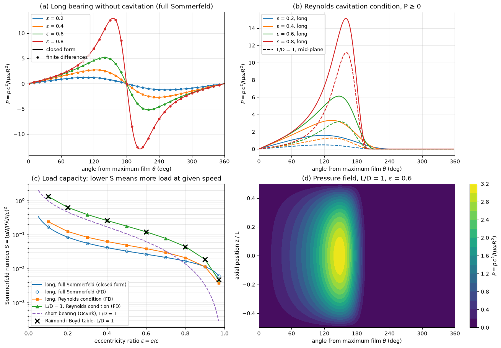

# Bearings and Lubrication

Bearings carry the loads between a shaft and its housing while allowing the shaft to turn with little friction. There are two families. Rolling-element bearings separate the races by balls or rollers and are selected from catalogues by a fatigue-life calculation. Fluid-film bearings separate the surfaces by a pressurized film of oil that the motion of the shaft drags into a converging gap; they carry the heaviest and fastest rotors, from turbine generators to engine crankshafts. This note covers the life of rolling bearings, then derives the Reynolds equation of thin-film lubrication from the Navier–Stokes equations and uses it to obtain Petroff's law, the Sommerfeld number and the load capacity of a journal bearing, and ends with the lubrication regimes of the Stribeck curve and elastohydrodynamic contacts.

## Problem Statement

For a rolling-element bearing: given the radial load $F_r$, the axial load $F_a$, the speed $n$, the required life and reliability, and catalogue data (dynamic load rating $C$, static rating $C_0$, load factors $X$ and $Y$), find the equivalent load, the rating life $L_{10}$, and the smallest bearing that meets the requirement.

For a hydrodynamic journal bearing: given the load $W$, the journal radius $R$, the length $L$, the radial clearance $c$, the speed $\omega$ and the lubricant viscosity $\mu$, find the pressure distribution in the film, the eccentricity of the journal, the minimum film thickness, the friction torque and the power loss. The film is assumed thin ($c/R \sim 10^{-3}$), laminar, isoviscous, incompressible and Newtonian, the surfaces rigid and smooth, and inertia negligible. The governing equation is the Reynolds equation, the thin-film limit of the Navier–Stokes and continuity equations,

$$
\frac{\partial}{\partial x}\left(h^3 \frac{\partial p}{\partial x}\right) +
\frac{\partial}{\partial z}\left(h^3 \frac{\partial p}{\partial z}\right) = 6\mu U
\frac{\partial h}{\partial x} + 12\mu \frac{\partial h}{\partial t}
$$

solved for the film pressure $p(x, z)$ with $p \ge 0$ and ambient pressure at the edges of the film.

## Rolling-Element Bearings

### Types

| Type | Loads carried | Notes |
| --- | --- | --- |
| deep groove ball | radial and moderate axial in both directions | most common; electric motors, gearboxes |
| angular contact ball | combined radial and axial in one direction | contact angle 15° to 40°; used in pairs, machine-tool spindles |
| self-aligning ball | radial, light axial | tolerates a few degrees of shaft misalignment |
| cylindrical roller | heavy radial, no axial (most designs) | allows axial float of the shaft |
| needle roller | heavy radial in a small radial space |  |
| tapered roller | heavy combined radial and axial | mounted in opposed pairs; wheel hubs, gear shafts |
| spherical roller | very heavy radial and axial, self-aligning | large rolls, crushers |
| thrust ball or roller | axial only |  |

Ball bearings have point contact and roller bearings line contact, so roller bearings carry more load for the same size but are more sensitive to misalignment.

### Load Ratings and Equivalent Load

Rolling bearings fail by fatigue of the races and rolling elements: after many cycles of Hertzian contact stress, cracks start below the surface and the surface spalls. The lives of identical bearings under identical load scatter widely, roughly following a Weibull distribution, so a life is quoted with a reliability. The **basic rating life** $L_{10}$ is the life, in millions of revolutions, that 90% of a large group of identical bearings reach or exceed.

The basic dynamic load rating $C$ is the constant load under which $L_{10}$ is one million revolutions; it is a reference value, not a load the bearing should carry. The basic static load rating $C_0$ is the load that produces a total permanent deformation of $10^{-4}$ times the rolling-element diameter at the most heavily loaded contact. A bearing that turns slowly or not at all is checked against $C_0$.

A combined radial and axial load is converted to the equivalent radial load that gives the same life,

$$
P = XF_r + YF_a
$$

For a deep groove ball bearing the catalogue gives a limit $e$ that depends on $F_a/C_0$. If $F_a/F_r \le e$, $X = 1$ and $Y = 0$; otherwise $X = 0.56$ and $Y$ is read from the catalogue (for example $e = 0.30$ and $Y = 1.45$ at $F_a/C_0 = 0.11$).

### Rating Life

Tests show that life varies with load as

$$
L_{10} = \left(\frac{C}{P}\right)^p
$$

with $p = 3$ for ball bearings and $p = 10/3$ for roller bearings. At constant speed $n$ in rpm the life in hours is

```math
L_{10h} = \frac{10^6}{60\,n}L_{10}
```

and the rating needed for a required life is

```math
C = P\left(\frac{60\,n\,L_{10h}}{10^6}\right)^{1/p}
```

Doubling the load divides the life of a ball bearing by 8, so load estimates, including shock and misalignment factors, matter more than anything else in the selection.

### Reliability and Life Adjustment

For a reliability $R$ other than 90% the life is multiplied by a factor $a_1$. The values of ISO 281:2007 are:

| Reliability | 90% | 95% | 96% | 97% | 98% | 99% |
| --- | --- | --- | --- | --- | --- | --- |
| $a_1$ | 1.00 | 0.64 | 0.55 | 0.47 | 0.37 | 0.25 |

(The 1990 edition used 0.62, 0.53, 0.44, 0.33 and 0.21.) ISO 281 also defines a life modification factor $a_{\mathrm{ISO}}$, and manufacturers publish their own (for example SKF's $a_{\mathrm{SKF}}$), which accounts for the lubricant film, contamination and the fatigue load limit, so that $L_{nm} = a_1 a_{\mathrm{ISO}} L_{10}$. With a clean, well-lubricated bearing $a_{\mathrm{ISO}}$ can be well above 1; with contaminated or thin-film lubrication it falls below 1.

### Selection Procedure

1. Find the radial and axial loads at each bearing from a free-body diagram of the shaft, including gear and belt forces.
2. Choose a bearing type and compute $P$, applying an application factor for shock (1.0 to 1.2 for smooth running, up to 3 for heavy impact).
3. Choose the required life in hours (about 20 000 to 30 000 h for machines in one-shift operation, 50 000 h or more for continuous duty) and reliability.
4. Compute the required $C$ and pick the smallest catalogue bearing with at least that rating and a suitable bore.
5. Check the static safety factor $C_0/P_0$, the speed limit and the lubrication.

### Example: Life of a Ball Bearing

A deep groove ball bearing with $C = 29.1$ kN and $C_0 = 17.8$ kN carries $F_r = 5$ kN and $F_a = 2$ kN at 1800 rpm. Here $F_a/C_0 = 0.112$, which gives $e \approx 0.30$; since $F_a/F_r = 0.4 > e$, $X = 0.56$ and $Y = 1.45$:

$$
P = 0.56 \times 5 + 1.45 \times 2 = 5.70 \text{ kN},
\qquad L_{10} = \left(\frac{29.1}{5.70}\right)^3 = 133.1 \text{ million rev}
$$

$$
L_{10h} = \frac{133.1 \times 10^6}{60 \times 1800} = 1232 \text{ h}
$$

Less than two months of continuous running: a larger bearing is needed.

## Hydrodynamic Journal Bearings

### Geometry

A journal of radius $R$ turns at $\omega$ inside a bearing of radius $R + c$, where the radial clearance $c$ is typically $10^{-3}R$. Under load the journal centre moves a distance $e$, the eccentricity, from the bearing centre. With the eccentricity ratio $\varepsilon = e/c$ and the angle $\theta$ measured from the position of the thickest film in the direction of rotation, the film thickness is, to first order in $c/R$,

$$
h = c\left(1 + \varepsilon\cos\theta\right)
$$

The film is thinnest, $h_{\min} = c(1 - \varepsilon)$, at $\theta = 180^\circ$. The line of centres generally does not lie along the load: the angle between them is the attitude angle $\phi$.

### The Reynolds Equation

Unroll the film so that $x = R\theta$ runs around the bearing, $y$ across the film and $z$ along the axis. The journal surface at $y = 0$ moves at $U = \omega R$ in $x$; the bearing surface at $y = h(x, z)$ is stationary. The [Navier–Stokes equations](../../fluid_mechanics/governing_equations/navier_stokes.md) simplify in such a film for three reasons. The film is thin, $h/L_x \sim 10^{-3}$ for a length scale $L_x \sim R$ along the film, so derivatives across it dominate. The reduced Reynolds number $\rho U h^2/(\mu L_x)$ is much less than 1, so inertia is negligible. The momentum equation across the film then reduces to $\partial p/\partial y = 0$, so the pressure is constant across the film. What remains is a balance of pressure gradient and viscous shear:

$$
\frac{\partial p}{\partial x} = \mu \frac{\partial^2 u}{\partial y^2},
\qquad \frac{\partial p}{\partial z} = \mu \frac{\partial^2 w}{\partial y^2}
$$

Integrating twice with no slip, $u = U$ and $w = 0$ at $y = 0$ and $u = w = 0$ at $y = h$, gives the sum of a [Couette and a Poiseuille profile](../../fluid_mechanics/governing_equations/navier_stokes.md#exact-solutions):

$$
u = \frac{1}{2\mu} \frac{\partial p}{\partial x}\left(y^2 - hy\right) +
U\left(1 - \frac{y}{h}\right),
\qquad w = \frac{1}{2\mu} \frac{\partial p}{\partial z}\left(y^2 - hy\right)
$$

The volume flow rates per unit width are

```math
q_x = \int_0^h u\, dy = -\frac{h^3}{12\mu} \frac{\partial p}{\partial x} + \frac{Uh}{2},
\qquad q_z = -\frac{h^3}{12\mu} \frac{\partial p}{\partial z}
```

Integrating the continuity equation across the film gives $\partial h/\partial t + \partial q_x/\partial x + \partial q_z/\partial z = 0$. Substituting the flow rates yields the Reynolds equation of the problem statement:

$$
\frac{\partial}{\partial x}\left(h^3 \frac{\partial p}{\partial x}\right) +
\frac{\partial}{\partial z}\left(h^3 \frac{\partial p}{\partial z}\right) = 6\mu U
\frac{\partial h}{\partial x} + 12\mu \frac{\partial h}{\partial t}
$$

The right-hand side holds the two ways a film generates pressure. The wedge term $`6\mu U\,\partial h/\partial x`$ is the flow dragged into a gap that narrows in the direction of motion: the Couette flow $Uh/2$ falls as $h$ falls, and the pressure must rise to push the difference through by Poiseuille flow. The squeeze term $`12\mu\,\partial h/\partial t`$ is the resistance of the film to being squeezed out, which carries the load in reciprocating engine bearings and gives fluid-film bearings their damping. A parallel film with steady motion carries no load.

### Petroff's Law

For a lightly loaded journal running concentric with its bearing ($\varepsilon = 0$), the film has uniform thickness $c$ and pure Couette flow, with shear stress $\tau = \mu\omega R/c$. With $N = \omega/2\pi$ the speed in rev/s, the friction torque is

```math
T_f = \tau\,(2\pi RL)\, R = \frac{4\pi^2\mu N R^3 L}{c}
```

Writing the load as $`W = P\,(2RL)`$ in terms of the mean pressure $P$ on the projected area and the friction coefficient as $f = T_f/(WR)$ gives Petroff's law,

$$
f = 2\pi^2 \frac{\mu N}{P} \frac{R}{c}
$$

It shows the two groups that control a journal bearing: the bearing characteristic $\mu N/P$ and the clearance ratio $R/c$. Petroff's law gives a good estimate of the friction of lightly loaded, high-speed bearings, but no load capacity, since a concentric film has no wedge.

### Long and Short Bearing Solutions

With $H = h/c$, $\zeta = z/R$ and $P = pc^2/(\mu\omega R^2)$ the steady Reynolds equation becomes

$$
\frac{\partial}{\partial\theta}\left(H^3 \frac{\partial P}{\partial\theta}\right) +
\frac{\partial}{\partial\zeta}\left(H^3 \frac{\partial P}{\partial\zeta}\right) = 6
\frac{\partial H}{\partial\theta}
$$

In a long bearing ($L/D > 2$) the axial flow is negligible and the equation can be integrated once in $\theta$. With pressure periodic around the bearing, the full-Sommerfeld solution is

```math
P = \frac{6\varepsilon\sin\theta\,(2 + \varepsilon\cos\theta)}{(2 + \varepsilon^2)(1 + \varepsilon\cos\theta)^2}
```

It is positive in the converging half of the film and equally negative in the diverging half. Real oil films cannot sustain that suction: dissolved gas comes out of solution and the film ruptures into streamers near ambient pressure. The Gümbel (half-Sommerfeld) model simply discards the negative half. The Reynolds condition is more consistent: the film ruptures at the angle where $p = 0$ and $\partial p/\partial\theta = 0$ together, which conserves mass at the rupture line. In a short bearing ($L/D < 0.5$) the circumferential pressure flow is negligible instead, and Ocvirk's solution follows from integrating twice in $z$.

The load is the integral of the film pressure over the journal surface. It is made dimensionless with the **Sommerfeld number**

$$
S = \frac{\mu N}{P}\left(\frac{R}{c}\right)^2
$$

which depends on $\varepsilon$ and $L/D$ only. For the long bearing with full-Sommerfeld pressure $S = (2 + \varepsilon^2)\sqrt{1 - \varepsilon^2}/(12\pi^2\varepsilon)$; for the short bearing

$$
S\left(\frac{L}{D}\right)^2 = \frac{(1 - \varepsilon^2)^2}{\pi\varepsilon\sqrt{\pi^2(1 - \varepsilon^2) + 16\varepsilon^2}}
$$

A large $S$ (light load, high speed or viscosity) means a nearly concentric journal; as $S \to 0$ the eccentricity approaches 1 and the film thickness approaches zero. Finite bearings have no closed-form solution. Raimondi and Boyd (1958) solved the finite bearing numerically with the Reynolds condition and tabulated $\varepsilon$, the attitude angle, the friction variable $(R/c)f$, the flow and the temperature rise against $S$ for $L/D = 1/4$, $1/2$ and $1$; these charts are still the standard design tool.



The figure comes from a finite-difference solution of the Reynolds equation in which cavitation is imposed as the complementarity condition $p \ge 0$. Panel (a) checks the long-bearing solver against the full-Sommerfeld closed form. Panel (b) shows that the Reynolds condition moves the peak pressure towards the minimum film and that the axial leakage of an $L/D = 1$ bearing lowers the mid-plane pressure. Panel (c) is the design chart: the computed $L/D = 1$ curve passes through the Raimondi–Boyd values (for example $S = 0.121$ at $\varepsilon = 0.6$, attitude angle 50.5°), while the long-bearing models overpredict the load capacity and the short-bearing formula underpredicts $S$ by a factor of 1.4 to 3 at this length.

### Example: Journal Bearing

A journal of diameter $D = 80$ mm and length $L = 80$ mm runs at 1200 rpm with radial clearance $c = 0.06$ mm and carries $W = 10$ kN. The oil viscosity at the operating temperature is $\mu = 0.025$ Pa·s.

1. Mean pressure: $`P = W/(LD) = 10\,000/(0.080 \times 0.080) = 1.5625`$ MPa.
2. Speed: $N = 1200/60 = 20$ rev/s; clearance ratio $R/c = 40/0.06 = 666.7$.
3. Sommerfeld number:

```math
S = \frac{0.025 \times 20}{1.5625 \times 10^6}\left(666.7\right)^2 = 0.142
```

4. For $L/D = 1$ the Raimondi–Boyd table gives $\varepsilon = 0.4$ at $S = 0.264$ and $\varepsilon = 0.6$ at $S = 0.121$; interpolating in $\ln S$ gives $\varepsilon = 0.559$. The finite-difference solver of the figure gives $\varepsilon = 0.560$ and an attitude angle of 53.1°.
5. Minimum film thickness: $h_{\min} = c(1 - \varepsilon) = 0.06 \times 0.44 = 0.026$ mm $`= 26\ \mu`$m. A common criterion asks for $h_{\min}$ of at least several times the combined surface roughness and above the shaft deflection and misalignment over the bearing length; 26 μm is comfortable for ground surfaces.

In practice the viscosity depends on the temperature rise of the film, which depends on the friction, so the calculation is iterated: assume a mean film temperature, read $\mu$, compute $S$, read the friction and flow from the charts, compute the temperature rise, and repeat until the assumed and computed temperatures agree.

## Lubrication Regimes and the Stribeck Curve

Plotted against the bearing characteristic $\mu N/P$ (the Hersey number), the friction coefficient of a lubricated contact follows the Stribeck curve, which has three regions:

| Regime | Film | Friction coefficient | Behaviour |
| --- | --- | --- | --- |
| boundary | thinner than the roughness; contact through adsorbed layers and additives | 0.05 to 0.15 | nearly independent of speed and viscosity; wear |
| mixed | partly fluid, partly asperity contact | falls steeply as $\mu N/P$ grows | minimum friction at the transition to full film |
| hydrodynamic | full film separating the surfaces | 0.001 to 0.01, rising with $\mu N/P$ as Petroff's law predicts | no wear in steady running |

Journal bearings are designed to run on the hydrodynamic branch, somewhat to the right of the minimum. There the operation is thermally stable: if the oil heats up, $\mu$ falls, $\mu N/P$ falls and so does the friction, which removes the extra heat. On the boundary side the same disturbance raises the friction and can run away to seizure. Every start and stop passes through the boundary and mixed regimes, which is where most journal-bearing wear happens.

### Elastohydrodynamic Lubrication

In the non-conformal contacts of rolling bearings, gear teeth and cams the contact pressure is 0.5 to 3 GPa. At these pressures the oil viscosity rises by orders of magnitude (the piezo-viscous effect) and the surfaces deform elastically, so a film of 0.1 to 1 μm survives where the rigid-surface theory would predict none. Hamrock and Dowson's fit to numerical solutions gives the minimum film thickness of an elliptical contact,

```math
\frac{h_{\min}}{R_x} = 3.63\, U^{0.68}G^{0.49}W^{-0.073}\left(1 - e^{-0.68k}\right)
```

with the speed parameter $U = \mu_0 u/(E'R_x)$, the materials parameter $G = \alpha E'$, the load parameter $W = w/(E'R_x^2)$ and the ellipticity ratio $k$. Here $u$ is the mean rolling speed, $\alpha$ the pressure-viscosity coefficient, $E'$ the effective elastic modulus and $R_x$ the effective radius in the rolling direction. The film depends mainly on speed and viscosity and hardly on load. Its adequacy is judged by the film parameter

$$
\Lambda = \frac{h_{\min}}{\sqrt{R_{q1}^2 + R_{q2}^2}}
$$

with $R_q$ the RMS roughness of each surface: $\Lambda > 3$ is full-film lubrication, $1 < \Lambda < 3$ mixed and $\Lambda < 1$ boundary. The life modification factor $a_{\mathrm{ISO}}$ of rolling bearings is largely a function of this ratio.

## Key Takeaways

- Rolling-bearing life scales as $(C/P)^3$ for balls and $(C/P)^{10/3}$ for rollers, at 90% reliability; higher reliability multiplies the life by $a_1 < 1$.
- The Reynolds equation follows from Navier–Stokes in a thin film with negligible inertia: pressure constant across the film, Couette plus Poiseuille flow along it, and continuity integrated across it.
- A film carries load only through a converging wedge or squeeze motion; a concentric journal has friction (Petroff's law) but no load capacity.
- The Sommerfeld number $S = (\mu N/P)(R/c)^2$ fixes the eccentricity ratio for a given $L/D$; smaller $S$ means a thinner film.
- Cavitation must be modelled: the full-Sommerfeld solution's suction is unphysical, and the Reynolds condition reproduces the Raimondi–Boyd design data.
- Run journal bearings on the hydrodynamic side of the Stribeck minimum, where they are thermally stable.

## Related Scripts

- [Journal Bearing Reynolds Equation](../../../scripts/algorithms/bearings_journal_reynolds/): solves the Reynolds equation of a hydrodynamic journal bearing by finite differences and reproduces the classical load-capacity results: the closed-form full-Sommerfeld solution of the long bearing, the effect of film rupture under the Reynolds cavitation condition, and the Raimondi–Boyd design table for a bearing with $L/D = 1$.

## Exercises

**Exercise 1.** By what factor does the $L_{10}$ life change when the equivalent load $P$ is doubled, for a ball bearing and for a roller bearing? What does this imply for load estimates during bearing selection?

<details>
<summary>Answer</summary>

Since $L_{10} \propto P^{-p}$:

- Ball bearing: $2^{-3} = 1/8$, so the life drops to 12.5%.
- Roller bearing: $2^{-10/3} = 1/10.08$, so the life drops to about 9.9%.

Life is very sensitive to load. Underestimating the load (ignoring shock, misalignment or preload) costs a large fraction of the life, which is why application factors are applied before selection. Conversely, a slightly larger bearing buys a lot of extra life.

</details>

**Exercise 2.** A deep groove ball bearing carries an equivalent load $P = 3.5$ kN at $n = 1450$ rpm and must reach $`L_{10h} = 20\,000`$ h. (a) Find the required basic dynamic load rating $C$. (b) The reliability requirement is raised to 96% ($a_1 = 0.55$, take $a_{\mathrm{ISO}} = 1$). What rating is needed now?

<details>
<summary>Answer</summary>

(a) Required life in revolutions:

```math
L_{10} = \frac{60\,n\,L_{10h}}{10^6} = \frac{60 \times 1450 \times 20\,000}{10^6} = 1740 \text{ million rev}
```

```math
C = P\,L_{10}^{1/3} = 3.5 \times 1740^{1/3} = 3.5 \times 12.03 = 42.1 \text{ kN}
```

(b) Now $a_1L_{10} \ge 1740$, so $L_{10} \ge 1740/0.55 = 3164$ million rev:

```math
C = 3.5 \times 3164^{1/3} = 51.4 \text{ kN}
```

Raising the reliability from 90% to 96% needs a 22% higher load rating.

</details>

**Exercise 3.** The bearing of the rolling-bearing example ($C = 29.1$ kN) runs at 1800 rpm. What is the largest equivalent dynamic load it can carry if it must reach $`L_{10h} = 20\,000`$ h?

<details>
<summary>Answer</summary>

```math
L_{10} = \frac{60 \times 1800 \times 20\,000}{10^6} = 2160 \text{ million rev}
```

```math
P_{\max} = \frac{C}{L_{10}^{1/3}} = \frac{29.1}{2160^{1/3}} = \frac{29.1}{12.93} = 2.25 \text{ kN}
```

The load of 5.7 kN in the example is about 2.5 times this, which is why that bearing reaches only about 1230 h.

</details>

**Exercise 4.** Use Petroff's law to estimate the friction coefficient, friction torque and power loss of the journal bearing in the example ($D = 80$ mm, $L = 80$ mm, $c = 0.06$ mm, $W = 10$ kN, $\mu = 0.025$ Pa·s, 1200 rpm). Why is the result only a first estimate for this bearing?

<details>
<summary>Answer</summary>

With $P = 1.5625$ MPa, $N = 20$ rev/s and $R/c = 666.7$:

```math
f = 2\pi^2 \frac{\mu N}{P} \frac{R}{c} = 2\pi^2 \times \frac{0.025 \times 20}{1.5625 \times 10^6} \times 666.7 = 4.21 \times 10^{-3}
```

Friction torque: $`T_f = fWR = 4.21 \times 10^{-3} \times 10\,000 \times 0.040 = 1.68`$ N·m.

Power loss:

```math
P_{\mathrm{loss}} = T_f\,\omega = fW\pi DN = 4.21 \times 10^{-3} \times 10\,000 \times \pi \times 0.080 \times 20 = 212 \text{ W}
```

Petroff's law assumes a concentric journal. With $S = 0.142$ this journal runs at $\varepsilon \approx 0.56$, so design values of friction and temperature rise should come from the Raimondi–Boyd charts, which give a somewhat higher friction for the eccentric film.

</details>

**Exercise 5.** The bearing of the example is to carry the same load at 300 rpm instead of 1200 rpm, with the same oil temperature. Estimate the new eccentricity ratio and minimum film thickness from the table, and say whether the design is still acceptable.

<details>
<summary>Answer</summary>

$S$ is proportional to $N$, so $S = 0.142/4 = 0.0356$. In the Raimondi–Boyd table for $L/D = 1$ this lies between $S = 0.0446$ at $\varepsilon = 0.8$ and $S = 0.0188$ at $\varepsilon = 0.9$. Interpolating in $\ln S$:

```math
\varepsilon = 0.8 + 0.1 \times \frac{\ln(0.0446/0.0356)}{\ln(0.0446/0.0188)} = 0.826
```

The finite-difference solver gives 0.832, so interpolation in the table is adequate. Then $h_{\min} = 0.06(1 - 0.826) = 0.0104$ mm, about 10 μm. That is still several times the roughness of ground surfaces, but the margin for shaft deflection, misalignment and particles in the oil is small, and the bearing passes through mixed lubrication at a higher speed during every start. A larger clearance or a more viscous oil would be considered.

</details>

**Exercise 6.** For a rolling contact the Hamrock–Dowson formula gives $h_{\min} = 0.35$ μm. The RMS roughnesses are $R_{q1} = 0.10$ μm and $R_{q2} = 0.15$ μm. (a) Which lubrication regime applies? (b) What composite roughness gives full-film lubrication, and what RMS roughness per surface if both surfaces are finished equally?

<details>
<summary>Answer</summary>

(a)

```math
\Lambda = \frac{0.35}{\sqrt{0.10^2 + 0.15^2}} = \frac{0.35}{0.180} = 1.94
```

Since $1 < \Lambda < 3$, the contact runs in mixed lubrication.

(b) For $\Lambda = 3$ the composite roughness must be at most $0.35/3 = 0.117$ μm. With equal surfaces, $`\sqrt{2}\,R_q = 0.117`$ μm, so $R_q = 0.083$ μm. The other route is to raise $h_{\min}$, for example with a more viscous oil, since $h_{\min} \propto U^{0.68}$.

</details>

## References

- Budynas, R. G., and Nisbett, J. K., *Shigley's Mechanical Engineering Design*, 11th ed., McGraw-Hill Education, 2020. Chapters 11 and 12.
- Hamrock, B. J., Schmid, S. R., and Jacobson, B. O., *Fundamentals of Fluid Film Lubrication*, 2nd ed., Marcel Dekker, 2004.
- Szeri, A. Z., *Fluid Film Lubrication*, 2nd ed., Cambridge University Press, 2010.
- Raimondi, A. A., and Boyd, J., "A solution for the finite journal bearing and its application to analysis and design", Parts I–III, *ASLE Transactions*, 1(1), 1958.
- Reynolds, O., "On the theory of lubrication and its application to Mr. Beauchamp Tower's experiments", *Philosophical Transactions of the Royal Society of London*, 177, 157–234, 1886.
- Harris, T. A., and Kotzalas, M. N., *Rolling Bearing Analysis*, 5th ed., CRC Press, 2006.
- ISO 281:2007, *Rolling bearings — Dynamic load ratings and rating life*, International Organization for Standardization, 2007.
