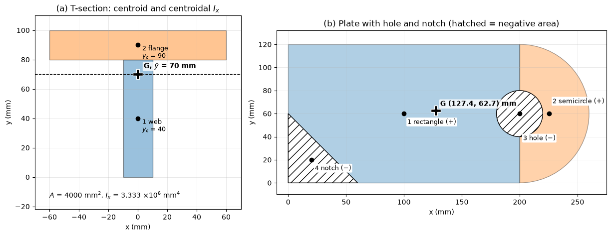

# Center of Mass and Centroids

The center of mass is the point at which the whole mass of a body can be taken as concentrated for its translational motion and for the moment of its weight; the centroid is the corresponding geometric point of a line, area or volume. Statics needs them to place the resultant of a weight or a distributed load, strength of materials needs the centroid of a cross section to locate its neutral axis, and fluid statics needs the centroid of a submerged surface to find the hydrostatic force. This note covers the definitions, centroids by integration and by composite parts, the theorems of Pappus and Guldinus, and leads into the second moments of area used for bending.

## Problem Statement

Given a body described by its geometry and its density $\rho(\mathbf{r})$ (kg/m³), or a plane shape described by its boundary, find the position of its center of mass, center of gravity or centroid, and in some cases the surface area or volume it generates when revolved. The assumptions are:

- gravity is uniform over the body, so the center of gravity coincides with the center of mass;
- for a centroid, the density (or thickness of a plate) is uniform, so the center of mass coincides with the centroid of the shape;
- composite bodies are made of parts whose own centroids are known.

The governing definitions are the first moments

```math
\bar{\mathbf{r}} = \frac{\int \mathbf{r}\,dm}{\int dm},
\qquad \bar{x} = \frac{\int x\,dA}{A}, \quad \bar{y} = \frac{\int y\,dA}{A}
```

for the center of mass and for the centroid of a plane area, and the corresponding sums for composite parts.

## Center of Gravity, Center of Mass and Centroid

For a system of particles of masses $m_i$ at positions $\mathbf{r}_i$, the center of mass is $\bar{\mathbf{r}} = \sum m_i\mathbf{r}_i/\sum m_i$; for a continuous body the sums become integrals over $`dm = \rho\,dV`$. The center of gravity is the point through which the resultant weight acts. The moment of the weights about any point equals the moment of the total weight placed at $\bar{\mathbf{r}}$ only if $\mathbf{g}$ is the same everywhere, which holds for every body on the scale of engineering structures. The centroid is a purely geometric property:

| Object | Centroid | First moments |
| --- | --- | --- |
| Line (wire) of length $L$ | $`\bar{x} = \int x\,dL/L`$ | $`\int x\,dL`$ |
| Area $A$ | $`\bar{x} = \int x\,dA/A`$ | $`Q_y = \int x\,dA`$, $`Q_x = \int y\,dA`$ |
| Volume $V$ | $`\bar{x} = \int x\,dV/V`$ | $`\int x\,dV`$ |

A centroid lies on every axis of symmetry of the shape, and at the intersection of two such axes. It need not lie inside the shape: the centroid of a ring is at its centre.

## Centroids by Integration

### Procedure

1. Choose coordinates in which the boundary is simple.
2. Choose a differential element whose own centroid is known: a thin strip parallel to an axis, a thin ring, or a polar sector.
3. Express $dA$ and the coordinates $\tilde{x}$, $\tilde{y}$ of the element's centroid in terms of one variable.
4. Integrate $A = \int dA$, $`Q_y = \int \tilde{x}\,dA`$ and $`Q_x = \int \tilde{y}\,dA`$, and divide.

### Worked Example: Parabolic Spandrel

The area under $y = h(x/b)^2$ from $x = 0$ to $x = b$ is a parabolic spandrel. Take vertical strips of width $dx$ and height $y$, with centroid at $(\tilde{x}, \tilde{y}) = (x, y/2)$:

```math
A = \int_0^b \frac{h}{b^2}x^2\, dx = \frac{bh}{3},
\qquad Q_y = \int_0^b x\, \frac{h}{b^2}x^2\, dx = \frac{hb^2}{4},
\qquad Q_x = \int_0^b \frac{1}{2}\left(\frac{h}{b^2}x^2\right)^2 dx = \frac{h^2 b}{10}
```

so $\bar{x} = Q_y/A = 3b/4$ and $\bar{y} = Q_x/A = 3h/10$. The centroid lies towards the tall, wide end of the spandrel, as it should.

### Common Shapes

| Shape | Area | $\bar{x}$ | $\bar{y}$ |
| --- | --- | --- | --- |
| Rectangle $b \times h$, corner at origin | $bh$ | $b/2$ | $h/2$ |
| Right triangle, legs $b$ (along $x$) and $h$ (along $y$) | $bh/2$ | $b/3$ | $h/3$ |
| Semicircle of radius $r$, diameter on the $x$-axis | $\pi r^2/2$ | $0$ | $4r/(3\pi)$ |
| Quarter circle of radius $r$ | $\pi r^2/4$ | $4r/(3\pi)$ | $4r/(3\pi)$ |
| Circular sector of radius $r$, half-angle $\alpha$, axis along $x$ | $\alpha r^2$ | $2r\sin\alpha/(3\alpha)$ | $0$ |
| Parabolic spandrel $y = h(x/b)^2$ | $bh/3$ | $3b/4$ | $3h/10$ |
| Semicircular arc (line) of radius $r$ | $\pi r$ (length) | $0$ | $2r/\pi$ |

## Composite Parts

A shape made of parts with areas $A_i$ and centroids $(\bar{x}_i, \bar{y}_i)$ has

$$
\bar{x} = \frac{\sum A_i\bar{x}_i}{\sum A_i},
\qquad \bar{y} = \frac{\sum A_i\bar{y}_i}{\sum A_i}
$$

A hole or cut-out enters as a part with negative area. The same formulas hold with masses for composite bodies and with lengths for composite wires. A table with columns $A_i$, $\bar{x}_i$, $\bar{y}_i$, $A_i\bar{x}_i$ and $A_i\bar{y}_i$ keeps the arithmetic in order.

### Worked Example: T-Section

A T-section has a $120 \times 20$ mm flange on top of a $20 \times 80$ mm web. By symmetry the centroid lies on the vertical axis of symmetry. Measuring $y$ from the bottom of the web:

| Part | $A_i$ (mm²) | $\bar{y}_i$ (mm) | $A_i\bar{y}_i$ (mm³) |
| --- | --- | --- | --- |
| Web | 1600 | 40 | 64 000 |
| Flange | 2400 | 90 | 216 000 |
| Sum | 4000 |  | 280 000 |

so $`\bar{y} = 280\,000/4000 = 70`$ mm above the bottom of the web.

### Worked Example: Plate With a Hole and a Notch

A plate consists of a $200 \times 120$ mm rectangle with its lower-left corner at the origin, and a semicircular end of radius 60 mm centred at $(200, 60)$ mm. A circular hole of diameter 40 mm is drilled at the centre of the semicircle, and a right-triangular notch with 60 mm legs is cut from the lower-left corner.

| Part | $A_i$ (mm²) | $\bar{x}_i$ (mm) | $\bar{y}_i$ (mm) |
| --- | --- | --- | --- |
| Rectangle | 24 000.0 | 100.00 | 60.00 |
| Semicircle | 5654.9 | $200 + 4(60)/(3\pi) = 225.46$ | 60.00 |
| Hole | $-1256.6$ | 200.00 | 60.00 |
| Notch | $-1800.0$ | 20.00 | 20.00 |

The net area is 26 598.2 mm², and the centroid is at

$$
\bar{x} = \frac{\sum A_i\bar{x}_i}{\sum A_i} = 127.36 \text{ mm},
\qquad \bar{y} = \frac{\sum A_i\bar{y}_i}{\sum A_i} = 62.71 \text{ mm}
$$



The figure marks each part's centroid and the composite one. Removing the notch from the lower left moves the centroid up and to the right; the semicircular end moves it right. The script checks the table against the centroid of the exact boundary computed with the shoelace formulas, and both agree to the printed digits.

## Theorems of Pappus and Guldinus

A plane curve or area revolved about a coplanar axis that does not cross it generates a surface or a solid of revolution. If $\bar{y}$ is the distance from the axis to the centroid of the curve or area:

```math
A_{\mathrm{surface}} = 2\pi\bar{y}\, L,
\qquad V = 2\pi\bar{y}\, A
```

where $L$ is the length of the generating curve and $A$ the generating area. Each follows by integrating the area or volume swept by an element, $`2\pi y\,dL`$ or $`2\pi y\,dA`$, and recognising the first moment. For a partial revolution through an angle $\theta$, replace $2\pi$ by $\theta$.

For a torus generated by a circle of radius $r$ whose centre is at distance $R > r$ from the axis:

$$
V = 2\pi R \cdot \pi r^2 = 2\pi^2 R r^2,
\qquad A_{\mathrm{surface}} = 2\pi R \cdot 2\pi r = 4\pi^2 R r
$$

The theorems also work backwards: knowing the volume of a sphere, $\tfrac{4}{3}\pi r^3 = 2\pi\bar{y}(\pi r^2/2)$ gives the centroid of a semicircle, $\bar{y} = 4r/(3\pi)$. They are used to size tanks, pressure vessels, O-rings and turned parts.

## Uses of the Centroid in Mechanics

The resultant of a distributed load passes through the centroid of the load diagram, which is how distributed loads are replaced in [Rigid Body Equilibrium](./rigid_body_equilibrium.md). The resultant hydrostatic force on a plane submerged surface is the pressure at its centroid times its area, $F = \rho g h_c A$, where $h_c$ is the depth of the centroid; it acts below the centroid, at the centre of pressure (see [Hydrostatics](../../fluid_mechanics/fluid_statics/hydrostatics.md)). The center of mass of a vehicle sets its axle loads, its tipping threshold and its handling.

## Second Moments of Area

The first moment of an area locates its centroid; the second moment measures how far the area is spread from an axis:

```math
I_x = \int y^2\, dA,
\qquad I_y = \int x^2\, dA,
\qquad J_O = \int r^2\, dA = I_x + I_y
```

The units are m⁴ (or mm⁴). The second moment about any axis parallel to a centroidal axis follows from the parallel-axis theorem,

$$
I = I_c + A d^2
$$

where $d$ is the distance between the axes; the centroidal axis gives the smallest value. For the T-section above, $I_x = 3.333 \times 10^6$ mm⁴ about the horizontal centroidal axis (Exercise 4). $I$ is the geometric stiffness of a beam in bending and of a column in buckling, and $J$ that of a circular shaft in torsion; their use is developed in [Beam Bending](../strength_materials/beam_bending.md), [Buckling](../strength_materials/buckling.md) and [Torsion](../strength_materials/torsion.md).

## Common Mistakes

- Using the centroid of a whole rectangle instead of subtracting the hole as a negative part.
- Measuring part centroids from different origins within one table.
- Assuming the centroid of a semicircular arc (line) equals that of a semicircular area ($2r/\pi$ against $`4r/(3\pi)`$).
- Applying Pappus's theorem with an axis that cuts through the generating area.
- Using the parallel-axis theorem between two non-centroidal axes without passing through the centroid.

## Key Takeaways

- The center of mass is the mass-weighted mean position; under uniform gravity it is also the center of gravity, and for uniform density the centroid.
- Centroids follow from first moments, by integration with a well-chosen element or by a composite-parts table with holes as negative areas.
- Symmetry axes contain the centroid and save most of the work.
- Pappus–Guldinus: surface $= 2\pi\bar{y}L$, volume $= 2\pi\bar{y}A$.
- The second moment $I = I_c + Ad^2$ carries the centroid into bending, buckling and torsion.

## Related Scripts

- [Composite Centroid](../../../scripts/plots/statics_composite_centroid/): computes the centroids of a T-section and of a plate with a hole and a notch from a table of parts, checks them against the polygon formula for the exact boundary, and gives the centroidal second moment of the T-section.

## Exercises

**Exercise 1.** Starting from $`\bar{y} = \int y\,dA/A`$, derive the centroid height $\bar{y} = 4r/(3\pi)$ of a semicircle of radius $r$ whose diameter lies on the $x$-axis.

<details>
<summary>Answer</summary>

Use polar coordinates, with $`dA = \rho\,d\rho\,d\theta`$ and $y = \rho\sin\theta$:

```math
Q_x = \int_0^{\pi}\int_0^{r} \rho\sin\theta\,\rho\,d\rho\,d\theta = \frac{r^3}{3}\left[-\cos\theta\right]_0^{\pi} = \frac{2r^3}{3}
```

```math
\bar{y} = \frac{Q_x}{A} = \frac{2r^3/3}{\pi r^2/2} = \frac{4r}{3\pi} \approx 0.424\,r
```

</details>

**Exercise 2.** A rectangular plate 200 mm wide ($x$) and 120 mm tall ($y$) has its lower-left corner at the origin. A circular hole of diameter 40 mm is centred at $(150, 60)$ mm. Find the centroid of the plate.

<details>
<summary>Answer</summary>

$`A_{\mathrm{rect}} = 24\,000`$ mm² at $(100, 60)$ and $A_{\mathrm{hole}} = \pi(20)^2 = 1256.6$ mm² at $(150, 60)$:

```math
\bar{x} = \frac{24\,000(100) - 1256.6(150)}{24\,000 - 1256.6} = 97.2 \text{ mm}, \qquad \bar{y} = 60 \text{ mm}
```

$\bar{y}$ follows from symmetry about $y = 60$ mm. The hole is right of centre, so the centroid moves left.

</details>

**Exercise 3.** Use the theorems of Pappus and Guldinus to derive (a) the volume of a right circular cone of base radius $r$ and height $h$ and (b) the surface area of a sphere of radius $r$.

<details>
<summary>Answer</summary>

(a) Revolve a right triangle with legs $r$ and $h$ about the leg $h$. Its centroid is $r/3$ from the axis:

```math
V = 2\pi\,\frac{r}{3}\cdot\frac{rh}{2} = \frac{\pi r^2 h}{3}
```

(b) Revolve a semicircular arc of length $\pi r$ about its diameter. The centroid of the arc is $2r/\pi$ from the axis:

```math
A = 2\pi\,\frac{2r}{\pi}\cdot\pi r = 4\pi r^2
```

</details>

**Exercise 4.** For the T-section of the worked example (centroid 70 mm above the bottom), compute the second moment of area $I_x$ about the horizontal centroidal axis, and the section moduli $S = I_x/c$ for the top and bottom fibres.

<details>
<summary>Answer</summary>

With the parallel-axis theorem:

- flange: $`120(20)^3/12 + 2400(90 - 70)^2 = 80\,000 + 960\,000 = 1\,040\,000`$ mm⁴;
- web: $`20(80)^3/12 + 1600(70 - 40)^2 = 853\,333 + 1\,440\,000 = 2\,293\,333`$ mm⁴.

```math
I_x = 3.333 \times 10^6 \text{ mm}^4
```

The top fibre is 30 mm and the bottom fibre 70 mm from the centroid, so $S_{\mathrm{top}} = I_x/30 = 1.11 \times 10^5$ mm³ and $S_{\mathrm{bottom}} = I_x/70 = 4.76 \times 10^4$ mm³. The bottom of the web carries the largest bending stress.

</details>

**Exercise 5.** A vertical rectangular gate 2 m wide and 3 m tall holds back water ($\rho = 1000$ kg/m³), with its top edge 1 m below the free surface. Find the resultant hydrostatic force and the depth of the centre of pressure.

<details>
<summary>Answer</summary>

The centroid is at depth $h_c = 1 + 1.5 = 2.5$ m and $A = 6$ m²:

```math
F = \rho g h_c A = 1000 \times 9.81 \times 2.5 \times 6 = 147.2 \text{ kN}
```

```math
I_c = \frac{bh^3}{12} = \frac{2 \times 3^3}{12} = 4.5 \text{ m}^4, \qquad
h_{cp} = h_c + \frac{I_c}{A h_c} = 2.5 + \frac{4.5}{6 \times 2.5} = 2.8 \text{ m}
```

The resultant acts 0.3 m below the centroid, because pressure grows with depth.

</details>

## References

- Hibbeler, R. C., *Engineering Mechanics: Statics*, 14th ed., Pearson, 2016.
- Beer, F. P., Johnston, E. R., and Mazurek, D. F., *Vector Mechanics for Engineers: Statics*, 12th ed., McGraw-Hill Education, 2019.
- Meriam, J. L., Kraige, L. G., and Bolton, J. N., *Engineering Mechanics: Statics*, 9th ed., Wiley, 2018.
- Gere, J. M., and Goodno, B. J., *Mechanics of Materials*, 9th ed., Cengage Learning, 2018.
- White, F. M., *Fluid Mechanics*, 8th ed., McGraw-Hill Education, 2016.
