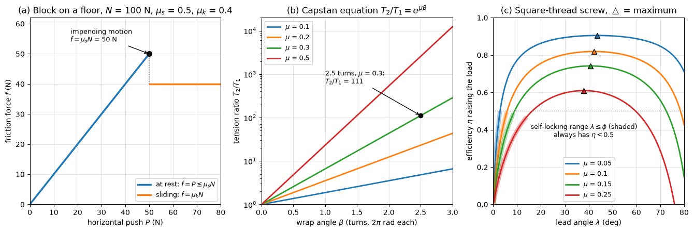

# Friction

Dry friction is the tangential force between two surfaces in contact that resists their relative sliding. It holds vehicles on the road, bolts in their holes and ropes on bollards, and it wastes power in screws and bearings. This note uses the Coulomb model of dry friction to analyse blocks on inclines, tipping versus sliding, wedges, square-threaded screws, belts and ropes on drums, and rolling resistance. Lubricated contacts, where a fluid film carries the load, follow different laws and are treated in [Bearings](../mechanical_systems/bearings.md).

## Problem Statement

Bodies in contact along known surfaces carry known loads (N) and are held by forces of which some are to be found. Each contact transmits a normal force $N \geq 0$ and a tangential friction force $F$. The task is either to find whether the system stays at rest under given loads, or to find the load at which motion is about to start (impending motion), or the force needed to keep it sliding. The assumptions are:

- dry contact, with friction force independent of the apparent contact area and of sliding speed;
- static and kinetic coefficients $\mu_s$ and $\mu_k$ known for each pair of surfaces;
- rigid bodies, so that equilibrium is written on the undeformed geometry.

The governing law (Coulomb, 1785, after Amontons, 1699) is

$$
|F| \leq \mu_s N \quad \text{at rest}, \qquad |F| = \mu_k N \quad \text{when sliding}
$$

with the friction force opposing the relative motion, or the motion that would occur without friction. Combined with the equilibrium equations of [Rigid Body Equilibrium](./rigid_body_equilibrium.md), the inequality turns statics problems into problems with a threshold.

## Coulomb Friction

### Regimes

As a horizontal push $P$ on a block of weight $W$ on a level floor grows from zero, three regimes follow:

1. At rest: $F = P < \mu_s N$. Friction is whatever equilibrium needs; it is not $\mu_s N$.
2. Impending motion: $F = \mu_s N$. This is the largest friction the contact can supply.
3. Sliding: $F = \mu_k N$, usually somewhat less than $\mu_s N$, so the block accelerates once it breaks free if $P$ is held.



Panel (a) shows the regimes for $N = 100$ N, $\mu_s = 0.5$ and $\mu_k = 0.4$: friction follows the push up to 50 N, then drops to 40 N. The drop from static to kinetic friction is what causes stick-slip vibration in brakes, machine slideways and bowed strings.

The coefficients depend on the materials, surface finish, contamination and temperature, and published values scatter widely. The table gives orders of magnitude only; design calculations should use measured values or the conservative end of a range.

| Surfaces (dry) | $\mu_s$ | $\mu_k$ |
| --- | --- | --- |
| Steel on steel | 0.5–0.8 | 0.4–0.6 |
| Rubber tyre on dry asphalt or concrete | 0.8–1.0 | 0.6–0.8 |
| Wood on wood | 0.25–0.5 | 0.2–0.4 |
| Brake lining on cast iron | 0.35–0.5 | 0.3–0.45 |
| PTFE on steel | 0.04–0.1 | 0.04–0.1 |

### Angle of Friction

At impending motion, the resultant of $N$ and $F = \mu_s N$ is inclined to the normal by the angle of static friction

$$
\phi_s = \tan^{-1}\mu_s
$$

In 3D the possible directions of the contact resultant form the friction cone of half-angle $\phi_s$ about the normal: the contact holds as long as the resultant lies inside it. Replacing $N$ and $F$ by one resultant at angle $\phi_s$ often reduces a problem to a force triangle, as for wedges and screws below.

### Blocks on an Incline

A block of weight $W$ on a plane inclined at $\theta$ has $N = W\cos\theta$ and needs $F = W\sin\theta$ up the slope to stay put. It slides on its own when $W\sin\theta > \mu_s W\cos\theta$, that is when $\theta > \phi_s$, whatever its weight.

With a horizontal force $P$ the two directions of impending motion give a range of $P$ for equilibrium. Writing the equations parallel and normal to the slope and substituting $\mu_s = \tan\phi_s$:

$$
P_{\min} = W\tan(\theta - \phi_s) \quad \text{(about to slide down)},
\qquad P_{\max} = W\tan(\theta + \phi_s) \quad \text{(about to slide up)}
$$

For $W = 200$ N, $\theta = 25^\circ$ and $\mu_s = 0.4$ ($\phi_s = 21.8^\circ$), the block slides down unless $P \geq 200\tan 3.2^\circ = 11.2$ N, and it starts to move up at $P = 200\tan 46.8^\circ = 213$ N.

### Sliding or Tipping

A body on a rough surface can also tip before it slides. A crate of weight $W$, base width $b$, pushed horizontally at height $h$, slides when $P = \mu_s W$ and tips about its front edge when the moment of $P$ about that edge exceeds that of the weight, $Ph = Wb/2$. Whichever threshold is lower governs. For $W = 1000$ N, $b = 1$ m, $h = 1.5$ m and $\mu_s = 0.4$, sliding needs 400 N and tipping only 333 N, so the crate tips. At the onset of tipping the normal force acts at the front edge; before that, its position along the base is an unknown found from moment equilibrium.

## Wedges

A wedge converts a small force along its length into a large force normal to it. Consider a wedge of angle $\alpha$ driven to the right under a block of weight $W$ that is guided vertically by frictionless rollers, with friction coefficient $\mu$ ($\phi = \tan^{-1}\mu$) on both faces of the wedge. The block's equilibrium in the vertical direction gives the normal force $N_2$ on the inclined face, the wedge's vertical equilibrium gives the floor force $N_1 = W$, and the wedge's horizontal equilibrium gives the driving force. Eliminating the normal forces:

$$
P = W\left[\tan(\alpha + \phi) + \tan\phi\right]
$$

The first term comes from the inclined face, the second from the floor. To withdraw the wedge, every friction force reverses, and the force needed to pull it out is

$$
Q = W\left[\tan(\phi - \alpha) + \tan\phi\right]
$$

The wedge is self-locking, staying in place when the driving force is removed, when $Q \geq 0$, that is when

$$
\alpha \leq 2\phi
$$

The factor 2 appears because both faces resist the wedge's tendency to slip out. For $W = 5$ kN, $\alpha = 10^\circ$ and $\mu = 0.3$ ($\phi = 16.7^\circ$), $P = 5(\tan 26.7^\circ + 0.3) = 4.01$ kN to drive the wedge and $Q = 5(\tan 6.7^\circ + 0.3) = 2.09$ kN to pull it out; the wedge is self-locking, since $10^\circ < 33.4^\circ$.

## Square-Threaded Screws

Unwrapping one turn of a square thread of mean radius $r$ and lead $l$ (axial advance per turn) gives an incline of lead angle

$$
\lambda = \tan^{-1} \frac{l}{2\pi r}
$$

The nut is a block on that incline, loaded axially by $W$ and pushed horizontally by the force $M/r$ from the applied moment $M$. The block-on-incline results above, with $\theta = \lambda$, give the moments to raise and to lower the load:

$$
M_{\mathrm{raise}} = W r \tan(\lambda + \phi_s),
\qquad M_{\mathrm{lower}} = W r \tan(\phi_s - \lambda)
$$

The screw is self-locking when $\lambda \leq \phi_s$, so that $M_{\mathrm{lower}} \geq 0$ and the load does not unwind the screw. The efficiency of raising is the work done on the load per turn, $Wl$, divided by the work input $2\pi M_{\mathrm{raise}}$:

$$
\eta = \frac{\tan\lambda}{\tan(\lambda + \phi_s)}
$$

Panel (c) of the figure plots $\eta$ against $\lambda$. Efficiency is greatest at $\lambda = 45^\circ - \phi_s/2$; at the self-locking limit $\lambda = \phi_s$ it is $\tan\phi_s/\tan 2\phi_s = (1 - \mu_s^2)/2 < 1/2$, so every self-locking screw wastes more than half its input. Jacks and clamps accept this to hold the load; ball screws avoid it with rolling contact and then need a brake.

Two corrections are common in practice. Threads with flank angle (ISO metric and Acme threads) press the flanks with a larger normal force, which is approximately accounted for by replacing $\mu$ with $\mu/\cos\alpha_n$, where $\alpha_n$ is the half-angle of the thread profile ($30^\circ$ for ISO metric, $14.5^\circ$ for Acme). A rotating collar bearing on a fixed surface adds a moment $\mu_c W r_c$, with $r_c$ the mean collar radius. Both are treated in detail in Shigley's text.

## Belts and Ropes on Drums

### Capstan Equation

A flat belt or rope wraps a fixed drum over the angle $\beta$ (rad) and is about to slip, with tension $T_2$ on the tight side and $T_1$ on the slack side. An element subtending $d\theta$ carries tensions $T$ and $T + dT$ at its ends. Their resultant presses it on the drum with $`dN = T\,d\theta`$ (to first order), and the tension difference is resisted by friction $`dT = \mu\,dN`$. Hence $`dT/T = \mu\,d\theta`$, and integrating over the wrap:

$$
\frac{T_2}{T_1} = e^{\mu\beta}
$$

This is the capstan (Euler–Eytelwein) equation. The ratio grows exponentially with the wrap angle and does not depend on the drum radius. Panel (b) of the figure shows it on a logarithmic axis.

### Worked Example: Rope on a Bollard

A rope makes 2.5 turns ($\beta = 5\pi$ rad) around a bollard with $\mu = 0.3$, and a sailor pulls the slack end with 50 N. The largest load that can be held is

```math
T_2 = 50\, e^{0.3 \times 5\pi} = 50 \times 111.3 = 5.57 \text{ kN}
```

One more half turn would raise the ratio by another factor $e^{0.3\pi} = 2.57$.

### Belt Drives

A flat belt drive transmits the moment $(T_2 - T_1)r$ at a pulley of radius $r$, and the largest moment before slip is set by $T_2/T_1 = e^{\mu\beta}$ on the pulley with the smaller wrap. In a V-belt of groove angle $2\gamma$, the wedging action multiplies the normal force, and the effective coefficient is $\mu/\sin\gamma$; for a $38^\circ$ groove this is about three times $\mu$, which is why V-belts carry more torque at the same tension. At high speed, centrifugal force reduces the contact pressure, and the tensions in the capstan equation are replaced by $T - m'v^2$, where $m'$ is the belt mass per unit length (kg/m) and $v$ the belt speed (m/s). Band brakes use the same equation, with the band fixed and the drum turning.

## Rolling Resistance

A wheel rolling on a surface does not slide, so Coulomb friction does no work at the contact. The resistance to rolling comes from deformation: the contact patch is pressed into a slight hollow, and the resultant contact force acts a small distance $a$ ahead of the point below the axle. Moment equilibrium of a wheel of radius $r$ carrying a load $W$ and pulled at its axle by a horizontal force $P$ gives, for $a \ll r$,

$$
P \approx \frac{W a}{r}
$$

The ratio $C_{rr} = a/r$ is the rolling resistance coefficient. Typical values are about 0.001 for a steel wheel on a steel rail and about 0.01 for a car tyre on asphalt, so a 0.45 m rail wheel has $a \approx 0.5$ mm and a 0.3 m car tyre $a \approx 3$ mm. Tyre rolling resistance comes mainly from the energy lost in the rubber as it deforms and recovers (hysteresis), and it is a significant part of a road vehicle's energy use at urban speeds.

## Common Mistakes

- Setting $F = \mu_s N$ when the body is not on the point of moving; friction is then an unknown found from equilibrium.
- Drawing friction in the wrong direction; it opposes the relative motion that would occur without it.
- Assuming the normal force equals the weight on an incline or when other forces have normal components.
- Using degrees in the capstan equation; $\beta$ is in radians.
- Ignoring tipping, which can occur before sliding for tall bodies.

## Key Takeaways

- Coulomb friction is an inequality, $|F| \leq \mu_s N$; it reaches its limit only at impending motion.
- The angle of friction $\phi_s = \tan^{-1}\mu_s$ turns friction problems into geometry: a block slides on its own when the slope exceeds $\phi_s$.
- A wedge is self-locking when $\alpha \leq 2\phi$, a square-threaded screw when $\lambda \leq \phi_s$, and a self-locking screw has efficiency below 50%.
- Belt friction grows exponentially with wrap angle, $T_2/T_1 = e^{\mu\beta}$.
- Rolling resistance comes from deformation, $P \approx W a/r$, and is far smaller than sliding friction.

## Related Scripts

- [Friction Curves](../../../scripts/plots/statics_friction_curves/): plots the friction force on a block as the push grows through impending motion to sliding, the capstan ratio $e^{\mu\beta}$ against wrap angle, and the efficiency of a square-threaded screw against lead angle with its self-locking range.

## Exercises

**Exercise 1.** A 50 kg crate rests on a $20^\circ$ ramp with $\mu_s = 0.3$. (a) Does it stay put on its own? (b) What force parallel to the ramp is needed to just hold it? (c) What force parallel to the ramp is needed to start pushing it up?

<details>
<summary>Answer</summary>

(a) $\tan 20^\circ = 0.364 > 0.3$: the ramp is steeper than the friction angle ($16.7^\circ$), so the crate slides.

$W = 490.5$ N, so $N = W\cos 20^\circ = 460.9$ N and $W\sin 20^\circ = 167.8$ N.

(b) Friction acts up the slope: $P = 167.8 - 0.3(460.9) = 29.5$ N.

(c) Friction acts down the slope: $P = 167.8 + 0.3(460.9) = 306.0$ N.

</details>

**Exercise 2.** A sailor must hold a 10 kN load with a pull of 100 N by wrapping the rope around a bollard with $\mu = 0.25$. How many full turns are needed?

<details>
<summary>Answer</summary>

```math
\beta = \frac{\ln(T_2/T_1)}{\mu} = \frac{\ln 100}{0.25} = 18.42 \text{ rad} = 2.93 \text{ turns}
```

Three full turns give $e^{0.25 \times 6\pi} = 111$, enough to hold 11.1 kN with 100 N.

</details>

**Exercise 3.** A square-threaded screw jack has a mean diameter of 30 mm, a lead of 6 mm and $\mu_s = 0.15$, and supports $W = 20$ kN. Find the lead angle, the moments needed to raise and lower the load, whether the screw is self-locking, and its efficiency when raising.

<details>
<summary>Answer</summary>

$\lambda = \tan^{-1}[6/(2\pi \times 15)] = 3.64^\circ$ and $\phi_s = \tan^{-1}0.15 = 8.53^\circ$.

```math
M_{\mathrm{raise}} = Wr\tan(\lambda + \phi_s) = 20\,000 \times 0.015 \times \tan 12.17^\circ = 64.7 \text{ N}\cdot\text{m}
```

```math
M_{\mathrm{lower}} = Wr\tan(\phi_s - \lambda) = 300 \times \tan 4.89^\circ = 25.7 \text{ N}\cdot\text{m}
```

The screw is self-locking because $\lambda < \phi_s$. The efficiency is $\eta = \tan 3.64^\circ/\tan 12.17^\circ = 0.295$, the price of self-locking.

</details>

**Exercise 4.** Show that the force $P$ needed to push a block of weight $W$ up an incline $\theta$, with $P$ applied at angle $\alpha$ above the horizontal, is least when $\alpha = \theta + \phi_s$, and that the minimum is $P_{\min} = W\sin(\theta + \phi_s)$. Evaluate it for $W = 200$ N, $\theta = 25^\circ$, $\mu_s = 0.4$.

<details>
<summary>Answer</summary>

Eliminating $N$ from the equilibrium equations parallel and normal to the slope gives

```math
P = \frac{W(\sin\theta + \mu_s\cos\theta)}{\cos(\alpha - \theta) + \mu_s\sin(\alpha - \theta)}
```

Substituting $\mu_s = \tan\phi_s$ and multiplying numerator and denominator by $\cos\phi_s$:

```math
P = \frac{W\sin(\theta + \phi_s)}{\cos(\alpha - \theta - \phi_s)}
```

The denominator is largest, equal to 1, when $\alpha = \theta + \phi_s$, so $P_{\min} = W\sin(\theta + \phi_s)$: the push should be tilted by the friction angle above the slope. With $\phi_s = 21.80^\circ$, $\alpha = 46.8^\circ$ and $P_{\min} = 200\sin 46.8^\circ = 145.8$ N, compared with 213 N for a horizontal push.

</details>

**Exercise 5.** A flat belt wraps $160^\circ$ around a 200 mm diameter pulley with $\mu = 0.3$, and the tight-side tension may not exceed 1.2 kN. Neglecting centrifugal effects, find the slack-side tension, the largest torque and the power transmitted at 1500 rpm.

<details>
<summary>Answer</summary>

$\beta = 160^\circ = 2.793$ rad, so $e^{\mu\beta} = e^{0.838} = 2.311$.

$T_1 = 1200/2.311 = 519$ N and $T_2 - T_1 = 681$ N. Torque: $681 \times 0.1 = 68.1$ N m. At $\omega = 1500 \times 2\pi/60 = 157.1$ rad/s the power is $68.1 \times 157.1 = 10.7$ kW.

</details>

## References

- Hibbeler, R. C., *Engineering Mechanics: Statics*, 14th ed., Pearson, 2016.
- Meriam, J. L., Kraige, L. G., and Bolton, J. N., *Engineering Mechanics: Statics*, 9th ed., Wiley, 2018.
- Beer, F. P., Johnston, E. R., and Mazurek, D. F., *Vector Mechanics for Engineers: Statics*, 12th ed., McGraw-Hill Education, 2019.
- Budynas, R. G., and Nisbett, J. K., *Shigley's Mechanical Engineering Design*, 11th ed., McGraw-Hill Education, 2020.
- Bowden, F. P., and Tabor, D., *The Friction and Lubrication of Solids*, Oxford University Press, 1950 (reprinted 2001).
- Gillespie, T. D., *Fundamentals of Vehicle Dynamics*, SAE International, 1992.
