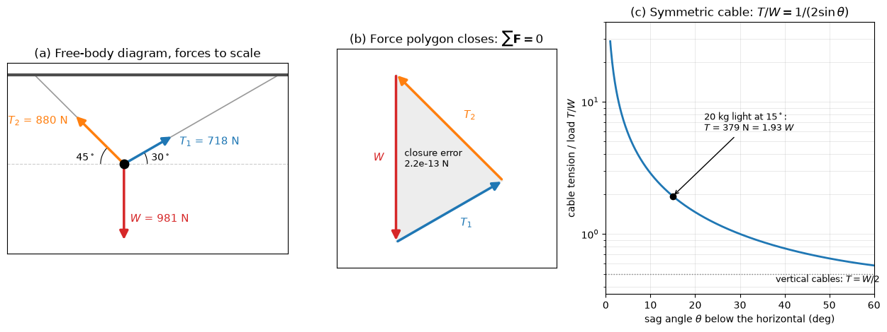

# Particle Equilibrium

A body can be treated as a particle when every force on it passes through one point, so that moments play no role and equilibrium reduces to a balance of forces. Hooks and rings in cable systems, the joints of pin-jointed trusses and a small mass hanging from springs are all handled this way. This note sets up the equilibrium equations in 2D and 3D, writes them as a linear system for the unknown force magnitudes, and covers cables, springs and pulleys. Bodies on which the forces are not concurrent need the moment equations of [Rigid Body Equilibrium](./rigid_body_equilibrium.md).

## Problem Statement

A particle is acted on by known forces $\mathbf{F}_1, \dots, \mathbf{F}_k$ (weights, applied loads) and by $n$ forces of unknown magnitude $T_1, \dots, T_n$ whose lines of action are known: cables, rods and springs attached at known points. The task is to find the magnitudes $T_i$ (N), or, when the geometry is unknown, the position or angle at which the particle is in equilibrium. The assumptions are:

- all forces are concurrent at the particle, and its size does not affect the answer;
- cables and ropes are weightless and inextensible and can only pull ($T_i \geq 0$);
- pulleys are frictionless, so a cable has the same tension on both sides;
- springs are linear, with force proportional to the change in length.

The governing equation is Newton's first law for a body at rest or in uniform motion:

$$
\sum \mathbf{F} = \mathbf{0}
$$

which gives two scalar equations in a plane and three in space. A planar problem therefore has at most two unknowns that statics alone can determine, and a spatial problem at most three.

## Equilibrium Equations

Write each unknown force as its magnitude times a unit vector $`\mathbf{u}_i`$ along its line of action, pointing away from the particle for a cable (the direction in which the cable pulls). With the known forces summed into $`\mathbf{F}_{\mathrm{app}}`$, equilibrium reads

```math
\sum_{i=1}^{n} T_i\,\mathbf{u}_i + \mathbf{F}_{\mathrm{app}} = \mathbf{0}
```

In matrix form this is $\mathbf{U}\mathbf{T} = -\mathbf{F}_{\mathrm{app}}$, where the columns of $\mathbf{U}$ are the unit vectors. In a plane, $\mathbf{U}$ is $2 \times n$; in space it is $3 \times n$. The system has a unique solution when $\mathbf{U}$ is square and its columns are linearly independent, that is when no two of the unknown forces in 2D are collinear and no three in 3D are coplanar. If they are, some applied loads cannot be balanced and the particle moves. If there are more unknowns than equations, the forces cannot be found from statics alone and the stiffnesses of the supporting members are needed (see [Structural Analysis](./structural_analysis.md)).

A negative magnitude means the force acts opposite to the assumed direction. For a rod that is acceptable (it is in compression); for a cable it means the arrangement cannot carry the load, because a cable cannot push.

## Two-Dimensional Problems

### Procedure

1. Isolate the particle and draw its free-body diagram with every force, the known ones with their values and the unknown ones with assumed directions.
2. Choose axes. Aligning one axis with an unknown force removes it from the other equation.
3. Resolve every force into components.
4. Write $\sum F_x = 0$ and $\sum F_y = 0$ and solve.
5. Check signs (cables in tension) and check the result against a force polygon or a limiting case.

### Worked Example: Mass on Two Cables

A 100 kg mass hangs from two cables. Cable 1 rises to the right at $\theta_1 = 30^\circ$ above the horizontal and cable 2 rises to the left at $\theta_2 = 45^\circ$. The weight is $W = mg = 100 \times 9.81 = 981$ N.

With $x$ to the right and $y$ up:

$$
\sum F_x = T_1\cos\theta_1 - T_2\cos\theta_2 = 0
$$

$$
\sum F_y = T_1\sin\theta_1 + T_2\sin\theta_2 - W = 0
$$

Eliminating $T_1$ from the first equation and using $\sin\theta_1\cos\theta_2 + \cos\theta_1\sin\theta_2 = \sin(\theta_1 + \theta_2)$ gives the closed form

$$
T_1 = \frac{W\cos\theta_2}{\sin(\theta_1 + \theta_2)} = \frac{981\cos 45^\circ}{\sin 75^\circ} = 718 \text{ N},
\qquad
T_2 = \frac{W\cos\theta_1}{\sin(\theta_1 + \theta_2)} = \frac{981\cos 30^\circ}{\sin 75^\circ} = 880 \text{ N}
$$

The steeper cable carries more of the load. The result also follows from Lami's theorem, which holds for any three concurrent forces in equilibrium: each force is proportional to the sine of the angle between the other two. Here the angle between $T_2$ and $W$ is $135^\circ$, between $T_1$ and $W$ it is $120^\circ$, and between $T_1$ and $T_2$ it is $105^\circ$, so $T_1 = W\sin 135^\circ/\sin 105^\circ = 718$ N.



Panel (a) draws the forces of the example to scale. In panel (b) the same three forces are placed head to tail; because they sum to zero, the polygon closes. Drawing the polygon to scale was the standard graphical solution before calculators and remains a quick check on signs.

### Cables Under Transverse Load

A cable carrying a load $W$ at its midpoint, with both halves at the sag angle $\theta$ below the horizontal, has $2T\sin\theta = W$ by vertical equilibrium:

$$
T = \frac{W}{2\sin\theta}
$$

Panel (c) of the figure plots this ratio. A cable at $15^\circ$ already carries almost twice the load, and the tension grows without bound as $\theta \to 0$. A cable can never be pulled straight under a transverse load, and shallow cables (overhead lines, guy wires, safety lines) must be designed for tensions much larger than the loads they carry.

## Three-Dimensional Problems

In space, each cable direction comes from the coordinates of its two ends. For a cable from the particle at $O$ to an anchor at $A$:

1. Form the position vector $\mathbf{r}_{OA} = (x_A - x_O)\mathbf{i} + (y_A - y_O)\mathbf{j} + (z_A - z_O)\mathbf{k}$ (m).
2. Compute its length $r_{OA} = |\mathbf{r}_{OA}|$.
3. The unit vector is $`\mathbf{u}_{OA} = \mathbf{r}_{OA}/r_{OA}`$, and the cable force on the particle is $`T_A\,\mathbf{u}_{OA}`$.
4. Write $\sum F_x = \sum F_y = \sum F_z = 0$ and solve the $3 \times 3$ system.

### Worked Example: Three Cables

A 500 N weight at the origin $O$ hangs from three cables anchored at $A(3, 0, 4)$, $B(-2, 2, 5)$ and $C(1, -3, 6)$ m. The lengths are $r_{OA} = 5$ m, $r_{OB} = \sqrt{33}$ m and $r_{OC} = \sqrt{46}$ m, and the unit vectors are

```math
\mathbf{u}_{OA} = (0.6, 0, 0.8), \qquad
\mathbf{u}_{OB} = \frac{(-2, 2, 5)}{\sqrt{33}}, \qquad
\mathbf{u}_{OC} = \frac{(1, -3, 6)}{\sqrt{46}}
```

The equilibrium equations are

```math
\sum F_x = 0.6\, T_A - \frac{2T_B}{\sqrt{33}} + \frac{T_C}{\sqrt{46}} = 0
```

$$
\sum F_y = \frac{2T_B}{\sqrt{33}} - \frac{3T_C}{\sqrt{46}} = 0
$$

```math
\sum F_z = 0.8\, T_A + \frac{5T_B}{\sqrt{33}} + \frac{6T_C}{\sqrt{46}} - 500 = 0
```

Solving gives $T_A = 103.1$ N, $T_B = 266.5$ N and $T_C = 209.8$ N. All three are positive, so every cable is in tension and the arrangement works. The sum of the tensions (579 N) exceeds the weight because the cables are inclined: only their vertical components, which add up to 500 N, hold the weight, and the horizontal components cancel.

## Springs and Pulleys

A linear spring of stiffness $k$ (N/m) exerts a force $`F = k\,\delta`$, where $\delta$ (m) is the change from its unstretched length, directed to restore that length. When springs support a particle, the geometry is part of the answer: the equilibrium position is found together with the forces.

Springs that share the load, attached between the same two points, act in parallel and their stiffnesses add. Springs connected end to end carry the same force, and their compliances add:

$$
k_{\mathrm{parallel}} = \sum_i k_i,
\qquad \frac{1}{k_{\mathrm{series}}} = \sum_i \frac{1}{k_i}
$$

For a 50 kg mass hung from two parallel springs with $k_1 = 1000$ N/m and $k_2 = 1500$ N/m, $k = 2500$ N/m and the static deflection is $\delta = mg/k = 490.5/2500 = 0.196$ m.

An ideal pulley changes the direction of a cable without changing its tension, because moment equilibrium of a frictionless pulley about its axle gives $T_1 r = T_2 r$. The pulley itself is then a particle loaded by the two cable tensions and the axle reaction. With friction between rope and drum the two tensions differ exponentially with the wrap angle; see [Friction](./friction.md).

## Common Mistakes

- Drawing a cable force pointing towards the cable instead of away from the particle along it; a cable always pulls.
- Using the mass (kg) instead of the weight (N) in the force balance.
- Taking angles from the wrong reference line when resolving components; mark each angle on the free-body diagram first.
- Treating a negative cable tension as acceptable: it means the configuration cannot hold the load.
- Applying particle equilibrium to a body whose forces are not concurrent, such as a beam on two supports.

## Key Takeaways

- A particle in equilibrium satisfies $\sum \mathbf{F} = \mathbf{0}$: two scalar equations in 2D, three in 3D.
- Unknown force magnitudes enter linearly, so the equations form a square linear system $\mathbf{U}\mathbf{T} = -\mathbf{F}_{\mathrm{app}}$ when the problem is determinate.
- The system is solvable only if the unknown forces are not collinear (2D) or coplanar (3D).
- Cable tensions must come out positive; a shallow cable carries a tension far larger than the load.
- In 3D, unit vectors from end-point coordinates give every direction without trigonometry.

## Related Scripts

- [Cable Force Polygon](../../../scripts/plots/statics_cable_force_polygon/): solves the tensions of a mass held by two cables, draws its free-body diagram and closed force polygon to scale, and plots how the tension of a sagging cable grows as the sag angle shrinks.
- [Friction Curves](../../../scripts/plots/statics_friction_curves/): plots the friction force on a block as the push grows through impending motion to sliding, the capstan ratio $e^{\mu\beta}$ against wrap angle, and the efficiency of a square-threaded screw against lead angle with its self-locking range.

## Exercises

**Exercise 1.** A 20 kg traffic light hangs at the midpoint of a cable whose two halves each make $15^\circ$ with the horizontal. Find the cable tension and describe what happens as the sag angle shrinks.

<details>
<summary>Answer</summary>

By symmetry, vertical equilibrium gives $2T\sin 15^\circ = mg = 196.2$ N, so

```math
T = \frac{196.2}{2\sin 15^\circ} = 379 \text{ N}
```

This is almost twice the weight. As the angle tends to zero, $T \to \infty$, so a cable can never be pulled perfectly straight under a transverse load.

</details>

**Exercise 2.** Show that for two cables at angles $\theta_1$ and $\theta_2$ above the horizontal, on opposite sides, supporting a weight $W$, the tensions are $T_1 = W\cos\theta_2/\sin(\theta_1 + \theta_2)$ and $T_2 = W\cos\theta_1/\sin(\theta_1 + \theta_2)$. What happens when both cables become vertical, and when $\theta_1 + \theta_2 \to 0$?

<details>
<summary>Answer</summary>

From $\sum F_x = 0$, $T_1 = T_2\cos\theta_2/\cos\theta_1$. Substituting into $\sum F_y = 0$:

```math
T_2\left(\frac{\cos\theta_2\sin\theta_1}{\cos\theta_1} + \sin\theta_2\right) = W
\implies T_2\, \frac{\sin(\theta_1 + \theta_2)}{\cos\theta_1} = W
```

which gives the stated results. With $\theta_1 = \theta_2 = 90^\circ$ the formulas are $0/0$: the two vertical cables are collinear, the $2 \times 2$ matrix is singular, and any split $T_1 + T_2 = W$ satisfies equilibrium. The actual split then depends on the cable stiffnesses. As $\theta_1 + \theta_2 \to 0$ both tensions grow without bound, as for the traffic light.

</details>

**Exercise 3.** Repeat the spring example with the two springs ($k_1 = 1000$ N/m, $k_2 = 1500$ N/m) connected in series instead of in parallel. Find the equivalent stiffness and the static deflection under the 50 kg mass.

<details>
<summary>Answer</summary>

```math
k_{\mathrm{series}} = \left(\frac{1}{1000} + \frac{1}{1500}\right)^{-1} = 600 \text{ N/m}, \qquad
\delta = \frac{50 \times 9.81}{600} = 0.818 \text{ m}
```

This is more than four times the parallel deflection of 0.196 m. In series each spring carries the full weight; in parallel the springs share it.

</details>

**Exercise 4.** In the three-cable example, check the $x$-equation with the computed tensions. Then lower anchor $C$ to $(1, -3, 3)$ m and find the new tensions.

<details>
<summary>Answer</summary>

Check: $0.6(103.1) - 2(266.5)/\sqrt{33} + 209.8/\sqrt{46} = 61.9 - 92.8 + 30.9 = 0$.

With $C$ at $(1, -3, 3)$ m, $r_{OC} = \sqrt{19} = 4.359$ m and $\mathbf{u}_{OC} = (0.229, -0.688, 0.688)$. Solving the new $3 \times 3$ system gives

```math
T_A = 126.6 \text{ N}, \quad T_B = 327.2 \text{ N}, \quad T_C = 165.5 \text{ N}
```

The vertical components ($101.3 + 284.8 + 113.9 = 500$ N) still carry the weight. Cable $C$ is now shallower, so each newton of its tension contributes less vertically and more horizontally; the horizontal components must still cancel, and the load shifts to $A$ and $B$.

</details>

**Exercise 5.** A small block rests on a plank whose inclination is slowly increased. With $\mu_s = 0.35$, at what angle does the block start to slide? Does the answer depend on the block's mass?

<details>
<summary>Answer</summary>

The forces are the weight, the normal force and the friction force, all through the block's centre. Sliding starts when the friction needed, $W\sin\theta$, reaches its limit $\mu_s W\cos\theta$, so $\theta = \tan^{-1}0.35 = 19.3^\circ$. The weight cancels, so the angle does not depend on mass; tilting-plane tests use this to measure $\mu_s$. See [Friction](./friction.md) for the general case.

</details>

## References

- Hibbeler, R. C., *Engineering Mechanics: Statics*, 14th ed., Pearson, 2016.
- Beer, F. P., Johnston, E. R., and Mazurek, D. F., *Vector Mechanics for Engineers: Statics*, 12th ed., McGraw-Hill Education, 2019.
- Meriam, J. L., Kraige, L. G., and Bolton, J. N., *Engineering Mechanics: Statics*, 9th ed., Wiley, 2018.
- Pytel, A., and Kiusalaas, J., *Engineering Mechanics: Statics*, 4th ed., Cengage Learning, 2016.
