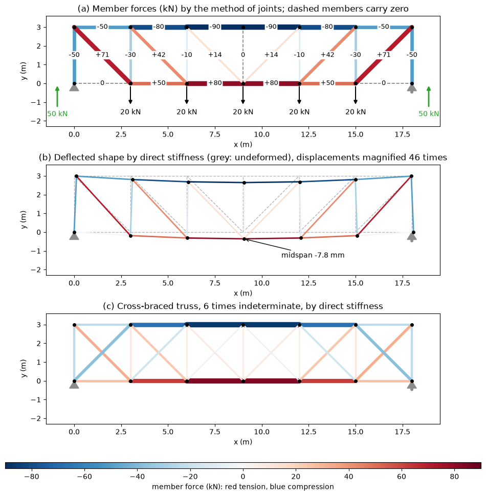

# Trusses, Frames and Machines

A truss is a framework of straight bars joined at their ends and loaded only at the joints, so that every bar carries a pure axial force. Bridges, roofs, transmission towers, crane booms and aircraft wing ribs use trusses because axial force uses the material far more efficiently than bending. Frames and machines also consist of connected members, but at least one member carries forces at more than two points and therefore bends. This note covers the idealization behind truss analysis, the methods of joints and of sections, zero-force members, space trusses, and the analysis of frames and machines by dismembering them.

## Problem Statement

Given the joint coordinates (m), the list of members connecting them, the supports and the external loads at the joints (N), find the support reactions and the axial force in every member, tension positive. For a frame or machine, find the pin forces between members and the forces delivered by the mechanism. The assumptions of the ideal truss are:

- members are straight and connected at their ends by frictionless pins;
- loads and reactions act only at the joints;
- member weights are neglected or lumped at the joints;
- deformations are small, so equilibrium is written on the undeformed geometry.

Each member is then a two-force member with one unknown, its axial force $N_e$. Each joint is a particle in equilibrium:

```math
\sum_{e \,\ni\, i} N_e\,\mathbf{u}_{e,i} + \mathbf{R}_i + \mathbf{P}_i = \mathbf{0}
\qquad \text{for every joint } i
```

where $\mathbf{u}_{e,i}$ is the unit vector along member $e$ pointing away from joint $i$, $\mathbf{R}_i$ the reaction and $\mathbf{P}_i$ the applied load at the joint. A plane truss with $j$ joints gives $2j$ scalar equations, a space truss $3j$.

## Truss Idealization

Real trusses have bolted, riveted or welded gusset plates, not pins. The joints are therefore partly rigid and the members bend a little, producing secondary stresses. They are small when the members are slender and their centroidal axes meet at a point at each joint, which is why the pin idealization gives the primary member forces accurately. A load applied between joints, such as the self-weight of a heavy member or a deck resting on a chord, makes that member a beam as well: it is then analysed by replacing the load with equivalent joint loads for the truss forces and adding the local bending of the member.

The common planar layouts differ in which diagonals carry tension under gravity load:

| Layout | Diagonals | Verticals | Typical use |
| --- | --- | --- | --- |
| Pratt | Slope down towards midspan; in tension | In compression | Steel bridges and roofs, where short compression members are preferred |
| Howe | Slope up towards midspan; in compression | In tension | Timber trusses with steel tie rods |
| Warren | Alternate in direction, tension and compression | None, or only to support the deck | Bridges and roof girders of moderate span |
| K-truss | Two half-diagonals per panel | Split | Deep trusses, where it shortens the compression members |
| Fink | Inclined members inside a pitched roof | None | Pitched roofs |

## Determinacy and Stability

With $m$ members, $r$ reaction components and $j$ joints, the unknowns number $m + r$ and the equations $2j$ (plane) or $3j$ (space). A necessary condition for a plane truss to be determinate is

$$
m + r = 2j
$$

If $m + r > 2j$ the truss is indeterminate to degree $m + r - 2j$; if $m + r < 2j$ it is a mechanism. The count is not sufficient: a truss with the right count can still contain a non-triangulated panel and be unstable, while having an extra member elsewhere. The reliable test is the rank of the $2j \times (m + r)$ equilibrium matrix, which must equal $2j$.

A simple truss is built from a triangle by adding one joint and two members at a time, so $m = 2j - 3$ and three properly arranged reactions make it determinate and stable. A compound truss joins simple trusses by three bars that are neither parallel nor concurrent, or by a common joint and one bar. A space truss built from a tetrahedron by adding one joint and three members at a time has $m = 3j - 6$, and needs $m + r = 3j$.

## Method of Joints

### Procedure

1. Check determinacy and find the reactions from the equilibrium of the whole truss.
2. Start at a joint with at most two unknown member forces (three in 3D).
3. Assume every unknown member force is tension, drawn pulling away from the joint.
4. Write $\sum F_x = 0$ and $\sum F_y = 0$ and solve. A negative result is compression.
5. Move to a neighbouring joint, using the forces already found, until every member is known. The last joints give spare equations that check the reactions.

### Worked Example: Triangular Truss

Joints $A(0, 0)$, $B(0, 3)$ and $C(4, 0)$ m form a right triangle, with a pin at A and a roller at C on a horizontal surface. A horizontal force of 12 kN to the right acts at B. The members have lengths $AB = 3$ m, $AC = 4$ m and $BC = 5$ m.

The whole truss gives $A_x = -12$ kN, $\sum M_A = 12(3) - 4C_y = 0$ so $C_y = 9$ kN, and $A_y = -9$ kN (downward).

At joint B the unit vector towards C is $(4, -3)/5$ and towards A is $(0, -1)$:

$$
\sum F_x = 12 + \tfrac{4}{5}F_{BC} = 0 \implies F_{BC} = -15 \text{ kN},
\qquad \sum F_y = -F_{AB} - \tfrac{3}{5}F_{BC} = 0 \implies F_{AB} = 9 \text{ kN}
$$

At joint A, $\sum F_x = -12 + F_{AC} = 0$ gives $F_{AC} = 12$ kN. So AB carries 9 kN tension, BC 15 kN compression and AC 12 kN tension. Joint C provides the check: $\sum F_y = 9 + \tfrac{3}{5}(-15) = 0$.

### Matrix Form

Writing the joint equations for all joints at once gives a linear system $`\mathbf{A}\begin{bmatrix}\mathbf{N} \\ \mathbf{R}\end{bmatrix} = -\mathbf{P}`$, where column $e$ of $\mathbf{A}$ contains $\mathbf{u}_{e,i}$ in the rows of both end joints and the last $r$ columns place unit reactions. For a determinate truss $\mathbf{A}$ is square and non-singular; this is how a computer applies the method of joints. Up to sign, the member columns of $\mathbf{A}$ form the transpose of the compatibility matrix that relates joint displacements to member elongations, which is the link to the stiffness method in [Structural Analysis](./structural_analysis.md).



Panel (a) is a Pratt truss of six 3 m panels, 3 m deep, with 20 kN at each interior bottom joint, solved by the matrix method of joints. The reactions are 50 kN each. Chord forces grow towards midspan (top chord $-90$ kN, bottom chord $+80$ kN), because they carry the bending moment of the truss as a couple, while the diagonal and vertical forces fall towards midspan with the shear. The end diagonals carry $50\sqrt{2} = 70.7$ kN tension.

## Zero-Force Members

Two rules identify members with no force by inspection:

1. If only two non-collinear members meet at an unloaded joint, both carry zero force.
2. If three members meet at an unloaded joint and two of them are collinear, the third carries zero force, and the collinear pair carry equal forces.

Both follow from resolving the joint equilibrium perpendicular to one member. The same reasoning applies at a support joint when the reaction has no component in some direction: in panel (a), the end bottom-chord members are zero because joint A has only a vertical reaction and the end vertical, so nothing balances a horizontal chord force. The midspan vertical is zero by rule 2 at the top joint. Zero-force members are not redundant: they brace compression members against buckling, keep the geometry stable, and carry load as soon as the loading changes.

## Method of Sections

### Procedure

1. Find the reactions.
2. Pass a section through the truss that cuts the members of interest and no more than three members with unknown forces, not all concurrent or parallel.
3. Take the part on one side of the cut as a free body, with the cut members in assumed tension.
4. Take moments about the point where two of the cut members intersect to find the third directly. For parallel chords, use vertical equilibrium for the diagonal.

### Worked Example: Pratt Truss Panel

A Pratt truss spans 16 m in four 4 m panels and is 3 m deep, with a pin at A and a roller at E. A 24 kN load acts at the midspan bottom joint ($x = 8$ m), so $A_y = E_y = 12$ kN. The panel-2 diagonal runs from the top joint at $x = 4$ m down to the bottom joint at $x = 8$ m. Cut through panel 2 and keep the left part, which carries only $A_y$.

For the top chord, take moments about the bottom joint at $x = 8$ m, where the diagonal and bottom chord meet. $A_y$ acts 8 m to the left and the top chord, assumed in tension, acts 3 m above:

$$
-12(8) - 3F_{\mathrm{top}} = 0 \implies F_{\mathrm{top}} = -32 \text{ kN}
$$

The top chord is in 32 kN compression. The bottom chord and diagonal follow in the same way (Exercise 4). The section method found one member force from one equation, where the method of joints would have needed the forces of all members from A to this panel.

## Space Trusses

In 3D each joint gives three equations and the members are directed with unit vectors from joint coordinates, as for cables in [Particle Equilibrium](./particle_equilibrium.md). Supports are ball-and-socket joints (3 reactions), slotted or rolling balls (1 or 2), and the truss must be supported against all six rigid-body motions.

### Worked Example: Tripod

A tripod has its apex at $D(0, 0, 3)$ m and legs to ball-and-socket supports at $A(2, 0, 0)$, $B(-1, \sqrt{3}, 0)$ and $C(-1, -\sqrt{3}, 0)$ m. Each leg is $\sqrt{13} = 3.606$ m long. A load $(3, 0, -12)$ kN acts at D. Here $m = 3$, $j = 4$ and $r = 9$, so $m + r = 12 = 3j$.

With every leg in assumed tension pulling D towards its support, joint D gives three equations. The $y$-equation makes $F_{DB} = F_{DC}$ by symmetry, and the other two give

$$
F_{DA} = -8.41 \text{ kN},
\qquad F_{DB} = F_{DC} = -3.00 \text{ kN}
$$

All three legs are in compression. The vertical components, $3/\sqrt{13} = 0.832$ of each leg force, add up to the 12 kN load, and the horizontal load is carried mainly by leg DA, which lies in the plane of the load.

## Frames and Machines

A frame is a stationary structure with at least one multi-force member; a machine is an assembly with moving parts that transmits and changes forces, such as pliers, toggle clamps and excavator arms. Their members carry axial force, shear and bending, so the joint method does not apply. The procedure is to take the structure apart:

1. Find as many reactions as possible from the whole structure.
2. Identify two-force members; their forces are along the line joining their pins.
3. Draw a free-body diagram of each multi-force member, with pin forces as unknown $x$ and $y$ components. At a pin joining two members, the forces on them are equal and opposite.
4. Write three equilibrium equations per member and solve the system.

### Worked Example: Beam and Strut

A horizontal beam AB, 3 m long, is pinned to a wall at $A(0, 0)$. A strut CD runs from $C(2, 0)$ m on the beam to a pin on the wall at $D(0, -1.5)$ m. A 6 kN downward load acts at B. The strut is a two-force member with direction from D to C equal to $(2, 1.5)/2.5 = (0.8, 0.6)$; its force on the beam is $F$ along this direction, positive when it pushes (compression).

On the beam, moments about A give $2(0.6F) - 3(6) = 0$, so $F = 15$ kN compression. Then $A_x + 0.8(15) = 0$ gives $A_x = -12$ kN and $A_y + 0.6(15) - 6 = 0$ gives $A_y = -3$ kN: the wall pulls the beam back and down at A. The beam is a multi-force member with forces at A, C and B; its bending moment is largest at C, $M_C = 6 \times 1 = 6$ kN m.

## Common Mistakes

- Assuming a member is in compression and also writing its force as pulling away from the joint, so the sign is applied twice.
- Cutting four unknown members with a section and trying to solve with three equations.
- Treating a multi-force frame member as a two-force member.
- Forgetting the equal and opposite pin forces when moving from one member of a frame to the next.
- Removing a zero-force member from the model, which can make the truss unstable under other loads.

## Key Takeaways

- An ideal truss has pin joints and joint loads only, so every member is a two-force member in tension or compression.
- The method of joints solves $2j$ equations for all forces; the method of sections finds selected forces directly.
- $m + r = 2j$ (or $3j$ in space) is necessary for determinacy; full rank of the equilibrium matrix is what guarantees stability.
- Zero-force members follow from joint equilibrium and are still needed for stability and other load cases.
- Frames and machines are analysed member by member with three equations per member.

## Related Scripts

- [Plane Truss Solver](../../../scripts/algorithms/statics_truss_solver/): solves a plane pin-jointed truss by the method of joints and by the direct stiffness method.

## Exercises

**Exercise 1.** Check the determinacy count of (a) the triangular truss of the first worked example and (b) the Pratt truss of the method-of-sections example, modelled with 5 bottom and 5 top joints, 4 top-chord and 4 bottom-chord members, 5 verticals and 4 diagonals, on a pin and a roller.

<details>
<summary>Answer</summary>

(a) $m = 3$, $r = 3$, $j = 3$: $m + r = 6 = 2j$, so the truss is determinate. It is also $m = 2j - 3$, the basic simple truss.

(b) $m = 4 + 4 + 5 + 4 = 17$, $r = 3$, $j = 10$: $m + r = 20 = 2j$. The count is necessary but not sufficient; the truss is also stable because every panel is triangulated.

</details>

**Exercise 2.** An unloaded joint on the bottom chord of a truss connects two collinear chord members and a single vertical member. What is the force in the vertical, and how do the two chord forces compare? What changes if a load hangs from that joint?

<details>
<summary>Answer</summary>

Taking $x$ along the chord, $\sum F_y = 0$ involves only the vertical, so its force is zero (rule 2), and $\sum F_x = 0$ makes the two chord forces equal.

If a load $P$ hangs from the joint, the vertical carries exactly $P$ in tension. This is why such members, although zero-force under some loadings, are needed.

</details>

**Exercise 3.** A symmetric triangular roof truss has supports A (pin) and C (roller) 6 m apart and apex B 2 m above midspan. A 30 kN vertical load acts at B. Find the forces in AB and AC. How do they change if the rise is halved?

<details>
<summary>Answer</summary>

By symmetry $A_y = C_y = 15$ kN and $AB = \sqrt{3^2 + 2^2} = 3.606$ m. At joint A, with members in assumed tension:

```math
\sum F_y = 15 + F_{AB} \frac{2}{3.606} = 0 \implies F_{AB} = -27.0 \text{ kN (compression)}
```

```math
\sum F_x = F_{AC} + F_{AB} \frac{3}{3.606} = 0 \implies F_{AC} = 22.5 \text{ kN (tension)}
```

With a 1 m rise, $AB = 3.162$ m, $F_{AB} = -15 \times 3.162 = -47.4$ kN and $F_{AC} = 45$ kN. The tie force is $PL/(4h)$ with $P = 30$ kN and $L = 6$ m, inversely proportional to the rise $h$.

</details>

**Exercise 4.** In the method-of-sections example, find the forces in the bottom chord and the diagonal of panel 2 using the same section, and check the top-chord result with $\sum F_x = 0$.

<details>
<summary>Answer</summary>

Bottom chord: moments about the top joint at $x = 4$ m, which eliminates the top chord and the diagonal. $A_y$ acts at $(-4, -3)$ relative to this point and the bottom chord 3 m below it:

```math
-12(4) + 3F_{\mathrm{bot}} = 0 \implies F_{\mathrm{bot}} = 16 \text{ kN (tension)}
```

Diagonal: its tension pulls the top joint at $x = 4$ m towards $(8, 0)$, with vertical component $-\tfrac{3}{5}F_d$, so $12 - \tfrac{3}{5}F_d = 0$ and $F_d = 20$ kN tension, as expected for a Pratt diagonal.

Check: $F_{\mathrm{top}} + \tfrac{4}{5}F_d + F_{\mathrm{bot}} = -32 + 16 + 16 = 0$.

</details>

**Exercise 5.** A pair of pliers is squeezed with 100 N applied 90 mm from the pivot, and the object is gripped 20 mm from the pivot. Treating one handle-jaw piece as a multi-force member, find the gripping force and the force on the pivot pin.

<details>
<summary>Answer</summary>

Moments about the pin: $F_{\mathrm{grip}}(20) = 100(90)$, so $F_{\mathrm{grip}} = 450$ N.

On one member the hand force and the reaction from the object act on opposite sides of the pin in the same direction, so force balance gives a pin force of $100 + 450 = 550$ N in the opposite direction. The pin carries more than either applied force, which is typical of lever-type machine members.

</details>

## References

- Hibbeler, R. C., *Engineering Mechanics: Statics*, 14th ed., Pearson, 2016.
- Beer, F. P., Johnston, E. R., and Mazurek, D. F., *Vector Mechanics for Engineers: Statics*, 12th ed., McGraw-Hill Education, 2019.
- Meriam, J. L., Kraige, L. G., and Bolton, J. N., *Engineering Mechanics: Statics*, 9th ed., Wiley, 2018.
- Hibbeler, R. C., *Structural Analysis*, 10th ed., Pearson, 2018.
- Timoshenko, S. P., and Young, D. H., *Theory of Structures*, 2nd ed., McGraw-Hill, 1965.
