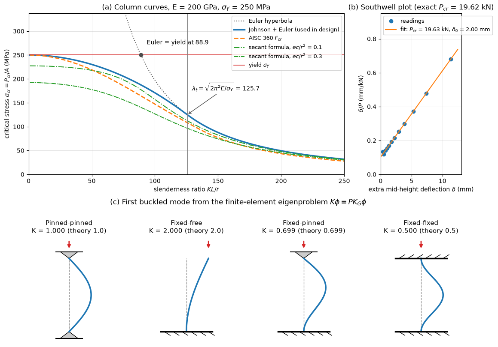

# Buckling of Columns

A slender member in compression can fail by buckling: at a critical load the straight shape stops being the only equilibrium and the member deflects sideways, often at an average stress far below the yield strength. Buckling is a loss of stability rather than of strength, so it is governed by stiffness ($E$ and $I$) and by the end conditions rather than by the strength of the material. This note derives the Euler load and the effective-length factors for the classic end conditions, then covers the slenderness ratio, inelastic buckling and the Johnson parabola, eccentric loads and the secant formula, imperfections and the Southwell plot, the energy method, and the design curves used for steel columns. Columns, truss members, struts, piston rods, aircraft stringers and the thin shells of tanks and rockets are all designed against it.

## Problem Statement

A straight prismatic column of length $L$, cross-sectional area $A$, minimum second moment of area $I$ and Young's modulus $E$ carries an axial compressive force $P$. Its ends are pinned, fixed, or free, in combinations. Given the geometry, the end conditions, the material's yield strength $\sigma_Y$, and possibly a load eccentricity $e$ or an initial crookedness $\delta_0$, find:

- the critical load $P_{cr}$ at which the straight configuration becomes unstable, and the buckled shape;
- the critical average stress $\sigma_{cr} = P_{cr}/A$, accounting for yielding in stocky columns;
- for an eccentric or imperfect column, the maximum stress and lateral deflection as functions of $P$;
- the allowable load, or the section required to carry a given load with a stated safety factor.

The ideal column is perfectly straight, centrally loaded, linear elastic, and analysed with small slopes. Its lateral deflection $v(x)$ obeys the beam equation of [Bending of Beams](./beam_bending.md#elastic-curve) with the bending moment produced by the axial load acting through the deflection:

```math
EI\, \frac{d^4 v}{dx^4} + P\, \frac{d^2 v}{dx^2} = 0
```

together with two boundary conditions at each end. Buckling is the eigenvalue problem of finding the values of $P$ for which this equation has a non-zero solution.

## Euler Critical Load

For a column pinned at both ends, cut at $x$ and take moments on the lower part. The moment at the cut is $M = -Pv$ (in the sagging-positive convention), so $`EI\,v'' = -Pv`$, or

$$
v'' + k^2 v = 0,
\qquad k^2 = \frac{P}{EI}
$$

The general solution is $v = C_1 \sin kx + C_2 \cos kx$. The condition $v(0) = 0$ gives $C_2 = 0$, and $v(L) = 0$ gives $C_1 \sin kL = 0$. A non-zero deflection requires $\sin kL = 0$, that is $kL = n\pi$, so

$$
P_n = \frac{n^2 \pi^2 EI}{L^2},
\qquad v_n(x) = C_1 \sin \frac{n\pi x}{L}
$$

The lowest, $n = 1$, is the Euler load

$$
P_{cr} = \frac{\pi^2 EI}{L^2}
$$

The amplitude $C_1$ is undetermined: linear theory says that at $P_{cr}$ the column can be in equilibrium in any slightly bent sine shape (neutral equilibrium), not how large the deflection is. The higher modes are reached only if the column is braced at the nodes of the first mode. The column buckles about the axis with the smaller second moment of area, so $I = I_{\min}$ unless it is braced differently in the two planes.

## End Conditions and Effective Length

Other end conditions change the boundary conditions of the fourth-order equation and therefore the critical load. Every case can be written in the Euler form with an effective length $L_e = KL$, the length of the equivalent pin-ended column, equal to the distance between inflection points of the buckled shape:

$$
P_{cr} = \frac{\pi^2 EI}{(KL)^2}
$$

| End conditions | Characteristic equation | $K$ theoretical | $K$ recommended for design | $P_{cr}$ relative to pinned–pinned |
| --- | --- | --- | --- | --- |
| Pinned–pinned | $\sin kL = 0$ | 1.0 | 1.0 | 1 |
| Fixed–free (flagpole) | $\cos kL = 0$ | 2.0 | 2.1 | 0.25 |
| Fixed–pinned | $\tan kL = kL$, $kL = 4.4934$ | 0.699 | 0.80 | 2.05 |
| Fixed–fixed | $\sin(kL/2) = 0$ (symmetric mode) | 0.5 | 0.65 | 4 |

The recommended values (from the commentary of the AISC specification) are larger because real connections are never fully rigid: a slight rotation at a nominally fixed end lengthens the effective length considerably.



The bottom row of the figure shows the buckled modes computed by a finite-element eigenvalue analysis, $`\mathbf{K}\boldsymbol{\phi} = P\,\mathbf{K}_G\boldsymbol{\phi}`$, with Hermite beam elements and the consistent geometric stiffness matrix $\mathbf{K}_G$; the factor $K$ recovered from the computed critical load matches the theoretical value to three decimals in each case. Each mode is a portion of a sine wave whose half-wavelength between inflection points is $KL$: the flagpole is half of a pinned column of length $2L$, and the fixed–fixed column has its inflection points at $L/4$ and $3L/4$.

## Slenderness Ratio

Dividing the Euler load by the area, with the radius of gyration $r = \sqrt{I/A}$:

$$
\sigma_{cr} = \frac{P_{cr}}{A} = \frac{\pi^2 E}{(KL/r)^2}
$$

The critical stress depends only on the modulus and the slenderness ratio $\lambda = KL/r$. It is the dotted hyperbola in panel (a) of the figure. For $\sigma_{cr}$ to be an elastic buckling stress, it must lie below the proportional limit; equating it with $\sigma_Y$ gives the slenderness below which the Euler hyperbola exceeds yield,

$$
\lambda_Y = \pi \sqrt{\frac{E}{\sigma_Y}}
$$

which is 88.9 for $E = 200$ GPa and $\sigma_Y = 250$ MPa. Real columns are weaker than the hyperbola well above this slenderness, because rolled and welded sections contain residual stresses of the order of $0.3\sigma_Y$ that make part of the section yield early, and because every column is slightly crooked. Columns are therefore grouped as short (failing by yielding or crushing, $\lambda$ below about 20 to 40), intermediate (inelastic buckling) and long or slender (elastic buckling).

## Inelastic Buckling

### Tangent and Reduced Modulus

When the average stress exceeds the proportional limit, the incremental stiffness of the material is the tangent modulus $E_t = d\sigma/d\varepsilon$ at the current stress. Engesser's tangent-modulus load replaces $E$ by $E_t$:

$$
\sigma_{cr} = \frac{\pi^2 E_t}{(KL/r)^2}
$$

The reduced-modulus theory (Engesser, von Kármán) notes that the fibres on the convex side unload elastically with modulus $E$ as the column bends, giving an effective modulus between $E_t$ and $E$; for a rectangular section $E_r = 4EE_t/(\sqrt{E} + \sqrt{E_t})^2$. Shanley showed in 1947 that a column begins to bend at the tangent-modulus load, with the load still rising, and that the reduced-modulus load is an upper bound reached only after finite deflection. The tangent-modulus load is therefore the practical critical load.

### Johnson Parabola

For design, Johnson's parabolic formula replaces the inelastic part of the column curve:

```math
\sigma_{cr} = \sigma_Y - \frac{1}{E}\left(\frac{\sigma_Y}{2\pi}\, \frac{KL}{r}\right)^2
```

It starts at $\sigma_Y$ for $\lambda = 0$ and touches the Euler hyperbola at the transition slenderness where both give $\sigma_Y/2$:

$$
\lambda_t = \sqrt{\frac{2\pi^2 E}{\sigma_Y}}
$$

To check tangency, both curves equal $\sigma_Y/2$ at $\lambda_t$, and their slopes, $-\sigma_Y^2\lambda/(2\pi^2E)$ and $-2\pi^2E/\lambda^3$, both equal $-\sigma_Y/\lambda_t$ there. The Johnson parabola is used for $\lambda < \lambda_t$ and Euler for $\lambda \ge \lambda_t$. For $E = 200$ GPa and $\sigma_Y = 250$ MPa, $\lambda_t = 125.7$: a column with slenderness between 88.9 and 125.7 buckles elastically according to the ideal theory, but it is designed with the Johnson parabola.

## Eccentric Loading and the Secant Formula

A load applied at eccentricity $e$ from the centroid bends the column from the start. For a pin-ended column the moment at a section is $M = -P(v + e)$, so

$$
v'' + k^2 v = -k^2 e,
\qquad v(0) = v(L) = 0
$$

whose solution has its largest value at mid-height:

```math
v_{\max} = e\left[\sec\left(\frac{kL}{2}\right) - 1\right], \qquad
M_{\max} = P\,e \sec\left(\frac{kL}{2}\right), \qquad
\frac{kL}{2} = \frac{L}{2r}\sqrt{\frac{P}{EA}}
```

The deflection grows without bound as $P \to P_{cr}$, where $kL/2 \to \pi/2$. Adding the axial stress to the bending stress at the extreme fibre, at distance $c$ from the centroid, gives the secant formula

```math
\sigma_{\max} = \frac{P}{A}\left[1 + \frac{e c}{r^2}\sec\left(\frac{KL}{2r}\sqrt{\frac{P}{EA}}\right)\right]
```

with $KL$ substituted for other end conditions. Setting $\sigma_{\max} = \sigma_Y$ and solving for $P/A$ gives the load at first yield, a column curve for each eccentricity ratio $ec/r^2$ (the green curves in panel (a)). Values of $ec/r^2$ around 0.25 have traditionally been used as an allowance for accidental eccentricity and crookedness in steel columns. Because $\sigma_{\max}$ is not proportional to $P$, a safety factor must be applied to the load, not to the stress.

### Example: Secant Formula

A W200×46 steel column ($A = 5890$ mm², $r_{\min} = 51.1$ mm, $E = 200$ GPa) with $L_e = 5$ m carries 400 kN at an eccentricity of 10 mm about its weak axis; take $c = 100$ mm. Then $P/A = 67.9$ MPa, $ec/r^2 = 0.383$, and

```math
\frac{L_e}{2r}\sqrt{\frac{P}{EA}} = \frac{5000}{102.2}\sqrt{\frac{400\,000}{200\,000 \times 5890}} = 0.902, \qquad \sec(0.902) = 1.612
```

so $\sigma_{\max} = 67.9(1 + 0.383 \times 1.612) = 109.8$ MPa. A 10 mm eccentricity raises the peak stress 62% above $P/A$, and the amplification grows quickly as $P$ approaches $P_{cr} = 1216$ kN.

## Imperfections and the Southwell Plot

A pin-ended column with an initial bow $v_0(x) = \delta_0 \sin(\pi x/L)$ adds a deflection with the same shape whose amplitude, by the same analysis, is

```math
\delta = \delta_0\, \frac{P/P_{cr}}{1 - P/P_{cr}}
```

The total bow $\delta_0 + \delta = \delta_0/(1 - P/P_{cr})$ is the initial bow multiplied by the amplification factor $1/(1 - P/P_{cr})$, which is 2 at half the critical load and 5 at 80%. Real columns therefore do not stay straight up to $P_{cr}$ and then buckle: they bend progressively, and the bending stress reaches yield before $P_{cr}$. This is the Perry–Robertson model on which the European column curves are based.

Rearranging the deflection formula gives

$$
\frac{\delta}{P} = \frac{\delta}{P_{cr}} + \frac{\delta_0}{P_{cr}}
$$

so a plot of $\delta/P$ against the measured $\delta$ is a straight line with slope $1/P_{cr}$ and intercept $\delta_0/P_{cr}$ (Southwell, 1932). The critical load of a real column can thus be estimated from readings taken well below it, without loading the specimen to collapse. In panel (b) of the figure, twelve synthetic readings of a 2 m long, 30 mm diameter steel strut with $\delta_0 = 2$ mm, taken between 15% and 85% of $P_{cr}$ with 0.02 mm reading noise, give $P_{cr} = 19.63$ kN against the exact 19.62 kN, and recover $\delta_0 = 2.00$ mm.

## Energy Method and the Rayleigh Quotient

The critical load is also the load at which the second variation of the total potential energy vanishes. For a deflected shape $v(x)$, the bending strain energy is $`U = \tfrac{1}{2}\int_0^L EI\,v''^2\,dx`$, and the work of the axial load as the ends approach is $`W = \tfrac{1}{2}P\int_0^L v'^2\,dx`$. Setting $U = W$ gives the Rayleigh quotient

```math
P_{cr} \le \frac{\int_0^L EI\,(v'')^2\,dx}{\int_0^L (v')^2\,dx}
```

Any admissible trial shape (satisfying the geometric boundary conditions) gives an upper bound, and the exact mode gives equality. For a flagpole, the static deflection shape under a tip load, $v = 3Lx^2 - x^3$, gives $`P_{cr} \approx 2.50\,EI/L^2`$ against the exact $`\pi^2 EI/(4L^2) = 2.467\,EI/L^2`$, only 1.3% high. The method handles tapered columns, columns with variable axial load (a column under its own weight), and elastic restraints, where no closed-form solution exists. Discretizing the trial function with finite elements turns the quotient into the eigenvalue problem used for the mode shapes in the figure.

## Design Curves

Design codes use column curves fitted to tests on real columns, with residual stresses and imperfections included. The AISC 360 specification gives the nominal flexural-buckling stress in terms of the elastic stress $F_e = \pi^2E/(KL/r)^2$:

```math
F_{cr} =
\begin{cases}
0.658^{\,F_y/F_e}\,F_y, & F_y/F_e \le 2.25 \\
0.877\,F_e, & F_y/F_e > 2.25
\end{cases}
```

with $F_y = \sigma_Y$; the change of form is at $KL/r = 4.71\sqrt{E/F_y}$. The factor 0.877 on the Euler stress allows for an initial crookedness of about $L/1500$. The orange dashed curve in panel (a) shows that it lies below the Johnson–Euler curve everywhere. Eurocode 3 instead uses a reduction factor $\chi$ on the squash load from the Perry–Robertson equation,

```math
\chi = \frac{1}{\Phi + \sqrt{\Phi^2 - \bar{\lambda}^2}}, \qquad
\Phi = \frac{1}{2}\left[1 + \alpha(\bar{\lambda} - 0.2) + \bar{\lambda}^2\right], \qquad
\bar{\lambda} = \frac{KL/r}{\pi\sqrt{E/\sigma_Y}}
```

with an imperfection factor $\alpha$ from 0.13 (curve a0) to 0.76 (curve d), chosen by section type, buckling axis and manufacturing process.

### Design Procedure

1. Estimate the effective length $KL$ in each principal plane, using the recommended $K$ and the bracing positions.
2. Choose a trial section and compute $r_{\min}$ and $\lambda = KL/r$ in each plane.
3. Compute $\sigma_{cr}$ from Johnson ($\lambda < \lambda_t$) or Euler ($\lambda \ge \lambda_t$), or from the code curve.
4. Check $P \le \sigma_{cr} A/n$ for the required safety factor $n$, or the code's resistance factor.
5. Revise the section and repeat. Also check local buckling of thin flanges and webs, and, for open sections, torsional and flexural–torsional buckling.

## Worked Examples

### Euler and Johnson for a Steel Column

A W200×46 column ($I_{\min} = 15.4 \times 10^6$ mm⁴, $A = 5890$ mm², $E = 200$ GPa, $\sigma_Y = 250$ MPa) is 5 m long and pinned at both ends.

```math
P_E = \frac{\pi^2 \times 200\,000 \times 15.4 \times 10^6}{5000^2} = 1216 \ \mathrm{kN}, \qquad \sigma_E = \frac{1\,216\,000}{5890} = 206.4 \ \mathrm{MPa}
```

With $r = \sqrt{15.4 \times 10^6/5890} = 51.1$ mm, $\lambda = 97.8$. This is above $\lambda_Y = 88.9$, so the Euler stress is below yield, but below $\lambda_t = 125.7$, so the Johnson parabola applies:

```math
\sigma_{cr} = 250 - \frac{1}{200\,000}\left(\frac{250 \times 97.8}{2\pi}\right)^2 = 174.3 \ \mathrm{MPa}, \qquad P_{cr} = 174.3 \times 5890 = 1027 \ \mathrm{kN}
```

The Euler load overestimates the capacity by 18%. AISC gives $F_y/F_e = 1.21$ and $F_{cr} = 0.658^{1.21} \times 250 = 150.6$ MPa, a nominal capacity of 887 kN.

### Effect of the End Conditions

For the same section and length with theoretical factors $K$, the Euler loads are:

| End conditions | $K$ | $KL$ (m) | $P_E$ (kN) |
| --- | --- | --- | --- |
| Fixed–free | 2.0 | 10.0 | 304 |
| Pinned–pinned | 1.0 | 5.0 | 1216 |
| Fixed–pinned | 0.699 | 3.5 | 2489 |
| Fixed–fixed | 0.5 | 2.5 | 4864 |

For the last two, $\lambda = 68.4$ and $48.9$, inside the inelastic range, where the Euler values are not attainable: the Johnson parabola limits them to 213 MPa and 231 MPa.

### Sizing a Solid Strut

A solid round steel strut ($E = 200$ GPa, $\sigma_Y = 350$ MPa), 3 m long and pinned at both ends, carries 400 kN with a safety factor of 2, so the critical load must be at least 800 kN. Here $`\lambda_t = \sqrt{2\pi^2(200\,000)/350} = 106.2`$ and $r = d/4$.

| $d$ (mm) | $\lambda$ | Formula | $\sigma_{cr}$ (MPa) | $P_{cr}$ (kN) |
| --- | --- | --- | --- | --- |
| 80 | 150 | Euler | 87.7 | 441 |
| 90 | 133 | Euler | 111.0 | 706 |
| 100 | 120 | Euler | 137.1 | 1077 |

A 100 mm strut gives an actual safety factor of $1077/400 = 2.69$.

## Common Mistakes

- Using the larger second moment of area, or ignoring bracing that differs between the two planes.
- Applying the Euler formula to an intermediate column, where it overestimates the capacity.
- Using the theoretical $K = 0.5$ for nominally fixed ends without considering connection flexibility.
- Applying a safety factor to the stress in the secant formula, which is not linear in the load.
- Checking only overall buckling of a thin-walled section and missing local buckling of its flanges, webs or skin.

## Key Takeaways

- The Euler load $P_{cr} = \pi^2 EI/(KL)^2$ depends on stiffness and end conditions, not strength; $K$ is 1, 2, 0.699 and 0.5 for the four classic cases.
- The critical stress depends on the slenderness $KL/r$ alone in the elastic range.
- The Johnson parabola touches the Euler curve at $\lambda_t = \sqrt{2\pi^2E/\sigma_Y}$, where $\sigma_{cr} = \sigma_Y/2$, and replaces it for stockier columns.
- Eccentricity and crookedness are amplified by $1/(1 - P/P_{cr})$; the secant formula and the Perry–Robertson curves account for them.
- A Southwell plot estimates $P_{cr}$ from deflections measured well below it, and the Rayleigh quotient bounds it from any admissible shape.
- Design codes use column curves below the Johnson–Euler curve to cover residual stresses and imperfections.

## Related Scripts

- [Column Buckling Curves](../../../scripts/plots/beams_buckling_curves/): plots the Euler, Johnson, AISC and secant-formula column curves for a structural steel, computes the buckled modes and effective-length factors of four end conditions with a finite-element eigenvalue analysis, and fits a Southwell plot to synthetic test readings.
- [Virtual Work and Stability](../../../scripts/plots/statics_virtual_work_stability/): plots the potential energy of a spring-loaded two-bar linkage for several loads with its stable and unstable equilibria, and its equilibrium path from the virtual-work equation with the snap-through limit point.

## Exercises

**Exercise 1.** A column has a solid rectangular section of $50 \times 100$ mm and is pinned at both ends in both planes. About which axis does it buckle, and what is the ratio of the two Euler loads? How could the two be equalized?

<details>
<summary>Answer</summary>

$I_{\min} = 100(50)^3/12 = 1.04 \times 10^6$ mm⁴, bending across the 50 mm dimension, and $I_{\max} = 50(100)^3/12 = 4.17 \times 10^6$ mm⁴.

The column buckles about the weak axis, at one quarter of the strong-axis load. Bracing the weak direction at mid-height halves its effective length and multiplies its Euler load by four, equalizing the two.

</details>

**Exercise 2.** An aluminium tube ($E = 70$ GPa, $\sigma_Y = 240$ MPa) with outer and inner diameters of 50 mm and 44 mm is a 2 m strut fixed at the base and free at the top. Find the Euler load and check that elastic buckling governs.

<details>
<summary>Answer</summary>

$I = \pi(50^4 - 44^4)/64 = 1.228 \times 10^5$ mm⁴, $A = 443$ mm², $r = 16.65$ mm, and $KL = 2(2000) = 4000$ mm.

```math
P_{cr} = \frac{\pi^2 \times 70\,000 \times 1.228 \times 10^5}{4000^2} = 5.30 \ \mathrm{kN}, \qquad \sigma_{cr} = 12.0 \ \mathrm{MPa}
```

$\lambda = 4000/16.65 = 240$, far above $`\lambda_t = \sqrt{2\pi^2(70\,000)/240} = 75.9`$, so buckling is elastic. The stress at buckling is 5% of the yield strength. With the recommended $K = 2.1$ the load falls to 4.81 kN.

</details>

**Exercise 3.** A solid round steel strut ($E = 200$ GPa, $\sigma_Y = 350$ MPa), 60 mm in diameter and 1.2 m long, is pinned at both ends. Find its critical load and compare it with the Euler prediction.

<details>
<summary>Answer</summary>

$r = d/4 = 15$ mm, so $\lambda = 1200/15 = 80$, below $\lambda_t = 106.2$. Johnson applies:

```math
\sigma_{cr} = 350 - \frac{1}{200\,000}\left(\frac{350 \times 80}{2\pi}\right)^2 = 250.7 \ \mathrm{MPa}
```

With $A = 2827$ mm², $P_{cr} = 709$ kN. Euler would give $\pi^2 E/\lambda^2 = 308$ MPa, or 872 kN, an unsafe overestimate of 23%.

</details>

**Exercise 4.** At the buckling stress, a material has $E = 200$ GPa and tangent modulus $E_t = 50$ GPa. For a rectangular column with $KL/r = 80$, compare the tangent-modulus and reduced-modulus critical stresses. Which is used in design?

<details>
<summary>Answer</summary>

```math
E_r = \frac{4EE_t}{(\sqrt{E} + \sqrt{E_t})^2} = \frac{4(200)(50)}{(14.14 + 7.07)^2} = 88.9 \ \mathrm{GPa}
```

The tangent-modulus stress is $`\pi^2(50\,000)/80^2 = 77.1`$ MPa, and the reduced-modulus stress is $`\pi^2(88\,900)/80^2 = 137.1`$ MPa.

Shanley's analysis shows that bending starts at the tangent-modulus load, so the lower value is the design value.

</details>

**Exercise 5.** Use the Rayleigh quotient with the trial shape $v = 1 - \cos(\pi x/(2L))$ and then with $v = x^2$ to estimate the critical load of a flagpole column (fixed at $x = 0$, free at $x = L$). Why is the second estimate poor?

<details>
<summary>Answer</summary>

For $v = 1 - \cos(\pi x/2L)$, $v' = \tfrac{\pi}{2L}\sin(\pi x/2L)$ and $v'' = \tfrac{\pi^2}{4L^2}\cos(\pi x/2L)$. Both squared integrals over $(0, L)$ contain a factor $L/2$, so the quotient is $EI(\pi/2L)^2 = \pi^2 EI/(4L^2)$: the trial shape is the exact mode.

For $v = x^2$: $`\int_0^L EI(2)^2\,dx = 4EIL`$ and $`\int_0^L (2x)^2\,dx = 4L^3/3`$, so $P \le 3EI/L^2$, 22% above the exact $`2.467\,EI/L^2`$.

The parabola has constant curvature, so it puts bending strain at the free end, where the true moment, and hence the curvature, is zero. A trial shape should satisfy the natural (force) boundary conditions as well as the geometric ones to give a close bound, as the cubic $3Lx^2 - x^3$ does.

</details>

## References

- Timoshenko, S. P., and Gere, J. M., *Theory of Elastic Stability*, 2nd ed., McGraw-Hill, 1961.
- Gere, J. M., and Goodno, B. J., *Mechanics of Materials*, 9th ed., Cengage Learning, 2018.
- Budynas, R. G., and Nisbett, J. K., *Shigley's Mechanical Engineering Design*, 11th ed., McGraw-Hill Education, 2020.
- Galambos, T. V. (ed.), *Guide to Stability Design Criteria for Metal Structures*, 5th ed., Wiley, 1998.
- American Institute of Steel Construction, *Specification for Structural Steel Buildings*, ANSI/AISC 360-16, AISC, 2016.
- CEN, *Eurocode 3: Design of Steel Structures, Part 1-1: General Rules and Rules for Buildings*, EN 1993-1-1:2005.
- Shanley, F. R., "Inelastic column theory", *Journal of the Aeronautical Sciences*, 14(5), 261–268, 1947.
- Southwell, R. V., "On the analysis of experimental observations in problems of elastic stability", *Proceedings of the Royal Society of London A*, 135, 601–616, 1932.
