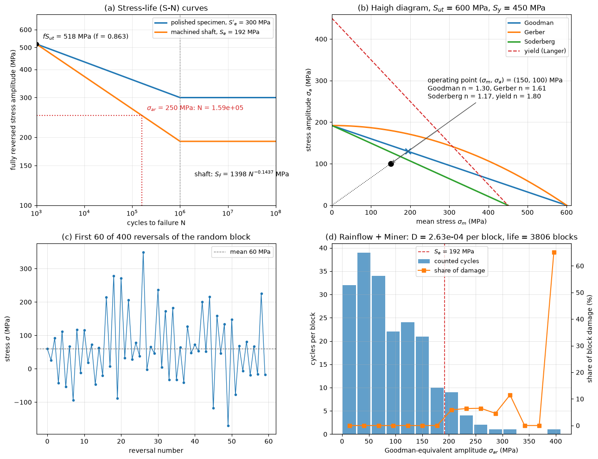

# Fatigue

A part that carries a fluctuating stress can fail after many cycles at a stress well below its static strength. Fatigue cracks start at a surface defect, a notch or an inclusion, grow a little with each cycle, and end in sudden fracture of the remaining section, usually with no visible yielding beforehand. Most mechanical failures in service are of this kind: rotating shafts, gears, springs, bolts, welded joints, aircraft skins, wind-turbine blades and towers, offshore risers, and any structure that vibrates. This note covers the stress parameters of a load cycle, the stress-life (S–N) approach with the endurance limit and its modifying factors, mean-stress corrections, Miner's rule with rainflow counting for variable-amplitude loading, and, briefly, the strain-life and fracture-mechanics approaches. It ends with the fatigue consequences of flow-induced vibration and wind and wave loading.

## Problem Statement

A component of known geometry and material is subjected to a stress history $\sigma(t)$ at its critical point, obtained from the loads by the methods of [Combined Loading](./combined_loading.md) and multiplied by a fatigue stress-concentration factor at notches. Given:

- the material's ultimate strength $S_{ut}$, yield strength $S_y$, and fatigue properties (an S–N curve or strain-life constants);
- the surface finish, size, load type, temperature and required reliability;
- the stress history, either constant amplitude with given mean and amplitude, or a measured or simulated variable-amplitude history;

find the fatigue life $N_f$ in cycles (or time), or the safety factor $n$ against fatigue failure for infinite or a target life. For a cracked part, find the number of cycles for a crack of size $a_i$ to grow to the critical size $a_c$.

The stress-life method assumes nominally elastic stresses and lives above about $10^3$ cycles (high-cycle fatigue). Damage from cycles of different amplitude is assumed to add linearly. The governing relations are the S–N curve, a mean-stress correction and the damage sum:

```math
\sigma_{ar} = \sigma'_f (2N_f)^b, \qquad
\frac{\sigma_a}{S_e} + \frac{\sigma_m}{S_{ut}} = \frac{1}{n}, \qquad
D = \sum_i \frac{n_i}{N_i}
```

with failure predicted when $D$ reaches 1.

## Cyclic Stress Parameters

A constant-amplitude cycle between $\sigma_{\min}$ and $\sigma_{\max}$ is described by any two of

```math
\sigma_m = \frac{\sigma_{\max} + \sigma_{\min}}{2}, \qquad
\sigma_a = \frac{\sigma_{\max} - \sigma_{\min}}{2}, \qquad
\Delta\sigma = 2\sigma_a, \qquad
R = \frac{\sigma_{\min}}{\sigma_{\max}}, \qquad
A = \frac{\sigma_a}{\sigma_m}
```

where $\sigma_m$ is the mean stress, $\sigma_a$ the stress amplitude (alternating stress), $\Delta\sigma$ the stress range, and $R$ the stress ratio.

| Cycle | $\sigma_m$ | $R$ | Example |
| --- | --- | --- | --- |
| Fully reversed | 0 | $-1$ | Rotating shaft under a steady bending moment |
| Zero to tension (pulsating) | $\sigma_a$ | 0 | Bolt or tie loaded and unloaded |
| Tension–tension | $> \sigma_a$ | $0 < R < 1$ | Pressurized vessel cycled between two pressures; preloaded bolt |
| Static | $\sigma_{\max}$ | 1 | No fatigue |

The amplitude controls crack growth; a tensile mean stress opens cracks and shortens life, while a compressive mean stress lengthens it. In welded steel joints, residual stresses near yield make the applied mean stress almost irrelevant, and design curves are expressed in the stress range $\Delta\sigma$ alone.

## Stress-Life Approach

### S–N Curve and the Basquin Relation

Fatigue tests at constant amplitude, typically on polished rotating-beam specimens with $R = -1$, give the number of cycles to failure $N_f$ against amplitude. On log–log axes, the data between about $10^3$ and $10^6$ cycles fall close to a straight line, Basquin's relation:

```math
\sigma_a = \sigma'_f (2N_f)^b
```

with the fatigue strength coefficient $`\sigma'_f`$ (roughly the true fracture strength) and the fatigue strength exponent $`b`$, typically between $`-0.05`$ and $`-0.12`$ for metals. Budynas and Nisbett write the same line as $`S_f = a N^b`$ through two points, $`(10^3, f S_{ut})`$ and $(10^6, S_e)$:

```math
a = \frac{(f S_{ut})^2}{S_e}, \qquad b = -\frac{1}{3}\log_{10}\left(\frac{f S_{ut}}{S_e}\right)
```

where $f$ is the fraction of $S_{ut}$ reached at $10^3$ cycles, about 0.8 to 0.9 for steels. Between $10^3$ and $10^6$ cycles the life at a fully reversed amplitude $\sigma_{ar}$ is $N = (\sigma_{ar}/a)^{1/b}$.

### Endurance Limit

Steels and titanium alloys show a knee in the S–N curve near $10^6$ to $10^7$ cycles, below which specimens survive indefinitely at constant amplitude. For steels the rotating-beam endurance limit is estimated as

```math
S'_e \approx
\begin{cases}
0.5\,S_{ut}, & S_{ut} \le 1400 \ \mathrm{MPa} \\
700 \ \mathrm{MPa}, & S_{ut} > 1400 \ \mathrm{MPa}
\end{cases}
```

Aluminium and copper alloys have no true endurance limit; their S–N curves keep falling, and a fatigue strength at a stated life, often $5 \times 10^8$ cycles, is used instead. Even for steels, the endurance limit disappears under corrosion and under variable-amplitude loading, where occasional large cycles start cracks that the small cycles then grow.

### Marin Factors

A machine part differs from a polished specimen in surface, size and loading. The Marin equation multiplies the specimen endurance limit by factors that are each at most about 1:

```math
S_e = k_a\,k_b\,k_c\,k_d\,k_e\,k_f\,S'_e
```

| Factor | Accounts for | Values (Budynas and Nisbett) |
| --- | --- | --- |
| $k_a$ | Surface finish | $`k_a = a S_{ut}^{\,b}`$, $S_{ut}$ in MPa: ground $a = 1.58$, $b = -0.085$; machined or cold-drawn 4.51, $-0.265$; hot-rolled 57.7, $-0.718$; as-forged 272, $-0.995$ |
| $k_b$ | Size, in bending and torsion | $`1.24\,d^{-0.107}`$ for $2.79 \le d \le 51$ mm; $`1.51\,d^{-0.157}`$ for $51 < d \le 254$ mm; 1 for axial load |
| $k_c$ | Load type | 1 for bending, 0.85 for axial, 0.59 for torsion |
| $k_d$ | Temperature | 1 near room temperature |
| $k_e$ | Reliability | 1.000 at 50%, 0.897 at 90%, 0.868 at 95%, 0.814 at 99%, 0.753 at 99.9% |
| $k_f$ | Other effects | Corrosion, plating, fretting, residual stress |

Notches are handled separately: the nominal stresses are multiplied by the fatigue stress-concentration factor $K_f = 1 + q(K_t - 1)$, where $K_t$ is the elastic stress-concentration factor and $q$, between 0 and 1, is the notch sensitivity, which grows with the strength of the material and with the notch radius.

### Example: Machined Steel Shaft

A machined steel shaft with $S_{ut} = 600$ MPa and $S_y = 450$ MPa and a diameter of 30 mm is in rotating bending, and 90% reliability is required. Then $S'_e = 300$ MPa and

```math
k_a = 4.51(600)^{-0.265} = 0.828, \qquad k_b = 1.24(30)^{-0.107} = 0.862, \qquad k_e = 0.897
```

so $S_e = 0.828 \times 0.862 \times 0.897 \times 300 = 192$ MPa, 32% of $S_{ut}$. Estimating $f = 0.863$ for this strength gives $f S_{ut} = 518$ MPa, $a = 518^2/192 = 1398$ MPa and $b = -0.1437$. A fully reversed amplitude of 250 MPa then gives

```math
N = \left(\frac{250}{1398}\right)^{1/(-0.1437)} = 1.59 \times 10^5 \ \mathrm{cycles}
```



Panel (a) shows the specimen and shaft S–N curves of this example. The Marin factors lower the endurance limit from 300 to 192 MPa but leave the $10^3$-cycle strength unchanged, so the shaft's line is steeper.

## Mean-Stress Correction

Tests at non-zero mean stress are summarized in the Haigh (constant-life) diagram of $\sigma_a$ against $\sigma_m$, panel (b) of the figure. Each criterion is a line or curve from $S_e$ on the amplitude axis to a static strength on the mean-stress axis. With safety factor $n$ applied to both stresses (a radial load line, on which $\sigma_a/\sigma_m$ stays fixed):

| Criterion | Failure line | Safety factor |
| --- | --- | --- |
| Goodman | $\dfrac{\sigma_a}{S_e} + \dfrac{\sigma_m}{S_{ut}} = 1$ | $n = \left(\dfrac{\sigma_a}{S_e} + \dfrac{\sigma_m}{S_{ut}}\right)^{-1}$ |
| Gerber | $\dfrac{\sigma_a}{S_e} + \left(\dfrac{\sigma_m}{S_{ut}}\right)^2 = 1$ | $n = \dfrac{1}{2}\left(\dfrac{S_{ut}}{\sigma_m}\right)^2\dfrac{\sigma_a}{S_e}\left[-1 + \sqrt{1 + \left(\dfrac{2\sigma_m S_e}{S_{ut}\sigma_a}\right)^2}\right]$ |
| Soderberg | $\dfrac{\sigma_a}{S_e} + \dfrac{\sigma_m}{S_y} = 1$ | $n = \left(\dfrac{\sigma_a}{S_e} + \dfrac{\sigma_m}{S_y}\right)^{-1}$ |
| Langer (first-cycle yield) | $\sigma_a + \sigma_m = S_y$ | $n = S_y/(\sigma_a + \sigma_m)$ |

Test data for ductile steels lie close to the Gerber parabola; the Goodman line is a little conservative and is the usual design choice; Soderberg is more conservative still. A design must also satisfy the Langer line, or the part yields on the first cycle. For a compressive mean stress the usual practice is to ignore its benefit and design for the amplitude alone.

For the shaft above with $\sigma_m = 150$ MPa and $\sigma_a = 100$ MPa:

```math
n_{\mathrm{Goodman}} = \left(\frac{100}{192} + \frac{150}{600}\right)^{-1} = 1.30
```

while Gerber gives 1.61, Soderberg 1.17, and the yield check 1.80, as marked in panel (b). For finite life, the Goodman line gives the equivalent fully reversed amplitude to use with the S–N curve:

```math
\sigma_{ar} = \frac{\sigma_a}{1 - \sigma_m/S_{ut}}
```

## Variable-Amplitude Loading

### Palmgren–Miner Rule

A service history contains cycles of many amplitudes. The Palmgren–Miner rule assumes that $n_i$ cycles at a level whose constant-amplitude life is $N_i$ use up a fraction $n_i/N_i$ of the life, independently of the order in which they occur:

$$
D = \sum_i \frac{n_i}{N_i}
$$

and that failure occurs when $D = 1$. For a block repeated many times, the life in blocks is $1/D$. The rule ignores load-sequence effects (a high-low sequence is more damaging than low-high), and measured values of $D$ at failure scatter widely; Budynas and Nisbett quote values from about 0.7 to 2.2. Some codes use a critical sum below 1 for this reason. Cycles below the endurance limit contribute nothing in the basic rule, which is non-conservative when large cycles are also present; the Haibach modification continues the S–N line below the knee with a shallower slope to account for this.

### Rainflow Counting

Before Miner's rule can be applied, an irregular history must be broken into cycles. Rainflow counting, introduced by Matsuishi and Endo and standardized in ASTM E1049, pairs reversals so that each counted cycle corresponds to a closed stress–strain hysteresis loop in the material. The three-point algorithm is:

1. Reduce the history to its sequence of peaks and valleys (reversals).
2. Read the reversals one at a time onto a stack. After each one, let $X$ be the range between the last two points on the stack and $Y$ the range between the two before them.
3. If $X < Y$, read the next reversal.
4. If $X \ge Y$ and $Y$ includes the first point of the stack, count $Y$ as a half cycle and remove the first point; otherwise count $Y$ as one cycle, remove its two points and keep the last one. Return to step 2.
5. When the history ends, count each remaining range on the stack as a half cycle.

For the ASTM example sequence $-2, 1, -3, 5, -1, 3, -4, 4, -2$, this gives a half cycle of range 3, one and a half cycles of range 4, a half cycle of range 6, one cycle of range 8 and a half cycle of range 9. For a block that repeats, starting and ending the block at its largest peak closes every cycle, including the largest one. Each counted cycle has its own mean, so the mean-stress correction is applied cycle by cycle.

### Example: Block Loading

The shaft of the example ($S_e = 192$ MPa, $a = 1398$ MPa, $b = -0.1437$) sees, per block, 2000 cycles at 300 MPa, 10 000 at 250 MPa and 50 000 at 220 MPa (fully reversed):

| $\sigma_{ar}$ (MPa) | $n_i$ | $N_i$ | $n_i/N_i$ |
| --- | --- | --- | --- |
| 300 | 2000 | $4.48 \times 10^4$ | 0.0447 |
| 250 | 10 000 | $1.59 \times 10^5$ | 0.0628 |
| 220 | 50 000 | $3.87 \times 10^5$ | 0.1290 |

The damage per block is $D = 0.237$, so the predicted life is $1/D = 4.2$ blocks, or about 260 000 cycles. Panels (c) and (d) of the figure do the same for a seeded random history of 400 reversals with a mean of 60 MPa: rainflow counting finds 200 cycles per block, the Goodman correction converts each to $\sigma_{ar}$, and the damage is $2.63 \times 10^{-4}$ per block, a life of about 3800 blocks. About 90% of the cycles lie below $S_e$ and do no damage under the basic rule, while the single largest cycle per block causes almost two thirds of the damage.

## Strain-Life Approach

At short lives, below about $10^4$ cycles, and at notches where the material yields locally, stress no longer determines the response; the strain does. The strain-life relation adds the elastic (Basquin) and plastic (Coffin–Manson) parts of the strain amplitude:

```math
\varepsilon_a = \frac{\sigma'_f}{E}(2N_f)^b + \varepsilon'_f (2N_f)^c
```

with the fatigue ductility coefficient $\varepsilon'_f$ and exponent $c$, typically between $-0.5$ and $-0.7$. The two parts are equal at the transition life $2N_t = (\varepsilon'_f E/\sigma'_f)^{1/(b - c)}$: plastic strain dominates below it and elastic strain above it. For a steel with $\sigma'_f = 1000$ MPa, $b = -0.09$, $\varepsilon'_f = 0.6$, $c = -0.6$ and $E = 200$ GPa, the transition is at about 6000 cycles, and a strain amplitude of 0.5% gives a life of about 3900 cycles. Morrow's mean-stress correction replaces $\sigma'_f$ by $\sigma'_f - \sigma_m$ in the elastic term; with $\sigma_m = 100$ MPa the life above drops to about 3500 cycles. At a notch, Neuber's rule $\sigma\varepsilon = (K_t S)^2/E$ estimates the local stress and strain from the nominal stress $S$.

## Fracture-Mechanics View

A component that already contains a crack, or is assumed to contain the largest crack that inspection can miss (damage-tolerant design in aircraft), is analysed by crack growth. The stress-intensity factor range at a crack of depth $a$ is

```math
\Delta K = Y\,\Delta\sigma\sqrt{\pi a}
```

with a geometry factor $Y$ (1.12 for a small edge crack). Paris and Erdogan found that in the intermediate range of $\Delta K$ the growth rate per cycle follows a power law:

```math
\frac{da}{dN} = C\,(\Delta K)^m
```

with $m$ about 3 for steels. Below a threshold $\Delta K_{th}$ cracks do not grow, and as $K_{\max}$ approaches the fracture toughness $K_{Ic}$ the growth accelerates to final fracture. Integrating with constant $Y$ and $m \ne 2$ gives the life from $a_i$ to $a_f$:

```math
N_f = \frac{a_f^{\,1 - m/2} - a_i^{\,1 - m/2}}{C\,(Y\Delta\sigma\sqrt{\pi})^m\,(1 - m/2)}, \qquad
a_f = \frac{1}{\pi}\left(\frac{K_{Ic}}{Y\sigma_{\max}}\right)^2
```

For a ferrite–pearlite steel ($C = 6.9 \times 10^{-12}$ m/cycle with $\Delta K$ in MPa$`\sqrt{\mathrm{m}}`$, $m = 3$, $K_{Ic} = 60$ MPa$`\sqrt{\mathrm{m}}`$) with an edge crack of 1 mm under $\Delta\sigma = 200$ MPa at $R = 0$, the critical depth is 22.8 mm and the life is $1.16 \times 10^5$ cycles. Most of it is spent while the crack is small, so the initial crack size controls the life: starting from 2 mm cuts it to $7.3 \times 10^4$ cycles. This is why inspection intervals are set from the time to grow from a detectable to a critical crack.

## Flow-Induced Vibration and Environmental Loading

Structures loaded by wind, waves and currents accumulate cycles at their natural frequencies, often for decades, so they are usually fatigue-critical rather than strength-critical. Vortex-induced vibration (see [Flow-Induced Vibrations](../fluid_loading/flow_induced_vibrations.md)) is especially severe: when the shedding frequency locks on to a natural frequency, a chimney, riser, heat-exchanger tube or cable vibrates at nearly constant amplitude, and at 2 Hz it accumulates $6.3 \times 10^7$ cycles per year.

Welded joints are designed with detail-category S–N curves, which are expressed in stress range with slope $m = 3$ and are independent of the steel's strength. In Eurocode 3 Part 1-9, a detail of category 71 has $\Delta\sigma_C = 71$ MPa at $2 \times 10^6$ cycles, a constant-amplitude fatigue limit $\Delta\sigma_D = 52.3$ MPa at $5 \times 10^6$ cycles, slope 5 beyond it, and a cut-off at $10^8$ cycles. A lock-in vibration with a stress range of 60 MPa at such a weld has

```math
N = 2 \times 10^6\left(\frac{71}{60}\right)^3 = 3.3 \times 10^6 \ \mathrm{cycles}
```

which at 2 Hz is 19 days. The remedy is to avoid lock-in (helical strakes on chimneys, a change of stiffness, added damping) so that the range falls below the fatigue limit, rather than to strengthen the weld.

Wind turbulence and irregular waves produce random stress histories. These are either counted with rainflow in the time domain, from measured or simulated time series, or treated in the frequency domain, where the stress spectrum from the load spectrum (see [Wind Loading](../fluid_loading/wind_loading.md) and [Wave Loading](../fluid_loading/wave_loading.md)) and the structure's transfer function gives a distribution of ranges; for a narrow-band process the ranges follow a Rayleigh distribution, and the damage follows in closed form. When the loads come from CFD of a vibrating structure, the stress histories at hot spots from a coupled simulation are counted in the same way.

## Common Mistakes

- Using the static strength or the polished-specimen endurance limit for a real part, without Marin factors and the notch factor.
- Applying the mean-stress correction to a compressive mean as if it were tensile, or forgetting the first-cycle yield check.
- Counting peaks instead of rainflow cycles, which pairs reversals that do not form hysteresis loops.
- Assuming cycles below the endurance limit are harmless under variable-amplitude loading or in a corrosive environment.
- Adding damage from different stress components at a point without a multiaxial criterion (for a shaft in bending and torsion, use the von Mises amplitude and mean).
- Treating a predicted life as exact: fatigue lives scatter by a factor of 3 to 10 at a given stress.

## Key Takeaways

- A load cycle is described by $\sigma_m$ and $\sigma_a$ (or $\Delta\sigma$ and $R$); amplitude drives fatigue, tensile mean stress accelerates it.
- The S–N line $`\sigma_a = \sigma'_f(2N)^b`$ holds between about $`10^3`$ and $`10^6`$ cycles; steels have an endurance limit near $`0.5S_{ut}`$ for polished specimens, reduced by Marin factors for real parts.
- The Goodman line $\sigma_a/S_e + \sigma_m/S_{ut} = 1/n$ is the standard mean-stress correction; Gerber fits ductile data more closely, Soderberg is more conservative.
- Variable-amplitude histories are rainflow-counted and their damage summed with Miner's rule, $D = \sum n_i/N_i$; a few large cycles often dominate.
- Strain-life handles low-cycle fatigue and notches; the Paris law $da/dN = C\Delta K^m$ gives crack-growth life, which is dominated by the small-crack stage.
- Lock-in vibration of welded structures can exhaust a fatigue life in days, so it is prevented rather than designed for.

## Related Scripts

- [Fatigue: S–N Curve, Haigh Diagram and Miner's Rule](../../../scripts/plots/fatigue_sn_and_goodman/): builds the S–N curve of a machined steel shaft from Marin factors, draws the Goodman, Gerber and Soderberg lines with an operating point, and sums the Miner damage of a rainflow-counted random stress history.

## Exercises

**Exercise 1.** A bolt's stress varies between $-50$ MPa and 250 MPa. Find $\sigma_m$, $\sigma_a$, $\Delta\sigma$ and $R$.

<details>
<summary>Answer</summary>

```math
\sigma_m = \frac{250 + (-50)}{2} = 100 \ \mathrm{MPa}, \qquad
\sigma_a = \frac{250 - (-50)}{2} = 150 \ \mathrm{MPa}
```

so $\Delta\sigma = 300$ MPa and $R = -50/250 = -0.2$.

</details>

**Exercise 2.** Estimate the endurance limit of a hot-rolled steel bar with $S_{ut} = 500$ MPa and diameter 40 mm in rotating bending, for 99% reliability.

<details>
<summary>Answer</summary>

$S'_e = 0.5(500) = 250$ MPa. Then $k_a = 57.7(500)^{-0.718} = 0.666$, $k_b = 1.24(40)^{-0.107} = 0.836$, $k_c = k_d = 1$ and $k_e = 0.814$, so

```math
S_e = 0.666 \times 0.836 \times 0.814 \times 250 = 113 \ \mathrm{MPa}
```

Less than half the specimen value remains, mostly because of the rough hot-rolled surface.

</details>

**Exercise 3.** The machined shaft of the example ($S_{ut} = 600$ MPa, $S_e = 192$ MPa, $a = 1398$ MPa, $b = -0.1437$) carries $\sigma_m = 150$ MPa and $\sigma_a = 200$ MPa. Is its life infinite? If not, estimate it with the Goodman correction.

<details>
<summary>Answer</summary>

The Goodman safety factor is $(200/192 + 150/600)^{-1} = 0.77 < 1$, so the life is finite. The equivalent fully reversed amplitude is

```math
\sigma_{ar} = \frac{200}{1 - 150/600} = 266.7 \ \mathrm{MPa}, \qquad N = \left(\frac{266.7}{1398}\right)^{1/(-0.1437)} = 1.02 \times 10^5 \ \mathrm{cycles}
```

The first-cycle yield check gives $S_y/(\sigma_a + \sigma_m) = 450/350 = 1.29$, so the part does not yield.

</details>

**Exercise 4.** For the block loading of the example (2000, 10 000 and 50 000 cycles at 300, 250 and 220 MPa per block), by what factor must all stresses be reduced to bring the life to 20 blocks?

<details>
<summary>Answer</summary>

On the Basquin line, $N \propto \sigma^{1/b}$, so scaling all amplitudes by $s$ multiplies every $N_i$ by $s^{1/b}$ and the damage by $s^{-1/b} = s^{6.96}$, provided every level stays above $S_e$. The life must rise from 4.23 to 20 blocks, so $s^{-6.96} = 4.23/20$, giving $s = (0.211)^{1/6.96} = 0.80$. The levels become 240, 200 and 176 MPa; the last is below $S_e = 192$ MPa, so it does no damage and the life is actually longer, about 44 blocks. A 20% reduction in stress multiplies the life by almost five on the Basquin line alone, and by ten here once the lowest level drops below the endurance limit, which is why small changes in stress concentration matter so much in fatigue.

</details>

**Exercise 5.** For the cracked plate of the fracture-mechanics section ($C = 6.9 \times 10^{-12}$, $m = 3$, $Y = 1.12$, $K_{Ic} = 60$ MPa$`\sqrt{\mathrm{m}}`$, $a_i = 1$ mm, $\Delta\sigma = 200$ MPa at $R = 0$), find the life if the stress range is halved. Why is the factor larger than $2^3 = 8$?

<details>
<summary>Answer</summary>

With $\sigma_{\max} = 100$ MPa, the critical depth is $a_f = (1/\pi)(60/112)^2 = 91.4$ mm (assuming the plate is large enough), and

```math
N_f = \frac{a_f^{-1/2} - a_i^{-1/2}}{C(1.12 \times 100\sqrt{\pi})^3(-1/2)} = 1.05 \times 10^6 \ \mathrm{cycles}
```

against $1.16 \times 10^5$ at 200 MPa, a factor of 9.1. The Paris law alone gives a factor of $2^m = 8$ for the same crack-size interval, and the lower maximum stress also raises the critical crack size, adding cycles at the end of the life. The extra cycles are few because the crack grows fast once it is large.

</details>

## References

- Budynas, R. G., and Nisbett, J. K., *Shigley's Mechanical Engineering Design*, 11th ed., McGraw-Hill Education, 2020.
- Stephens, R. I., Fatemi, A., Stephens, R. R., and Fuchs, H. O., *Metal Fatigue in Engineering*, 2nd ed., Wiley, 2000.
- Dowling, N. E., *Mechanical Behavior of Materials*, 4th ed., Pearson, 2013.
- Paris, P., and Erdogan, F., "A critical analysis of crack propagation laws", *Journal of Basic Engineering*, 85(4), 528–533, 1963.
- Miner, M. A., "Cumulative damage in fatigue", *Journal of Applied Mechanics*, 12(3), A159–A164, 1945.
- ASTM E1049-85 (Reapproved 2017), *Standard Practices for Cycle Counting in Fatigue Analysis*, ASTM International.
- Barsom, J. M., and Rolfe, S. T., *Fracture and Fatigue Control in Structures*, 3rd ed., ASTM, 1999.
- CEN, *Eurocode 3: Design of Steel Structures, Part 1-9: Fatigue*, EN 1993-1-9:2005.
- Blevins, R. D., *Flow-Induced Vibration*, 2nd ed., Van Nostrand Reinhold, 1990.
