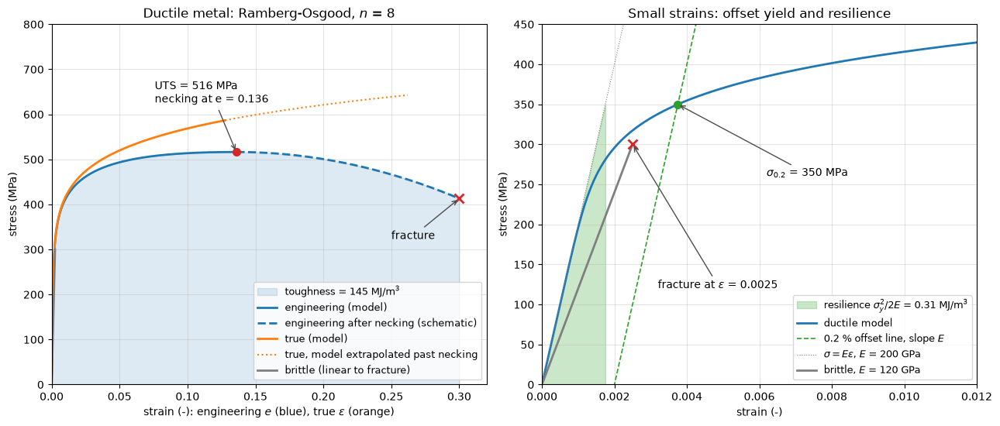

# Mechanical Properties of Materials

The formulas of strength of materials need numbers: a modulus to turn stress into deformation, a strength to compare the stress with, and some measure of how much the material can deform or absorb before it breaks. This note explains how these properties are measured in the tensile test, how engineering and true stress–strain curves differ, what yield strength, ultimate strength, ductility, resilience, toughness and hardness mean, and how the properties change with temperature, loading rate and time. It gives a table of typical values for common structural materials and introduces Ashby's performance indices for choosing between them. The definitions of stress and strain are in [Stress and Strain](stress_strain.md); fatigue under cyclic loading is treated separately in [Fatigue](fatigue.md).

## Problem Statement

Given a material in a specified condition (composition, heat treatment, product form), determine the properties that a structural calculation needs:

- elastic constants: Young's modulus $E$ (GPa) and Poisson's ratio $\nu$;
- strength: yield strength $\sigma_Y$ and ultimate tensile strength $\sigma_u$ (MPa), and for brittle materials the separate tensile and compressive strengths;
- ductility: elongation and reduction of area at fracture (%);
- energy absorption: modulus of resilience and toughness (MJ/m³), impact energy (J), fracture toughness $K_{Ic}$ (MPa√m);
- physical properties: density $\rho$ (kg/m³) and thermal expansion coefficient $\alpha$ (K⁻¹);
- the dependence of all of these on temperature $T$, strain rate $\dot{\varepsilon}$ and time under load (creep).

The reference measurement is the quasi-static uniaxial tensile test at room temperature (ISO 6892-1, ASTM E8/E8M). The material is assumed homogeneous and, except for fibre composites, isotropic. A further question is how to combine properties into a single figure of merit when the design goal is minimum mass or cost.

## The Tensile Test

A specimen with a reduced, parallel gauge section of initial length $L_0$ and area $A_0$ is pulled at a slow, controlled rate. A load cell measures the force $P$ and an extensometer the change of gauge length $\Delta L$. The **engineering stress** and **engineering strain** refer to the initial dimensions:

$$
\sigma_e = \frac{P}{A_0},
\qquad \varepsilon_e = \frac{\Delta L}{L_0}
$$

The **true stress** uses the current area $A$, and the **true strain** sums the increments $dL/L$:

$$
\sigma_t = \frac{P}{A},
\qquad \varepsilon_t = \int_{L_0}^{L} \frac{dL}{L} = \ln \frac{L}{L_0}
$$

Plastic deformation of metals conserves volume, $AL = A_0 L_0$. As long as the gauge section deforms uniformly this gives

$$
\sigma_t = \sigma_e(1 + \varepsilon_e),
\qquad \varepsilon_t = \ln(1 + \varepsilon_e)
$$

The two descriptions agree to within 1% for strains below 0.01, which covers the whole elastic range of metals. True strains are additive over successive deformations and are the natural measure for metal forming and crash simulations; engineering values are what design codes quote.

### Features of the Curve

The figure below shows a model curve for a ductile metal and a brittle one.



The curves come from the [stress–strain script](../../../scripts/plots/materials_stress_strain_curves/), which describes the ductile metal by the Ramberg–Osgood law in true stress and strain,

$$
\varepsilon_t = \frac{\sigma_t}{E} + 0.002\left(\frac{\sigma_t}{\sigma_{0.2}}\right)^{n}
$$

with $E = 200$ GPa, $\sigma_{0.2} = 350$ MPa and $n = 8$; they are a model, not data for a specific grade. Read from small strain to large:

1. The **proportional limit** ends the linear part, $\sigma = E\varepsilon$. The **elastic limit** is the highest stress after which unloading returns to zero strain; for most metals the two are close and hard to measure.
2. **Yielding** is the onset of significant plastic deformation. Annealed low-carbon steel shows a distinct upper and lower yield point followed by a plateau (Lüders bands). Most other metals yield gradually, as in the model, and the **0.2% offset yield strength** is used (right panel): draw a line of slope $E$ through $\varepsilon = 0.002$ and read the stress where it meets the curve. For the Ramberg–Osgood law this is exactly $\sigma_{0.2}$, 350 MPa.
3. Beyond yield the true stress keeps rising because the material **strain-hardens**. A simple fit is the Hollomon law $`\sigma_t = K\varepsilon_t^{\,n_H}`$ with hardening exponent $n_H$ typically 0.1–0.5.
4. The engineering stress reaches a maximum, the **ultimate tensile strength** $\sigma_u$, when the loss of area outpaces hardening. Setting $dP = d(\sigma_t A) = 0$ with $dA/A = -d\varepsilon_t$ gives the Considère condition $d\sigma_t/d\varepsilon_t = \sigma_t$; for the Hollomon law it is met at $\varepsilon_t = n_H$. In the model $\sigma_u = 516$ MPa at $\varepsilon_e = 0.136$.
5. After the maximum the deformation localizes in a **neck**, the engineering stress falls, and the specimen fractures (drawn schematically). The true stress in the neck keeps rising, but the neck is in a triaxial stress state and the measured $P/A$ needs the Bridgman correction to give the flow stress.

A brittle material (grey line, $E = 120$ GPa, linear to fracture at 300 MPa) fractures at a strain of 0.0025 with no yielding. Ceramics, glass, grey cast iron and concrete behave this way in tension; they are much stronger in compression, so their tensile and compressive strengths are listed separately.

### Elastic Modulus

$E$ is set by the stiffness of the interatomic bonds and the packing of atoms. Alloying, cold work and heat treatment change the yield strength of a steel by a factor of five or more but leave $E$ within a few per cent of 200–210 GPa. A stronger steel therefore does not make a stiffer part, and a stiffness-limited design cannot be improved by choosing a higher grade. The slope of a tensile curve is a poor measurement of $E$ because of machine and grip compliance; precise values come from extensometers with careful unloading or from resonance and ultrasonic methods.

## Ductility

Ductility is the plastic deformation a material sustains before fracture. It is reported as the **percent elongation** and the **percent reduction of area**,

```math
\%EL = \frac{L_f - L_0}{L_0} \times 100, \qquad \%RA = \frac{A_0 - A_f}{A_0} \times 100
```

where $L_f$ is the gauge length measured after fracture and $A_f$ the area of the fracture surface. Elongation depends on the gauge length because the neck contributes a fixed extension, so it is quoted with the gauge length (for example $L_0 = 5.65\sqrt{A_0}$ in ISO tests). Reduction of area does not, and $\ln(A_0/A_f)$ is the true fracture strain. A material with a fracture strain below about 5% is usually called brittle (Callister and Rethwisch). Ductility matters even when the design stress is elastic: it allows local yielding to relieve stress concentrations, warns of overload by visible deformation, and absorbs energy in a crash.

The following data come from a test on a steel specimen with $d_0 = 12.5$ mm and $L_0 = 50$ mm: yield load 38 kN, maximum load 58 kN, length after fracture 63 mm and fracture diameter 8.5 mm. With $A_0 = 122.7$ mm² and $A_f = 56.7$ mm²,

```math
\sigma_Y = \frac{38\,000}{122.7} = 309.7 \text{ MPa}, \quad
\sigma_u = \frac{58\,000}{122.7} = 472.6 \text{ MPa}, \quad
\%EL = \frac{63 - 50}{50} \times 100 = 26\%, \quad
\%RA = \frac{122.7 - 56.7}{122.7} \times 100 = 53.8\%
```

and the true fracture strain is $\ln(122.7/56.7) = 0.77$, three times the engineering elongation.

## Resilience, Toughness and Hardness

### Resilience

The **modulus of resilience** is the strain energy per unit volume stored up to the elastic limit, the area under the linear part of the curve:

$$
u_r = \frac{\sigma_Y^2}{2E}
$$

It is the figure of merit for springs, which must store elastic energy without yielding. For the model metal $`u_r = 350^2/(2 \times 200\,000) = 0.31`$ MJ/m³ (green triangle in the figure).

### Toughness

The **toughness** in the sense of the tensile test is the energy absorbed per unit volume up to fracture, the area under the whole engineering curve:

```math
u_T = \int_0^{\varepsilon_f} \sigma_e \, d\varepsilon_e \approx \frac{\sigma_Y + \sigma_u}{2}\,\varepsilon_f
```

the approximation being for ductile metals. The model metal absorbs about 145 MJ/m³ (blue area), the brittle material 0.38 MJ/m³, a factor of nearly 400 although its strength is similar. Two other measures are used in practice. The **Charpy impact energy** (J) is absorbed by a notched bar broken by a pendulum; it is a comparative test, used mainly to locate the ductile-to-brittle transition (below). The **fracture toughness** $K_{Ic}$ (MPa√m) is the critical value of the stress intensity factor $K_I = Y\sigma\sqrt{\pi a}$ at the tip of a crack of length $a$ under plane strain; it predicts the stress at which a known flaw grows unstably. Structural steels have $K_{Ic}$ of order 50–150 MPa√m, soda-lime glass below 1 MPa√m and most engineering ceramics 2–10 MPa√m.

### Hardness

Hardness is the resistance to local plastic indentation. It is cheap, nearly non-destructive and can be measured on finished parts.

| Scale | Indenter | Typical use |
| --- | --- | --- |
| Brinell (HB) | 10 mm hardened steel or carbide ball | castings, forgings, coarse microstructures |
| Rockwell (HRB, HRC) | 1.588 mm ball (B) or diamond cone (C) | production control, hardened steels (C) |
| Vickers (HV) | diamond pyramid | thin sections, coatings, microhardness |

Because indentation is a plastic process, hardness correlates with strength. For steels, and roughly for cast iron and brass, $`\sigma_u \approx 3.45\,\mathrm{HB}`$ MPa (Callister and Rethwisch), so a steel of 200 HB has $\sigma_u \approx 690$ MPa.

## Typical Properties

The table lists room-temperature values for five structural materials. They are representative values from the sources cited; minimum guaranteed values in material standards are lower, and design must use the values specified for the actual product.

| Material | $E$ (GPa) | $\nu$ | $\sigma_Y$ (MPa) | $\sigma_u$ (MPa) | Elongation (%) | $\rho$ (kg/m³) | $\alpha$ ($10^{-6}$ K⁻¹) |
| --- | --- | --- | --- | --- | --- | --- | --- |
| Structural steel S355 | 210 | 0.30 | 355 | 470–630 | ≥ 22 | 7850 | 12 |
| Aluminium alloy 6061-T6 | 69 | 0.33 | 276 | 310 | 12 | 2700 | 23.6 |
| Titanium alloy Ti-6Al-4V, annealed | 114 | 0.34 | 830 | 900 | 14 | 4430 | 8.6 |
| Concrete C30/37 | 33 | 0.2 | compression 30 | tension 2.9 | — | 2400 | 10 |
| CFRP, unidirectional, along fibres | 130–180 | 0.3 | — | 1500–2000 | 1–1.5 | 1550–1600 | about 0 |

For S355 the yield value is the minimum for thickness up to 16 mm in EN 10025-2, with $E$ and $\alpha$ from EN 1993-1-1. Concrete values are the characteristic cylinder compressive strength $f_{ck}$, the mean tensile strength $f_{ctm}$ and the secant modulus $E_{cm}$ of EN 1992-1-1. The aluminium and titanium values are from Callister and Rethwisch, Appendix B. For a unidirectional carbon–epoxy laminate with a fibre fraction near 60%, the modulus and strength across the fibres are an order of magnitude lower (about 10 GPa and 50 MPa); quasi-isotropic laminates have $E$ of roughly 50–70 GPa. CFRP fails without yielding.

## Material Selection and Ashby Charts

When the goal is minimum mass, the properties combine into a **performance index**. For a tie of length $L$ carrying a force $F$ without yielding, the area must be $A = F/\sigma_Y$, so the mass is

```math
m = \rho A L = F L\, \frac{\rho}{\sigma_Y}
```

and the lightest tie maximizes $\sigma_Y/\rho$. For a beam of square section $b \times b$ whose bending stiffness $S = C_1 E I/L^3$ is prescribed, $I = b^4/12$ gives $b^2 = (12 S L^3/(C_1 E))^{1/2}$, and

```math
m = \rho b^2 L = \left(\frac{12 S}{C_1}\right)^{1/2} L^{5/2}\, \frac{\rho}{E^{1/2}}
```

so the lightest stiff beam maximizes $E^{1/2}/\rho$. The same argument gives the other common indices:

| Design goal (minimum mass) | Index to maximize |
| --- | --- |
| tie, given stiffness | $E/\rho$ |
| tie, given strength | $\sigma_Y/\rho$ |
| beam, given stiffness | $E^{1/2}/\rho$ |
| beam, given strength | $\sigma_Y^{2/3}/\rho$ |
| panel in bending, given stiffness | $E^{1/3}/\rho$ |
| panel in bending, given strength | $\sigma_Y^{1/2}/\rho$ |

An **Ashby chart** plots one property against another on logarithmic axes, for example $E$ against $\rho$, with each material class as a bubble covering its range. On such a chart a line of constant index, $E^{1/m}/\rho = C$, is a straight line of slope $m$, so lines of slope 1, 2 and 3 for the three stiffness indices can be slid across the chart; materials above the line are better. The $E$–$`\rho`$ chart shows at once why the common metals are almost interchangeable as stiff ties ($E/\rho \approx 26$ GPa m³/Mg for steel, aluminium and titanium alike) while CFRP is three times better, and why wood and foams excel as panels.

## Temperature, Strain Rate and Time

### Temperature

Elastic modulus and strength fall as the temperature rises. The natural scale is the **homologous temperature** $T/T_m$ with both in kelvin. Below about $`0.3\,T_m`$ the properties of metals are nearly independent of time; above about $0.3$–$`0.4\,T_m`$ they creep (below). Aluminium alloys ($T_m \approx 900$ K) therefore lose much of their age-hardened strength above 150–200 °C, while nickel superalloys keep useful strength in gas turbines at homologous temperatures of 0.7 and above.

At low temperature the danger is embrittlement. Body-centred cubic metals, including ferritic structural steels, have a **ductile-to-brittle transition** temperature, below which the Charpy energy drops from over 100 J to a few joules and fracture becomes cleavage. Steel grades are specified with a Charpy energy at a test temperature (S355J2 means 27 J at −20 °C) for this reason. Face-centred cubic metals (aluminium, copper, austenitic stainless steel) show no such transition and are used for cryogenic service. Polymers change from glassy to rubbery behaviour near the glass transition temperature, where the modulus drops by orders of magnitude.

### Strain Rate

The flow stress of most metals rises with strain rate, which matters for impact, crash and blast. A common model for mild steel is the Cowper–Symonds relation

$$
\frac{\sigma_{\mathrm{dyn}}}{\sigma_{\mathrm{stat}}} = 1 +
\left(\frac{\dot{\varepsilon}}{D}\right)^{1/q}
$$

with $D = 40.4$ s⁻¹ and $q = 5$ (Jones). The dynamic flow stress doubles at $\dot{\varepsilon} = D$ and is 2.2 times the static value at 100 s⁻¹; even a nominally quasi-static rate of $10^{-3}$ s⁻¹ gives a factor 1.12, which shows that the "static" reference value is itself rate-dependent. Aluminium alloys are much less rate-sensitive, and polymers far more.

### Creep and Stress Relaxation

Under a constant stress at high homologous temperature, strain grows with time. The creep curve has a primary stage with decreasing rate, a long secondary stage at nearly constant rate $\dot{\varepsilon}_s$, and a tertiary stage of accelerating strain ending in rupture. The secondary rate follows the Norton–Arrhenius law

```math
\dot{\varepsilon}_s = A\,\sigma^{n} \exp\left(-\frac{Q}{RT}\right)
```

with a material constant $A$, stress exponent $n$ (typically 3–8 for metals), activation energy $Q$ and gas constant $R = 8.314$ J/(mol K). Rupture data at different temperatures are collapsed by the Larson–Miller parameter $\mathrm{LMP} = T(C + \log_{10} t_r)$, with $T$ in K, the rupture time $t_r$ in hours and $C \approx 20$, plotted against stress.

If instead the total strain is held fixed, as in a bolted flange or a shrink fit, creep converts elastic strain into creep strain and the stress relaxes. With Norton creep at a fixed temperature, $\dot{\varepsilon}_s = B\sigma^n$, the condition $\dot{\sigma}/E + B\sigma^n = 0$ integrates to

```math
\sigma(t) = \sigma_0\left[1 + (n - 1)\,E B \sigma_0^{\,n-1} t\right]^{-1/(n-1)}
```

For $n = 1$ (a linear Maxwell material) the limit is exponential, $\sigma = \sigma_0 e^{-EBt}$. Bolts in hot joints are therefore re-tightened or designed with a creep allowance. Polymers creep and relax at room temperature.

## Key Takeaways

- Engineering stress and strain use the original dimensions; true values use the current ones and are related by $\sigma_t = \sigma_e(1 + \varepsilon_e)$ and $\varepsilon_t = \ln(1 + \varepsilon_e)$ until necking.
- Yield is defined by the 0.2% offset unless the material has a distinct yield point; the ultimate strength is the peak of the engineering curve, reached when $d\sigma_t/d\varepsilon_t = \sigma_t$.
- Resilience is the elastic area $\sigma_Y^2/(2E)$, toughness the area to fracture; strength and toughness are different properties.
- $E$ barely changes with alloying or heat treatment; strength does.
- Performance indices such as $E/\rho$, $E^{1/2}/\rho$ and $\sigma_Y^{2/3}/\rho$ decide the lightest material for a given loading.
- Check the service temperature against the creep regime and the ductile-to-brittle transition, and the loading rate against rate-dependent strength.

## Related Scripts

- [Stress-Strain Curves](../../../scripts/plots/materials_stress_strain_curves/): draws model engineering and true stress–strain curves of a ductile and a brittle material.

## Exercises

**Exercise 1.** In the tensile test above, the engineering strain at maximum load is 0.18. Find the true stress and true strain at that point. Using the Considère condition for a Hollomon material, estimate the hardening exponent.

<details>
<summary>Answer</summary>

```math
\sigma_t = \sigma_e(1 + \varepsilon_e) = 472.6 \times 1.18 = 558 \text{ MPa},
\quad \varepsilon_t = \ln 1.18 = 0.166
```

Necking starts at maximum load, where $\varepsilon_t = n_H$, so $n_H \approx 0.17$, within the typical range.

</details>

**Exercise 2.** Compare the modulus of resilience of S355 steel and of 6061-T6 aluminium from the property table, per unit volume and per unit mass. Which makes the lighter spring of the two?

<details>
<summary>Answer</summary>

- Steel: $`u_r = 355^2/(2 \times 210\,000) = 0.300`$ MPa $= 300$ kJ/m³, or 38 J/kg.
- Aluminium: $`u_r = 276^2/(2 \times 69\,000) = 0.552`$ MPa $= 552$ kJ/m³, or 204 J/kg.

The aluminium stores 1.8 times more elastic energy per volume and 5.3 times more per mass, because of its lower modulus and density. Real springs use spring steels with $\sigma_Y$ above 1000 MPa, since the yield strength enters squared.

</details>

**Exercise 3.** Using the property table (with the lower end of the CFRP ranges, $E = 135$ GPa, $\sigma_u = 1500$ MPa, $\rho = 1600$ kg/m³, and $\sigma_u$ in place of $\sigma_Y$ for CFRP), rank S355 steel, 6061-T6, Ti-6Al-4V and CFRP for (a) a light, stiff tie ($E/\rho$) and (b) a light, strong beam ($\sigma_Y^{2/3}/\rho$). Work in GPa, MPa and Mg/m³.

<details>
<summary>Answer</summary>

(a) $E/\rho$: steel 26.8, aluminium 25.6, titanium 25.7, CFRP 84.4. The three metals are practically identical, which is why weight-critical stiff structures move to composites.

(b) $\sigma^{2/3}/\rho$: steel 6.4, aluminium 15.7, titanium 19.9, CFRP 81.9. The order is CFRP, titanium, aluminium, steel; for strength-limited beams the light alloys beat steel even though steel is cheaper per unit strength.

</details>

**Exercise 4.** For an alloy at 100 MPa the Larson–Miller parameter at rupture is $\mathrm{LMP} = 2.0 \times 10^4$ (with $T$ in K, $t_r$ in hours and $C = 20$). Estimate the rupture life at 900 K and at 850 K.

<details>
<summary>Answer</summary>

$\log_{10} t_r = \mathrm{LMP}/T - C$.

- At 900 K: $\log_{10} t_r = 22.22 - 20 = 2.22$, so $t_r \approx 170$ h.
- At 850 K: $\log_{10} t_r = 23.53 - 20 = 3.53$, so $t_r \approx 3400$ h.

A 50 K reduction in temperature extends the life twenty times.

</details>

**Exercise 5.** A steel creeps with activation energy $Q = 250$ kJ/mol and stress exponent $n = 5$. By what factor does the secondary creep rate increase if (a) the temperature rises from 800 K to 850 K, or (b) the stress rises by 20%?

<details>
<summary>Answer</summary>

(a)

```math
\frac{\dot{\varepsilon}_{850}}{\dot{\varepsilon}_{800}} = \exp\left[\frac{Q}{R}\left(\frac{1}{800} - \frac{1}{850}\right)\right] = \exp\left[\frac{250\,000}{8.314} \times 7.35 \times 10^{-5}\right] = 9.1
```

(b) $1.2^5 = 2.49$.

A 50 K rise matters more than a 20% stress increase, which is why creep design is dominated by temperature control.

</details>

## References

- Callister, W. D., and Rethwisch, D. G., *Materials Science and Engineering: An Introduction*, 10th ed., Wiley, 2018.
- Ashby, M. F., *Materials Selection in Mechanical Design*, 5th ed., Butterworth-Heinemann, 2017.
- Dowling, N. E., *Mechanical Behavior of Materials*, 4th ed., Pearson, 2013.
- Jones, N., *Structural Impact*, 2nd ed., Cambridge University Press, 2012.
- Ramberg, W., and Osgood, W. R., "Description of stress–strain curves by three parameters", NACA Technical Note 902, 1943.
- EN 1992-1-1:2004, *Eurocode 2: Design of concrete structures, Part 1-1: General rules and rules for buildings*, CEN, 2004.
- EN 1993-1-1:2005, *Eurocode 3: Design of steel structures, Part 1-1: General rules and rules for buildings*, CEN, 2005.
- ISO 6892-1:2019, *Metallic materials: Tensile testing, Part 1: Method of test at room temperature*, ISO, 2019.
