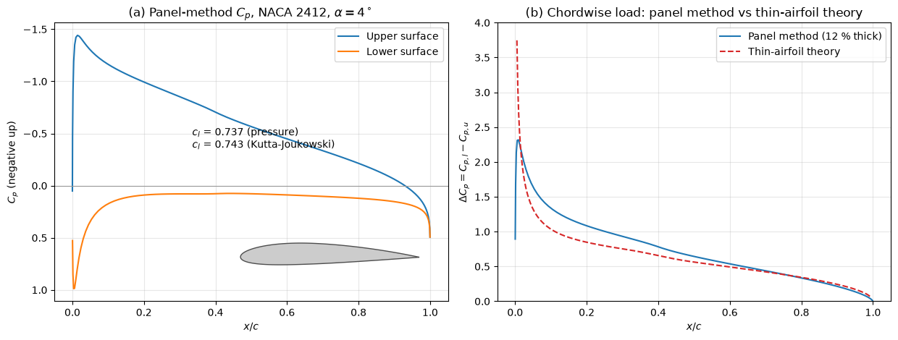
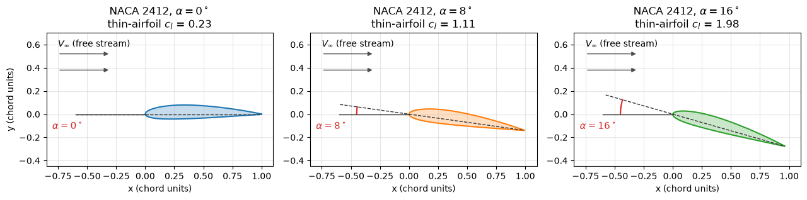

# Airfoil Design

An airfoil is the cross-section of a wing, a tail surface, a propeller or a turbine blade. Its shape decides how much lift the wing produces at a given angle of attack, how much profile drag it pays, how its pitching moment behaves, how gently it stalls and how much room it leaves for spars and fuel. This note defines the geometry of an airfoil, gives the NACA four-digit equations as a concrete parametric family, explains the pressure distribution and the forms of stall, and summarizes the design trade-offs of thickness, camber, laminar flow, Reynolds number and high-lift devices. Airfoil analysis is also the standard first test case of a CFD code: a 2D section at a few angles of attack checks the mesh, the turbulence model and the transition treatment against wind-tunnel polars.

## Problem Statement

The analysis problem is: given the section geometry (coordinates of the upper and lower surfaces on a chord $c$), the angle of attack $\alpha$, the Reynolds number $Re = Vc/\nu$ and the Mach number $M$, find the pressure distribution $C_p(x)$, the section coefficients $c_l$, $c_d$ and $c_m$, and the angle and value of $c_{l,max}$.

The design problem is the inverse: given the operating range of $c_l$, $Re$ and $M$, a minimum thickness for structure and fuel, and limits on pitching moment and stall behaviour, find a shape that minimizes drag or maximizes $c_l/c_d$ over that range.

A first estimate assumes inviscid, incompressible, two-dimensional flow, governed by Laplace's equation for the velocity potential with zero normal velocity on the surface and the Kutta condition at the trailing edge ([Potential Flow](../../../fluid_mechanics/inviscid_flow/potential_flow.md)). Thin-airfoil theory linearizes it further; panel methods solve it for the exact shape. Drag, transition and stall require the boundary layer, either through a coupled viscous–inviscid method such as XFOIL or through RANS CFD.

## Airfoil Geometry


| Feature | Definition |
| --- | --- |
| Chord line, chord $c$ | straight line from the leading edge to the trailing edge, and its length |
| Mean camber line $z(x)$ | locus of points midway between the upper and lower surfaces, measured normal to itself |
| Camber $m$ | maximum distance of the camber line from the chord line, as a fraction of $c$, at station $x = pc$ |
| Thickness $t$ | maximum distance between upper and lower surfaces, as a fraction of $c$ |
| Leading-edge radius $r_{LE}$ | radius of the circle fitted to the nose, centred on the camber-line tangent at $x = 0$ |
| Trailing-edge angle | angle between the upper and lower surfaces at the trailing edge |

The upper panel of the figure labels these on a NACA 4412. The lower panel separates the two main shape parameters: camber (0012, 2412, 4412) bends the section without thickening it, and thickness (4412 against 4421) blunts the nose and fattens the section without changing the camber line.

## NACA Four-Digit Sections

The NACA four-digit family (Jacobs, Ward and Pinkerton, 1933) defines a section by a code $MPXX$: maximum camber $m = M/100$, its position $p = P/10$ and thickness $t = XX/100$. With $\xi = x/c$ the camber line is two parabolas joined at $\xi = p$,

```math
\frac{z}{c} = \begin{cases} \dfrac{m}{p^2}\left(2p\xi - \xi^2\right), & 0 \le \xi < p, \\[2mm] \dfrac{m}{(1-p)^2}\left(1 - 2p + 2p\xi - \xi^2\right), & p \le \xi \le 1, \end{cases}
```

and the half-thickness is

```math
\frac{y_t}{c} = 5t\left(0.2969\sqrt{\xi} - 0.1260\,\xi - 0.3516\,\xi^2 + 0.2843\,\xi^3 - 0.1015\,\xi^4\right)
```

which has its maximum $t/2$ at $\xi = 0.30$, a leading-edge radius $`r_{LE} = 1.1019\,t^2c`$ and a small trailing-edge thickness of $`0.021\,t\,c`$ (0.25% of the chord for $t = 0.12$); replacing $-0.1015$ by $-0.1036$ closes the trailing edge, which panel methods prefer. The surfaces are offset from the camber line along its normal: with $\theta = \arctan(dz/dx)$,

$$
x_{u,l} = x \mp y_t\sin\theta,
\qquad y_{u,l} = z \pm y_t\cos\theta
$$

Thin-airfoil theory turns the camber line directly into the zero-lift angle and the moment about the quarter chord, which is the aerodynamic centre of every thin section:

```math
\alpha_{L0} = -\frac{1}{\pi}\int_0^\pi \frac{dz}{dx}(\cos\theta - 1)\,d\theta,
\qquad
c_{m,c/4} = \frac{\pi}{4}(A_2 - A_1),
\qquad
x = \frac{c}{2}(1 - \cos\theta)
```

where $`A_n = (2/\pi)\int_0^\pi (dz/dx)\cos n\theta\,d\theta`$. Integrating the NACA camber lines gives

| Section | $\alpha_{L0}$ (thin airfoil) | $c_{m,c/4}$ (thin airfoil) | $c_l$ at $\alpha = 0$ |
| --- | --- | --- | --- |
| NACA 0012 | $0^\circ$ | 0 | 0 |
| NACA 2412 | $-2.08^\circ$ | $-0.053$ | 0.23 |
| NACA 4412 | $-4.15^\circ$ | $-0.106$ | 0.46 |

Both quantities are proportional to $m$ for a fixed $p$. Doubling the camber doubles the lift at zero incidence and the nose-down moment that the tail must balance. Later families refine the idea: the five-digit sections (such as NACA 23012) move the maximum camber forward for higher $c_{l,max}$ with small moments, and the six-series sections (such as NACA $63_2$-415) shape the thickness for long runs of laminar flow.

## Pressure Distribution

The pressure coefficient

$$
C_p = \frac{p - p_\infty}{\tfrac{1}{2}\rho V_\infty^2} = 1 -
\left(\frac{V}{V_\infty}\right)^2
$$

(the second form for incompressible flow outside the boundary layer) equals 1 at the stagnation point near the nose and is negative wherever the surface flow is faster than the free stream. It is plotted with negative values up, so that the area between the upper- and lower-surface curves is the lift.



At $4^\circ$ the NACA 2412 has a sharp suction peak ($C_p \approx -1.4$) just behind the leading edge, followed by a long region of rising pressure (the pressure recovery) to the trailing edge. The panel solution gives $c_l = 0.74$ and $c_{m,c/4} = -0.060$, against 0.67 and $-0.053$ from thin-airfoil theory; the difference is the effect of thickness, which raises the inviscid lift slope by about $`0.77\,t/c`$. Panel (b) shows the chordwise load $\Delta C_p = C_{p,l} - C_{p,u}$, which thin-airfoil theory makes infinite at the leading edge and the round nose of the real section keeps finite.

The pressure recovery is an adverse pressure gradient for the boundary layer ([Boundary Layers](../../../fluid_mechanics/viscous_flow/boundary_layers.md)). Its steepness decides where the boundary layer goes turbulent and whether it separates, so most of airfoil design is the shaping of the upper-surface pressure distribution: a high suction peak gives lift but a hard recovery; a flat-topped distribution keeps the boundary layer laminar but limits the lift range.

### Centre of Pressure and Aerodynamic Centre

The resultant of the pressure forces acts at the **centre of pressure** $x_{cp}$, where the moment vanishes. It moves with angle of attack:

$$
\frac{x_{cp}}{c} = \frac{1}{4} - \frac{c_{m,c/4}}{c_l}
$$

For a cambered section with $c_{m,c/4} < 0$, it lies behind the quarter chord and moves forward as $c_l$ increases, and runs off to infinity as $c_l \to 0$. Stability analysis therefore uses the **aerodynamic centre**, the point about which the moment does not change with $\alpha$ (the quarter chord in thin-airfoil theory, typically $0.24$–$`0.26\,c`$ in practice), together with the constant moment $c_{m,ac}$ about it ([Airplane Stability](airplane_stability.md)).

## Angle of Attack and Stall



The angle of attack is measured between the free stream and the chord line. A cambered section lifts at $\alpha = 0$ ($c_l = 0.23$ for NACA 2412), and thin-airfoil theory predicts $c_l$ rising linearly through 1.11 at $8^\circ$ and 1.98 at $16^\circ$. A real NACA 2412 at a Reynolds number of a few million reaches $c_{l,max} \approx 1.6$–$`1.7`$ near $16^\circ$ and then stalls. Three forms of stall are distinguished (McCullough and Gault, 1951):

| Type | Typical sections | Mechanism | Character |
| --- | --- | --- | --- |
| Trailing-edge stall | thick, $t/c \gtrsim 0.12$ | turbulent separation starts at the trailing edge and moves forward with $\alpha$ | gradual, rounded lift peak |
| Leading-edge stall | moderately thin, $t/c \approx 0.09$–$`0.12`$ | a short laminar separation bubble near the nose bursts | abrupt loss of lift |
| Thin-airfoil stall | very thin, sharp nose | a long leading-edge bubble grows steadily rearwards | early, gentle, low $c_{l,max}$ |

Gradual trailing-edge stall gives the pilot warning and is preferred for general aviation; wings are also twisted (washout) or given section changes along the span so that the root stalls before the tips and the ailerons keep working.

## Design Trade-offs

| Parameter | Increasing it gives | At the cost of |
| --- | --- | --- |
| Thickness $t/c$ | lighter, stiffer spar for the same strength, more fuel volume, gentler stall, higher $c_{l,max}$ up to about 12–15% | higher profile drag, lower critical Mach number |
| Camber $m$ | lift at low $\alpha$, higher $c_{l,max}$, $c_l/c_d$ peak at higher $c_l$ | more nose-down $c_{m,ac}$ (larger tail trim load), poor inverted flight |
| Forward camber ($p$ small) | higher $c_{l,max}$ | sharper stall |
| Leading-edge radius | tolerance to angle-of-attack changes, gentler stall | higher suction peak and drag at high speed |
| Favourable pressure gradient over the front (laminar sections) | laminar boundary layer to 40–60% chord and a low-drag "bucket" in the polar | narrow $c_l$ range of low drag, sensitivity to roughness, insects and rain |
| Flat upper surface (supercritical sections) | weaker shocks at transonic speed, higher drag-divergence Mach number | strong aft camber and nose-down moment |

Symmetric sections ($m = 0$) have $\alpha_{L0} = 0$ and $c_{m,ac} = 0$; they are used where the load reverses (tail surfaces, aerobatic wings, helicopter rotors in part). Most wings use moderate camber (2–4%) chosen so that the cruise $c_l$ falls near the minimum-drag point of the polar.

## Reynolds-Number Effects

At fixed $\alpha$ the inviscid flow is independent of $Re$, but the boundary layer is not ([The Reynolds Number in Flight](reynolds_number.md)):

- Profile drag falls with $Re$, roughly as skin friction does, because the boundary layer becomes relatively thinner.
- $c_{l,max}$ and the stall angle rise with $Re$, as Abbott and von Doenhoff's polars at $Re = 3$, 6 and $9 \times 10^6$ show for most NACA sections, because a thinner, more energetic turbulent boundary layer resists separation longer.
- Below about $Re = 5 \times 10^5$ the boundary layer stays laminar past the suction peak, separates and may reattach as a turbulent layer, forming a laminar separation bubble. The bubble adds drag and makes $c_l(\alpha)$ non-linear and hysteretic; below about $5 \times 10^4$ the flow may not reattach at all. Sections for model aircraft, small UAVs and sailplane tips (Eppler, Selig, Wortmann families) are thin and shaped to control the bubble, and turbulator strips are used to trip the boundary layer.

Wind-tunnel models run at a lower $Re$ than the aircraft, so their polars must be corrected, which is one of the main uses of CFD in aircraft design.

## High-Lift Devices

Cruise wings are sized for low drag at high speed, which leaves too little lift for take-off and landing. High-lift devices increase camber, chord or both, and re-energize the boundary layer through slots:

| Device | How it works | Approximate $\Delta c_{l,max}$ (Raymer) |
| --- | --- | --- |
| Plain flap | hinged rear portion adds camber | 0.9 |
| Split flap | lower surface plate deflected | 0.9 |
| Single-slotted flap | slot feeds high-energy air over the flap | 1.3 |
| Fowler flap | moves aft as it deflects, adding chord $c'$ | $`1.3\,c'/c`$ |
| Double-slotted flap | two elements, two slots | $`1.6\,c'/c`$ |
| Leading-edge slat | slot at the nose lowers the suction peak on the main element | $`0.4\,c'/c`$ |
| Krueger flap | hinged panel from the lower leading edge | 0.3 |

Flaps shift the lift curve up and slightly reduce the stall angle; slats extend the lift curve to higher $\alpha$. Airliners combine slats with double- or triple-slotted Fowler flaps to reach landing $C_{L,max}$ of about 2.5–3.

## Key Takeaways

- A section is defined by its camber line and thickness distribution; the NACA four-digit equations give both from three numbers $m$, $p$, $t$.
- Camber sets the zero-lift angle and the nose-down moment ($-2.08^\circ$ and $-0.053$ for NACA 2412 in thin-airfoil theory); thickness raises the inviscid lift slope slightly above $2\pi$.
- Lift comes mostly from the suction on the forward upper surface; the adverse pressure gradient behind it controls transition, separation and stall.
- The centre of pressure moves with $c_l$; the aerodynamic centre near the quarter chord does not, which makes it the reference for stability.
- Thickness, camber and laminar-flow shaping trade drag against $c_{l,max}$, structure, moment and robustness; Reynolds number shifts all of them.

## Related Scripts

- [NACA 4-Digit Airfoil Profile](../../../../scripts/plots/airfoil_profile/): draws an annotated NACA 4-digit airfoil profile (NACA 4412 by default) from its four-digit designation, marking the chord line, the mean camber line, the maximum camber and thickness and the leading-edge radius, and compares it with sections of different camber and thickness.
- [Airfoil Angle of Attack](../../../../scripts/plots/airfoil_angle_attack/): draws a NACA 2412 airfoil pitched nose-up about its leading edge to several angles of attack, $0^\circ$, $8^\circ$ and $16^\circ$ by default, relative to a free stream flowing left to right.
- [Thin-Airfoil Theory, Panel Method and Drag Polar](../../../../scripts/algorithms/airplane_thin_airfoil_and_polar/): computes the lift of a NACA 4-digit airfoil with thin-airfoil theory and with a Hess–Smith panel method, then turns the section result into a finite-wing lift curve, a parabolic drag polar and the power-required curve of a light aircraft.

## Exercises

**Exercise 1.** A wing uses the NACA 2412 section with a chord of 1.5 m. Find the maximum camber and where it occurs, the maximum thickness and where it occurs, and the leading-edge radius.

<details>
<summary>Answer</summary>

- Maximum camber: 2% of 1.5 m = 30 mm, at 40% chord, 0.60 m behind the leading edge.
- Maximum thickness: 12% of the chord = 180 mm, at 30% chord, 0.45 m behind the leading edge.
- Leading-edge radius: $1.1019 \times 0.12^2 \times 1.5 = 0.0238$ m = 23.8 mm.

A NACA 0012 of the same chord has the same thickness and nose radius, but its camber line coincides with the chord line.

</details>

**Exercise 2.** Explain why a symmetrical airfoil produces no lift at zero angle of attack. Using thin-airfoil theory, estimate the lift coefficient of a NACA 0012 and of a NACA 2412 at $4^\circ$. Why do aerobatic aircraft often use symmetrical sections?

<details>
<summary>Answer</summary>

At $\alpha = 0$ the upper and lower surfaces of a symmetric section are mirror images, so the pressures on them are equal and the net normal force vanishes; equivalently, the Kutta condition is satisfied with zero circulation.

- NACA 0012: $c_l = 2\pi \times 0.0698 = 0.44$.
- NACA 2412: $c_l = 2\pi \times (4 + 2.08)\pi/180 = 0.67$.

A symmetrical section behaves the same inverted as upright, so the aircraft handles alike in both. A cambered section flown inverted works at a large negative angle of attack, with lower maximum lift and more drag.

</details>

**Exercise 3.** Verify the zero-lift angle of the NACA 2412 by evaluating the integral for $\alpha_{L0}$ analytically. Use $dz/dx = (2m/p^2)(p - \xi)$ for $\theta < \theta_p$ and $(2m/(1-p)^2)(p - \xi)$ for $\theta > \theta_p$, with $\xi = (1 - \cos\theta)/2$ and $\cos\theta_p = 1 - 2p$.

<details>
<summary>Answer</summary>

With $p - \xi = p - \tfrac{1}{2} + \tfrac{1}{2}\cos\theta$, each piece is a combination of $`\int(\cos\theta - 1)\,d\theta`$ and $`\int\cos\theta(\cos\theta - 1)\,d\theta`$, both elementary. For $m = 0.02$, $p = 0.4$: $\theta_p = \arccos(0.2) = 1.3694$ rad, and

```math
\int_0^{\theta_p} = \frac{2m}{p^2}\left[(p - \tfrac12)(\sin\theta_p - \theta_p) + \tfrac12\left(\tfrac{\theta_p}{2} + \tfrac{\sin 2\theta_p}{4} - \sin\theta_p\right)\right] = -0.01490
```

```math
\int_{\theta_p}^{\pi} = \frac{2m}{(1-p)^2}\left[(p - \tfrac12)\left(-\pi - \sin\theta_p + \theta_p\right) + \tfrac12\left(\tfrac{\pi - \theta_p}{2} - \tfrac{\sin 2\theta_p}{4} + \sin\theta_p\right)\right] = 0.12879
```

so $\alpha_{L0} = -(1/\pi)(0.11390) = -0.03625$ rad $= -2.08^\circ$. The negative zero-lift angle means the section must be pitched nose-down by 2.08° to stop lifting.

</details>

**Exercise 4.** A wing has aspect ratio $AR = 8$ and span efficiency $e = 0.80$ and flies at $C_L = 0.5$. Winglets raise the effective $e$ to 0.85. Using $C_{D_i} = C_L^2/(\pi e AR)$, find the induced drag coefficient before and after, and the percentage reduction.

<details>
<summary>Answer</summary>

- Before: $C_{D_i} = 0.25/(\pi \times 0.80 \times 8) = 0.0124$.
- After: $C_{D_i} = 0.25/(\pi \times 0.85 \times 8) = 0.0117$.

The reduction is $`1 - 0.80/0.85 = 5.9\%`$ of the induced drag. Winglets act much like a modest increase in span, but they add weight and bending moment at the wing root, so the net benefit has to be checked against a simple span extension.

</details>

**Exercise 5.** For a cambered airfoil with $c_{m,ac} = -0.05$ about the quarter chord, find the centre of pressure at $c_l = 0.5$ and $c_l = 1.0$. Then explain why stability analyses do not use the centre of pressure as the point of action of lift.

<details>
<summary>Answer</summary>

$x_{cp}/c = 0.25 - c_{m,ac}/c_l$:

- At $c_l = 0.5$: $x_{cp}/c = 0.25 + 0.10 = 0.35$.
- At $c_l = 1.0$: $x_{cp}/c = 0.25 + 0.05 = 0.30$.

The centre of pressure moves forward as lift increases and goes to infinity as $c_l \to 0$, so a moment balance written about it would need a different point at each flight condition. Writing the lift at the fixed aerodynamic centre plus a constant moment $c_{m,ac}$ is exactly equivalent and keeps the coefficients constant.

</details>

## References

- Abbott, I. H., and von Doenhoff, A. E., *Theory of Wing Sections: Including a Summary of Airfoil Data*, Dover, 1959.
- Anderson, J. D., Jr., *Fundamentals of Aerodynamics*, 6th ed., McGraw-Hill Education, 2017.
- Jacobs, E. N., Ward, K. E., and Pinkerton, R. M., "The characteristics of 78 related airfoil sections from tests in the variable-density wind tunnel", NACA Report No. 460, 1933.
- McCullough, G. B., and Gault, D. E., "Examples of three representative types of airfoil-section stall at low speed", NACA TN 2502, 1951.
- Raymer, D. P., *Aircraft Design: A Conceptual Approach*, 6th ed., AIAA, 2018.
- Drela, M., "XFOIL: An analysis and design system for low Reynolds number airfoils", in Mueller, T. J. (ed.), *Low Reynolds Number Aerodynamics*, Lecture Notes in Engineering, vol. 54, Springer, 1989, pp. 1–12.
- Katz, J., and Plotkin, A., *Low-Speed Aerodynamics*, 2nd ed., Cambridge University Press, 2001.
