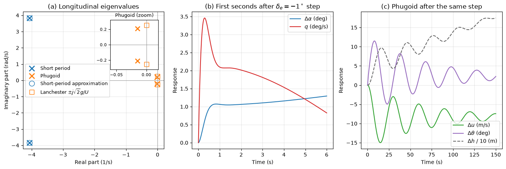

# Airplane Stability and Control

An aircraft is stable if, after a gust or a control input, it returns to its trimmed flight condition without the pilot's help. Stability is studied in two steps: static stability asks whether the first reaction to a disturbance is a restoring moment, and dynamic stability asks whether the resulting motion dies out. This note derives the static longitudinal stability criterion, the neutral point and the static margin, the trim condition and the elevator angle it needs, then the longitudinal modes (short period and phugoid, with Lanchester's approximation) and the lateral–directional modes (roll subsidence, spiral and Dutch roll). The stability derivatives that enter these models are exactly what wind-tunnel tests and CFD simulations of aircraft are run to produce. The general classification of static and dynamic stability for oscillating systems is in [Static and Dynamic Stability of Oscillating Systems](pecking.md).

## Problem Statement

Given an aircraft's geometry (wing area $S$, mean aerodynamic chord $\bar c$, span $b$, tail area $S_t$ and arm $l_t$), mass $m$ and moments of inertia, the position of its centre of gravity, its aerodynamic coefficients and their derivatives, and a reference flight condition (speed $U$, density $\rho$), find

- the trim angle of attack and elevator deflection;
- whether the aircraft is statically stable in pitch, its neutral point and static margin, and the allowable CG range;
- the eigenvalues, frequencies, damping ratios and shapes of its longitudinal and lateral–directional modes, and its response to control inputs.

The aircraft is treated as a rigid body making small perturbations about steady, wings-level flight, so the equations of motion can be linearized. For a symmetric aircraft they split into two independent sets: longitudinal (forward speed $u$, vertical speed $w$, pitch rate $q$, pitch angle $\theta$) and lateral–directional (sideslip $\beta$, roll rate $p$, yaw rate $r$, bank angle $\phi$). Each is a linear system

$$
\dot{\mathbf{x}} = A\mathbf{x} + B\mathbf{u}
$$

whose eigenvalues define the modes.

## Axes and Sign Conventions

| Axis (body, origin at the CG) | Rotation | Rate | Moment | Main control |
| --- | --- | --- | --- | --- |
| $x$, forward | roll | $p$ | $L$ (rolling) | ailerons $\delta_a$ |
| $y$, out of the right wing | pitch | $q$ | $M$ (pitching) | elevator $\delta_e$ |
| $z$, down | yaw | $r$ | $N$ (yawing) | rudder $\delta_r$ |

Nose-up pitching moments are positive, and a positive elevator deflection is trailing edge down. The pitching-moment coefficient is

$$
C_m = \frac{M}{\tfrac{1}{2}\rho V^2 S\bar c}
$$

and positions along the chord are written as fractions of the mean aerodynamic chord measured from its leading edge, $h = x/\bar c$.

## Static Longitudinal Stability

### Pitching Moment About the Centre of Gravity

With the wing lift acting at its aerodynamic centre $h_{ac}$ (near the quarter chord), the wing moment $C_{m,ac}$ about that point, and the horizontal tail lift acting a distance $l_t$ behind the CG, the moment about the CG is (fuselage contribution neglected)

$$
C_{m,cg} = C_{m,ac} + C_{L,w}(h - h_{ac}) - \eta V_H C_{L,t},
\qquad V_H = \frac{S_t l_t}{S\bar c}
$$

where $V_H$ is the tail volume coefficient (0.5–0.7 for light aircraft) and $\eta = q_t/q$ the tail dynamic-pressure ratio. The tail works in the downwash of the wing: its angle of attack is $\alpha_t = \alpha - \varepsilon + i_t$ with downwash angle $\varepsilon = \varepsilon_0 + (d\varepsilon/d\alpha)\alpha$ and tail incidence $i_t$. With lift slopes $a$ (wing) and $a_t$ (tail),

$$
C_{m_\alpha} = \frac{dC_m}{d\alpha} = a(h - h_{ac}) - \eta V_H
a_t\left(1 - \frac{d\varepsilon}{d\alpha}\right)
$$

### Stability Criterion

If a gust raises the angle of attack, a stable aircraft must respond with a nose-down moment:

$$
C_{m_\alpha} < 0
$$

The wing term is destabilizing when the CG is behind the aerodynamic centre; the tail term is always stabilizing. Static stability alone is not enough to fly: the aircraft must also trim at a positive lift coefficient, $C_m = C_{m_0} + C_{m_\alpha}\alpha = 0$ at $\alpha > \alpha_{L0}$, which requires $C_{m_0} > 0$ (supplied by tail incidence or a reflexed wing on tailless aircraft).

### Neutral Point and Static Margin

$C_{m_\alpha}$ is linear in the CG position $h$, and vanishes at the **neutral point**

$$
h_n = h_{ac} + \eta V_H \frac{a_t}{a}\left(1 - \frac{d\varepsilon}{d\alpha}\right)
$$

The distance from the CG to the neutral point is the **static margin**,

```math
SM = h_n - h,
\qquad C_{m_\alpha} = -a\, SM
```

$SM > 0$ means stable; typical values are 5–20% of $\bar c$. Moving the CG aft reduces the static margin and the stick forces, making the aircraft more responsive but less stable; at $SM = 0$ the aircraft is neutrally stable, and behind the neutral point it diverges without active control.

### Worked Example

For the light aircraft of the scripts ($a = 4.6$ per rad, $AR = 7.47$), take $h_{ac} = 0.25$, $\eta = 0.9$, $V_H = 0.6$, $a_t = 3.5$ per rad and the elliptic-wing downwash gradient $d\varepsilon/d\alpha = 2a/(\pi AR) = 0.392$.

1. Neutral point: $h_n = 0.25 + 0.9 \times 0.6 \times (3.5/4.6) \times (1 - 0.392) = 0.250 + 0.250 = 0.500$.
2. With the CG at $h = 0.307$: $SM = 0.193$ and $C_{m_\alpha} = -4.6 \times 0.193 = -0.887$ per rad.
3. For a 5% minimum static margin the aft CG limit is $h = 0.45$, i.e. $0.45\bar c$ behind the leading edge of the mean aerodynamic chord.

The forward CG limit is set by control power instead: the further forward the CG, the more elevator is needed to trim at high lift (landing flare with flaps down), until the elevator runs out of travel or the tail stalls.

## Trim

In steady flight the aircraft must be in moment equilibrium with the required lift:

$$
C_m = C_{m_0} + C_{m_\alpha}\alpha + C_{m_{\delta_e}}\delta_e = 0,
\qquad C_L = C_{L_\alpha}\alpha + C_{L_{\delta_e}}\delta_e = \frac{2W}{\rho V^2 S}
$$

with $\alpha$ measured from zero lift. Neglecting the small $C_{L_{\delta_e}}$, the elevator angle to trim is

$$
\delta_{e,trim} = -\frac{C_{m_0} + C_{m_\alpha}C_L/C_{L_\alpha}}{C_{m_{\delta_e}}},
\qquad \frac{d\delta_{e,trim}}{dC_L} = \frac{SM}{C_{m_{\delta_e}}}
$$

The elevator control power is $C_{m_{\delta_e}} = -\eta\tau V_H a_t$, with $\tau$ the elevator effectiveness ($d\alpha_t/d\delta_e$, 0.4–0.6 for typical elevator chords). Since $C_{m_{\delta_e}} < 0$, a stable aircraft needs more trailing-edge-up elevator to fly slower (higher $C_L$), and the gradient is proportional to the static margin: at the neutral point the elevator angle no longer changes with speed, which is how the neutral point is found in flight tests.

With $C_{m_0} = 0.06$, $C_{m_\alpha} = -0.887$ and $C_{m_{\delta_e}} = -1.28$ per rad, the example aircraft trims at $\delta_e = -0.4^\circ$ at 55 m/s ($C_L = 0.36$), $-3.2^\circ$ at 40 m/s and $-7.7^\circ$ at 30 m/s, a gradient of $-8.6^\circ$ per unit $C_L$.

## Dynamic Longitudinal Stability

### Linearized Equations

In stability axes, with thrust effects and the small derivatives $Z_q$ and $Z_{\dot w}$ neglected,

```math
\begin{aligned}
\Delta\dot u &= X_u\Delta u + X_w\Delta w - g\,\Delta\theta \\
\Delta\dot w &= Z_u\Delta u + Z_w\Delta w + Uq + Z_{\delta_e}\delta_e \\
\dot q &= M_u\Delta u + M_w\Delta w + M_{\dot w}\Delta\dot w + M_q q + M_{\delta_e}\delta_e \\
\Delta\dot\theta &= q
\end{aligned}
```

The dimensional derivatives ($X_u = \partial X/\partial u/m$ and so on) follow from the non-dimensional coefficients; for example $Z_u = -2g/U$, $M_w = C_{m_\alpha}QS\bar c/(I_yU)$ and $M_q = C_{m_q}(\bar c/2U)QS\bar c/I_y$, with $Q = \tfrac{1}{2}\rho U^2$. The pitch-damping derivatives $C_{m_q} = \partial C_m/\partial(q\bar c/2U)$ and $C_{m_{\dot\alpha}} = \partial C_m/\partial(\dot\alpha\bar c/2U)$ come mostly from the tail: pitching changes its angle of attack, and the downwash takes time $l_t/U$ to reach it. The characteristic equation of the $4 \times 4$ system factors, for conventional aircraft, into two oscillatory modes with very different time scales.

### Short-Period Mode

A fast, usually well-damped oscillation in angle of attack and pitch rate at almost constant speed, with a period of one to a few seconds. Holding $u$ constant gives the approximation

$$
\omega_{sp} \approx \sqrt{\frac{Z_\alpha M_q}{U} - M_\alpha},
\qquad \zeta_{sp} \approx - \frac{M_q + M_{\dot\alpha} + Z_\alpha/U}{2\omega_{sp}}
$$

with $Z_\alpha = UZ_w$, $M_\alpha = UM_w$, $M_{\dot\alpha} = UM_{\dot w}$. The stiffness is $-M_\alpha$, proportional to the static margin, and the damping comes from $M_q$ and $M_{\dot\alpha}$.

### Phugoid Mode

A slow, lightly damped exchange of speed and height at nearly constant angle of attack. Lanchester (1908) found its frequency from energy alone: if drag is ignored and $C_L$ stays constant, the total energy $\tfrac{1}{2}V^2 + gh$ per unit mass is conserved and the lift is $L = W(V/U)^2$. A height change $\Delta h$ changes $V^2$ by $-2g\Delta h$, so the vertical acceleration is

$$
\Delta\ddot
h = \frac{L - W}{m} = g\left(\frac{V^2}{U^2} - 1\right) = -\frac{2g^2}{U^2}\Delta h
$$

which is a harmonic oscillator with

```math
\omega_{ph} = \frac{\sqrt{2}\,g}{U},
\qquad T_{ph} = \frac{\pi\sqrt{2}\,U}{g}
```

independent of the aircraft. Its damping is approximately $`\zeta_{ph} \approx -X_u/(2\omega_{ph}) = 1/(\sqrt{2}\,L/D)`$, small for an efficient aircraft.



For the light aircraft at 55 m/s ($C_{m_\alpha} = -0.89$, $C_{m_q} = -12.4$, $C_{m_{\dot\alpha}} = -5.2$, $I_y = 1825$ kg m²):

| Mode | Eigenvalues (1/s) | $\omega_n$ (rad/s) | $\zeta$ | Period (s) | Approximation |
| --- | --- | --- | --- | --- | --- |
| Short period | $-4.07 \pm 3.83j$ | 5.59 | 0.73 | 1.64 | 5.59 rad/s, $\zeta = 0.73$ |
| Phugoid | $-0.015 \pm 0.210j$ | 0.211 | 0.071 | 29.9 | Lanchester 0.252 rad/s, 24.9 s |

Panel (b) shows the short period dying out within about a second after a $-1^\circ$ elevator step; panel (c) shows the phugoid that follows, with speed and pitch attitude oscillating out of phase over a 30 s period while the aircraft settles to a slower trim. The short-period approximation is accurate to three digits. Lanchester's formula overestimates the phugoid frequency by 20% here; removing the pitch damping ($M_q = M_{\dot w} = 0$) from the full model recovers it to 0.1%, so the difference comes from coupling with the pitch dynamics.

### Flying-Qualities Requirements

Pilots tolerate a lightly damped phugoid because it is slow enough to correct by hand; the short period is too fast to fly against and must be well damped by the airframe or a stability augmentation system. The US military specification MIL-F-8785C, the basis of most later standards, requires for satisfactory (Level 1) flying qualities a short-period damping ratio of 0.35–1.30 in precision tasks such as landing (0.30–2.0 in cruise) and a phugoid damping ratio of at least 0.04.

## Lateral–Directional Stability

### Static Stability

Two derivatives with respect to sideslip $\beta$ (the angle between the velocity and the plane of symmetry, positive with the wind from the right) define the static behaviour:

| Derivative | Name | Stable sign | Main sources |
| --- | --- | --- | --- |
| $C_{n_\beta}$ | directional (weathercock) stability | $> 0$: the nose yaws into the relative wind | vertical tail; the fuselage is destabilizing |
| $C_{l_\beta}$ | dihedral effect | $< 0$: sideslip produces a roll away from the slip | wing dihedral angle, sweepback, high wing position, fin above the CG |

In a sideslip to the right, a wing with dihedral angle $\Gamma$ sees the right wing's angle of attack raised by about $\beta\Gamma$, so the right wing lifts more and the aircraft rolls left, away from the slip, which levels the wings.

### Lateral–Directional Modes

| Mode | Character | Typical time scale | Mainly governed by |
| --- | --- | --- | --- |
| Roll subsidence | non-oscillatory, heavily damped convergence of roll rate after an aileron input | time constant $\tau_r = -1/L_p$, well under 1 s | roll damping $L_p$ |
| Spiral | slow non-oscillatory mode in bank and heading; slightly divergent on many aircraft | time to double or halve of tens of seconds or more | balance of $C_{l_\beta}$ against $C_{n_\beta}$ and the yaw-rate derivatives |
| Dutch roll | oscillation combining yaw, sideslip and roll, the wing tips tracing ellipses | period of a few seconds | $C_{n_\beta}$ (stiffness), $C_{n_r}$ (damping), $C_{l_\beta}$ (coupling) |

The spiral mode is stable when $L_\beta N_r - N_\beta L_r > 0$ (Etkin and Reid), which favours a strong dihedral effect and a weak fin. The Dutch roll prefers the opposite: a large fin raises its frequency and damping, while a strong dihedral effect increases the rolling it couples into the oscillation and reduces its damping. Designers accept a slightly divergent spiral (which the pilot corrects without effort) to obtain a well-damped Dutch roll; swept-wing airliners, whose sweep gives a large dihedral effect, use a yaw damper for the Dutch roll.

## Augmentation and Pilot-in-the-Loop Stability

When the airframe alone does not meet the requirements, a stability augmentation system feeds measured rates back to the control surfaces (a pitch damper adds to $M_q$, a yaw damper to $N_r$). Fly-by-wire fighters go further and fly with negative static margin, which reduces trim drag and increases agility; the flight-control computer then supplies the missing stiffness. The pilot is also part of a closed loop: with a reaction delay, a high-gain pilot can destabilize an aircraft that is stable on its own, producing a pilot-induced oscillation ([Static and Dynamic Stability of Oscillating Systems](pecking.md)).

## Key Takeaways

- Static longitudinal stability requires $C_{m_\alpha} < 0$; the CG must lie ahead of the neutral point, and $`C_{m_\alpha} = -a\,SM`$.
- The neutral point is set by the tail volume, the tail-to-wing lift-slope ratio and the downwash gradient; the aft CG limit comes from stability, the forward limit from elevator power.
- The trim elevator gradient $d\delta_e/dC_L = SM/C_{m_{\delta_e}}$ vanishes at the neutral point.
- The short period is fast and well damped, with stiffness from the static margin and damping from $C_{m_q}$ and $C_{m_{\dot\alpha}}$; the phugoid is slow, lightly damped and close to Lanchester's $`\omega = \sqrt{2}\,g/U`$.
- Laterally, $C_{n_\beta} > 0$ and $C_{l_\beta} < 0$ are required; dihedral helps the spiral mode but hurts the Dutch roll, and a fin does the opposite.

## Related Scripts

- [Longitudinal Modes of a Light Aircraft](../../../../scripts/algorithms/airplane_longitudinal_modes/): finds the short-period and phugoid modes of a representative 1100 kg light aircraft from its linearized longitudinal equations, compares them with the classical two-mode approximations, and shows how a pilot with a reaction delay can turn the well-damped short period into a pilot-induced oscillation.
- [Static and Dynamic Stability Classification](../../../../scripts/plots/airplane_stability_classification/): draws the static picture of stability (a ball in a bowl, on a hill and on a flat surface) and the five free responses of a second-order system, from non-oscillatory convergence to monotonic divergence, together with their eigenvalues in the complex plane.

## Exercises

**Exercise 1.** Using the sign conventions of this note (positive $\delta_e$ is trailing edge down, nose-up moments positive), what are the signs of $C_{m_{\delta_e}}$ and $C_{m_\alpha}$ for a conventional, statically stable aircraft with an aft tail? What elevator deflection sign is needed to trim at a higher angle of attack?

<details>
<summary>Answer</summary>

Trailing-edge-down elevator increases the tail's lift, which acts behind the CG and pitches the nose down, so $C_{m_{\delta_e}} < 0$. Static stability requires $C_{m_\alpha} < 0$.

From $\delta_e = -(C_{m_0} + C_{m_\alpha}\alpha)/C_{m_{\delta_e}}$: raising $\alpha$ makes $C_{m_0} + C_{m_\alpha}\alpha$ more negative, so $\delta_e$ becomes more negative. The elevator moves trailing edge up, which matches pulling back on the control column to fly slower.

</details>

**Exercise 2.** An aircraft has wing area $S = 16$ m² and mean aerodynamic chord $\bar c = 1.5$ m. Its horizontal tail has $S_t = 3.6$ m² and moment arm $l_t = 4.5$ m. With $\eta\tau = 0.45$ and $a_t = 4.3$ per radian, find the tail volume coefficient and the elevator control power $C_{m_{\delta_e}}$.

<details>
<summary>Answer</summary>

```math
V_H = \frac{S_t l_t}{S\bar c} = \frac{3.6 \times 4.5}{16 \times 1.5} = 0.675
```

```math
C_{m_{\delta_e}} = -\eta\tau V_H a_t = -0.45 \times 0.675 \times 4.3 = -1.31 \text{ per rad}
```

</details>

**Exercise 3.** For the aircraft of Exercise 2, $C_{m_0} = 0.06$ and $C_{m_\alpha} = -1.0$ per radian. Find the elevator deflection needed to trim at $\alpha = 5^\circ$ (measured from zero lift).

<details>
<summary>Answer</summary>

$\alpha = 0.0873$ rad, so $C_{m_0} + C_{m_\alpha}\alpha = 0.06 - 0.0873 = -0.0273$.

```math
\delta_e = -\frac{-0.0273}{-1.31} = -0.0209 \text{ rad} = -1.20^\circ
```

That is $1.2^\circ$ trailing edge up, consistent with Exercise 1.

</details>

**Exercise 4.** The neutral point is 0.62 m and the CG 0.45 m behind the leading edge of the mean aerodynamic chord ($\bar c = 1.5$ m). The aircraft lift-curve slope is 5.2 per radian. Find the static margin and $C_{m_\alpha}$. How far aft can the CG move if the static margin must stay at least 5%?

<details>
<summary>Answer</summary>

```math
SM = \frac{0.62 - 0.45}{1.5} = 0.113,
\qquad
C_{m_\alpha} = -5.2 \times 0.113 = -0.59 \text{ per rad}
```

For $SM \geq 0.05$: $x_{cg} \leq 0.62 - 0.05 \times 1.5 = 0.545$ m. The aft CG limit is 0.545 m, and loading must keep the CG ahead of it.

</details>

**Exercise 5.** Use Lanchester's approximation to estimate the phugoid period at 60 m/s and at 230 m/s. Explain why pilots can easily control the phugoid but not a poorly damped short-period mode.

<details>
<summary>Answer</summary>

```math
T_{ph} \approx \frac{\pi\sqrt{2}\,U}{g} = \frac{4.443 \times 60}{9.81} = 27 \text{ s at } 60 \text{ m/s},
\qquad
104 \text{ s at } 230 \text{ m/s}
```

The phugoid is a slow exchange of height and speed at nearly constant angle of attack, so a pilot has plenty of time to correct it even when it is lightly damped. The short period involves angle of attack and pitch rate over about a second, comparable to human reaction times; trying to fly against it risks a pilot-induced oscillation, so it needs good natural damping ($C_{m_q}$) or a stability augmentation system.

</details>

## References

- Etkin, B., and Reid, L. D., *Dynamics of Flight: Stability and Control*, 3rd ed., Wiley, 1996.
- Nelson, R. C., *Flight Stability and Automatic Control*, 2nd ed., McGraw-Hill, 1998.
- Cook, M. V., *Flight Dynamics Principles*, 3rd ed., Butterworth-Heinemann, 2013.
- Anderson, J. D., Jr., *Aircraft Performance and Design*, McGraw-Hill, 1999.
- Lanchester, F. W., *Aerodonetics*, Constable, London, 1908.
- U.S. Department of Defense, *Military Specification: Flying Qualities of Piloted Airplanes*, MIL-F-8785C, 1980.
