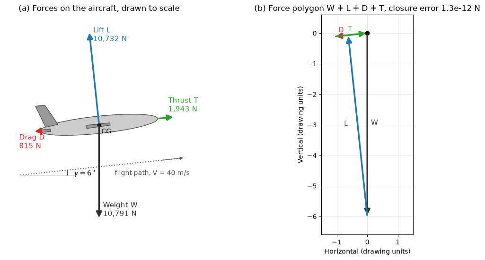
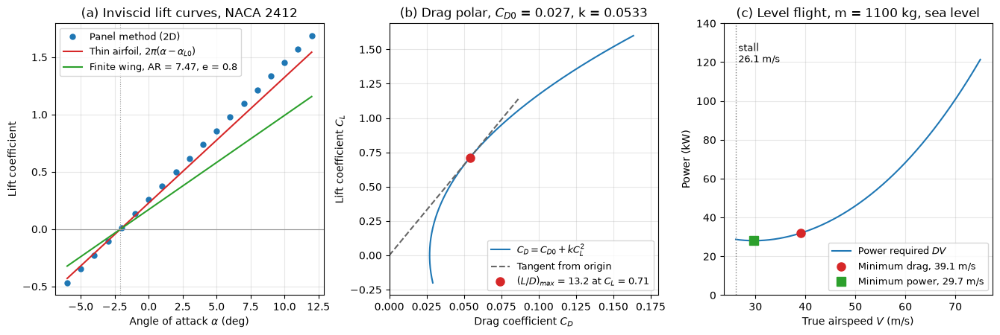

# How Airplanes Fly

An airplane in steady flight is a rigid body in equilibrium under four forces: lift and drag from the air, thrust from the engine and its own weight. This note explains where lift comes from (the pressure distribution on the wing, which circulation theory predicts and the "equal transit time" story does not), how the lift and drag of a finite wing are expressed through coefficients, and how the drag polar leads to the speeds, powers and glide angles that define an aircraft's performance. It ends with the control surfaces that change the forces and moments. The same quantities are what a CFD simulation of a wing or a complete aircraft is asked to deliver: $C_L$, $C_D$, $C_m$ and the surface pressure.

## Problem Statement

Given an aircraft of mass $m$, wing area $S$, span $b$ (aspect ratio $AR = b^2/S$), span efficiency $e$, zero-lift drag coefficient $C_{D0}$ and maximum lift coefficient $C_{L,max}$, flying at true airspeed $V$ in air of density $\rho$, find

- the lift coefficient and angle of attack needed to support the weight,
- the drag, the thrust and the power required,
- the stall speed, the speeds of minimum drag and minimum power, and the best lift-to-drag ratio,
- the rate of climb for a given excess power and the glide angle with the engine off.

The flow is assumed subsonic and incompressible ($M < 0.3$), the aircraft rigid and the flight steady, with thrust along the flight path. For a flight path inclined at angle $\gamma$ above the horizontal, Newton's second law along and normal to the path gives

$$
m \frac{dV}{dt} = T - D - W\sin\gamma,
\qquad mV \frac{d\gamma}{dt} = L - W\cos\gamma
$$

and steady flight sets both left-hand sides to zero. Rotational equilibrium (trim) and its stability are treated in [Airplane Stability](airplane_stability.md).

## The Four Forces

| Force | Direction | Expression |
| --- | --- | --- |
| Lift $L$ | normal to the flight path (the relative wind) | $L = \tfrac{1}{2}\rho V^2 S C_L$ |
| Drag $D$ | opposite to the flight path | $D = \tfrac{1}{2}\rho V^2 S C_D$ |
| Weight $W$ | vertically down | $W = mg$ |
| Thrust $T$ | along the propeller or engine axis, here taken along the path | $T = P_{shaft}\eta_p/V$ for a propeller |

Here $q = \tfrac{1}{2}\rho V^2$ is the dynamic pressure (Pa), $S$ the reference wing area (m²), $C_L$ and $C_D$ the dimensionless lift and drag coefficients and $\eta_p$ the propeller efficiency. Lift and drag are defined relative to the flight path, not to the vertical: in a climb the lift is tilted back and is slightly smaller than the weight.



The figure shows the four forces on a 1100 kg aircraft climbing at 40 m/s on a $6^\circ$ path, drawn to one scale. Thrust (1943 N) and drag (815 N) are an order of magnitude smaller than lift (10 732 N) and weight (10 791 N), and the climb is produced by the thrust exceeding the drag by $W\sin\gamma$, not by extra lift.

## Where Lift Comes From

### Pressure on the Surface

The air acts on the wing only through pressure, normal to the surface, and shear stress, tangent to it. Integrating both over the surface gives the resultant force, and its component normal to the free stream is the lift. In coefficient form, with $C_p = (p - p_\infty)/q_\infty$, the section lift is dominated by the pressure difference between the lower and upper surfaces:

```math
c_l \approx \frac{1}{c}\int_0^c \left(C_{p,l} - C_{p,u}\right) dx
\quad \text{(small } \alpha\text{, pressure only)}
```


The panel-method solution for a NACA 2412 at $\alpha = 4^\circ$ shows the typical picture: strong suction ($C_p$ down to $-1.4$) on the front of the upper surface, a mild overpressure on the lower surface, and most of the lift generated in the front third of the chord. The upper surface contributes more than the lower one. In terms of velocity, Bernoulli's equation (valid along streamlines outside the boundary layer, see [Bernoulli's Equation](../../../fluid_mechanics/inviscid_flow/bernoulli.md)) relates low pressure to high speed, so the air flows faster over the upper surface; but Bernoulli's equation does not say why it does.

### Circulation and the Kutta Condition

In inviscid theory ([Potential Flow](../../../fluid_mechanics/inviscid_flow/potential_flow.md)) the flow past a two-dimensional body can carry any amount of circulation

$$
\Gamma = \oint \mathbf{V}\cdot d\mathbf{s}
$$

and the Kutta–Joukowski theorem gives the lift per unit span

$$
L' = \rho_\infty V_\infty \Gamma
$$

for a clockwise circulation in a free stream from left to right. For a body with a sharp trailing edge the circulation is fixed by the **Kutta condition**, which requires the flow to leave the trailing edge smoothly instead of wrapping around it. Physically, viscosity enforces it: when the wing starts moving, a starting vortex is shed from the trailing edge, and by Kelvin's theorem an equal and opposite circulation remains bound to the wing. Thin-airfoil theory, which replaces the airfoil by a vortex sheet on its camber line, gives

$$
\Gamma = \pi c V_\infty(\alpha - \alpha_{L0}),
\qquad c_l = \frac{L'}{q_\infty c} = 2\pi(\alpha - \alpha_{L0})
$$

with $\alpha$ in radians and $\alpha_{L0}$ the zero-lift angle, which depends only on the camber line (zero for symmetric sections, $-2.08^\circ$ for NACA 2412, $-4.15^\circ$ for NACA 4412). The lift-curve slope $2\pi$ per radian, about 0.11 per degree, is the same for every thin airfoil.

As a check of scale: a light-aircraft wing of 1.5 m chord at 55 m/s with $c_l = 0.36$ carries $\Gamma = c_l V c/2 = 14.9$ m²/s.

### The Equal-Transit-Time Error

A common explanation states that air parcels separated at the leading edge must meet again at the trailing edge, so the air over the longer upper surface must go faster. This is false on both counts:

1. Nothing requires the parcels to meet. Measurements, flow visualization and every solution of the flow equations show that air over the upper surface of a lifting wing arrives at the trailing edge well before the air that went underneath.
2. The argument predicts far too little lift. The upper surface of a NACA 2412 is only 1.4% longer than the lower surface; equal transit times would give an upper-surface speed 1.4% higher and $c_l \approx (1.014)^2 - 1 = 0.03$, against about 0.65 measured at $4^\circ$ (0.74 in the inviscid panel solution above).
3. It cannot explain how a symmetric airfoil, a flat plate or a cambered wing flying inverted produces lift.

The correct statement is that the circulation fixed by the Kutta condition speeds up the flow over the upper surface and slows it over the lower surface. The equivalent momentum description is that the wing turns the oncoming flow downward (downwash), and the rate of change of downward momentum of the air equals the lift. Pressure, circulation and downwash are three consistent descriptions of the same flow, not competing theories.

## Lift and Drag Coefficients

### Section and Wing Coefficients

Lower-case coefficients ($c_l$, $c_d$, $c_m$) refer to a two-dimensional section per unit span, with the chord as reference length; upper-case ($C_L$, $C_D$, $C_m$) refer to a whole wing or aircraft with reference area $S$:

$$
C_L = \frac{L}{\tfrac{1}{2}\rho V^2 S},
\qquad C_D = \frac{D}{\tfrac{1}{2}\rho V^2 S}
$$

The coefficients depend on the shape, the angle of attack $\alpha$ (between the chord line and the relative wind), the Reynolds number and the Mach number, but not on $V$ or $\rho$ directly, which is why one curve of $C_L(\alpha)$ describes the wing at all speeds of a given regime ([The Reynolds Number in Flight](reynolds_number.md)).

### Lift Curve and Stall

$C_L$ grows linearly with $\alpha$ up to a few degrees below the stall. Past the stall angle (typically $14$–$`18^\circ`$ for a clean wing) the boundary layer on the upper surface separates, the suction peak collapses, lift drops and drag rises sharply. The highest lift coefficient $C_{L,max}$ sets the slowest speed at which the aircraft can fly level:

$$
V_{stall} = \sqrt{\frac{2W}{\rho S C_{L,max}}}
$$

Flaps and slats raise $C_{L,max}$ (see [Airfoil Design](airfoil_design.md)), which is why they are deployed for take-off and landing.

### Finite Wings and Induced Drag

At the wing tips the high-pressure air below flows around to the low-pressure side, forming trailing vortices. These induce a downward velocity (downwash) at the wing that tilts the local relative wind down by the induced angle $\alpha_i$; the wing works at a smaller effective angle of attack and its lift vector tilts back, producing a drag component, the **induced drag**. For a wing with span efficiency $e$ (1 for an elliptic lift distribution, 0.7–0.9 for practical wings),

$$
\alpha_i = \frac{C_L}{\pi e AR},
\qquad C_{D_i} = \frac{C_L^2}{\pi e AR}
$$

and the lift-curve slope of the wing falls below the section value $a$ ($\approx 2\pi$):

$$
a_{3D} = \frac{a}{1 + a/(\pi e AR)}
$$

For $AR = 7.47$, $e = 0.8$ and $a = 2\pi$ this gives $a_{3D} = 4.71$ per radian, 25% less than the section. High aspect ratio reduces induced drag, which is why sailplanes ($AR \approx 20$–$`30`$) have long, slender wings; winglets act like a modest increase in span.

### The Drag Polar

The total drag of the aircraft is the sum of the zero-lift (parasite) drag, made of skin friction, pressure (form) drag and interference drag ([Drag](../../../fluid_mechanics/viscous_flow/drag.md)), and the induced drag. To good accuracy below the drag-divergence Mach number,

$$
C_D = C_{D0} + kC_L^2,
\qquad k = \frac{1}{\pi e AR}
$$

where $e$ now absorbs the lift dependence of the profile drag as well (the Oswald efficiency factor). The lift-to-drag ratio $C_L/C_D$ is greatest where the tangent from the origin touches the polar, which is where induced drag equals parasite drag:

$$
C_L^* = \sqrt{\frac{C_{D0}}{k}},
\qquad \left(\frac{L}{D}\right)_{max} = \frac{1}{2\sqrt{kC_{D0}}}
$$



Panel (a) compares the section lift curve from a panel method with thin-airfoil theory and with the finite wing. Panel (b) is the polar of a light aircraft with $C_{D0} = 0.027$ and $k = 0.0533$, with $(L/D)_{max} = 13.2$ at $C_L^* = 0.71$. Panel (c) is the power required in level flight, discussed next.

## Level Flight Performance

In steady level flight $L = W$ and $T = D$. Each speed requires one lift coefficient,

$$
C_L = \frac{2W}{\rho V^2 S}
$$

and the drag and power required follow from the polar:

```math
D = \tfrac{1}{2}\rho V^2 S C_{D0} + \frac{2kW^2}{\rho V^2 S},
\qquad
P_{req} = DV = \tfrac{1}{2}\rho V^3 S C_{D0} + \frac{2kW^2}{\rho V S}
```

The first term (parasite) grows as $V^2$ in drag and $V^3$ in power; the second (induced) falls as $1/V^2$ and $1/V$. Drag is smallest at $C_L^*$, where $`D_{min} = W/(L/D)_{max}`$. Power is smallest at a lower speed, where $`C_L = \sqrt{3C_{D0}/k}`$, and the minimum-power speed is $3^{-1/4} = 0.76$ times the minimum-drag speed.

### Worked Example

A light aircraft with $m = 1100$ kg ($`W = 10\,791`$ N), $S = 16.2$ m², $b = 11.0$ m, $e = 0.80$, $C_{D0} = 0.027$ and $C_{L,max} = 1.6$ flies at sea level ($\rho = 1.225$ kg/m³).

1. Aspect ratio and induced-drag factor: $AR = 11.0^2/16.2 = 7.47$, $k = 1/(\pi \times 0.80 \times 7.47) = 0.0533$.
2. Best lift-to-drag ratio: $C_L^* = \sqrt{0.027/0.0533} = 0.712$, $(L/D)_{max} = 1/(2\sqrt{0.0533 \times 0.027}) = 13.2$.
3. Minimum drag: $`D_{min} = 10\,791/13.2 = 818`$ N, at $V_{md} = \sqrt{2W/(\rho S C_L^*)} = 39.1$ m/s.
4. Minimum power: at $C_L = \sqrt{3 \times 0.027/0.0533} = 1.23$, $V_{mp} = 0.76 \times 39.1 = 29.7$ m/s and $P_{min} = 28.1$ kW.
5. Stall: $`V_{stall} = \sqrt{2 \times 10\,791/(1.225 \times 16.2 \times 1.6)} = 26.1`$ m/s.
6. Cruise at 55 m/s: $C_L = 0.360$, $C_D = 0.027 + 0.0533 \times 0.360^2 = 0.0339$, $D = 1017$ N and $P_{req} = 55.9$ kW, of which induced drag is only 20%.

The minimum-drag speed is the best-glide and best-range speed of a jet; the minimum-power speed gives the longest endurance of a propeller aircraft and the smallest sink rate of a glider.

### Climb and Glide

In a steady climb, multiplying the along-path balance by $V$ gives

$$
R_c = V\sin\gamma = \frac{TV - DV}{W} = \frac{P_{av} - P_{req}}{W}
$$

so the rate of climb is the excess power per unit weight. With the engine off ($T = 0$) the aircraft descends at the glide angle

$$
\tan\gamma_{glide} = \frac{D}{L} = \frac{1}{L/D}
$$

and the still-air glide distance from height $h$ is $`h\,(L/D)`$, greatest at $(L/D)_{max}$. Weight does not change the glide angle at a given $C_L$, only the speed at which it is flown.

## Control Surfaces

The pilot changes the forces and moments by changing the camber of parts of the lifting surfaces.

| Surface | Location | Primary effect | Motion |
| --- | --- | --- | --- |
| Elevator (or all-moving stabilator) | trailing edge of the horizontal tail | changes tail lift, giving a pitching moment | pitch about the lateral axis |
| Ailerons | outer trailing edges of the wings, deflecting in opposite directions | raise lift on one wing and lower it on the other | roll about the longitudinal axis |
| Rudder | trailing edge of the fin | side force at the tail, giving a yawing moment | yaw about the vertical axis |
| Trailing-edge flaps | inner trailing edges | add camber and area: higher $C_{L,max}$, more drag | lower stall and approach speeds |
| Leading-edge slats | wing leading edge | delay leading-edge separation | stall at higher $\alpha$ |
| Spoilers | upper wing surface | destroy lift and add drag; roll when used on one side | descent, braking after touchdown |
| Trim tabs | trailing edges of control surfaces | hold a surface deflected with zero stick force | trim |

A turn is made by banking with the ailerons so that a component of lift points toward the centre of the turn, with the rudder used to keep the flight coordinated (no sideslip). Because the lift must still support the weight, the load factor in a level turn at bank angle $\phi$ is $n = L/W = 1/\cos\phi$, and the stall speed rises by $\sqrt{n}$.

## Key Takeaways

- Lift is the integral of the surface pressure; circulation theory with the Kutta condition predicts it, giving $L' = \rho V\Gamma$ and $c_l = 2\pi(\alpha - \alpha_{L0})$ for thin airfoils.
- The equal-transit-time explanation is wrong: upper-surface air arrives first, and the path-length argument underestimates lift by a factor of more than 20.
- A finite wing has a lower lift slope than its section and pays induced drag $C_L^2/(\pi e AR)$, which falls with aspect ratio.
- The parabolic polar $C_D = C_{D0} + kC_L^2$ gives $`(L/D)_{max} = 1/(2\sqrt{kC_{D0}})`$ where induced and parasite drag are equal.
- Minimum power occurs at $0.76$ times the minimum-drag speed; climb rate is excess power over weight; glide ratio equals $L/D$.

## Related Scripts

- [Forces on an Aircraft in a Steady Climb](../../../../scripts/plots/airplane_four_forces/): draws the free-body diagram of a 1100 kg light aircraft in a steady climb, with lift, drag, weight and thrust computed from the equilibrium conditions and drawn to scale, and checks that the four forces close into a polygon.
- [Thin-Airfoil Theory, Panel Method and Drag Polar](../../../../scripts/algorithms/airplane_thin_airfoil_and_polar/): computes the lift of a NACA 4-digit airfoil with thin-airfoil theory and with a Hess–Smith panel method, then turns the section result into a finite-wing lift curve, a parabolic drag polar and the power-required curve of a light aircraft.
- [Airfoil Angle of Attack](../../../../scripts/plots/airfoil_angle_attack/): draws a NACA 2412 airfoil pitched nose-up about its leading edge to several angles of attack, $0^\circ$, $8^\circ$ and $16^\circ$ by default, relative to a free stream flowing left to right.

## Exercises

**Exercise 1.** A light aircraft has mass 1100 kg and wing area 16.2 m². Find its sea-level stall speed ($\rho = 1.225$ kg/m³) with $C_{L,max} = 1.6$ (flaps up) and $C_{L,max} = 2.1$ (flaps down). Give the answers in m/s and knots.

<details>
<summary>Answer</summary>

$`W = 1100 \times 9.81 = 10\,791`$ N.

- Flaps up: $`V_{stall} = \sqrt{2 \times 10\,791/(1.225 \times 1.6 \times 16.2)} = 26.1`$ m/s = 50.7 kt.
- Flaps down: $V_{stall} = 22.8$ m/s = 44.2 kt.

Flaps cut the stall speed by 13%. Take-off and landing distances scale roughly with $V^2$, so they shrink by about 24%.

</details>

**Exercise 2.** The same aircraft cruises in level flight at 55 m/s at sea level. What lift coefficient is required? With the thin-airfoil slope corrected for the finite wing ($a_{3D} = 4.71$ per radian) and $\alpha_{L0} = -2.08^\circ$, estimate the angle of attack of the wing.

<details>
<summary>Answer</summary>

```math
C_L = \frac{2W}{\rho V^2 S} = \frac{2 \times 10\,791}{1.225 \times 55^2 \times 16.2} = 0.360
```

$\alpha - \alpha_{L0} = 0.360/4.71 = 0.0764$ rad $= 4.38^\circ$, so $\alpha = 4.38 - 2.08 = 2.3^\circ$. The required $C_L$ is less than a quarter of $C_{L,max}$, a wide margin above the stall.

</details>

**Exercise 3.** Using the polar $`C_D = 0.027 + 0.0533\,C_L^2`$, find the drag and power required at 30, 55 and 110 m/s for this aircraft. What fraction of the drag is induced at each speed? Why would a constant $C_D$ give a wrong picture at low speed?

<details>
<summary>Answer</summary>

| $V$ (m/s) | $C_L$ | $C_D$ | $D$ (N) | $P$ (kW) | induced share |
| --- | --- | --- | --- | --- | --- |
| 30 | 1.208 | 0.1048 | 936 | 28.1 | 74% |
| 55 | 0.360 | 0.0339 | 1017 | 55.9 | 20% |
| 110 | 0.090 | 0.0274 | 3293 | 362 | 1.6% |

At 30 m/s the aircraft needs almost as much drag force as at 55 m/s, because the induced drag ($\propto C_L^2 \propto 1/V^4$ in coefficient form) dominates. A constant $C_D$ would predict that drag and power fall steadily toward zero as speed decreases, and would miss the minimum of the power curve near 30 m/s.

</details>

**Exercise 4.** At a climb speed of 40 m/s, the engine and propeller deliver 80 kW of useful power and the power required for level flight at that speed is 35 kW. Find the rate of climb and the climb angle, and show that the lift during the climb is slightly less than the weight.

<details>
<summary>Answer</summary>

The excess power is 45 kW, so

```math
R_c = \frac{P_{av} - P_{req}}{W} = \frac{45\,000}{10\,791} = 4.17 \text{ m/s} \approx 820 \text{ ft/min}
```

$\sin\gamma = R_c/V = 4.17/40$, so $\gamma = 6.0^\circ$. Normal to the path, $`L = W\cos\gamma = 0.9946\,W`$. The climb comes from excess thrust, not excess lift. (This treats the drag in the climb as equal to that in level flight, which is accurate to within 1% because $\cos\gamma \approx 1$.)

</details>

**Exercise 5.** With the engine off, the aircraft's best lift-to-drag ratio is 13.2. How far can it glide from 1500 m in still air, at what speed, and what is the glide angle? How does a headwind change the best speed to fly?

<details>
<summary>Answer</summary>

Glide distance: $13.2 \times 1500 = 19.8$ km, flown at the minimum-drag speed, 39.1 m/s at sea-level density (slightly faster higher up, where the air is thinner). The glide angle is $\arctan(1/13.2) = 4.3^\circ$.

A headwind reduces the distance over the ground; the best ground range is then obtained by flying faster than the still-air best-glide speed, because the time spent exposed to the wind falls faster than $L/D$ deteriorates.

</details>

## References

- Anderson, J. D., Jr., *Introduction to Flight*, 8th ed., McGraw-Hill Education, 2016.
- Anderson, J. D., Jr., *Fundamentals of Aerodynamics*, 6th ed., McGraw-Hill Education, 2017.
- McLean, D., *Understanding Aerodynamics: Arguing from the Real Physics*, Wiley, 2013.
- Raymer, D. P., *Aircraft Design: A Conceptual Approach*, 6th ed., AIAA, 2018.
- Hess, J. L., and Smith, A. M. O., "Calculation of potential flow about arbitrary bodies", *Progress in Aerospace Sciences*, vol. 8, pp. 1–138, 1967.
- Federal Aviation Administration, *Pilot's Handbook of Aeronautical Knowledge*, FAA-H-8083-25B, 2016.
