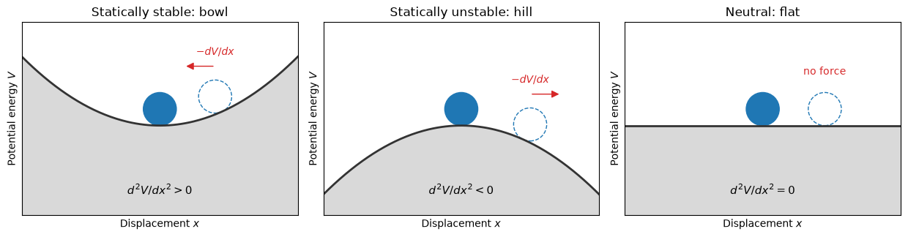
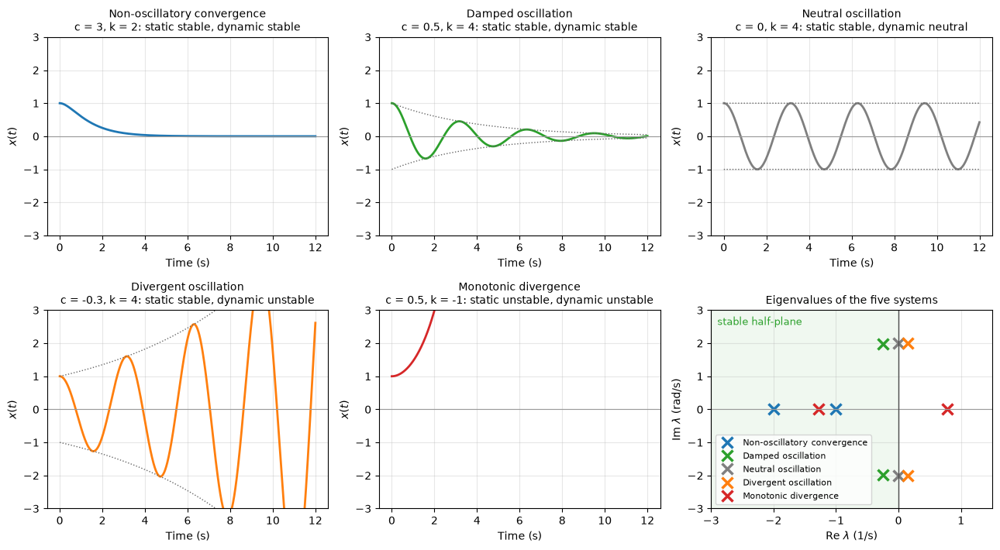
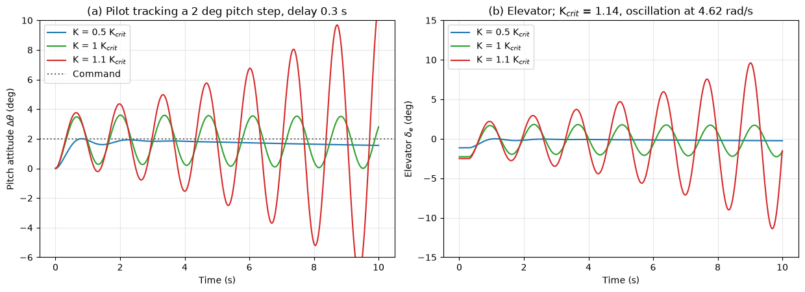

# Static and Dynamic Stability of Oscillating Systems

After a disturbance, a system near equilibrium can return to it, oscillate about it, or move away from it. Two questions separate these outcomes: whether the first reaction is a restoring force (static stability), and whether the motion that follows dies out (dynamic stability). This note sets out both for the damped linear oscillator, classifies its five kinds of free response by their eigenvalues, and applies the classification to the pitching motion of an aircraft and to pilot-induced oscillations, where a pilot's own corrections drive the aircraft into a growing oscillation. The same classification applies to structures under flow-induced loads ([Flow-Induced Vibrations](../../fluid_loading/flow_induced_vibrations.md)) and to feedback control loops ([Stability Analysis](../../control_systems/stability_analysis.md)).

The file name refers to "pecking", an informal description of a repeated nose-down bobbing of an aircraft. It is not a term of the stability or flight-dynamics literature, where such motions are described by their mode (short period, phugoid), as porpoising (a coupled pitch and heave oscillation of seaplane hulls and planing boats) or as a pilot-induced oscillation; this note uses the standard terms.

## Problem Statement

Given a linear or linearized system with state $\mathbf{x}$ (displacements and velocities about an equilibrium), written either as a single degree of freedom

$$
m\ddot x + c\dot x + kx = 0
$$

with mass (or inertia) $m > 0$, damping coefficient $c$ and stiffness $k$, or in state-space form $\dot{\mathbf{x}} = A\mathbf{x}$, determine

- whether the equilibrium is statically stable, unstable or neutral;
- the eigenvalues, natural frequency, damping ratio and type of free response, and whether it is dynamically stable;
- how quickly a disturbance decays or grows (time to half or double amplitude, logarithmic decrement);
- for an aircraft, how these properties follow from the stability derivatives, and how closing a loop through a pilot with a reaction delay changes them.

The analysis is linear: it describes small motions. Nonlinear effects (amplitude-dependent damping, actuator rate limits, separation) can bound a growing oscillation into a limit cycle or make a linearly stable system unstable at large amplitude.

## Static Stability

A conservative system with potential energy $V(x)$ is in equilibrium where $dV/dx = 0$. The force after a small displacement is $`F = -dV/dx \approx -k\,x`$ with $k = d^2V/dx^2$:

| Stiffness | Potential | Force after a displacement | Static stability |
| --- | --- | --- | --- |
| $k > 0$ | minimum (bowl) | restoring, towards equilibrium | stable |
| $k < 0$ | maximum (hill) | away from equilibrium | unstable |
| $k = 0$ | flat | none | neutral |



Static stability describes only the initial tendency. It says nothing about whether the system overshoots, how many times it oscillates or whether the oscillation grows.

## Dynamic Stability

### Eigenvalues of the Damped Oscillator

Substituting $x = e^{\lambda t}$ into $m\ddot x + c\dot x + kx = 0$ gives the characteristic equation $m\lambda^2 + c\lambda + k = 0$, with roots

$$
\lambda_{1,2} = -\zeta\omega_n \pm \omega_n \sqrt{\zeta^2 - 1},
\qquad \omega_n = \sqrt{\frac{k}{m}},
\qquad \zeta = \frac{c}{2\sqrt{mk}}
$$

for $k > 0$. The free response is a combination of $e^{\lambda_1 t}$ and $e^{\lambda_2 t}$. A complex pair $\lambda = \sigma \pm j\omega_d$ gives an oscillation at the damped frequency $\omega_d = \omega_n\sqrt{1 - \zeta^2}$ inside the envelope $e^{\sigma t}$. The system is dynamically stable if every eigenvalue has a negative real part, neutral if the largest real part is zero, and unstable if any real part is positive.

| Response | Eigenvalues | Parameters | Static | Dynamic |
| --- | --- | --- | --- | --- |
| Non-oscillatory convergence | two negative real roots | $k > 0$, $\zeta \ge 1$ | stable | stable |
| Damped oscillation | complex pair, $\sigma < 0$ | $k > 0$, $0 < \zeta < 1$ | stable | stable |
| Neutral oscillation | imaginary pair, $\sigma = 0$ | $k > 0$, $c = 0$ | stable | neutral |
| Divergent oscillation | complex pair, $\sigma > 0$ | $k > 0$, $c < 0$ | stable | unstable |
| Monotonic divergence | one positive real root | $k < 0$ | unstable | unstable |



The figure integrates the five cases from $x(0) = 1$, $\dot x(0) = 0$ and places their eigenvalues in the complex plane: the dynamic class depends only on which side of the imaginary axis the eigenvalues lie, and the response oscillates only if they leave the real axis.

### Static Versus Dynamic Stability

For the second-order system the two roots satisfy $\lambda_1\lambda_2 = k/m$ and $\lambda_1 + \lambda_2 = -c/m$, so both have negative real parts if and only if $c > 0$ and $k > 0$ (the Routh–Hurwitz condition of second order). Two consequences follow:

1. Static stability is necessary for dynamic stability. If $k < 0$, the product of the roots is negative, so one root is real and positive whatever the damping; no passive damping can save a statically unstable system.
2. Static stability is not sufficient. With $k > 0$ but $c < 0$, energy is fed into the motion every cycle and the oscillation grows although a restoring force exists. Negative damping arises from aerodynamic forces in phase with velocity: galloping of iced cables, wing flutter (where two structural modes couple through the airflow) and a pilot reacting late.

### Measures of Decay and Growth

For an underdamped system the ratio of successive peaks gives the logarithmic decrement

$$
\delta = \ln \frac{x_n}{x_{n+1}} = \frac{2\pi\zeta}{\sqrt{1 - \zeta^2}}
$$

which is how $\zeta$ is measured from a recorded free decay. The time for the amplitude to halve (stable) or double (unstable) is

```math
t_{1/2} = \frac{\ln 2}{|\sigma|},
\qquad \sigma = \mathrm{Re}\,\lambda
```

Flight-test reports and flying-qualities specifications quote modes in exactly these terms: frequency, damping ratio and time to half or double amplitude.

## Application to Aircraft Pitch

With speed held constant, the pitching motion of an aircraft (the short-period mode) reduces to a second-order system in the angle of attack,

```math
\ddot\alpha - \left(M_q + M_{\dot\alpha} + \frac{Z_\alpha}{U}\right)\dot\alpha + \left(\frac{Z_\alpha M_q}{U} - M_\alpha\right)\alpha = 0
```

with the dimensional derivatives of [Airplane Stability](airplane_stability.md). The stiffness contains $`-M_\alpha \propto -C_{m_\alpha} = a\,SM`$, proportional to the static margin, plus the term $Z_\alpha M_q/U$; the damping comes from the pitch-rate derivatives $M_q$ and $M_{\dot\alpha}$, mostly generated by the tail. For the light aircraft of the [longitudinal-modes script](../../../../scripts/algorithms/airplane_longitudinal_modes/) at 55 m/s the stiffness is 31.3 s⁻² and the damping coefficient 8.14 s⁻¹, giving $\omega_n = 5.59$ rad/s and $\zeta = 0.73$, a damped oscillation.

The full four-state longitudinal model shows the same classification as the static margin changes:

| $C_{m_\alpha}$ (per rad) | Static margin | Longitudinal eigenvalues (1/s) | Behaviour |
| --- | --- | --- | --- |
| $-0.89$ | $0.19$ | $-4.07 \pm 3.83j$, $-0.015 \pm 0.210j$ | damped short period and phugoid |
| $0$ | $0$ | $-6.74$, $-1.38$, $-0.061$, $0$ | oscillations gone; one neutral root |
| $+0.10$ | $-0.022$ | $-7.16$, $-0.91$, $-0.21$, $+0.11$ | monotonic divergence, doubling in 6.2 s |

Behind the neutral point one eigenvalue becomes real and positive: the aircraft diverges in pitch without oscillating, the "monotonic divergence" of the classification. A fly-by-wire aircraft designed with negative static margin flies only because its control system feeds back pitch rate and angle of attack to move that eigenvalue back into the left half-plane.

## Pilot-Induced Oscillations

A pilot-induced oscillation (PIO) is a sustained or growing oscillation that results from the pilot's efforts to control the aircraft. Its mechanism is a phase lag in the closed loop formed by the pilot and the aircraft. Model the pilot as a gain $K$ with a reaction delay $\tau$, so that the elevator command is $\delta_e = K(\theta(t - \tau) - \theta_c)$. The loop transfer function is $`L(j\omega) = -K\,G_{\theta\delta_e}(j\omega)\,e^{-j\omega\tau}`$; the delay adds a phase lag $\omega\tau$ that grows with frequency, and the loop becomes neutrally stable at the gain $K_{crit} = 1/|G_{\theta\delta_e}(j\omega_{180})|$ where the total phase reaches $-180^\circ$ ([Frequency Response](../../control_systems/frequency_response.md)).



For the light aircraft with $\tau = 0.3$ s, $K_{crit} = 1.14$ rad of elevator per rad of pitch error and the critical frequency is 4.62 rad/s (period 1.36 s), close to the short-period frequency. At half the critical gain the aircraft follows the command smoothly; at the critical gain it oscillates with constant amplitude; 10% above it, the pilot's corrections arrive late enough to reinforce the motion and the oscillation grows. The aircraft is dynamically stable on its own in all three cases: the instability belongs to the closed loop.

PIOs are usually grouped into three categories (National Research Council, 1997):

| Category | Cause | Example |
| --- | --- | --- |
| I, linear | excessive phase lag from delays or high-order flight-control dynamics with high pilot gain | landing flare of Space Shuttle *Enterprise* on its last approach and landing test, 1977 |
| II, quasi-linear | actuator rate or position limiting adds sudden extra phase lag at large amplitude | crashes of the Saab JAS 39 Gripen prototype (1989) and of the YF-22 (1992) |
| III, nonlinear | mode switching or other transitions in the control laws | rare, hard to predict by analysis |

The remedies follow from the loop analysis: reduce delays in the control system, avoid rate saturation, shape the aircraft response so that a high-gain pilot keeps phase margin, and train pilots to relax their gain (let go of the stick) when an oscillation starts.

## Key Takeaways

- Static stability is the sign of the stiffness, $k = d^2V/dx^2 > 0$; dynamic stability is the sign of the eigenvalues' real parts.
- For $m\ddot x + c\dot x + kx = 0$, dynamic stability requires both $k > 0$ and $c > 0$; a statically unstable system always diverges, a statically stable one can still oscillate with growing amplitude if its damping is negative.
- The five free responses are non-oscillatory convergence, damped oscillation, neutral oscillation, divergent oscillation and monotonic divergence.
- In aircraft pitch, the static margin supplies the stiffness and the tail's pitch-rate derivatives the damping; behind the neutral point a real positive eigenvalue appears.
- A pilot with a reaction delay closes a loop that can be unstable even when the aircraft is not; the critical gain follows from the $-180^\circ$ phase crossing.
- "Pecking" is an informal word, not an established term; the motions it describes are the short period, the phugoid, porpoising or a PIO.

## Related Scripts

- [Static and Dynamic Stability Classification](../../../../scripts/plots/airplane_stability_classification/): draws the static picture of stability (a ball in a bowl, on a hill and on a flat surface) and the five free responses of a second-order system, from non-oscillatory convergence to monotonic divergence, together with their eigenvalues in the complex plane.
- [Longitudinal Modes of a Light Aircraft](../../../../scripts/algorithms/airplane_longitudinal_modes/): finds the short-period and phugoid modes of a representative 1100 kg light aircraft from its linearized longitudinal equations, compares them with the classical two-mode approximations, and shows how a pilot with a reaction delay can turn the well-damped short period into a pilot-induced oscillation.

## Exercises

**Exercise 1.** A system has $m = 2$ kg, $k = 800$ N/m and $c = 8$ N s/m. Find the natural frequency, the damping ratio and the damped frequency, and classify the response.

<details>
<summary>Answer</summary>

```math
\omega_n = \sqrt{k/m} = 20 \text{ rad/s},
\qquad
\zeta = \frac{c}{2\sqrt{mk}} = \frac{8}{2\sqrt{1600}} = 0.10
```

$\omega_d = \omega_n\sqrt{1 - \zeta^2} = 19.9$ rad/s. Since $k > 0$ and $0 < \zeta < 1$ the system is statically stable and its free response is a damped oscillation.

</details>

**Exercise 2.** What damping coefficient would make the system of Exercise 1 critically damped? What happens to the response if $c$ is doubled beyond that value?

<details>
<summary>Answer</summary>

$c_{cr} = 2\sqrt{mk} = 2\sqrt{2 \times 800} = 80$ N s/m. At $c = 160$ N s/m, $\zeta = 2$ and the eigenvalues are $\lambda = -20(2 \pm \sqrt 3) = -5.36$ and $-74.6$ s⁻¹. The system is overdamped: it returns without oscillating, but the slow root makes it take longer than the critically damped system ($\lambda = -20$ s⁻¹, double).

</details>

**Exercise 3.** For $\zeta = 0.1$, find the logarithmic decrement, the ratio of successive peak amplitudes, and the number of cycles for the amplitude to halve.

<details>
<summary>Answer</summary>

$\delta = 2\pi(0.1)/\sqrt{0.99} = 0.631$, so successive peaks shrink by a factor $e^{0.631} = 1.88$.

The amplitude halves after $\ln 2/\delta = 1.10$ cycles.

</details>

**Exercise 4.** An energy source (for example aerodynamic forcing) makes the effective damping of the system in Exercise 1 negative, $c = -1$ N s/m. Find $\zeta$, the growth rate of the oscillation amplitude and the time for it to double.

<details>
<summary>Answer</summary>

$\zeta = -1/80 = -0.0125$. The amplitude varies as $e^{\sigma t}$ with $\sigma = -c/(2m) = 0.25$ s⁻¹, so the doubling time is $\ln 2/0.25 = 2.77$ s.

Even a very small negative damping ratio gives an oscillation that grows without limit in a linear model. In reality nonlinearities usually cap it as a limit cycle, or the structure fails first; flutter is the classic example.

</details>

**Exercise 5.** A pilot with a reaction delay of 0.3 s closes a pitch-attitude loop at the short-period frequency of 4.6 rad/s. How much phase lag does the delay alone add at that frequency? If the pilot's delay rises to 0.5 s (fatigue, distraction), does the critical gain rise or fall, and why?

<details>
<summary>Answer</summary>

The delay adds $\omega\tau = 4.6 \times 0.3 = 1.38$ rad $= 79^\circ$ of phase lag.

A longer delay adds more lag at every frequency, so the $-180^\circ$ crossing moves to a lower frequency, where the aircraft's response $|G|$ is larger; the critical gain $1/|G(j\omega_{180})|$ therefore falls. For the light aircraft of the script it drops from 1.14 at 4.62 rad/s ($\tau = 0.3$ s) to 0.90 at 3.28 rad/s ($\tau = 0.5$ s). A slower pilot destabilizes the loop at a lower gain, which is why PIO tendencies are worse when the pilot is tense and tracking aggressively.

</details>

## References

- Rao, S. S., *Mechanical Vibrations*, 6th ed., Pearson, 2017.
- Den Hartog, J. P., *Mechanical Vibrations*, 4th ed., McGraw-Hill, 1956.
- Etkin, B., and Reid, L. D., *Dynamics of Flight: Stability and Control*, 3rd ed., Wiley, 1996.
- Nelson, R. C., *Flight Stability and Automatic Control*, 2nd ed., McGraw-Hill, 1998.
- National Research Council, *Aviation Safety and Pilot Control: Understanding and Preventing Unfavorable Pilot-Vehicle Interactions*, National Academy Press, 1997.
- McRuer, D. T., *Pilot-Induced Oscillations and Human Dynamic Behavior*, NASA CR-4683, 1995.
- Ogata, K., *Modern Control Engineering*, 5th ed., Prentice Hall, 2010.
