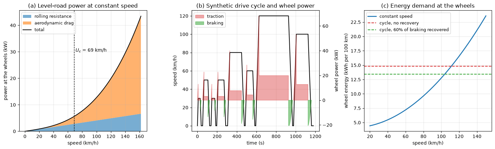
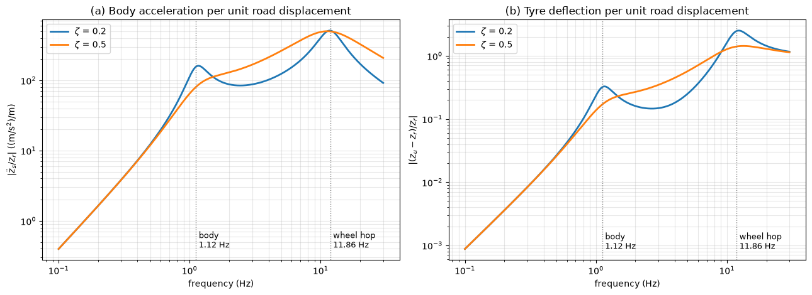

# How Cars Work

A car converts stored chemical or electrical energy into tractive force at the tyre contact patches, and spends that energy against rolling resistance, aerodynamic drag, gradients and braking. This note treats the car as a mechanical system: the road-load equation that sets the force and power demand, the combustion engine and the electric motor that supply it, the transmission that matches them to the wheels, the tyre friction that limits braking and traction, the quarter-car model of the suspension, and the aerodynamic quantities that external-flow CFD is asked to predict. The design and production of the vehicle are covered in [Car Design and Manufacturing](manufacturing_and_design_process.md).

## Problem Statement

Given a vehicle (mass $m$, drag area $C_dA$, rolling-resistance coefficient $C_{rr}$, wheel radius $r$, gear ratios, the torque and efficiency characteristics of the engine or motor, brake and suspension parameters) and a driving task (a speed profile $U(t)$ on a road of grade $\theta$ and roughness $`z_r(x)`$), find

- the tractive force and power at the wheels, and the energy per distance travelled;
- acceleration, top speed and gradeability for the available powertrain and gearing;
- the braking distance and the axle loads, limited by tyre friction;
- the ride response of the body and the variation of tyre load caused by road roughness.

The vehicle is treated as a point mass for longitudinal motion and as a two-degree-of-freedom quarter car for vertical motion, both linear except for the tyre friction limit. The governing equations are the longitudinal equation of motion with the road load,

$$
m_{eff} \frac{dU}{dt} = F_t -
\left(m g C_{rr} + \tfrac{1}{2}\rho C_d A U^2 + m g\sin\theta\right),
\qquad \lvert F_t \rvert \le \mu F_z
$$

and the quarter-car equations given below.

## Road Load

At constant acceleration $a$ the tractive force at the wheels must be

$$
F = m g C_{rr} + \tfrac{1}{2}\rho C_d A U^2 + m g\sin\theta + m a
$$

The four terms are rolling resistance, aerodynamic drag, the grade force and the inertial force. Rolling resistance comes mainly from hysteresis in the deforming tyre; $C_{rr}$ is 0.007–0.012 for modern passenger-car tyres on asphalt and rises slowly with speed. The inertial term is often written with an effective mass $m_{eff} = m(1 + \delta)$ that includes the rotating wheels, driveline and engine; $\delta$ is a few per cent in top gear and can exceed 0.2 in first gear.

On a level road the rolling and aerodynamic forces are equal at the crossover speed

$$
U_c = \sqrt{\frac{2 m g C_{rr}}{\rho C_d A}}
$$

Below $U_c$ mass and tyres dominate the consumption; above it the shape of the car does. Power is $P = FU$, so the aerodynamic part grows as $U^3$. At constant speed the energy per unit distance is simply the force, and 1 N of road load costs $10^5$ J = 0.028 kWh per 100 km at the wheels.



For a 1500 kg car with $C_{rr} = 0.010$, $C_d = 0.30$ and $A = 2.2$ m², rolling resistance is 147 N and $U_c = 19.1$ m/s (69 km/h), as panel (a) shows. At 120 km/h the road load is 596 N, the power 19.9 kW and the wheel energy 16.6 kWh per 100 km, against 6.3 kWh at 50 km/h. Panel (b) is a synthetic mixed cycle at a mean of 68 km/h, and panel (c) compares its energy, 14.8 kWh per 100 km of traction energy, with the constant-speed values. On the cycle 2.3 kWh per 100 km is dissipated in the brakes; an electric car that recovers 60% of it needs 13.4 kWh per 100 km at the wheels. Real consumption also includes the powertrain losses, which for an engine are much larger than the road load, and accessories such as heating and air conditioning.

## Powertrain

### Combustion Engine

A four-stroke engine completes one thermodynamic cycle in two crankshaft revolutions:

1. intake: the piston moves down with the inlet valve open and draws in air (and fuel, in a port-injected spark-ignition engine);
2. compression: both valves close and the piston compresses the charge by the compression ratio $r = V_{max}/V_{min}$;
3. combustion and expansion: the spark (or, in a diesel, the injection of fuel into the hot compressed air) starts combustion near top dead centre, and the high-pressure gas pushes the piston down, which is the only stroke that delivers work;
4. exhaust: the exhaust valve opens and the rising piston expels the burned gas.

The connecting rod and crankshaft turn the reciprocating motion into rotation (see [Mechanisms and Linkages](../../mechanical_systems/mechanisms.md)), and a camshaft driven at half crankshaft speed times the valves. The ideal model of the spark-ignition engine is the air-standard Otto cycle, with isentropic compression and expansion and heat addition at constant volume. Its thermal efficiency depends only on the compression ratio and the ratio of specific heats $\gamma$:

$$
\eta_{Otto} = 1 - r^{1-\gamma}
$$

For $r = 10$ and $\gamma = 1.4$, $\eta = 0.60$. Real engines reach brake efficiencies of about 30–40% for spark ignition and 40–45% for large diesels, because of heat transfer to the walls, finite combustion duration, friction, pumping work and, at part load, throttling. The compression ratio of a spark-ignition engine is limited by knock (autoignition of the end gas) to about 10–13; diesels avoid this because the fuel is injected only when combustion should start, and run at 15–20.

The engine output is described by its torque $T$ and speed $\omega$, with power $P = T\omega$. A convenient size-independent measure is the brake mean effective pressure: for a four-stroke engine of displacement $V_d$ at $N$ revolutions per second, $P = \bar p_b V_d N/2$ and $T = \bar p_b V_d/(4\pi)$. A 2.0 L engine with $\bar p_b = 1.2$ MPa produces 191 N·m and, at 6000 rpm, 120 kW. Efficiency is plotted on an engine map of brake-specific fuel consumption against speed and torque; the best region is at moderate speed and high load, which is what the transmission tries to keep the engine near.

### Electric Motor and Battery

An electric drive consists of a battery, an inverter that converts its direct current into the three-phase alternating current of the motor, and a permanent-magnet synchronous or induction motor. The motor gives its maximum torque from standstill up to a base speed, where the back-EMF reaches the available voltage, and roughly constant power above it, so a single fixed reduction gear usually suffices. Motor and inverter efficiencies are 90–97% over most of the operating range, against 20–40% for an engine over a typical cycle. The motor can run as a generator to recover braking energy.

A battery stores $`E = V_{nom}\,Q`$, with nominal voltage $V_{nom}$ and capacity $Q$ in ampere-hours. Lithium-ion packs store roughly 0.15–0.25 kWh/kg, far below the 12 kWh/kg chemical energy of petrol, but the much higher efficiency of the electric drive narrows the difference in usable energy. The rate of charge and discharge is expressed as a C-rate (1C empties the battery in one hour), and the internal resistance of the cells sets the losses $I^2R$ and the voltage drop at high power.

## Transmission and Gear Ratios

With gear ratio $i_g$, final-drive ratio $i_f$, driveline efficiency $\eta_d$ and tyre rolling radius $r$, the wheel force and the road speed are

```math
F_t = \frac{T_e\,i_g\,i_f\,\eta_d}{r},
\qquad U = \frac{\omega_e\,r}{i_g\,i_f}
```

The product $F_tU = \eta_d T_e\omega_e$ is fixed by the engine, and the gearbox only chooses the trade between force and speed. A combustion engine produces useful torque only between idle (about 800 rpm) and its maximum speed (about 6000–7000 rpm), so it needs a clutch or torque converter to start from rest and several ratios to cover the speed range. Low gears give the tractive force for starting and climbing; high gears let the engine cruise at low speed and high load, where it is most efficient. The ratios of consecutive gears are usually close to a geometric progression so that each upshift drops the engine speed by a similar fraction. Manual, automatic (planetary gearsets with a torque converter), dual-clutch and continuously variable transmissions differ in how the ratio is changed, not in this principle.

Top speed is reached where the maximum wheel power equals the road-load power. For the car above with 100 kW at the wheels, solving $(m g C_{rr} + \tfrac{1}{2}\rho C_dAU^2)U = 100$ kW gives about 220 km/h, provided the top gear lets the engine reach its maximum power at that speed.

## Braking and Tyre Friction

The brakes convert kinetic energy into heat: stopping a 1500 kg car from 100 km/h dissipates 579 kJ in a few seconds. In a hydraulic system the pedal force, multiplied by the pedal lever and a vacuum or electric booster, pressurizes the master cylinder, and the same pressure acts on the caliper pistons that clamp the pads against the discs. The deceleration is limited by tyre friction, $a \le \mu g$, so the stopping distance with driver reaction time $t_r$ is

$$
s = U t_r + \frac{U^2}{2\mu g}
$$

From 100 km/h with $\mu = 0.9$ and $t_r = 1$ s this is $27.8 + 43.7 = 71.5$ m.

Braking transfers load to the front axle. For a wheelbase $L$, centre of gravity at height $h$ and at distance $b$ in front of the rear axle, the front axle load during a deceleration $a$ is

$$
F_{zf} = m g \frac{b}{L} + m a \frac{h}{L}
$$

With $L = 2.7$ m, $b = 1.5$ m, $h = 0.55$ m and $a = 0.9g$, the front share rises from 56% at rest to 74%. The brakes are therefore proportioned toward the front, so that the rear wheels do not lock first, which would make the car unstable.

The friction force of a tyre depends on the longitudinal slip $\kappa = (\omega r - U)/U$. It rises almost linearly with slip, peaks at about 10–20% slip on dry asphalt, and falls toward the lower sliding value as the wheel locks. A locked tyre also loses its lateral force, so the car cannot be steered. An anti-lock braking system (ABS) measures the wheel speeds and modulates the brake pressure to keep each wheel near the peak of the slip curve. Lateral force is generated in the same way by the slip angle between the wheel plane and its direction of travel; the combined longitudinal and lateral force cannot exceed about $\mu F_z$, the friction circle.

## Suspension and Ride

The suspension carries the body on springs and dampers, keeps the tyres in contact with the road, and controls the wheel position under load. The simplest model of its vertical dynamics is the **quarter car**, made of a sprung mass $m_s$ (a quarter of the body), an unsprung mass $m_u$ (wheel, hub, brake and part of the links), the suspension spring $k_s$ and damper $c_s$ between them, and the tyre as a spring $k_t$ to the road profile $z_r$. With body and wheel displacements $z_s$ and $z_u$,

```math
m_s\ddot z_s = -k_s(z_s - z_u) - c_s(\dot z_s - \dot z_u)
```

```math
m_u\ddot z_u = k_s(z_s - z_u) + c_s(\dot z_s - \dot z_u) - k_t(z_u - z_r)
```

Because $m_u \ll m_s$ and $k_s \ll k_t$, the two undamped natural frequencies are well separated and close to

$$
f_{body} \approx \frac{1}{2\pi} \sqrt{\frac{k_s k_t}{(k_s + k_t)m_s}},
\qquad f_{wheel} \approx \frac{1}{2\pi} \sqrt{\frac{k_s + k_t}{m_u}}
$$

Passenger cars have body frequencies of about 1–1.5 Hz and wheel-hop frequencies of about 10–15 Hz. The vibration theory behind this two-degree-of-freedom system is in [Vibrations and Oscillations](../../dynamics/vibrations.md).



For $m_s = 400$ kg, $m_u = 40$ kg, $k_s = 22$ kN/m and $k_t = 200$ kN/m the modes are at 1.12 Hz and 11.86 Hz. Panel (a) shows the body acceleration per unit road displacement, a measure of comfort, and panel (b) the tyre deflection, which is proportional to the variation of tyre load and so to the loss of grip. Light damping ($\zeta = 0.2$) isolates the body well between the two modes but lets both resonances grow; heavy damping ($\zeta = 0.5$) suppresses the resonances but transmits more motion between and above them. Damper tuning is a compromise between comfort and road holding, and adaptive or active suspensions change the damping with the driving situation.

## Vehicle Aerodynamics

The aerodynamic force on a car is written with the frontal area $A$ as reference:

$$
D = \tfrac{1}{2}\rho U^2 C_d A,
\qquad L = \tfrac{1}{2}\rho U^2 C_L A
$$

The product $C_dA$, the drag area, is what the road load depends on; a tall car with a low $C_d$ can have more drag than a low car with a higher one.

| Vehicle | $C_d$ | $A$ (m²) | $C_dA$ (m²) |
| --- | --- | --- | --- |
| streamlined modern saloon | 0.22–0.26 | 2.2–2.3 | 0.50–0.60 |
| typical hatchback or saloon | 0.28–0.33 | 2.1–2.3 | 0.60–0.75 |
| SUV | 0.32–0.40 | 2.6–2.9 | 0.85–1.15 |
| pickup or van | 0.38–0.45 | 3.0–3.5 | 1.15–1.55 |

These are representative ranges, not data for particular models. A car is a bluff body at a Reynolds number of order $10^7$ (based on length), and most of its drag is pressure drag from the separated wake behind the rear end; skin friction contributes only about a tenth. The wheels and wheel arches, the underbody, the mirrors and the cooling flow contribute much of the rest. Air ducted through the radiator and engine bay loses momentum and leaves through the underbody, which adds cooling drag; closing the grille with active shutters when little cooling is needed is one of the cheapest drag reductions available.

A road car usually produces some lift, which reduces the tyre loads at speed, and the lift is split into front and rear components because their balance changes the handling: rear lift reduces stability at high speed. Spoilers, diffusers and underbody shaping reduce lift or produce downforce, $C_L < 0$, which racing cars use to increase grip beyond $\mu mg$ without adding mass. Downforce costs drag, so its benefit depends on the circuit. The flow physics of drag is covered in [Drag](../../../fluid_mechanics/viscous_flow/drag.md), and the prediction of $C_d$ for many car shapes with CFD and machine learning in the [automotive aerodynamics case study](../../../machine_learning/automotive_aerodynamics/ml_process.md).

## Key Takeaways

- The road load $F = m g C_{rr} + \tfrac{1}{2}\rho C_d A U^2 + m g\sin\theta + m a$ sets the force and energy demand; aerodynamics dominates above the crossover speed $U_c = \sqrt{2mgC_{rr}/(\rho C_dA)}$, about 70 km/h for a typical car.
- The ideal Otto efficiency $1 - r^{1-\gamma}$ explains why compression ratio matters; real engines lose much more, especially at part load.
- Electric drives are efficient over a wide speed range and recover braking energy, which makes road load, and therefore aerodynamics, the main factor in their range.
- The gearbox trades force for speed at constant power so that the engine runs in an efficient region.
- Tyre friction limits braking and traction to about $\mu F_z$; ABS keeps the tyres near the peak of the slip curve.
- The quarter car separates a 1 Hz body mode from a 10–15 Hz wheel-hop mode, and damping trades comfort against tyre-load variation.

## Related Scripts

- [Car Road Load and Quarter-Car Ride](../../../../scripts/algorithms/car_road_load_and_quarter_car/): computes the road-load power and energy demand of a mid-size car and the ride response of a quarter-car suspension model.

## Exercises

**Exercise 1.** (a) How many power strokes per second does a four-cylinder four-stroke engine produce at 3000 rpm? (b) Find the ideal Otto efficiency for compression ratios 10 and 12 with $\gamma = 1.4$, and explain why a real engine reaches much less.

<details>
<summary>Answer</summary>

(a) At 3000 rpm there are 50 rev/s. Each cylinder fires once every two revolutions, 25 times per second, so four cylinders give 100 power strokes per second. More cylinders give smaller, overlapping torque pulses and a smoother output.

(b) $\eta = 1 - 10^{-0.4} = 0.602$ and $\eta = 1 - 12^{-0.4} = 0.630$. The ideal cycle assumes instantaneous combustion, no heat loss to the walls, no friction, no pumping work and air as a perfect gas with constant $\gamma$. The real working fluid has a lower $\gamma$ at high temperature, combustion takes time, and at part load the throttle adds pumping losses, so brake efficiencies are 30–40%.

</details>

**Exercise 2.** An engine delivers 200 N·m. First gear has a ratio of 3.5, the final drive 4.1, and the driveline efficiency is 0.90. The tyre rolling radius is 0.31 m. Find the tractive force and the acceleration of a 1400 kg car, ignoring rolling resistance, drag and wheel slip. Is the result achievable?

<details>
<summary>Answer</summary>

```math
F = \frac{T\,i_g\,i_f\,\eta}{r} = \frac{200 \times 3.5 \times 4.1 \times 0.90}{0.31} = 8330\ \mathrm{N}, \qquad a = \frac{8330}{1400} = 5.95\ \mathrm{m/s^2}
```

Tyre grip limits it. For a front-driven car with about 60% of its weight on the driven wheels and $\mu = 0.9$, the limit is $0.6 \times 1400 \times 9.81 \times 0.9 = 7.4$ kN, and load transfer to the rear during acceleration lowers it further. The rotating inertia, large in first gear, also reduces the acceleration.

</details>

**Exercise 3.** A driver presses the brake pedal with 300 N and the pedal lever ratio is 4:1. The master cylinder bore is 20 mm and each caliper piston has a diameter of 50 mm. (a) Find the hydraulic pressure and the clamping force per caliper piston, ignoring the booster. (b) Find the stopping distance from 100 km/h on a dry road with $\mu = 0.9$ and a reaction time of 1 s.

<details>
<summary>Answer</summary>

(a) The force on the master cylinder is $300 \times 4 = 1200$ N, so

```math
p = \frac{1200}{\pi (0.010)^2} = 3.82\ \mathrm{MPa}, \qquad F_{clamp} = p\,\pi (0.025)^2 = 7.5\ \mathrm{kN}
```

a hydraulic advantage of $(50/20)^2 = 6.25$.

(b) $U = 27.8$ m/s, so $s = 27.8 \times 1 + 27.8^2/(2 \times 0.9 \times 9.81) = 27.8 + 43.7 = 71.5$ m. More than a third of the distance is covered before the brakes are applied.

</details>

**Exercise 4.** Explain, using the dependence of tyre force on wheel slip, why an anti-lock braking system shortens stopping distances on most surfaces and preserves steering, and why it may not on loose gravel.

<details>
<summary>Answer</summary>

Longitudinal tyre force rises with slip to a peak at about 10–20% slip on dry asphalt, then falls toward the lower sliding value at 100% slip, when the wheel is locked. A locked tyre also produces no useful lateral force, so the car cannot be steered. ABS senses impending lock-up from the wheel deceleration and modulates the pressure to keep each wheel near the peak, which gives close to the maximum braking force while keeping lateral grip.

On loose gravel or deep snow a locked wheel ploughs up a wedge of material in front of it, which can stop the car in a shorter distance than a rolling wheel, so ABS stopping distances may be longer there.

</details>

**Exercise 5.** The car of the road-load example needs 6.3, 11.1 and 16.6 kWh per 100 km at the wheels at 50, 90 and 120 km/h. As an electric car with a 60 kWh battery and a battery-to-wheel efficiency of 0.88, what is its constant-speed range at each speed? What does the result say about the value of drag reduction?

<details>
<summary>Answer</summary>

The battery energy per 100 km is the wheel energy divided by 0.88: 7.2, 12.6 and 18.9 kWh. The ranges are

```math
R = \frac{60}{7.16} \times 100 = 838\ \mathrm{km}, \qquad \frac{60}{12.6} \times 100 = 476\ \mathrm{km}, \qquad \frac{60}{18.9} \times 100 = 318\ \mathrm{km}
```

The range at 120 km/h is less than 40% of that at 50 km/h. At 120 km/h aerodynamic drag is 75% of the road load, so a 10% reduction in $C_dA$ cuts consumption by about 7.5% and adds about 25 km of range, which costs nothing in battery mass. Real ranges are lower because of accessory loads, heating and battery temperature effects.

</details>

## References

- Gillespie, T. D., *Fundamentals of Vehicle Dynamics*, Society of Automotive Engineers, 1992.
- Heywood, J. B., *Internal Combustion Engine Fundamentals*, 2nd ed., McGraw-Hill, 2018.
- Wong, J. Y., *Theory of Ground Vehicles*, 4th ed., Wiley, 2008.
- Pacejka, H. B., *Tire and Vehicle Dynamics*, 3rd ed., Butterworth-Heinemann, 2012.
- Ehsani, M., Gao, Y., Longo, S., and Ebrahimi, K., *Modern Electric, Hybrid Electric, and Fuel Cell Vehicles*, 3rd ed., CRC Press, 2018.
- Hucho, W.-H. (ed.), *Aerodynamics of Road Vehicles*, 4th ed., SAE International, 1998.
- Stone, R., and Ball, J. K., *Automotive Engineering Fundamentals*, SAE International, 2004.
