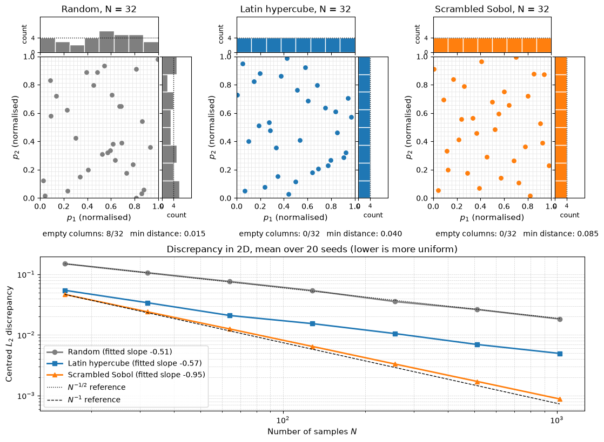

# Design of Experiments and Dataset Construction

Every CFD case in a training set costs hundreds of core-hours, so which designs get simulated matters as much as how the surrogate is built. This note covers the choice of sample points in a $d$-dimensional design space (factorial, random, Latin hypercube, low-discrepancy and adaptive designs), rough sample-size guidelines, merging legacy data with new runs, decimating the CFD output to a size a model can train on, and splitting the data so that the test error measures what the model will face in use. Running each case is covered in [Generating CFD Training Data](generating_cfd_datasets.md); the general sampling theory is in [One-Stage Sampling](../../numerical/surrogates/one_stage_sampling.md).

## Problem Statement

The design variables $q_1, \dots, q_d$ (geometric deformations such as ramp angle or ground clearance, and operating conditions such as yaw angle) have bounds $a_k \le q_k \le b_k$. Scaling each to $p_k = (q_k - a_k)/(b_k - a_k)$ maps the design space to the unit hypercube $\mathcal{P} = [0, 1]^d$. Choose a design $`X = \{\mathbf{p}_1, \dots, \mathbf{p}_N\} \subset \mathcal{P}`$, run CFD at each point to obtain labels $`\mathbf{y}_i`$, and train a surrogate $`f_{\boldsymbol\theta}`$ on $`\mathcal{D} = \{(\mathbf{p}_i, \mathbf{y}_i)\}_{i=1}^N`$. The ideal design minimises the expected prediction error over the space,

```math
X^\star = \arg\min_{|X| = N}\ \mathbb{E}_{\mathbf{p} \sim \mathcal{U}(\mathcal{P})}\left[\left\|f_{\boldsymbol\theta}(\mathbf{p};\, X) - \mathbf{y}(\mathbf{p})\right\|^2\right],
\qquad N\, \bar{c} \le B,
```

where $\bar{c}$ is the mean cost per case and $B$ the budget. The response $\mathbf{y}(\mathbf{p})$ is unknown before the runs, so this cannot be solved directly. In practice the design is chosen to be space-filling (no large empty regions, no near-duplicate points, even 1D and 2D projections), and points are added later where the trained model is least certain. The difficulty is that $d$ is often 10 to 20 while $N$ is a few hundred, so the points are always sparse, and parts of the box may be geometrically infeasible.

## Design Variables

The variables fall into two groups, and both need explicit ranges.

| Group | Examples | Notes |
| --- | --- | --- |
| Geometry | Front bumper profile, bonnet and windscreen angles, mirror position, rear window and trunk angles, diffuser angle, ride height and pitch, wheel and tyre shape, add-ons such as spoilers or roof racks | Continuous morphing parameters suit space-filling designs; add-ons are categorical and are crossed with the continuous design |
| Operating condition | Speed (Reynolds number), yaw angle, inlet turbulence intensity, wheel rotation, ground motion | Each one multiplies the cost if crossed with the geometry design; include only the ones the surrogate must predict |

Parameter definitions and their physical effects are in [Deformation Parameters](deformation_parameters.md). Ranges should come from packaging and styling limits, not from what the mesher tolerates; if the mesher fails inside the range, that is information to record (see the failure discussion in [Generating CFD Training Data](generating_cfd_datasets.md)).

## Full Factorial Designs and the Curse of Dimensionality

A full factorial design with $L$ levels per variable has $N = L^d$ points. Three levels in eight variables already need $3^8 = 6561$ cases. Factorial designs also project badly: in each 1D projection the $L^d$ points collapse onto only $L$ distinct values, so most of the runs repeat information about each individual variable.

A space-filling design avoids repetition, but sparsity in high dimension cannot be avoided. If $N$ points share the unit cube evenly, each owns a sub-cube of side

```math
\ell = N^{-1/d}
```

For $d = 8$, $N = 256$ gives $\ell = 0.5$: each point represents half the range of every variable. The surrogate can only learn smooth, low-order trends in such a space, and its accuracy depends on the response being dominated by a few variables and low-order interactions. That is the case for many aerodynamic responses, which is why designs with a few hundred points work at all.

## Random Sampling

Independent uniform points are simple and unbiased, and any $N$ is possible. They clump and leave gaps: with $N = 32$ in 2D, typically about a third of the 32 equal-width columns contain no point (in the figure below, 8 of 32 do). The discrepancy of a random design decays only like $N^{-1/2}$.

## Latin Hypercube Sampling

A Latin hypercube design (McKay, Beckman and Conover, 1979) divides each axis into $N$ equal intervals and places exactly one point in each interval of each axis:

```math
p_{ik} = \frac{\pi_k(i) - u_{ik}}{N},
\qquad i = 1, \dots, N, \quad k = 1, \dots, d,
```

where $\pi_1, \dots, \pi_d$ are independent random permutations of $`\{1, \dots, N\}`$ and $u_{ik} \sim \mathcal{U}(0, 1)$ (or $u_{ik} = 1/2$ for centred cells). Every 1D projection is therefore perfectly stratified. For a response that is close to additive, $y \approx \sum_k g_k(p_k)$, this removes most of the variance of sample averages compared with random sampling. The 2D layout is still random, and a bad permutation can put the points near a diagonal. Practical designs therefore draw many Latin hypercubes and keep the one with the best space-filling score (optimised or maximin LHS).

## Low-Discrepancy Sequences

The star discrepancy of a design measures the worst mismatch between the fraction of points in an origin-anchored box and the volume of that box:

```math
D_N^* = \sup_{\mathbf{a} \in [0,1]^d}\left|\frac{\#\{i : \mathbf{p}_i \in [\mathbf{0}, \mathbf{a})\}}{N} - \prod_{k=1}^{d} a_k\right|
```

The Koksma-Hlawka inequality bounds the error of the sample mean of any function of bounded variation by $`V_{HK}(f)\,D_N^*`$, so a low discrepancy means even coverage at all scales. Low-discrepancy sequences reach $`D_N^* = \mathcal{O}((\log N)^d / N)`$, compared with roughly $N^{-1/2}$ for random points.

- The Halton sequence uses the radical inverse in a different prime base for each coordinate: the integer $i = \sum_j a_j b^j$ in base $b$ maps to $\phi_b(i) = \sum_j a_j b^{-j-1}$. In 2D with bases 2 and 3 the first points are $(1/2, 1/3)$, $(1/4, 2/3)$, $(3/4, 1/9)$, $(1/8, 4/9)$. In higher dimensions the large bases make neighbouring coordinates correlated unless the sequence is scrambled.
- The Sobol sequence (Sobol', 1967) uses base 2 for every coordinate with direction numbers chosen per dimension. Its first $N = 2^m$ points are balanced: every dyadic box of the appropriate volume holds the same number of points. Use powers of two and scrambling, which keeps the balance and gives unbiased estimates.

Both sequences are extensible: continuing the sequence adds points that fill the gaps left by the earlier ones. A Latin hypercube cannot be extended without losing its stratification.

## Distance-Based Criteria

The maximin criterion (Johnson, Moore and Ylvisaker, 1990) maximises the smallest distance between design points,

```math
d_{\min}(X) = \min_{i \ne j}\ \|\mathbf{p}_i - \mathbf{p}_j\|_2,
\qquad X^\star = \arg\max_X d_{\min}(X),
```

which prevents near-duplicate simulations. Morris and Mitchell (1995) proposed the smoother criterion $\phi_q(X) = \left(\sum_{i < j} d_{ij}^{-q}\right)^{1/q}$, which is minimised and tends to the maximin ordering as $q \to \infty$. Discrepancy and distance measure different things and should both be checked: a design can have good 1D projections and still contain two almost identical points.



The top row shows 32 points from each method with their marginal histograms. The random design leaves 8 of the 32 columns empty and has a minimum spacing of 0.015; the Latin hypercube and Sobol designs leave none empty, with minimum spacings of 0.040 and 0.085. The bottom panel shows the centred $L_2$ discrepancy averaged over 20 seeds. Random and Latin hypercube designs decay at about $N^{-1/2}$ (fitted slopes $-0.51$ and $-0.57$), the Latin hypercube with a constant three to four times smaller, while scrambled Sobol decays at about $N^{-1}$ (slope $-0.95$).

| Method | 1D projections | Discrepancy rate | Allowed $N$ | Can be extended |
| --- | --- | --- | --- | --- |
| Full factorial | $L$ values only | Poor | $L^d$ | Only by a full new level |
| Random | Random | $N^{-1/2}$ | Any | Yes |
| Latin hypercube | Perfectly stratified | $N^{-1/2}$ with a smaller constant | Any, fixed in advance | No |
| Maximin or optimised LHS | Stratified | Usually better than plain LHS | Any, fixed in advance | No |
| Scrambled Sobol | Balanced | Close to $N^{-1}$ | Powers of 2 preferred | Yes |

## Sequential and Adaptive Sampling

The response of a vehicle is rarely equally difficult everywhere: a rear-end parameter may produce a sharp change in $C_d$ where the flow switches between attached and separated. A design fixed in advance spends the same density everywhere. Sequential sampling spends the budget in stages:

1. Run an initial space-filling design with a fraction of the budget (often a third to a half).
2. Train the surrogate and estimate where it is least reliable, for example from the kriging predictive variance, the disagreement of an ensemble, or the leave-one-out cross-validation error.
3. Add a batch of points that balance high estimated error with distance from existing points, sized to fill the cluster in one round of runs.
4. Repeat until the budget is spent or the estimated error stops improving.

The infill criteria and their trade-off between exploration and exploitation are discussed in [Adaptive Sampling](../../numerical/surrogates/adaptive_sampling.md). Two cautions apply to datasets meant for general use. Adaptive points cluster where one particular model struggles, so a dataset built this way is biased towards that model's weaknesses. A test set drawn from the adaptive points is also not representative of the design space; keep a separate space-filling test set.

## How Many Samples

There is no general formula, only heuristics.

- For Gaussian-process (kriging) surrogates, Loeppky, Sacks and Welch (2009) suggest an initial design of about $N = 10d$ points, which is adequate when the response is smooth and dominated by a few variables. It is not enough for responses with sharp changes.
- Neural-network field surrogates typically need hundreds to thousands of geometries, because they learn a mapping to a whole surface or volume field, not a scalar.
- The most reliable guide is a learning curve: train on nested subsets of size $N_1 < N_2 < \dots$, measure the test error $\varepsilon(N)$, and fit $\varepsilon \approx c N^{-\alpha}$. The fitted exponent shows whether more simulations are worth their cost. When $\varepsilon$ approaches the label uncertainty of the CFD, more cases do not help.

## Legacy and Newly Generated Data

Earlier design studies add cases cheaply, but they were run with other meshes, models and conventions. Before merging, check and harmonise:

- reference area and length, moment reference point, coordinate system, and the definition of the Reynolds number;
- turbulence model, wall treatment, boundary conditions (fixed or moving ground, wheel rotation) and domain size;
- mesh rules and convergence and averaging criteria;
- the parameterisation, so that legacy designs can be expressed in the same design variables.

Coefficients are converted exactly when only a convention differs: the drag force is unchanged, so $C_d A_{\mathrm{ref}}$ is conserved. Differences in modelling cannot be converted. Re-run a few legacy designs with the new pipeline to measure the offset, store a source indicator with every case, and either correct the offset, use the legacy cases as a low-fidelity level in a multi-fidelity model (see [Hierarchical Kriging](../../numerical/surrogates/hierarchical_kriging.md)), or leave them out. Also check the coverage: legacy cases tend to cluster around past production designs, and the combined set may be heavily weighted to one region.

## Dataset Overview

A dataset index records one row per family of cases, so that the content and the design of the dataset are visible at a glance. The table below is an illustrative layout; the case counts and ranges are examples.

| ID | Vehicle | Variant family | Varied parameters | Design | Cases | Operating conditions |
| --- | --- | --- | --- | --- | --- | --- |
| 1 | Vehicle A (saloon) | Baseline | None | Single case | 1 | 40 m/s, $0^\circ$ yaw |
| 2 | Vehicle A | Front-end morphs | Bonnet height, bumper profile, intake extensions | Scrambled Sobol | 128 | 40 m/s, $0^\circ$ yaw |
| 3 | Vehicle A | Rear-end morphs | Rear window angle, trunk length and angle, diffuser angle | Scrambled Sobol | 128 | 40 m/s, $0^\circ$ yaw |
| 4 | Vehicle A | Ride height | Ground clearance, pitch angle | Latin hypercube | 32 | 40 m/s, $0^\circ$ yaw |
| 5 | Vehicle A | Add-ons | Rear spoiler, roof rack (categorical) crossed with 16 Sobol points of set 3 | Crossed design | 32 | 40 m/s, $0^\circ$ yaw |
| 6 | Vehicle A | Crosswind | Baseline geometry | Levels | 3 | 40 m/s, $5^\circ$, $10^\circ$, $15^\circ$ yaw |
| 7 | Vehicle B (SUV) | Combined morphs | Same parameter names as sets 2 to 4 | Scrambled Sobol | 64 | 40 m/s, $0^\circ$ yaw |
| 8 | Vehicle B | Legacy study | Ride height | Legacy levels, re-run on 3 cases | 12 | 38.9 m/s, $0^\circ$ yaw |

Each row should also link to the solver settings, the meshing rules and the convergence report used for those cases, so that later users can tell whether two sets are compatible.

## Data Decimation

Production meshes have tens of millions of cells and surface meshes of millions of faces, which is too large for most training pipelines. Decimation reduces the geometry and maps the fields onto the reduced representation.

### Geometry Simplification

Surface simplification by edge collapse with quadric error metrics (Garland and Heckbert, 1997) assigns each vertex $\mathbf{v}$ the sum $Q_{\mathbf{v}} = \sum_{\text{planes}} K_{\mathbf{n}}$ of the quadrics $K_{\mathbf{n}} = \mathbf{n}\mathbf{n}^T$ of its incident face planes $\mathbf{n} = (a, b, c, e)^T$ with $ax + by + cz + e = 0$ and $a^2 + b^2 + c^2 = 1$. The cost of moving the vertex to $\bar{\mathbf{v}} = (x, y, z, 1)^T$ is $\bar{\mathbf{v}}^T Q_{\mathbf{v}} \bar{\mathbf{v}}$, the sum of squared distances to those planes. Collapsing the cheapest edges first removes vertices in flat regions and keeps them at edges and in regions of high curvature. Keeping a fraction $\alpha$ of the $N_s$ surface points increases the mean spacing by $\alpha^{-1/2}$ on a surface, because the number of points scales with $h^{-2}$.

### Field Interpolation

The CFD fields are then interpolated onto the decimated points, by nearest neighbour, by linear (barycentric) interpolation within the original surface triangles, or by radial basis functions. For linear interpolation of a smooth field $f$ with spacing $h$, the error in 1D is bounded by

```math
\left|f(x) - I_h f(x)\right| \le \frac{h^2}{8}\max\left|f''\right|,
```

and the same $h^2$ scaling holds on triangles. Interpolation here means evaluating the original high-resolution field at the decimated points, which is exact at those points; the error appears when the decimated representation is used to reconstruct the field between them or to integrate it. Since $h$ grows like $\alpha^{-1/2}$, the reconstruction error grows like $\alpha^{-1}$, so a factor of 10 fewer points costs a factor of about 10 in accuracy wherever $C_p$ varies quickly (stagnation regions, edges, separation lines). Two checks catch most problems: integrate $C_p$ and wall shear on the decimated surface and compare the resulting $C_d$ with the full-resolution value, and plot the reconstruction error map to see where it concentrates.

### Practical Considerations

- A symmetric vehicle at zero yaw can be stored as a half model, which halves memory; any yawed case breaks the symmetry.
- All geometries should be aligned in one coordinate system ($x$ downstream, $y$ lateral, $z$ up) with the same origin convention.
- Memory scales as $(\text{cases}) \times (\text{points per case}) \times (\text{variables}) \times (\text{bytes per value})$, so the number of geometries and the resolution per geometry compete for the same budget.
- Keep the full-resolution data archived, so the decimation can be redone when the model or the target changes.

## Splitting by Geometry Family

The test set must contain the kind of designs the surrogate will be asked about, and nothing from the test designs may leak into training.

- Split by geometry, not by row. All operating conditions of one geometry (for example every yaw angle) belong to the same subset; otherwise the test asks for interpolation in one variable of a shape the model has already seen.
- Hold out whole families when cross-design use is intended. An in-distribution test set (unseen morphs of known vehicles) and a cross-design test set (a vehicle the model has never seen) measure different things and should be reported separately; the experiment is developed in [Training and Evaluating Surrogates Across Vehicle Designs](model_training.md).
- Use grouped $k$-fold cross validation, with the folds formed by geometry or family, for hyperparameter tuning. General splitting and validation practice is in [Training and Validation](../fundamentals/training_and_validation.md).
- Draw the test set with the same space-filling method as the training set but from an independent sequence or seed, so that it spans the space rather than clustering where training points are dense.

## Key Takeaways

- Scale every design variable to $[0, 1]$ and treat the design as a space-filling problem; full factorial designs are unaffordable beyond about four variables and project badly.
- Latin hypercubes stratify every 1D projection; scrambled Sobol sequences also achieve nearly $N^{-1}$ discrepancy and can be extended, which makes them a good default.
- Check both discrepancy and the minimum pairwise distance of a design before launching the runs.
- Adaptive sampling spends the budget where the model is uncertain, but keep a separate space-filling test set.
- Use $N \approx 10d$ only as a starting point for smooth scalar responses, and decide on more cases from a learning curve.
- Harmonise conventions of legacy data exactly, measure modelling offsets by re-running a few cases, and flag the source of every case.
- Decimation increases reconstruction error roughly in proportion to the reduction in point count; check it by re-integrating forces.

## Related Scripts

- [Sampling Strategies Comparison](../../../scripts/plots/sampling_strategies_comparison/): compares random, Latin hypercube and scrambled Sobol designs of the same size in a 2D design space, showing their point layouts, their 1D marginal histograms and how their centred $L_2$ discrepancy falls with the number of samples.
- [Design Space Distribution via Sobol Sequences](../../../scripts/plots/design_space_distribution/): draws a four-dimensional scrambled Sobol design of 512 geometry variants and shows all of its 2D projections and 1D marginals in a scatter matrix, with the discrepancy of each projection compared against a random design of the same size.
- [Cross-Design Generalization](../../../scripts/plots/cross_design_generalization/): is a synthetic illustration of why a surrogate trained on one design family can fail on another: three ridge-regression models trained on family X, family Y and both are tested on held-out designs of each family.

## Exercises

**Exercise 1.** A study has $d = 8$ design variables, each case costs 500 core-hours and 2000 cores can run cases in parallel. Compare the cost and wall-clock time of a three-level full factorial design with a 256-point Sobol design. What is the side length $N^{-1/d}$ of the sub-cube that each point represents in each design?

<details>
<summary>Answer</summary>

Full factorial: $3^8 = 6561$ cases, $6561 \times 500 \approx 3.28 \times 10^6$ core-hours, or $3.28 \times 10^6/2000 = 1640$ h (about 68 days) on the whole cluster.

Sobol: $256 \times 500 = 128{,}000$ core-hours, or 64 h.

Side lengths: $6561^{-1/8} = 1/3$ and $256^{-1/8} = 0.5$. The factorial design is 26 times more expensive, yet each point still represents a third of each range, and every 1D projection has only 3 distinct values compared with 256 for Sobol.

</details>

**Exercise 2.** Build a 5-point Latin hypercube in 2D from the permutations $\pi_1 = (3, 1, 5, 2, 4)$ and $\pi_2 = (2, 5, 1, 4, 3)$ with jitters $u_{i1} = (0.5, 0.2, 0.9, 0.4, 0.7)$ and $u_{i2} = (0.3, 0.6, 0.1, 0.8, 0.5)$, using the formula of the note. Check the Latin property.

<details>
<summary>Answer</summary>

With $p_{ik} = (\pi_k(i) - u_{ik})/5$:

| $i$ | $p_{i1}$ | $p_{i2}$ |
| --- | --- | --- |
| 1 | $(3 - 0.5)/5 = 0.50$ | $(2 - 0.3)/5 = 0.34$ |
| 2 | $(1 - 0.2)/5 = 0.16$ | $(5 - 0.6)/5 = 0.88$ |
| 3 | $(5 - 0.9)/5 = 0.82$ | $(1 - 0.1)/5 = 0.18$ |
| 4 | $(2 - 0.4)/5 = 0.32$ | $(4 - 0.8)/5 = 0.64$ |
| 5 | $(4 - 0.7)/5 = 0.66$ | $(3 - 0.5)/5 = 0.50$ |

The $p_1$ values fall in the intervals $[0.4, 0.6)$, $[0, 0.2)$, $[0.8, 1)$, $[0.2, 0.4)$ and $[0.6, 0.8)$, one in each; the same holds for $p_2$.

</details>

**Exercise 3.** A legacy study reports $C_d = 0.320$ for a vehicle using a reference area of 2.10 m². The new campaign uses 2.25 m² for the same vehicle. Convert the legacy value and explain the risk of skipping this step.

<details>
<summary>Answer</summary>

The drag force is the same, so $C_d A_{\mathrm{ref}}$ is conserved: $C_{d,\mathrm{new}} = 0.320 \times 2.10/2.25 \approx 0.299$.

Left uncorrected, the legacy cases would carry an offset of about 21 counts. That is larger than many of the geometry effects the surrogate is meant to learn, and it would be learned as a spurious effect of whatever features distinguish the legacy designs.

</details>

**Exercise 4.** A surface mesh has a spacing of 5 mm near the A-pillar, where $|d^2 C_p/ds^2|$ reaches about 2000 m⁻² along the surface coordinate $s$. Estimate the linear-interpolation error bound for $C_p$ at the original spacing and after decimation to $\alpha = 0.1$ of the points.

<details>
<summary>Answer</summary>

At $h = 5$ mm: $h^2/8 \times 2000 = (0.005)^2/8 \times 2000 \approx 0.0063$.

After decimation the spacing becomes $h/\sqrt{0.1} \approx 15.8$ mm, and the bound becomes $(0.0158)^2/8 \times 2000 \approx 0.063$.

The error grows by $1/\alpha = 10$. An error of 0.06 in $C_p$ near the A-pillar is comparable to the pressure changes produced by small shape changes there, so this region should be decimated less, which quadric-error simplification does automatically in regions of high curvature but not necessarily in regions of high pressure gradient.

</details>

**Exercise 5.** Set 6 of the dataset table contains the baseline at yaw angles $5^\circ$, $10^\circ$ and $15^\circ$. A random 90/10 split of all rows puts the $10^\circ$ case in the test set and the other two in training. Is the test error a fair measure of generalization? Propose a better test design for a model meant to predict new rear-end morphs and a new vehicle.

<details>
<summary>Answer</summary>

No. The model has seen the same geometry at $5^\circ$ and $15^\circ$, so predicting $10^\circ$ is a 1D interpolation for a known shape, and the test error will be optimistic.

A better design uses grouped splits and two test sets. The in-distribution test set holds out complete geometries from sets 2 to 5 (all of their operating conditions together), drawn from an independent Sobol sequence over the same ranges. The cross-design test set holds out Vehicle B entirely. Hyperparameters are tuned by grouped cross validation within the training geometries only, and the two test errors are reported separately.

</details>

## References

- McKay, M. D., Beckman, R. J., & Conover, W. J., "A comparison of three methods for selecting values of input variables in the analysis of output from a computer code", *Technometrics*, 21(2), 239–245, 1979.
- Sobol', I. M., "On the distribution of points in a cube and the approximate evaluation of integrals", *USSR Computational Mathematics and Mathematical Physics*, 7(4), 86–112, 1967.
- Halton, J. H., "On the efficiency of certain quasi-random sequences of points in evaluating multi-dimensional integrals", *Numerische Mathematik*, 2, 84–90, 1960.
- Johnson, M. E., Moore, L. M., & Ylvisaker, D., "Minimax and maximin distance designs", *Journal of Statistical Planning and Inference*, 26(2), 131–148, 1990.
- Morris, M. D., & Mitchell, T. J., "Exploratory designs for computational experiments", *Journal of Statistical Planning and Inference*, 43(3), 381–402, 1995.
- Loeppky, J. L., Sacks, J., & Welch, W. J., "Choosing the sample size of a computer experiment: A practical guide", *Technometrics*, 51(4), 366–376, 2009.
- Forrester, A. I. J., Sóbester, A., & Keane, A. J., *Engineering Design via Surrogate Modelling: A Practical Guide*, Wiley, 2008.
- Garland, M., & Heckbert, P. S., "Surface simplification using quadric error metrics", *Proceedings of SIGGRAPH 97*, 209–216, 1997.
