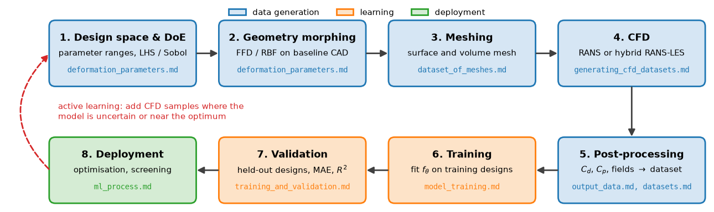

# Automotive Aerodynamics Case Study: Overview

This note opens a seven-note case study on predicting the aerodynamics of passenger-car variants with machine-learning surrogates trained on CFD. It states the problem, walks through the workflow from design space to deployment and points to the note that covers each step, collects the physics needed to read the rest of the case study, and lists the public datasets on which such models are developed and compared. Each design variant costs hundreds to thousands of core-hours of CFD, so the case study is ultimately about how to get the most predictive model out of a few hundred or thousand such runs.

## Problem Statement

A baseline vehicle is varied through a vector of design parameters $\mathbf{p} \in \mathcal{P} \subset \mathbb{R}^{d}$ (in this case study the $d = 13$ morphing parameters of [Deformation Parameters](deformation_parameters.md)), or more generally through its surface geometry $G$. For each design CFD provides the outputs

```math
\mathbf{y} = \left(C_d,\; C_l,\; C_s,\; C_{m},\;
C_p(\mathbf{x})\big|_{\mathbf{x} \in \Gamma},\;
\overline{\mathbf{u}}(\mathbf{x})\big|_{\mathbf{x} \in \Omega}\right)
```

that is, force and moment coefficients, surface fields on the body surface $\Gamma$ and time-averaged volume fields in the fluid domain $\Omega$. Given a dataset $`\mathcal{D} = \{(\mathbf{p}_i, \mathbf{y}_i)\}_{i=1}^{N}`$ of $N$ simulated designs, the task is to find $f_{\boldsymbol\theta}$ that minimises the expected prediction error on new designs,

```math
\boldsymbol\theta^* = \arg\min_{\boldsymbol\theta} \; \frac{1}{N}\sum_{i=1}^{N}
\ell\big(f_{\boldsymbol\theta}(\mathbf{p}_i), \mathbf{y}_i\big) +
\lambda\,\Omega(\boldsymbol\theta)
```

with a loss $\ell$ (squared error on normalised outputs, area-weighted for surface fields) and a regulariser $\Omega$, and to verify on designs not used for training that the error is small compared with the differences between designs.

The task is hard for four reasons. Training data is expensive, so $N$ is typically $10^2$ to $10^4$ and every sample has to count. The differences of interest are small: design changes move $C_d$ by a few thousandths, and a useful model must resolve differences of the order of one drag count ($\Delta C_d = 0.001$). The CFD labels themselves contain modelling error (turbulence model, mesh, averaging), typically several drag counts relative to experiment, which bounds what the surrogate can meaningfully achieve. Finally, predictions are only trustworthy inside the design space that was sampled.

## Workflow and Where Each Step Is Covered



The workflow has a data-generation stage (blue), a learning stage (orange) and a deployment stage (green). The dashed arrow is the active-learning loop: once a model exists, new CFD runs are placed where it is most uncertain or where an optimiser is searching, rather than spread evenly.

| Step | Question answered | Note |
| --- | --- | --- |
| 1. Design space and DoE | Which parameters, which ranges, how many samples, where? | [Deformation Parameters](deformation_parameters.md) |
| 2. Geometry morphing | How does a parameter vector become a valid surface? | [Deformation Parameters](deformation_parameters.md) |
| 3. Meshing | How is a consistent, good-quality mesh produced for every variant? | [Dataset of Meshes](dataset_of_meshes.md) |
| 4. CFD | Which solver settings, turbulence model, convergence criteria? | [Generating CFD Datasets](generating_cfd_datasets.md) |
| 5. Post-processing | Which outputs are stored, how are they averaged and checked? | [Output Data](output_data.md) |
| 5. Dataset assembly | How are samples organised, split and documented? | [Datasets](datasets.md) |
| 6. Training | Which model, loss and training procedure? | [Model Training](model_training.md) |
| 7. Validation | Is the model accurate on unseen designs, and how is that measured? | [Training and Validation](../fundamentals/training_and_validation.md), [Model Training](model_training.md) |
| 8. Deployment | How is the surrogate used in design exploration and optimisation? | [Optimization](../flow/optimization.md), [Adaptive Sampling](../../numerical/surrogates/adaptive_sampling.md) |

## Physics Needed for the Case Study

### Force and Moment Coefficients

The aerodynamic force on the vehicle is the integral of pressure and wall shear stress over its surface,

```math
\mathbf{F} = \oint_{\Gamma}
\left[-(p - p_\infty)\,\mathbf{n} + \boldsymbol\tau_w \right] dS
```

with $\mathbf{n}$ the unit normal pointing out of the body into the fluid and $\boldsymbol\tau_w$ the wall shear stress vector. With the dynamic pressure $q_\infty = \tfrac{1}{2}\rho U_\infty^2$ and the frontal area $A$, the drag, lift and side-force coefficients are

$$
C_d = \frac{F_x}{q_\infty A},
\qquad C_l = \frac{F_z}{q_\infty A},
\qquad C_s = \frac{F_y}{q_\infty A}
$$

and moment coefficients use an additional reference length, usually the wheelbase $L_{wb}$: $C_m = M_y/(q_\infty A L_{wb})$. The vehicle axis convention (origin, sign of $z$, moment reference point) differs between companies and datasets and must be checked before data from different sources are combined. Typical passenger cars have $C_d$ between about 0.25 and 0.35 and frontal areas of 2.0 to 2.5 $\mathrm{m}^2$. The drag power is $P = F_x U_\infty = \tfrac{1}{2}\rho U_\infty^3 C_d A$, so at 140 km/h a single drag count on a car with $A = 2.2\ \mathrm{m}^2$ costs about 78 W; this is why differences of a few counts matter in practice. Definitions of the surface and volume outputs are collected in [Output Data](output_data.md).

### Reynolds and Mach Numbers

With the vehicle length $L$ and the kinematic viscosity of air $\nu \approx 1.5 \times 10^{-5}\ \mathrm{m^2/s}$,

$$
\mathrm{Re} = \frac{U_\infty L}{\nu},
\qquad \mathrm{Ma} = \frac{U_\infty}{a}
$$

A 4.6 m car at 140 km/h ($U_\infty = 38.9$ m/s) has $\mathrm{Re} \approx 1.2 \times 10^7$ and $\mathrm{Ma} \approx 0.11$. The flow is therefore turbulent over almost the whole body and effectively incompressible, so the incompressible Navier–Stokes equations ([Navier–Stokes Equations](../../fluid_mechanics/governing_equations/navier_stokes.md)) with a turbulence model are the standard description. Because $\mathrm{Re}$ is large, $C_d$ depends only weakly on speed for a fixed shape, and most datasets simulate a single speed; the input of the surrogate is then the geometry alone. Drag of bluff vehicles is dominated by pressure drag from the separated wake at the rear, which is why rear-end parameters usually have the largest effect and why the unsteady wake makes the averaging of outputs important.

## Choosing a Model

The model is chosen by what goes in, what comes out and how much data there is.

| Model | Input | Output | Suitable dataset size | Remarks |
| --- | --- | --- | --- | --- |
| Linear or polynomial ridge regression | Parameter vector | Scalars | Tens | Baseline; quadratic terms capture simple interactions |
| Gaussian process (kriging) | Parameter vector | Scalars, POD coefficients | Tens to a few thousand | Gives uncertainty for active learning; see [Kriging](../../numerical/surrogates/kriging.md) |
| Radial basis functions | Parameter vector | Scalars, POD coefficients | Tens to thousands | See [Radial Basis Functions](../../numerical/surrogates/radial_basis_functions.md) |
| Random forest, gradient boosting | Parameter vector, geometric features | Scalars | Hundreds and more | Robust to scaling, little tuning |
| Multilayer perceptron | Parameter vector | Scalars, POD coefficients | Hundreds and more | See [Neural Networks](../fundamentals/neural_networks.md) |
| POD plus regression | Parameter vector | Surface or volume fields | Tens to thousands | Field as a few modal coefficients; see [POD](../../numerical/pod/pod_intro.md) |
| CNN on images, SDF grids or voxels | Rasterised geometry | Scalars, fields on a grid | Thousands | Needs a regular grid representation |
| Graph neural network | Surface or volume mesh | Fields on the mesh, scalars | Hundreds to thousands | Handles arbitrary geometry; see [Graph Neural Networks](../neural_networks/graph_neural_networks.md) |
| Point-cloud network | Sampled surface points | Scalars, surface fields | Thousands | No connectivity needed; see [Machine Learning on CAD Geometry](../geometry/ml_on_cad.md) |
| Neural operator | Fields on a grid or mesh | Fields | Thousands | See [Neural Operators](../neural_networks/neural_operators.md) |

When the designs are described by a fixed parameter vector, simple models are hard to beat and should always be fitted first as baselines. Geometry-based models (graph, point-cloud and grid networks) become necessary when designs come from different families or sources and no common parameterisation exists, or when surface and volume fields are predicted.

## Error Metrics

For $N_t$ test designs with reference values $y_i$, predictions $\hat{y}_i$ and reference mean $\bar{y}$,

$$
\mathrm{MAE} = \frac{1}{N_t}\sum_{i=1}^{N_t}|y_i - \hat{y}_i|,
\qquad \mathrm{RMSE} = \sqrt{\frac{1}{N_t}\sum_{i=1}^{N_t}(y_i - \hat{y}_i)^2},
\qquad R^2 = 1 - \frac{\sum_i(y_i - \hat{y}_i)^2}{\sum_i(y_i - \bar{y})^2}
$$

For drag, MAE and RMSE are best quoted in drag counts. $R^2$ compares the error with the spread of the test set and therefore depends on how varied the designs are: the same RMSE gives a high $R^2$ on a diverse set and a low one on a set of near-identical variants. A ranking measure (does the model order two designs correctly?) is often what an optimisation actually needs. The test designs must be different geometries from the training designs; when a geometry appears several times (for example at several yaw angles), all its runs belong to the same split. Splitting, cross-validation and uncertainty estimates are covered in [Training and Validation](../fundamentals/training_and_validation.md).

## Public Datasets

Several open datasets make it possible to develop and compare automotive surrogates without generating thousands of CFD runs.

| Dataset | Geometry | Data | Reference |
| --- | --- | --- | --- |
| DrivAerNet | Parametric variants of the DrivAer fastback | RANS results with drag, surface and volume fields, plus 3D meshes of each design | Elrefaie, Dai and Ahmed (2024) |
| DrivAerNet++ | About 8000 variants covering fastback, notchback and estateback rear ends, with different wheel and underbody options | RANS results, surface and volume fields | Elrefaie et al. (2024) |
| AhmedML | 500 variants of the Ahmed body | Hybrid RANS-LES time-averaged surface and volume fields, forces | Ashton et al. (2024a) |
| DrivAerML | 500 morphed variants of the DrivAer notchback | Hybrid RANS-LES time-averaged surface and volume fields, forces | Ashton et al. (2024b) |

The underlying geometries are standard reference bodies. The Ahmed body (Ahmed et al., 1984) is a simplified bluff body with a slanted rear whose drag depends strongly on the slant angle. The DrivAer model (Heft, Indinger and Adams, 2012) is a realistic generic car with interchangeable fastback, notchback and estateback rear ends and detailed and smooth underbody options, for which wind-tunnel data exist. The datasets differ in fidelity: steady RANS gives more designs per unit of compute, while scale-resolving hybrid RANS-LES gives labels closer to experiment for fewer designs. Results from models trained on one should not be compared directly with results on another.

## Key Takeaways

- The task is to predict force coefficients and surface or volume fields of unseen vehicle variants from a few hundred to a few thousand CFD runs.
- Each step of the workflow has its own note; data generation (DoE, morphing, meshing, CFD, post-processing) costs far more effort than training.
- A useful drag surrogate must resolve about one drag count, and its error cannot be meaningfully smaller than the error of the CFD that produced its labels.
- Start with simple regressors on the parameter vector; use graph, point-cloud or grid networks when there is no common parameterisation or when fields are predicted.
- Report MAE and RMSE in drag counts on held-out geometries, together with $R^2$ and the spread of the test set.
- DrivAerNet, DrivAerNet++, AhmedML and DrivAerML provide public training data at different fidelity levels.

## Related Scripts

- [ML-CFD Surrogate Workflow](../../../scripts/plots/ml_cfd_workflow/): draws a schematic of the workflow for building a machine-learning surrogate of CFD results, from the design of experiments to deployment in an optimisation loop.
- [Drag Coefficient Prediction](../../../scripts/plots/drag_coefficient_prediction/): compares two synthetic drag-coefficient surrogates with held-out CFD values in a parity plot and an error plot, and shows that a high $R^2$ can hide errors of ten drag counts.

## Exercises

**Exercise 1.** A wind-tunnel test measures a drag force $F_x = 380$ N at $U_\infty = 30$ m/s, with $\rho = 1.2\ \mathrm{kg/m^3}$ and $A = 2.2\ \mathrm{m}^2$. Compute $C_d$ and the drag power. If $C_d$ stays constant, what are the drag force and power at 40 m/s?

<details>
<summary>Answer</summary>

```math
C_d = \frac{2F_x}{\rho U_\infty^2 A} = \frac{2 \times 380}{1.2 \times 30^2 \times 2.2} \approx 0.320
```

The power at 30 m/s is $P = F_x U_\infty = 380 \times 30 = 11.4$ kW.

At constant $C_d$ the force scales with $U_\infty^2$ and the power with $U_\infty^3$: $`F_x = 380\,(40/30)^2 \approx 676`$ N and $`P = 11.4\,(40/30)^3 \approx 27.0`$ kW.

</details>

**Exercise 2.** A 4.6 m car is simulated at 140 km/h with $\nu = 1.5 \times 10^{-5}\ \mathrm{m^2/s}$ and speed of sound 343 m/s. Compute $\mathrm{Re}$ and $\mathrm{Ma}$. A 1:4 scale model is tested at the same speed: what is its Reynolds number, and what speed would match the full-scale value? Why is that not done?

<details>
<summary>Answer</summary>

$U_\infty = 140/3.6 = 38.9$ m/s, so $\mathrm{Re} = 38.9 \times 4.6/1.5 \times 10^{-5} \approx 1.19 \times 10^7$ and $\mathrm{Ma} = 38.9/343 \approx 0.11$.

The model has $L = 1.15$ m and $\mathrm{Re} \approx 2.98 \times 10^6$. Matching the full-scale value needs four times the speed, 156 m/s, which is $\mathrm{Ma} \approx 0.45$: compressibility effects would appear that the real car never sees, and the tunnel power would be enormous. Reduced-scale tests accept the Reynolds-number mismatch. Mixing reduced-scale and full-scale data in one training set therefore requires care with features that depend on $\mathrm{Re}$, such as transition and separation on rounded edges.

</details>

**Exercise 3.** A model predicts $\hat{y} = (0.31, 0.31, 0.29, 0.33, 0.30)$ for five test designs with reference drag coefficients $y = (0.30, 0.32, 0.28, 0.35, 0.31)$. Compute MAE and RMSE in drag counts, and $R^2$.

<details>
<summary>Answer</summary>

The errors $\hat{y} - y$ are $(0.01, -0.01, 0.01, -0.02, -0.01)$.

- MAE $= 0.06/5 = 0.012$, or 12 counts.
- The squared errors sum to $8 \times 10^{-4}$, so RMSE $= \sqrt{1.6 \times 10^{-4}} \approx 0.0126$, or about 12.6 counts.
- $\bar{y} = 0.312$ and $\sum_i (y_i - \bar{y})^2 = 2.68 \times 10^{-3}$, so $R^2 = 1 - 8 \times 10^{-4}/2.68 \times 10^{-3} \approx 0.70$.

An error of about 4% of $C_d$ sounds small, but the designs differ by only a few hundredths, so 30% of their variance is unexplained and the model cannot reliably rank designs that differ by 10 counts.

</details>

**Exercise 4.** A study has 300 shapes, each simulated at three yaw angles (900 CFD results). A colleague shuffles the 900 rows and splits them 80/10/10. What is wrong, and how should the split be done?

<details>
<summary>Answer</summary>

A row-level split puts the same geometry into both training and test sets at different yaw angles. The test score then measures interpolation in yaw for known shapes, not prediction for new shapes, and it is optimistic.

Split by shape: 240 shapes (720 rows) for training, 30 shapes (90 rows) for validation and 30 shapes (90 rows) for testing, keeping all yaw angles of a shape together. Fit normalisation statistics on the training shapes only, and use grouped cross-validation (folds of shapes) for hyperparameter tuning.

</details>

**Exercise 5.** A network takes 4 inputs (three geometric parameters and the yaw angle), has two hidden layers of 64 neurons and outputs $C_d$. Count its trainable parameters and compare with the 720 training rows of Exercise 4. What precautions does the comparison suggest?

<details>
<summary>Answer</summary>

Each dense layer has inputs times outputs weights plus one bias per output: $4 \times 64 + 64 = 320$, $64 \times 64 + 64 = 4160$ and $64 + 1 = 65$, so 4545 parameters in total.

With more parameters than training samples the network can fit the training set exactly. Weight decay, early stopping on the validation shapes, a smaller network and comparison with a Gaussian process or gradient-boosted trees baseline, which often do as well on small tabular datasets, are the usual precautions.

</details>

## References

- Hucho, W.-H. (Ed.), *Aerodynamics of Road Vehicles*, 4th ed., SAE International, 1998.
- Katz, J., *Automotive Aerodynamics*, Wiley, 2016.
- Ahmed, S. R., Ramm, G., & Faltin, G., "Some Salient Features of the Time-Averaged Ground Vehicle Wake", SAE Technical Paper 840300, 1984.
- Heft, A. I., Indinger, T., & Adams, N. A., "Introduction of a New Realistic Generic Car Model for Aerodynamic Investigations", SAE Technical Paper 2012-01-0168, 2012.
- Elrefaie, M., Dai, A., & Ahmed, F., "DrivAerNet: A Parametric Car Dataset for Data-Driven Aerodynamic Design and Graph-Based Drag Prediction", ASME International Design Engineering Technical Conferences and Computers and Information in Engineering Conference (IDETC-CIE), 2024.
- Elrefaie, M., Morar, F., Dai, A., & Ahmed, F., "DrivAerNet++: A Large-Scale Multimodal Car Dataset with Computational Fluid Dynamics Simulations and Deep Learning Benchmarks", Advances in Neural Information Processing Systems (NeurIPS) Datasets and Benchmarks Track, 2024.
- Ashton, N., et al., "AhmedML: High-Fidelity Computational Fluid Dynamics Dataset for Incompressible, Low-Speed Bluff Body Aerodynamics", arXiv preprint, 2024a.
- Ashton, N., et al., "DrivAerML: High-Fidelity Computational Fluid Dynamics Dataset for Road-Car External Aerodynamics", arXiv preprint, 2024b.
- Brunton, S. L., Noack, B. R., & Koumoutsakos, P., "Machine Learning for Fluid Mechanics", *Annual Review of Fluid Mechanics* 52, 477–508, 2020.
