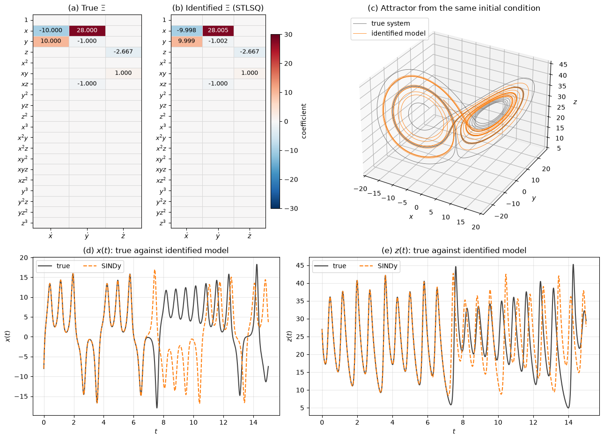

# Modeling Flow Dynamics

Feature extraction ([Flow Feature Extraction](feature_extraction.md)) finds coordinates in which a flow is low-dimensional. This note is about learning how the flow evolves in those coordinates, from data, so that it can be predicted, analyzed or controlled at a fraction of the cost of solving the Navier–Stokes equations. The methods range from linear operator fits (dynamic mode decomposition and Koopman analysis), through sparse regression of governing equations (SINDy), to recurrent and continuous-time neural networks.

The methods differ mainly in how much structure they impose. A linear model is cheap to fit and easy to interpret but cannot represent limit cycles, multiple attractors or chaos. A neural network can represent all of these but needs much more data and can drift or blow up when run forward far beyond its training data.

## Problem Statement

Given a sequence of states $`\mathbf{x}_0, \mathbf{x}_1, \dots, \mathbf{x}_{m-1} \in \mathbb{R}^n`$ sampled at a fixed interval $\Delta t$ (full snapshots, POD coefficients $\mathbf{a}(t) \in \mathbb{R}^r$, or sensor time series), find either a discrete-time map or a continuous-time vector field

$$
\mathbf{x}_{k+1} = \mathbf{F}(\mathbf{x}_k)
\qquad \text{or}
\qquad \frac{d\mathbf{x}}{dt} = \mathbf{f}(\mathbf{x})
$$

from a model class $`\mathbf{F}_{\boldsymbol\theta}`$ (or $`\mathbf{f}_{\boldsymbol\theta}`$). The simplest objective is the one-step prediction error

$$
\mathcal{L}(\boldsymbol\theta) = \sum_{k=0}^{m-2} \lVert \mathbf{x}_{k+1} -
\mathbf{F}_{\boldsymbol\theta}(\mathbf{x}_k) \rVert^2 + \mathcal{R}(\boldsymbol\theta)
$$

with a regularization term $\mathcal{R}$. The model is then used for forecasting by repeated application, $`\hat{\mathbf{x}}_{k+\ell} = \mathbf{F}_{\boldsymbol\theta}^{\ell}(\mathbf{x}_k)`$, for stability and frequency analysis, or for control with an input $`\mathbf{u}_k`$, $`\mathbf{x}_{k+1} = \mathbf{F}(\mathbf{x}_k, \mathbf{u}_k)`$.

What makes this hard:

- The state dimension $n$ is large, so models are usually built in a reduced space, and the dynamics of the neglected modes must then be modeled or ignored.
- Small one-step errors compound during a forecast, and a model with low one-step error can still be unstable over long horizons.
- In chaotic flows, nearby trajectories separate exponentially, so even a perfect model with slightly wrong initial data has a finite prediction horizon; only statistics can be compared beyond it.
- Measurements may observe only part of the state, in which case $\mathbf{x}_{k+1}$ is not a function of $\mathbf{x}_k$ alone and time-delay coordinates are needed.
- The model has to be used at conditions (Reynolds number, geometry, forcing) different from those seen in training.

## Dynamic Mode Decomposition

### Exact DMD

Dynamic mode decomposition (Schmid 2010) fits the best linear map between consecutive snapshots. Arrange the data as two shifted matrices

$$
\mathbf{X} = [\mathbf{x}_0 \ \cdots \ \mathbf{x}_{m-2}],
\qquad \mathbf{X}' = [\mathbf{x}_1 \ \cdots \ \mathbf{x}_{m-1}]
$$

and seek $\mathbf{A}$ with $\mathbf{X}' \approx \mathbf{A}\mathbf{X}$. The minimum-norm least-squares solution is $\mathbf{A} = \mathbf{X}'\mathbf{X}^{+}$, but this $n \times n$ matrix is never formed. The exact DMD algorithm of Tu et al. (2014) works in the POD subspace of $\mathbf{X}$:

1. Compute the truncated SVD $\mathbf{X} \approx \mathbf{U}_r\boldsymbol{\Sigma}_r\mathbf{V}_r^{\mathsf{H}}$, choosing $r$ from the singular value spectrum.
2. Project $\mathbf{A}$ onto the leading POD modes: $\tilde{\mathbf{A}} = \mathbf{U}_r^{\mathsf{H}}\mathbf{X}'\mathbf{V}_r\boldsymbol{\Sigma}_r^{-1} \in \mathbb{C}^{r \times r}$.
3. Solve the small eigenproblem $\tilde{\mathbf{A}}\mathbf{W} = \mathbf{W}\boldsymbol{\Lambda}$.
4. Form the DMD modes $\boldsymbol{\Phi} = \mathbf{X}'\mathbf{V}_r\boldsymbol{\Sigma}_r^{-1}\mathbf{W}$. Each column is an eigenvector of $\mathbf{X}'\mathbf{X}^{+}$ with eigenvalue $\lambda_j$.
5. Fit the amplitudes from the first snapshot, $\mathbf{b} = \boldsymbol{\Phi}^{+}\mathbf{x}_0$.

The cost is one thin SVD plus an $r \times r$ eigenproblem. The older "projected" DMD uses $\mathbf{U}_r\mathbf{W}$ instead of step 4; the two agree when $\mathbf{X}'$ lies in the column space of $\mathbf{X}$. The resulting model is

$$
\mathbf{x}_k \approx
\boldsymbol{\Phi}\boldsymbol{\Lambda}^{k}\mathbf{b} = \sum_{j=1}^{r}
b_j\lambda_j^{k}\boldsymbol{\phi}_j,
\qquad \mathbf{x}(t) \approx \sum_{j=1}^{r} b_j e^{\omega_j t}\boldsymbol{\phi}_j
$$

### Eigenvalues, Growth Rates and Frequencies

Each discrete-time eigenvalue $\lambda_j$ corresponds to a continuous-time eigenvalue

```math
\omega_j = \frac{\ln\lambda_j}{\Delta t},
\qquad g_j = \mathrm{Re}\,\omega_j = \frac{\ln\lvert\lambda_j\rvert}{\Delta t},
\qquad f_j = \frac{\mathrm{Im}\,\omega_j}{2\pi} = \frac{\arg\lambda_j}{2\pi\,\Delta t}
```

with growth rate $g_j$ and frequency $f_j$ in Hz. Eigenvalues inside the unit circle ($g_j < 0$) decay, those on it are neutral and those outside grow. For real data, complex eigenvalues come in conjugate pairs that together describe one oscillating structure. Frequencies are resolvable only up to the Nyquist limit $1/(2\Delta t)$, since $\arg\lambda$ is defined modulo $2\pi$.

Unlike POD modes, which are ranked by energy and mix frequencies, each DMD mode has one frequency and one growth rate. For a periodic flow such as a cylinder wake, the DMD modes are the Fourier modes of the shedding frequency and its harmonics. When the mean is subtracted from a sequence of periodic data, DMD reduces to a temporal discrete Fourier transform (Chen, Tu and Rowley, *Journal of Nonlinear Science*, 2012), which is why DMD is usually applied without mean subtraction.


The figure applies exact DMD to a noisy field made of three travelling wave packets. The singular values in (b) show six values above a noise floor, one conjugate pair per packet, and the eigenvalues in (c) lie on the true ones. The frequencies are recovered to within 0.005 rad/s, but (d) shows a systematic downward bias of the growth rates: $-0.205$ instead of $-0.15$ s $`^{-1}`$ for the decaying packet. This bias, caused by noise in $\mathbf{X}$, makes forecasts drift (panel (f)), with the error growing from about 6% in the training window to 12% after another 10 s.

### Pitfalls and Variants

- Noise in $\mathbf{X}$ biases the eigenvalues towards the origin, so damping is overestimated. Forward-backward and total-least-squares DMD (Dawson et al., *Experiments in Fluids*, 2016) remove most of the bias, and optimized DMD (Askham and Kutz, *SIAM Journal on Applied Dynamical Systems*, 2018) fits eigenvalues and modes to the whole trajectory by nonlinear least squares.
- A standing wave $\boldsymbol{\phi}(\mathbf{x})\cos(\omega t)$, or a single sensor signal, has a rank-one snapshot matrix but needs a conjugate pair of eigenvalues. Stacking $d$ time-shifted copies of the data (a Hankel matrix) supplies the missing rank; this is also the remedy for partial observations.
- Travelling structures need many DMD modes, as they do POD modes, and transients that switch on and off are poorly described by a sum of exponentials.
- With actuation, DMD with control (Proctor, Brunton and Kutz, *SIAM Journal on Applied Dynamical Systems*, 2016) fits $\mathbf{X}' \approx \mathbf{A}\mathbf{X} + \mathbf{B}\boldsymbol{\Upsilon}$, where $\boldsymbol{\Upsilon}$ stacks the inputs, which gives a linear model for controller design.

## Koopman Operator Theory

### The Koopman Operator

For a discrete-time system $\mathbf{x}_{k+1} = \mathbf{F}(\mathbf{x}_k)$, the Koopman operator $\mathcal{K}$ (Koopman 1931) acts on scalar observables $g(\mathbf{x})$, such as a velocity at a probe or the lift coefficient, by composition:

$$
(\mathcal{K}g)(\mathbf{x}) = g(\mathbf{F}(\mathbf{x}))
$$

$\mathcal{K}$ is linear even when $\mathbf{F}$ is nonlinear, because $\mathcal{K}(\alpha g_1 + \beta g_2) = \alpha\mathcal{K}g_1 + \beta\mathcal{K}g_2$. The price is that it acts on a space of functions, which is infinite-dimensional. A Koopman eigenfunction satisfies $\varphi_j(\mathbf{F}(\mathbf{x})) = \lambda_j\varphi_j(\mathbf{x})$, so it evolves exactly linearly along every trajectory. If a vector of observables $\mathbf{g}$ lies in the span of eigenfunctions, the Koopman mode decomposition (Mezić 2005) gives

$$
\mathbf{g}(\mathbf{x}_k) = \sum_{j} \lambda_j^{k}\varphi_j(\mathbf{x}_0)\mathbf{v}_j
$$

with Koopman modes $\mathbf{v}_j$. Rowley et al. (2009) showed that DMD computes this decomposition approximately when the observables are the state itself, $\mathbf{g}(\mathbf{x}) = \mathbf{x}$. DMD then gives the right answer when the state components lie (nearly) in the span of a few eigenfunctions, as they do on a limit cycle, where the eigenvalues are $e^{\mathrm{i}k\omega_0\Delta t}$ for the fundamental frequency $\omega_0$ and its harmonics (Mezić 2013).

### Extended DMD

Extended DMD (Williams, Kevrekidis and Rowley 2015) replaces the state by a dictionary of $N$ nonlinear observables $\boldsymbol{\psi}(\mathbf{x}) = [\psi_1(\mathbf{x}), \dots, \psi_N(\mathbf{x})]^T$, for example monomials or radial basis functions. With $`\boldsymbol{\Psi}_X = [\boldsymbol{\psi}(\mathbf{x}_0) \cdots \boldsymbol{\psi}(\mathbf{x}_{m-2})]`$ and $\boldsymbol{\Psi}_Y$ the same for the shifted data, the finite-dimensional Koopman approximation is

$$
\mathbf{K} = \boldsymbol{\Psi}_Y\boldsymbol{\Psi}_X^{+} \in \mathbb{R}^{N \times N}
$$

whose eigenvectors give approximate eigenfunctions as combinations of the dictionary functions. The approximation is exact only if the span of the dictionary is invariant under $\mathcal{K}$ (Exercise 3 gives an example). Otherwise the truncation introduces spurious eigenvalues, and a large dictionary also overfits. Deep Koopman methods learn the observables with an autoencoder whose latent dynamics are constrained to be linear (Lusch, Kutz and Brunton, *Nature Communications*, 2018).

A finite linear model cannot reproduce everything. A system with several isolated fixed points or a chaotic attractor with a continuous spectrum has no finite set of eigenfunctions that represents the state globally. In practice Koopman models are accurate locally (in one basin, or on an attractor with a discrete spectrum) and are used for analysis and short-horizon control.

## Sparse Identification of Nonlinear Dynamics (SINDy)

### Sparse Regression of the Vector Field

SINDy (Brunton, Proctor and Kutz 2016) assumes that the vector field $\mathbf{f}$ in $d\mathbf{x}/dt = \mathbf{f}(\mathbf{x})$ is a sparse combination of candidate functions. With $m$ samples of an $r$-dimensional state stacked as rows of $\mathbf{X} \in \mathbb{R}^{m \times r}$ and their time derivatives in $\dot{\mathbf{X}}$, build the library matrix

$$
\boldsymbol{\Theta}(\mathbf{X}) = [\mathbf{1} \ \ \mathbf{X} \ \ \mathbf{X}^{P_2}
\ \ \mathbf{X}^{P_3} \ \cdots \ \sin(\mathbf{X}) \ \cdots] \in \mathbb{R}^{m \times p}
$$

where $\mathbf{X}^{P_2}$ holds all quadratic monomials $x_ix_j$, and solve

$$
\dot{\mathbf{X}} \approx \boldsymbol{\Theta}(\mathbf{X})\boldsymbol{\Xi}
$$

for a sparse coefficient matrix $\boldsymbol{\Xi} \in \mathbb{R}^{p \times r}$, whose column $k$ holds the coefficients of equation $k$. Sparsity is the modeling assumption: most physical systems have a few terms in each equation, and a sparse model is both interpretable and less prone to overfitting.

### Sequential Thresholded Least Squares

The sparse regression is solved by sequential thresholded least squares (STLSQ):

1. Solve the least-squares problem $\boldsymbol{\Xi} = \boldsymbol{\Theta}^{+}\dot{\mathbf{X}}$.
2. Set to zero all coefficients with $\lvert\Xi_{jk}\rvert < \lambda$.
3. For each equation $k$, refit the remaining coefficients by least squares using only the library columns still active.
4. Repeat steps 2 and 3 until the set of active terms stops changing, usually after a few iterations.

The threshold $\lambda$ sets the trade-off between accuracy and sparsity. It is chosen by scanning $\lambda$ and looking for the knee of the Pareto curve of model error against number of terms, preferably measured on held-out data. Library columns should be scaled to comparable magnitude, or the threshold acts unevenly. The LASSO, $`\min \lVert \dot{\mathbf{X}} - \boldsymbol{\Theta}\boldsymbol{\Xi} \rVert^2 + \alpha\lVert\boldsymbol{\Xi}\rVert_1`$, is an alternative, but with strongly correlated library columns it tends to spread weight over several of them, and STLSQ is usually the default.

Time derivatives are rarely measured. They are estimated by finite differences of the states, which amplify noise by roughly $1/\Delta t$, so noisy data need smoothing first, total-variation-regularized differentiation, or the weak (integral) formulation of SINDy, which avoids pointwise derivatives.



The figure applies STLSQ with $\lambda = 0.1$ and a 20-term cubic library to 10 time units of Lorenz data with light noise. Exactly the seven true terms are selected, with a largest coefficient error of 0.2%. The identified model follows the true trajectory for about seven time units and then diverges, as any model of a chaotic system does after a small perturbation, while the attractor it produces has the same shape as the true one.

### SINDy for Flows

For flows, SINDy is applied to POD coefficients. For the cylinder wake at $Re = 100$, Brunton, Proctor and Kutz (2016) used two oscillating POD modes plus the shift mode, which describes how the mean flow changes as the shedding grows, and identified a quadratic model with a stable limit cycle on a paraboloid. This matches the mean-field model that Noack et al. (*Journal of Fluid Mechanics*, 2003) had derived from the Navier–Stokes equations.

## Neural-Network Models

### Recurrent Networks and LSTMs

A recurrent neural network carries a hidden state $\mathbf{h}_k$ that summarizes the history of the inputs:

$$
\mathbf{h}_k = \tanh(\mathbf{W}_h\mathbf{h}_{k-1} + \mathbf{W}_x\mathbf{x}_k +
\mathbf{b}),
\qquad \hat{\mathbf{x}}_{k+1} = \mathbf{W}_y\mathbf{h}_k + \mathbf{b}_y
$$

The memory lets it model partially observed states, in the same spirit as time-delay coordinates. Plain RNNs are hard to train over long sequences because gradients vanish or explode through repeated multiplication by $\mathbf{W}_h$. The long short-term memory (LSTM) cell (Hochreiter and Schmidhuber, *Neural Computation*, 1997) adds a cell state $\mathbf{c}_k$ controlled by input, forget and output gates:

```math
\begin{aligned}
\mathbf{i}_k &= \sigma(\mathbf{W}_i[\mathbf{h}_{k-1}; \mathbf{x}_k] + \mathbf{b}_i), &
\mathbf{f}_k &= \sigma(\mathbf{W}_f[\mathbf{h}_{k-1}; \mathbf{x}_k] + \mathbf{b}_f), &
\mathbf{o}_k &= \sigma(\mathbf{W}_o[\mathbf{h}_{k-1}; \mathbf{x}_k] + \mathbf{b}_o), \\
\tilde{\mathbf{c}}_k &= \tanh(\mathbf{W}_c[\mathbf{h}_{k-1}; \mathbf{x}_k] + \mathbf{b}_c), &
\mathbf{c}_k &= \mathbf{f}_k \odot \mathbf{c}_{k-1} + \mathbf{i}_k \odot \tilde{\mathbf{c}}_k, &
\mathbf{h}_k &= \mathbf{o}_k \odot \tanh(\mathbf{c}_k)
\end{aligned}
```

where $\sigma$ is the logistic sigmoid and $\odot$ the element-wise product. The additive update of $\mathbf{c}_k$ lets gradients pass through many steps. LSTMs trained on POD or autoencoder coefficients forecast chaotic and turbulent systems for a few Lyapunov times (Vlachas et al., *Proceedings of the Royal Society A*, 2018), but they have no built-in notion of stability or conservation.

### Neural ODEs

A neural ODE (Chen et al., *Advances in Neural Information Processing Systems*, 2018) models the vector field directly, $`d\mathbf{x}/dt = \mathbf{f}_{\boldsymbol\theta}(\mathbf{x})`$, and predicts by integrating it with a standard ODE solver. The loss compares integrated trajectories with data, $`\mathcal{L} = \sum_k \lVert \mathbf{x}(t_k) - \hat{\mathbf{x}}(t_k;\boldsymbol\theta) \rVert^2`$, and gradients are obtained by backpropagating through the solver steps or by solving an adjoint ODE backwards in time. The continuous-time form handles irregular sampling and time steps different from those in the data, and $`\mathbf{f}_{\boldsymbol\theta}`$ can be combined with known terms, for example the linear viscous part of a Galerkin model plus a learned closure.

### Autoregressive Surrogates and Rollout Stability

Many surrogates for full fields, including the convolutional, graph ([Graph Neural Networks](../neural_networks/graph_neural_networks.md)) and operator-learning ([Neural Operators](../neural_networks/neural_operators.md)) architectures, are autoregressive: a network maps the current state to the next one, usually as a residual update

```math
\hat{\mathbf{x}}_{k+1} = \hat{\mathbf{x}}_k + \Delta
t\,\mathbf{g}_{\boldsymbol\theta}(\hat{\mathbf{x}}_k)
```

and a forecast is a rollout of this map from its own outputs. If the one-step error is $\boldsymbol{\varepsilon}$ and the Jacobian of the learned map has spectral radius $\rho$ along the error direction, errors evolve as $e_{k+1} \approx \rho e_k + \varepsilon$. For $\rho < 1$ they saturate at $\varepsilon/(1 - \rho)$; for $\rho > 1$ they grow geometrically, even when $\varepsilon$ is tiny. A model trained only on one-step pairs from the true trajectory has never seen its own errors, so its inputs drift off the training distribution during a rollout.

The common remedies are:

- training on multi-step rollouts, with the loss summed over several predicted steps and gradients through the unrolled chain;
- adding noise to the inputs during training, so the model learns to correct small departures from the data;
- predicting in a reduced space with well-conditioned coordinates, and constraining the learned dynamics (next section);
- judging long rollouts by statistics (energy spectra, mean and RMS fields, probability density functions) rather than by pointwise error, which is meaningless beyond the predictability horizon of a chaotic flow.

## Physics Constraints

A Galerkin projection of the incompressible Navier–Stokes equations onto $r$ orthonormal POD modes gives a quadratic system ([POD-Galerkin Projection](../../numerical/rom/pod_galerkin_projection.md)),

$$
\frac{da_i}{dt} = c_i + \sum_{j} L_{ij}a_j + \sum_{j,k} Q_{ijk}a_ja_k,
\qquad i = 1, \dots, r
$$

With suitable boundary conditions, the convective term conserves kinetic energy, $\sum_i a_i\sum_{j,k}Q_{ijk}a_ja_k = 0$ for every $\mathbf{a}$. With $Q_{ijk}$ symmetric in $j$ and $k$, this holds if and only if

$$
Q_{ijk} + Q_{jki} + Q_{kij} = 0
\qquad \text{for all } i, j, k
$$

Loiseau and Brunton (2018) imposed this as a set of linear equality constraints in the SINDy regression on POD coefficients of a cylinder wake. The constrained model is guaranteed to have energy-preserving nonlinear terms, so energy can only enter or leave through the linear and constant terms, which rules out a common way in which identified quadratic models blow up.

Other constraints used in practice:

- Linear stability can be enforced through the parameterization, for example by writing the linear operator as $\mathbf{L} = \mathbf{S} - \mathbf{D}$ with $\mathbf{S}$ skew-symmetric and $\mathbf{D}$ symmetric positive definite.
- Symmetries such as reflection of a wake about its centerline require that the model commutes with the symmetry operation, which removes terms from the library or ties network weights.
- Conservation can be built into the architecture, for example by predicting a stream function so that the velocity is divergence-free, or by predicting fluxes between cells rather than cell values.
- Residuals of the governing equations can be added to the loss, as in [Physics-Informed Neural Networks](../neural_networks/pinns.md).

Constraints reduce the amount of data needed and improve extrapolation, because they exclude models that fit the training data but violate the physics elsewhere.

## Comparison

| Method | Model form | Data needed | Interpretability | Extrapolation and long-term behavior |
| --- | --- | --- | --- | --- |
| DMD | linear, $\mathbf{x}_{k+1} = \mathbf{A}\mathbf{x}_k$ | small; one trajectory | high: modes with one frequency and growth rate each | exact for linear dynamics; cannot form limit cycles that attract, only neutral oscillations; noise biases growth rates |
| Extended DMD / Koopman | linear in a dictionary or learned observables | moderate | moderate: eigenfunctions, modes | good within one basin; spurious eigenvalues if the dictionary is not invariant |
| SINDy | sparse sum of library terms | small to moderate; needs derivatives | high: explicit equations | good if the library contains the true terms; reproduces attractors; poor if it does not |
| RNN / LSTM | nonlinear map with memory | large; many trajectories | low | short-horizon forecasts; long rollouts may drift or blow up |
| Neural ODE | learned vector field | moderate to large | low, unless combined with known terms | similar to RNN; handles irregular sampling |
| Autoregressive field surrogate | learned one-step map on full fields | large | low | needs rollout training and constraints for stability |

## Practical Workflow

1. Reduce the data with POD or an autoencoder and check that the reduced coordinates reconstruct the flow to the required accuracy.
2. Fit DMD as a baseline: the singular values, eigenvalues and modes show the dominant frequencies, growth rates and whether a linear model is adequate.
3. If the dynamics are nonlinear and a low-dimensional description exists, try SINDy on the reduced coordinates with a polynomial library, scanning the threshold, and enforce energy conservation of the quadratic terms where it applies.
4. If interpretable models fail and data are plentiful, train an LSTM, a neural ODE or an autoregressive surrogate with multi-step losses.
5. Validate on held-out trajectories and conditions: short-horizon error against the predictability horizon, and long-horizon statistics against the data.

## Key Takeaways

- Exact DMD fits the best linear operator between snapshot pairs through an SVD and an $r \times r$ eigenproblem; $\omega = \ln(\lambda)/\Delta t$ gives each mode's growth rate and frequency.
- DMD approximates the Koopman operator on linear observables; extended DMD and learned observables extend it to nonlinear systems, exactly only when the observables span an invariant subspace.
- SINDy finds sparse governing equations by thresholded least squares over a library of candidate terms; it needs good derivative estimates and a library that contains the right terms.
- Neural networks (LSTMs, neural ODEs, autoregressive surrogates) are the most flexible models but need the most data, and their long-horizon stability must be trained for and tested.
- Physical constraints such as energy-preserving quadratic terms, stability-preserving parameterizations and symmetries reduce data requirements and prevent nonphysical rollouts.
- For chaotic flows, pointwise forecasts are limited by the predictability horizon; compare statistics beyond it.

## Related Scripts

- [Dynamic Mode Decomposition (DMD)](../../../scripts/algorithms/dynamic_mode_decomposition/): applies exact dynamic mode decomposition to a noisy synthetic 1D wave field built from three wave packets whose frequencies and growth rates are known, and checks how well DMD recovers them.
- [SINDy on the Lorenz System](../../../scripts/algorithms/sindy_lorenz/): identifies the Lorenz equations from a noisy simulated trajectory with sparse identification of nonlinear dynamics (SINDy), using sequential thresholded least squares over a library of cubic polynomials.
- [Lorenz Attractor Simulation](../../../scripts/simulations/lorenz_attractor/): integrates the Lorenz equations, a three-mode model of convection in a fluid layer heated from below, for 60 trajectories that start within $10^{-5}$ of one another and animates how they fan out over the butterfly-shaped attractor.
- [POD-Galerkin Reduced-Order Model of the Burgers Equation](../../../scripts/algorithms/pod_galerkin_burgers/): builds a POD-Galerkin reduced-order model (ROM) of the 1D viscous Burgers equation from snapshots of a 2000-point finite-difference solution, precomputes the reduced constant, linear and quadratic operators offline, and compares ROMs of 1 to 30 modes with the full-order model (FOM) inside the training window, in a later time window and at a new viscosity.

## Exercises

**Exercise 1.** A DMD analysis of snapshots taken every $\Delta t = 0.01$ s gives the eigenvalue $\lambda = 0.95 + 0.30\mathrm{i}$. Convert it to a continuous-time growth rate and frequency. Is the mode growing or decaying, and how long does its amplitude take to halve?

<details>
<summary>Answer</summary>

The continuous-time eigenvalue is $\omega = \ln(\lambda)/\Delta t$.

$\lvert\lambda\rvert = \sqrt{0.95^2 + 0.30^2} = 0.9962$, so the growth rate is $\ln\lvert\lambda\rvert/\Delta t = -0.376$ s $`^{-1}`$ and the mode decays.

$\arg\lambda = \mathrm{atan2}(0.30, 0.95) = 0.306$ rad, so the frequency is $f = \arg\lambda/(2\pi\Delta t) = 4.87$ Hz.

The half-life is $\ln 2/0.376 = 1.84$ s.

</details>

**Exercise 2.** A linear system evolves as $\mathbf{x}_{k+1} = \mathbf{A}\mathbf{x}_k$ with $`\mathbf{A} = \begin{bmatrix} 0.9 & -0.2 \\ 0.2 & 0.9 \end{bmatrix}`$ and $\mathbf{x}_0 = (1, 0)$. Generate $\mathbf{x}_1$ and $\mathbf{x}_2$, form $\mathbf{X}$ and $\mathbf{X}'$, and show that $\mathbf{X}'\mathbf{X}^{-1}$ recovers $\mathbf{A}$. Give its eigenvalues and interpret them.

<details>
<summary>Answer</summary>

$\mathbf{x}_1 = (0.9, 0.2)$ and $\mathbf{x}_2 = (0.77, 0.36)$.

$`\mathbf{X} = \begin{bmatrix} 1 & 0.9 \\ 0 & 0.2 \end{bmatrix}`$ and $`\mathbf{X}' = \begin{bmatrix} 0.9 & 0.77 \\ 0.2 & 0.36 \end{bmatrix}`$, with $`\mathbf{X}^{-1} = \begin{bmatrix} 1 & -4.5 \\ 0 & 5 \end{bmatrix}`$.

```math
\mathbf{X}'\mathbf{X}^{-1} = \begin{bmatrix} 0.9 & -4.05 + 3.85 \\ 0.2 & -0.9 + 1.8 \end{bmatrix} = \begin{bmatrix} 0.9 & -0.2 \\ 0.2 & 0.9 \end{bmatrix} = \mathbf{A}
```

The eigenvalues are $0.9 \pm 0.2\mathrm{i}$, with $\lvert\lambda\rvert = 0.922$ and a phase of 0.219 rad per step: a decaying rotation. With noise-free data from a linear system DMD is exact. With noisy or nonlinear data it gives only a least-squares fit, and noise biases $\lvert\lambda\rvert$ downwards.

</details>

**Exercise 3.** Consider the nonlinear map $x_{k+1} = \lambda x_k$, $y_{k+1} = \mu y_k + c x_k^2$. Find a set of observables in which the dynamics are exactly linear, write the Koopman matrix, and give its eigenvalues.

<details>
<summary>Answer</summary>

Take $\mathbf{z} = (x, y, x^2)$. Then $x_{k+1}^2 = \lambda^2x_k^2$, so

```math
\mathbf{z}_{k+1} = \begin{bmatrix} \lambda & 0 & 0 \\ 0 & \mu & c \\ 0 & 0 & \lambda^2 \end{bmatrix}\mathbf{z}_k
```

The matrix is upper triangular, so its eigenvalues are $\lambda$, $\mu$ and $\lambda^2$.

Adding the single observable $x^2$ closes the system: the span of $`\{x, y, x^2\}`$ is invariant under the Koopman operator. Extended DMD with this dictionary would recover the matrix exactly. For most flows no finite invariant set of observables exists, so the embedding must be truncated or learned.

</details>

**Exercise 4.** SINDy with the library $(1, x, x^2, x^3)$ is applied to data from a one-dimensional system. The initial least-squares fit gives $\boldsymbol{\xi} = (0.04, -1.97, 0.08, 0.49)$. Which terms survive the first thresholding step with $\lambda = 0.1$? Why do the surviving coefficients change when they are refitted? What happens with $\lambda = 0.5$?

<details>
<summary>Answer</summary>

The constant ($0.04$) and the $x^2$ term ($0.08$) fall below 0.1 and are set to zero. The $x$ and $x^3$ terms survive, giving the candidate model $\dot{x} = -1.97x + 0.49x^3$ before refitting.

The library columns are not orthogonal over the data (for example $1$ and $x^2$ are both positive, and $x$ and $x^3$ have the same sign), so part of the signal that the removed terms were fitting is taken up by the remaining ones. Refitting on the active columns alone gives the least-squares coefficients of the sparse model. If the data came from $\dot{x} = -2x + 0.5x^3$, the refit moves the coefficients towards these values.

With $\lambda = 0.5$ the $x^3$ term ($0.49$) is also removed, leaving the linear model $\dot{x} \approx -2x$. It misses the nonlinearity, which matters at large $\lvert x\rvert$: the cubic term creates unstable fixed points at $x = \pm 2$, beyond which trajectories grow instead of decaying. Too large a threshold underfits; too small a threshold keeps noise-fitting terms. The knee of the Pareto curve of error against number of terms marks the right choice.

</details>

**Exercise 5.** An autoregressive surrogate makes a one-step error of $\varepsilon = 10^{-3}$ (in normalized units) and its Jacobian amplifies existing errors by a factor $\rho$ per step, so that $e_{k+1} = \rho e_k + \varepsilon$ with $e_0 = 0$. Compute $e_{100}$ for $\rho = 0.99$, $1.00$ and $1.01$, and the long-time limit for $\rho = 0.99$.

<details>
<summary>Answer</summary>

Summing the geometric series gives $e_k = \varepsilon(\rho^k - 1)/(\rho - 1)$, or $e_k = k\varepsilon$ for $\rho = 1$.

- For $\rho = 0.99$: $e_{100} = 10^{-3}(1 - 0.366)/0.01 = 0.063$.
- For $\rho = 1.00$: $e_{100} = 0.100$.
- For $\rho = 1.01$: $e_{100} = 10^{-3}(2.705 - 1)/0.01 = 0.170$.

For $\rho = 0.99$ the error saturates at $\varepsilon/(1 - \rho) = 0.1$, while for $\rho = 1.01$ it grows without bound, by a factor $e$ every 100 steps. A 1% change in the amplification factor separates a stable surrogate from a divergent one, which is why rollout stability has to be trained for (multi-step losses, noise injection) and tested over long horizons.

</details>

## References

- Schmid, P. J., "Dynamic mode decomposition of numerical and experimental data", *Journal of Fluid Mechanics* 656, 5–28, 2010.
- Tu, J. H., Rowley, C. W., Luchtenburg, D. M., Brunton, S. L., and Kutz, J. N., "On dynamic mode decomposition: Theory and applications", *Journal of Computational Dynamics* 1(2), 391–421, 2014.
- Kutz, J. N., Brunton, S. L., Brunton, B. W., and Proctor, J. L., *Dynamic Mode Decomposition: Data-Driven Modeling of Complex Systems*, SIAM, 2016.
- Koopman, B. O., "Hamiltonian systems and transformation in Hilbert space", *Proceedings of the National Academy of Sciences* 17(5), 315–318, 1931.
- Mezić, I., "Spectral properties of dynamical systems, model reduction and decompositions", *Nonlinear Dynamics* 41, 309–325, 2005.
- Rowley, C. W., Mezić, I., Bagheri, S., Schlatter, P., and Henningson, D. S., "Spectral analysis of nonlinear flows", *Journal of Fluid Mechanics* 641, 115–127, 2009.
- Mezić, I., "Analysis of fluid flows via spectral properties of the Koopman operator", *Annual Review of Fluid Mechanics* 45, 357–378, 2013.
- Williams, M. O., Kevrekidis, I. G., and Rowley, C. W., "A data-driven approximation of the Koopman operator: Extending dynamic mode decomposition", *Journal of Nonlinear Science* 25(6), 1307–1346, 2015.
- Brunton, S. L., Proctor, J. L., and Kutz, J. N., "Discovering governing equations from data by sparse identification of nonlinear dynamical systems", *Proceedings of the National Academy of Sciences* 113(15), 3932–3937, 2016.
- Loiseau, J.-C., and Brunton, S. L., "Constrained sparse Galerkin regression", *Journal of Fluid Mechanics* 838, 42–67, 2018.
