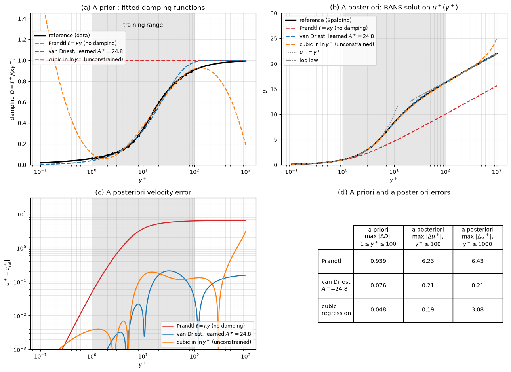

# Machine-Learned Turbulence Closures

Industrial CFD still relies on Reynolds-averaged Navier–Stokes (RANS) models such as Spalart–Allmaras, $k$–$`\varepsilon`$ and SST, whose constants were calibrated on a handful of simple flows. They fail in predictable places: separation and reattachment, strong streamline curvature, secondary flows in ducts, and flows far from equilibrium. Large-eddy simulation (LES) moves the problem to the subgrid scales and to the wall. This note describes how high-fidelity data (DNS, well-resolved LES, experiments) are used to learn corrections to these closures, what has to be built into the learned model so that it remains physically consistent, and how such models are evaluated.

The theory of the closures themselves is in [Turbulence Modeling](../../fluid_mechanics/turbulence/modeling.md), [RANS Equations](../../fluid_mechanics/turbulence/rans_equations.md) and the CFD-oriented [Turbulence Modeling](../../numerical/cfd/turbulence_modeling.md) note.

## Problem Statement

For incompressible flow, the RANS equations for the mean velocity $U_i$ and mean pressure $P$ are

```math
\frac{\partial U_i}{\partial x_i} = 0, \qquad \frac{\partial U_i}{\partial t} + U_j\frac{\partial U_i}{\partial x_j} = -\frac{1}{\rho}\frac{\partial P}{\partial x_i} + \nu\frac{\partial^2 U_i}{\partial x_j\partial x_j} - \frac{\partial \tau_{ij}}{\partial x_j}, \qquad \tau_{ij} = \overline{u_i'u_j'}
```

The six components of the Reynolds stress tensor $\tau_{ij}$ are unknown: this is the closure problem. Most models use the Boussinesq hypothesis,

$$
\tau_{ij} = \frac{2}{3}k\delta_{ij} - 2\nu_t S_{ij},
\qquad
S_{ij} = \frac{1}{2}\left(\frac{\partial U_i}{\partial x_j} +
\frac{\partial U_j}{\partial x_i}\right)
$$

with turbulent kinetic energy $k = \tau_{ii}/2$ and an eddy viscosity $\nu_t$ supplied by transport equations. It aligns the anisotropy tensor

$$
b_{ij} = \frac{\tau_{ij}}{2k} - \frac{1}{3}\delta_{ij}
$$

with the mean strain rate, which is the main source of error in the flows listed above.

The learning problem is posed as follows. A dataset $\mathcal{D}$ contains, for a few training flows, the mean fields and Reynolds stresses from DNS or LES. A closure model $`\mathcal{M}_{\boldsymbol\theta}`$ maps local mean-flow features $`\mathbf{q}(\mathbf{x})`$ (strain and rotation rates, $`k`$, $`\varepsilon`$ or $`\omega`$, wall distance, pressure gradient, all non-dimensionalized) to a closure quantity: a correction to $`\nu_t`$ or to a transport-equation source, the anisotropy $`b_{ij}`$, or the subgrid stress in LES. What matters in the end is the a posteriori objective

```math
\min_{\boldsymbol\theta} \ \mathcal{J}(\boldsymbol\theta) = \sum_{\text{flows}} \left\lVert \mathbf{U}(\boldsymbol\theta) - \mathbf{U}^{\mathrm{HF}} \right\rVert^2 \quad \text{subject to} \quad \mathbf{R}\big(\mathbf{U}, \mathcal{M}_{\boldsymbol\theta}(\mathbf{q}(\mathbf{U}))\big) = \mathbf{0}
```

where $\mathbf{R} = \mathbf{0}$ is the discretized RANS system and $\mathbf{U}^{\mathrm{HF}}$ the high-fidelity mean flow (or quantities derived from it, such as wall pressure or skin friction). The easier a priori surrogate fits the closure directly on the high-fidelity fields,

$$
\min_{\boldsymbol\theta} \ \sum_{i} \lVert
\mathcal{M}_{\boldsymbol\theta}(\mathbf{q}_i^{\mathrm{HF}}) -
\boldsymbol{\tau}_i^{\mathrm{HF}} \rVert^2
$$

The difficulties are:

- The two objectives disagree. At prediction time the features come from the model's own RANS solution, not from DNS, and closure errors feed back through the mean flow.
- Small errors in an explicitly prescribed Reynolds stress can produce large errors in the mean velocity (the ill-conditioning discussed below).
- The model must respect Galilean and rotational invariance and give realizable stresses, or it will be wrong in any frame or flow it was not trained in.
- High-fidelity data exist for few flows (channels, ducts, periodic hills, backward-facing steps, a few airfoils), and every new geometry is an extrapolation.

## What Can Be Learned

| Target | Where it enters the solver | Representative work |
| --- | --- | --- |
| Multiplicative correction $\beta(\mathbf{x})$ of a transport-equation source term | inside the existing RANS model | Parish and Duraisamy (2016); Singh, Medida and Duraisamy (2017) |
| Reynolds-stress anisotropy $b_{ij}$ | replaces the Boussinesq stress in the momentum equation | Ling, Kurzawski and Templeton (2016) |
| LES subgrid-scale stress | replaces or corrects the Smagorinsky term | Gamahara and Hattori (2017); Beck, Flad and Munz (2019) |
| Wall shear stress from outer-layer velocity | boundary condition of wall-modeled LES or RANS | data-driven wall models |

### Field Inversion and Machine Learning

Field inversion and machine learning (FIML), introduced by Parish and Duraisamy (2016), keeps the baseline model and learns a spatial correction to one of its terms. For the Spalart–Allmaras model the production term is multiplied by a field $\beta(\mathbf{x})$:

```math
\frac{D\tilde{\nu}}{Dt} = \beta(\mathbf{x})\,\mathcal{P}(\tilde{\nu}, \mathbf{U}) -
\mathcal{D}(\tilde{\nu}, \mathbf{U}) + \mathcal{T}(\tilde{\nu})
```

with production $\mathcal{P}$, destruction $\mathcal{D}$ and diffusion $\mathcal{T}$. The procedure has three steps:

1. For each training case, field inversion finds the field $\beta(\mathbf{x})$, one value per cell, that minimizes the mismatch with the data plus a penalty for departing from the baseline:

   ```math
   \min_{\beta} \ \sum_{l}\left(d_l - h_l(\mathbf{U}(\beta))\right)^2 + \lambda\lVert \beta - 1 \rVert^2
   ```

   where $d_l$ are measurements such as surface pressure or lift, and $h_l$ extracts the same quantities from the RANS solution. The gradient with respect to millions of $\beta$ values is computed with one adjoint solve.

2. A neural network or Gaussian process is fitted to the inferred $\beta$ fields of all training cases together, as a function of local, non-dimensional features: $\beta \approx f_{\boldsymbol\theta}(\mathbf{q})$.

3. The trained $f_{\boldsymbol\theta}(\mathbf{q})$ is inserted into the RANS solver, which then predicts new cases.

Singh, Medida and Duraisamy (2017) used FIML with lift data on airfoils to improve the predicted lift near stall for airfoils not in the training set. The strength of the approach is consistency: every $\beta$ field used for training reproduces the data when inserted in the solver, so the learning step fits quantities that are known to work a posteriori, and the baseline model is recovered where $\beta = 1$. The cost is one adjoint-based optimization per training case, and the correction can only act through the single term that was chosen.

### Tensor-Basis Neural Networks for the Anisotropy

A model for $b_{ij}$ must transform as a tensor. With the non-dimensional strain and rotation tensors

$$
\hat{\mathbf{S}} = \frac{k}{\varepsilon}\mathbf{S},
\qquad \hat{\mathbf{\Omega}} = \frac{k}{\varepsilon}\mathbf{\Omega},
\qquad
\Omega_{ij} = \frac{1}{2}\left(\frac{\partial U_i}{\partial x_j} -
\frac{\partial U_j}{\partial x_i}\right)
$$

Pope (1975) showed, using the Cayley–Hamilton theorem, that any symmetric, traceless tensor function of $\hat{\mathbf{S}}$ and $\hat{\mathbf{\Omega}}$ can be written as

```math
\mathbf{b} = \sum_{n=1}^{10} g^{(n)}(\lambda_1, \dots, \lambda_5)\,\mathbf{T}^{(n)}
```

The scalar invariants are $\lambda_1 = \mathrm{tr}(\hat{\mathbf{S}}^2)$, $\lambda_2 = \mathrm{tr}(\hat{\mathbf{\Omega}}^2)$, $\lambda_3 = \mathrm{tr}(\hat{\mathbf{S}}^3)$, $\lambda_4 = \mathrm{tr}(\hat{\mathbf{\Omega}}^2\hat{\mathbf{S}})$ and $\lambda_5 = \mathrm{tr}(\hat{\mathbf{\Omega}}^2\hat{\mathbf{S}}^2)$. The first four of the ten basis tensors are

```math
\mathbf{T}^{(1)} = \hat{\mathbf{S}}, \qquad \mathbf{T}^{(2)} = \hat{\mathbf{S}}\hat{\mathbf{\Omega}} - \hat{\mathbf{\Omega}}\hat{\mathbf{S}}, \qquad \mathbf{T}^{(3)} = \hat{\mathbf{S}}^2 - \tfrac{1}{3}\mathbf{I}\,\mathrm{tr}(\hat{\mathbf{S}}^2), \qquad \mathbf{T}^{(4)} = \hat{\mathbf{\Omega}}^2 - \tfrac{1}{3}\mathbf{I}\,\mathrm{tr}(\hat{\mathbf{\Omega}}^2)
```

and the others are higher products up to $\mathbf{T}^{(10)} = \hat{\mathbf{\Omega}}\hat{\mathbf{S}}^2\hat{\mathbf{\Omega}}^2 - \hat{\mathbf{\Omega}}^2\hat{\mathbf{S}}^2\hat{\mathbf{\Omega}}$. The Boussinesq hypothesis is the one-term case $g^{(1)} = -C_\mu$, since $\nu_t = C_\mu k^2/\varepsilon$ gives $\mathbf{b} = -C_\mu\hat{\mathbf{S}}$. Quadratic and cubic eddy-viscosity models keep a few more terms with fixed coefficients.

The tensor-basis neural network (TBNN) of Ling, Kurzawski and Templeton (2016) learns the coefficient functions. A multilayer perceptron takes the five invariants as input and outputs the ten $g^{(n)}$, and a final layer, without trainable weights, forms $\sum_n g^{(n)}\mathbf{T}^{(n)}$. The loss is the mismatch with the DNS anisotropy. Because the inputs are invariants of velocity gradients, the prediction is Galilean invariant, and because the output is assembled from the tensor basis, rotating the frame rotates $\mathbf{b}$ consistently ($\mathbf{b} \to \mathbf{Q}\mathbf{b}\mathbf{Q}^T$) without any data augmentation. Trained on several flows, the TBNN predicted the anisotropy in a square duct and a wavy-wall channel better than linear and quadratic eddy-viscosity models and better than a generic network without the tensor structure. Used in the RANS momentum equation, its anisotropy produced the secondary flow in the duct that linear eddy-viscosity models cannot produce at all.

### LES Subgrid-Scale Models

Filtering the Navier–Stokes equations with a filter of width $\Delta$ leaves the subgrid stress $`\tau^{\mathrm{sgs}}_{ij} = \overline{u_iu_j} - \bar{u}_i\bar{u}_j`$ unclosed. The Smagorinsky model sets $`\tau^{\mathrm{sgs}}_{ij} - \tfrac{1}{3}\tau^{\mathrm{sgs}}_{kk}\delta_{ij} = -2(C_s\Delta)^2\lvert\bar{\mathbf{S}}\rvert\bar{S}_{ij}`$. Data for learning come from filtering DNS fields, which gives the exact $\tau^{\mathrm{sgs}}_{ij}$ at every point together with the filtered velocity gradients and neighboring values as inputs.

Gamahara and Hattori (2017) trained a fully connected network on filtered DNS of channel flow. The predicted stresses correlated well with the true ones in a priori tests, better than the Smagorinsky model, but in actual LES the network brought no clear improvement over Smagorinsky. Beck, Flad and Munz (2019) trained convolutional and residual networks on decaying isotropic turbulence and obtained correlations above 0.9 with the exact closure terms a priori. Using the predicted terms directly in LES was unstable, and a stable model was obtained only by projecting the prediction onto an eddy-viscosity form. They also stressed that in practical LES the filter is defined implicitly by the grid and the numerical scheme, so the "exact" closure depends on the discretization and must be learned for it.

### Wall Models

Wall-modeled LES places the first grid points well above the viscous sublayer and needs the wall shear stress $\tau_w$ as a boundary condition. The classical equilibrium wall model solves the log law at the matching height $h$ for the friction velocity,

$$
\frac{U(h)}{u_\tau} = \frac{1}{\kappa}\ln \frac{hu_\tau}{\nu} + B,
\qquad \tau_w = \rho u_\tau^2
$$

which fails under strong pressure gradients and separation. A learned wall model maps the local LES state at the matching height (velocity, $h^+$, pressure gradient, possibly time history) to $\tau_w$. Training data come from DNS or wall-resolved LES of channels, boundary layers and separated flows. Learned wall models use physics-based input normalization, for example wall units, and are trained on several flows; Yang et al. (*Physical Review Fluids*, 2019) and Bae and Koumoutsakos (*Nature Communications*, 2022, using reinforcement learning) are examples. The same issues as for RANS closures arise: the model must be tested inside the LES, where its errors change the outer flow that it receives as input.

## A Priori and A Posteriori Evaluation

An a priori test evaluates the closure on high-fidelity input fields and compares its output with the high-fidelity closure quantity: correlation coefficients, the error in $b_{ij}$, or the error in a predicted eddy viscosity. An a posteriori test solves the RANS or LES equations with the closure and compares the resulting mean velocity, pressure, skin friction or spectra with the reference. A model is useful only if it passes the a posteriori test.

The two can rank models differently for three reasons. First, the closure is evaluated at prediction time on its own solution, so its inputs differ from the training inputs and its errors compound. Second, the mean velocity is an integral of the closure through the momentum equation, so small but systematic errors accumulate, while scattered errors average out. Third, a learned model is only constrained where there were training data, and the solver will visit states outside that region.



The figure shows the loop on the smallest possible example. Spalding's law of the wall plays the role of DNS data for the inner layer of a wall flow. It implies an eddy viscosity and a damping function $D = \ell^+/(\kappa y^+)$ for Prandtl's mixing length, which are fitted on $1 \leq y^+ \leq 100$ in two ways: a van Driest damping $1 - e^{-y^+/A^+}$ with one learned constant ($A^+ = 24.8$), and an unconstrained cubic polynomial in $\ln y^+$. Each closure is then inserted into the 1D RANS momentum equation, integrated from the wall to $y^+ = 1000$. The table in (d) shows the reversal. The polynomial fits the training data better (largest error in $D$ of 0.048 against 0.076) and gives a slightly better profile up to $y^+ = 100$, but outside its training range its damping falls towards zero and the predicted $u^+$ is 3.1 too high at $y^+ = 1000$. The van Driest form contains the correct limit $D \to 1$ and keeps its error below 0.21 everywhere. Plain Prandtl mixing length, without damping, is 6.4 too low throughout the log layer.

Three practices follow. Train with the solver in the loop where possible (field inversion, adjoint-based or differentiable solvers), so that the training targets are consistent with the solution. Build the known limits and structure into the model form, as the van Driest form or the tensor basis does. Always report a posteriori results on flows that were not used in training.

## Ill-Conditioning of Explicit Reynolds-Stress Injection

A natural test of a data-driven anisotropy model is to insert the DNS Reynolds stresses themselves into the RANS momentum equation and solve for the mean velocity. Wu et al. (2019) showed that even this can give large errors in the mean flow, because the RANS equations with an explicitly prescribed Reynolds stress can be ill-conditioned.

The fully developed channel shows why. In wall units, the mean momentum equation integrates to

$$
\frac{du^+}{dy^+} = \left(1 - \frac{y^+}{Re_\tau}\right) + \overline{u'v'}^+
$$

In the log and outer layers the two terms on the right nearly cancel, and the velocity gradient is their small difference. An error $\delta$ in the prescribed $\overline{u'v'}^+$ changes the gradient by $\delta$ directly, not in proportion to the gradient, and integrated over a layer of thickness $Re_\tau$ wall units the velocity error grows like $`\delta\,Re_\tau`$. If the stress is instead written with an eddy viscosity treated implicitly,

$$
(1 + \nu_t^+) \frac{du^+}{dy^+} = 1 - \frac{y^+}{Re_\tau}
$$

then a relative error in $\nu_t$ causes a similar relative error in the gradient, which is small. Exercise 3 puts numbers on this.

The remedy proposed by Wu et al. (2019) splits the learned Reynolds stress into a linear eddy-viscosity part, with an optimal $\nu_t$ estimated from the data by least squares against the strain rate and treated implicitly in the solver, and a remainder treated explicitly,

$$
\boldsymbol{\tau} = \frac{2}{3}k\mathbf{I} - 2\nu_t^{\mathrm{L}}\mathbf{S} +
\boldsymbol{\tau}^{\perp}
$$

The implicit part keeps the discrete system well conditioned and damps the effect of errors in $\boldsymbol{\tau}^{\perp}$. The same consideration explains why FIML-type corrections inside a transport equation are more robust than direct stress injection.

## Invariance, Realizability and Generalization

### Invariance

The closure must give the same physical stress in any inertial frame and any rotated coordinate system. Galilean invariance is obtained by using velocity gradients and other frame-independent quantities as inputs, never the velocity itself. Rotational invariance requires either invariant inputs and a tensor-basis output (as in the TBNN), or scalar outputs such as a correction to $\nu_t$ that multiply an already invariant tensor. Inputs should also be non-dimensional and bounded, for example ratios such as $(\lVert\mathbf{\Omega}\rVert^2 - \lVert\mathbf{S}\rVert^2)/(\lVert\mathbf{\Omega}\rVert^2 + \lVert\mathbf{S}\rVert^2)$ or a wall-distance Reynolds number $`\sqrt{k}\,d/\nu`$, so that the same model applies at different scales and speeds.

### Realizability

A Reynolds stress tensor is a covariance matrix, so it must be symmetric positive semi-definite: $\overline{u_\alpha'^2} \geq 0$ for every component and the Cauchy–Schwarz inequality $`\overline{u_\alpha'u_\beta'}^2 \leq \overline{u_\alpha'^2}\,\overline{u_\beta'^2}`$ for every pair. For the anisotropy tensor this means that its eigenvalues lie between $-1/3$ and $2/3$ and its invariants lie inside the Lumley triangle, whose corners are one-component, two-component axisymmetric and isotropic turbulence. Learned models can violate these bounds, especially when extrapolating. Realizability is enforced by penalising violations in the loss, by projecting the predicted eigenvalues onto the admissible set, or by predicting coordinates in a barycentric map of the triangle, which are admissible by construction.

### Generalization

Training data come from a few canonical flows, and a learned closure is reliable only for features similar to those it was trained on. Practical steps are:

- train on several flows at once, so that the model cannot memorise a single geometry;
- monitor the distance of each prediction point from the training data in feature space and fall back to the baseline model where the distance is large;
- prefer corrections to an existing model, which reduce to the baseline where no correction is learned, over models that replace it;
- report results for flows that differ in geometry and Reynolds number from all training flows.

Duraisamy, Iaccarino and Xiao (2019) review these issues, together with the uncertainty quantification that the limited data make necessary.

## Comparison of Approaches

| Approach | Learned quantity | Training data | Consistency with the solver | Main risk |
| --- | --- | --- | --- | --- |
| FIML | correction field $\beta$ of one source term | sparse data (surface pressure, lift) plus adjoint inversions | high: targets reproduce the data in the solver | correction limited to one term; inversion cost |
| TBNN | anisotropy coefficients $g^{(n)}$ | DNS Reynolds stresses | low unless trained a posteriori; ill-conditioning if injected explicitly | extrapolation outside training flows |
| LES SGS network | subgrid stress | filtered DNS | depends on filter and discretization | instability a posteriori; non-dissipative backscatter |
| Learned wall model | $\tau_w$ from outer velocity | DNS or wall-resolved LES | tested inside LES only | non-equilibrium and separated flows |
| Calibrated algebraic form (as in the script) | a few constants of a physical model form | profiles or closure data | high; few parameters | limited flexibility |

## Key Takeaways

- The RANS closure problem is to model the six components of $\overline{u_i'u_j'}$; the Boussinesq hypothesis aligns their anisotropy with the strain rate, and this is what fails in complex flows.
- Field inversion and machine learning learns a correction inside an existing model from fields that, by construction, reproduce the data in the solver.
- Tensor-basis neural networks use Pope's integrity basis to predict an anisotropy tensor that is Galilean and rotationally invariant by construction.
- LES subgrid and wall models can be learned from filtered or wall-resolved DNS, but high a priori correlation has repeatedly failed to translate into better or even stable LES.
- A priori accuracy is not a posteriori accuracy: the closure is used on its own solution, and errors accumulate through the momentum equation.
- Prescribing Reynolds stresses explicitly can be ill-conditioned; treating an eddy-viscosity part implicitly avoids this.
- Realizability, invariance and correct limits should be built into the model form; generalization to unseen flows must be demonstrated, not assumed.

## Related Scripts

- [Learned Mixing-Length Closure](../../../scripts/algorithms/learned_mixing_length_closure/): learns a near-wall correction to Prandtl's mixing length from reference velocity data, then inserts the learned closure into a 1D RANS solver to check whether a good fit to the closure data also gives a good velocity profile.
- [Turbulent Flow: Reynolds Decomposition](../../../scripts/plots/turbulent_flow/): splits a synthetic velocity signal into its time mean and fluctuation, following the Reynolds decomposition used in turbulence modelling.

## Exercises

**Exercise 1.** In the log layer of a channel, DNS gives approximately $\overline{u'^2}/k = 1.0$, $\overline{v'^2}/k = 0.4$, $\overline{w'^2}/k = 0.6$, $-\overline{u'v'}/k = 0.3$ and $`(k/\varepsilon)\,dU/dy = 3.3`$. Compute the anisotropy tensor and the Boussinesq prediction with $C_\mu = 0.09$. Which components does the Boussinesq model get right, and what consequence does the error have in a square duct?

<details>
<summary>Answer</summary>

From $b_{ij} = \tau_{ij}/(2k) - \delta_{ij}/3$: $b_{11} = 0.5 - 0.333 = 0.167$, $b_{22} = 0.2 - 0.333 = -0.133$, $b_{33} = 0.3 - 0.333 = -0.033$ and $b_{12} = -0.3/2 = -0.15$.

In simple shear, $`S_{12} = \tfrac{1}{2}\,dU/dy`$ is the only non-zero strain component, so the Boussinesq model $\mathbf{b} = -C_\mu\hat{\mathbf{S}}$ gives

```math
b_{12} = -C_\mu\,\frac{k}{\varepsilon}\,\frac{1}{2}\frac{dU}{dy} = -0.09 \times 1.65 = -0.149
```

and $b_{11} = b_{22} = b_{33} = 0$.

The shear component is right (that is how $C_\mu = 0.09$ was calibrated), but all normal-stress anisotropy is lost. In a square duct the secondary flow is driven by gradients of the difference $\overline{v'^2} - \overline{w'^2}$ in the cross-section, which is zero under the Boussinesq hypothesis, so linear eddy-viscosity models predict no secondary flow at all.

</details>

**Exercise 2.** A learned model predicts the anisotropy $\mathbf{b} = \mathrm{diag}(0.7, -0.2, -0.5)$ at a point. Is it realizable? What normal stresses does it imply, in units of $k$?

<details>
<summary>Answer</summary>

The trace is zero, as required. The normal stresses are $\overline{u_\alpha'^2} = 2k(b_{\alpha\alpha} + 1/3)$, giving $2.07k$, $0.27k$ and $-0.33k$.

A negative variance is impossible, so the tensor is not realizable. Equivalently, the eigenvalues must lie between $-1/3$ and $2/3$, and both $0.7$ and $-0.5$ are outside this range. A realizable model would have to be constrained in its output, for example by mapping the predicted eigenvalues into the Lumley triangle.

</details>

**Exercise 3.** A channel at $Re_\tau = 1000$ is solved with the DNS Reynolds shear stress injected explicitly, but the injected $-\overline{u'v'}^+$ is 1% too low everywhere between $y^+ = 30$ and the centerline. Assume $-\overline{u'v'}^+ \approx 1 - y^+/Re_\tau$ there. Estimate the error in the centerline velocity and compare it with $u^+_c$ from the log law ($\kappa = 0.41$, $B = 5.2$). Then estimate the error if instead an eddy viscosity, 1% too low over the same range, is treated implicitly.

<details>
<summary>Answer</summary>

With explicit injection the gradient error is the stress error itself, $`\delta(du^+/dy^+) = 0.01\,(1 - y^+/1000)`$. Integrating from 30 to 1000:

```math
\Delta u^+_c = 0.01\left[y^+ - \frac{(y^+)^2}{2000}\right]_{30}^{1000} = 0.01\,(500 - 29.55) = 4.70
```

The log law gives $u^+_c = \ln(1000)/0.41 + 5.2 = 22.05$, so a 1% stress error produces a 21% velocity error.

With the implicit form, $du^+/dy^+ = (1 - y^+/Re_\tau)/(1 + \nu_t^+)$ and $\nu_t^+ \gg 1$ above $y^+ = 30$, so a 1% error in $\nu_t^+$ changes the gradient by about 1%. The velocity rises from $u^+ = 13.5$ at $y^+ = 30$ to 22.05 at the center, so the error is about $0.01 \times 8.55 = 0.09$, fifty times smaller. This is the ill-conditioning identified by Wu et al. (2019).

</details>

**Exercise 4.** In the learned mixing-length example of this note, the cubic polynomial has the smaller a priori error, but the van Driest form has the smaller a posteriori error over $y^+ \leq 1000$. Explain the reversal and propose two changes to the polynomial model that would fix it without abandoning regression.

<details>
<summary>Answer</summary>

The a priori error is measured only on $1 \leq y^+ \leq 100$, where both models fit well. The a posteriori solution needs the closure up to $y^+ = 1000$, where the polynomial is extrapolated. Polynomials in $\ln y^+$ diverge outside the fitting range, and here the cubic falls towards 0.2 at $y^+ = 1000$, so the eddy viscosity is too small, the gradient too large and $u^+$ too high. The van Driest form tends to 1 for large $y^+$, which is the correct log-layer limit $\ell = \kappa y$, so it extrapolates correctly.

Two fixes:

1. Build the limits into the model form, for example $D = 1 - \exp(-p(y^+))$ with $p$ a regression function that is positive and grows at large $y^+$, or $D = \tanh(\cdot)$, so that $D \to 1$ is guaranteed.
2. Train on the range where the model will be used, or add the log-layer constraint $D(y^+) = 1$ for $y^+ \gg 1$ as extra data or as a penalty. Fitting a posteriori, through the solver, on $u^+$ over the full range would also expose the problem during training.

</details>

**Exercise 5.** In simple shear with $`(k/\varepsilon)\,dU/dy = 3.3`$, the non-dimensional tensors are $`\hat{\mathbf{S}} = s\,(\mathbf{e}_1\mathbf{e}_2^T + \mathbf{e}_2\mathbf{e}_1^T)`$ and $`\hat{\mathbf{\Omega}} = s\,(\mathbf{e}_1\mathbf{e}_2^T - \mathbf{e}_2\mathbf{e}_1^T)`$ with $s = 1.65$. Compute $\mathbf{T}^{(2)}$ and $\mathbf{T}^{(3)}$, and find the coefficients $g^{(2)}$ and $g^{(3)}$ for which $g^{(1)}\mathbf{T}^{(1)} + g^{(2)}\mathbf{T}^{(2)} + g^{(3)}\mathbf{T}^{(3)}$, with $g^{(1)} = -0.09$, reproduces all the anisotropy components of Exercise 1.

<details>
<summary>Answer</summary>

In the $(x_1, x_2)$ block, $`\hat{\mathbf{S}}\hat{\mathbf{\Omega}} = s^2\,\mathrm{diag}(-1, 1)`$ and $`\hat{\mathbf{\Omega}}\hat{\mathbf{S}} = s^2\,\mathrm{diag}(1, -1)`$, so $`\mathbf{T}^{(2)} = s^2\,\mathrm{diag}(-2, 2, 0)`$.

$`\hat{\mathbf{S}}^2 = s^2\,\mathrm{diag}(1, 1, 0)`$ with trace $2s^2$, so $`\mathbf{T}^{(3)} = s^2\,\mathrm{diag}(1/3, 1/3, -2/3)`$.

$\mathbf{T}^{(1)}$ has only the off-diagonal entries $s$, so $b_{12} = g^{(1)}s = -0.149$, as in Exercise 1. The diagonal entries are

```math
b_{11} = s^2\left(-2g^{(2)} + \tfrac{1}{3}g^{(3)}\right), \qquad b_{22} = s^2\left(2g^{(2)} + \tfrac{1}{3}g^{(3)}\right), \qquad b_{33} = -\tfrac{2}{3}s^2 g^{(3)}
```

With $s^2 = 2.7225$, the last equation and $b_{33} = -0.0333$ give $g^{(3)} = 0.0184$. Subtracting the first from the second gives $4s^2g^{(2)} = b_{22} - b_{11} = -0.300$, so $g^{(2)} = -0.0275$. Substituting back gives $b_{11} = 0.167$ and $b_{22} = -0.133$, as required.

$\mathbf{T}^{(2)}$ alone can only produce $b_{11} = -b_{22}$ with $b_{33} = 0$; the $\mathbf{T}^{(3)}$ term is needed for the spanwise component. A TBNN learns such coefficients as functions of the invariants, so they can differ between, for example, the log layer and a separated shear layer.

</details>

## References

- Duraisamy, K., Iaccarino, G., and Xiao, H., "Turbulence modeling in the age of data", *Annual Review of Fluid Mechanics* 51, 357–377, 2019.
- Pope, S. B., "A more general effective-viscosity hypothesis", *Journal of Fluid Mechanics* 72(2), 331–340, 1975.
- Pope, S. B., *Turbulent Flows*, Cambridge University Press, 2000.
- Ling, J., Kurzawski, A., and Templeton, J., "Reynolds averaged turbulence modelling using deep neural networks with embedded invariance", *Journal of Fluid Mechanics* 807, 155–166, 2016.
- Parish, E. J., and Duraisamy, K., "A paradigm for data-driven predictive modeling using field inversion and machine learning", *Journal of Computational Physics* 305, 758–774, 2016.
- Singh, A. P., Medida, S., and Duraisamy, K., "Machine-learning-augmented predictive modeling of turbulent separated flows over airfoils", *AIAA Journal* 55(7), 2215–2227, 2017.
- Wu, J., Xiao, H., Sun, R., and Wang, Q., "Reynolds-averaged Navier–Stokes equations with explicit data-driven Reynolds stress closure can be ill-conditioned", *Journal of Fluid Mechanics* 869, 553–586, 2019.
- Gamahara, M., and Hattori, Y., "Searching for turbulence models by artificial neural network", *Physical Review Fluids* 2(5), 054604, 2017.
- Beck, A., Flad, D., and Munz, C.-D., "Deep neural networks for data-driven LES closure models", *Journal of Computational Physics* 398, 108910, 2019.
- Spalding, D. B., "A single formula for the law of the wall", *Journal of Applied Mechanics* 28(3), 455–458, 1961.
