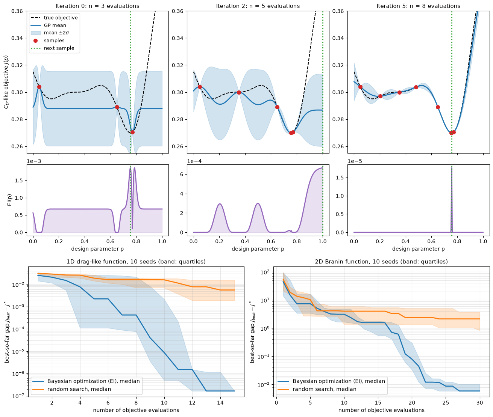

# Optimization with CFD and Machine Learning

Aerodynamic design is an optimization problem: choose shape and operating parameters to minimize drag, maximize lift-to-drag ratio, or reduce pressure loss, subject to geometric and performance constraints. Each evaluation of the objective is a CFD solution, which costs minutes to days, so the number of evaluations matters more than anything else. This note covers the classical approaches (gradient-based optimization with adjoint sensitivities, gradient-free evolutionary methods, multidisciplinary design optimization) and the data-driven ones (surrogate-based and Bayesian optimization, multi-fidelity models, multi-objective search, learned design spaces, and reinforcement learning for flow control).

The methods differ in what they need from the CFD solver. Adjoint methods need a solver that provides gradients, and gradient-free methods need many evaluations. Surrogate-based methods need few evaluations but only work in moderate dimension.

## Problem Statement

Let $\mathbf{p} \in \mathcal{P} \subset \mathbb{R}^d$ be the design variables (shape parameters, angle of attack, jet amplitude), $\mathbf{w}(\mathbf{p})$ the discrete flow state that satisfies the residual equations $\mathbf{R}(\mathbf{w}, \mathbf{p}) = \mathbf{0}$ of the CFD solver, and $J$ the objective. The design problem is

```math
\min_{\mathbf{p} \in \mathcal{P}} \ J\left(\mathbf{w}(\mathbf{p}), \mathbf{p}\right)
\quad \text{subject to} \quad \mathbf{R}(\mathbf{w}, \mathbf{p}) = \mathbf{0},
\quad g_k\left(\mathbf{w}(\mathbf{p}), \mathbf{p}\right) \le 0, \ \ k = 1, \dots, K
```

where the $g_k$ are constraints such as a minimum lift coefficient, a maximum pitching moment, or a minimum thickness. The set $\mathcal{P}$ is usually a box of bounds. Each evaluation of $J$ and $g_k$ requires a converged flow solution. What makes the problem hard:

- Evaluations are expensive, so budgets are tens to a few thousand evaluations, depending on the cost of a solve.
- The dimension $d$ ranges from a handful (operating conditions, a few shape modes) to hundreds or thousands (free-form deformation control points, surface nodes).
- $J$ is often noisy. Incomplete convergence, remeshing at each design, and time averaging of unsteady flows add scatter that is small in absolute terms but comparable to the improvements sought, such as one drag count, $\Delta C_D = 10^{-4}$.
- $J$ can be multimodal, and constraints can make the feasible region non-convex.
- Several objectives often compete (drag against lift, mass or noise), and the answer is then a trade-off curve, not a single design.

## Parametrizing the Design

The parametrization fixes the search space and therefore the best design that can be found. Common choices are free-form deformation boxes, B-spline or Bézier control points, class-shape transformation (CST) coefficients for airfoils, and mesh morphing with radial basis functions. These are discussed in [Deformation Parameters and Shape Morphing](../automotive_aerodynamics/deformation_parameters.md). Few parameters favour surrogate-based methods, while many parameters (a smooth surface described by hundreds of control points) favour adjoint gradients.

## Gradient-Based Optimization and the Adjoint Method

Quasi-Newton methods (BFGS) for bound-constrained problems and sequential quadratic programming (SQP) with constraints converge in tens of iterations from a reasonable start (Nocedal & Wright, 2006). Each iteration needs the gradient $dJ/d\mathbf{p}$ and the constraint gradients.

### Sensitivity Equations

Differentiating $J(\mathbf{w}(\mathbf{p}), \mathbf{p})$ and the residual equation with respect to $\mathbf{p}$ gives

$$
\frac{dJ}{d\mathbf{p}} = \frac{\partial J}{\partial \mathbf{p}} +
\frac{\partial J}{\partial \mathbf{w}} \frac{d\mathbf{w}}{d\mathbf{p}},
\qquad \frac{\partial \mathbf{R}}{\partial \mathbf{w}}
\frac{d\mathbf{w}}{d\mathbf{p}} = -\frac{\partial \mathbf{R}}{\partial \mathbf{p}}
$$

The direct method solves the second equation, one linear system per design variable, so the cost grows with $d$. Finite differences cost $d + 1$ (forward) or $2d$ (central) nonlinear solves and are sensitive to the step size and to solver noise.

### Adjoint Equation

Substituting $d\mathbf{w}/d\mathbf{p}$ from the second equation into the first and grouping the terms differently gives

$$
\frac{dJ}{d\mathbf{p}} = \frac{\partial J}{\partial \mathbf{p}} + \boldsymbol\psi^T
\frac{\partial \mathbf{R}}{\partial \mathbf{p}},
\qquad \left(\frac{\partial \mathbf{R}}{\partial \mathbf{w}}\right)^T
\boldsymbol\psi = -\left(\frac{\partial J}{\partial \mathbf{w}}\right)^T
$$

The adjoint vector $\boldsymbol\psi$ is the Lagrange multiplier of the flow equations in $\mathcal{L} = J + \boldsymbol\psi^T\mathbf{R}$. It is found from one linear solve with the transposed flow Jacobian, whatever the number of design variables. The remaining term $\boldsymbol\psi^T \partial\mathbf{R}/\partial\mathbf{p}$ is a cheap product, usually evaluated through the sensitivity of the mesh to the surface. Jameson (1988) introduced the method for aerodynamic shape design, using the Euler equations and control theory. The cost of the full gradient is then about one to two flow solutions per objective or constraint, so the adjoint method is the standard for problems with many shape variables and few functions.

| Gradient method | Cost per gradient | Scales with |
| --- | --- | --- |
| Finite differences | $d + 1$ nonlinear solves | Number of design variables |
| Direct (tangent) | 1 nonlinear + $d$ linear solves | Number of design variables |
| Adjoint | 1 nonlinear + 1 linear solve per function | Number of objectives and constraints |

The practical difficulties are in the details: the adjoint of the turbulence model (the frozen-turbulence approximation can give gradients of the wrong sign), unsteady flows (the adjoint runs backwards in time and needs the stored forward solution), and the convergence of the adjoint solver itself. Gradient-based methods also find a local optimum near the starting design.

## Gradient-Free Methods

Evolutionary algorithms keep a population of designs and improve it by selection, recombination and mutation. They need no gradients, tolerate noise, handle discrete variables, and can escape local minima. Their cost is high: typically hundreds to tens of thousands of evaluations, growing with $d$. That is affordable with a cheap model and rarely with high-fidelity CFD.

- Genetic algorithms encode designs as chromosomes, select parents in proportion to fitness, and create children by crossover and mutation.
- CMA-ES (Hansen & Ostermeier, 2001) samples candidates from a multivariate normal distribution $\mathcal{N}(\mathbf{m}, \sigma^2 C)$, moves the mean towards the best-ranked samples, and adapts the covariance $C$ and the step size $\sigma$ from the successful steps. It learns the local shape of the objective, which makes it one of the most efficient gradient-free methods on ill-conditioned continuous problems.
- Particle swarm and differential evolution belong to the same family.

## Multidisciplinary Design Optimization

Real designs couple disciplines: a wing deflects under load, which changes the aerodynamics. Optimizing one discipline at a time misses the coupling. Multidisciplinary design optimization (MDO) formulates one problem over all disciplines. The architectures differ in how consistency between the disciplines is enforced (Martins & Lambe, 2013):

- Multidisciplinary feasible (MDF) solves the coupled system to convergence at every design.
- Individual discipline feasible (IDF) treats the coupling variables as extra design variables and enforces consistency through constraints.

Coupled adjoints extend the gradient computation to the whole system at a cost again independent of the number of design variables.

## Surrogate-Based Optimization

When $d$ is moderate (up to about 10–20) and evaluations are expensive, a surrogate model $\hat{J}(\mathbf{p})$ fitted to past evaluations can decide where to evaluate next. The loop is:

1. Evaluate an initial space-filling design of about $10d$ points, for example a Latin hypercube or a Sobol sequence (see [One-Stage Sampling](../../numerical/surrogates/one_stage_sampling.md)).
2. Fit the surrogate (kriging, radial basis functions, or a neural network) to all evaluations so far.
3. Choose the next point or batch by optimizing an infill criterion on the surrogate.
4. Evaluate the true $J$ there, add the result to the data, and repeat from step 2 until the budget is spent or the criterion indicates convergence.

Minimizing the surrogate mean alone in step 3 converges to wherever the surrogate is most optimistic, which may be an artefact of the fit. Infill criteria that account for surrogate uncertainty avoid this, and they are why Gaussian-process surrogates are the usual choice (Forrester, Sóbester & Keane, 2008; see also [Adaptive Sampling](../../numerical/surrogates/adaptive_sampling.md)).

### Gaussian-Process Surrogate

A Gaussian process (kriging) model treats $J$ as a random function with a mean and a covariance kernel, for example the squared exponential $k(\mathbf{p}, \mathbf{p}') = \sigma_f^2 \exp\left(-\frac{1}{2}\sum_j (p_j - p_j')^2/\ell_j^2\right)$. Conditioned on $n$ evaluations $\mathbf{J} = (J_1, \dots, J_n)$ at $\mathbf{p}_1, \dots, \mathbf{p}_n$, the prediction at a new point is normal with mean and variance

$$
\mu(\mathbf{p}) = m + \mathbf{k}(\mathbf{p})^T K^{-1}(\mathbf{J} - m\mathbf{1}),
\qquad \sigma^2(\mathbf{p}) = \sigma_f^2 - \mathbf{k}(\mathbf{p})^T
K^{-1}\mathbf{k}(\mathbf{p})
$$

where $K_{ij} = k(\mathbf{p}_i, \mathbf{p}_j)$ plus a small nugget, $\mathbf{k}(\mathbf{p})_i = k(\mathbf{p}, \mathbf{p}_i)$, and $m$ is the mean. The length scales $\ell_j$ and the amplitude $\sigma_f$ are fitted by maximizing the marginal likelihood (Rasmussen & Williams, 2006). The variance is zero at the samples and grows away from them, which is the information an infill criterion needs. See [Kriging](../../numerical/surrogates/kriging.md) for the derivation and the choice of correlation function.

### Acquisition Functions

With $J_{best} = \min_i J_i$ the best value so far and $J(\mathbf{p}) \sim \mathcal{N}(\mu, \sigma^2)$ under the surrogate, the improvement is $I(\mathbf{p}) = \max(J_{best} - J(\mathbf{p}), 0)$. Writing $z = (J_{best} - \mu)/\sigma$ and $\phi$, $\Phi$ for the standard normal PDF and CDF:

- The probability of improvement is $\mathrm{PI}(\mathbf{p}) = P(J < J_{best}) = \Phi(z)$. It ignores how large the improvement is and tends to sample very close to the current best.
- The expected improvement is $\mathrm{EI}(\mathbf{p}) = \mathbb{E}[I]$.
- The lower confidence bound is $\mathrm{LCB}(\mathbf{p}) = \mu - \kappa\sigma$, to be minimized, with $\kappa$ (often 2–3) setting the balance. Its maximization form is the upper confidence bound (UCB) used in bandit theory.

The expected improvement has a closed form. With the substitution $t = (y - \mu)/\sigma$,

```math
\mathrm{EI} = \int_{-\infty}^{J_{best}} (J_{best} - y)\,\frac{1}{\sigma}\phi\!\left(\frac{y - \mu}{\sigma}\right) dy
= \int_{-\infty}^{z} (J_{best} - \mu - \sigma t)\,\phi(t)\, dt
= (J_{best} - \mu)\,\Phi(z) - \sigma\int_{-\infty}^{z} t\,\phi(t)\, dt
```

and since $`\phi'(t) = -t\,\phi(t)`$, the last integral is $-\phi(z)$:

```math
\mathrm{EI}(\mathbf{p}) = (J_{best} - \mu)\,\Phi(z) + \sigma\,\phi(z)
```

Its derivatives are $\partial\mathrm{EI}/\partial\mu = -\Phi(z) < 0$ and $\partial\mathrm{EI}/\partial\sigma = \phi(z) > 0$. EI therefore grows both where the predicted value is low (exploitation) and where the prediction is uncertain (exploration), and it is zero at points already sampled without noise. Maximizing EI with a Gaussian process is the efficient global optimization (EGO) algorithm of Jones, Schonlau & Welch (1998). The review by Shahriari et al. (2016) covers the wider family of Bayesian optimization methods.

### Bayesian Optimization in Practice



The top rows show EGO on a one-parameter drag-like function with a global minimum $J^\star = 0.26990$ and a local minimum at 0.29507. With three samples the fitted length scale is far too short and EI is spread over the whole interval. After two more evaluations EI concentrates on the unexplored right edge and on the gaps between samples. By eight evaluations the surrogate matches the function, and EI is a narrow spike at the minimum. The bottom row compares the median best-so-far gap over ten seeds with random search. After 15 evaluations Bayesian optimization is at the $10^{-7}$ resolution of its candidate grid, against $5.6 \times 10^{-3}$ for random search. On the two-dimensional Branin function, after 30 evaluations, the gaps are $5.9 \times 10^{-3}$ and 2.1.

Points to keep in mind when the objective is a CFD result:

- With noisy evaluations, add a noise variance to the kernel diagonal instead of a tiny nugget. $J_{best}$ is then better taken as the best posterior mean than as the best noisy sample.
- Constraints evaluated by the same CFD run can be modelled by their own Gaussian processes, and the acquisition multiplied by the probability of feasibility $\prod_k P(g_k \le 0)$.
- To use a cluster, propose a batch of $q$ points per iteration, for example by the "constant liar" heuristic (pretend the pending points returned $J_{best}$ and refit) or by a multi-point EI.
- Above about 20 dimensions, a Gaussian process needs too many samples to learn the landscape. Reduce the parametrization, use additive or low-dimensional embedding models, or switch to adjoint gradients.
- Stop when the largest EI falls below a fraction of the improvement that matters (for example one drag count), or when the budget is spent.

## Multi-Fidelity Optimization

Cheap approximations of the objective are often available: a coarser mesh, RANS instead of LES, a panel method instead of RANS. A multi-fidelity surrogate models the high-fidelity objective as a scaled low-fidelity one plus a correction (Kennedy & O'Hagan, 2000):

```math
J_{hi}(\mathbf{p}) = \rho\, J_{lo}(\mathbf{p}) + \delta(\mathbf{p})
```

with independent Gaussian processes for $J_{lo}$ and the discrepancy $\delta$, and a scale factor $\rho$ fitted with the hyperparameters (co-kriging). Many cheap evaluations fix the shape of $J_{lo}$, and a few expensive ones fit the smoother correction. The acquisition then also chooses the fidelity, trading information gained against cost. See [Hierarchical Kriging](../../numerical/surrogates/hierarchical_kriging.md) for a variant that uses the low-fidelity model as the trend of the high-fidelity one.

## Multi-Objective Optimization

With objectives $J_1, \dots, J_M$, a design $\mathbf{p}$ dominates $\mathbf{p}'$ if it is no worse in every objective and strictly better in at least one:

```math
\mathbf{p} \prec \mathbf{p}' \iff J_i(\mathbf{p}) \le J_i(\mathbf{p}')\ \ \forall i \in \{1, \dots, M\}
\ \text{ and }\ J_j(\mathbf{p}) < J_j(\mathbf{p}')\ \text{ for some } j
```

The Pareto set contains the designs that no other feasible design dominates, and its image in objective space is the Pareto front. Moving along the front trades one objective against another. There are three common ways to compute it:

- Minimizing a weighted sum $\sum_i w_i J_i$ for several weight vectors is simple, but it only finds points on convex parts of the front.
- The $\varepsilon$-constraint method minimizes one objective with the others bounded, $J_i \le \varepsilon_i$, and sweeps the bounds.
- Population methods such as NSGA-II (Deb et al., 2002) rank the population by non-domination and keep it spread along the front. In Bayesian optimization, the expected improvement of the hypervolume dominated by the front plays the role of EI.

## Learned Design Spaces and Surrogates

Machine learning enters the design loop in other ways too:

- Neural-network surrogates trained on a database of CFD results predict $J$ and its gradient (by automatic differentiation) at negligible cost. They can be optimized with gradients in high dimension, but the optimum must be verified with CFD, because the optimizer seeks out regions where the surrogate is wrong. See [Neural-Network Surrogates for Aerodynamics](../neural_networks/intro.md).
- Generative models (variational autoencoders, GANs) trained on existing shapes give a low-dimensional latent space of realistic shapes. Optimizing in the latent space with Bayesian optimization searches only plausible designs, at the price of excluding designs unlike the training set.
- Inverse design maps a target performance or pressure distribution to a shape directly. It is useful for generating candidates that are then refined by optimization.

## Reinforcement Learning for Flow Control and Shape Optimization

Reinforcement learning (RL) formulates control as a Markov decision process. At each step the agent observes a state $\mathbf{s}_t$ (for example pressure probes), applies an action $`\mathbf{a}_t \sim \pi_{\boldsymbol\theta}(\cdot \mid \mathbf{s}_t)`$ (for example jet mass flow rates), and receives a reward $r_t$ (for example the negative drag). The policy parameters maximize the expected discounted return:

```math
\max_{\boldsymbol\theta}\ \mathbb{E}_{\pi_{\boldsymbol\theta}}\left[\sum_{t=0}^{T} \gamma^t r_t\right],
\qquad 0 < \gamma \le 1
```

Deep RL uses neural networks for the policy and value function, trained with algorithms such as proximal policy optimization (PPO). Rabault et al. (2019) coupled PPO to a two-dimensional CFD simulation of the flow past a cylinder at $Re = 100$ with two synthetic jets. The learned closed-loop strategy reduced the drag by about 8 % with small jet mass flow rates. RL can also treat shape optimization as a sequence of deformation actions with the improvement as reward.

RL is suited to closed-loop control, where the action must respond to the instantaneous flow and no fixed design is optimal. For static design optimization it is less sample-efficient than Bayesian or adjoint methods, because each episode needs many CFD time steps or solves. Training runs need simulations fast enough for thousands of episodes, often in parallel environments, and policies trained in 2D or at one Reynolds number do not transfer directly.

## Choosing a Method

| Method | Evaluations needed | Design dimension | Gradients | Noise | Global search |
| --- | --- | --- | --- | --- | --- |
| Adjoint + quasi-Newton or SQP | Tens of flow + adjoint solves | Up to thousands | Required | Poor | No, local |
| Evolutionary (GA, CMA-ES) | Hundreds to tens of thousands | Tens | Not needed | Good | Yes |
| Bayesian optimization (GP + EI) | Tens to a few hundred | Up to about 20 | Not needed | Good with a noise model | Yes |
| Multi-fidelity surrogate | Many cheap, few expensive | Up to about 20 | Not needed | Good | Yes |
| Neural surrogate + gradient search | Large training database | High | From the network | Depends on data | Within the training data |
| Deep reinforcement learning | Thousands of episodes | Action and observation space | Not needed | Good | Policy search |

## Key Takeaways

- Write the problem down explicitly: the objective, the constraints, the parametrization, and the cost and noise of one evaluation. These decide the method.
- The adjoint method gives the full gradient for the cost of about one extra solve per function, independent of the number of design variables (Jameson, 1988). It is the method of choice for detailed shape optimization with many variables.
- Gradient-free evolutionary methods are robust but need many evaluations, and are best paired with cheap models.
- Bayesian optimization fits a Gaussian process and maximizes expected improvement, $(J_{best} - \mu)\Phi(z) + \sigma\phi(z)$. It balances exploitation and exploration and needs far fewer evaluations than random or evolutionary search in low dimension.
- Multi-fidelity models combine many cheap evaluations with few expensive ones. Multi-objective problems have a Pareto front, not a single optimum.
- Learned surrogates and generative design spaces speed up the search, and deep RL is effective for closed-loop flow control. Every optimum found on a model must be verified with the high-fidelity solver.

## Related Scripts

- [Bayesian Optimization](../../../scripts/algorithms/bayesian_optimization/): This script minimizes a one-dimensional drag-like test function and the two-dimensional Branin function by Bayesian optimization: a Gaussian-process (GP) surrogate with a squared-exponential kernel, hyperparameters fitted by maximum marginal likelihood, and the expected-improvement (EI) acquisition function of the EGO algorithm.
- [Kriging Interpolation](../../../scripts/algorithms/kriging_interpolation/): This script builds an ordinary kriging model of the Forrester function $y(x) = (6x-2)^2 \sin(12x-4)$ from nine equally spaced samples with a compactly supported cubic correlation function, estimates the correlation parameter $\theta$ by maximum likelihood, and compares the predictor and its $\pm 2\hat{s}$ band for $\theta$ below, at and above the estimate.
- [Hierarchical Kriging for Multi-Fidelity Data](../../../scripts/algorithms/hierarchical_kriging_multifidelity/): fits a hierarchical kriging model to the one-dimensional Forrester test case, using a kriging model of 11 cheap low-fidelity samples as the trend of a kriging model of a few expensive high-fidelity samples, and compares it with ordinary kriging of the high-fidelity samples alone.

## Exercises

**Exercise 1.** Five car designs have (drag coefficient, mass in kg) of A $(0.30, 1200)$, B $(0.28, 1500)$, C $(0.32, 1100)$, D $(0.29, 1600)$ and E $(0.31, 1250)$. Find the Pareto set. Which design minimizes the weighted sum $J = C_D/0.01 + m/100$, and is it on the front?

<details>
<summary>Answer</summary>

D is dominated by B ($0.28 < 0.29$ and $1500 < 1600$), and E is dominated by A ($0.30 < 0.31$ and $1200 < 1250$). No design dominates A, B or C, so the Pareto set is $`\{B, A, C\}`$, ordered from low drag to low mass.

The weighted sums are A: $30 + 12 = 42$, B: $28 + 15 = 43$, C: $32 + 11 = 43$, D: $29 + 16 = 45$ and E: $31 + 12.5 = 43.5$. A is the minimum and lies on the front, as the minimizer of a weighted sum with positive weights always does. Other weights select B or C.

</details>

**Exercise 2.** An airfoil is parametrized by 200 spline control points and optimized over 30 design iterations. Compare the number of flow solves for forward-difference gradients and for an adjoint method when the objective is $C_D$ alone, and when three functions ($C_D$, $C_L$, $C_M$) are needed.

<details>
<summary>Answer</summary>

- Forward differences need 201 solves per iteration, or 6030 in total. All three functions come from the same perturbed runs, so the count is the same with one or three functions.
- The adjoint method with $C_D$ only needs 1 primal and 1 adjoint solve per iteration, or 60 solves.
- The adjoint method with three functions needs 1 primal and 3 adjoint solves per iteration, or 120 solves.

The adjoint cost scales with the number of functions, not the number of design variables, so it wins decisively when there are many parameters and few objectives or constraints.

</details>

**Exercise 3.** With $J_{best} = 0.302$, compare the expected improvement of candidate A ($\mu = 0.300$, $\sigma = 0.002$) and candidate B ($\mu = 0.305$, $\sigma = 0.010$). Which one does Bayesian optimization evaluate next? Which one would the probability of improvement choose?

<details>
<summary>Answer</summary>

Candidate A: $z = 1$, so $\mathrm{EI} = 0.002 \times 0.8413 + 0.002 \times 0.2420 \approx 2.17 \times 10^{-3}$.

Candidate B: $z = -0.3$, so $\mathrm{EI} = -0.003 \times 0.3821 + 0.010 \times 0.3814 \approx 2.67 \times 10^{-3}$.

EI picks B, even though its predicted mean is worse than the current best, because its large uncertainty gives a real chance of a much better value. The probability of improvement is $\Phi(1) = 0.84$ for A and $\Phi(-0.3) = 0.38$ for B, so PI would pick A. PI rewards a likely small gain, while EI weighs the size of the gain as well.

</details>

**Exercise 4.** A simplified drag model is $C_D = 0.02 + 0.5p_1^2 + 0.3p_2^2$, and the design must satisfy $C_L = 0.4p_1 + 0.6p_2 = 0.3$. Use a Lagrange multiplier to find the optimum and interpret the multiplier.

<details>
<summary>Answer</summary>

Stationarity $\nabla C_D = \lambda\nabla C_L$ gives $p_1 = 0.4\lambda$ and $0.6p_2 = 0.6\lambda$, so $p_2 = \lambda$.

The constraint becomes $0.16\lambda + 0.6\lambda = 0.3$, so $\lambda \approx 0.395$, $p_1 \approx 0.158$ and $p_2 \approx 0.395$.

The minimum drag is $C_D = 0.02 + 0.5(0.158)^2 + 0.3(0.395)^2 \approx 0.0792$.

The multiplier is the sensitivity of the optimal drag to the lift requirement, $dC_D^\star/dC_{L,req} = \lambda$, so 0.01 more lift costs about 0.0039 in $C_D$, or 39 drag counts. In the adjoint method, $\boldsymbol\psi$ plays the same role for the flow equations.

</details>

**Exercise 5.** Minimize $f(\mathbf{p}) = (p_1 - 1)^2 + 10(p_2 + 0.5)^2$ by gradient descent from $\mathbf{p} = (0, 0)$ with step $\eta = 0.05$. Carry out two iterations, give the largest stable step, and estimate how many iterations reduce the $p_1$ error below $10^{-3}$. How would a quasi-Newton method behave?

<details>
<summary>Answer</summary>

$\nabla f = (2(p_1 - 1), 20(p_2 + 0.5))$.

- Iteration 1: $\nabla f = (-2, 10)$, so $\mathbf{p} = (0.1, -0.5)$ and $f = 0.81$.
- Iteration 2: $\nabla f = (-1.8, 0)$, so $\mathbf{p} = (0.19, -0.5)$ and $f = 0.6561$.

Each step multiplies the $p_1$ error by $1 - 2\eta$ and the $p_2$ error by $1 - 20\eta$. Stability requires $|1 - 20\eta| < 1$, so $\eta < 0.1$.

At $\eta = 0.05$ the $p_2$ error vanishes in one step, but the $p_1$ error shrinks only by a factor 0.9 per step. Reducing it from 1 to $10^{-3}$ takes $\ln(10^{-3})/\ln(0.9) \approx 65.6$, so 66 iterations. The curvature ratio of 10 is what slows gradient descent.

A quasi-Newton method builds an approximation of the Hessian $\mathrm{diag}(2, 20)$ from successive gradients. On a quadratic in two variables, BFGS with exact line searches converges in at most two iterations.

</details>

## References

- Jameson, A., "Aerodynamic design via control theory", *Journal of Scientific Computing* 3(3), 233–260, 1988.
- Nocedal, J., & Wright, S. J., *Numerical Optimization*, 2nd ed., Springer, 2006.
- Jones, D. R., Schonlau, M., & Welch, W. J., "Efficient global optimization of expensive black-box functions", *Journal of Global Optimization* 13(4), 455–492, 1998.
- Shahriari, B., Swersky, K., Wang, Z., Adams, R. P., & de Freitas, N., "Taking the human out of the loop: a review of Bayesian optimization", *Proceedings of the IEEE* 104(1), 148–175, 2016.
- Forrester, A. I. J., Sóbester, A., & Keane, A. J., *Engineering Design via Surrogate Modelling: A Practical Guide*, Wiley, 2008.
- Rasmussen, C. E., & Williams, C. K. I., *Gaussian Processes for Machine Learning*, MIT Press, 2006.
- Hansen, N., & Ostermeier, A., "Completely derandomized self-adaptation in evolution strategies", *Evolutionary Computation* 9(2), 159–195, 2001.
- Kennedy, M. C., & O'Hagan, A., "Predicting the output from a complex computer code when fast approximations are available", *Biometrika* 87(1), 1–13, 2000.
- Deb, K., Pratap, A., Agarwal, S., & Meyarivan, T., "A fast and elitist multiobjective genetic algorithm: NSGA-II", *IEEE Transactions on Evolutionary Computation* 6(2), 182–197, 2002.
- Martins, J. R. R. A., & Lambe, A. B., "Multidisciplinary design optimization: a survey of architectures", *AIAA Journal* 51(9), 2049–2075, 2013.
- Rabault, J., Kuchta, M., Jensen, A., Réglade, U., & Cerardi, N., "Artificial neural networks trained through deep reinforcement learning discover control strategies for active flow control", *Journal of Fluid Mechanics* 865, 281–302, 2019.
