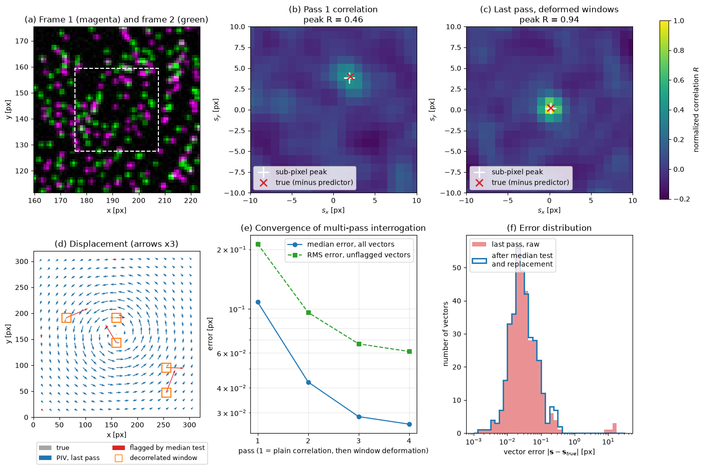

# Machine Learning in Particle Image Velocimetry

Particle image velocimetry (PIV) measures a velocity field by seeding a flow with small tracer particles, illuminating a thin sheet or volume with a pulsed laser, and recording two images a short time $\Delta t$ apart. The velocity follows from how the particle pattern moves between the images. This note covers the classical processing chain (window cross-correlation with sub-pixel peak fitting, iterative window deformation, outlier detection and uncertainty) and then the places where machine learning replaces or improves parts of it: learned optical-flow estimators, particle detection and tracking, outlier replacement, and physics-constrained reconstruction.

The classical chain is the baseline every learned method is judged against, and most of its parameters (window size, overlap, seeding density, time separation) set limits that no estimator can remove. A clear picture of where its error comes from shows what a neural network can and cannot add.

## Problem Statement

Given two grey-scale images $I_1(\mathbf{x})$ and $I_2(\mathbf{x})$ on a pixel grid, recorded $\Delta t$ apart with magnification $M$ (metres per pixel), estimate the displacement field $\mathbf{s}(\mathbf{x})$ in pixels such that the particle pattern of $I_1$ at $\mathbf{x}$ appears at $\mathbf{x} + \mathbf{s}(\mathbf{x})$ in $I_2$:

```math
I_2\left(\mathbf{x} + \mathbf{s}(\mathbf{x})\right) \approx I_1(\mathbf{x}),
\qquad \mathbf{u}(\mathbf{x}) \approx \frac{M\,\mathbf{s}(\mathbf{x})}{\Delta t}
```

Classical PIV assumes $\mathbf{s}$ is nearly constant inside an interrogation window and finds it by maximizing the cross-correlation of the two windows. A learned estimator is a network $f_{\boldsymbol\theta}(I_1, I_2) = \hat{\mathbf{s}}$ trained on a dataset $`\mathcal{D} = \{(I_1^{(i)}, I_2^{(i)}, \mathbf{s}^{(i)})\}_{i=1}^N`$ of image pairs with known displacement, usually synthetic, by minimizing the average endpoint error

```math
\mathcal{L}(\boldsymbol\theta) = \frac{1}{N}\sum_{i=1}^{N} \frac{1}{|\Omega|}\sum_{\mathbf{x}\in\Omega} \left\| f_{\boldsymbol\theta}\left(I_1^{(i)}, I_2^{(i)}\right)(\mathbf{x}) - \mathbf{s}^{(i)}(\mathbf{x}) \right\|_2
```

over the pixels $\Omega$. What makes the problem hard:

- The image only carries information where there are particles. With about 0.01–0.05 particles per pixel, $\mathbf{s}$ is sampled at scattered points, and its value between particles is an interpolation.
- Useful accuracy is sub-pixel. Typical displacements are 5–10 px, so 1 % accuracy needs about 0.05–0.1 px, a fraction of the particle image diameter of 2–3 px.
- Particles leave the light sheet between exposures (out-of-plane loss of pairs), and others enter it. Reflections, background, uneven illumination and camera noise add intensity that does not move with the flow.
- Velocity gradients deform the particle pattern inside a window and broaden the correlation peak.
- Ground truth does not exist for real experiments. Learned methods are trained on synthetic images and must generalize to real optics.

## Recording Guidelines

The design rules below come from the analysis of Keane & Adrian (1992) and the practice summarized by Raffel et al. (2018). They are the starting point for both classical and learned processing, because no estimator can recover a displacement that the images do not encode.

| Quantity | Typical guideline | Reason |
| --- | --- | --- |
| Particle image diameter $d_\tau$ | 2–3 px | Smaller images cause peak locking: sub-pixel estimates cluster at integers |
| Particle images per window $N_I$ | at least about 10 | Probability of a valid correlation peak above about 95 % |
| In-plane displacement | below 1/4 of the window size | Enough particle pairs stay inside the window |
| Out-of-plane displacement | below 1/4 of the light-sheet thickness | Limits loss of pairs |
| Displacement variation across a window | below about $d_\tau$ | Limits peak broadening; window deformation relaxes this |

## Cross-Correlation in Interrogation Windows

### Correlation and Its FFT Evaluation

For a window $W$ centred at $\mathbf{x}_0$, let $a(\mathbf{x})$ and $b(\mathbf{x})$ be the intensities of $I_1$ and $I_2$ in that window with their means removed. The cross-correlation as a function of the trial shift $\mathbf{s}$ is

```math
R(\mathbf{s}) = \frac{\sum_{\mathbf{x}\in W} a(\mathbf{x})\, b(\mathbf{x} + \mathbf{s})}{\sqrt{\sum_{\mathbf{x}\in W} a^2 \sum_{\mathbf{x}\in W} b^2}}
```

and its highest peak gives the integer displacement. Evaluating every shift directly costs $O(n_W^4)$ operations for an $n_W \times n_W$ window. With the correlation theorem it becomes $`R = \mathcal{F}^{-1}[\overline{\mathcal{F}(a)}\,\mathcal{F}(b)]`$, at $O(n_W^2 \log n_W)$ (Willert & Gharib, 1991). The FFT correlation is circular: patterns that leave one side of the window re-enter on the other. Shifts must therefore stay well below half the window, and the correlation at large shifts is biased towards zero because fewer particle pairs overlap.

### Sub-Pixel Peak Fitting

The integer peak at $(i, j)$ is refined independently along each axis. Fitting a Gaussian through the peak value $R_0$ and its neighbours $R_{-}$ and $R_{+}$ gives the offset

$$
\varepsilon = \frac{\ln R_{-} - \ln R_{+}}{2\left(\ln R_{-} - 2\ln R_0 + \ln R_{+}\right)}
$$

so the displacement along that axis is $i + \varepsilon$. The fit is exact when the peak is Gaussian, which is the case for Gaussian particle images and a uniform displacement. When $d_\tau$ falls below about 2 px, the peak is under-sampled and the estimates are biased towards integer values (peak locking). A histogram of the fractional parts of the displacements shows it at once.

### Multi-Pass Interrogation and Window Deformation

A single pass assumes a uniform displacement over the window. Iterative methods (Scarano, 2002) use the result of one pass as a predictor $\mathbf{d}_k(\mathbf{x})$ for the next:

1. Interrogate with large windows, validate, and replace outliers.
2. Interpolate the predictor to every pixel and warp the images symmetrically, $I_1(\mathbf{x} - \mathbf{d}_k/2)$ and $I_2(\mathbf{x} + \mathbf{d}_k/2)$.
3. Correlate the warped images. The peak now lies near zero and measures only the residual $\Delta\mathbf{s}$, so $\mathbf{d}_{k+1} = \mathbf{d}_k + \Delta\mathbf{s}$.
4. Optionally reduce the window size, and repeat until the residual stops changing.

Warping removes the in-window gradient to first order, so the peak becomes tall and narrow again, and smaller windows (higher spatial resolution) can be used. The predictor must be low-pass filtered between iterations. Errors that alternate from one vector to the next are not seen by the window average and are never corrected, and without the filter the iteration stalls or becomes unstable (Schrijer & Scarano, 2008). The symmetric warp also gives a second-order (central-difference) estimate of $\mathbf{u}$ at the window centre.

### Outlier Detection

Spurious vectors appear where a window has too few particle pairs, a reflection, or a strong gradient. The normalized median test of Westerweel & Scarano (2005) compares each vector component $U_0$ with the median $U_m$ of its eight neighbours, scaled by the median $r_m$ of the neighbour residuals $|U_i - U_m|$:

$$
r_0 = \frac{|U_0 - U_m|}{r_m + \varepsilon_0}
$$

With $\varepsilon_0 \approx 0.1$ px, a level of random correlation error, a single threshold $r_0 > 2$ works across many flows, because the normalization adapts to the local variability. Flagged vectors are replaced, usually by the median or mean of their valid neighbours, and replaced vectors should be marked in the output, because they carry no measured information. Other validation criteria include the ratio of the highest to the second-highest correlation peak, which drops towards 1 when the peak is ambiguous, and global limits on displacement.

### Uncertainty and Spatial Resolution

Three error sources dominate:

- The random error of well-seeded, well-focused images is typically 0.05–0.1 px. It grows with noise, particle image size, loss of pairs and gradients.
- Bias errors come from peak locking, from the circular-correlation weighting at large shifts, and from window offsets with non-integer residuals.
- Each vector is a weighted average of $\mathbf{s}$ over its window, so the window acts as a spatial filter. Structures smaller than about one window are attenuated, whatever the estimator.

There is also a dynamic-range trade-off: $\Delta t$ is chosen so the largest displacement stays below about a quarter of the window, but a fixed absolute error of 0.1 px is then a large relative error in slow regions. Uncertainty can be estimated per vector, for example from the correlation statistics of the warped windows or from the disparity between particle images after warping (Raffel et al., 2018, Chapter 6).

### A Synthetic Example



The figure processes a synthetic image pair of a vortex with a peak displacement of 5 px, in which five windows of the second image were replaced by unrelated particles. In the core the displacement changes by about 5 px across a 32 px window, so the plain correlation peak (b) is low and broad. After deformation (c) the warped windows correlate at $R = 0.94$. The median error falls from 0.108 px after one pass to 0.026 px after three deformation passes (e). The median test catches all five spurious vectors, whose errors are 10–18 px, and three accurate edge vectors that have only one-sided neighbourhoods (d). After replacement the RMS error over all 361 vectors is 0.071 px.

## Learned Optical-Flow Estimators

PIV is a special case of optical flow: dense motion estimation between two images. Convolutional networks for optical flow were adapted to particle images from 2017 onwards. They differ from correlation in two ways. They can output one vector per pixel instead of one per window, and they learn from training data how to deal with noise, gradients and missing pairs.

| Method | Idea | Output |
| --- | --- | --- |
| PIV-DCNN (Lee, Yang & Yin, 2017) | Cascade of CNNs regresses the displacement of window pairs, refined coarse to fine with window deformation | Vectors on a grid, as in PIV |
| PIV-LiteFlowNet-en (Cai et al., 2020) | LiteFlowNet optical-flow architecture (feature pyramid, cost volume, flow regularization) retrained on synthetic particle images | Dense, one vector per pixel |
| RAFT-PIV (Lagemann et al., 2021) | RAFT architecture: all-pairs correlation volume of learned features and a recurrent unit that refines the flow over many iterations | Dense, one vector per pixel |

The architectures share three ingredients. A shared convolutional encoder turns each image into feature maps. A correlation or cost volume compares features of $I_1$ at $\mathbf{x}$ with features of $I_2$ at $\mathbf{x} + \mathbf{s}$ for a range of $\mathbf{s}$, which is a learned version of the window correlation. A decoder then turns the cost volume into a flow field and refines it iteratively, which plays the role of multi-pass deformation.

On synthetic benchmarks these networks reach errors comparable to or below state-of-the-art correlation with window deformation, and they resolve smaller structures because they are not limited by a window size. A forward pass is fast on a GPU once trained. The main risks are on the data side:

- The networks learn the statistics of the training images (particle size, density, noise, displacement range). On real images with different optics, background or reflections, errors can increase without any warning sign, because there is no correlation peak to inspect.
- A dense output is not dense information. Between particles the network interpolates according to what it has learned, much as a correlation window averages.
- A network trained on displacements up to 10 px will not extrapolate to 20 px. The displacement range of the training data, or a coarse-to-fine scheme, must cover the experiment.
- Validation against a classical result on real data, and against known ground truth on synthetic images that mimic the experiment, remains necessary.

## Particle Detection and Tracking

Particle tracking velocimetry (PTV) skips the window average and follows individual particles. The steps are detection (find particle image centres, for example as local maxima refined by a Gaussian fit), matching (pair each particle with its image in the next frame, using nearest neighbours, predictors from previous frames, or relaxation methods), and interpolation of the scattered vectors to a grid if needed. PTV resolves gradients down to the particle spacing but needs low seeding density, so that images do not overlap and matches are unambiguous. Time-resolved three-dimensional methods such as Shake-the-Box (Schanz, Gesemann & Schröder, 2016) track particles over many frames and reach high seeding densities by predicting each particle's position from its track.

Machine learning helps with the detection step in dense or noisy images, where CNNs trained on synthetic images locate overlapping particles better than local-maximum detection. It also helps with matching, where learned models score candidate pairs from track history and local motion. The same synthetic-data caveats apply.

## Outlier Replacement and Denoising

Median replacement uses only the eight neighbours. Better reconstructions use the spatial and temporal structure of the whole data set:

- Gappy POD fills flagged vectors with a combination of POD modes fitted to the valid vectors of the same snapshot. See [Gappy POD](../../numerical/pod/gappy_pod.md).
- Truncating the POD of a time series removes noise that is spread evenly over all modes, and robust PCA separates sparse outliers from a low-rank flow. Both are covered in [Super-Resolution and Flow Cleansing](superresolution_and_flow_cleansing.md).
- Learned replacement uses a network trained to predict a masked vector from its neighbourhood, with artificially removed vectors from clean data as training pairs. It amounts to a learned interpolation prior, and it is only as good as the similarity between training and test flows.

Every replacement method invents data, so replaced vectors should be flagged in the output and excluded from statistics that are sensitive to them, such as fluctuation spectra.

## Physics-Constrained Reconstruction

Measured fields violate the governing equations because of noise and spatial filtering. Physics can be imposed after the measurement or during the estimation.

### Divergence-Free Projection

For incompressible flow measured with all three components on a volume (tomographic PIV), the closest divergence-free field in the least-squares sense is

```math
\min_{\mathbf{u}} \|\mathbf{u} - \mathbf{u}_m\|^2 \ \ \text{s.t.}\ \ \nabla\cdot\mathbf{u} = 0
\quad\Rightarrow\quad
\mathbf{u} = \mathbf{u}_m - \nabla\phi, \qquad \nabla^2\phi = \nabla\cdot\mathbf{u}_m
```

with boundary conditions on $\phi$ that match the measurement domain. This Helmholtz projection removes only the irrotational part of the error. For planar two-component PIV of a three-dimensional flow, the in-plane divergence equals $-\partial w/\partial z$, which is not measured. Forcing $\partial u/\partial x + \partial v/\partial y = 0$ is then wrong, except in genuinely two-dimensional flows.

### Data Assimilation with the Navier–Stokes Equations

A physics-informed neural network represents $(\mathbf{u}, p)(\mathbf{x}, t)$ with a network $f_{\boldsymbol\theta}$ and minimizes

```math
\mathcal{L}(\boldsymbol\theta) = \frac{1}{N_d}\sum_{i=1}^{N_d} \left\| \mathbf{u}_{\boldsymbol\theta}(\mathbf{x}_i, t_i) - \mathbf{u}_m(\mathbf{x}_i, t_i) \right\|^2 + \frac{\lambda}{N_r}\sum_{j=1}^{N_r} \left\| \mathbf{r}_{NS}(\mathbf{x}_j, t_j) \right\|^2
```

where $\mathbf{r}_{NS}$ is the residual of the momentum and continuity equations at collocation points. The result is a smooth, differentiable field that respects the equations where the data are sparse, together with a pressure field that PIV does not measure. The classical alternative for pressure is to integrate the measured material acceleration through a pressure Poisson equation (van Oudheusden, 2013). See [Physics-Informed Neural Networks](../neural_networks/pinns.md) for the method and its training difficulties. The weight $\lambda$, the boundary conditions, and the measurement noise model all influence the result, and the fitted residual should be reported together with the data misfit.

## Synthetic Training Images

Supervised training needs image pairs with exact displacements, and these can only be made synthetically. A standard recipe:

1. Take velocity fields from DNS, LES or analytic flows (uniform shifts, vortices, shear layers) covering the expected displacement range and gradients.
2. Seed particles uniformly at random in a volume around the light sheet, at the densities of the experiment.
3. Render each particle as a Gaussian of diameter $d_\tau$, integrated over the pixel area, with an intensity that depends on its distance from the sheet centre through a Gaussian sheet profile.
4. Move the particles with the velocity field over $\Delta t$ (or $\pm\Delta t/2$ for a central-difference reference) and render the second frame. Out-of-plane motion then produces realistic loss of pairs.
5. Add background, camera noise and intensity non-uniformity, and quantize to the camera bit depth.

The script behind the figure above follows steps 2–5 for a single plane. The gap between synthetic and real images (lens aberrations, astigmatism, reflections, non-spherical particles) is the main reason learned estimators degrade on experiments. Fine-tuning on real data needs some form of ground truth, for example from a classical result or from unsupervised photometric losses that compare $I_2(\mathbf{x} + \hat{\mathbf{s}})$ with $I_1(\mathbf{x})$.

## Comparing the Approaches

| Approach | Vectors | Spatial resolution | Training data | Main failure mode |
| --- | --- | --- | --- | --- |
| Correlation with window deformation | One per window | About one window | None | Loss of pairs, too few particles per window |
| CNN optical flow | One per pixel | Particle spacing and network receptive field | Large synthetic set | Distribution shift between synthetic and real images |
| PTV and Shake-the-Box | One per particle | Particle spacing | None (classical), synthetic (learned detection) | Overlapping images at high seeding density |

## Key Takeaways

- PIV estimates displacement from the motion of a sparse particle pattern. Seeding density, particle image size and $\Delta t$ limit what any estimator can recover.
- FFT cross-correlation with a Gaussian sub-pixel fit, iterative window deformation and the normalized median test are the reference pipeline. With good images it reaches random errors of a few hundredths of a pixel.
- Window deformation needs a filtered predictor. The window size, not the estimator, sets the spatial resolution of correlation PIV.
- Learned optical-flow networks (PIV-DCNN, PIV-LiteFlowNet, RAFT-PIV) give dense fields and good accuracy on synthetic data. Their weak point is generalization from synthetic to real images.
- Outlier replacement and denoising, whether by medians, POD or networks, add information from a prior. Replaced vectors should be marked.
- Physics constraints help when they match the measurement: divergence-free projection for volumetric three-component data, Navier–Stokes residuals for data assimilation. A 2D divergence constraint on planar data of a 3D flow is wrong.

## Related Scripts

- [PIV Cross-Correlation](../../../scripts/algorithms/piv_cross_correlation/): This script measures a known vortex displacement field from a synthetic pair of particle images with the standard particle image velocimetry (PIV) pipeline: FFT cross-correlation in interrogation windows, a three-point Gaussian sub-pixel peak fit, iterative window deformation, and the normalized median test for spurious vectors.
- [Flow Super-Resolution](../../../scripts/algorithms/flow_superresolution/): This script reconstructs a $128 \times 128$ velocity field from its $4\times$ block average with cubic-spline (bicubic) interpolation and with a learned linear patch model, then denoises noisy vortex-street snapshots by truncating their proper orthogonal decomposition (POD).

## Exercises

**Exercise 1.** The correlation peak in an interrogation window is at $\mathbf{s} = (6.4, -1.2)$ px. The magnification is 25 µm per pixel and the frames are 500 µs apart. Compute the velocity components.

<details>
<summary>Answer</summary>

Convert pixels to metres, then divide by $\Delta t = 5 \times 10^{-4}$ s:

```math
u = \frac{6.4 \times 25 \times 10^{-6}}{5 \times 10^{-4}} = 0.32 \text{ m/s},
\qquad v = \frac{-1.2 \times 25 \times 10^{-6}}{5 \times 10^{-4}} = -0.06 \text{ m/s}
```

</details>

**Exercise 2.** The one-quarter rule keeps the particle displacement below a quarter of the interrogation window. For 32 px windows, 25 µm per pixel and a maximum flow speed of 2 m/s, what is the largest allowed $\Delta t$? With that $\Delta t$, a slow region moves at 0.2 m/s. If the correlation peak can be located to about 0.1 px, what is the relative velocity error there?

<details>
<summary>Answer</summary>

The maximum displacement is $32/4 = 8$ px, or $2 \times 10^{-4}$ m, so $\Delta t_{\max} = 2 \times 10^{-4} / 2 = 1.0 \times 10^{-4}$ s (100 µs).

In the slow region the displacement is only 0.8 px, so a 0.1 px uncertainty is a 12.5 % velocity error. This is the dynamic-range limit of a single $\Delta t$. Multi-frame methods, or a second recording with a longer $\Delta t$, are the usual remedies.

</details>

**Exercise 3.** A one-dimensional version of the correlation uses intensity profiles $I_1 = (0, 1, 3, 1, 0, 0, 0, 0, 0)$ and $I_2 = (0, 0, 0, 1, 2.5, 2, 0.5, 0, 0)$. Compute $`R(s) = \sum_i I_1(i)\, I_2(i + s)`$ for $s = 0, \dots, 4$, find the integer peak, and refine it with the three-point Gaussian estimator. Compare with a parabolic fit $\varepsilon = (R_{-} - R_{+})/(2(R_{-} - 2R_0 + R_{+}))$.

<details>
<summary>Answer</summary>

$R(0) = 1.0$, $R(1) = 5.5$, $R(2) = 10.5$, $R(3) = 9.0$ and $R(4) = 3.5$, so the integer peak is at $s = 2$.

With $R_- = 5.5$, $R_0 = 10.5$ and $R_+ = 9.0$:

```math
\varepsilon_{Gauss} = \frac{\ln 5.5 - \ln 9.0}{2(\ln 5.5 - 2\ln 10.5 + \ln 9.0)} \approx 0.307,
\qquad \varepsilon_{parab} = \frac{5.5 - 9.0}{2(5.5 - 21 + 9.0)} \approx 0.269
```

so $s \approx 2.31$ px with the Gaussian fit and 2.27 px with the parabola. The estimators disagree by 0.04 px, which is the size of a typical random error, so the choice of peak model matters. The Gaussian fit is preferred because correlation peaks of Gaussian particle images are themselves close to Gaussian.

</details>

**Exercise 4.** The $u$ components of the eight neighbours of a vector are 2.1, 2.3, 2.2, 2.0, 2.4, 2.2, 2.3 and 2.1 px. Apply the normalized median test with $\varepsilon_0 = 0.1$ px and threshold 2 to a centre value of 3.4 px and to one of 2.5 px.

<details>
<summary>Answer</summary>

Sorted, the neighbours are 2.0, 2.1, 2.1, 2.2, 2.2, 2.3, 2.3 and 2.4, so $U_m = 2.2$. The residuals $|U_i - 2.2|$ are 0.1, 0.1, 0, 0.2, 0.2, 0, 0.1 and 0.1, with median $r_m = 0.1$.

For $U_0 = 3.4$: $r_0 = 1.2/(0.1 + 0.1) = 6 > 2$, so the vector is flagged.

For $U_0 = 2.5$: $r_0 = 0.3/0.2 = 1.5 < 2$, so the vector is accepted.

Without $\varepsilon_0$ the second vector would give $r_0 = 3$ and be rejected. In smooth regions the residual median approaches the random measurement error, and the $\varepsilon_0$ term stops the test from rejecting vectors because of that noise.

</details>

**Exercise 5.** A network predicts a planar PIV field on a 1 mm grid. Around one node the neighbouring values are $u_{i+1,j} = 0.52$, $u_{i-1,j} = 0.48$, $v_{i,j+1} = 0.11$ and $v_{i,j-1} = 0.13$ m/s. Compute the in-plane divergence with central differences. Should a divergence-free penalty force it to zero?

<details>
<summary>Answer</summary>

$\partial u/\partial x \approx (0.52 - 0.48)/0.002 = 20$ s$`^{-1}`$ and $\partial v/\partial y \approx (0.11 - 0.13)/0.002 = -10$ s$`^{-1}`$, so the in-plane divergence is 10 s$`^{-1}`$, half the magnitude of $\partial u/\partial x$.

For planar two-component PIV of a three-dimensional flow, incompressibility requires $\partial u/\partial x + \partial v/\partial y = -\partial w/\partial z$, and the out-of-plane gradient is not measured. A hard 2D divergence-free constraint is only appropriate for genuinely two-dimensional flows. Otherwise the constraint belongs in volumetric three-component data, where all of $\nabla\cdot\mathbf{u}$ is available.

</details>

## References

- Raffel, M., Willert, C. E., Scarano, F., Kähler, C. J., Wereley, S. T., & Kompenhans, J., *Particle Image Velocimetry: A Practical Guide*, 3rd ed., Springer, 2018.
- Adrian, R. J., & Westerweel, J., *Particle Image Velocimetry*, Cambridge University Press, 2011.
- Willert, C. E., & Gharib, M., "Digital particle image velocimetry", *Experiments in Fluids* 10(4), 181–193, 1991.
- Keane, R. D., & Adrian, R. J., "Theory of cross-correlation analysis of PIV images", *Applied Scientific Research* 49(3), 191–215, 1992.
- Scarano, F., "Iterative image deformation methods in PIV", *Measurement Science and Technology* 13(1), R1–R19, 2002.
- Westerweel, J., & Scarano, F., "Universal outlier detection for PIV data", *Experiments in Fluids* 39(6), 1096–1100, 2005.
- Schrijer, F. F. J., & Scarano, F., "Effect of predictor–corrector filtering on the stability and spatial resolution of iterative PIV interrogation", *Experiments in Fluids* 45(5), 927–941, 2008.
- Schanz, D., Gesemann, S., & Schröder, A., "Shake-The-Box: Lagrangian particle tracking at high particle image densities", *Experiments in Fluids* 57, 70, 2016.
- van Oudheusden, B. W., "PIV-based pressure measurement", *Measurement Science and Technology* 24(3), 032001, 2013.
- Lee, Y., Yang, H., & Yin, Z., "PIV-DCNN: cascaded deep convolutional neural networks for particle image velocimetry", *Experiments in Fluids* 58, 171, 2017.
- Cai, S., Liang, J., Gao, Q., Xu, C., & Wei, R., "Particle image velocimetry based on a deep learning motion estimator", *IEEE Transactions on Instrumentation and Measurement* 69(6), 3538–3554, 2020.
- Lagemann, C., Lagemann, K., Mukherjee, S., & Schröder, W., "Deep recurrent optical flow learning for particle image velocimetry data", *Nature Machine Intelligence* 3, 641–651, 2021.
