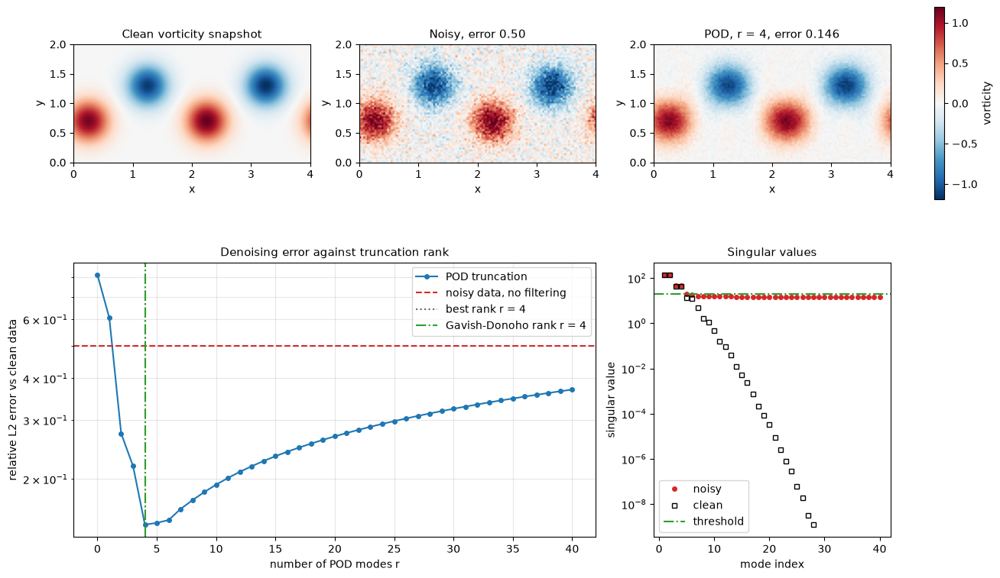
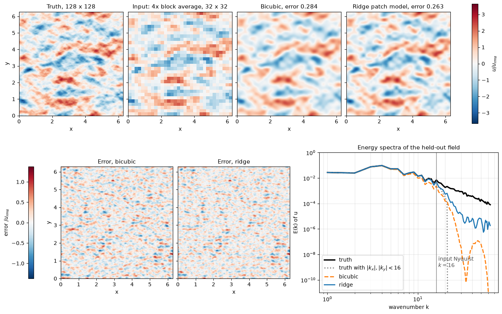

# Super-Resolution and Flow Cleansing

Measured and computed flow fields are often coarser, noisier or more incomplete than the analysis needs. PIV averages over interrogation windows and drops vectors, LES resolves only the large eddies, and sensor arrays sample a handful of points. Super-resolution recovers fine-scale structure from coarse data, and flow cleansing removes noise and outliers or fills gaps. This note treats both as one inverse problem, covers the classical estimators (interpolation, Tikhonov regularization, POD-based methods, robust PCA) and the learned ones (CNNs, generative models, physics-informed losses), and discusses how to judge a reconstruction.

The key point throughout is that a coarse or gappy measurement does not contain the missing information. Every method fills it in from a prior. That prior can be smoothness, a low-dimensional basis, or a training set, and the result can be no more reliable than the prior is for the flow at hand.

## Problem Statement

Let $\mathbf{x} \in \mathbb{R}^n$ be the high-resolution field (for example one velocity component on a fine grid) and $\mathbf{y} \in \mathbb{R}^m$ the measurement:

$$
\mathbf{y} = H\mathbf{x} + \mathbf{n}
$$

The measurement operator $H \in \mathbb{R}^{m \times n}$ averages blocks of $r \times r$ cells for super-resolution by a factor $r$ ($m = n/r^2$), selects the valid entries for gap filling, or is the identity for pure denoising. The noise $\mathbf{n}$ has covariance $\sigma^2 I$ in the simplest model. The task is to find an estimator $\hat{\mathbf{x}} = g(\mathbf{y})$.

As a regularized inverse problem, the estimate is

```math
\hat{\mathbf{x}} = \arg\min_{\mathbf{x}} \ \frac{1}{2\sigma^2}\|\mathbf{y} - H\mathbf{x}\|_2^2 + \mathcal{R}(\mathbf{x})
```

which is the maximum a posteriori (MAP) estimate for Gaussian noise and a prior $p(\mathbf{x}) \propto e^{-\mathcal{R}(\mathbf{x})}$. A learned estimator is a network $g_{\boldsymbol\theta}$ trained on pairs $`\mathcal{D} = \{(\mathbf{x}_i, \mathbf{y}_i = H\mathbf{x}_i + \mathbf{n}_i)\}_{i=1}^N`$ made by degrading high-resolution data:

```math
\mathcal{L}(\boldsymbol\theta) = \frac{1}{N}\sum_{i=1}^{N} \left\| g_{\boldsymbol\theta}(\mathbf{y}_i) - \mathbf{x}_i \right\|_2^2 + \mathcal{L}_{phys}(\boldsymbol\theta)
```

The minimizer of the mean-square term over all functions is the conditional mean $\mathbb{E}[\mathbf{x} \mid \mathbf{y}]$, so the training set plays the role of the prior. What makes the problem hard:

- $H$ has a null space of dimension at least $n - m$. Any component of $\mathbf{x}$ in it is invisible in $\mathbf{y}$ and can only come from the prior.
- In turbulence the unresolved scales are only weakly determined by the resolved ones, so even the best estimator has a substantial error.
- High-resolution training data come from DNS, fine LES or high-resolution PIV, which are expensive and may not cover the Reynolds numbers, geometries or noise of the target data.
- Pixel-wise metrics reward smooth outputs, and visually convincing outputs can be wrong in detail.

## What a Coarse Measurement Contains

With $H$ the $r \times r$ block average on a periodic grid of spacing $h$, the coarse data determine the Fourier modes of $\mathbf{x}$ only up to the coarse Nyquist wavenumber $k_c = \pi/(rh)$. Even there they are attenuated by the transfer function of the box filter, $`\mathrm{sinc}(k_x r h/2)\,\mathrm{sinc}(k_y r h/2)`$, and contaminated by aliased energy from $|k| > k_c$. Two consequences follow:

- Below $k_c$ an estimator can undo the attenuation, which is deconvolution, and partially separate the aliased energy. Plain interpolation does neither.
- Above $k_c$ the data carry information only through the aliased energy, which is mixed with the resolved modes. For a Gaussian random field, Fourier modes at different wavenumbers are independent, so beyond this aliased information the fine scales cannot be predicted from the coarse ones. Real flows have coherent structures (vortex cores, shear layers, fronts) whose small scales are phase-locked to large scales. This structure is what learned super-resolution exploits, and it is flow-specific.

## Classical Estimators

### Interpolation

Bilinear, bicubic or spline interpolation assumes the field is smooth between samples. It is fast and makes no assumptions tied to a particular flow, but it treats cell averages as point values and so leaves the box-filter attenuation in place. It adds no energy above $k_c$.

### Tikhonov Regularization and the Wiener Filter

With $`\mathcal{R}(\mathbf{x}) = \frac{\lambda}{2}\|L\mathbf{x}\|^2`$, where $L$ is a gradient or Laplacian operator, the MAP estimate is linear:

$$
\hat{\mathbf{x}} = \left(H^T H + \lambda\sigma^2 L^T L\right)^{-1} H^T \mathbf{y}
$$

If $\mathbf{x}$ is modelled as Gaussian with mean zero and covariance $C$, the posterior mean is the Wiener filter

$$
\hat{\mathbf{x}} = C H^T \left(H C H^T + \sigma^2 I\right)^{-1} \mathbf{y}
$$

which is the best linear estimator in the mean-square sense. A linear map learned by ridge regression from coarse patches to fine values, as in the script below, is a data-driven estimate of this filter that does not require $C$ to be known.

### Low-Rank Priors: Gappy POD

If snapshots of the flow lie close to the span of $r$ POD modes $\Phi = [\boldsymbol\phi_1, \dots, \boldsymbol\phi_r]$ about a mean $\bar{\mathbf{x}}$, write $\mathbf{x} \approx \bar{\mathbf{x}} + \Phi\mathbf{a}$ and fit the coefficients to the available data:

$$
\hat{\mathbf{a}} = \left(\Phi^T H^T H \Phi\right)^{-1}\Phi^T
H^T\left(\mathbf{y} - H\bar{\mathbf{x}}\right)
$$

With $H$ a mask this is gappy POD (Everson & Sirovich, 1995), the standard way to fill missing PIV vectors from the rest of the time series. The matrix $\Phi^T H^T H \Phi$ must be well conditioned, which requires enough measurements at informative locations. See [Gappy POD](../../numerical/pod/gappy_pod.md) for the derivation and the iterative version for data with gaps in every snapshot.

### Denoising by POD Truncation

For a snapshot matrix $Y = X + \sigma Z$ with a low-rank signal $X$ and white noise, the noise spreads its energy evenly over all singular values, while the signal concentrates in a few. Keeping the leading $r$ modes removes most of the noise. Choosing $r$ too small discards signal, and choosing it too large keeps noise. For known $\sigma$ and an $m \times n$ matrix ($m \ge n$), Gavish & Donoho (2014) derive the asymptotically optimal hard threshold on the singular values:

```math
\tau = \lambda(\beta)\sqrt{m}\,\sigma,
\qquad \lambda(\beta) = \sqrt{2(\beta + 1) + \frac{8\beta}{\beta + 1 + \sqrt{\beta^2 + 14\beta + 1}}},
\qquad \beta = \frac{n}{m}
```



In the example, noise at half the field RMS gives a relative error of 0.50. Truncating at four modes, two travelling pairs that hold 99.2 % of the fluctuation energy, reduces it to 0.146, and the Gavish–Donoho threshold picks the same rank without access to the clean data. Beyond the optimum the error rises again, to 0.37 at 40 modes, because each extra mode adds more noise than signal.

### Robust PCA

POD truncation assumes small, dense noise. PIV outliers are the opposite: large and sparse. Robust principal component analysis splits the data matrix into a low-rank part $L$ and a sparse part $S$ (Candès et al., 2011):

```math
\min_{L, S}\ \|L\|_* + \lambda\|S\|_1
\quad \text{subject to} \quad L + S = Y,
\qquad \lambda = \frac{1}{\sqrt{\max(m, n)}}
```

where $`\|L\|_*`$ is the nuclear norm (sum of singular values) and $`\|S\|_1`$ the sum of absolute entries. The problem is convex and is solved by augmented-Lagrangian iterations that alternate singular-value thresholding for $L$ with entry-wise soft thresholding for $S$. Scherl et al. (2020) applied it to PIV and simulation data with corrupted vectors and showed that the POD modes of $L$ are much closer to those of the clean flow than modes computed from the corrupted data.

## Learned Super-Resolution

### Convolutional Networks

SRCNN (Dong et al., 2016) set the template for image super-resolution. The low-resolution image is upsampled by bicubic interpolation and passed through three convolutional layers, interpreted as patch extraction, non-linear mapping and reconstruction, trained with a mean-square loss. Later architectures add residual and skip connections and filters at several scales so that the network sees both the local texture and the larger structure.

Fukami, Fukagata & Taira (2019) applied CNN super-resolution to fluid flows, a laminar cylinder wake and two-dimensional decaying homogeneous turbulence. They compared a plain CNN with a hybrid downsampled skip-connection multi-scale (DSC/MS) model. Both reconstructed the wake from very coarse inputs. For turbulence, the DSC/MS model recovered the vorticity field and the energy spectrum over a much wider wavenumber range than bicubic interpolation. Because the networks are trained on fields of one flow, the learned prior applies to that flow and to conditions close to it.



The figure shows the baseline every network should be compared with. The field is a random divergence-free velocity field with a $k^{-3}$ spectrum, block-averaged by a factor 4. Bicubic interpolation gives a relative error of 0.284. A linear model trained by ridge regression on 40 other fields, mapping each $5 \times 5$ coarse patch to the 16 fine values of its centre cell, gives 0.263. Keeping the true field exactly up to the input Nyquist wavenumber would give 0.257. The spectra show why. The learned model restores the energy that the block filter removed below $k = 16$ (95 % of the band $8 \le k \le 16$, against 65 % for bicubic). Above $k = 16$ it adds little (1.4 % of the energy, against 6.9 % in the truth), because this field is Gaussian and has no phase coupling between the scales to exploit. A nonlinear network can only improve on this baseline for flows whose small scales depend on the large ones.

### Generative Models and Hallucination

A network trained with a mean-square loss returns an estimate of $\mathbb{E}[\mathbf{x} \mid \mathbf{y}]$. Where the fine scales are uncertain, it averages over the possibilities, and the output is too smooth: the energy spectrum falls off early. Generative adversarial networks (GANs; Goodfellow et al., 2014) add a discriminator loss that penalizes outputs that do not look like real high-resolution fields, and temporally coherent variants such as tempoGAN (Xie et al., 2018) have been used for smoke and turbulence. The output then has realistic small scales and spectra.

The price is accuracy at each point. At best, a generator draws a sample $\tilde{\mathbf{x}}$ from the posterior $p(\mathbf{x} \mid \mathbf{y})$. If $\tilde{\mathbf{x}}$ and $\mathbf{x}$ are independent given $\mathbf{y}$,

```math
\mathbb{E}\|\tilde{\mathbf{x}} - \mathbf{x}\|^2 = 2\,\mathrm{tr}\,\mathrm{Cov}(\mathbf{x}\mid\mathbf{y}) = 2\,\mathbb{E}\|\mathbb{E}[\mathbf{x}\mid\mathbf{y}] - \mathbf{x}\|^2
```

so the expected squared error is twice that of the conditional mean. The fine-scale structures are plausible but not the true ones: they are hallucinated. This is acceptable when the goal is a realistic field, for example an inflow condition or a visualization. It is not acceptable when the reconstruction is used to measure a local quantity such as wall shear stress, peak vorticity, or a correlation with another measurement. Diffusion models trained as conditional generators have the same property.

### Physics-Informed Losses and Data Consistency

The training loss can include terms that do not need high-resolution labels:

- A divergence penalty $`\lambda_{div}\|\nabla_h\cdot\hat{\mathbf{u}}\|^2`$, with $\nabla_h$ a discrete divergence, for incompressible velocity fields. The usual caveat about planar data of three-dimensional flows applies.
- A spectrum loss $\lambda_{E}\sum_k \left(\log E_{\hat{\mathbf{x}}}(k) - \log E_{\mathbf{x}}(k)\right)^2$ that counteracts the smoothing of the mean-square loss, at the risk of hallucination described above.
- Residuals of the governing equations on the fine grid, as in [Physics-Informed Neural Networks](../neural_networks/pinns.md), when time sequences are available.
- A data-consistency term $`\|H\hat{\mathbf{x}} - \mathbf{y}\|^2`$. Consistency can also be enforced exactly after the network by the projection $\hat{\mathbf{x}} \leftarrow \hat{\mathbf{x}} + H^{+}(\mathbf{y} - H\hat{\mathbf{x}})$. For a block average, $H H^T = I/r^2$, so $H^{+} = r^2 H^T$, and the projection adds each block's mean residual to every fine cell in the block.

### Reconstruction from Sparse Sensors

The extreme case of super-resolution is reconstruction of a full field from a few point sensors. The linear baseline is gappy POD with sensors at well-conditioned locations. The shallow decoder of Erichson et al. (2020) replaces it by a fully connected network with one or two hidden layers mapping the sensor readings directly to the field, trained on snapshots. For flows such as a cylinder wake and sea-surface temperature, it gave lower errors than POD-based reconstruction from the same randomly placed sensors. As with every learned prior, it reconstructs flows similar to its training snapshots.

## Evaluating a Reconstruction

The relative $L_2$ error $`\|\hat{\mathbf{x}} - \mathbf{x}\|_2/\|\mathbf{x}\|_2`$ on held-out data is the primary measure, but it hides where the error is. Image-quality metrics are also common. The peak signal-to-noise ratio is

```math
\mathrm{PSNR} = 10\log_{10}\frac{\mathrm{MAX}^2}{\mathrm{MSE}}
```

where MAX is the range of the field and MSE the mean squared error. The structural similarity index (Wang et al., 2004) compares local means $\mu$, standard deviations $\sigma$ and the covariance $\sigma_{xy}$:

```math
\mathrm{SSIM}(x, y) = \frac{(2\mu_x\mu_y + c_1)(2\sigma_{xy} + c_2)}{(\mu_x^2 + \mu_y^2 + c_1)(\sigma_x^2 + \sigma_y^2 + c_2)},
\qquad c_1 = (0.01\,\mathrm{MAX})^2, \ \ c_2 = (0.03\,\mathrm{MAX})^2
```

It is evaluated in small sliding windows (typically Gaussian-weighted, $11 \times 11$) and averaged over the image, and equals 1 for identical fields.

Both metrics should be used with care for flow fields:

- PSNR is a rescaled MSE. Its value depends on the choice of MAX, which for a signed velocity or vorticity field is a convention, so PSNR values from different papers are rarely comparable.
- SSIM was designed for natural images and human perception. Its constants depend on MAX, and a smooth reconstruction that misses all small scales can still score high.
- Neither metric knows about physics. Each should be paired with the energy spectrum (which scales are recovered), the divergence of the reconstructed velocity, probability densities of velocity gradients or vorticity, and the quantity the reconstruction will be used for.

| Metric | Sensitive to | Blind to |
| --- | --- | --- |
| Relative $L_2$ error, PSNR | Overall amplitude and phase errors, dominated by large scales | Where the error lies in wavenumber |
| SSIM | Local structure and contrast | Physical units, the choice of MAX |
| Energy spectrum $E(k)$ | Missing or spurious energy at each scale | Phase: hallucinated structures can have the right spectrum |
| Divergence, gradient statistics | Physical consistency of small scales | Agreement with the true field at each point |

## Key Takeaways

- Super-resolution, gap filling and denoising are one inverse problem, $\mathbf{y} = H\mathbf{x} + \mathbf{n}$. What is in the null space of $H$ comes from the prior, whether that is smoothness, a POD basis or a training set.
- Interpolation does not undo the filtering of cell-averaged data. A learned linear map, a data-driven Wiener filter, already recovers most of the resolvable band and is the baseline any network has to beat.
- Gappy POD fills gaps and POD truncation removes dense noise; the Gavish–Donoho threshold chooses the rank. Robust PCA separates sparse outliers.
- CNNs trained with a mean-square loss approximate the conditional mean and produce smooth fields. GANs and spectrum losses produce realistic small scales that are not the true ones.
- Pixel metrics such as PSNR and SSIM are not enough. Compare energy spectra, divergence and the downstream quantity, on flows not used in training.

## Related Scripts

- [Flow Super-Resolution](../../../scripts/algorithms/flow_superresolution/): This script reconstructs a $128 \times 128$ velocity field from its $4\times$ block average with cubic-spline (bicubic) interpolation and with a learned linear patch model, then denoises noisy vortex-street snapshots by truncating their proper orthogonal decomposition (POD).
- [PIV Cross-Correlation](../../../scripts/algorithms/piv_cross_correlation/): This script measures a known vortex displacement field from a synthetic pair of particle images with the standard particle image velocimetry (PIV) pipeline: FFT cross-correlation in interrogation windows, a three-point Gaussian sub-pixel peak fit, iterative window deformation, and the normalized median test for spurious vectors.

## Exercises

**Exercise 1.** A reconstructed vorticity field normalized to $[0, 1]$ has MSE $= 0.0025$ against the reference. Compute the PSNR. How much does it change if the MSE is halved, and what MSE gives 40 dB?

<details>
<summary>Answer</summary>

$\mathrm{PSNR} = 10\log_{10}(1/0.0025) \approx 26.0$ dB.

Halving the MSE adds $10\log_{10}2 \approx 3.01$ dB, giving about 29.0 dB.

For 40 dB, $\mathrm{MSE} = 10^{-4}$.

</details>

**Exercise 2.** Low-resolution inputs are made by averaging adjacent pairs of fine values. Show that the fine fields $(1, 3, 2, 6)$ and $(2, 2, 5, 3)$ give the same coarse field. A network returns $\hat{\mathbf{x}} = (1.5, 2.0, 3.5, 4.0)$ for this input. Apply the data-consistency projection $\hat{\mathbf{x}} \leftarrow \hat{\mathbf{x}} + H^{+}(\mathbf{y} - H\hat{\mathbf{x}})$.

<details>
<summary>Answer</summary>

$(1 + 3)/2 = 2$ and $(2 + 6)/2 = 4$; $(2 + 2)/2 = 2$ and $(5 + 3)/2 = 4$. Both give $\mathbf{y} = (2, 4)$. The difference $(-1, 1, -3, 3)$ lies in the null space of $H$, so recovering the fine field is ill-posed and the answer depends on the prior.

$H\hat{\mathbf{x}} = (1.75, 3.75)$, so the residual is $(0.25, 0.25)$. With $r = 2$, $H^{+} = 2H^T$ copies each coarse residual to both fine cells of its block, so

```math
\hat{\mathbf{x}} \leftarrow (1.75,\ 2.25,\ 3.75,\ 4.25)
```

which averages exactly to $(2, 4)$. The projection changes only the block means. The within-block differences, which are the part that came from the prior, are unchanged.

</details>

**Exercise 3.** Compute a single global SSIM between $x = (1, 2, 3, 4)$ and $y = (1.1, 1.9, 3.2, 3.8)$, using population statistics and $c_1 = c_2 = 0$.

<details>
<summary>Answer</summary>

$\mu_x = \mu_y = 2.5$, $\sigma_x^2 = 1.25$, $\sigma_y^2 = 1.125$ and $\sigma_{xy} = 1.175$.

The mean term is $(2 \cdot 2.5 \cdot 2.5)/(2.5^2 + 2.5^2) = 1$.

The structure term is $(2 \cdot 1.175)/(1.25 + 1.125) = 2.35/2.375 \approx 0.989$.

So SSIM $\approx 0.989$. In practice SSIM is computed over local windows and averaged, with the small positive constants $c_1$ and $c_2$.

</details>

**Exercise 4.** A reference signal is $u(x) = \sin x + 0.1\sin 8x$ on $[0, 2\pi)$, and a reconstruction returns only $\sin x$. Compute the MSE, the MSE relative to the mean square of $u$, and the PSNR using the peak-to-peak range of $u$ as MAX. What fraction of the energy at wavenumber 8 is recovered?

<details>
<summary>Answer</summary>

The error is $0.1\sin 8x$, so MSE $= 0.01/2 = 0.005$. The mean square of $u$ is $0.5 + 0.005 = 0.505$, so the relative MSE is about 0.99 %.

The peak-to-peak range of $u$ is 2.167, so PSNR $= 10\log_{10}(2.167^2/0.005) \approx 29.7$ dB, which looks respectable.

None of the energy at wavenumber 8 is recovered. A pixel metric can look good while an entire band of small scales is missing, which is why the energy spectrum has to be checked as well.

</details>

**Exercise 5.** In the super-resolution example, 6.6 % of the energy of the held-out field lies outside $|k_x|, |k_y| < 16$, which the input cannot resolve. Assume the resolved modes are recovered exactly. Estimate the relative $L_2$ error of a model that predicts zero for the unresolved modes, and of a generative model that fills them with an independent sample with the correct spectrum. Compare with the ridge model's error of 0.263.

<details>
<summary>Answer</summary>

Predicting zero leaves an error equal to the unresolved part, so the relative error is $\sqrt{0.066} \approx 0.257$.

An independent sample $\tilde{\mathbf{x}}_u$ with the same energy as the true unresolved part $\mathbf{x}_u$ gives $`\mathbb{E}\|\tilde{\mathbf{x}}_u - \mathbf{x}_u\|^2 = 2\|\mathbf{x}_u\|^2`$, so the error is $\sqrt{2 \times 0.066} \approx 0.364$, 41 % larger.

The ridge model, at 0.263, is within 3 % of the first bound. The generative model would produce a more realistic-looking spectrum and a larger error. For a Gaussian field no estimator can do better than about 0.257. For a real flow, a nonlinear model can do better only to the extent that the small scales are coupled to the large ones.

</details>

## References

- Dong, C., Loy, C. C., He, K., & Tang, X., "Image super-resolution using deep convolutional networks", *IEEE Transactions on Pattern Analysis and Machine Intelligence* 38(2), 295–307, 2016.
- Fukami, K., Fukagata, K., & Taira, K., "Super-resolution reconstruction of turbulent flows with machine learning", *Journal of Fluid Mechanics* 870, 106–120, 2019.
- Candès, E. J., Li, X., Ma, Y., & Wright, J., "Robust principal component analysis?", *Journal of the ACM* 58(3), 11, 2011.
- Scherl, I., Strom, B., Shang, J. K., Williams, O., Polagye, B. L., & Brunton, S. L., "Robust principal component analysis for modal decomposition of corrupt fluid flows", *Physical Review Fluids* 5(5), 054401, 2020.
- Everson, R., & Sirovich, L., "Karhunen–Loève procedure for gappy data", *Journal of the Optical Society of America A* 12(8), 1657–1664, 1995.
- Gavish, M., & Donoho, D. L., "The optimal hard threshold for singular values is $4/\sqrt{3}$", *IEEE Transactions on Information Theory* 60(8), 5040–5053, 2014.
- Erichson, N. B., Mathelin, L., Yao, Z., Brunton, S. L., Mahoney, M. W., & Kutz, J. N., "Shallow neural networks for fluid flow reconstruction with limited sensors", *Proceedings of the Royal Society A* 476(2238), 20200097, 2020.
- Goodfellow, I., Pouget-Abadie, J., Mirza, M., Xu, B., Warde-Farley, D., Ozair, S., Courville, A., & Bengio, Y., "Generative adversarial nets", *Advances in Neural Information Processing Systems* 27, 2014.
- Xie, Y., Franz, E., Chu, M., & Thuerey, N., "tempoGAN: a temporally coherent, volumetric GAN for super-resolution fluid flow", *ACM Transactions on Graphics* 37(4), 95, 2018.
- Wang, Z., Bovik, A. C., Sheikh, H. R., & Simoncelli, E. P., "Image quality assessment: from error visibility to structural similarity", *IEEE Transactions on Image Processing* 13(4), 600–612, 2004.
