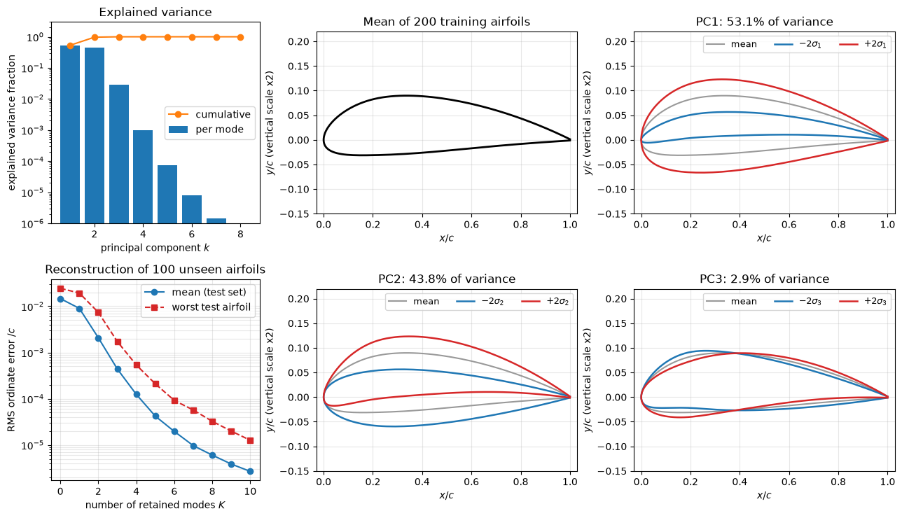

# Machine Learning on CAD Geometry

A CFD surrogate is only as useful as its description of the geometry. Before a network can predict drag for a new car or airfoil, the shape has to be turned into numbers, and if the network is used to propose shapes, those numbers have to be turned back into a closed, meshable surface. This note covers the representations used for that purpose, from classical parametric models to learned latent spaces and networks that operate directly on CAD boundary representations, and the validity checks a generated shape must pass before it can be meshed.

## Problem Statement

Let $`\mathcal{S} = \{S_1, \dots, S_N\}`$ be a collection of solid shapes (CAD models, surface meshes or scans) and, optionally, $y_i$ a simulated quantity for each, such as $C_d$. Two related tasks arise.

The representation task is to find an encoder $E$ and a decoder $D$ with a low-dimensional code $\mathbf{z} = E(S) \in \mathbb{R}^{d}$ such that the decoded shape is close to the original,

```math
\min_{E, D} \; \frac{1}{N}\sum_{i=1}^{N} d\big(S_i, D(E(S_i))\big) + \mathcal{R}(E, D)
```

where $d$ is a shape distance (for example the Chamfer distance between sampled surface points) and $\mathcal{R}$ a regulariser. A good code also makes the downstream map $\mathbf{z} \mapsto y$ smooth enough to be learned from few CFD runs.

The generation task is to produce new codes $\mathbf{z}$ (by sampling, interpolation or optimisation of a predicted $y$) whose decoded shapes $D(\mathbf{z})$ are valid: watertight, free of self-intersections, within packaging constraints, and smooth enough for boundary-layer meshing.

Several things make this hard. Shapes are not vectors: they have different numbers of faces, different topology and no natural point-to-point correspondence. The choice of $d$ decides which errors are penalised, and a small Chamfer distance does not guarantee a valid surface. CAD datasets with matching CFD results are small, typically $10^2$ to $10^4$ designs. Finally, the downstream solver needs an exact, closed geometry, while most learned decoders produce approximate point sets or implicit fields.

## Shape Representations

| Representation | Stored data | Strengths | Weaknesses for CFD | Typical networks |
| --- | --- | --- | --- | --- |
| Boundary representation (B-rep, STEP/IGES) | Trimmed NURBS faces, edges, vertices and their adjacency | Exact geometry, native to CAD, features (fillets, holes) explicit | Irregular graph of faces, variable size, hard to generate validly | UV-Net, BRepNet |
| Parametric model (NURBS, CST, FFD) | A fixed vector of control points or coefficients | Fixed length, smooth, always valid within bounds | Covers only the family it was built for | Any regressor, PCA |
| Triangle surface mesh (STL) | Vertices and triangles | Universal exchange format, close to what the mesher needs | Connectivity differs between shapes, faceting | Graph networks, MeshCNN |
| Point cloud | Unordered surface points, optionally normals | Easy to sample from any format | No connectivity, no inside or outside | PointNet, point transformers |
| Voxel grid | Occupancy on an $n^3$ grid | Regular, works with 3D CNNs | Memory grows as $n^3$, staircase surfaces | 3D CNN |
| Signed distance function (SDF) | $\phi(\mathbf{x})$ on a grid or as a network | Closed surface by construction, smooth, resolution-free | Needs surface extraction, sharp edges are rounded | DeepSDF, occupancy networks |

### Parametric Curves and Surfaces

CAD systems represent faces as non-uniform rational B-spline (NURBS) surfaces. A NURBS curve of degree $p$ with control points $`\mathbf{P}_i`$, weights $`w_i`$ and B-spline basis functions $`N_{i,p}(u)`$ on a knot vector is

```math
\mathbf{C}(u) = \frac{\sum_{i=0}^{n} N_{i,p}(u)\, w_i \mathbf{P}_i}{\sum_{i=0}^{n} N_{i,p}(u)\, w_i}
```

and a surface uses the tensor product $N_{i,p}(u)N_{j,q}(v)$. The control points of a fixed-topology model form a fixed-length vector, which is the simplest possible ML input. A B-rep adds topology: which faces bound the solid, which edges they share, and how each face is trimmed in its $(u, v)$ parameter domain.

### Signed Distance Functions

A signed distance function returns the distance to the surface $\partial\Omega$ with a sign that marks inside and outside,

```math
\phi(\mathbf{x}) = \begin{cases} -\mathrm{dist}(\mathbf{x}, \partial\Omega), & \mathbf{x} \in \Omega, \\ +\mathrm{dist}(\mathbf{x}, \partial\Omega), & \mathbf{x} \notin \Omega, \end{cases} \qquad |\nabla\phi| = 1 \text{ almost everywhere}
```

The surface is the zero level set $\phi = 0$. Any continuous field has a closed zero level set, which is why implicit representations are attractive for generation. The surface is recovered as a triangle mesh with marching cubes on a sampled grid (Lorensen and Cline, 1987). SDFs on a grid are also common inputs for CNN surrogates of flow fields, because the distance to the wall is a physically meaningful feature everywhere in the domain.

## Parametric Shape Models

Parametric models describe a family of shapes by a few numbers. They are the standard input for CFD surrogates because every parameter vector maps to a valid shape and the parameters have engineering meaning.

### Class-Shape Transformation

The class-shape transformation (CST) of Kulfan (2008) writes an airfoil surface as a class function times a shape function, with $\psi = x/c$:

```math
\frac{y(\psi)}{c} = C(\psi)\, S(\psi) + \psi\, \frac{\Delta z_{TE}}{c},
\qquad C(\psi) = \psi^{N_1}(1 - \psi)^{N_2},
\qquad S(\psi) = \sum_{i=0}^{n} A_i \binom{n}{i}\psi^i(1 - \psi)^{n-i}
```

The exponents $N_1 = 0.5$, $N_2 = 1$ give a round nose and a sharp trailing edge. The shape function is a Bernstein polynomial whose coefficients $A_i$ are the design variables, with $A_0$ fixing the leading-edge radius ($R_{LE}/c = A_0^2/2$) and $A_n$ the trailing-edge angle. A few coefficients per surface (Bernstein orders of about 4 to 8) reproduce most practical airfoils closely.

### Free-Form Deformation

Free-form deformation (FFD), introduced by Sederberg and Parry (1986), embeds the geometry in a lattice of control points $\mathbf{P}_{ijk}$ and moves every embedded point with the lattice. A point with local lattice coordinates $(s, t, u) \in [0, 1]^3$ is mapped to

```math
\mathbf{X}(s, t, u) = \sum_{i=0}^{l}\sum_{j=0}^{m}\sum_{k=0}^{n} B_i^{l}(s)\,
B_j^{m}(t)\, B_k^{n}(u)\, \mathbf{P}_{ijk}
```

with Bernstein polynomials $B_i^{l}(s) = \binom{l}{i}s^i(1-s)^{l-i}$. With the undeformed lattice the map is the identity. The displacement of every surface point is linear in the control-point displacements, so FFD gives a smooth, mesh-independent parameterisation in which the design variables are a selection of control-point moves. Large moves can fold the lattice; the deformation stays locally invertible only while the Jacobian determinant of $\mathbf{X}(s, t, u)$ stays positive. FFD and the related radial-basis-function morphing are the standard tools for automotive design studies; see [Deformation Parameters](../automotive_aerodynamics/deformation_parameters.md).

### Linear Shape Spaces by PCA

If all shapes are sampled at corresponding points, each becomes a vector $\mathbf{s}_i \in \mathbb{R}^{3n}$ and principal component analysis gives a data-driven parameterisation:

$$
\mathbf{s} \approx \bar{\mathbf{s}} + \sum_{k=1}^{K} a_k \boldsymbol\phi_k,
\qquad a_k = \boldsymbol\phi_k^T(\mathbf{s} - \bar{\mathbf{s}})
$$

where $\bar{\mathbf{s}}$ is the mean shape and $\boldsymbol\phi_k$ are the leading left singular vectors of the centred data matrix, with variances $\lambda_k = \sigma_k^2/(N-1)$. This is the same computation as [proper orthogonal decomposition](../../numerical/pod/pod_intro.md) applied to coordinates instead of flow fields. Two conditions matter. The shapes must be in correspondence (the $j$-th entry of every vector refers to the same material point), which morphing a common baseline mesh provides automatically and which otherwise requires a common parameterisation or registration. They must also be aligned, usually by removing translation, rotation and, if appropriate, scale with a Procrustes fit, so that the modes describe shape changes rather than rigid motions.



The figure shows PCA of 200 NACA 4-digit airfoils with random camber, camber position and thickness. Three modes hold 99.9% of the variance. The first is almost pure thickness, because the thickness distribution is linear in $t$, and the next two describe the amount and position of camber. The reconstruction error of 100 unseen airfoils falls from $1.5 \times 10^{-2}c$ with the mean shape to $4.4 \times 10^{-4}c$ with three modes. A family generated by three physical parameters is thus captured by three linear modes, which is typical when the parameters enter the geometry almost linearly. Strongly nonlinear families, such as shapes with moving features or changing topology, need many more linear modes, which is the motivation for nonlinear autoencoders.

## Learned Representations

### Autoencoders and Variational Autoencoders

An autoencoder replaces the linear maps of PCA by neural networks $E_{\boldsymbol\theta}$ and $D_{\boldsymbol\theta}$ trained to minimise a reconstruction loss. For point clouds the usual loss is the Chamfer distance between the input set $S_1$ and the decoded set $S_2$,

```math
d_{\mathrm{CD}}(S_1, S_2) = \frac{1}{|S_1|}\sum_{\mathbf{x} \in S_1} \min_{\mathbf{y} \in S_2} \|\mathbf{x} - \mathbf{y}\|^2 + \frac{1}{|S_2|}\sum_{\mathbf{y} \in S_2} \min_{\mathbf{x} \in S_1} \|\mathbf{y} - \mathbf{x}\|^2 .
```

The first term penalises missing geometry, the second spurious geometry. Neither says anything about whether the decoded points describe a closed surface.

A variational autoencoder (Kingma and Welling, 2014) makes the encoder output a Gaussian $`q(\mathbf{z} \mid S) = \mathcal{N}(\boldsymbol\mu, \mathrm{diag}\,\boldsymbol\sigma^2)`$ and adds a Kullback-Leibler term that pulls it towards the prior $\mathcal{N}(\mathbf{0}, I)$:

$$
\mathcal{L} = \mathbb{E}_{q}\left[d\big(S, D(\mathbf{z})\big)\right] + \beta
\sum_{j=1}^{d} \frac{1}{2}\left(\mu_j^2 + \sigma_j^2 - 1 - \ln\sigma_j^2\right)
$$

The KL term keeps the latent space compact and continuous, so that points between two encoded shapes decode to plausible shapes and new shapes can be sampled from the prior. The weight $\beta$ trades reconstruction accuracy against that regularity. For design optimisation the latent code then plays the role of the design vector, but unlike CAD parameters its directions have no direct engineering meaning, and constraints such as a fixed wheelbase have to be imposed by penalty or by conditioning the decoder.

### Implicit Neural Representations

DeepSDF (Park et al., 2019) represents a family of shapes by one network $f_{\boldsymbol\theta}(\mathbf{z}_i, \mathbf{x}) \approx \phi_i(\mathbf{x})$ that takes a latent code and a query point and returns the signed distance. It is trained as an auto-decoder: there is no encoder, and the codes $\mathbf{z}_i$ are optimised together with $\boldsymbol\theta$,

```math
\min_{\boldsymbol\theta, \{\mathbf{z}_i\}} \sum_{i=1}^{N}\sum_{j} \left|
\mathrm{clamp}\big(f_{\boldsymbol\theta}(\mathbf{z}_i, \mathbf{x}_j), \delta\big) -
\mathrm{clamp}\big(\phi_i(\mathbf{x}_j), \delta\big) \right| +
\frac{1}{\sigma^2}\sum_{i=1}^{N}\|\mathbf{z}_i\|^2
```

where $\mathrm{clamp}(\phi, \delta) = \min(\delta, \max(-\delta, \phi))$ concentrates the fit near the surface and the last term is a Gaussian prior on the codes. A new shape is encoded by optimising $\mathbf{z}$ alone against its sampled distances. Occupancy networks are the same idea with an inside/outside probability instead of a distance. Because the output is a continuous field, the extracted zero level set is always closed, which addresses the watertightness problem of point-cloud decoders. The trade-offs are rounded sharp edges, the cost of marching cubes, and fields that can still contain small spurious components away from the main body.

### Networks on Points and Meshes

PointNet (Qi et al., 2017) applies the same small network to every point and aggregates with a symmetric function (a max over points), which makes the output independent of point order. It and its successors are used to encode car surfaces for drag prediction. Graph neural networks operate on the vertices and edges of the surface mesh and can predict fields such as $C_p$ on the same mesh; they are covered in [Graph Neural Networks](../neural_networks/graph_neural_networks.md).

### Learning Directly on B-reps

B-reps carry information that is lost when a model is tessellated: which faces are planes, cylinders or freeform patches, where edges are sharp, and how faces are connected. Two architectures from 2021 learn directly from it. UV-Net (Jayaraman et al., 2021) samples each face on a regular grid in its $(u, v)$ parameter domain (points, normals and a trimming mask) and each edge along its curve parameter, encodes these grids with small CNNs, and passes messages over the face-adjacency graph with a graph network. BRepNet (Lambourne et al., 2021) defines convolutions on oriented coedges, the half-edges of the B-rep topology, so that the kernel follows the faces and edges around each entity in a fixed topological pattern. Both are used for classification and face segmentation (for example, recognising machining features), not yet for flow prediction, but they show that the CAD structure itself can be the input.

Generating B-reps is harder because the output must satisfy topological consistency. DeepCAD (Wu et al., 2021) avoids generating the B-rep directly: it represents a model as the sequence of sketch and extrude commands that builds it, learns a transformer autoencoder on such sequences, and lets a CAD kernel execute the decoded sequence to produce an exact solid. The approach is restricted to the operations in its command vocabulary (lines, arcs, circles, extrusions) and therefore to prismatic parts, but its output is a proper parametric CAD model.

### Text and Sketch to CAD

Language and vision models can now emit CAD command sequences or scripts for programmatic CAD tools from a text prompt or a hand sketch. In practice the results are simple prismatic parts, and a substantial share of generated programs fail to execute or produce a different part than intended, so each output still has to be checked. Freeform aerodynamic surfaces such as car bodies or wings are far from what these methods produce reliably. For CFD the practical value today lies in setting up parametric templates and in retrieving similar models from a library, not in creating simulation-ready aerodynamic geometry from a description.

## From Generated Geometry to a Simulation-Ready Model

A mesher needs a closed, consistently oriented, non-self-intersecting surface with features larger than the target cell size. A shape that looks right on screen can fail any of these. The following checks are cheap and should run automatically on every generated or morphed shape before meshing.

| Check | Test on a triangle mesh | Typical fix |
| --- | --- | --- |
| Watertight | Every edge is shared by exactly two triangles | Hole filling, re-extraction from an SDF |
| Manifold | Every vertex has a single fan of triangles around it | Splitting non-manifold vertices, remeshing |
| Consistent orientation | Adjacent triangles traverse their common edge in opposite directions; signed volume is positive | Flipping inconsistent faces |
| Topology | Euler characteristic $\chi = V - E + F = 2 - 2g$ matches the expected genus $g$ | Removing small handles or spurious components |
| No self-intersections | No pair of non-adjacent triangles intersects | Limiting morph amplitude, smoothing |
| Feature size | Minimum gap and wall thickness exceed a few target cell sizes | Constraining the design space |
| Smoothness | Normals vary smoothly except at intended sharp edges | Smoothing the decoder output, remeshing |

The signed volume of a closed triangle mesh follows from the divergence theorem,

$$
V = \frac{1}{6}\sum_{\text{triangles}} \mathbf{v}_1 \cdot
(\mathbf{v}_2 \times \mathbf{v}_3)
$$

where $\mathbf{v}_1, \mathbf{v}_2, \mathbf{v}_3$ are the vertices of each triangle in its stored order. A negative value means the normals point inwards, and a value that changes when the origin is moved means the mesh is not closed.

The route from a representation to a solver-ready surface differs by type. Parametric models and DeepCAD-style command sequences produce exact CAD through a geometry kernel. Implicit fields go through marching cubes, then remeshing and feature recovery. Point clouds need surface reconstruction, for example Poisson reconstruction, which is the least robust route. Mesh-based decoders that deform a template mesh inherit its topology and correspondence, which is why morphing a baseline remains the most common choice in industrial aerodynamic studies.

## Choosing a Representation

| Situation | Recommended representation |
| --- | --- |
| Design study around one baseline with a few engineering parameters | Morphing parameters (FFD, RBF) as the input vector |
| Many variants of one family, shapes available as corresponding meshes | PCA of coordinates, then a regressor on the coefficients |
| Heterogeneous shapes from different sources, prediction of a scalar | Point cloud or graph network on sampled surfaces |
| Prediction of surface fields such as $C_p$ | Graph network on the surface mesh |
| Shape generation that must stay watertight | Implicit (SDF) decoder, or deformation of a template mesh |
| Learning from CAD features (holes, fillets, face types) | B-rep networks (UV-Net, BRepNet) |

## Key Takeaways

- The representation decides what an ML model can learn and what it can generate; fixed-length parametric vectors are the simplest and are always valid within their bounds.
- CST and FFD give smooth, low-dimensional, engineering-meaningful parameterisations; PCA of corresponding shapes gives a data-driven one that is optimal among linear models.
- Autoencoders and VAEs extend PCA to nonlinear shape families, at the cost of latent directions without physical meaning.
- Implicit representations such as DeepSDF produce closed surfaces by construction, which point-cloud decoders do not.
- B-rep networks and command-sequence models work with the CAD structure itself, but current methods are limited to classification, segmentation and simple prismatic parts.
- Every generated shape must pass automatic validity checks (watertight, manifold, oriented, no self-intersections, sufficient feature size) before meshing.

## Related Scripts

- [Airfoil Shape PCA](../../../scripts/algorithms/airfoil_shape_pca/): builds a linear shape space for NACA 4-digit airfoils by principal component analysis (PCA) of their surface coordinates and shows how few modes are needed to describe the family.
- [Surrogate Input Representations](../../../scripts/plots/surrogate_input_representations/): draws one NACA 2412 airfoil in the four forms a neural-network surrogate can take as input: a parameter vector, a signed distance field on a Cartesian grid, a surface point cloud, and a mesh graph.

## Exercises

**Exercise 1.** A generated 2D shape is sampled as $`S_2 = \{(0, 0.1), (1, 0), (2, 0)\}`$ and the reference as $`S_1 = \{(0, 0), (1, 0)\}`$. Compute the Chamfer distance $d_{\mathrm{CD}}(S_1, S_2)$ defined above and its two one-sided terms. Which term detects the spurious point?

<details>
<summary>Answer</summary>

From $S_1$ to $S_2$: $(0, 0)$ is nearest to $(0, 0.1)$ with squared distance 0.01, and $(1, 0)$ matches exactly. The mean is 0.005.

From $S_2$ to $S_1$: $(0, 0.1)$ gives 0.01, $(1, 0)$ gives 0, and $(2, 0)$ is nearest to $(1, 0)$ with squared distance 1. The mean is $1.01/3 \approx 0.337$.

The total is $d_{\mathrm{CD}} \approx 0.342$. The second term penalises the extra point. The first term alone (0.005) would rate the shape as nearly perfect, which is why one-sided distances are not used as reconstruction losses.

</details>

**Exercise 2.** Two decoded car surfaces are closed triangle meshes in which every edge is shared by exactly two triangles. Mesh A has $F = 20{,}000$ triangles and $V = 10{,}002$ vertices; mesh B has $F = 20{,}000$ and $V = 10{,}000$. Find the number of edges and the genus of each. Which one should be rejected before meshing a car body?

<details>
<summary>Answer</summary>

Each triangle has three edges and each edge belongs to two triangles, so $E = 3F/2 = 30{,}000$ for both meshes.

Mesh A: $\chi = V - E + F = 10{,}002 - 30{,}000 + 20{,}000 = 2$, so $g = 0$, a sphere-like closed surface, as expected for a car body without through-holes.

Mesh B: $\chi = 0$, so $g = 1$. The surface has a handle, for example a thin tunnel the decoder has opened through the body or two parts fused at one spot. Unless the design really has a through-flow duct, mesh B should be rejected or repaired. The test costs one count of vertices and faces.

</details>

**Exercise 3.** A symmetric CST airfoil uses $N_1 = 0.5$, $N_2 = 1$, zero trailing-edge thickness and a constant shape function $S(\psi) = A_0$ on each surface. Find the chordwise position of maximum thickness and the value of $A_0$ that gives a thickness of 12% of chord. What leading-edge radius results?

<details>
<summary>Answer</summary>

The half-thickness is $`y/c = A_0\,\psi^{1/2}(1 - \psi)`$. Setting the derivative to zero, $\tfrac{1}{2}\psi^{-1/2}(1 - \psi) - \psi^{1/2} = 0$, gives $1 - \psi = 2\psi$, so $\psi = 1/3$.

At $\psi = 1/3$ the class function is $(1/3)^{1/2}(2/3) \approx 0.385$. A 12% thick airfoil has half-thickness 0.06, so $A_0 = 0.06/0.385 \approx 0.156$.

The leading-edge radius is $R_{LE}/c = A_0^2/2 \approx 0.0122$. A single coefficient fixes thickness, its position and nose radius together, which is why practical CST models use several Bernstein coefficients per surface.

</details>

**Exercise 4.** In the airfoil PCA figure the cumulative explained variance is 0.531 for one mode, 0.970 for two, 0.99894 for three and 0.99992 for four. How many modes are needed to explain 99.9% of the variance? Explain why one mode suffices for all thickness variation in this family, and why camber needs more than one.

<details>
<summary>Answer</summary>

Three modes give 0.99894, just below 0.999, so four modes are needed for 99.9%.

The shape vector is $`[y_c + y_t; \; y_c - y_t]`$ and $`y_t(x) = t\,g(x)`$ with a fixed function $g$. Every change in $t$ therefore moves the vector along the single direction $[g; -g]$, so thickness spans exactly one dimension. The camber line is $m$ times a function that depends nonlinearly on $p$: changing the position of maximum camber changes the shape of the camber line, not just its amplitude, and a nonlinear one-parameter family of curves needs several linear modes to be represented accurately.

</details>

**Exercise 5.** A VAE encoder returns $\mu = 0.5$ and $\sigma = 0.8$ in each of 32 latent dimensions for one shape. Compute the KL term per dimension and in total. What happens to interpolation between shapes if $\beta$ is set much too small?

<details>
<summary>Answer</summary>

Per dimension, $\tfrac{1}{2}(0.25 + 0.64 - 1 - \ln 0.64) = \tfrac{1}{2}(-0.11 + 0.446) \approx 0.168$ nats, so $32 \times 0.168 \approx 5.38$ nats in total.

With a very small $\beta$ the model behaves like a plain autoencoder. The encoder places shapes in isolated regions of latent space with tiny variances, and points between two encoded shapes decode to geometry the decoder never learned, often with holes or spurious fragments. Smooth interpolation and sampling from the prior are what the KL term buys.

</details>

## References

- Piegl, L., & Tiller, W., *The NURBS Book*, 2nd ed., Springer, 1997.
- Kulfan, B. M., "Universal Parametric Geometry Representation Method", *Journal of Aircraft* 45(1), 142–158, 2008.
- Sederberg, T. W., & Parry, S. R., "Free-Form Deformation of Solid Geometric Models", *Computer Graphics (Proceedings of SIGGRAPH '86)* 20(4), 151–160, 1986.
- Lorensen, W. E., & Cline, H. E., "Marching Cubes: A High Resolution 3D Surface Construction Algorithm", *Computer Graphics (Proceedings of SIGGRAPH '87)* 21(4), 163–169, 1987.
- Kingma, D. P., & Welling, M., "Auto-Encoding Variational Bayes", International Conference on Learning Representations (ICLR), 2014.
- Qi, C. R., Su, H., Mo, K., & Guibas, L. J., "PointNet: Deep Learning on Point Sets for 3D Classification and Segmentation", IEEE Conference on Computer Vision and Pattern Recognition (CVPR), 2017.
- Park, J. J., Florence, P., Straub, J., Newcombe, R., & Lovegrove, S., "DeepSDF: Learning Continuous Signed Distance Functions for Shape Representation", IEEE Conference on Computer Vision and Pattern Recognition (CVPR), 2019.
- Jayaraman, P. K., Sanghi, A., Lambourne, J. G., Willis, K. D. D., Davies, T., Shayani, H., & Morris, N., "UV-Net: Learning from Boundary Representations", IEEE Conference on Computer Vision and Pattern Recognition (CVPR), 2021.
- Lambourne, J. G., Willis, K. D. D., Jayaraman, P. K., Sanghi, A., Meltzer, P., & Shayani, H., "BRepNet: A Topological Message Passing System for Solid Models", IEEE Conference on Computer Vision and Pattern Recognition (CVPR), 2021.
- Wu, R., Xiao, C., & Zheng, C., "DeepCAD: A Deep Generative Network for Computer-Aided Design Models", IEEE/CVF International Conference on Computer Vision (ICCV), 2021.
