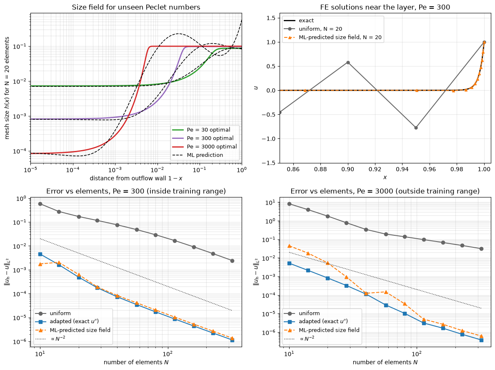

# Machine Learning for Mesh Generation and Adaptation

The mesh decides both the cost and the accuracy of a CFD result, and producing a good one for a new geometry still takes expert time or several cycles of solve, estimate and refine. Goal-oriented adaptation methods produce excellent meshes for a chosen output such as drag, but each new case needs repeated primal and adjoint solves. Machine learning is used here to predict the result of that process, a mesh-size or metric field, directly from the geometry and the flow conditions, so that a near-optimal mesh is available before the first solve. This note reviews the error-estimation background that defines what an optimal mesh is, the main ML formulations, how the training data is generated, and how the results should be evaluated.

## Problem Statement

Let $G$ be a geometry in a computational domain $\Omega$ and $\boldsymbol\mu$ the flow conditions (Reynolds number, Mach number, angle of attack). A mesh generator produces a mesh $\mathcal{T}$ from a size field $h(\mathbf{x})$ or, for anisotropic meshes, from a metric tensor field $\mathcal{M}(\mathbf{x})$. Let $J$ be an output functional (drag, lift, a heat flux), $u$ the exact solution and $u_{\mathcal{T}}$ the discrete solution on $\mathcal{T}$. The optimal mesh for a given cost solves

```math
\min_{\mathcal{M}} \; \big|J(u) - J(u_{\mathcal{T}(\mathcal{M})})\big| \quad
\text{subject to} \quad \mathcal{C}(\mathcal{M}) = \int_\Omega
\sqrt{\det\mathcal{M}(\mathbf{x})}\, d\mathbf{x} = N
```

where the complexity $\mathcal{C}$ is proportional to the number of mesh vertices. Adjoint-based adaptation approximates the solution of this problem iteratively for one case at a time.

The learning problem is to approximate the map from case to optimal field. Given a dataset $`\mathcal{D} = \{(G_i, \boldsymbol\mu_i, h_i)\}_{i=1}^{N_c}`$ of $N_c$ cases with adapted size fields $h_i$, find $f_{\boldsymbol\theta}$ minimising

$$
\mathcal{L}(\boldsymbol\theta) = \frac{1}{N_c}\sum_{i=1}^{N_c}
\frac{1}{|\Omega_i|}\int_{\Omega_i}
\Big(\log f_{\boldsymbol\theta}(G_i, \boldsymbol\mu_i, \mathbf{x}) - \log
h_i(\mathbf{x})\Big)^2 d\mathbf{x}
$$

or the analogous loss on the components of $\log\mathcal{M}$. The logarithm makes the loss measure relative errors, which is what matters for sizes that span several orders of magnitude. An alternative is to learn a refinement policy that decides, element by element, whether to refine.

The difficulty is that the quantity that matters, the error in $J$ on the resulting mesh, is not the training loss. The target is expensive (each training case needs a full adaptation loop), not unique (different meshes give almost the same error), defined on domains that change from case to case, and the trained model has to generalise to geometries and flow regimes outside its training data, where a poor mesh may be worse than a conservative uniform one.

## Error Estimation Background

### A Posteriori Error Indicators

An a posteriori error estimator computes a local indicator $\eta_K$ for every element $K$ from the discrete solution. Residual-based indicators measure how badly $u_{\mathcal{T}}$ satisfies the PDE inside elements and across faces. Recovery-based indicators compare the discrete gradient with a smoothed reconstruction of it. Feature-based indicators, such as normalised gradients of velocity or Mach number, are simpler and widely used but carry no guarantee about any particular output. All of these target a global norm of the error. A cell with a large residual far from the body may not affect the drag at all.

### Goal-Oriented Adaptation and the Dual-Weighted Residual

Goal-oriented methods weight the local residuals by their influence on $J$. For a discrete residual $\mathbf{R}(\mathbf{u}) = 0$ the discrete adjoint $\boldsymbol\psi$ solves

$$
\left(\frac{\partial \mathbf{R}}{\partial \mathbf{u}}\right)^T
\boldsymbol\psi = \left(\frac{\partial J}{\partial \mathbf{u}}\right)^T
$$

If $\mathbf{u}_H$ is the coarse solution prolonged to a finer space $h$, linearisation gives the adjoint-weighted residual estimate (Venditti and Darmofal, 2000)

$$
J_h(\mathbf{u}_h) - J_h(\mathbf{u}_H^h) \approx - \left(\boldsymbol\psi_h\right)^T
\mathbf{R}_h(\mathbf{u}_H^h)
$$

so the error in the output is the residual of the coarse solution on the fine space, weighted by the adjoint. In the finite-element setting the dual-weighted residual (DWR) method of Becker and Rannacher (2001) writes the same idea as

```math
J(u) - J(u_h) \approx \sum_{K} \eta_K,
\qquad \eta_K = \rho_K(u_h)\, \omega_K(z)
```

where $\rho_K$ is the local residual and $\omega_K$ a local weight built from the adjoint (dual) solution $z$, approximated by a higher-order reconstruction. The adjoint is large where perturbations of the flow change $J$ strongly, typically upstream of the body, in the boundary layer and along the stagnation streamline, and small in the wake far downstream for a drag functional. Elements are then marked for refinement, for instance with Dörfler marking: choose the smallest set of elements whose indicators sum to at least a fraction $\theta$ of the total (Dörfler, 1996).

### Metric-Based Anisotropic Adaptation

Boundary layers, shocks and wakes need cells that are small in one direction and long in the others. A Riemannian metric field $\mathcal{M}(\mathbf{x})$, a symmetric positive-definite matrix at every point, prescribes this. Its eigendecomposition gives the requested sizes along the principal directions,

```math
\mathcal{M} = R\,\mathrm{diag}\left(h_1^{-2}, \dots, h_n^{-2}\right) R^T
```

and the length of an edge $\mathbf{e}$ measured in the metric is $`\ell_{\mathcal{M}}(\mathbf{e}) = \sqrt{\mathbf{e}^T\mathcal{M}\,\mathbf{e}}`$. The mesh generator builds a unit mesh, one whose edges all have metric length close to one. In the continuous-mesh framework of Loseille and Alauzet (2011) the metric that minimises the $L^p$ norm of the linear interpolation error of a field $u$ with Hessian $H_u$, for a given complexity $N$ in $n$ dimensions, is

$$
\mathcal{M}_{L^p} = N^{2/n}
\left(\int_\Omega \big(\det|H_u|\big)^{\frac{p}{2p+n}} d\mathbf{x} \right)^{-2/n}
\big(\det|H_u|\big)^{-\frac{1}{2p+n}} |H_u|
$$

where $|H_u|$ is the Hessian with its eigenvalues replaced by their absolute values. In one dimension this reduces to a node density $\rho = 1/h \propto |u''|^{p/(2p+1)}$, which for $p = 2$ is $|u''|^{2/5}$. Goal-oriented versions replace $|H_u|$ by a sum of Hessians weighted with adjoint gradients. Metric fields are the natural target for learning anisotropic meshes because they are smooth, independent of any particular mesh, and accepted directly by anisotropic mesh generators.

## Machine-Learning Formulations

| Approach | What is learned | Input | Training target | Examples |
| --- | --- | --- | --- | --- |
| Size-field regression on images | $\log h$ on a Cartesian grid | Rasterised geometry, flow conditions | Size fields of adjoint-adapted meshes | Huang et al. (2021) |
| Size-field regression on a mesh | $h$ or $\mathcal{M}$ per element or vertex | Coarse mesh with geometry and flow features | Adapted or a posteriori sizes | MeshingNet (Zhang et al., 2020) |
| Learned error estimation | Output-error indicator $\eta_K$ | Coarse primal solution, local features | Adjoint-weighted residuals | Chen and Fidkowski (2020) |
| Refinement policy | Refine or coarsen decision per element | Local error estimate, depth, neighbourhood | Reward: error reduction minus cost | Yang et al. (2023), MeshDQN |
| Graph networks with remeshing | Sizing tensor on the simulation mesh | Current mesh and state | Sizes from a reference remesher | Pfaff et al. (2021) |

### Learning Size Fields

The most direct formulation treats the size field as an image. Huang et al. (2021) generate random two-dimensional bodies in a wind-tunnel domain, adapt a mesh for each with an adjoint-based method, rasterise the resulting cell sizes on a regular grid, smooth and downsample them to $128 \times 128$ pixels, and train a U-Net to map an image of the geometry to the size image. Pixels inside the solid and in the prism-layer region are masked out, so the loss is a masked mean squared error,

$$
\mathcal{L} = \frac{1}{\sum_i m_i} \sum_i m_i \big(\hat{d}_i - d_i\big)^2
$$

where $\hat{d}_i$ is the predicted and $d_i$ the reference value (preferably of $\log h$) at pixel $i$, and $`m_i \in \{0, 1\}`$ is one in the fluid. The denominator counts the fluid pixels, so the loss is an average over the region where the mesh matters. The prism layers are left to the mesher's boundary-layer settings, which is sensible because near-wall spacing is set by the target $y^+$ rather than by the outer flow (see [Boundary Layers](../../../practice/mesh_generation/boundary_layers.md)).

MeshingNet (Zhang et al., 2020) works on unstructured meshes: an MLP predicts the desired local element area from the coordinates of a point, the geometry parameters and the PDE parameters, and the prediction drives a standard triangle mesh generator. The training targets come from a posteriori error estimates on a fine reference solution.

Chen and Fidkowski (2020) learn the error estimate rather than the size: a CNN predicts the adjoint-weighted output error indicator from the primal solution on a coarse mesh, which then drives the usual output-based anisotropic adaptation step. This keeps the physics-based adaptation loop but removes the adjoint solve, which for complex flows is the most expensive and least robust part of the loop.

### Refinement as a Learned Policy

Adaptive refinement is a sequence of decisions, so it can be posed as a Markov decision process. Yang et al. (2023) define the state from local features of each element (its error estimate, refinement depth and neighbourhood), the action as the refinement of selected elements, and the reward as the reduction of the global error minus a penalty on the number of degrees of freedom. Because the policy acts element by element on local features, a policy trained on small problems can be applied to larger meshes than those seen in training. MeshDQN (Lorsung and Barati Farimani, 2023) applies deep Q-learning to coarsen an existing mesh while keeping lift and drag within a tolerance. Policies avoid the need for "optimal" target meshes, but they still need a solver in the training loop and a reward that reflects the output error.

### Graph Networks

When the mesh itself is the data structure, graph neural networks are the natural model ([Graph Neural Networks](../neural_networks/graph_neural_networks.md)). MeshGraphNets (Pfaff et al., 2021) predicts, alongside the next state of the simulation, a sizing tensor at each vertex that a remesher uses to refine and coarsen the mesh as the solution evolves. Graph networks are also used to predict mesh quality metrics or to flag elements that will cause solver problems, using element shape measures (skewness, aspect ratio, non-orthogonality) as features; see [Mesh Quality](../../../practice/mesh_generation/mesh_quality.md).

## Generating Training Data

The training set is produced offline by running the expensive adaptation loop on many cases.

1. Generate geometries that cover the intended use, for example random polygons and spline bodies in two dimensions or morphed variants of a baseline in three ([Deformation Parameters](../automotive_aerodynamics/deformation_parameters.md)). Vary the flow conditions as well, since the optimal mesh depends on them.
2. Solve the primal problem on an initial mesh to a tight convergence tolerance; an unconverged primal residual contaminates the error estimate.
3. Solve the adjoint problem for the chosen output.
4. Compute the local indicators or the goal-oriented metric and generate a new mesh at the prescribed complexity.
5. Repeat steps 2 to 4 until the output and the mesh stop changing (typically 5 to 10 cycles), optionally at several complexities.
6. Store the final size or metric field as the target, interpolated to the learning representation (pixels, a background mesh or the vertices of a coarse mesh), together with masks for solid regions.

The cost of one training case is several primal and adjoint solves, so datasets are usually limited to hundreds or a few thousand two-dimensional cases. The output functional must be fixed in advance: a mesh optimal for drag is not optimal for, say, the pressure on a sensor.

## A One-Dimensional Example

The script [Adaptive Mesh Sizing](../../../scripts/algorithms/adaptive_mesh_sizing/) shows the whole chain on a problem small enough to run in a second. The steady convection-diffusion equation $-\varepsilon u'' + u' = 0$ on $[0, 1]$ with $\varepsilon = 1/\mathrm{Pe}$ has a boundary layer of width $\varepsilon$ at the outflow. For seven training Peclet numbers between 10 and 1000 the optimal $L^2$ node density $\hat\rho \propto (1 + |u''|/\alpha)^{2/5}$ is computed from the exact solution, and a ridge regression on the features $\log_{10}\mathrm{Pe}$ and $\log_{10}(1 + (1 - x)\mathrm{Pe})$, the wall distance in layer units, learns $\log_{10}\hat\rho$. For unseen Peclet numbers the predicted density is turned into nodes by equidistribution, $`\int_{x_{j-1}}^{x_j}\hat\rho\,dx = 1/N`$, and the Galerkin finite-element problem is solved.



Three observations carry over to real applications. First, uniform meshes are not merely inaccurate here but wrong: with 20 elements at $\mathrm{Pe} = 300$ the mesh Peclet number in the layer exceeds one and the solution oscillates over the whole domain. Second, inside the training range the learned meshes are within 30% of the optimal error for $N \geq 14$, more than two orders of magnitude below uniform meshes of the same size. Third, at $\mathrm{Pe} = 3000$, outside the training range, the learned meshes are still far better than uniform ones but up to 8.6 times worse than optimal at small $N$. The choice of input feature matters: expressing the wall distance in layer units collapses the cases onto one curve, and without it the same regression cannot represent layers of different widths.

## Evaluating Learned Meshes

Regression error on the size field is a poor measure of success, because large relative errors in regions that do not affect $J$ are harmless while small ones near the body may not be. The evaluation that matters is end-to-end:

1. Generate a mesh from the predicted field for each test case at several complexities.
2. Solve the flow and evaluate $J$; obtain a reference $J$ from a highly refined adapted solution or from extrapolation.
3. Plot the output error against the number of degrees of freedom for uniform or expert meshes, adjoint-adapted meshes and ML meshes. The adapted curve is the target, and the gap between the ML curve and the adapted curve at equal cost is the quantity to report.
4. Report the mesh-generation and solve times, including the time saved by skipping adaptation cycles.

Mesh quality (minimum angles, aspect ratios, growth rates) must also be checked, because a predicted field can be rough enough to produce poor elements. For error estimators the standard check is the effectivity index $\eta/(J(u) - J(u_h))$, which should be close to one. A practical safeguard is to use the ML mesh as the initial mesh of a conventional adaptation loop: if the prediction is good the loop converges in one or two cycles, and if it is poor the loop still reaches the correct answer.

## Key Takeaways

- An optimal mesh is defined only relative to an output functional and a cost; goal-oriented adaptation with adjoint-weighted residuals or metric-based methods computes it for one case at a time.
- ML replaces the expensive adaptation loop by predicting a size or metric field from geometry and flow conditions, learned from adapted meshes generated offline.
- Predict $\log h$ or $\log\mathcal{M}$, mask solid and prism-layer regions, and use features that make cases comparable, such as wall distance in boundary-layer units.
- Alternatives are learning the error estimate (keeping the adaptation machinery) and learning a refinement policy with reinforcement learning.
- Evaluate with output-error versus degrees-of-freedom curves on unseen cases, not by the regression loss alone, and expect degraded performance outside the training range.

## Related Scripts

- [Adaptive Mesh Sizing](../../../scripts/algorithms/adaptive_mesh_sizing/): learns a mesh-size field for a one-dimensional convection-diffusion boundary layer from optimally adapted training cases and uses it to mesh Peclet numbers it has not seen.
- [GNN Message Passing on a Cylinder Mesh](../../../scripts/plots/gnn_message_passing/): shows how far information travels through a graph neural network on an unstructured CFD mesh, and that a linear message-passing layer with the right weights is a finite-volume diffusion scheme.

## Exercises

**Exercise 1.** A DWR estimate gives five elements local residuals $\rho_K = (0.8, 0.1, 0.5, 0.05, 0.3)$ and adjoint weights $\omega_K = (0.1, 2.0, 0.4, 1.0, 0.05)$. Compute the indicators $\eta_K = \rho_K\omega_K$ and their sum. With Dörfler marking and $\theta = 0.6$, which elements are refined? Comment on element 1.

<details>
<summary>Answer</summary>

$\eta = (0.08, 0.2, 0.2, 0.05, 0.015)$, which sums to 0.545. The target is $0.6 \times 0.545 = 0.327$.

Sorted from the largest, elements 2 and 3 (0.2 each) already give $0.4 \ge 0.327$, so elements 2 and 3 are refined.

Element 1 has the largest residual but a small adjoint weight: its error hardly affects the output, so goal-oriented refinement leaves it alone, while a residual-based indicator would refine it first. This importance weighting is what a model trained on adjoint-adapted meshes has to reproduce without solving the adjoint.

</details>

**Exercise 2.** On a $3 \times 3$ image the predicted values are $`\hat{d} = \begin{bmatrix} 0.2 & 0.4 & 0.5 \\ 0.3 & 0.9 & 0.6 \\ 0.1 & 0.2 & 0.3 \end{bmatrix}`$ and the references are $`d = \begin{bmatrix} 0.25 & 0.4 & 0.45 \\ 0.3 & 0.1 & 0.7 \\ 0.1 & 0.3 & 0.3 \end{bmatrix}`$. The centre pixel lies inside the solid body ($m = 0$); all others have $m = 1$. Compute the masked and the unmasked MSE.

<details>
<summary>Answer</summary>

The squared errors on the eight fluid pixels are $0.0025, 0, 0.0025, 0, 0.01, 0, 0.01, 0$, which sum to 0.025. The masked MSE is $0.025/8 = 3.125 \times 10^{-3}$.

The centre pixel adds $(0.9 - 0.1)^2 = 0.64$, so the unmasked MSE is $0.665/9 \approx 7.39 \times 10^{-2}$, about 24 times larger. Without the mask, training would spend most of its effort fitting a value that is never used.

</details>

**Exercise 3.** Cell sizes in a dataset range from $10^{-4}$ m to $10^{-1}$ m. Map $10^{-3}$ m and $10^{-2}$ m to $[0, 1]$ with (a) linear min-max scaling and (b) min-max scaling of $\log_{10} h$. Which choice suits an MSE loss?

<details>
<summary>Answer</summary>

(a) Linear: $10^{-3} \to (10^{-3} - 10^{-4})/(10^{-1} - 10^{-4}) \approx 0.009$ and $10^{-2} \to 0.099$.

(b) Logarithmic: $10^{-3} \to (-3 + 4)/3 \approx 0.333$ and $10^{-2} \to 0.667$.

With linear scaling every size below 1 cm is squeezed into the bottom tenth of the range, so the MSE hardly notices a factor-of-ten error in the finest cells, which are the ones that matter. The number of cells scales as $h^{-n}$ in $n$ dimensions, so relative size errors are what count, and the log scale measures exactly those.

</details>

**Exercise 4.** In a two-dimensional region of size $1 \times 0.5$ m the metric is constant with $R = I$, $h_1 = 0.01$ m along $x$ and $h_2 = 0.1$ m along $y$. Compute the metric length of the edge $\mathbf{e} = (0.01, 0.05)$ m and the complexity $`\mathcal{C} = \int\sqrt{\det\mathcal{M}}\,d\mathbf{x}`$. Estimate the number of triangles in a unit mesh, using the fact that an equilateral triangle with unit sides has area $\sqrt{3}/4$.

<details>
<summary>Answer</summary>

$\mathcal{M} = \mathrm{diag}(10^4, 10^2)\ \mathrm{m}^{-2}$, so $\ell_{\mathcal{M}} = \sqrt{10^4 \times 0.01^2 + 10^2 \times 0.05^2} = \sqrt{1 + 0.25} \approx 1.118$. The edge is slightly too long for a unit mesh.

$\sqrt{\det\mathcal{M}} = 1/(h_1 h_2) = 1000\ \mathrm{m}^{-2}$, so $\mathcal{C} = 1000 \times 0.5 = 500$.

$\mathcal{C}$ is the area of the region measured in the metric. Dividing by the metric area of one unit triangle gives about $500/(\sqrt{3}/4) \approx 1155$ triangles, all of them stretched ten to one along $y$.

</details>

**Exercise 5.** In the one-dimensional example at $\mathrm{Pe} = 300$, a uniform mesh with 320 elements gives an $L^2$ error of $2.44 \times 10^{-3}$, while an adapted mesh with 80 elements gives $1.73 \times 10^{-5}$. Assuming the uniform mesh converges at second order from 320 elements on, how many uniform elements reach $1.73 \times 10^{-5}$? How would the ratio change in three dimensions if the error still scales as $h^2$ and the adapted mesh concentrates cells in a thin layer?

<details>
<summary>Answer</summary>

With error $\propto N^{-2}$, $N = 320\sqrt{2.44 \times 10^{-3}/1.73 \times 10^{-5}} \approx 320 \times 11.9 \approx 3800$ elements, about 48 times more than the adapted mesh.

In three dimensions a uniform mesh needs $h$ to shrink in all three directions, so the cell count grows as $h^{-3}$, while an anisotropic adapted mesh refines mainly in the wall-normal direction of the layer. The same reduction of $h$ in the layer therefore costs a factor $h^{-1}$ for the adapted mesh but $h^{-3}$ for the uniform one, and the cost ratio grows by orders of magnitude. This is why near-wall anisotropy is standard practice and why the prediction of anisotropic metrics is the relevant target in three dimensions.

</details>

## References

- Becker, R., & Rannacher, R., "An optimal control approach to a posteriori error estimation in finite element methods", *Acta Numerica* 10, 1–102, 2001.
- Venditti, D. A., & Darmofal, D. L., "Adjoint error estimation and grid adaptation for functional outputs: application to quasi-one-dimensional flow", *Journal of Computational Physics* 164(1), 204–227, 2000.
- Dörfler, W., "A Convergent Adaptive Algorithm for Poisson's Equation", *SIAM Journal on Numerical Analysis* 33(3), 1106–1124, 1996.
- Loseille, A., & Alauzet, F., "Continuous mesh framework part I: well-posed continuous interpolation error", *SIAM Journal on Numerical Analysis* 49(1), 38–60, 2011.
- Zhang, Z., Wang, Y., Jimack, P. K., & Wang, H., "MeshingNet: A New Mesh Generation Method Based on Deep Learning", International Conference on Computational Science (ICCS), Lecture Notes in Computer Science 12139, Springer, 2020.
- Chen, G., & Fidkowski, K. J., "Output-based error estimation and mesh adaptation using convolutional neural networks: application to a scalar advection-diffusion problem", AIAA SciTech 2020 Forum, 2020.
- Huang, K., Krügener, M., Brown, A., Menhorn, F., Bungartz, H.-J., & Hartmann, D., "Machine Learning-Based Optimal Mesh Generation in Computational Fluid Dynamics", arXiv:2102.12923, 2021.
- Yang, J., Dzanic, T., Petersen, B., Kudo, J., Mittal, K., Tomov, V., Camier, J.-S., Zhao, T., Zha, H., Kolev, T., Anderson, R., & Faissol, D., "Reinforcement Learning for Adaptive Mesh Refinement", International Conference on Artificial Intelligence and Statistics (AISTATS), 2023.
- Lorsung, C., & Barati Farimani, A., "MeshDQN: A deep reinforcement learning framework for improving meshes in computational fluid dynamics", *AIP Advances*, 2023, doi:10.1063/5.0138039.
- Pfaff, T., Fortunato, M., Sanchez-Gonzalez, A., & Battaglia, P. W., "Learning Mesh-Based Simulation with Graph Networks", International Conference on Learning Representations (ICLR), 2021.
