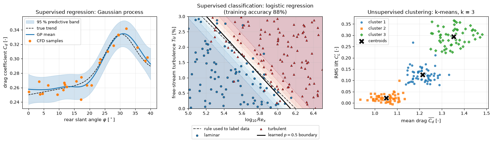

# Introduction to Machine Learning for CFD

A CFD solver maps a geometry, boundary conditions and flow parameters to a discrete flow field at a cost of minutes to days per case. Machine learning (ML) builds approximate maps from data, either to replace part of that chain, to accelerate it, or to extract information from its output. This note states where ML can enter the CFD pipeline, defines the learning paradigms by the objective each one minimises, matches common CFD tasks to methods, and lists the limitations that decide whether an ML model can be trusted.

The rest of this section builds on it: [Neural Networks](fundamentals/neural_networks.md) and [Training and Validation](fundamentals/training_and_validation.md) cover the general machinery, and the notes in `neural_networks/`, `flow/`, `geometry/` and `automotive_aerodynamics/` apply it. The [section index](README.md) gives a reading order.

## Problem Statement

A steady CFD analysis evaluates a solution operator

$$
\mathcal{S}: (\Omega, \mathbf{p}) \mapsto (\mathbf{u}, p),
\qquad \mathbf{y} = \mathcal{Q}(\mathbf{u}, p)
$$

where $\Omega$ is the geometry, $\mathbf{p} \in \mathbb{R}^d$ collects the operating and design parameters (Reynolds number, angle of attack, shape parameters), $(\mathbf{u}, p)$ are the velocity and pressure fields on the mesh, and $\mathcal{Q}$ extracts quantities of interest $\mathbf{y}$ such as $C_d$, $C_L$ or a surface pressure distribution. One evaluation of $\mathcal{S}$ costs $C$ (core-hours).

Given a dataset of $N$ solved cases $`\mathcal{D} = \{(\mathbf{x}_i, \mathbf{y}_i)\}_{i=1}^N`$, where $\mathbf{x}_i$ is a numerical description of $`(\Omega_i, \mathbf{p}_i)`$, supervised ML seeks a parametric model $`f_{\boldsymbol\theta}`$ that minimises the empirical risk

$$
\boldsymbol\theta^\star = \arg\min_{\boldsymbol\theta} \mathcal{L}(\boldsymbol\theta),
\qquad \mathcal{L}(\boldsymbol\theta) = \frac{1}{N} \sum_{i=1}^{N}
\ell\big(f_{\boldsymbol\theta}(\mathbf{x}_i), \mathbf{y}_i\big) + \lambda
R(\boldsymbol\theta)
$$

with a pointwise loss $\ell$ (for example the squared error), a regulariser $R$ and its weight $\lambda$. What is actually wanted is small error on cases not in $\mathcal{D}$, at an evaluation cost $c \ll C$.

Three things make this hard in CFD:

- Data are expensive. $N$ is often $10^2$ to $10^3$ cases, while the outputs can have $10^6$ or more degrees of freedom.
- Inputs are awkward. Geometries and meshes have no fixed-length vector representation, so $\mathbf{x}$ must be constructed (shape parameters, point clouds, graphs, signed-distance fields).
- The model must respect physics it was never told about: conservation, symmetries, boundary conditions, and the right behaviour outside the sampled parameter range.

If every query would otherwise be one CFD run, a surrogate trained on $N$ runs with training cost $T$ pays off after $Q^\star$ queries, where

$$
N C + T + Q^\star c = Q^\star C \quad\Rightarrow\quad Q^\star = \frac{N C + T}{C - c}
$$

ML is therefore attractive for many-query tasks (optimisation, uncertainty propagation, real-time control) and rarely for a single analysis.

## Where ML Enters the CFD Pipeline

| Pipeline stage | Task | Role of the ML model | Notes |
| --- | --- | --- | --- |
| Pre-processing | Geometry parameterisation, CAD feature recognition, shape generation | Learn a low-dimensional latent description of shapes; classify CAD features | [ML on CAD](geometry/ml_on_cad.md) |
| Pre-processing | Mesh sizing and adaptation | Predict a target cell-size field from geometry instead of solving adjoint problems | [ML with Meshes](geometry/ml_with_meshes.md) |
| Solver | Turbulence and wall-model closures | Replace or correct the Reynolds-stress or eddy-viscosity model inside RANS/LES | [ML Turbulence Closures](flow/ml_turbulence_closures.md) |
| Solver | Acceleration | Better initial guesses, learned coarse-grid corrections, learned time steppers | [Flow Dynamics](flow/flow_dynamics.md) |
| Solver | Surrogate replacement | Map $\mathbf{p}$ or $\Omega$ directly to $\mathbf{y}$ or to the full field | [Neural Networks in Aerodynamics](neural_networks/intro.md), [Neural Operators](neural_networks/neural_operators.md) |
| Post-processing | Feature extraction | Find coherent structures, regimes and low-dimensional coordinates | [Flow Feature Extraction](flow/feature_extraction.md) |
| Post-processing | Reconstruction | Super-resolve coarse fields, fill gaps, denoise PIV, estimate fields from sparse sensors | [Super-Resolution](flow/superresolution_and_flow_cleansing.md), [PIV](flow/particle_image_velocimetry.md) |
| Design and control loops | Optimisation, active learning, flow control | Cheap objective evaluations inside an optimiser; policies for actuators | [Optimization](flow/optimization.md) |

In pre- and post-processing, an ML error affects only one step and is easy to check. Inside the solver, errors feed back into the next iteration or time step, so a closure that is accurate on frozen data (a priori) can still make the coupled simulation diverge (a posteriori). A surrogate that replaces the solver gives up the solver's guarantees completely and must be validated against CFD on held-out cases.

## Learning Paradigms

The paradigms differ in what data are available and what objective is minimised. Figure 1 shows one example of each of the first three, computed on synthetic flow data.



*Figure 1. Left: a Gaussian process fitted to 25 noisy $`C_d`$ samples, with its 95 % predictive band widening where samples are sparse. Centre: logistic regression learns a linear boundary in the $`(\log_{10} Re_x, Tu)`$ plane close to the rule that generated the labels. Right: k-means groups unlabelled $`(\overline{C_d}, C_L')`$ samples into three regimes without being told that regimes exist.*

### Supervised Learning

Supervised learning uses labelled pairs $(\mathbf{x}_i, \mathbf{y}_i)$ and minimises the empirical risk of the Problem Statement. The loss depends on the output type.

In regression the output is continuous ($\mathbf{y} \in \mathbb{R}^m$: $C_d$, a pressure distribution, a velocity field) and the default loss is the squared error

$$
\mathcal{L}(\boldsymbol\theta) = \frac{1}{N} \sum_{i=1}^{N} \lVert
f_{\boldsymbol\theta}(\mathbf{x}_i) - \mathbf{y}_i \rVert_2^2
$$

Minimising it is maximum-likelihood estimation under Gaussian noise. Linear regression $f(\mathbf{x}) = \mathbf{w}^T\mathbf{x} + b$, Gaussian-process regression ([kriging](../numerical/surrogates/kriging.md)), [radial basis functions](../numerical/surrogates/radial_basis_functions.md) and neural networks all fit this template.

Gaussian-process regression is worth stating explicitly because it returns an uncertainty along with the prediction. With kernel $k(\mathbf{x}, \mathbf{x}')$, kernel matrix $`K_{ij} = k(\mathbf{x}_i, \mathbf{x}_j)`$, noise variance $`\sigma_n^2`$, training outputs $`\mathbf{y}`$ and $`\mathbf{k}_\ast`$ the vector of $k(\mathbf{x}^\ast, \mathbf{x}_i)$, the prediction at a new point $\mathbf{x}^\ast$ is Gaussian with

$$
\mu^\ast = \mathbf{k}_\ast^T (K + \sigma_n^2 I)^{-1} \mathbf{y},
\qquad \sigma^{\ast 2} = k(\mathbf{x}^\ast, \mathbf{x}^\ast) - \mathbf{k}_\ast^T
(K + \sigma_n^2 I)^{-1} \mathbf{k}_\ast
$$

The variance grows away from the data, which is what adaptive sampling and Bayesian optimisation exploit (Figure 1, left).

In classification the output is one of $K$ classes (laminar or turbulent, attached or separated, a mesh cell flagged for refinement or not). The model outputs class probabilities $\hat{y}_{ik}$ and the loss is the cross-entropy

$$
\mathcal{L}(\boldsymbol\theta) = -\frac{1}{N} \sum_{i=1}^{N} \sum_{k=1}^{K} y_{ik} \log
\hat{y}_{ik}
$$

with $y_{ik} = 1$ if sample $i$ belongs to class $k$ and 0 otherwise. Logistic regression is the two-class linear case, $\hat{y} = 1/(1 + e^{-(\mathbf{w}^T\mathbf{x} + b)})$, with decision boundary $\mathbf{w}^T\mathbf{x} + b = 0$ (Figure 1, centre). Support vector machines, decision trees, random forests, k-nearest neighbours and neural networks are the usual nonlinear alternatives.

### Unsupervised Learning

Unsupervised learning has only inputs $`\{\mathbf{x}_i\}`$ and looks for structure. Each method is defined by its objective:

- k-means clustering minimises the within-cluster sum of squares over cluster assignments $c_i$ and centroids $\boldsymbol\mu_j$:

  ```math
  J = \sum_{i=1}^{N} \lVert \mathbf{x}_i - \boldsymbol\mu_{c_i} \rVert_2^2 .
  ```

- Proper orthogonal decomposition (POD, equivalently PCA) finds the rank-$`r`$ orthonormal basis $\Phi \in \mathbb{R}^{n \times r}$ that minimises the projection error of mean-subtracted snapshots, $`\sum_i \lVert \mathbf{x}_i - \Phi\Phi^T\mathbf{x}_i \rVert_2^2`$. See [POD](../numerical/pod/pod_intro.md).

- An autoencoder replaces the linear maps of POD by a nonlinear encoder $g_{\boldsymbol\phi}$ and decoder $h_{\boldsymbol\psi}$ and minimises $`\sum_i \lVert \mathbf{x}_i - h_{\boldsymbol\psi}(g_{\boldsymbol\phi}(\mathbf{x}_i)) \rVert_2^2`$.

- Density estimation and generative models (Gaussian mixtures, variational autoencoders, GANs, diffusion models) maximise the likelihood of the data, or a surrogate of it, to learn $p(\mathbf{x})$ and sample new fields or shapes.

In CFD these are used to identify flow regimes, build reduced coordinates for reduced-order models, compress datasets, detect anomalies and generate plausible geometries.

### Semi-Supervised and Self-Supervised Learning

When only $N_\ell$ samples are labelled and $N_u \gg N_\ell$ are not (a few wind-tunnel measurements and many cheap CFD fields; a few annotated PIV snapshots and thousands of raw ones), semi-supervised learning adds an unlabelled term:

$$
\mathcal{L}(\boldsymbol\theta) = \frac{1}{N_\ell} \sum_{i=1}^{N_\ell}
\ell\big(f_{\boldsymbol\theta}(\mathbf{x}_i), \mathbf{y}_i\big) + \frac{\lambda}{N_u}
\sum_{j=1}^{N_u} \ell_u\big(f_{\boldsymbol\theta}, \mathbf{x}_j\big)
$$

where $\ell_u$ requires something that holds without labels: consistent predictions under perturbations or symmetry transformations of $\mathbf{x}_j$, low entropy of predicted classes, or agreement with a pseudo-label. A physics-informed residual term (see [PINNs](neural_networks/pinns.md)) plays the same role, with the governing equations providing the unlabelled constraint.

Self-supervised learning creates labels from the inputs themselves. A typical pretext task masks part of a field and trains the network to reconstruct it, $`\ell = \lVert (1 - M) \odot (h(M \odot \mathbf{x}) - \mathbf{x}) \rVert^2`$ with a binary mask $M$. The pretrained network is then fine-tuned on the few labelled cases.

### Reinforcement Learning

Reinforcement learning (RL) is a separate paradigm, not a form of semi-supervised learning. There is no fixed dataset: an agent chooses actions, the environment (here a flow simulation or experiment) responds, and the data depend on the agent's own policy. The setting is a Markov decision process with states $s_t$ (sensor readings), actions $a_t$ (jet velocity, flap angle), transition dynamics given by the flow, and a scalar reward $r_t$ (for example $-C_d$ minus an actuation penalty). A policy $\pi_{\boldsymbol\theta}(a \mid s)$ is trained to maximise the expected discounted return

$$
J(\boldsymbol\theta) = \mathbb{E}_{\pi_{\boldsymbol\theta}}
\left[\sum_{t=0}^{\infty} \gamma^t r_t \right],
\qquad 0 \le \gamma < 1
$$

The reward says how good an outcome was, not what the correct action would have been, which is the difference from supervised learning. Value-based methods learn the action value $Q(s, a)$; tabular Q-learning updates it with

$$
Q(s_t, a_t) \leftarrow Q(s_t, a_t) + \alpha
\left[r_t + \gamma \max_{a'} Q(s_{t+1}, a') - Q(s_t, a_t) \right]
$$

where $\alpha$ is the learning rate. Policy-gradient and actor-critic methods (PPO, SAC) optimise $J$ directly and are the usual choice for continuous actuation; deep RL replaces tables by neural networks. RL for active flow control (Rabault et al., 2019) and for shape optimisation needs many episodes, so the environment is usually a coarse or reduced model.

## Matching CFD Tasks to Methods

| CFD task | ML task type | Typical methods | Note |
| --- | --- | --- | --- |
| $C_d$, $C_L$ from a few design parameters | Supervised regression, small $N$ | Gaussian process / kriging, RBF, polynomial, small MLP | [Surrogates](../numerical/surrogates/intro.md), [Neural Networks](fundamentals/neural_networks.md) |
| Surface or volume fields on a fixed mesh | Supervised regression, high-dimensional output | POD + regression of coefficients, CNN, autoencoder | [Neural Networks in Aerodynamics](neural_networks/intro.md) |
| Fields on varying unstructured meshes | Supervised regression on graphs or point clouds | Graph neural networks, PointNet-type models | [Graph Neural Networks](neural_networks/graph_neural_networks.md) |
| Solution operator for a parametric PDE | Operator learning | DeepONet, Fourier neural operator | [Neural Operators](neural_networks/neural_operators.md) |
| PDE solution with little or no data | Physics-regularised regression | Physics-informed neural networks | [PINNs](neural_networks/pinns.md) |
| RANS/LES closure correction | Supervised regression inside the solver | Tensor-basis networks, random forests, symbolic regression | [ML Turbulence Closures](flow/ml_turbulence_closures.md) |
| Laminar/turbulent or attached/separated detection | Supervised classification | Logistic regression, SVM, random forest, CNN | [Flow Feature Extraction](flow/feature_extraction.md) |
| Coherent structures, regime identification | Unsupervised learning | POD, k-means, spectral clustering, autoencoders | [Flow Feature Extraction](flow/feature_extraction.md), [POD](../numerical/pod/pod_intro.md) |
| Time evolution of a flow | System identification | DMD, Koopman, SINDy, RNN, neural ODE | [Flow Dynamics](flow/flow_dynamics.md) |
| Coarse-to-fine reconstruction, PIV denoising | Supervised (or self-supervised) image regression | CNN, U-Net, GAN | [Super-Resolution](flow/superresolution_and_flow_cleansing.md), [PIV](flow/particle_image_velocimetry.md) |
| Shape optimisation | Surrogate-based optimisation, active learning | Bayesian optimisation, GP + expected improvement, evolutionary search on a surrogate | [Optimization](flow/optimization.md), [Adaptive Sampling](../numerical/surrogates/adaptive_sampling.md) |
| Active flow control | Reinforcement learning | PPO, SAC, deep Q-networks | [Optimization](flow/optimization.md) |
| Mesh sizing from geometry | Supervised regression on geometry | CNN, graph networks | [ML with Meshes](geometry/ml_with_meshes.md) |

The first row matters more than its length suggests. With $10^1$ to $10^2$ samples and a handful of parameters, a Gaussian process or RBF model is usually more accurate than a neural network and also gives an error estimate. Neural networks earn their cost when the input or output is high-dimensional and $N$ is large.

## Integrating Physics

ML models for CFD can be ordered by how much of the physics they carry:

| Approach | What the model learns | Physics enforced | Data needed | Behaviour outside the data |
| --- | --- | --- | --- | --- |
| Pure data-driven | $f_{\boldsymbol\theta}: \mathbf{x} \mapsto \mathbf{y}$ from examples | None beyond the choice of inputs | Most | Unconstrained; can violate conservation |
| Physics in the inputs and architecture | Same map, with nondimensional inputs, symmetry-equivariant layers, divergence-free outputs | Invariances by construction | Less | Symmetries hold everywhere |
| Physics-informed loss | $f_{\boldsymbol\theta}$ penalised by the PDE residual | Equations approximately, through the loss | Few or none | Residual is small only where it was enforced |
| Hybrid solver in the loop | A correction or closure inside a conventional solver | Discrete conservation from the solver | Moderate, plus solver runs during training | Solver keeps the flow physical; closure errors can still accumulate |

The physics-informed loss for a residual operator $\mathcal{R}$ (for example the steady incompressible Navier-Stokes equations with kinematic viscosity $\nu$) evaluated at collocation points $\mathbf{x}_j$ is

```math
\mathcal{L}(\boldsymbol\theta) = \frac{1}{N} \sum_{i=1}^{N} \lVert f_{\boldsymbol\theta}(\mathbf{x}_i) - \mathbf{y}_i \rVert^2 + \frac{\lambda}{M} \sum_{j=1}^{M} \lVert \mathcal{R}[f_{\boldsymbol\theta}](\mathbf{x}_j) \rVert^2, \qquad \mathcal{R}[\mathbf{u}, p] = \begin{pmatrix} (\mathbf{u}\cdot\nabla)\mathbf{u} + \nabla p - \nu \nabla^2 \mathbf{u} \\ \nabla \cdot \mathbf{u} \end{pmatrix}.
```

A divergence-free velocity can instead be built in: in 2D, predicting a stream function $\psi_{\boldsymbol\theta}$ and setting $u = \partial\psi/\partial y$, $v = -\partial\psi/\partial x$ satisfies $\nabla\cdot\mathbf{u} = 0$ exactly. In the hybrid approach a learned term $`\mathbf{c}_{\boldsymbol\theta}`$ corrects a coarse solver step, $`\mathbf{u}^{n+1} = \mathcal{S}_{\Delta}(\mathbf{u}^n) + \mathbf{c}_{\boldsymbol\theta}(\mathbf{u}^n)`$, and is trained through several unrolled solver steps so that it learns to correct its own accumulated error (Um et al., 2020; Kochkov et al., 2021).

Moving down the table trades flexibility and training simplicity for physical consistency and data efficiency.

## Limitations

ML models interpolate. A model is reliable only inside the region of input space covered by its training data, and in more than a few dimensions almost every new point lies outside the convex hull of the samples. Separation onset, transition and shock formation are exactly where the response changes character, and they are poorly predicted unless the training set resolves them. Out-of-distribution checks (see [Training and Validation](fundamentals/training_and_validation.md)) should run alongside every prediction.

The training data are themselves CFD results with modelling and discretisation errors. A surrogate cannot be more accurate than its data, and if the data come from one turbulence model, the surrogate learns that model's errors too. Generating $N$ cases costs $N C$ before any learning starts, and the break-even count $Q^\star$ above is often larger than the number of queries a project actually has.

CFD has verification tools: mesh-convergence studies, residual monitoring, conservation checks. A neural network has none of these built in. Its error on a new case is unknown unless the model reports an uncertainty (GP variance, ensembles) and that uncertainty has been checked for calibration. Conservation, positivity of $k$ and $\varepsilon$, and realisability of Reynolds stresses are not guaranteed unless they are built into the architecture.

Results are also fragile in ways that solvers are not. They depend on random seeds, data splits, preprocessing and hyperparameters, and published accuracies are often reported on random splits that leak information between training and test cases. A model is only as credible as its validation protocol.

## Workflow for an ML-for-CFD Project

1. State the task as in the Problem Statement: inputs, outputs, the accuracy required (in drag counts, percent of dynamic pressure, etc.), the range of validity, and how many queries the model must serve. Compare $Q^\star$ with that number before generating data.
2. Fix the CFD setup (solver, turbulence model, mesh strategy, convergence criteria) and keep it identical across the dataset. Sample the design space with a space-filling plan ([sampling](../numerical/surrogates/one_stage_sampling.md)) and estimate the CFD's own discretisation error, which sets the floor for useful surrogate accuracy.
3. Choose a split that matches the intended use: unseen geometries need a split by geometry, future times need a split in time.
4. Start with a baseline (mean predictor, linear regression, GP or POD with interpolation) and move to neural networks only if the baseline is not accurate enough.
5. Report test-set errors in physical units, the worst-case error and an uncertainty estimate. Then confirm the model inside its application (an optimisation loop, a coupled solver run) against full CFD for the final candidates.

## Key Takeaways

- ML enters CFD at four places: geometry and mesh preparation, inside the solver (closures, acceleration), as a replacement for the solver (surrogates), and in post-processing and design or control loops.
- Supervised learning minimises a loss against labels, unsupervised learning minimises an objective on the inputs alone (k-means, POD, reconstruction), semi- and self-supervised learning combine a few labels with constraints on unlabelled data, and reinforcement learning maximises an expected return through interaction.
- For few samples and few parameters, Gaussian processes and RBF models are usually the right first choice. Neural networks pay off for high-dimensional inputs or outputs and large datasets.
- Physics can be added through inputs, architecture, loss terms or a solver in the loop, trading flexibility for consistency.
- A surrogate pays for its training data only after $Q^\star = (NC + T)/(C - c)$ queries.
- Extrapolation, data cost and the absence of built-in error estimates are the main limitations; credible models come with group-aware splits, uncertainty estimates and checks against CFD.

## Related Scripts

- [Learning Paradigms on Flow Data](../../scripts/plots/ml_learning_paradigms/): Three panels contrast supervised regression, supervised classification and unsupervised clustering on synthetic flow data, each computed in numpy.
- [Kriging Interpolation](../../scripts/algorithms/kriging_interpolation/): This script builds an ordinary kriging model of the Forrester function $y(x) = (6x-2)^2 \sin(12x-4)$ from nine equally spaced samples with a compactly supported cubic correlation function, estimates the correlation parameter $\theta$ by maximum likelihood, and compares the predictor and its $\pm 2\hat{s}$ band for $\theta$ below, at and above the estimate.
- [Bias-Variance Trade-off](../../scripts/plots/bias_variance_tradeoff/): Polynomial fits of increasing degree to 20 noisy samples show underfitting, overfitting, a U-shaped validation curve and the Monte Carlo split of the error into bias², variance and noise.

## Exercises

**Exercise 1.** Classify each task as supervised regression, supervised classification, semi-supervised, unsupervised or reinforcement learning: (a) predicting $C_L$ from angle of attack using 500 CFD runs; (b) labelling snapshots as laminar or turbulent using 2,000 labelled examples; (c) grouping 10,000 unlabelled PIV snapshots into recurring flow states; (d) 50 wind-tunnel labels plus 5,000 unlabelled CFD fields; (e) learning a jet-actuation policy that maximises a drag-reduction reward.

<details>
<summary>Answer</summary>

(a) Supervised regression, because the output is continuous. (b) Supervised classification, because the labels are discrete. (c) Unsupervised clustering, because there are no labels. (d) Semi-supervised, with a few labels and many unlabelled samples. (e) Reinforcement learning: the agent chooses actions, the flow responds, and the only feedback is a reward. There is no label giving the correct action.

</details>

**Exercise 2.** Four CFD runs of a spoiler setting $x = 1, 2, 3, 4$ give $C_d = 0.34, 0.31, 0.30, 0.27$. Fit $\hat{y} = w x + b$ by least squares and predict $C_d$ at $x = 5$. Why is this prediction risky?

<details>
<summary>Answer</summary>

The means are $\bar{x} = 2.5$ and $\bar{y} = 0.305$. Then $\sum (x_i - \bar{x})(y_i - \bar{y}) = -0.11$ and $\sum (x_i - \bar{x})^2 = 5$, so $w = -0.022$ and $b = 0.305 + 0.022 \times 2.5 = 0.36$.

The prediction at $x = 5$ is $0.36 - 0.022 \times 5 = 0.25$.

The point $x = 5$ lies outside the training range. Drag cannot keep falling linearly: at some spoiler setting the flow separates and the trend may reverse. The prediction should be confirmed with CFD.

</details>

**Exercise 3.** A Gaussian process uses the kernel $k(x, x') = \exp(-(x - x')^2/2)$, noise variance $\sigma_n^2 = 0.01$ and a single training point $(x, y) = (0, 1)$. Compute the predictive mean and variance at $x^\ast = 1$ and at $x^\ast = 3$.

<details>
<summary>Answer</summary>

With one training point, $K + \sigma_n^2 = 1 + 0.01 = 1.01$ and $k(x^\ast, x^\ast) = 1$.

At $x^\ast = 1$: $k_\ast = e^{-0.5} = 0.6065$, so $\mu^\ast = 0.6065/1.01 = 0.601$ and $\sigma^{\ast 2} = 1 - 0.6065^2/1.01 = 0.636$.

At $x^\ast = 3$: $k_\ast = e^{-4.5} = 0.0111$, so $\mu^\ast = 0.011$ and $\sigma^{\ast 2} = 0.9999$.

Far from the data the GP returns to its prior (mean 0, variance 1) and its variance says so. That is the property adaptive sampling uses to decide where to run the next CFD case.

</details>

**Exercise 4.** In Q-learning for flow control, the current estimate is $Q(s, a) = 0.5$. Taking action $a$ gives reward $r = 1$ and leads to a state whose best action value is $\max_{a'} Q(s', a') = 0.8$. With learning rate $\alpha = 0.1$ and discount $\gamma = 0.9$, apply one update.

<details>
<summary>Answer</summary>

```math
Q \leftarrow 0.5 + 0.1\,(1 + 0.9 \times 0.8 - 0.5) = 0.5 + 0.1 \times 1.22 = 0.622
```

A discount close to 1 makes the agent value long-term drag reduction. That matters in flow control, where the effect of an actuation on the wake appears only after a convective delay.

</details>

**Exercise 5.** One CFD run of a car costs $C = 500$ core-hours. A surrogate needs 200 training runs and 20 test runs, $T = 100$ core-hours of training, and negligible evaluation cost. (a) After how many queries does the surrogate break even? (b) A Monte Carlo uncertainty study needs $10^4$ evaluations. By what factor does the surrogate reduce its cost?

<details>
<summary>Answer</summary>

(a) The data cost is $220 \times 500 = 110{,}000$ core-hours, so $Q^\star = (110{,}000 + 100)/500 = 220.2$. The surrogate pays off from the 221st query; a study with 50 design evaluations should use CFD directly.

(b) Direct Monte Carlo costs $10^4 \times 500 = 5 \times 10^6$ core-hours. The surrogate route costs $110{,}100$ core-hours, a factor of $5 \times 10^6 / 110{,}100 = 45$ less, provided the surrogate's error is small compared with the input uncertainty being propagated.

</details>

## References

- Brunton, S. L., Noack, B. R., and Koumoutsakos, P., "Machine Learning for Fluid Mechanics", *Annual Review of Fluid Mechanics* 52, 477-508, 2020.
- Brunton, S. L., and Kutz, J. N., *Data-Driven Science and Engineering: Machine Learning, Dynamical Systems, and Control*, 2nd ed., Cambridge University Press, 2022.
- Duraisamy, K., Iaccarino, G., and Xiao, H., "Turbulence Modeling in the Age of Data", *Annual Review of Fluid Mechanics* 51, 357-377, 2019.
- Vinuesa, R., and Brunton, S. L., "Enhancing Computational Fluid Dynamics with Machine Learning", *Nature Computational Science* 2, 358-366, 2022.
- Bishop, C. M., *Pattern Recognition and Machine Learning*, Springer, 2006.
- Rasmussen, C. E., and Williams, C. K. I., *Gaussian Processes for Machine Learning*, MIT Press, 2006.
- Sutton, R. S., and Barto, A. G., *Reinforcement Learning: An Introduction*, 2nd ed., MIT Press, 2018.
- Rabault, J., Kuchta, M., Jensen, A., Réglade, U., and Cerardi, N., "Artificial Neural Networks Trained through Deep Reinforcement Learning Discover Control Strategies for Active Flow Control", *Journal of Fluid Mechanics* 865, 281-302, 2019.
- Um, K., Brand, R., Fei, Y. R., Holl, P., and Thuerey, N., "Solver-in-the-Loop: Learning from Differentiable Physics to Interact with Iterative PDE-Solvers", *Advances in Neural Information Processing Systems* 33, 2020.
- Kochkov, D., Smith, J. A., Alieva, A., Wang, Q., Brenner, M. P., and Hoyer, S., "Machine Learning-Accelerated Computational Fluid Dynamics", *Proceedings of the National Academy of Sciences* 118(21), e2101784118, 2021.
