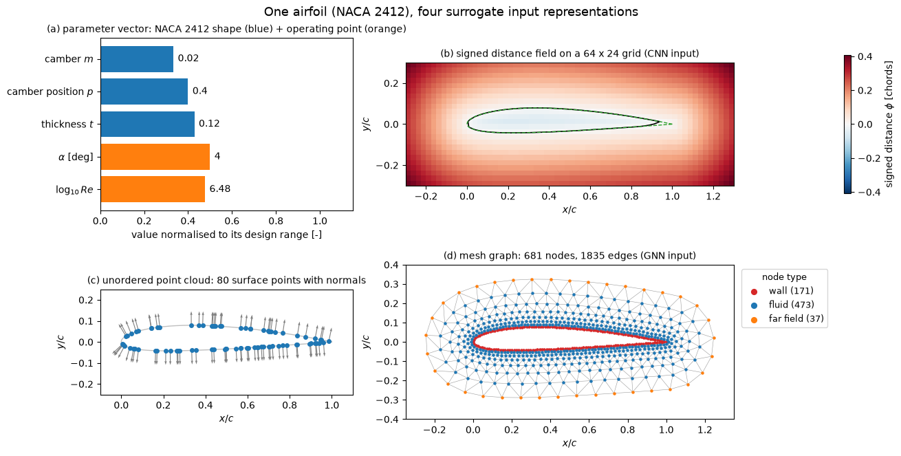

# Neural-Network Surrogates for Aerodynamics

A steady RANS solution around a car or a wing costs hours of compute, so a design study is limited by how many CFD runs it can afford. A neural-network surrogate is trained once on a set of solved cases and then predicts force coefficients or flow fields for a new geometry in milliseconds. This note sets up the learning problem, organises the methods by how the geometry is fed to the network, compares data-driven, physics-informed and hybrid strategies, and gives a break-even formula for deciding whether a surrogate pays for the CFD needed to train it.

The case-study notes in [automotive_aerodynamics](../automotive_aerodynamics/ml_process.md) follow one such workflow end to end. Graph networks, physics-informed networks and neural operators have their own notes, linked below.

## Problem Statement

Let $g$ denote a geometry (a CAD surface or a body-fitted mesh) and $\mathbf{c}$ the operating conditions, for example angle of attack $\alpha$, Reynolds number $Re$, Mach number $M$ or yaw angle. A CFD solver maps $(g, \mathbf{c})$ to one of three kinds of output $\mathbf{y}$:

- scalar coefficients such as the drag and lift coefficients $C_d = F_D / (\tfrac{1}{2}\rho U_\infty^2 A)$ and $C_l = F_L / (\tfrac{1}{2}\rho U_\infty^2 A)$, with force $F$, density $\rho$, free-stream speed $U_\infty$ and reference area $A$;
- surface fields, the pressure coefficient $C_p$ and skin-friction coefficient $C_f$ at the $M_s$ wall nodes;
- volume fields, velocity $\mathbf{u}$, pressure $p$ and turbulence variables at the $M_v$ cells of the mesh.

A dataset of $N$ solved cases $`\mathcal{D} = \{(g_i, \mathbf{c}_i, \mathbf{y}_i)\}_{i=1}^N`$ is available. The geometry is not a fixed-length vector, so it first passes through a representation $`R(g)`$: a parameter vector, a grid, a latent code, a point cloud or a graph. The task is to find network parameters $`\boldsymbol\theta`$ of $`f_{\boldsymbol\theta}`$ that minimise

```math
\mathcal{L}(\boldsymbol\theta) = \frac{1}{N}\sum_{i=1}^{N} \sum_{j=1}^{M_i} w_{ij}\,\bigl\| f_{\boldsymbol\theta}\bigl(R(g_i), \mathbf{c}_i\bigr)_j - \mathbf{y}_{ij} \bigr\|^2 + \lambda\, \Omega(\boldsymbol\theta)
```

where $j$ runs over the $M_i$ output locations of case $i$ ($M_i = 1$ for a scalar), $w_{ij}$ are weights such as normalised cell volumes or face areas, and $`\lambda\,\Omega(\boldsymbol\theta)`$ is a regulariser. Without area or volume weights the loss is dominated by the densely meshed boundary layer. The goal is low error on geometries that are not in $\mathcal{D}$, not on $\mathcal{D}$ itself.

Four things make this hard. Each sample costs a CFD run, so $N$ is in the tens to thousands, while field outputs have $10^5$ to $10^8$ entries. Geometries differ in topology and mesh size, so the network must accept inputs of varying size. Small geometric changes, a sharper edge or a gap, can move a separation line and change $C_d$ by several percent. Finally, the training labels carry the discretisation and turbulence-model error of the solver that produced them, and the surrogate cannot be more accurate than that solver.

## Input Representations

The representation $R(g)$ decides which network family applies, how much geometric detail reaches the network, and whether a model trained on one mesh can be evaluated on another. The figure shows one airfoil in four of the forms discussed below.



Panel (a) holds five numbers. Panel (b) loses the thin trailing edge because the section is thinner than one grid cell over the last 9 % of the chord. Panels (c) and (d) keep the exact wall, and (d) adds the connectivity and near-wall clustering of a CFD mesh.

### Explicit Parameter Vectors

When the geometry comes from a parametric CAD model or a morphing tool, $R(g) = \mathbf{p} \in \mathbb{R}^{n_p}$ holds the design parameters (camber, thickness, hood angle, diffuser angle). Inputs $\mathbf{x} = (\mathbf{p}, \mathbf{c})$ are scaled to $[0, 1]$ or to zero mean and unit variance, and a multilayer perceptron maps them to the outputs:

```math
f_{\boldsymbol\theta}(\mathbf{x}) = W_L\, \sigma\bigl(W_{L-1} \cdots \sigma(W_1 \mathbf{x} + \mathbf{b}_1) \cdots + \mathbf{b}_{L-1}\bigr) + \mathbf{b}_L
```

with weight matrices $W_k$, biases $\mathbf{b}_k$ and activation $\sigma$ (see [neural network fundamentals](../fundamentals/neural_networks.md)). For scalar outputs and $N$ below a few hundred, Gaussian-process regression ([kriging](../../numerical/surrogates/kriging.md)) or [radial basis functions](../../numerical/surrogates/radial_basis_functions.md) are usually as accurate and also give an error estimate. The parameter vector is compact and smooth to learn from, but the model only knows the shapes its parameterisation can produce; a new feature, such as an added spoiler, needs a new parameter and new data. The [deformation parameters](../automotive_aerodynamics/deformation_parameters.md) note discusses how such parameters are chosen for cars.

### Grids: Images, Voxels and Signed Distance Fields

Sampling the geometry on a Cartesian grid gives a tensor that convolutional neural networks (CNNs) can process. A binary occupancy mask marks cells inside the body; the signed distance field

```math
\phi(\mathbf{x}) = \pm \min_{\mathbf{y} \in \partial\Omega} \|\mathbf{x} - \mathbf{y}\|
```

(negative inside the body $\Omega$) is a smoother input because it varies continuously across the wall and tells every cell how far it is from it. A convolution layer computes

```math
z_{ij}^{(k)} = \sigma\Bigl(\sum_{c}\sum_{a,b=-1}^{1} K^{(k)}_{c,ab}\, x_{c,\,i+a,\,j+b} + b^{(k)}\Bigr)
```

for output channel $k$, input channel $c$ and a $3 \times 3$ kernel $K$. The same kernel is applied at every cell, so the layer is translation-equivariant and has few parameters, but each layer only sees a $3 \times 3$ neighbourhood. Encoder-decoder networks downsample with pooling to reach a global receptive field and upsample back to full resolution; the U-Net (Ronneberger et al., 2015) adds skip connections between matching resolutions so that the decoder keeps the fine detail.

Guo et al. (2016) trained a CNN to map the signed distance field of 2D and 3D shapes, including car profiles, to the steady laminar velocity field computed by a lattice-Boltzmann solver, at a fraction of the solver cost. Thuerey et al. (2020) trained U-Nets on about $10^4$ RANS solutions of airfoils from the UIUC database: the input is a $128 \times 128$ grid with the free-stream velocity components and the airfoil mask, the output is the pressure and velocity fields, and the mean relative error of the larger models is a few percent.

Grid methods need the CFD solution interpolated from the body-fitted mesh to the grid, which smears the boundary layer. Memory grows as $n^3$ for a 3D grid of $n$ cells per side, so resolution is limited to roughly $128^3$ to $256^3$, which is coarse compared with near-wall CFD spacing. Cells inside the body must be masked out of the loss.

### Latent Shape Codes from Autoencoders

An autoencoder compresses a shape, given as a voxel grid, an SDF or a fixed set of surface points, to a latent vector $\mathbf{z} \in \mathbb{R}^{m}$ with an encoder $E$ and reconstructs it with a decoder $D$. The two are trained on geometries alone, which are cheap compared with CFD:

```math
\min_{E,\,D}\; \frac{1}{N_g}\sum_{k=1}^{N_g} \bigl\| D\bigl(E(g_k)\bigr) - g_k \bigr\|^2
```

A regression network then maps $(\mathbf{z}, \mathbf{c})$ to the aerodynamic outputs, so the code plays the role of a learned parameter vector. With linear $E$ and $D$ this reduces to principal component analysis, the same decomposition as [proper orthogonal decomposition](../../numerical/pod/pod_intro.md) applied to shape coordinates. The latent code allows shape families that have no CAD parameterisation, and many unlabelled geometries can be used. The reconstruction loss weights all of the surface equally, so small features that matter aerodynamically (mirror edges, gaps, trailing edges) are the first to be lost, and nothing guarantees that nearby codes give similar flows.

### Point Clouds

A point cloud $`\{\mathbf{x}_j\}_{j=1}^{M}`$ sampled on the surface, optionally with normals, keeps the exact geometry without a grid. Because the points have no order, the network must be permutation-invariant. PointNet (Qi et al., 2017) achieves this with a shared per-point network $h$ followed by a symmetric pooling:

```math
f_{\boldsymbol\theta}\bigl(\{\mathbf{x}_j\}\bigr) = \gamma\Bigl(\max_{j=1,\dots,M} h(\mathbf{x}_j)\Bigr)
```

where the maximum is taken element-wise over the feature vectors and $\gamma$ is an MLP. For a surface field such as $C_p$, the pooled global feature is concatenated with each point's own feature and decoded point by point. Plain PointNet has no notion of neighbourhood, so local curvature is captured poorly; hierarchical variants such as PointNet++ group nearby points first. Point clouds can be resampled to any density, which makes them mesh-independent, but they carry no connectivity, so wall-normal structure has to be inferred.

### Meshes and Graphs

The CFD mesh itself is a graph: nodes are vertices or cells and edges join neighbours. A graph neural network passes messages along the edges, so it works on the native mesh with its near-wall clustering, accepts any number of nodes, and predicts fields at the solver's own nodes without interpolation. The price is memory proportional to the number of edges and a receptive field that grows by one hop per layer. Both are treated in [Graph Neural Networks for CFD](graph_neural_networks.md).

### Comparison

| Representation | Network | Geometric resolution | Mesh-independent | Data need | Typical accuracy issues |
| --- | --- | --- | --- | --- | --- |
| Parameter vector | MLP, GP, RBF | Exact within the family, nothing outside it | Yes (no mesh) | Lowest, tens to hundreds of cases | Cannot represent shapes outside the parameterisation; extrapolation in $\mathbf{p}$ |
| Grid / voxels / SDF | CNN, U-Net | One grid cell, $10^{-2}$ of the domain at $128$ cells per side | No, tied to the grid | High, $10^3$ to $10^4$ cases for fields | Thin features and boundary layers blurred; interpolation error near walls |
| Latent code | Autoencoder + MLP | Limited by the decoder and $m$ | Yes once encoded | Many cheap geometries, fewer CFD cases | Small but critical features lost; latent space not aligned with flow sensitivity |
| Point cloud | PointNet and variants | Exact at sampled points | Yes | Moderate to high | Weak local structure; no wall-normal information |
| Mesh graph | GNN | Exact, follows the CFD mesh | Yes, within similar mesh densities | High for volume fields | Limited receptive field; memory; sensitivity to mesh density changes |

## Modelling Strategies

### Pure Data-Driven Surrogates

The network learns the map from inputs to outputs only from the labelled cases, with the loss of the problem statement. It is fast to evaluate and makes no assumption about the physics, which also means it has no protection against unphysical predictions (non-zero divergence, wrong far-field behaviour) away from the training data. Training and validation practice, including splitting by geometry rather than by sample, is covered in [training and validation](../fundamentals/training_and_validation.md) and applied to the car case in [model training](../automotive_aerodynamics/model_training.md).

### Physics-Informed Training

A physics-informed neural network represents the field $(\mathbf{u}, p)(\mathbf{x})$ with a network and adds the residuals of the governing equations at collocation points to the loss. For steady incompressible flow,

```math
\mathcal{L} = \mathcal{L}_{\mathrm{data}} + \lambda_1 \bigl\| \nabla\cdot\mathbf{u} \bigr\|^2 + \lambda_2 \Bigl\| (\mathbf{u}\cdot\nabla)\mathbf{u} + \frac{1}{\rho}\nabla p - \nu\,\nabla^2\mathbf{u} \Bigr\|^2 + \mathcal{L}_{\mathrm{BC}}
```

with derivatives obtained by automatic differentiation, kinematic viscosity $\nu$, and $\mathcal{L}_{\mathrm{BC}}$ penalising the boundary conditions (Raissi et al., 2019). The residual terms let the model use far fewer labelled solutions, or none, but each new geometry generally needs a new optimisation, and the weights $\lambda_k$ and the stiffness of high-$`Re`$ residuals make training difficult. Details are in [physics-informed neural networks](pinns.md); operator-learning architectures that map whole input functions to solution fields are in [neural operators](neural_operators.md).

### Hybrid Solver-Network Methods

Hybrid methods keep a CFD solver in the loop and learn only the part it gets wrong or computes slowly.

- A learned closure replaces or corrects a term of the turbulence model, for example the Reynolds-stress anisotropy or a source term in the Spalart–Allmaras equation, while the solver still enforces conservation (Duraisamy et al., 2019). See [ML turbulence closures](../flow/ml_turbulence_closures.md) and the classical models in [turbulence modelling](../../numerical/cfd/turbulence_modeling.md).
- A correction network runs alongside a coarse solver $S$: $\mathbf{u}^{n+1} = S(\mathbf{u}^n) + c_{\boldsymbol\theta}\bigl(S(\mathbf{u}^n)\bigr)$, trained so that the corrected coarse trajectory follows a fine reference. Training through several solver steps ("solver-in-the-loop", Um et al., 2020) exposes the network to its own errors and gives much more stable rollouts than training on single steps; Kochkov et al. (2021) used learned interpolation inside a differentiable solver to reach the accuracy of a much finer grid in 2D turbulence.
- A multi-fidelity surrogate learns the difference $`\mathbf{y}_{\mathrm{fine}} - \mathbf{y}_{\mathrm{coarse}}`$ between a cheap solution (potential flow, coarse RANS) and the high-fidelity one. The difference is usually smaller and smoother than $\mathbf{y}_{\mathrm{fine}}$ itself, so it needs less data.

## Cost and Break-Even Analysis

A surrogate is worthwhile only if the CFD spent on its training data is less than the CFD it replaces. Let $c_{\mathrm{CFD}}$ be the cost of one CFD run, $N$ the training runs, $N_v$ the validation and test runs, $C_{\mathrm{train}}$ the cost of training (in the same units, for example core-hours), $c_s$ the cost of one surrogate evaluation, $M$ the number of evaluations the study needs, and $M_c$ the number of final designs that are re-checked with CFD. Running the study with CFD costs $M c_{\mathrm{CFD}}$; with the surrogate it costs

```math
C_{\mathrm{sur}}(M) = (N + N_v + M_c)\, c_{\mathrm{CFD}} + C_{\mathrm{train}} + M\, c_s
```

The two are equal at the break-even number of evaluations

```math
M^{*} = \frac{(N + N_v + M_c)\, c_{\mathrm{CFD}} + C_{\mathrm{train}}}{c_{\mathrm{CFD}} - c_s} \approx N + N_v + M_c + \frac{C_{\mathrm{train}}}{c_{\mathrm{CFD}}}
```

where the approximation uses $c_s \ll c_{\mathrm{CFD}}$. Three consequences follow. A surrogate needs at least $N + N_v$ evaluations to pay off, so it does not help a study that needs fewer evaluations than the training set, such as an adjoint-based gradient optimisation whose cost is nearly independent of the number of design variables. It pays off for global optimisation, uncertainty quantification and interactive design, which need $10^3$ to $10^6$ evaluations, and when the same surrogate is reused across several studies, since $M$ then sums over all of them. Space-filling or adaptive sampling ([one-stage sampling](../../numerical/surrogates/one_stage_sampling.md), [adaptive sampling](../../numerical/surrogates/adaptive_sampling.md)) reduces $N$ for a given accuracy and so lowers $M^{*}$ directly.

## Validation Pitfalls

- Splitting by sample instead of by geometry leaks information: the same shape at a different $\alpha$ in the training set makes the test error look small. Hold out whole geometries, and a whole shape family if generalisation across families is claimed.
- Errors in integrated forces depend on how the field error correlates with the surface normal, not on its mean size. Report $C_d$ and $C_l$ errors in addition to field errors.
- Extrapolation in the input space, the latent space or the operating conditions gives confident but wrong predictions. A distance to the nearest training case, an ensemble spread or a GP variance flags such queries.
- A drag change of one count ($\Delta C_d = 10^{-4}$) is often what a design decision depends on, which is far below the error of most field surrogates. Compare the surrogate's error with the differences it must resolve, not with the absolute value of $C_d$.

## Key Takeaways

- The surrogate learns $f_{\boldsymbol\theta}: (R(g), \mathbf{c}) \to \mathbf{y}$ from $N$ CFD solutions; $N$ is small, the outputs are large, and the geometry has no natural fixed-size encoding.
- The representation $R(g)$ chooses the network: parameter vectors for MLPs and GPs, grids and SDFs for CNNs and U-Nets, latent codes from autoencoders, point clouds for PointNet, and meshes for GNNs.
- Grid inputs lose features thinner than a cell; parameter vectors cannot leave their family; mesh and point-cloud inputs keep the exact wall at higher memory cost.
- Physics-informed losses reduce the data need but make training harder; hybrid methods keep the solver and learn a closure or a correction.
- A surrogate breaks even only after about $N + N_v + M_c + C_{\mathrm{train}}/c_{\mathrm{CFD}}$ evaluations, so it pays off for many-query studies, not for a single gradient-based optimisation.
- Validate on held-out geometries and on integrated forces, and flag inputs far from the training data.

## Related Scripts

- [Surrogate Input Representations](../../../scripts/plots/surrogate_input_representations/): This script draws one NACA 2412 airfoil in the four forms a neural-network surrogate can take as input: a parameter vector, a signed distance field on a Cartesian grid, a surface point cloud, and a mesh graph.
- [GNN Message Passing on a Cylinder Mesh](../../../scripts/plots/gnn_message_passing/): This script shows how far information travels through a graph neural network on an unstructured CFD mesh, and that a linear message-passing layer with the right weights is a finite-volume diffusion scheme.
- [Drag Coefficient Prediction](../../../scripts/plots/drag_coefficient_prediction/): compares two synthetic drag-coefficient surrogates with held-out CFD values in a parity plot and an error plot, and shows that a high $R^2$ can hide errors of ten drag counts.

## Exercises

**Exercise 1.** A surrogate maps $n_p = 8$ geometry parameters to two outputs $(C_d, C_l)$ through dense layers of 128, 128 and 64 neurons. Count the trainable parameters and compare with a training set of 120 CFD designs.

<details>
<summary>Answer</summary>

A dense layer from $a$ to $b$ neurons has $ab + b$ parameters:

- $8 \to 128$: $8 \times 128 + 128 = 1{,}152$
- $128 \to 128$: $16{,}512$
- $128 \to 64$: $8{,}256$
- $64 \to 2$: $130$

That is 26,050 parameters in total. With 120 designs there are 240 target values, so the network is heavily over-parameterised. Weight decay, early stopping on a held-out set, a much smaller network, or a Gaussian process are all worth trying, and the comparison should be made on held-out geometries.

</details>

**Exercise 2.** A physics-informed candidate for steady 2D channel flow between $y = \pm h$ is $\mathbf{u} = (U(1 - y^2/h^2), 0)$ with $p = p_0 + Gx$. Evaluate the continuity and momentum residuals of the loss in the physics-informed section. For what $G$ does the loss vanish? Evaluate it for $\mu = \rho\nu = 1.8 \times 10^{-5}$ Pa s, $U = 1$ m/s and $h = 0.01$ m.

<details>
<summary>Answer</summary>

Continuity: $\partial u/\partial x + \partial v/\partial y = 0$, so the first residual is zero.

Momentum: $`(\mathbf{u}\cdot\nabla)\mathbf{u} = (u\, \partial u/\partial x, 0) = \mathbf{0}`$, $\nabla p / \rho = (G/\rho, 0)$ and $\nu\nabla^2\mathbf{u} = (-2\nu U/h^2, 0)$. The residual is $(G/\rho + 2\nu U/h^2, 0)$.

It vanishes for

```math
G = -\frac{2\rho\nu U}{h^2} = -\frac{2\mu U}{h^2} = -\frac{2 \times 1.8 \times 10^{-5} \times 1}{10^{-4}} = -0.36\ \mathrm{Pa/m}
```

This is plane Poiseuille flow. The PDE residual fixes the pressure gradient, and the boundary term enforces $u = 0$ at $y = \pm h$, which the candidate already satisfies.

</details>

**Exercise 3.** A 3D CNN autoencoder encodes a $128^3$ voxel geometry into $\mathbf{z} \in \mathbb{R}^{256}$. What is the compression ratio? For a 5 m car, how large is a voxel, and what does that imply for small aerodynamic features?

<details>
<summary>Answer</summary>

$128^3 = 2{,}097{,}152$ voxels, so the ratio is $2{,}097{,}152/256 = 8{,}192$.

The voxel size is $5/128 \approx 0.039$ m, about 3.9 cm. Mirror edges, small spoilers and panel gaps are at most one voxel wide before any compression, and the first near-wall CFD cell is several orders of magnitude smaller. The grid cannot represent the features that often decide small drag differences.

</details>

**Exercise 4.** A CNN maps a $128 \times 128$ SDF to a pressure field. (a) How many $3 \times 3$ convolution layers with stride 1 are needed before one output cell can depend on the whole input? (b) In a U-Net encoder, each level has two $3 \times 3$ convolutions followed by $2 \times 2$ max pooling with stride 2. After how many levels does the receptive field at the end of the level's convolutions exceed 128 cells? Use the recursion $`r \leftarrow r + (k - 1)\,j`$ for a layer of kernel size $k$, where $j$ is the product of the strides of the preceding layers.

<details>
<summary>Answer</summary>

(a) Each layer grows the receptive field by 2 cells, so $L$ layers see $2L + 1$ cells. $2L + 1 \ge 128$ needs $L = 64$ layers.

(b) Starting from $r = 1$, $j = 1$:

- level 1: convolutions give $r = 5$; pooling gives $r = 6$, $j = 2$
- level 2: $r = 14$; pooling gives $r = 16$, $j = 4$
- level 3: $r = 32$; pooling gives $r = 36$, $j = 8$
- level 4: $r = 68$; pooling gives $r = 76$, $j = 16$
- level 5: $r = 76 + 2 \times 16 + 2 \times 16 = 140$

The fifth level, after 4 poolings and 10 convolutions, has a 140-cell receptive field. Downsampling buys a global view with far fewer layers, which is why encoder-decoder networks are used for elliptic quantities such as pressure, and the skip connections restore the detail that pooling discards.

</details>

**Exercise 5.** One CFD run costs 8 h on 64 cores. A surrogate needs $N = 120$ training runs, $N_v = 20$ test runs and $M_c = 10$ verification runs of the final designs, plus training equivalent to 5,000 core-hours; its evaluation cost is negligible. (a) Compute the break-even number of evaluations $M^{*}$. (b) An optimisation needs 2,000 evaluations. How much cheaper is the surrogate route? (c) Would the surrogate pay off for an adjoint optimisation that converges in 40 flow-plus-adjoint solves, each costing about twice a flow solve?

<details>
<summary>Answer</summary>

One run costs $c_{\mathrm{CFD}} = 8 \times 64 = 512$ core-hours.

(a) $M^{*} = \bigl((120 + 20 + 10) \times 512 + 5000\bigr)/512 = (76{,}800 + 5{,}000)/512 \approx 160$ evaluations.

(b) Direct CFD costs $2000 \times 512 = 1{,}024{,}000$ core-hours; the surrogate route costs $81{,}800$ core-hours, about 12.5 times less.

(c) The adjoint optimisation costs about $40 \times 2 \times 512 = 40{,}960$ core-hours, the equivalent of 80 flow solves, below $M^{*} = 160$. The surrogate does not pay off for that single study; it would if the surrogate were reused for several studies or for uncertainty quantification.

</details>

## References

- Guo, X., Li, W., & Iorio, F., "Convolutional Neural Networks for Steady Flow Approximation", *Proceedings of the 22nd ACM SIGKDD International Conference on Knowledge Discovery and Data Mining*, pp. 481–490, 2016.
- Thuerey, N., Weißenow, K., Prantl, L., & Hu, X., "Deep Learning Methods for Reynolds-Averaged Navier–Stokes Simulations of Airfoil Flows", *AIAA Journal* 58(1), pp. 25–36, 2020.
- Ronneberger, O., Fischer, P., & Brox, T., "U-Net: Convolutional Networks for Biomedical Image Segmentation", *Medical Image Computing and Computer-Assisted Intervention (MICCAI)*, Lecture Notes in Computer Science 9351, pp. 234–241, Springer, 2015.
- Qi, C. R., Su, H., Mo, K., & Guibas, L. J., "PointNet: Deep Learning on Point Sets for 3D Classification and Segmentation", *IEEE Conference on Computer Vision and Pattern Recognition (CVPR)*, pp. 652–660, 2017.
- Raissi, M., Perdikaris, P., & Karniadakis, G. E., "Physics-informed neural networks: A deep learning framework for solving forward and inverse problems involving nonlinear partial differential equations", *Journal of Computational Physics* 378, pp. 686–707, 2019.
- Um, K., Brand, R., Fei, Y. R., Holl, P., & Thuerey, N., "Solver-in-the-Loop: Learning from Differentiable Physics to Interact with Iterative PDE-Solvers", *Advances in Neural Information Processing Systems* 33, 2020.
- Kochkov, D., Smith, J. A., Alieva, A., Wang, Q., Brenner, M. P., & Hoyer, S., "Machine learning–accelerated computational fluid dynamics", *Proceedings of the National Academy of Sciences* 118(21), e2101784118, 2021.
- Duraisamy, K., Iaccarino, G., & Xiao, H., "Turbulence Modeling in the Age of Data", *Annual Review of Fluid Mechanics* 51, pp. 357–377, 2019.
- Brunton, S. L., Noack, B. R., & Koumoutsakos, P., "Machine Learning for Fluid Mechanics", *Annual Review of Fluid Mechanics* 52, pp. 477–508, 2020.
- Goodfellow, I., Bengio, Y., & Courville, A., *Deep Learning*, MIT Press, 2016.
