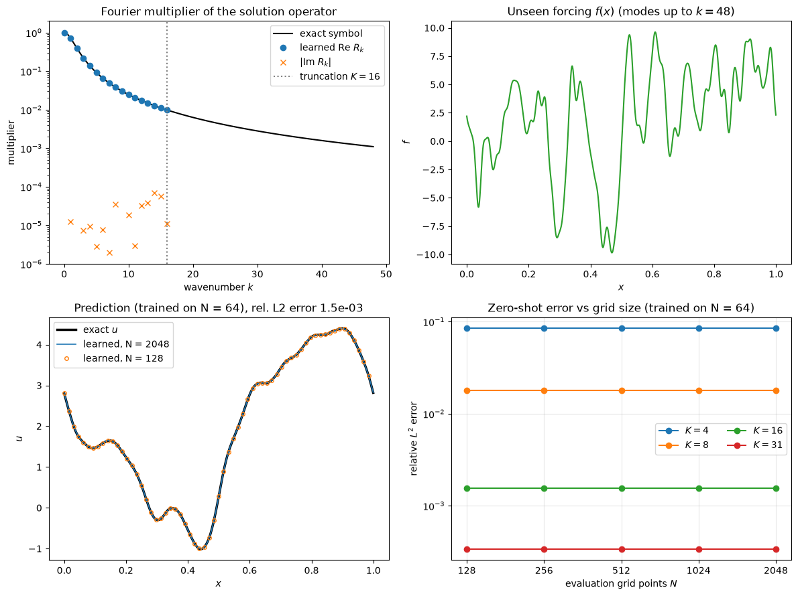

# Neural Operators

A neural operator learns the map from an input function to the solution function of a family of PDEs: from a forcing, an initial condition, a boundary condition or a coefficient field to the resulting flow. Once trained on solutions produced by a classical solver, it returns the solution for a new input in one forward pass, typically milliseconds instead of minutes or hours. Its parameters are not tied to one grid, so the same trained model can be evaluated on different discretizations.

This note covers the problem setting, the universal approximation result behind it, the two most widely used architectures (DeepONet and the Fourier neural operator), and their cost and limitations for CFD. It assumes the [neural network](../fundamentals/neural_networks.md) basics and contrasts neural operators with [physics-informed neural networks](pinns.md) and with the grid- or parameter-based surrogates of [Neural-Network Surrogates](intro.md).

## Problem Statement

Let $D \subset \mathbb{R}^d$ be the spatial domain, $\mathcal{A}$ a space of input functions $a: D \to \mathbb{R}^{d_a}$ and $\mathcal{U}$ a space of solutions $u: D \to \mathbb{R}^{d_u}$. A PDE with a unique solution for each input defines the solution operator

$$
\mathcal{G}: \mathcal{A} \to \mathcal{U},
\qquad u = \mathcal{G}(a)
$$

Examples: $a$ is the permeability field and $u$ the pressure in Darcy flow; $a$ is the initial vorticity and $u$ the vorticity at time $T$; $a$ is the forcing $f$ and $u$ the velocity. The data are $N$ input–output pairs $`\{(a_i, u_i)\}_{i=1}^{N}`$ with $`a_i`$ drawn from a probability measure $`\mu`$ on $`\mathcal{A}`$ and $`u_i = \mathcal{G}(a_i)`$, each known only at the nodes of some discretization $`D_i = \{\mathbf{x}_1, \dots, \mathbf{x}_{n_i}\} \subset D`$, which may differ between samples. The goal is a parameterised operator $`\mathcal{G}_{\boldsymbol\theta}`$ minimising the expected relative error

```math
\min_{\boldsymbol\theta} \; \mathbb{E}_{a \sim \mu} \left[ \frac{\lVert \mathcal{G}_{\boldsymbol\theta}(a) - \mathcal{G}(a) \rVert_{L^2(D)}}{\lVert \mathcal{G}(a) \rVert_{L^2(D)}} \right]
\approx
\frac{1}{N} \sum_{i=1}^{N} \frac{\lVert \mathcal{G}_{\boldsymbol\theta}(a_i) - u_i \rVert_2}{\lVert u_i \rVert_2}
```

where the discrete norms are taken over the nodes of $D_i$.

The setting differs from the neighbouring methods:

| Method | What is learned | Input | Output |
| --- | --- | --- | --- |
| PINN | One solution $u(\mathbf{x})$ for one fixed input $a$ | Coordinates $\mathbf{x}$ | $u(\mathbf{x})$ |
| Parametric surrogate | Map $\mathbf{p} \mapsto \mathbf{y}$ between finite-dimensional vectors | Design parameters or a field on a fixed grid | Coefficients, scalars or a field on a fixed grid |
| Neural operator | Map $a \mapsto u$ between function spaces | A function, sampled on any grid | A function, evaluated on any grid |

What makes it hard: the input and output are infinite-dimensional, every training pair costs a full simulation, and the error must be controlled for inputs not seen in training, including inputs sampled on unseen grids.

## Universal Approximation for Operators

Chen and Chen (1995) proved that a two-network structure can approximate any continuous nonlinear operator. Let $V$ be a compact set of continuous functions on a compact set $K_1$, $\mathcal{G}$ a continuous operator from $V$ to continuous functions on a compact set $K_2$, and $\sigma$ a continuous non-polynomial activation. Then for every $\epsilon > 0$ there exist integers $p$, $n$, $m$, sensor points $`\mathbf{x}_1, \dots, \mathbf{x}_m \in K_1`$ and real constants $`c_i^k`$, $`\xi_{ij}^k`$, $\theta_i^k$, $\zeta_k$ and vectors $\mathbf{w}_k$ such that

```math
\left| \mathcal{G}(a)(\mathbf{y}) - \sum_{k=1}^{p} \underbrace{\sum_{i=1}^{n} c_i^k \, \sigma\!\left( \sum_{j=1}^{m} \xi_{ij}^k a(\mathbf{x}_j) + \theta_i^k \right)}_{\text{depends on } a} \; \underbrace{\sigma\!\left( \mathbf{w}_k \cdot \mathbf{y} + \zeta_k \right)}_{\text{depends on } \mathbf{y}} \right| < \epsilon
```

for all $a \in V$ and $\mathbf{y} \in K_2$. Two facts follow. A finite number of point values $a(\mathbf{x}_j)$ suffices to identify the input to accuracy $\epsilon$, and the output can be written as a sum of products of a coefficient that depends on the input and a basis function that depends on the query point. The theorem says nothing about how many sensors, terms or samples are needed, or whether training finds the approximation.

## DeepONet

The deep operator network of Lu et al. (2021) replaces the shallow networks of the theorem by deep ones. A branch network $`\mathbf{b}_{\boldsymbol\theta}: \mathbb{R}^m \to \mathbb{R}^p`$ takes the input function at $`m`$ fixed sensors, and a trunk network $`\mathbf{t}_{\boldsymbol\theta}: \mathbb{R}^d \to \mathbb{R}^p`$ takes the query point $\mathbf{y}$:

$$
\mathcal{G}_{\boldsymbol\theta}(a)(\mathbf{y}) = \sum_{k=1}^{p}
b_k\left(a(\mathbf{x}_1), \dots, a(\mathbf{x}_m)\right) t_k(\mathbf{y}) + b_0
$$

with a trainable bias $b_0$. The trunk outputs $t_k$ act as a learned basis for the solutions, and the branch outputs $b_k$ are the coefficients of that basis for a given input, the same structure as a [POD](../../numerical/pod/pod_intro.md) expansion. The POD-DeepONet variant of Lu et al. (2022) uses POD modes of the training solutions as a fixed trunk.

Properties that matter in practice:

- The output can be queried at any point $\mathbf{y}$, and training pairs can have their outputs at different points.
- The input must be sampled at the same $m$ sensors for every sample, so the input discretization is fixed.
- The output is a linear combination of $p$ fixed functions, so solutions whose shape changes strongly with the input (moving shocks, travelling fronts) need a large $p$.
- Training costs one evaluation of the trunk per query point; for $N$ samples with $n$ output points the loss has $Nn$ terms.

## Neural Operator Layers

Kovachki et al. (2023) define a neural operator as a composition of layers that act on functions. An input $a$ is lifted pointwise to $d_v$ channels, $v_0(\mathbf{x}) = P(a(\mathbf{x}))$, passed through $T$ layers

```math
v_{t+1}(\mathbf{x}) = \sigma\left( W_t\, v_t(\mathbf{x}) + \int_D \kappa_t(\mathbf{x}, \mathbf{y})\, v_t(\mathbf{y}) \, d\mathbf{y} + \mathbf{b}_t(\mathbf{x}) \right), \qquad t = 0, \dots, T-1,
```

and projected pointwise to the output, $u(\mathbf{x}) = Q(v_T(\mathbf{x}))$. Here $P$, $Q$ are small pointwise networks, $W_t \in \mathbb{R}^{d_v \times d_v}$ is a local linear map, $\kappa_t$ is a learned matrix-valued kernel and $\sigma$ is a pointwise nonlinearity. Every operation is defined on functions; a discretization enters only when the integral is approximated by a quadrature over the available nodes. This is what makes the architecture discretization invariant: with a convergent quadrature, the model converges to one operator as the grid is refined, and the same parameters can be used on any grid.

A direct quadrature of the integral costs $O(n^2)$ for $n$ nodes. The architectures differ in how they make it cheaper:

| Variant | Kernel integral | Cost per layer | Geometry |
| --- | --- | --- | --- |
| Graph neural operator (GNO) | Kernel network $\kappa_{\boldsymbol\theta}(\mathbf{x}, \mathbf{y}, a(\mathbf{x}), a(\mathbf{y}))$, integral restricted to a ball and evaluated by message passing on a graph | $O(n \bar k)$ for $\bar k$ neighbours | Unstructured meshes and point clouds |
| Low-rank neural operator | $\kappa(\mathbf{x}, \mathbf{y}) = \sum_{j=1}^{r} \phi_j(\mathbf{x}) \psi_j(\mathbf{y})$ | $O(n r)$ | Any |
| Fourier neural operator (FNO) | Translation-invariant kernel $\kappa(\mathbf{x} - \mathbf{y})$, applied as a product in Fourier space | $O(n \log n)$ | Uniform grids on boxes |
| Geo-FNO, other extensions | FNO on a learned or prescribed map from the physical domain to a box | $O(n \log n)$ plus the map | Deformed and irregular domains |

The graph form is close to the [graph neural networks](graph_neural_networks.md) used on CFD meshes.

## Fourier Neural Operator

### Spectral Convolution

If the kernel depends only on $\mathbf{x} - \mathbf{y}$, the integral is a convolution, and the convolution theorem turns it into a product of Fourier transforms. Li et al. (2021) parameterise the kernel directly by its Fourier coefficients and keep only the lowest modes. For a function $v$ with $d_v$ channels on a periodic box,

```math
\left(\mathcal{K} v\right)(\mathbf{x}) = \mathcal{F}^{-1}\left[ R \cdot \mathcal{F} v \right](\mathbf{x}),
\qquad
\left(R \cdot \mathcal{F} v\right)_{\mathbf{k}, l} = \sum_{j=1}^{d_v} R_{\mathbf{k}, l j} \left(\mathcal{F} v\right)_{\mathbf{k}, j} \quad \text{for } |k_i| \le k_{\max},
```

and zero for higher wavenumbers $\mathbf{k}$. Here $\mathcal{F}$ is the Fourier transform, computed with the FFT on a uniform grid, and $R \in \mathbb{C}^{n_k \times d_v \times d_v}$ holds one complex $d_v \times d_v$ matrix for each of the $n_k$ retained modes. A full FNO layer is

```math
v_{t+1}(\mathbf{x}) = \sigma\left(W_t v_t(\mathbf{x}) + \mathcal{F}^{-1}\left[R_t \cdot
\mathcal{F} v_t \right](\mathbf{x}) \right)
```

The spectral term is global and smooth, the pointwise term $W_t v_t$ carries information at all wavenumbers and handles non-periodic content, and the nonlinearity $\sigma$ generates higher modes from the retained ones, so the output is not limited to $k_{\max}$ modes. Non-periodic domains are handled by zero-padding the input before the FFT.

### Complexity

On a grid of $n$ points the FFT of $d_v$ channels costs $O(d_v n \log n)$, the mode multiplication $O(n_k d_v^2)$ and the pointwise map $O(n d_v^2)$. The number of parameters, $n_k d_v^2$ complex numbers plus $W_t$, is independent of $n$.

### Discretization Invariance and Zero-Shot Super-Resolution

The weights $R_{\mathbf{k}}$ belong to wavenumbers, not to grid points. A model trained on a $64 \times 64$ grid can be applied to the FFT of a $256 \times 256$ input, as long as the grid resolves the retained modes; Li et al. called this zero-shot super-resolution and demonstrated it on the 2D Navier–Stokes equations. Two caveats apply. The prediction on a finer grid cannot contain physics that the training data at the coarse resolution did not contain, so the extra resolution mainly smooths the output. And invariance holds exactly only for the spectral part; the pointwise maps are evaluated at more points but are not changed.

### A Linear Example

For $-\nu u'' + u = f$ on the periodic unit interval, the solution operator is a convolution with Fourier multiplier $m(k) = 1/(1 + \nu (2\pi k)^2)$. A single spectral convolution with one channel, no $W$ and no $\sigma$, $\hat u_k = R_k \hat f_k$, can represent it exactly up to the truncation $K$. The example script fits $R_k$ by least squares from 200 noisy pairs on a 64-point grid with $\nu = 0.01$, then applies the layer to an unseen forcing that contains modes up to $k = 48$, on grids of 128 to 2048 points.



The learned weights lie on the exact symbol (top left), with imaginary parts below $10^{-4}$. With $K = 16$ the relative $L^2$ error on the unseen forcing is $1.5 \times 10^{-3}$ on every evaluation grid (bottom right). The error is set by the discarded modes ($8.5 \times 10^{-2}$ for $K = 4$, $3.4 \times 10^{-4}$ for $K = 31$), not by the grid. A dense $64 \times 64$ matrix fitted to the same data could only be applied on the 64-point grid.

## Data Generation and Training

The training set is produced by a classical solver, which is where most of the cost lies.

1. Choose a distribution $\mu$ of inputs that covers the intended use. Gaussian random fields with covariance $(-\Delta + \tau^2 I)^{-\alpha}$ are common for coefficients and initial conditions; $\alpha$ and $\tau$ set the smoothness and the length scale. Inputs outside the support of $\mu$ will not be predicted reliably.
2. Solve the PDE for each sample on a grid fine enough for the solution to be converged, then store input and output at the training resolution. The FNO benchmarks of Li et al. used 1000 to 10 000 training pairs per problem.
3. Normalise inputs and outputs (for example pointwise mean and standard deviation over the training set).
4. Minimise the relative $L^2$ loss of the problem statement with Adam and a decaying learning rate. The relative form gives each sample the same weight regardless of its amplitude.
5. Test on held-out samples from $\mu$, and separately on inputs from a shifted distribution, at the training resolution and at others.

For time-dependent problems the operator is often learned as a one-step map $u(t) \mapsto u(t + \Delta t)$ and applied autoregressively. Errors then accumulate, and long rollouts can drift or become unstable, as with any learned time stepper. Physics-informed neural operators (PINO, Li et al. 2024) add a PDE residual on the predicted fields to the data loss, which reduces the amount of data needed and can be used to fine-tune a trained model for a specific input.

## Comparison of Approaches

|  | PINN | DeepONet | FNO | CNN surrogate |
| --- | --- | --- | --- | --- |
| Learns | One solution | Operator $a \mapsto u$ | Operator $a \mapsto u$ | Map between fixed-grid arrays |
| Training data | None or sparse measurements | Many solver pairs | Many solver pairs | Many solver pairs |
| Needs the PDE | Yes (residual) | No (optional) | No (optional, PINO) | No |
| Input discretization | Not applicable | Fixed sensors | Any uniform grid that resolves $k_{\max}$ | Fixed grid |
| Output discretization | Any point | Any point | Uniform grid; any resolution | Fixed grid |
| Cost of a new input | Retrain (minutes to hours) | One forward pass | One forward pass | One forward pass |
| Geometry | Any (meshless) | Any for outputs | Boxes, or a map to a box | Boxes, or interpolation to a grid |
| Typical failure | Optimisation (stiffness, layers) | Too few basis functions for moving features | Non-periodic or irregular domains, high-frequency output | Grid lock-in, poor generalisation |

## Limitations

- Every training pair is a full simulation, so the operator pays off only when it is evaluated many more times than the number of training solves, as in optimisation, uncertainty quantification or real-time control.
- Accuracy is that of interpolation within $\mu$. For inputs outside the training distribution (higher Reynolds number, new geometry class) the error is unbounded and is not signalled by the model.
- The FNO assumes a uniform grid on a box and, through the FFT, periodicity; padding, geometric maps or graph-based kernels are needed otherwise, and resolving thin boundary layers on a uniform grid is expensive.
- Mode truncation limits the frequencies that the linear part can represent; sharp features are produced only through the nonlinearities and are often smeared.
- Typical errors of $10^{-3}$ to $10^{-2}$ in relative $L^2$ norm are adequate for design screening but much larger than the discretization error of the solver that produced the data, and conservation laws are not satisfied exactly.
- Autoregressive rollouts accumulate error, and for chaotic flows only statistics, not trajectories, can be predicted beyond a few Lyapunov times.

## Key Takeaways

- A neural operator approximates the solution operator $\mathcal{G}: a \mapsto u$ of a PDE family from solver data, so one trained model answers many queries.
- DeepONet writes the output as branch coefficients times trunk basis functions, following the Chen and Chen (1995) approximation theorem; it fixes the input sensors but allows any output point.
- The FNO applies a learned, truncated Fourier multiplier per layer at $O(n \log n)$ cost, with parameters independent of the grid, which allows evaluation at resolutions not used in training.
- Data generation dominates the cost, and accuracy holds only within the training distribution.
- For a linear translation-invariant PDE a single spectral layer recovers the exact multiplier; the nonlinear layers are what extend this to nonlinear flows.

## Related Scripts

- [Fourier Neural Operator Layer in 1D](../../../scripts/algorithms/fourier_neural_operator_1d/): This script learns the solution operator $G: f \mapsto u$ of the periodic problem $-\nu u'' + u = f$ from 200 random forcing–solution pairs with a single spectral convolution, the linear part of a Fourier neural operator (FNO) layer, fitted by least squares.

## Exercises

1. For $-\nu u'' + u = f$ on the periodic unit interval with $\nu = 0.01$, compute the multiplier $m(k)$ for $k = 1$, 4 and 16. What fraction of the amplitude of mode 16 of the forcing survives in $u$, and what does this imply for the accuracy with which $R_{16}$ can be learned from noisy data?

<details><summary>Answer</summary>

```math
m(1) = \frac{1}{1 + 0.01 (2\pi)^2} = 0.717, \qquad m(4) = \frac{1}{1 + 0.01 (8\pi)^2} = 0.137, \qquad m(16) = \frac{1}{1 + 0.01 (32\pi)^2} = 0.0098
```

Less than 1 % of mode 16 survives. With measurement noise of fixed size in $u$, the signal-to-noise ratio of mode 16 is about 100 times lower than that of mode 0, so its weight is learned less accurately: in the example script the relative weight error grows from $10^{-4}$ for $K = 4$ to $7 \times 10^{-3}$ for $K = 16$ and $10^{-1}$ for $K = 31$. Those modes contribute little to $u$, so the prediction error still falls as $K$ grows.

</details>

2. A 1D FNO layer has $d_v = 32$ channels and keeps 16 Fourier modes. How many real parameters do the spectral weights $R$ and the pointwise map $W$ (with bias) have? For a grid of $n = 4096$ points, by what factor is the FFT-based convolution cheaper than a direct quadrature of the kernel integral, counting $n \log_2 n$ against $n^2$ operations per channel?

<details><summary>Answer</summary>

$R$ has $`16 \times 32 \times 32 = 16\,384`$ complex entries, that is $`32\,768`$ real parameters. $W$ has $32 \times 32 = 1024$ weights plus 32 biases, 1056 parameters. Neither number depends on $n$. The cost ratio is $n^2 / (n \log_2 n) = 4096/12 = 341$.

</details>

3. A linear surrogate $\mathbf{u} = A \mathbf{f}$ with a dense $64 \times 64$ matrix $A$ is fitted by least squares to noise-free pairs of the periodic problem in exercise 1, sampled on 64 points, with at least 64 linearly independent forcings. Show that $A$ is circulant and find its eigenvalues. Compare its parameter count with the spectral layer for $K = 16$, and explain why only one of them can be applied on a 128-point grid.

<details><summary>Answer</summary>

With 64 independent forcings the fit is exact, so $A$ equals the discrete solution operator. On the periodic grid, applying the operator to a shifted forcing gives the shifted solution, so $A$ commutes with the cyclic shift and is circulant. A circulant matrix is diagonalised by the discrete Fourier transform, with eigenvalues equal to the multiplier on the grid's wavenumbers: $\lambda_k = m(k)$ for $|k| \le 32$. $A$ has $64^2 = 4096$ parameters, while the spectral layer has $R_0$ (real) and 16 complex weights, 33 real parameters. The spectral layer's weights belong to wavenumbers, so it applies to the FFT of a forcing on any grid with more than $2K$ points. $A$ is indexed by grid points and has no defined action on a 128-point vector; it would have to be interpolated or refitted.

</details>

4. In the example script the forcing coefficients for $k \ge 1$ are complex Gaussian with $\mathbb{E}|\hat f_k|^2 = 2 s_k^2$, where $s_k = (1 + (k/8)^2)^{-1}$, and the test forcing has modes up to $k = 48$. Ignoring errors in the learned weights, estimate the expected relative $L^2$ error caused by truncation at $K = 16$ and $K = 31$, and compare with the values the script prints for its single test forcing ($1.5 \times 10^{-3}$ and $3.4 \times 10^{-4}$).

<details><summary>Answer</summary>

By Parseval, the relative error of discarding modes $k > K$ is

```math
e_K \approx \left( \frac{\sum_{k=K+1}^{48} s_k^2\, m(k)^2}{\tfrac{1}{4} s_0^2 m(0)^2 + \sum_{k=1}^{48} s_k^2\, m(k)^2} \right)^{1/2}
```

where the mode $k = 0$ term has weight 1/4 relative to the others because $\hat f_0$ is real (variance $s_0^2$ instead of $2 s_k^2$) and appears once rather than as a conjugate pair. Evaluating the sums gives $e_{16} = 2.9 \times 10^{-3}$ and $e_{31} = 3.3 \times 10^{-4}$. The second matches the printed value; the first differs by a factor of two because a single random forcing has random mode energies, and the energy of the modes $17 \le k \le 48$ in this sample happens to be below its expectation.

</details>

5. Show that a DeepONet can represent the operator of exercise 1, truncated to $|k| \le K$, exactly. How many basis functions $p$ and sensors $m$ are needed, and what are the branch and trunk functions?

<details><summary>Answer</summary>

Take the trunk functions $t_1(y) = 1$, $t_{2k}(y) = \cos(2\pi k y)$, $t_{2k+1}(y) = \sin(2\pi k y)$ for $k = 1, \dots, K$, so $p = 2K + 1$. With $m = 2K + 1$ (or more) equally spaced sensors, the discrete Fourier transform of the sensor values gives the cosine and sine coefficients $\alpha_k$, $\beta_k$ of a forcing band-limited to $K$ exactly, by the sampling theorem; these are linear functions of the sensor values. The branch outputs $b_1 = m(0) \alpha_0$, $b_{2k} = m(k) \alpha_k$, $b_{2k+1} = m(k) \beta_k$ are then linear in the sensor values, so a branch network with linear activations represents them exactly, and $\sum_k b_k t_k(y) = \mathcal{G}(f)(y)$ for every $y$. For a forcing with modes above $K$, aliasing at the sensors corrupts the coefficients, which is the DeepONet analogue of the FNO's need for a grid that resolves the retained modes.

</details>

## References

- Chen, T., and Chen, H. "Universal approximation to nonlinear operators by neural networks with arbitrary activation functions and its application to dynamical systems." *IEEE Transactions on Neural Networks* 6(4), 911–917, 1995.
- Lu, L., Jin, P., Pang, G., Zhang, Z., and Karniadakis, G. E. "Learning nonlinear operators via DeepONet based on the universal approximation theorem of operators." *Nature Machine Intelligence* 3, 218–229, 2021.
- Li, Z., Kovachki, N., Azizzadenesheli, K., Liu, B., Bhattacharya, K., Stuart, A., and Anandkumar, A. "Fourier neural operator for parametric partial differential equations." *International Conference on Learning Representations (ICLR)*, 2021.
- Kovachki, N., Li, Z., Liu, B., Azizzadenesheli, K., Bhattacharya, K., Stuart, A., and Anandkumar, A. "Neural operator: Learning maps between function spaces with applications to PDEs." *Journal of Machine Learning Research* 24(89), 1–97, 2023.
- Li, Z., Kovachki, N., Azizzadenesheli, K., Liu, B., Bhattacharya, K., Stuart, A., and Anandkumar, A. "Neural operator: Graph kernel network for partial differential equations." arXiv:2003.03485, 2020.
- Lu, L., Meng, X., Cai, S., Mao, Z., Goswami, S., Zhang, Z., and Karniadakis, G. E. "A comprehensive and fair comparison of two neural operators (with practical extensions) based on FAIR data." *Computer Methods in Applied Mechanics and Engineering* 393, 114778, 2022.
- Karniadakis, G. E., Kevrekidis, I. G., Lu, L., Perdikaris, P., Wang, S., and Yang, L. "Physics-informed machine learning." *Nature Reviews Physics* 3, 422–440, 2021.
