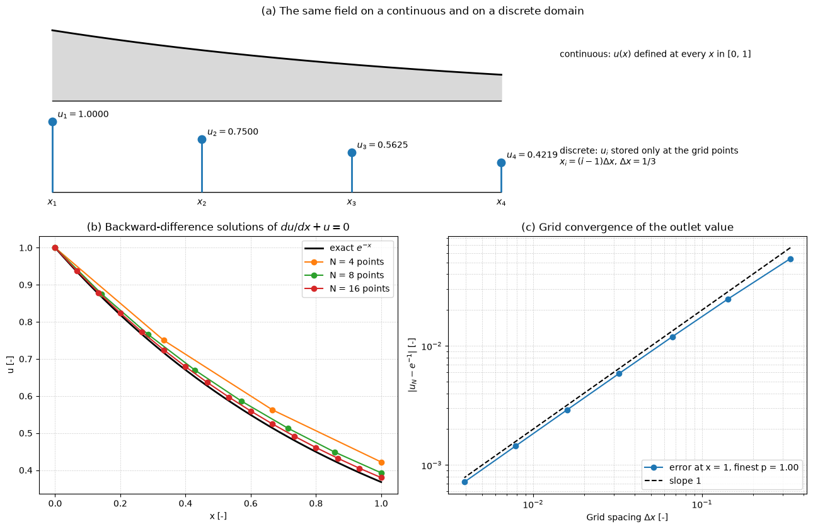

# The Strategy of CFD

Every CFD calculation, from a textbook exercise to a 100-million-cell car simulation, follows the same strategy: the continuous domain is replaced by a mesh, the differential equations by algebraic equations for values on that mesh, and the algebraic system is solved and interpreted. This note describes the four stages of that workflow (pre-processing, discretization, solution of the algebraic system and post-processing) and then carries a one-dimensional problem through all of them, including the refinement study that tells whether the answer can be trusted. Why the continuous problem cannot be solved directly is explained in [Why CFD](./intro.md).

## Problem Statement

Given a partial differential equation on a domain $\Omega$ with boundary and initial conditions, CFD produces a finite set of numbers $\phi_1, \dots, \phi_N$ that approximate the solution $\phi(\mathbf{x}, t)$ at chosen locations, together with an estimate of how far they are from it. The model problem used throughout this note is

$$
\frac{du}{dx} + u = 0,
\qquad 0 < x \le 1,
\qquad u(0) = 1
$$

with the exact solution $u = e^{-x}$. It is a first-order equation with a single condition at the inflow end $x = 0$: information travels in the $+x$ direction, as it does along a streamline in a convection-dominated flow.

A discrete solution is accepted when two conditions hold. The algebraic equations are satisfied to a tolerance far below the discretization error (iterative convergence), and the discretization error itself has been estimated by refining the grid and found acceptable for the purpose (grid convergence). The difficulty in real problems is that $N$ is $10^6$ to $10^9$, the equations are nonlinear and coupled, and the exact solution is unknown.

## Continuous and Discrete Domains

In the continuous domain a flow variable such as the pressure is a function defined at every point, for example $p = p(x)$ for $0 \le x \le 1$, and the governing equations are PDEs that hold at every point. In the discrete domain the variable is stored only at $N$ grid points,

$$
p_i \approx p(x_i),
\qquad i = 1, 2, \dots, N
$$

and the PDEs are replaced by $N$ coupled algebraic equations that relate each $p_i$ to the values at neighbouring points. Values between grid points are not computed; if needed, they are interpolated afterwards.



The top panel shows the same field described both ways, with the four stored values of the worked example below. The lower panels anticipate the result of the worked example: the discrete solutions approach the exact one as the grid is refined, and the error at $x = 1$ falls in proportion to $\Delta x$.

In two and three dimensions the grid becomes a mesh of cells. Structured meshes have an implicit $(i, j, k)$ ordering, so the neighbours of a cell follow from its indices; unstructured meshes of tetrahedra, prisms, hexahedra or polyhedra store the connectivity explicitly and fit complex geometries. The unknowns can be stored at the vertices (vertex-centred) or at the cell centres (cell-centred, the usual choice in finite-volume codes). For incompressible flow the velocity components may also be stored on the faces, a staggered arrangement that avoids spurious pressure oscillations (see [Pressure–Velocity Coupling](../fvm/pressure_velocity_coupling.md)).

## The Workflow

1. Pre-processing: define the geometry and the computational domain, generate the mesh, choose the physical models, set boundary and initial conditions.
2. Discretization: convert the PDEs on the mesh into algebraic equations.
3. Solution: solve the algebraic system, iterating over linearizations and coupled equations until the residuals and the monitored quantities have converged. If they have not, the iteration continues; if it diverges, the time step, under-relaxation, mesh or initial field is changed and the solver restarted.
4. Post-processing: extract and visualize the quantities of interest and check them.
5. Verification of the result: repeat steps 1 to 4 on systematically refined meshes and estimate the discretization error.

Steps 2 and 3 are usually hidden inside a solver, but the user's choices in step 1 decide whether they succeed.

### Pre-Processing

The geometry is taken from CAD and cleaned: small gaps, sliver faces and details below the mesh resolution are removed. The computational domain must extend far enough that the artificial outer boundaries do not influence the result; for external aerodynamics, inlets are typically placed several body lengths upstream and outlets five to ten body lengths downstream.

The mesh determines both accuracy and cost. Cells must be small where gradients are large (boundary layers, shear layers, wakes, shocks) and may be large elsewhere. Wall-resolved turbulence models need the first cell centre at $y^+ \approx 1$ with prism layers growing away from the wall; wall functions accept $30 \lesssim y^+ \lesssim 300$. Skewness, non-orthogonality and abrupt changes in cell size increase the discretization error and can prevent convergence. Practical meshing is covered in [Boundary Layer Meshing Guide](../../../practice/mesh_generation/boundary_layers.md) and [Mesh Quality Assessment Guide](../../../practice/mesh_generation/mesh_quality.md).

The physical models are chosen next: compressible or incompressible, laminar or turbulent and with which turbulence model, heat transfer, multiphase or reacting flow. Boundary conditions close the problem and are a frequent source of error; their mathematical types and implementation are the subject of [Boundary Conditions](./boundary_conditions.md). Finally the arrays that hold the unknowns (velocity components, pressure, temperature, turbulence quantities) are allocated and filled with an initial field. For a steady problem the initial field affects only the convergence path, as long as the iteration converges to the same solution; for an unsteady problem it is part of the problem definition.

### Discretization

Discretization replaces each derivative or integral by an algebraic approximation. For example, the five-point approximation of the Laplacian on a uniform grid with $\Delta x = \Delta y = h$ is

$$
\nabla^2\phi\big|_{i,j} \approx
\frac{\phi_{i+1,j} + \phi_{i-1,j} + \phi_{i,j+1} + \phi_{i,j-1} - 4\phi_{i,j}}{h^2}
$$

with a truncation error $\tfrac{h^2}{12}(\partial_x^4\phi + \partial_y^4\phi) + O(h^4)$, so it is second order. Finite differences derive such formulas from Taylor series ([Finite Difference Method](../fdm/intro.md)); finite volumes integrate the conservation law over each cell and approximate the face fluxes ([The Finite Volume Method](../fvm/intro.md)); finite elements multiply by test functions and integrate ([Finite Element Method](../fem/intro.md)). Time derivatives are discretized separately, by explicit or implicit time-stepping schemes ([Time Integration](./time_integration.md)).

Each discrete equation links an unknown to a few neighbours, so the matrix of the algebraic system is sparse: the five-point stencil gives at most five nonzeros per row however large the mesh.

### Solving the Algebraic System

For a linear problem the result is a system $A\boldsymbol{\phi} = \mathbf{b}$. Direct solvers (Gaussian elimination, LU or Cholesky factorization) give the solution in a fixed number of operations but fill in the sparse matrix, so their memory and work grow quickly with $N$. Large CFD systems are solved by iterative methods (Gauss–Seidel, conjugate gradient, GMRES, BiCGSTAB, multigrid) that need only matrix–vector products and are preconditioned to converge in few iterations ([Direct and Iterative Solvers](./direct_and_iterative_solvers.md)).

The Navier–Stokes equations are nonlinear and couple velocity and pressure, so the linear solver sits inside an outer iteration: the equations are linearized about the current estimate (Picard or Newton linearization, [Dealing with Nonlinearity](./dealing_with_nonlinearity.md)) and the momentum and pressure equations are solved in turn by an algorithm such as SIMPLE or PISO ([Pressure–Velocity Coupling](../fvm/pressure_velocity_coupling.md)). Convergence is monitored through the residuals and through the quantities of interest ([Iterative Convergence](./iterative_convergence.md)).

On parallel computers the mesh is split into subdomains, one per processor core. Each core assembles and solves the equations of its cells and exchanges values in a layer of halo cells with its neighbours after each iteration, so the cost per core stays roughly constant as mesh and core count grow together.

### Post-Processing

Post-processing extracts what the calculation was for: integrated quantities (forces, moments, pressure drop, heat transfer rates), profiles along lines, surface distributions of pressure and skin friction, and contour, vector and streamline plots that reveal separation and recirculation. It is also where the result is checked. The global mass and energy imbalance should be small, the $y^+$ of the first cells should match the wall treatment, the flow at the outlet should leave the domain everywhere, and the quantities of interest should be compared on at least two meshes.

## Worked Example: A First-Order Equation End to End

The model problem $du/dx + u = 0$, $u(0) = 1$ is carried through the whole workflow.

### Grid

The domain $[0, 1]$ is divided by $N$ equally spaced points $x_i = (i - 1)\Delta x$, $i = 1, \dots, N$, with $\Delta x = 1/(N - 1)$. The first run uses $N = 4$, so $\Delta x = 1/3$.

### Discretization

At each point $i \ge 2$ the derivative is replaced by the backward difference

$$
\left. \frac{du}{dx}\right|_{x_i} \approx \frac{u_i - u_{i-1}}{\Delta x}
$$

A Taylor expansion of $u_{i-1}$ about $x_i$ gives $(u_i - u_{i-1})/\Delta x = u'(x_i) - \tfrac{\Delta x}{2}u''(x_i) + O(\Delta x^2)$, so the truncation error is first order. The backward difference uses the upstream neighbour, consistent with the direction in which information travels. The discrete equation is

```math
\frac{u_i - u_{i-1}}{\Delta x} + u_i = 0 \quad\Longleftrightarrow\quad - u_{i-1} +
(1 + \Delta x)\, u_i = 0,
\qquad i = 2, \dots, N
```

### Boundary Condition and Assembly

The first point has no upstream neighbour, and its equation is replaced by the boundary condition $u_1 = 1$. A first-order equation needs exactly one condition, at the inflow end. A central difference $(u_{i+1} - u_{i-1})/(2\Delta x)$ would reach past $x = 1$ at the last point and would need an extra numerical condition there that the continuous problem does not supply. Combining the boundary row with the three discrete equations gives

```math
\begin{bmatrix}
1 & 0 & 0 & 0 \\
-1 & 1 + \Delta x & 0 & 0 \\
0 & -1 & 1 + \Delta x & 0 \\
0 & 0 & -1 & 1 + \Delta x
\end{bmatrix}
\begin{bmatrix} u_1 \\ u_2 \\ u_3 \\ u_4 \end{bmatrix}
=
\begin{bmatrix} 1 \\ 0 \\ 0 \\ 0 \end{bmatrix}
```

In general, interior points carry the discretized PDE, and points on or next to the boundary carry the boundary condition or a modified equation that includes it.

### Solution

The matrix is lower bidiagonal, so forward substitution solves it exactly: $u_i = u_{i-1}/(1 + \Delta x)$. With $\Delta x = 1/3$,

$$
u_1 = 1,
\qquad u_2 = \frac{3}{4},
\qquad u_3 = \frac{9}{16},
\qquad u_4 = \frac{27}{64} \approx 0.4219
$$

A real CFD system is not triangular, and the same step is done by an iterative solver.

### Comparison with the Exact Solution


The discrete solution lies above $e^{-x}$, and the error accumulates along the march: at $x = 1$ the discrete value 0.4219 exceeds $e^{-1} = 0.3679$ by 14.7%.

### Grid Refinement

In a real problem the exact solution is unknown, so accuracy is judged from a sequence of grids. Repeating the calculation with more points gives the errors at $x = 1$ below, computed by the [Continuous vs Discrete Domain](../../../scripts/plots/continuous_vs_discrete_domain/) script.

| Points $N$ | $\Delta x$ | $u_N$ | Error at $x = 1$ | Observed order $p$ |
| --- | --- | --- | --- | --- |
| 4 | 0.3333 | 0.42188 | 0.05400 (14.7%) |  |
| 8 | 0.1429 | 0.39270 | 0.02482 (6.75%) | 0.92 |
| 16 | 0.0667 | 0.37981 | 0.01193 (3.24%) | 0.96 |
| 32 | 0.0323 | 0.37373 | 0.00586 (1.59%) | 0.98 |
| 64 | 0.0159 | 0.37078 | 0.00290 (0.79%) | 0.99 |
| 256 | 0.0039 | 0.36860 | 0.00072 (0.20%) | 1.00 |

The observed order $p = \ln(e_k/e_{k+1})/\ln(\Delta x_k/\Delta x_{k+1})$ approaches the formal order 1 of the backward difference. When the solutions on successive grids agree to within a tolerance chosen for the purpose, the solution is called grid converged. Agreement between two grids alone can be misleading if they are too coarse to be in the asymptotic range, where the error behaves as $C\Delta x^p$; a third grid confirms the observed order. Richardson extrapolation and the grid convergence index turn such a sequence into an error estimate without knowing the exact solution, as described in [Verification and Validation](./verification_and_validation.md).

## Key Takeaways

- CFD replaces a field defined at every point by values stored on a mesh, and the PDEs by a sparse system of algebraic equations.
- The workflow is pre-processing, discretization, solution and post-processing, followed by a refinement study; the user's choices of domain, mesh, models and boundary conditions decide most of the outcome.
- Boundary conditions replace or modify the discrete equations at boundary points, and the number of conditions must match the mathematical character of the equation.
- Large systems are solved iteratively inside an outer nonlinear iteration and in parallel by domain decomposition.
- One solution says nothing about its own accuracy; a sequence of refined grids gives the observed order and the discretization error.

## Related Scripts

- [Continuous vs Discrete Domain](../../../scripts/plots/continuous_vs_discrete_domain/): illustrates the central step of CFD, replacing a field defined at every point of a continuous domain by values stored at a finite set of grid points, and measures the error this introduces for the model problem $du/dx + u = 0$, $u(0) = 1$.
- [Numerical vs. Exact Solution Comparison](../../../scripts/plots/numerical_vs_exact_solution/): solves $du/dx + u = 0$ with $u(0) = 1$ by a first-order finite-difference scheme and compares the result with the exact solution $u(x) = e^{-x}$, plotting the pointwise error.
- [Grid Convergence Index](../../../scripts/algorithms/grid_convergence_index/): estimates discretization error from three meshes with Richardson extrapolation and the grid convergence index (GCI), following the procedure of Celik et al. (2008).
- [Backward-Facing Step Flow (SIMPLE Algorithm)](../../../scripts/simulations/backward_facing_step_simple/): solves steady 2D laminar incompressible flow over a backward-facing step with the finite volume method and the SIMPLE pressure–velocity coupling algorithm.
- [Lid-Driven Cavity Flow Simulation](../../../scripts/simulations/lid_driven_cavity/): solves the 2D incompressible Navier-Stokes equations for flow in a square cavity driven by a moving lid at a Reynolds number of 100 and animates the velocity field.
- [Grid Convergence Comparison](../../../scripts/plots/comparing_grid_convergence/): illustrates grid convergence by plotting the model numerical solutions $u_N(x) = e^{-x(1 + x/N)}$ for $N = 4, 8, 16$ against the exact solution $u(x) = e^{-x}$ on $[0, 1]$.
- [Mean Velocity Magnitude: Experiment vs CFD Comparison](../../../scripts/plots/mean_velocity_magnitude/): plots a mock experimental profile and a mock CFD scale-resolving simulation (SRS) profile of the normalised mean velocity magnitude $|U|/U_0$ along an under-body centreline.

## Exercises

**Exercise 1.** Repeat the worked example with the same backward difference on a 5-point grid ($\Delta x = 1/4$). Give all nodal values and the percentage error at $x = 1$.

<details>
<summary>Answer</summary>

Each equation $-u_{i-1} + (1 + \Delta x)u_i = 0$ gives $u_i = u_{i-1}/1.25$.

$u = (1, 0.8, 0.64, 0.512, 0.4096)$.

The exact value is $e^{-1} \approx 0.3679$, so the error at $x = 1$ is $`(0.4096 - 0.3679)/0.3679 \approx 11.3\%`$, down from 14.7% on the 4-point grid.

</details>

**Exercise 2.** The discrete solution at $x = 1$ is $u_N = (1 + \Delta x)^{-(N-1)}$. Compute the error at $x = 1$ for $N = 4$, 8 and 16 ($\Delta x = 1/3$, $1/7$, $1/15$) and the observed order of accuracy $p = \ln(e_1/e_2)/\ln(\Delta x_1/\Delta x_2)$ between successive grids.

<details>
<summary>Answer</summary>

$u_4 = 0.421875$, $u_8 \approx 0.392696$ and $u_{16} \approx 0.379812$.

The errors are $0.05400$, $0.02482$ and $0.01193$.

$p \approx \ln(0.05400/0.02482)/\ln(7/3) \approx 0.92$, then $p \approx \ln(0.02482/0.01193)/\ln(15/7) \approx 0.96$.

$p$ approaches 1, the formal order of the backward difference. This is what a grid-convergence study should show before the solution is called grid converged.

</details>

**Exercise 3.** Use the solutions at $x = 1$ on grids with $\Delta x = 1/4$, $1/8$ and $1/16$ ($N = 5$, 9, 17) for Richardson extrapolation with refinement ratio $r = 2$. Compute the observed order and the extrapolated value, and compare with the extrapolation that assumes $p = 1$.

<details>
<summary>Answer</summary>

$f_3 = 0.409600$ (coarse), $f_2 \approx 0.389744$ and $f_1 \approx 0.379085$ (fine).

```math
p = \frac{\ln\left((f_3 - f_2)/(f_2 - f_1)\right)}{\ln 2} \approx 0.90,
\qquad f_{\text{ext}} = f_1 + \frac{f_1 - f_2}{2^p - 1} \approx 0.36673
```

This is within $-0.0011$ of $e^{-1} = 0.367879$, whereas the finest grid alone is off by $+0.0112$.

With $p = 1$: $f_{\text{ext}} = 2f_1 - f_2 \approx 0.36843$, an error of $+0.00055$. Extrapolation cuts the error by a factor of 10 to 20 at no extra cost.

</details>

**Exercise 4.** Apply the five-point Laplacian with $h = 0.1$ to (a) $f = x^2 + y^2$ and (b) $f = x^4$ at the point $(1, 0)$. Compare with the exact values and explain the error in (b).

<details>
<summary>Answer</summary>

(a) Each second difference of a quadratic is exact: $(f_{i+1,j} - 2f_{i,j} + f_{i-1,j})/h^2 = 2$ in each direction. The stencil gives $\nabla^2 f = 4$, which is exact.

(b) Only the $x$ direction contributes: $((1.1)^4 + (0.9)^4 - 2)/0.01 = (1.4641 + 0.6561 - 2)/0.01 = 12.02$. The exact value is $12x^2 = 12$.

The difference of 0.02 matches the leading truncation term $\frac{h^2}{12} f'''' = \frac{0.01}{12} \times 24 = 0.02$, which confirms second-order accuracy.

</details>

**Exercise 5.** A 2D problem with $N = 10^6$ unknowns uses the five-point stencil. Compare the memory to store $A$ as a dense matrix of doubles with a compressed sparse row (CSR) format using 8-byte values and 4-byte column indices and row pointers. What does this imply for the choice of solver?

<details>
<summary>Answer</summary>

Dense: $10^{12}$ entries $\times$ 8 bytes $= 8$ TB.

CSR: about $5 \times 10^6$ nonzeros, so $5 \times 10^6 \times (8 + 4)$ bytes for values and column indices plus $(10^6 + 1) \times 4$ bytes for row pointers, about 64 MB in total.

Only sparse storage is feasible. Direct factorization creates fill-in that destroys sparsity, so large CFD systems are solved with iterative methods (CG, GMRES, multigrid) that only need matrix–vector products.

</details>

## References

- Anderson, J. D., *Computational Fluid Dynamics: The Basics with Applications*, McGraw-Hill, 1995.
- Versteeg, H. K., & Malalasekera, W., *An Introduction to Computational Fluid Dynamics: The Finite Volume Method*, 2nd ed., Pearson Education, 2007.
- Ferziger, J. H., Perić, M., & Street, R. L., *Computational Methods for Fluid Dynamics*, 4th ed., Springer, 2020.
- Patankar, S. V., *Numerical Heat Transfer and Fluid Flow*, Hemisphere, 1980.
- Roache, P. J., *Verification and Validation in Computational Science and Engineering*, Hermosa Publishers, 1998.
- Saad, Y., *Iterative Methods for Sparse Linear Systems*, 2nd ed., SIAM, 2003.
