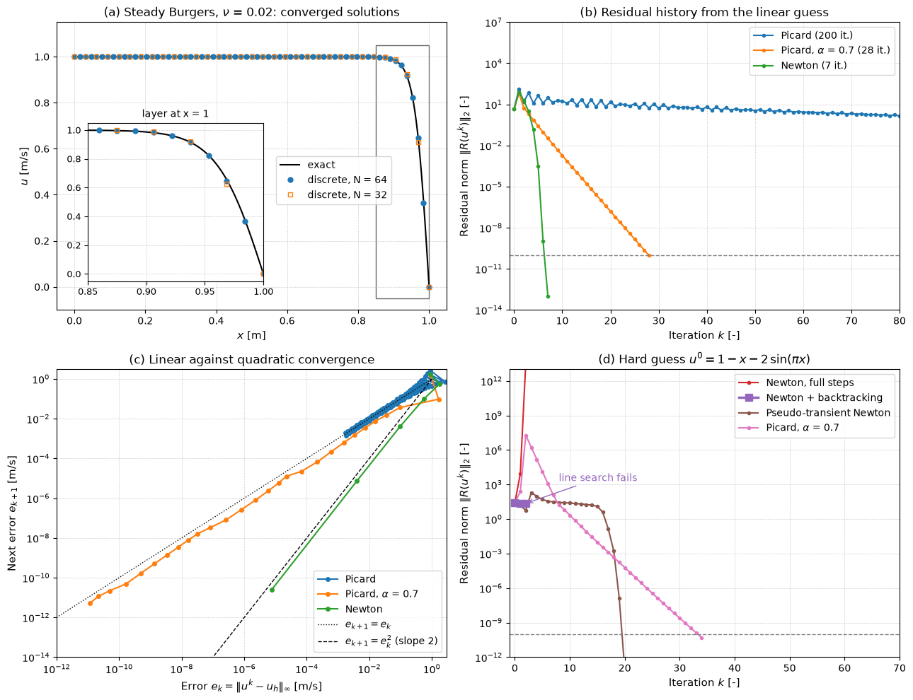

# Dealing with Nonlinearity

The convective term $\nabla\cdot(\rho\mathbf{u}\mathbf{u})$ makes the Navier–Stokes equations nonlinear, and turbulence models, temperature-dependent properties and reaction sources add further nonlinearity. After discretization the result is a system of nonlinear algebraic equations that no direct method can solve. CFD codes replace it by a sequence of linear systems, each solved with the methods of [Direct and Iterative Solvers](direct_and_iterative_solvers.md). This note covers the two basic linearizations, Picard iteration and Newton's method, under-relaxation, globalization by damping and pseudo-transient continuation, and Jacobian-free Newton–Krylov methods, with steady viscous Burgers as the worked example.

## Problem Statement

A steady problem, or one implicit time step of an unsteady one, discretized on $N$ unknowns $\boldsymbol{\phi}$, leads to

$$
\mathbf{R}(\boldsymbol{\phi}) = \mathbf{0},
\qquad \mathbf{R}: \mathbb{R}^N \to \mathbb{R}^N
$$

where $R_i$ is the residual of the discrete equation of cell or node $i$, including the boundary conditions. Find $\boldsymbol{\phi}$ such that $`\|\mathbf{R}(\boldsymbol{\phi})\|`$ falls below a tolerance chosen with the discretization error in mind ([Iterative Convergence](iterative_convergence.md)), starting from an initial guess $\boldsymbol{\phi}^0$ (uniform flow, a coarse-grid solution or the previous time step).

What makes it hard:

- There is no finite algorithm; every method iterates, and none converges from every initial guess.
- The equations may have several solutions (separated flows, bifurcations), or none that is steady (vortex shedding).
- The Jacobian $J = \partial\mathbf{R}/\partial\boldsymbol{\phi}$ is large, nonsymmetric and expensive to form and store, especially for higher-order schemes and turbulence models.
- The convergence radius of the fast methods is small, while the robust methods are slow.

## A Scalar Example

Consider $d\phi/dx + \phi^2 = 0$ on $0 \le x \le 1$ with $\phi(0) = 1$, whose exact solution is $\phi = 1/(1 + x)$. The backward difference at grid point $i$ gives

$$
\frac{\phi_i - \phi_{i-1}}{\Delta x} + \phi_i^2 = 0
$$

which is nonlinear in $\phi_i$. Let $\phi^\ast_i$ be a guess and $\Delta\phi_i = \phi_i - \phi^\ast_i$. Then

```math
\phi_i^2 = (\phi^\ast_i)^2 + 2\phi^\ast_i\,\Delta\phi_i + (\Delta\phi_i)^2
```

Dropping $(\Delta\phi_i)^2$ gives the Newton linearization $\phi_i^2 \approx 2\phi^\ast_i\phi_i - (\phi^\ast_i)^2$, whose error is $(\Delta\phi_i)^2$. Freezing one factor gives the Picard linearization $\phi_i^2 \approx \phi^\ast_i\phi_i$, whose error is $`\phi_i\,\Delta\phi_i`$, first order in $\Delta\phi_i$. With the Newton form, the equations on a four-point grid ($\Delta x = 1/3$, $\phi_1 = 1$) become the linear system

```math
\begin{bmatrix}
1 & 0 & 0 & 0 \\
-1 & 1 + 2\Delta x\,\phi^\ast_2 & 0 & 0 \\
0 & -1 & 1 + 2\Delta x\,\phi^\ast_3 & 0 \\
0 & 0 & -1 & 1 + 2\Delta x\,\phi^\ast_4
\end{bmatrix}
\begin{bmatrix} \phi_1 \\ \phi_2 \\ \phi_3 \\ \phi_4 \end{bmatrix}
=
\begin{bmatrix} 1 \\ \Delta x\,(\phi^\ast_2)^2 \\ \Delta x\,(\phi^\ast_3)^2 \\ \Delta x\,(\phi^\ast_4)^2 \end{bmatrix}
```

The coefficients depend on the guess, so the system is solved, the guess replaced by the result and the process repeated. Two iterations are nested here: the outer one updates the coefficients, and an inner one (or a direct solve) handles the linear system. Codes often perform only a few inner sweeps per outer iteration, since the coefficients are about to change anyway. The exercises at the end follow this example through by hand.

## Picard Iteration

### Successive Substitution

Write the discrete equations as $`A(\boldsymbol{\phi})\,\boldsymbol{\phi} = \mathbf{b}(\boldsymbol{\phi})`$, with coefficients that depend on the solution. Picard iteration (successive substitution) evaluates the coefficients at the latest iterate and solves the resulting linear system:

```math
A(\boldsymbol{\phi}^k)\,\boldsymbol{\phi}^{k+1} = \mathbf{b}(\boldsymbol{\phi}^k)
```

For the momentum equations this means lagging the convecting velocity, or in a finite-volume code the face mass flux $\dot m_f$:

```math
\sum_f \dot m_f^{\,k}\,\mathbf{u}_f^{k+1} - \sum_f \mu
A_f\left(\frac{\partial\mathbf{u}}{\partial n}\right)_f^{k+1} = -\sum_f p_f
A_f\,\mathbf{n}_f + \dots
```

The resulting matrix has the familiar $a_P\phi_P = \sum a_{nb}\phi_{nb} + b$ structure, is diagonally dominant with upwind-type convection, and is solved cheaply. This is the linearization of SIMPLE-type segregated solvers (Patankar, 1980; [Pressure–Velocity Coupling](../fvm/pressure_velocity_coupling.md)).

Picard iteration is a fixed-point iteration $\boldsymbol{\phi}^{k+1} = \mathbf{F}(\boldsymbol{\phi}^k)$. Near the solution $`\boldsymbol{\phi}_\ast`$ the error obeys $`\mathbf{e}^{k+1} \approx G\,\mathbf{e}^k`$ with $`G = \partial\mathbf{F}/\partial\boldsymbol{\phi}`$ at $`\boldsymbol{\phi}_\ast`$, so it converges linearly with rate $\rho(G)$ when $\rho(G) < 1$, and diverges or oscillates otherwise. For convection-dominated flows $\rho(G)$ is often close to or above 1.

### Under-Relaxation

Under-relaxation blends the new solution with the old one:

$$
\boldsymbol{\phi}^{k+1} = \boldsymbol{\phi}^k +
\alpha\left(\boldsymbol{\phi}^\ast - \boldsymbol{\phi}^k\right),
\qquad 0 < \alpha \le 1
$$

where $\boldsymbol{\phi}^\ast$ is the solution of the linearized system. The error operator becomes $(1 - \alpha)I + \alpha G$, which moves the eigenvalues of $G$ towards 1; eigenvalues of $G$ near $-1$, which make the plain iteration oscillate, are pulled inside the unit circle. In finite-volume codes the relaxation is built into the matrix instead (Patankar's implicit under-relaxation):

```math
\frac{a_P}{\alpha}\,\phi_P = \sum_{nb} a_{nb}\phi_{nb} + b + \frac{1 - \alpha}{\alpha}\,
a_P\,\phi_P^k
```

which at convergence reduces to the original equation and also increases the diagonal dominance of the matrix. Typical values in SIMPLE are $\alpha \approx 0.7$ for momentum and $0.3$ for pressure. Implicit under-relaxation is closely related to a pseudo-time step: $a_P(1 - \alpha)/\alpha$ plays the role of $\rho V/\Delta\tau$.

Nonlinear source terms are linearized in the same spirit, $S \approx S_C + S_P\phi_P$ with $S_P \le 0$, so that the source adds to the diagonal rather than taking away from it (Patankar, 1980).

## Newton's Method

### Algorithm

Expanding $\mathbf{R}$ about the current iterate, $`\mathbf{R}(\boldsymbol{\phi}^k + \delta\boldsymbol{\phi}) = \mathbf{R}(\boldsymbol{\phi}^k) + J(\boldsymbol{\phi}^k)\,\delta\boldsymbol{\phi} + O(\|\delta\boldsymbol{\phi}\|^2)`$, and setting the linear part to zero gives:

1. Evaluate the residual $\mathbf{R}(\boldsymbol{\phi}^k)$ and stop if it is small enough.
2. Form the Jacobian $J_{ij} = \partial R_i/\partial\phi_j$ at $\boldsymbol{\phi}^k$, or an approximation of it.
3. Solve $`J(\boldsymbol{\phi}^k)\,\delta\boldsymbol{\phi} = -\mathbf{R}(\boldsymbol{\phi}^k)`$.
4. Update $`\boldsymbol{\phi}^{k+1} = \boldsymbol{\phi}^k + \lambda_k\,\delta\boldsymbol{\phi}`$, with $\lambda_k = 1$ for the full Newton step.

If $J$ is Lipschitz continuous and nonsingular at the solution, there is a neighbourhood in which the iteration converges quadratically:

```math
\|\mathbf{e}^{k+1}\| \le K\,\|\mathbf{e}^k\|^2
```

so the number of correct digits roughly doubles each iteration once the error is small. Outside that neighbourhood there is no guarantee.

### Newton Linearization of Convection

For the 1D convective term $\partial(u^2)/\partial x$, the Picard and Newton linearizations about a guess $u^\ast$ are

```math
\text{Picard:}\quad \frac{\partial (u^\ast u)}{\partial x},
\qquad
\text{Newton:}\quad \frac{\partial (2u^\ast u - u^{\ast 2})}{\partial x}
```

and for the vector term $\nabla\cdot(\mathbf{u}\mathbf{u})$ the Newton form is $\nabla\cdot(\mathbf{u}^\ast\mathbf{u} + \mathbf{u}\mathbf{u}^\ast - \mathbf{u}^\ast\mathbf{u}^\ast)$. The extra terms couple the velocity components with one another, so a Newton method for the Navier–Stokes equations is naturally a coupled solver: one large system for all components and the pressure instead of a sequence of scalar equations.

### Inexact Newton

The linear system of step 3 does not need to be solved exactly. Inexact Newton methods stop the inner iteration when

```math
\| J\,\delta\boldsymbol{\phi} + \mathbf{R}\| \le \eta_k\,\|\mathbf{R}\|
```

with a forcing term $\eta_k$ (Dembo, Eisenstat and Steihaug, 1982). A constant $\eta_k < 1$ gives linear convergence; $\eta_k \to 0$ gives superlinear convergence, and $`\eta_k = O(\|\mathbf{R}\|)`$ keeps the quadratic rate. Loose inner tolerances far from the solution save most of the linear-solver work.

## Globalization

Plain Newton steps can diverge from a poor initial guess, as panel (d) of the figure below shows. Globalization strategies make the iteration converge from further away while keeping the fast local convergence.

1. Damping with a line search: choose $\lambda_k \le 1$, for example by halving from 1 until the residual decreases sufficiently (the Armijo condition $`\|\mathbf{R}(\boldsymbol{\phi}^k + \lambda\delta\boldsymbol{\phi})\| \le (1 - c\lambda)\|\mathbf{R}(\boldsymbol{\phi}^k)\|`$ with $c \approx 10^{-4}$). This helps when the Newton direction is good but too long; it cannot help when the Jacobian is nearly singular and the direction itself is useless.

2. Trust regions: limit $`\|\delta\boldsymbol{\phi}\|`$ and blend the Newton step with a steepest-descent step.

3. Pseudo-transient continuation: add a pseudo-time derivative and take implicit steps,

   ```math
   \left(\frac{V}{\Delta\tau_k} I + J(\boldsymbol{\phi}^k)\right)\delta\boldsymbol{\phi} = -\mathbf{R}(\boldsymbol{\phi}^k),
   \qquad
   \Delta\tau_k = \Delta\tau_0\,\frac{\|\mathbf{R}(\boldsymbol{\phi}^0)\|}{\|\mathbf{R}(\boldsymbol{\phi}^k)\|}
   ```

   The diagonal term regularizes the Jacobian and makes the early iterations follow the physical transient towards the steady state; as the residual falls, $\Delta\tau$ grows (switched evolution relaxation, Mulder and van Leer, 1985) and the method becomes Newton's method (Kelley and Keyes, 1998). This is what CFD codes do when they march to a steady state with an implicit scheme and a CFL number ramped up during the run; with local time steps $\Delta\tau_i$ per cell it is the local time stepping of [Numerical Stability](numerical_stability.md).

4. Continuation in a parameter: converge at a low Reynolds number or with a first-order scheme, then use that solution as the initial guess for the target case.

## Newton–Krylov and Jacobian-Free Methods

Krylov solvers such as GMRES need only the product of the Jacobian with a vector. That product can be approximated by a directional difference of the residual,

```math
J(\boldsymbol{\phi})\,\mathbf{v} \approx
\frac{\mathbf{R}(\boldsymbol{\phi} + \varepsilon\mathbf{v}) - \mathbf{R}(\boldsymbol{\phi})}{\varepsilon}
```

with $\varepsilon$ chosen to balance truncation and round-off error, for example $`\varepsilon \approx \sqrt{\epsilon_{\mathrm{mach}}}\,(1 + \|\boldsymbol{\phi}\|)/\|\mathbf{v}\|`$. The Jacobian-free Newton–Krylov (JFNK) method combines inexact Newton, restarted GMRES and this approximation, so it needs only the residual routine that any explicit code already has (Knoll and Keyes, 2004). Each Krylov iteration costs one residual evaluation. Its performance depends on preconditioning: the preconditioner is usually built from a simpler, cheaper Jacobian, such as a first-order upwind or Picard matrix, solved approximately with ILU or multigrid. The approach is used in implicit compressible solvers, in coupled multiphysics codes and wherever the exact Jacobian would be too complex to code by hand.

## Worked Example: Steady Viscous Burgers

The steady Burgers equation $`u\,u' = \nu\,u''`$ on $0 < x < 1$ with $u(0) = 1$ and $u(1) = 0$ is a 1D model of the convective nonlinearity. Its exact solution is $`u = A\tanh\left(A(1 - x)/2\nu\right)`$ with $`A\tanh(A/2\nu) = 1`$, a layer of thickness about $2\nu$ at $x = 1$. With central differences on $N$ cells,

```math
R_i = \frac{u_{i+1}^2 - u_{i-1}^2}{4h} - \nu\,\frac{u_{i+1} - 2u_i + u_{i-1}}{h^2},
\qquad
\frac{\partial R_i}{\partial u_{i\pm1}} = \pm\frac{u_{i\pm1}}{2h} - \frac{\nu}{h^2}, \qquad \frac{\partial R_i}{\partial u_i} = \frac{2\nu}{h^2}
```

so the Jacobian is tridiagonal and each Newton step is one Thomas-algorithm solve. Picard iteration lags the convecting velocity: $`u_{i\pm1}^2 \approx u_{i\pm1}^k\,u_{i\pm1}^{k+1}`$.



With $\nu = 0.02$ and $N = 64$ the converged discrete solution differs from the exact one by at most $7.2 \times 10^{-3}$ (panel (a)). From the linear guess $u^0 = 1 - x$ (panels (b) and (c)):

| Method | Iterations to $`\Vert \mathbf{R}\Vert _2 < 10^{-10}`$ | Convergence |
| --- | --- | --- |
| Picard, $\alpha = 1$ | not converged after 200 ($`\Vert \mathbf{R}\Vert  = 0.04`$) | oscillating; dominant eigenvalues of $G$ are $-0.94 \pm 0.24\mathrm{i}$ |
| Picard, $\alpha = 0.7$ | 28 | linear, error ratio 0.40 per iteration |
| Newton | 7 | quadratic: errors $9.6 \times 10^{-2}$, $4.0 \times 10^{-3}$, $7.5 \times 10^{-6}$, $2.4 \times 10^{-11}$ |

From the poor guess $u^0 = 1 - x - 2\sin(\pi x)$, which has reversed flow in the interior (panel (d)), the first full Newton step overshoots to $\max|u| = 21$, where the Jacobian is nearly singular, and the iteration diverges. Backtracking cannot find a step that reduces the residual and stops after two iterations. Pseudo-transient continuation with $\Delta\tau_0 = 0.2$ converges in 20 iterations, the last four of them quadratically, and under-relaxed Picard in 34.

## Picard or Newton

| Aspect | Picard (with under-relaxation) | Newton |
| --- | --- | --- |
| Convergence near the solution | linear, rate $\rho(G)$, often slow | quadratic |
| Robustness far from the solution | good with small $\alpha$ | poor without globalization |
| Matrix | diagonally dominant, segregated, one variable at a time | full Jacobian, coupled, nonsymmetric, often indefinite |
| Cost per iteration | low | high (Jacobian, coupled linear solve) |
| Memory | low | high, unless Jacobian-free |
| Implementation | simple, reuses the discretization | needs derivatives of every term, or JFNK |
| Typical use | segregated pressure-based solvers (SIMPLE, PISO), early iterations | coupled and density-based implicit solvers, stiff or strongly coupled physics, final convergence |

Many codes combine them: Picard or pseudo-time iterations until the residual has dropped by one or two orders, then Newton for the remaining digits.

## Key Takeaways

- Discretized flow equations are nonlinear algebraic systems $\mathbf{R}(\boldsymbol{\phi}) = \mathbf{0}$, solved as a sequence of linearized systems.
- Picard iteration lags the coefficients (the convecting velocity), gives diagonally dominant segregated matrices and converges linearly; under-relaxation is usually needed.
- Newton's method uses the full Jacobian and converges quadratically near the solution, but needs globalization from poor initial guesses.
- Line searches fix overly long steps; pseudo-transient continuation with switched evolution relaxation also handles nearly singular Jacobians and is the basis of implicit steady solvers with CFL ramping.
- Jacobian-free Newton–Krylov needs only residual evaluations, and its efficiency is decided by the preconditioner.

## Related Scripts

- [Picard Iteration and Newton's Method for Steady Burgers](../../../scripts/algorithms/picard_vs_newton/): solves the discretized steady viscous Burgers equation, a 1D model of the convective nonlinearity in the Navier–Stokes equations, with Picard iteration and Newton's method and compares their convergence.
- [Backward-Facing Step Flow (SIMPLE Algorithm)](../../../scripts/simulations/backward_facing_step_simple/): solves steady 2D laminar incompressible flow over a backward-facing step with the finite volume method and the SIMPLE pressure–velocity coupling algorithm.
- [Lid-Driven Cavity Flow Simulation](../../../scripts/simulations/lid_driven_cavity/): solves the 2D incompressible Navier-Stokes equations for flow in a square cavity driven by a moving lid at a Reynolds number of 100 and animates the velocity field.
- [Iterative Linear Solvers on the Poisson Equation](../../../scripts/algorithms/iterative_linear_solvers/): solves the 2D Poisson equation on an $N \times N$ grid with Jacobi, Gauss–Seidel, SOR with the optimal relaxation factor, conjugate gradients and a geometric multigrid V-cycle, and compares how many iterations each needs as the grid is refined.

## Exercises

**Exercise 1.** The true value at a grid point is $\phi_i = 0.75$ and the guess is $\phi^\ast_i = 0.8$. Evaluate $\phi_i^2$ exactly and with the Newton linearization $\phi_i^2 \approx 2\phi^\ast_i\phi_i - (\phi^\ast_i)^2$, and check that the error equals $(\Delta\phi_i)^2$.

<details>
<summary>Answer</summary>

Exact: $0.75^2 = 0.5625$. Linearized: $2 \times 0.8 \times 0.75 - 0.64 = 0.56$.

The error is $0.0025$, and $\Delta\phi_i = 0.75 - 0.8 = -0.05$ gives $(\Delta\phi_i)^2 = 0.0025$. The two agree.

</details>

**Exercise 2.** At grid point 2 of the scalar example ($\Delta x = 1/3$, $\phi_1 = 1$), solve the linearized equation $(\phi_2 - \phi_1)/\Delta x + 2\phi^\ast\phi_2 - (\phi^\ast)^2 = 0$ repeatedly, starting from $\phi^\ast = 1$ and using each result as the next guess. Give the first three iterates and their errors relative to the exact root of $`\Delta x\,\phi_2^2 + \phi_2 - 1 = 0`$.

<details>
<summary>Answer</summary>

Solving for $\phi_2$ gives $\phi_2 = \dfrac{\phi_1/\Delta x + (\phi^\ast)^2}{1/\Delta x + 2\phi^\ast}$, and the exact root is $\phi_2 = \dfrac{-1 + \sqrt{1 + 4\Delta x}}{2\Delta x} \approx 0.7912878$.

- From $\phi^\ast = 1$: $\phi_2 = 4/5 = 0.8$, error $8.7 \times 10^{-3}$.
- From $\phi^\ast = 0.8$: $\phi_2 = 3.64/4.6 \approx 0.7913043$, error $1.65 \times 10^{-5}$.
- Next: $\phi_2 \approx 0.79128785$, error $5.9 \times 10^{-11}$.

The number of correct digits roughly doubles each iteration: quadratic convergence.

</details>

**Exercise 3.** Show that the update of Exercise 2 is exactly Newton's method applied to $F(\phi) = (\phi - \phi_{i-1})/\Delta x + \phi^2 = 0$.

<details>
<summary>Answer</summary>

Newton's method gives $\phi^{\mathrm{new}} = \phi^\ast - F(\phi^\ast)/F'(\phi^\ast)$ with $F'(\phi) = 1/\Delta x + 2\phi$. Then

```math
\phi^{\mathrm{new}} = \frac{\phi^\ast\left(\frac{1}{\Delta x} + 2\phi^\ast\right) - \frac{\phi^\ast - \phi_{i-1}}{\Delta x} - (\phi^\ast)^2}{\frac{1}{\Delta x} + 2\phi^\ast} = \frac{\frac{\phi_{i-1}}{\Delta x} + (\phi^\ast)^2}{\frac{1}{\Delta x} + 2\phi^\ast}
```

which is the same expression. Dropping $(\Delta\phi_i)^2$ is the same as keeping the first-order Taylor term that Newton's method uses, which is why the error is $O((\Delta\phi_i)^2)$.

</details>

**Exercise 4.** The Picard linearization lags one factor: $\phi_i^2 \approx \phi^\ast\phi_i$. Derive the update, iterate six times from $\phi^\ast = 1$ for the same point as Exercise 2, and compare the convergence with Newton's method. What is the convergence rate, and how does it follow from the fixed-point map?

<details>
<summary>Answer</summary>

The update is $\phi_2 = \dfrac{\phi_1/\Delta x}{1/\Delta x + \phi^\ast} = \dfrac{3}{3 + \phi^\ast}$.

The iterates are $0.75$, $0.8$, $0.78947$, $0.79167$, $0.79121$ and $0.79130$, with errors $-4.1 \times 10^{-2}$, $8.7 \times 10^{-3}$, $-1.8 \times 10^{-3}$, $3.8 \times 10^{-4}$, $-7.9 \times 10^{-5}$ and $1.65 \times 10^{-5}$.

The fixed-point map is $F(\phi) = 3/(3 + \phi)$, with $F'(\phi_\ast) = -3/(3 + \phi_\ast)^2 = -\phi_\ast/(1/\Delta x + \phi_\ast) \approx -0.21$. The error therefore changes sign and shrinks by a factor of about 0.21 per iteration: linear convergence. Picard needs six iterations to reach the accuracy Newton reaches in two.

</details>

**Exercise 5.** An iteration converges linearly with $`e^{(k)} \approx \rho\,e^{(k-1)}`$, and the change between successive iterates is $`\|\boldsymbol{\phi}^{(k)} - \boldsymbol{\phi}^{(k-1)}\| = 10^{-6}`$. Estimate the remaining error for $\rho = 0.9$ and $\rho = 0.99$, and explain what this means for a convergence criterion based on the change between iterates.

<details>
<summary>Answer</summary>

The change is $e^{(k-1)} - e^{(k)} \approx (1 - \rho)e^{(k-1)}$, so

```math
e^{(k)} \approx \frac{\rho}{1 - \rho}\,\|\boldsymbol{\phi}^{(k)} - \boldsymbol{\phi}^{(k-1)}\|
```

For $\rho = 0.9$: $9 \times 10^{-6}$. For $\rho = 0.99$: $9.9 \times 10^{-5}$.

For slowly converging iterations the true error can be about 100 times larger than the step. The tolerance must be tighter than the accuracy required, or the rate estimated from the history and used to correct it ([Iterative Convergence](iterative_convergence.md)).

</details>

## References

- Kelley, C. T., *Iterative Methods for Linear and Nonlinear Equations*, SIAM, 1995.
- Dennis, J. E., and Schnabel, R. B., *Numerical Methods for Unconstrained Optimization and Nonlinear Equations*, SIAM, 1996.
- Knoll, D. A., and Keyes, D. E., "Jacobian-free Newton–Krylov methods: a survey of approaches and applications", *Journal of Computational Physics* 193(2), 357–397, 2004.
- Dembo, R. S., Eisenstat, S. C., and Steihaug, T., "Inexact Newton methods", *SIAM Journal on Numerical Analysis* 19(2), 400–408, 1982.
- Kelley, C. T., and Keyes, D. E., "Convergence analysis of pseudo-transient continuation", *SIAM Journal on Numerical Analysis* 35(2), 508–523, 1998.
- Mulder, W. A., and van Leer, B., "Experiments with implicit upwind methods for the Euler equations", *Journal of Computational Physics* 59(2), 232–246, 1985.
- Patankar, S. V., *Numerical Heat Transfer and Fluid Flow*, Hemisphere, 1980.
- Ferziger, J. H., Perić, M., and Street, R. L., *Computational Methods for Fluid Dynamics*, 4th ed., Springer, 2020.
