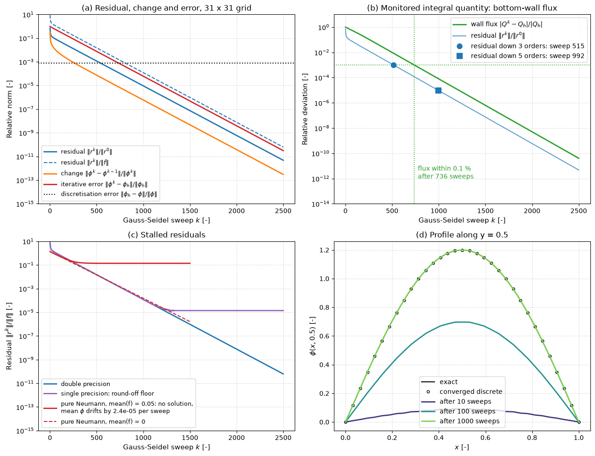

# Iterative Convergence

A steady CFD solution, and each time step of an implicit unsteady one, is obtained by iteration, and the iteration has to be stopped at some point. The error that remains when it stops is the iterative error, one of the three numerical errors of a simulation besides the discretization error and round-off. This note defines the residuals that solvers report and their normalisations, relates the residual to the error, explains why integral quantities must be monitored too, collects practical convergence criteria and discusses what stalled or oscillating residuals mean.

The iterative methods themselves are described in [Direct and Iterative Solvers](direct_and_iterative_solvers.md) and [Dealing with Nonlinearity](dealing_with_nonlinearity.md); estimating the discretization error, which sets how far the iteration needs to go, is part of [Verification and Validation](verification_and_validation.md).

## Problem Statement

The discrete equations, written as a residual, are

$$
\mathbf{R}(\boldsymbol{\phi}) = \mathbf{0}
$$

with one equation per cell and variable (for a linear system, $\mathbf{R} = \mathbf{b} - A\boldsymbol{\phi}$). An iterative solver produces $\boldsymbol{\phi}^0, \boldsymbol{\phi}^1, \dots$ that should approach the exact discrete solution $\boldsymbol{\phi}_h$. The iterative error is

$$
\mathbf{e}^k = \boldsymbol{\phi}_h - \boldsymbol{\phi}^k
$$

and the goal is to stop when $\mathbf{e}^k$ is small compared with the discretization error $\boldsymbol{\phi}_h - \boldsymbol{\phi}$, so that further iterations would not change the answer to the accuracy that the mesh allows. The difficulty is that neither error can be observed during the run: the solver only knows the residual, the change between iterates and whatever quantities it is asked to monitor, and the relation between these and the error depends on the problem, the normalisation and the convergence rate.

## Residuals

### Definition

For a finite-volume equation in the usual form $a_P\phi_P = \sum_{nb}a_{nb}\phi_{nb} + b_P$, the residual of cell $P$ is the imbalance

$$
r_P = \sum_{nb}a_{nb}\phi_{nb} + b_P - a_P\phi_P
$$

evaluated with the current iterate. It is zero when the discrete conservation law for that cell is satisfied. For the continuity equation of a pressure-based solver it is the mass imbalance of the cell. Solvers combine the cell residuals into a single number with a norm:

```math
\|\mathbf{r}\|_1 = \sum_P |r_P|, \qquad
\|\mathbf{r}\|_2 = \Big(\sum_P r_P^2\Big)^{1/2}, \qquad
\|\mathbf{r}\|_{\mathrm{RMS}} = \Big(\frac{1}{N}\sum_P r_P^2\Big)^{1/2}, \qquad
\|\mathbf{r}\|_\infty = \max_P |r_P|
```

The $L_\infty$ norm shows the worst cell, which matters because a converged-looking global norm can hide one cell far from convergence.

### Normalisation

The raw residual has the units of the equation (kg/s for continuity, N for momentum) and scales with the mesh and the flow, so solvers report it normalised. The common choices, under various names, are:

| Normalisation | Definition | Comment |
| --- | --- | --- |
| By the size of the terms | $`\sum_P\lvert r_P\rvert / \sum_P\lvert a_P\phi_P\rvert`$ | a relative imbalance of the equation; independent of units and mesh size |
| By the initial residual | $`\lVert\mathbf{r}^k\rVert / \lVert\mathbf{r}^{k_0}\rVert`$, with $k_0$ the first iteration (or the largest of the first few) | reports the orders of magnitude gained; depends on the initial guess |
| By the right-hand side | $`\lVert\mathbf{b} - A\boldsymbol{\phi}^k\rVert / \lVert\mathbf{b}\rVert`$ | the standard for linear solvers |
| By the variation of the solution | $`\lVert\mathbf{r}\rVert`$ divided by a measure of $`\lVert A\boldsymbol{\phi} - A\bar{\boldsymbol{\phi}}\rVert + \lVert\mathbf{b} - A\bar{\boldsymbol{\phi}}\rVert`$, with $\bar{\boldsymbol{\phi}}$ the mean value | insensitive to a uniform shift of $\phi$, such as a pressure level |
| Change between iterates | $`\lVert\boldsymbol{\phi}^k - \boldsymbol{\phi}^{k-1}\rVert / \lVert\boldsymbol{\phi}^k\rVert`$ | not a residual; small values can mean slow progress rather than convergence |

Commercial and open-source codes use different combinations, and the same physical state can give residuals that differ by orders of magnitude between codes. A residual of $10^{-4}$ means nothing until the definition is known; its decrease during the run is more informative than its value. Residuals normalised by the initial residual also depend on how good the initial guess was: a better start makes the reported drop smaller for the same final state.

In segregated solvers each equation has its own residual, and most codes report the residual at the start of each outer iteration, before the linear solver runs, which measures how well the current solution satisfies the nonlinear equations. The residual after the linear solve only measures how well the linear system was solved.

## Residual and Error

For a linear system $A\boldsymbol{\phi}_h = \mathbf{b}$ the error and the residual are related by $A\mathbf{e}^k = \mathbf{r}^k$, so

```math
\frac{1}{\kappa(A)}\, \frac{\|\mathbf{r}^k\|}{\|\mathbf{b}\|} \le
\frac{\|\mathbf{e}^k\|}{\|\boldsymbol{\phi}_h\|} \le \kappa(A)\,
\frac{\|\mathbf{r}^k\|}{\|\mathbf{b}\|},
\qquad \kappa(A) = \| A\|\,\| A^{-1}\|
```

For discretized diffusion operators $\kappa \propto h^{-2}$, so a small relative residual guarantees a small relative error only up to a factor that grows as the mesh is refined. The bound is pessimistic for most error distributions, but it shows that the relation between the two depends on the mesh.

The change between iterates is even less direct. When one error mode dominates, $`\mathbf{e}^k \approx \rho\,\mathbf{e}^{k-1}`$, and

```math
\|\mathbf{e}^k\| \approx \frac{\rho}{1 - \rho}\,\|\boldsymbol{\phi}^k -
\boldsymbol{\phi}^{k-1}\|
```

For $\rho = 0.99$ the error is a hundred times the change. The convergence rate $\rho$ can be estimated from the ratio of successive changes or residuals, which allows the error to be estimated during the run.



The figure follows a Gauss–Seidel solve of a 2D Poisson problem on $31 \times 31$ points with a known exact solution. In panel (a), all measures fall along parallel lines once the slowest mode dominates (rate $\cos^2\pi h = 0.9904$ per sweep), but at different levels. The residual normalised by the norm of the source term $f$ starts above 1, because the residual also contains the boundary values; normalised by its initial value, which equals $`\|\mathbf{b}\|`$ here because the initial guess is zero, it is a decade lower; the iterative error is 6.5 times the latter; and the change between iterates is about 100 times smaller than the error, as $1/(1 - \rho) = 104$ predicts. The iterative error drops below the discretization error ($7.6 \times 10^{-4}$) after 739 sweeps, when the residual has fallen by about four orders of magnitude.

## Monitoring Integral Quantities

The quantities an engineer reports, such as forces, moments, pressure drop, heat transfer and mass flow rate, are integrals over parts of the boundary or of the domain. They should be monitored during the run alongside the residuals, because:

- residual norms are dominated by regions where the residual is large, which are not necessarily the regions that determine the quantity of interest;
- a quantity can still drift slowly after the residuals have levelled off, and residuals can stay high in a region that hardly affects it;
- the monitor is directly in the units of the answer, so its iterative uncertainty can be compared with its discretization uncertainty.

Panel (b) shows the flux through one wall of the Poisson problem. It settles within 0.1% of its converged value after 736 sweeps, when the residual has dropped by about four orders; at a drop of three orders it is still 0.8% off. Global balances are a further check: in a converged steady solution the net mass flux through the boundaries, and the energy balance between inlets, outlets and walls, should close to a small fraction of the throughput.

## Convergence Criteria

A steady run is usually considered converged when all of the following hold:

1. The residuals have dropped by three to six orders of magnitude from their initial level, or reached the level recommended for the code and normalisation, and have stopped decreasing because they reached round-off, not because they stalled.
2. Each monitored quantity changes by less than a set tolerance, for example 0.1% of its value, over a window of the last $W$ iterations (a few hundred for a large steady RANS case), not only between consecutive iterations. A slow drift can pass a per-iteration test indefinitely.
3. Global mass, momentum and energy balances close to a small fraction (0.1% to 1%) of the throughput.
4. The iterative error is well below the estimated discretization error, by at least an order of magnitude, so that it does not affect a grid-convergence study ([Verification and Validation](verification_and_validation.md), and the GCI procedure in [Generating CFD Datasets](../../machine_learning/automotive_aerodynamics/generating_cfd_datasets.md)).

The iterative error can be estimated directly by converging one case far beyond the usual criteria, or by extrapolating the monitored quantity with the observed convergence rate. Criteria tighter than necessary waste run time; panel (d) of the figure shows the opposite risk, a profile after 100 sweeps that looks like a plausible solution but is 36% below the converged one.

### Inner Iterations

Inside each outer iteration of a segregated solver, the linear systems are solved only to a relative tolerance of about 0.01 to 0.1 (more tightly for the pressure equation), because the coefficients will change at the next outer iteration. In implicit unsteady runs the outer or pseudo-time iterations within each time step are stopped when the residuals have dropped by two to four orders, or after a fixed number; an incompletely converged time step adds an error that accumulates over the run.

## Stalled and Oscillating Residuals

A residual history that levels off or oscillates instead of decreasing has a cause, and the cause decides what to do.

| Behaviour | Likely cause | Response |
| --- | --- | --- |
| Flat floor at $10^{-5}$ to $10^{-7}$ relative | round-off in single precision (panel (c)) | run in double precision; the solution may already be converged |
| Flat floor at a high level, with a quantity drifting linearly | incompatible boundary conditions, for example a pure-Neumann pressure problem with unbalanced mass fluxes (panel (c)) | fix the boundary conditions or fix the pressure level at one point |
| Regular oscillation, forces periodic | physically unsteady flow (vortex shedding, separation) that a steady solver cannot represent | run a time-accurate simulation, or average over the cycle and report the amplitude as uncertainty |
| Irregular oscillation of small amplitude | limiter or upwind-switching chatter, a few bad cells (high skewness or non-orthogonality) | freeze or smooth the limiter, improve the mesh locally |
| Slow growth followed by divergence | time step, CFL number or relaxation factors too large, or an inconsistent discretization | reduce the CFL number or relaxation factors, start with a first-order scheme |


The second figure shows a clean history for comparison: the normalised change between iterates of a Gauss–Seidel solve of the 1D Laplace equation on 100 points falls quickly while the oscillatory error is removed, then decreases along a straight line on the logarithmic axis at the rate of the smoothest mode, and crosses $10^{-9}$ after 9709 iterations. Because this measure is a change, not an error, the error at that point is still about $7 \times 10^{-7}$.

## Key Takeaways

- A residual measures how well the current iterate satisfies the discrete equations; its value depends on the norm and the normalisation, which differ between codes.
- The relative error can be up to $\kappa(A)$ times the relative residual, and the error of a slowly converging iteration is about $1/(1 - \rho)$ times the change between iterates.
- Monitor the quantities of interest and the global balances, and require them to be steady over a window of iterations.
- Converge until the iterative error is at least an order of magnitude below the discretization error, and no further.
- A stalled residual is a symptom: round-off, incompatible boundary conditions, physical unsteadiness or a poor mesh each have a different remedy.

## Related Scripts

- [Residual Monitoring During an Iterative Solve](../../../scripts/algorithms/residual_monitoring/): follows a Gauss–Seidel solve of the 2D Poisson equation sweep by sweep and records everything a CFD user might look at to decide whether the run has converged: the residual with two normalisations, the change between iterates, the true iterative error, and an integral quantity (the flux through a wall).
- [Variation of Residual with Iteration](../../../scripts/plots/variation_of_residual/): solves the 1D Laplace equation with Gauss-Seidel iteration on a 100-point grid and plots the normalised residual against iteration number on a logarithmic scale.
- [Iterative Linear Solvers on the Poisson Equation](../../../scripts/algorithms/iterative_linear_solvers/): solves the 2D Poisson equation on an $N \times N$ grid with Jacobi, Gauss–Seidel, SOR with the optimal relaxation factor, conjugate gradients and a geometric multigrid V-cycle, and compares how many iterations each needs as the grid is refined.
- [Grid Convergence Index](../../../scripts/algorithms/grid_convergence_index/): estimates discretization error from three meshes with Richardson extrapolation and the grid convergence index (GCI), following the procedure of Celik et al. (2008).
- [Backward-Facing Step Flow (SIMPLE Algorithm)](../../../scripts/simulations/backward_facing_step_simple/): solves steady 2D laminar incompressible flow over a backward-facing step with the finite volume method and the SIMPLE pressure–velocity coupling algorithm.
- [SIMPLE in a 1D Converging Nozzle](../../../scripts/algorithms/simple_1d_nozzle/): solves steady, incompressible, frictionless flow through a converging nozzle with the SIMPLE and SIMPLEC pressure–velocity coupling algorithms on a staggered grid, and compares the converged mass flow and pressure with Bernoulli's equation.

## Exercises

The first three exercises use the scalar example of [Dealing with Nonlinearity](dealing_with_nonlinearity.md): $d\phi/dx + \phi^2 = 0$, $\phi(0) = 1$, on four points with $\Delta x = 1/3$, solved by sweeps from right to left with the update $`\phi_i = (\phi^\ast_{i-1} + \Delta x\,(\phi^\ast_i)^2)/(1 + 2\Delta x\,\phi^\ast_i)`$ for $i = 4, 3, 2$, where the starred values are those of the previous sweep. The residual $R$ is the RMS change between sweeps.

**Exercise 1.** The guess before the third sweep is $\boldsymbol{\phi}^\ast = (1, 0.791304, 0.660870, 0.660870)$, and the sweep produces $\boldsymbol{\phi} = (1, 0.791288, 0.650354, 0.559811)$. Compute $R$ and the residual scaled by the mean of $\phi$.

<details>
<summary>Answer</summary>

The differences are $(0, -1.65 \times 10^{-5}, -0.010516, -0.101059)$.

```math
R = \sqrt{\frac{0 + 2.7 \times 10^{-10} + 1.106 \times 10^{-4} + 1.0213 \times 10^{-2}}{4}} \approx 0.0508
```

The scaled value is $R \times N/\sum\phi_i = 0.0508 \times 4/3.001 \approx 0.0677$.

</details>

**Exercise 2.** Carry out the full iteration from $\phi^\ast = 1$ everywhere, recording $R$ after each sweep. How many sweeps are needed for $R < 10^{-9}$? Why is convergence slow at first and fast later?

<details>
<summary>Answer</summary>

$R$ after each sweep: $0.1732$, $0.0985$, $0.0508$, $5.07 \times 10^{-3}$, $2.62 \times 10^{-5}$, $4.67 \times 10^{-10}$, so six sweeps.

In each right-to-left sweep every point uses the old value of its left neighbour, so the boundary value $\phi_1 = 1$ travels only one point per sweep and reaches $\phi_4$ after three sweeps. After that each point's update is effectively a Newton step with an accurate neighbour, and the change falls quadratically.

</details>

**Exercise 3.** The converged 4-point solution has $\phi_4 = 0.549622$, while the exact value is $\phi(1) = 0.5$. What is the relative discretization error, and how does it compare with the iterative tolerance $10^{-9}$? How many grid points does this first-order scheme need for an error at $x = 1$ below 1%?

<details>
<summary>Answer</summary>

$`(0.549622 - 0.5)/0.5 \approx 9.9\%`$, an absolute error of about 0.05, roughly $5 \times 10^7$ times the iterative tolerance.

Solving the converged discrete equations on finer grids gives errors of 4.6% ($N = 8$), 2.2% ($N = 16$) and 1.1% ($N = 32$). The first grid below 1% is $N = 36$ ($\Delta x = 1/35$), with 0.98%.

Once the iterative error is an order of magnitude or two below the discretization error, further iterations are wasted; refining the grid is what improves accuracy.

</details>

**Exercise 4.** In a larger problem the residual history settles into $R = 1.0 \times 10^{-2}$, $5.0 \times 10^{-3}$, $2.5 \times 10^{-3}$. Estimate the convergence rate, the remaining iterative error in units of the last change, and the number of further iterations to reach $10^{-9}$. What would you change if this is too slow?

<details>
<summary>Answer</summary>

The ratio is $\rho = 0.5$ per iteration (linear convergence), so the remaining error is about $\rho/(1 - \rho) = 1$ times the last change. The iterations needed are $\ln(10^{-9}/2.5 \times 10^{-3})/\ln 0.5 \approx 21.3$, so 22 more.

If this is too slow: relax the tolerance to match the discretization error (Exercise 3), improve the initial guess, use Newton linearization or a better linear solver (preconditioning, multigrid), or tune the relaxation factors. Check the residual definition used by the code before comparing thresholds.

</details>

**Exercise 5.** A linear solve of the $31 \times 31$ Poisson problem of the figure stops at $`\|\mathbf{r}\|/\|\mathbf{b}\| = 10^{-6}`$. The matrix has $\kappa = 414$. Bound the relative error, and compare with what the figure shows at that residual level.

<details>
<summary>Answer</summary>

The bound gives $`\|\mathbf{e}\|/\|\boldsymbol{\phi}_h\| \le 414 \times 10^{-6} = 4.1 \times 10^{-4}`$.

In the figure the initial guess is zero, so $`\|\mathbf{r}^0\| = \|\mathbf{b}\|`$, and the iterative error is about 6.5 times $`\|\mathbf{r}^k\|/\|\mathbf{r}^0\|`$ (at sweep 1230, where the residual has fallen to $10^{-6}$, the error is $6.5 \times 10^{-6}$). That is about 60 times below the bound. The bound is reached only when the error is concentrated in the smoothest mode and the residual in the most oscillatory one; it is a worst case that grows like $h^{-2}$, not an estimate.

</details>

## References

- Ferziger, J. H., Perić, M., and Street, R. L., *Computational Methods for Fluid Dynamics*, 4th ed., Springer, 2020.
- Versteeg, H. K., and Malalasekera, W., *An Introduction to Computational Fluid Dynamics: The Finite Volume Method*, 2nd ed., Pearson Education, 2007.
- Roache, P. J., *Verification and Validation in Computational Science and Engineering*, Hermosa Publishers, 1998.
- Oberkampf, W. L., and Roy, C. J., *Verification and Validation in Scientific Computing*, Cambridge University Press, 2010.
- ASME, *Standard for Verification and Validation in Computational Fluid Dynamics and Heat Transfer*, ASME V\&V 20-2009, American Society of Mechanical Engineers, 2009.
- Saad, Y., *Iterative Methods for Sparse Linear Systems*, 2nd ed., SIAM, 2003.
- Patankar, S. V., *Numerical Heat Transfer and Fluid Flow*, Hemisphere, 1980.
