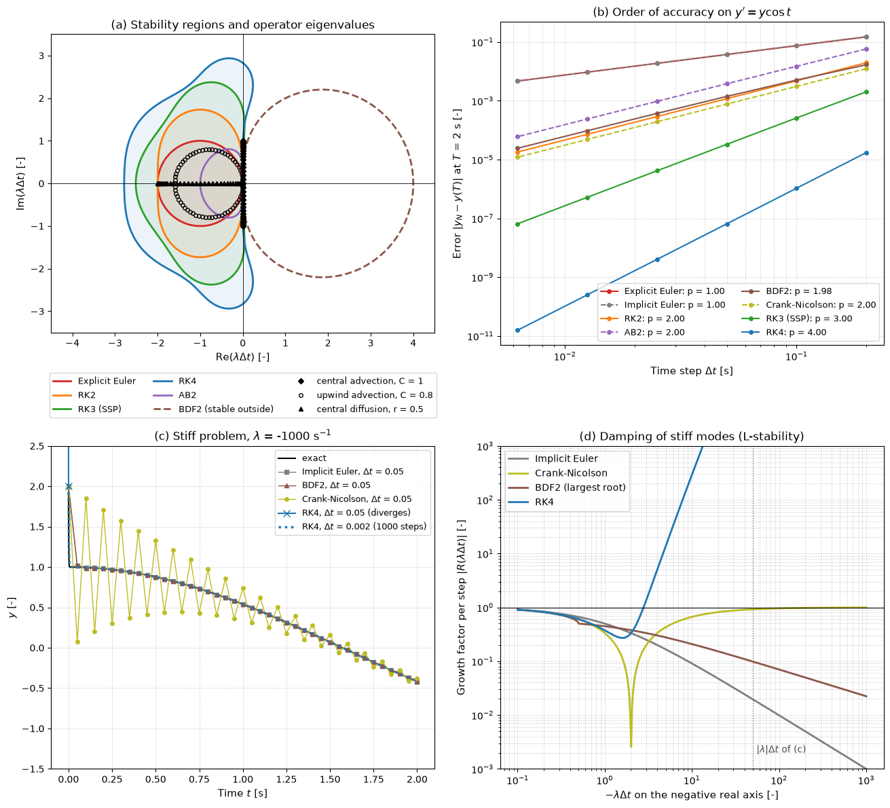

# Time Integration

Most CFD codes discretize space first and time second. The spatial discretization turns the governing equations into a large system of ordinary differential equations for the cell or node values, and a time integrator advances that system. This note covers the method of lines, the explicit and implicit integrators used in CFD, their stability regions and how they combine with the eigenvalues of discretized advection and diffusion operators, order of accuracy, stiffness, and dual time stepping for implicit unsteady simulations. It ends with a table for choosing a method.

Stability of fully discrete schemes analysed directly with von Neumann's method is in [Numerical Stability](numerical_stability.md); solving the nonlinear systems that implicit methods produce is in [Dealing with Nonlinearity](dealing_with_nonlinearity.md).

## Problem Statement

After spatial discretization by finite differences, finite volumes or finite elements, the unknowns $\boldsymbol{\phi}(t) \in \mathbb{R}^N$ satisfy the semi-discrete system

$$
\frac{d\boldsymbol{\phi}}{dt} = \mathbf{L}(\boldsymbol{\phi}, t),
\qquad \boldsymbol{\phi}(0) = \boldsymbol{\phi}_0
$$

where $\mathbf{L}$ contains the discretized convection, diffusion and source terms (for a finite-volume method, minus the sum of face fluxes divided by the cell volume). A time integrator computes approximations $\boldsymbol{\phi}^n \approx \boldsymbol{\phi}(t^n)$ with $t^n = n\Delta t$. The questions are:

1. Is the integrator stable for the eigenvalues of the Jacobian $\partial\mathbf{L}/\partial\boldsymbol{\phi}$ at the chosen $\Delta t$?
2. What is its order of accuracy $p$, meaning a global error $O(\Delta t^p)$?
3. What does a step cost: how many evaluations of $\mathbf{L}$, and for implicit methods how many nonlinear and linear solves?

The integrator is adequate when it is stable, the temporal error is below the spatial error for the time scales of interest, and the total cost is acceptable. The difficulty is that the eigenvalues of $\partial\mathbf{L}/\partial\boldsymbol{\phi}$ spread over many orders of magnitude (stiffness): fine cells, viscous terms, sound waves at low Mach number and chemical source terms all produce eigenvalues much larger than the time scales of the flow.

## Method of Lines

For a linear operator $\mathbf{L}(\boldsymbol{\phi}) = A\boldsymbol{\phi}$ with eigen-decomposition $A = V\Lambda V^{-1}$, the variables $\mathbf{w} = V^{-1}\boldsymbol{\phi}$ decouple into scalar equations $w' = \lambda w$, one per eigenvalue. Applied to $y' = \lambda y$, every method in this note gives $`y^{n+1} = R(z)\,y^n`$ (one-step methods) or a recurrence with characteristic roots $\xi(z)$ (multistep methods), with

```math
z = \lambda\,\Delta t
```

The fully discrete scheme is stable when every scaled eigenvalue $\lambda_k\Delta t$ lies in the **absolute-stability region** $`\{z : |R(z)| \le 1\}`$ of the integrator. This is exact for normal matrices such as periodic convection and diffusion; for non-normal matrices (convection with inflow and outflow boundaries) it is necessary, and transient growth can still occur.

On a periodic grid the eigenvectors are the Fourier modes $`e^{\mathrm{i}\,i\theta}`$, and the eigenvalues of the common operators, scaled by $\Delta t$, are

| Operator | Semi-discrete form | $\lambda\Delta t$ | Location in the complex plane |
| --- | --- | --- | --- |
| Central advection | $`-u(\phi_{i+1} - \phi_{i-1})/(2\Delta x)`$ | $`-\mathrm{i}\,C\sin\theta`$ | imaginary axis, $[-\mathrm{i}C, \mathrm{i}C]$ |
| First-order upwind advection | $`-u(\phi_i - \phi_{i-1})/\Delta x`$ | $-C(1 - e^{-\mathrm{i}\theta})$ | circle of radius $C$ centred at $-C$ |
| Central diffusion | $`\nu(\phi_{i+1} - 2\phi_i + \phi_{i-1})/\Delta x^2`$ | $-4r\sin^2(\theta/2)$ | negative real axis, $[-4r, 0]$ |

with $C = u\Delta t/\Delta x$ and $r = \nu\Delta t/\Delta x^2$. Combining a row of this table with the stability region of an integrator gives the stability limit of the pair.

## Explicit Methods

Explicit methods evaluate $\mathbf{L}$ only at known states. Writing $\mathbf{L}^n = \mathbf{L}(\boldsymbol{\phi}^n, t^n)$:

| Method | Update | Order | Evaluations per step |
| --- | --- | --- | --- |
| Explicit (forward) Euler | $`\boldsymbol{\phi}^{n+1} = \boldsymbol{\phi}^n + \Delta t\,\mathbf{L}^n`$ | 1 | 1 |
| RK2 (Heun) | predictor $`\boldsymbol{\phi}^\ast = \boldsymbol{\phi}^n + \Delta t\,\mathbf{L}^n`$, then $`\boldsymbol{\phi}^{n+1} = \boldsymbol{\phi}^n + \tfrac{\Delta t}{2}\left(\mathbf{L}^n + \mathbf{L}(\boldsymbol{\phi}^\ast)\right)`$ | 2 | 2 |
| AB2 (Adams–Bashforth) | $`\boldsymbol{\phi}^{n+1} = \boldsymbol{\phi}^n + \Delta t\left(\tfrac{3}{2}\mathbf{L}^n - \tfrac{1}{2}\mathbf{L}^{n-1}\right)`$ | 2 | 1 |
| RK4 (classical) | four stages, below | 4 | 4 |

The classical fourth-order Runge–Kutta method is

```math
\mathbf{k}_1 = \mathbf{L}(\boldsymbol{\phi}^n),\quad
\mathbf{k}_2 = \mathbf{L}\!\left(\boldsymbol{\phi}^n + \tfrac{\Delta t}{2}\mathbf{k}_1\right),\quad
\mathbf{k}_3 = \mathbf{L}\!\left(\boldsymbol{\phi}^n + \tfrac{\Delta t}{2}\mathbf{k}_2\right),\quad
\mathbf{k}_4 = \mathbf{L}\!\left(\boldsymbol{\phi}^n + \Delta t\,\mathbf{k}_3\right),\quad
\boldsymbol{\phi}^{n+1} = \boldsymbol{\phi}^n + \tfrac{\Delta t}{6}\left(\mathbf{k}_1 + 2\mathbf{k}_2 + 2\mathbf{k}_3 + \mathbf{k}_4\right)
```

and the third-order strong-stability-preserving method of Shu and Osher (1988) is a convex combination of forward Euler steps:

```math
\boldsymbol{\phi}^{(1)} = \boldsymbol{\phi}^n + \Delta t\,\mathbf{L}(\boldsymbol{\phi}^n),\qquad
\boldsymbol{\phi}^{(2)} = \tfrac{3}{4}\boldsymbol{\phi}^n + \tfrac{1}{4}\left(\boldsymbol{\phi}^{(1)} + \Delta t\,\mathbf{L}(\boldsymbol{\phi}^{(1)})\right),\qquad
\boldsymbol{\phi}^{n+1} = \tfrac{1}{3}\boldsymbol{\phi}^n + \tfrac{2}{3}\left(\boldsymbol{\phi}^{(2)} + \Delta t\,\mathbf{L}(\boldsymbol{\phi}^{(2)})\right)
```

Because every stage is a convex combination of forward Euler steps, any property that forward Euler has under a time-step limit (total variation diminishing, positivity of density and pressure, a maximum principle) is kept by SSP-RK3 under the same limit (Gottlieb, Shu and Tadmor, 2001). This is why SSP-RK2 and SSP-RK3 are the standard partners of TVD and limited schemes for compressible flow.

For $y' = \lambda y$ every $s$-stage explicit Runge–Kutta method of order $s \le 4$ has the stability function

$$
R(z) = \sum_{k=0}^{s} \frac{z^k}{k!}
$$

the Taylor polynomial of $e^z$. AB2 is a two-step method; its growth factor $\xi$ solves $\xi^2 - (1 + \tfrac{3}{2}z)\xi + \tfrac{1}{2}z = 0$, and it must be started with a one-step method.

## Implicit Methods

Implicit methods evaluate $\mathbf{L}$ at the unknown new state, so each step requires the solution of a nonlinear system, usually by Newton's method or by Picard iteration with a linear solver inside ([Dealing with Nonlinearity](dealing_with_nonlinearity.md), [Direct and Iterative Solvers](direct_and_iterative_solvers.md)).

| Method | Update | Order | $R(z)$ or characteristic equation |
| --- | --- | --- | --- |
| Implicit (backward) Euler | $`\boldsymbol{\phi}^{n+1} = \boldsymbol{\phi}^n + \Delta t\,\mathbf{L}^{n+1}`$ | 1 | $R = 1/(1 - z)$ |
| Crank–Nicolson (trapezoidal rule) | $`\boldsymbol{\phi}^{n+1} = \boldsymbol{\phi}^n + \tfrac{\Delta t}{2}\left(\mathbf{L}^n + \mathbf{L}^{n+1}\right)`$ | 2 | $R = (1 + z/2)/(1 - z/2)$ |
| BDF2 | $`\tfrac{3}{2}\boldsymbol{\phi}^{n+1} - 2\boldsymbol{\phi}^n + \tfrac{1}{2}\boldsymbol{\phi}^{n-1} = \Delta t\,\mathbf{L}^{n+1}`$ | 2 | $(\tfrac{3}{2} - z)\xi^2 - 2\xi + \tfrac{1}{2} = 0$ |

BDF2 is started with one implicit Euler step; a single first-order step has a local error $O(\Delta t^2)$, which does not reduce the global order.

## Stability Regions

The boundary of the stability region of a one-step method is the curve $|R(z)| = 1$; for a multistep method it is the image of the unit circle under $z(\varphi) = \rho(e^{\mathrm{i}\varphi})/\sigma(e^{\mathrm{i}\varphi})$, where $\rho$ and $\sigma$ are the characteristic polynomials of the left- and right-hand sides.



Panel (a) shows the regions of the explicit methods (inside the curves) and of BDF2 (outside its dashed curve), with the scaled eigenvalues of central advection at $C = 1$, upwind advection at $C = 0.8$ and central diffusion at $r = 0.5$. The limits along the two axes are (the Runge–Kutta values are the ones the script measures):

| Method | Real-axis interval | Imaginary-axis interval | A-stable | L-stable |
| --- | --- | --- | --- | --- |
| Explicit Euler | $[-2, 0]$ | only $0$ | no | no |
| RK2 | $[-2, 0]$ | only $0$ | no | no |
| SSP-RK3 | $[-2.513, 0]$ | $[-1.732, 1.732]$ | no | no |
| RK4 | $[-2.785, 0]$ | $[-2.828, 2.828]$ | no | no |
| AB2 | $[-1, 0]$ | only $0$ | no | no |
| Implicit Euler | $(-\infty, 0]$ | whole axis | yes | yes |
| Crank–Nicolson | $(-\infty, 0]$ | whole axis | yes | no |
| BDF2 | $(-\infty, 0]$ | whole axis | yes | yes |

Reading the table against the operator eigenvalues gives the stability limits of common pairs:

- Central advection with forward Euler has $|R(-\mathrm{i}C\sin\theta)|^2 = 1 + C^2\sin^2\theta > 1$: unstable for every $C$, which is the FTCS result of [Numerical Stability](numerical_stability.md). RK2 and AB2 are also unstable on the imaginary axis (weakly, $|R| - 1 = O(z^4)$ for RK2), so they need some dissipation in the spatial scheme. RK3 is stable for $C \le \sqrt{3} \approx 1.73$ and RK4 for $C \le 2\sqrt{2} \approx 2.83$.
- Upwind advection with forward Euler: the circle of radius $C$ centred at $-C$ lies inside the unit disc centred at $-1$ exactly when $C \le 1$.
- Central diffusion with forward Euler: $-4r \ge -2$ gives $r \le 1/2$; with RK4, $r \le 2.785/4 = 0.696$.

The [Decaying 2D Turbulence](../../../scripts/simulations/decaying_2d_turbulence/) simulation is an example of the central-advection case: its spectral convection operator has imaginary eigenvalues, and it uses RK4 with $\max|u||k|\Delta t = 2.0$, inside the limit $2\sqrt{2}$.

## Order of Accuracy

The local truncation error of a method of order $p$ is $O(\Delta t^{p+1})$ per step, and over a fixed time interval the global error is $O(\Delta t^p)$. Panel (b) of the figure measures it on $y' = y\cos t$, $y(0) = 1$, whose exact solution is $e^{\sin t}$:

| Method | Observed order | Error at $\Delta t = 0.00625$ s, $t = 2$ s |
| --- | --- | --- |
| Explicit Euler | 0.999 | $4.7 \times 10^{-3}$ |
| Implicit Euler | 1.001 | $4.7 \times 10^{-3}$ |
| RK2 | 2.004 | $1.8 \times 10^{-5}$ |
| AB2 | 1.997 | $6.0 \times 10^{-5}$ |
| BDF2 | 1.980 | $2.4 \times 10^{-5}$ |
| Crank–Nicolson | 2.000 | $1.2 \times 10^{-5}$ |
| SSP-RK3 | 2.997 | $6.5 \times 10^{-8}$ |
| RK4 | 4.003 | $1.6 \times 10^{-11}$ |

In CFD the spatial error is usually second order, so a higher temporal order mainly buys a larger stable and accurate time step. RK4 costs four evaluations per step but allows $C$ up to 2.83 on central advection, against 1.73 for RK3 with three evaluations, and both have much smaller phase errors than second-order methods at the same $C$.

## Stiffness, A-Stability and L-Stability

A system is **stiff** when the time step needed for stability of an explicit method is much smaller than the time step needed to resolve the solution, because some eigenvalues are far larger in magnitude than the rates of the dynamics of interest. In CFD the typical sources are:

- explicit diffusion on fine cells, with $\Delta t \propto \Delta x^2/\nu$, worst in the wall-normal direction of boundary-layer meshes;
- acoustic waves at low Mach number, with $\Delta t \propto \Delta x/(|u| + c)$ while the flow evolves on $\Delta x/|u|$;
- chemical reaction and turbulence-model source terms with short time scales;
- very small or badly shaped cells in an otherwise coarse mesh.

A method is **A-stable** if its stability region contains the whole left half-plane, so that every decaying mode stays bounded for every $\Delta t$; no explicit method is A-stable, and no linear multistep method of order higher than 2 is (Dahlquist's second barrier). A method is **L-stable** if it is A-stable and $|R(z)| \to 0$ as $z \to -\infty$, so that very stiff modes are damped in one step.

Panel (c) shows the Prothero–Robinson problem $y' = \lambda(y - \cos t) - \sin t$ with $\lambda = -1000$ s$`^{-1}`$ and $y(0) = 2$, whose solution $\cos t + e^{\lambda t}$ has a transient of about 1 ms. With $\Delta t = 0.05$ s ($z = -50$), RK4 has $|R| = 2.4 \times 10^5$ and overflows; RK4 needs $\Delta t \le 2.785/1000$ s and the run uses 1000 steps at $\Delta t = 0.002$ s. Implicit Euler ($|R| = 0.0196$) and BDF2 (largest root 0.0985) remove the transient within a few steps. Crank–Nicolson is A-stable but $R(-50) = -0.923$, so the transient flips sign every step and decays by only 8% per step. Panel (d) shows the growth factors along the negative real axis: Crank–Nicolson approaches 1, implicit Euler and BDF2 approach 0. This is why implicit unsteady CFD codes prefer BDF2 (or a Crank–Nicolson blended with some implicit Euler) when the initial or boundary data are not smooth.

## Dual Time Stepping

Implicit unsteady solvers for compressible and incompressible flow commonly use BDF2 in physical time. Each physical step requires the solution of

$$
\mathbf{R}^\ast(\boldsymbol{\phi}) \equiv
\frac{3\boldsymbol{\phi} - 4\boldsymbol{\phi}^n + \boldsymbol{\phi}^{n-1}}{2\Delta t} -
\mathbf{L}(\boldsymbol{\phi}) = \mathbf{0},
\qquad \boldsymbol{\phi}^{n+1} = \boldsymbol{\phi}
$$

Dual time stepping (Jameson, 1991) solves this nonlinear system by marching in a pseudo-time $\tau$,

$$
\frac{d\boldsymbol{\phi}}{d\tau} = -\mathbf{R}^\ast(\boldsymbol{\phi})
$$

to a steady state in $\tau$, with all the acceleration techniques of steady solvers: local pseudo-time steps, multigrid, implicit residual smoothing or an approximate implicit pseudo-time step. When the pseudo-time iteration converges, the result is the BDF2 solution and is second-order accurate in $\Delta t$, whatever the pseudo-time steps were. The physical time step is then chosen for accuracy only, often hundreds of times the explicit limit, and the work per physical step is the number of pseudo-time iterations needed to drop $\mathbf{R}^\ast$ by two to four orders. The term $3\boldsymbol{\phi}/(2\Delta t)$ adds the real eigenvalue $-3/(2\Delta t)$ to the pseudo-time operator; with an explicit pseudo-time scheme it limits $\Delta\tau$ when $\Delta t$ is small, so it is usually treated point-implicitly. Pressure-based codes use the same idea with outer iterations of SIMPLE or PIMPLE within each time step ([Pressure–Velocity Coupling](../fvm/pressure_velocity_coupling.md)).

## Choosing a Method

| Situation | Typical choice | Time step set by |
| --- | --- | --- |
| Compressible flow with shocks, explicit, time-accurate | SSP-RK2 or SSP-RK3 with a TVD or limited spatial scheme | acoustic CFL, $C \lesssim 1$ |
| DNS and LES of incompressible or weakly compressible flow | RK3 or RK4 for convection, often with implicit (Crank–Nicolson) diffusion | convective CFL, $C \approx 1$ to 2 |
| Incompressible projection methods | AB2 or RK3 for convection with Crank–Nicolson for diffusion (Kim and Moin, 1985) | convective CFL |
| Unsteady RANS, implicit | BDF2 with dual time stepping or PIMPLE outer iterations | accuracy of the resolved unsteadiness, $C \gg 1$ |
| Steady RANS or Euler | implicit Euler in pseudo-time with local time stepping | largest stable CFL, ramped |
| Stiff source terms (chemistry, two-equation models) | implicit or point-implicit treatment of the source | flow time scales |
| Smooth diffusion problems (heat conduction) | Crank–Nicolson, or BDF2 if the data are rough | accuracy |

## Key Takeaways

- The method of lines separates spatial and temporal discretization; stability requires every scaled eigenvalue $\lambda\Delta t$ of the spatial operator to lie in the stability region of the integrator.
- Central advection has imaginary eigenvalues: forward Euler, RK2 and AB2 are unstable on them, RK3 and RK4 are stable up to $C = 1.73$ and $2.83$.
- Explicit diffusion limits are on the negative real axis: $r \le 1/2$ for forward Euler, $r \le 0.696$ for RK4.
- SSP Runge–Kutta methods keep the TVD and positivity properties of forward Euler steps, which is why they accompany limited schemes for compressible flow.
- Stiff problems need A-stable implicit methods; L-stable ones (implicit Euler, BDF2) also damp the stiffest modes, while Crank–Nicolson lets them oscillate.
- Dual time stepping solves each implicit BDF2 step with steady-state techniques in pseudo-time, so the physical time step is chosen for accuracy alone.

## Related Scripts

- [Stability Regions of Time Integrators](../../../scripts/algorithms/time_integrator_stability/): draws the absolute-stability regions of explicit Euler, RK2, RK3, RK4, AB2 and BDF2 and overlays the eigenvalues of semi-discrete advection and diffusion operators, so the stable pairings of a spatial scheme and a time integrator can be read off directly.
- [Von Neumann Amplification Factors](../../../scripts/algorithms/von_neumann_amplification/): computes the von Neumann amplification factor $G(\theta)$ of the classic finite-difference schemes for linear advection and diffusion and checks the predictions by marching a square wave with each scheme.
- [Decaying 2D Turbulence](../../../scripts/simulations/decaying_2d_turbulence/): simulates freely decaying two-dimensional turbulence in a doubly periodic box and animates how a random vorticity field organises itself into coherent vortices that merge into ever larger ones.
- [Raindrops on a Pond: Shallow-Water Ripples](../../../scripts/simulations/shallow_water_ripples/): simulates raindrops falling on a square basin of still water by solving the 2D shallow-water equations with a conservative finite-volume scheme, and animates the free surface as shaded relief.
- [1D Heat and Wave Equation Simulations](../../../scripts/simulations/1d_heat_and_wave_equations/): solves the 1D heat equation with the implicit Crank–Nicolson scheme and the 1D wave equation with the explicit leapfrog scheme, animating both from the same initial Gaussian pulse.

## Exercises

**Exercise 1.** Derive the stability function of Heun's method (RK2) and show that $|R(\mathrm{i}y)| > 1$ for every real $y \ne 0$. What does this mean for central advection with RK2?

<details>
<summary>Answer</summary>

For $y' = \lambda y$: $\phi^\ast = (1 + z)\phi^n$ and $\phi^{n+1} = \phi^n + \tfrac{z}{2}\left(\phi^n + (1 + z)\phi^n\right)$, so $R(z) = 1 + z + z^2/2$.

On the imaginary axis, $R(\mathrm{i}y) = 1 - y^2/2 + \mathrm{i}y$ and

```math
|R(\mathrm{i}y)|^2 = \left(1 - \frac{y^2}{2}\right)^2 + y^2 = 1 + \frac{y^4}{4} > 1
```

Central advection has eigenvalues $-\mathrm{i}C\sin\theta$, so every mode except $\theta = 0$ and $\pi$ grows, slowly for small $C$ (by $C^4/8$ per step at $\theta = \pi/2$ to first order). The combination is unstable and needs added dissipation, such as an upwind-biased flux or artificial viscosity.

</details>

**Exercise 2.** What is the largest stable time step for central diffusion with $\nu = 10^{-3}$ m²/s on $\Delta x = 1$ mm with forward Euler, SSP-RK3 and RK4? Compare the cost per unit simulated time, counting evaluations of $\mathbf{L}$.

<details>
<summary>Answer</summary>

The eigenvalues lie in $[-4r, 0]$, so $4r$ must not exceed the real-axis limit: $r \le 0.5$, $0.628$ and $0.696$. With $\Delta x^2/\nu = 10^{-3}$ s:

- forward Euler: $\Delta t \le 5.0 \times 10^{-4}$ s, 1 evaluation per step, 2000 evaluations per second of simulated time;
- SSP-RK3: $\Delta t \le 6.28 \times 10^{-4}$ s, 3 evaluations, about 4780 per second;
- RK4: $\Delta t \le 6.96 \times 10^{-4}$ s, 4 evaluations, about 5750 per second.

For pure diffusion at the stability limit forward Euler is cheapest; the higher-order methods pay off through accuracy and on the imaginary axis, not on the real axis.

</details>

**Exercise 3.** A boundary-layer mesh has wall-normal spacing $\Delta y = 1$ µm and streamwise spacing $\Delta x = 1$ mm, with $u = 10$ m/s and $\nu = 1.5 \times 10^{-5}$ m²/s. Compare the explicit convective limit $\Delta x/u$ with the explicit wall-normal viscous limit $\Delta y^2/(2\nu)$. What do codes do about it?

<details>
<summary>Answer</summary>

Convective: $10^{-3}/10 = 10^{-4}$ s. Viscous: $10^{-12}/(3 \times 10^{-5}) = 3.3 \times 10^{-8}$ s, 3000 times smaller.

An explicit method would be limited by viscous diffusion across the near-wall cells, which carries no interesting dynamics at that time scale: the problem is stiff. Codes treat the viscous terms (at least the wall-normal ones) implicitly, use a fully implicit method, or for steady problems use local time stepping, which lets the large outer cells take large steps.

</details>

**Exercise 4.** For the stiff mode $z = \lambda\Delta t = -50$, how many steps does each of Crank–Nicolson, BDF2 and implicit Euler need to reduce an initial transient by a factor $10^3$?

<details>
<summary>Answer</summary>

- Crank–Nicolson: $R = (1 - 25)/(1 + 25) = -0.923$, so $n = \ln 10^{-3}/\ln 0.923 = 86.3$, that is 87 steps, with a sign change at each.
- BDF2: the roots of $(1.5 + 50)\xi^2 - 2\xi + 0.5 = 0$ are $0.0194 \pm 0.0966\mathrm{i}$, with modulus 0.0985, so $n = 2.98$: 3 steps.
- Implicit Euler: $R = 1/51 = 0.0196$, so $n = 1.76$: 2 steps.

</details>

**Exercise 5.** For a central-advection mode with $\lambda\Delta t = \mathrm{i}$, compute $R(\mathrm{i})$ for RK4 and the amplitude and phase errors per step. How many steps until the amplitude has dropped by 10%?

<details>
<summary>Answer</summary>

```math
R(\mathrm{i}) = 1 + \mathrm{i} - \frac{1}{2} - \frac{\mathrm{i}}{6} + \frac{1}{24} = 0.541667 + 0.833333\,\mathrm{i}
```

$|R| = 0.99391$, so the amplitude decreases by 0.61% per step. $\arg R = 0.99442$ rad against the exact phase change of 1 rad, a lag of 0.56%.

The amplitude reaches 0.9 after $\ln 0.9/\ln 0.99391 \approx 17$ steps. The damping is slight, but it shows that RK4 is not exactly neutral on the imaginary axis.

</details>

## References

- Hairer, E., and Wanner, G., *Solving Ordinary Differential Equations II: Stiff and Differential-Algebraic Problems*, 2nd ed., Springer, 1996.
- Hairer, E., Nørsett, S. P., and Wanner, G., *Solving Ordinary Differential Equations I: Nonstiff Problems*, 2nd ed., Springer, 1993.
- LeVeque, R. J., *Finite Difference Methods for Ordinary and Partial Differential Equations*, SIAM, 2007.
- Shu, C.-W., and Osher, S., "Efficient implementation of essentially non-oscillatory shock-capturing schemes", *Journal of Computational Physics* 77(2), 439–471, 1988.
- Gottlieb, S., Shu, C.-W., and Tadmor, E., "Strong stability-preserving high-order time discretization methods", *SIAM Review* 43(1), 89–112, 2001.
- Jameson, A., "Time dependent calculations using multigrid, with applications to unsteady flows past airfoils and wings", AIAA Paper 91-1596, 1991.
- Kim, J., and Moin, P., "Application of a fractional-step method to incompressible Navier–Stokes equations", *Journal of Computational Physics* 59(2), 308–323, 1985.
- Ferziger, J. H., Perić, M., and Street, R. L., *Computational Methods for Fluid Dynamics*, 4th ed., Springer, 2020.
