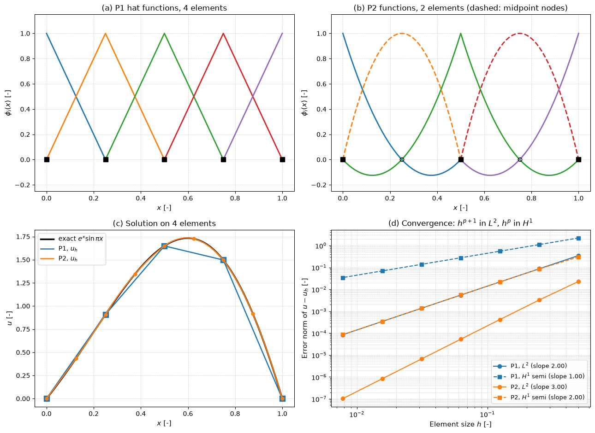

# Finite Element Method

The finite element method (FEM) approximates the solution of a boundary-value problem by a piecewise polynomial on a mesh of elements, chosen so that the residual of the equation is orthogonal to every function in the same piecewise polynomial space. It starts from the weak (integral) form of the equation rather than from the equation at points, which gives it three properties that finite differences lack: unstructured meshes of triangles and tetrahedra fit arbitrary geometry, derivative boundary conditions enter without special stencils, and the error can be bounded rigorously in terms of how well the polynomial space can approximate the exact solution.

FEM dominates structural mechanics and heat conduction, and in fluid dynamics it is used for incompressible and viscous flows, free-surface and fluid–structure problems, and as the basis of the high-order discontinuous Galerkin methods described in [High-Order Methods](../high_order/intro.md). This note works through the method on the 1D Poisson equation, states the error estimates, sketches the 2D version, and summarizes what changes for incompressible flow. The function spaces and the well-posedness theory behind the weak form are in [Weak Formulation of a Reaction–Diffusion Equation](./weak_formulation_pde.md). Throughout, the unknown is $u$ and the basis functions are $\phi_i$.

## Problem Statement

The model problem is the 1D Poisson equation with one Dirichlet and one Neumann condition,

```math
-\frac{d}{dx}\left(\kappa\, \frac{du}{dx}\right) = f \quad \text{on } (0, L),
\qquad u(0) = 0,
\qquad \kappa\, \frac{du}{dx}(L) = g
```

with a conductivity $\kappa(x) \ge \kappa_0 > 0$, a source $f$ and a boundary flux $g$. Its weak form reads: find $u \in V$ such that

```math
a(u, v) = \ell(v) \quad \text{for all } v \in V,
\qquad
a(u, v) = \int_0^L \kappa\,u'\,v'\,dx,
\qquad
\ell(v) = \int_0^L f\,v\,dx + g\,v(L)
```

where $V$ is the space of functions with square-integrable first derivatives that vanish at $x = 0$. The finite element problem replaces $V$ by a finite-dimensional subspace $V_h$ of piecewise polynomials of degree $p$ on a mesh of size $h$. It is solved when the error $u - u_h$, measured in the energy norm $`\|v\|_a = a(v, v)^{1/2}`$ or in $L^2$, is below a tolerance and falls as $O(h^p)$ or $O(h^{p+1})$ under refinement. The difficulties are building $V_h$ on complex geometry, integrating and assembling the element contributions efficiently, choosing spaces that remain stable for constrained problems such as incompressible flow, and controlling the oscillations of the standard method when convection dominates.

## From Strong to Weak Form

Multiply the equation by a test function $v \in V$ and integrate over the domain:

```math
-\int_0^L (\kappa u')'\,v\,dx = \int_0^L f\,v\,dx
```

Integration by parts moves one derivative from $u$ to $v$:

```math
\int_0^L \kappa\,u'\,v'\,dx - \Big[\kappa\,u'\,v\Big]_0^L = \int_0^L f\,v\,dx
```

The boundary term is handled by the two boundary conditions in different ways. At $x = 0$ the value of $u$ is prescribed, so $v$ is required to vanish there and the term drops out. At $x = L$ the flux $\kappa u'(L) = g$ is prescribed, so the term becomes $`g\,v(L)`$ and moves to the right-hand side. This gives the weak form of the problem statement.

| Condition | Example | Where it enters | Name |
| --- | --- | --- | --- |
| Value prescribed | $u(0) = u_0$ | in the space: trial functions satisfy it, test functions vanish there | essential (Dirichlet) |
| Flux prescribed | $\kappa u'(L) = g$ | in the right-hand side through the boundary term | natural (Neumann) |
| Flux proportional to value | $\kappa u'(L) = \beta(u_\infty - u(L))$ | $\beta u(L) v(L)$ in $a$, $\beta u_\infty v(L)$ in $\ell$ | natural (Robin) |

The weak form needs only first derivatives of $u$, so a continuous, piecewise linear function with kinks at the nodes is an admissible solution. A classical solution of the strong form also satisfies the weak form, and a weak solution that happens to be twice differentiable satisfies the strong form.

## The Galerkin Method

Let $V_h \subset V$ be spanned by basis functions $\phi_1, \dots, \phi_n$ and write $u_h = \sum_j U_j\phi_j$. Requiring the weak form for every $v \in V_h$, which is the same as requiring it for each basis function $v = \phi_i$, gives $n$ linear equations:

```math
\sum_{j=1}^{n} a(\phi_j, \phi_i)\,U_j = \ell(\phi_i), \quad i = 1, \dots, n
\qquad\Longleftrightarrow\qquad
K\,U = F, \quad K_{ij} = a(\phi_j, \phi_i), \quad F_i = \ell(\phi_i)
```

$K$ is the stiffness matrix and $F$ the load vector. Because $a$ is symmetric and coercive here, $K$ is symmetric positive definite. Subtracting the discrete equations from the continuous ones gives **Galerkin orthogonality**,

```math
a(u - u_h, v_h) = 0 \quad \text{for all } v_h \in V_h
```

so the error is orthogonal to the approximation space in the energy inner product, and $u_h$ is the best approximation of $u$ from $V_h$ in the energy norm. Equivalently, $u_h$ minimizes the energy functional $J(v) = \tfrac12 a(v, v) - \ell(v)$ over $V_h$ (the Ritz method).

## Basis Functions

Split $[0, L]$ into elements $[x_{e}, x_{e+1}]$ of length $h_e$. The piecewise linear (P1) space uses one **hat function** per node,

```math
\phi_i(x) =
\begin{cases}
(x - x_{i-1})/h_{i-1} & x_{i-1} \le x \le x_i \\
(x_{i+1} - x)/h_i & x_i \le x \le x_{i+1} \\
0 & \text{otherwise}
\end{cases}
```

with $\phi_i(x_j) = \delta_{ij}$, so the coefficient $U_i$ is the nodal value $u_h(x_i)$. Each hat function overlaps only its two neighbours, which makes $K$ tridiagonal.

The piecewise quadratic (P2) space adds a node at the midpoint of each element. On the reference element $\xi \in [0, 1]$ with nodes at $\xi = 0, 1/2, 1$, the shape functions are

```math
N_0 = 2\left(\xi - \tfrac12\right)(\xi - 1), \qquad N_{1/2} = 4\xi(1 - \xi), \qquad N_1 = 2\xi\left(\xi - \tfrac12\right)
```

A vertex function is built from two such pieces and spans two elements; a midpoint function lives on one element only. Higher degrees add more nodes per element in the same way.



Panels (a) and (b) show the P1 hat functions and the P2 vertex and midpoint functions. Panel (c) solves $-u'' = f$ with exact solution $e^x\sin\pi x$ on four elements: the P1 solution is exact at the nodes and linear between them, and the P2 solution is close to the exact curve everywhere. Panel (d) is discussed under the error estimates below.

## Element Matrices and Assembly

The integrals in $K$ and $F$ are sums of contributions from each element, and on each element only the shape functions of that element's nodes are non-zero. The element of length $h$ is mapped to the reference element by $x = x_e + h\xi$, so $`dx = h\,d\xi`$ and $d/dx = h^{-1}d/d\xi$. For constant $\kappa$ and $f$:

```math
K^e_{P1} = \frac{\kappa}{h}\begin{pmatrix} 1 & -1 \\ -1 & 1 \end{pmatrix},
\qquad
F^e_{P1} = \frac{fh}{2}\begin{pmatrix} 1 \\ 1 \end{pmatrix},
\qquad
M^e_{P1} = \frac{h}{6}\begin{pmatrix} 2 & 1 \\ 1 & 2 \end{pmatrix}
```

```math
K^e_{P2} = \frac{\kappa}{3h}\begin{pmatrix} 7 & -8 & 1 \\ -8 & 16 & -8 \\ 1 & -8 & 7 \end{pmatrix},
\qquad
F^e_{P2} = fh\begin{pmatrix} 1/6 \\ 2/3 \\ 1/6 \end{pmatrix}
```

where $`M^e_{ij} = \int\phi_i\phi_j\,dx`$ is the element mass matrix needed for time-dependent problems. For variable coefficients the integrals are evaluated by Gauss quadrature on the reference element; a rule with $q$ points integrates polynomials of degree $2q - 1$ exactly.

Assembly adds each element's contributions into the global positions given by the element's node numbers:

1. Set $K = 0$ and $F = 0$.
2. For each element $e$, with global node numbers $\mathrm{dofs}(e)$:
   1. compute $K^e$ and $F^e$ on the reference element;
   2. add $K^e_{ab}$ to $`K_{\mathrm{dofs}(e)_a,\,\mathrm{dofs}(e)_b}`$ and $`F^e_a`$ to $`F_{\mathrm{dofs}(e)_a}`$ for all local indices $a, b$.
3. Add the natural boundary terms to $F$ (and Robin terms to $K$).
4. Impose the essential conditions and solve $KU = F$.

The loop is the same in 1D, 2D and 3D; only the element type, the quadrature rule and the connectivity change. Essential conditions are imposed either by eliminating the known unknowns (move their columns to the right-hand side and delete their rows) or by replacing their rows with identity rows; the first keeps $K$ symmetric.

### Worked Example

Solve $-u'' = 1$ on $(0, 1)$ with $u(0) = 0$ and $u'(1) = 0$ using two P1 elements ($h = 1/2$). Each element contributes $`K^e = 2\begin{pmatrix} 1 & -1 \\ -1 & 1\end{pmatrix}`$ and $F^e = (1/4, 1/4)$, so

```math
K = \begin{pmatrix} 2 & -2 & 0 \\ -2 & 4 & -2 \\ 0 & -2 & 2 \end{pmatrix},
\qquad
F = \begin{pmatrix} 1/4 \\ 1/2 \\ 1/4 \end{pmatrix}
```

The natural condition $u'(1) = 0$ adds nothing. Eliminating the Dirichlet node 0 leaves

```math
4U_1 - 2U_2 = \frac12, \qquad -2U_1 + 2U_2 = \frac14
```

so $U_1 = 3/8$ and $U_2 = 1/2$. The exact solution $u = x - x^2/2$ gives $u(1/2) = 3/8$ and $u(1) = 1/2$: the nodal values are exact. A single P2 element reproduces the quadratic exact solution everywhere.

## A Priori Error Estimates

Suppose $a$ is continuous, $`|a(u, v)| \le M\|u\|_{H^1}\|v\|_{H^1}`$, and coercive, $`a(v, v) \ge \alpha\|v\|^2_{H^1}`$ (for the model problem $M$ and $\alpha$ depend on $\kappa$ and the domain). Galerkin orthogonality then gives **Céa's lemma**,

```math
\| u - u_h\|_{H^1} \le \frac{M}{\alpha}\,\inf_{v_h \in V_h}\| u - v_h\|_{H^1}
```

The Galerkin solution is as good as the best approximation from $V_h$, up to the constant $M/\alpha$. Choosing $v_h$ as the interpolant of $u$ and using polynomial interpolation estimates gives, for $u \in H^{p+1}$ and degree-$`p`$ elements,

```math
\| u - u_h\|_{H^1} \le C\,h^{p}\,| u|_{H^{p+1}},
\qquad
\| u - u_h\|_{L^2} \le C\,h^{p+1}\,| u|_{H^{p+1}}
```

The extra power in $L^2$ comes from a duality argument (the Aubin–Nitsche trick), which needs the adjoint problem to be regular, as it is on convex or smooth domains. The constants do not depend on $h$ but grow with the derivatives of $u$, so the rates appear only once the mesh resolves the solution. Near singularities (re-entrant corners, point loads) $u$ is not in $H^{p+1}$ and the rates drop; local mesh refinement restores them.

Panel (d) of the figure confirms the rates for $e^x\sin\pi x$. On 128 elements the P1 errors are $8.53 \times 10^{-5}$ in $L^2$ and $3.45 \times 10^{-2}$ in the $H^1$ seminorm, the P2 errors $1.04 \times 10^{-7}$ and $8.60 \times 10^{-5}$, with observed orders 2.00, 1.00, 3.00 and 2.00. In 1D the P1 nodal values are exact whenever the load integrals are exact, because the Green's function of the operator with its source at a node lies in $V_h$; the script finds a maximum nodal error of $9 \times 10^{-16}$. This superconvergence does not carry over to 2D.

## Two Dimensions: Triangles

In 2D the domain is covered by triangles, and the P1 basis function of node $i$ is linear on each triangle, 1 at node $i$ and 0 at all other nodes. On a triangle with vertices $(x_1, y_1), (x_2, y_2), (x_3, y_3)$ and area $A$, the local shape functions are the barycentric coordinates $\lambda_1, \lambda_2, \lambda_3$, whose gradients are constant:

```math
\nabla\lambda_1 = \frac{1}{2A}\begin{pmatrix} y_2 - y_3 \\ x_3 - x_2 \end{pmatrix}
\quad \text{(and cyclically)},
\qquad
K^e_{ij} = \int_{T}\kappa\,\nabla\lambda_i\cdot\nabla\lambda_j\,dA = \kappa A\,\nabla\lambda_i\cdot\nabla\lambda_j
```

For the Laplacian on a uniform mesh of right triangles (each square of side $h$ cut along one diagonal), the assembled stiffness matrix row of an interior node is $4$ on the diagonal and $-1$ for the four horizontal and vertical neighbours: exactly the [five-point finite-difference Laplacian](../fdm/intro.md#the-five-point-laplacian-in-2d) multiplied by $h^2$. The two methods differ in the load vector and in how they extend to unstructured meshes. Quadrilateral elements use bilinear (Q1) or biquadratic (Q2) shape functions on a reference square mapped to each element, and curved boundaries are fitted with isoparametric elements, which use the shape functions themselves to describe the geometry.

## Finite Elements for Incompressible Flow

For steady Stokes flow, $-\nu\nabla^2\mathbf{u} + \nabla p = \mathbf{f}$ and $\nabla\cdot\mathbf{u} = 0$ in $\Omega$ with $\mathbf{u} = \mathbf{0}$ on the boundary, the weak form is: find $\mathbf{u} \in [H^1_0(\Omega)]^d$ and $p \in L^2_0(\Omega)$ (pressure with zero mean) such that

```math
\nu\int_\Omega \nabla\mathbf{u} : \nabla\mathbf{v}\,d\Omega - \int_\Omega p\,\nabla\cdot\mathbf{v}\,d\Omega = \int_\Omega \mathbf{f}\cdot\mathbf{v}\,d\Omega,
\qquad
\int_\Omega q\,\nabla\cdot\mathbf{u}\,d\Omega = 0
```

for all test functions $\mathbf{v}$ and $q$. With velocity and pressure bases the discrete system has the saddle-point form

```math
\begin{pmatrix} A & B^{T} \\ B & 0 \end{pmatrix}
\begin{pmatrix} U \\ P \end{pmatrix}
=
\begin{pmatrix} F \\ 0 \end{pmatrix}
```

where $A$ is the vector Laplacian and $B$ the discrete divergence. The zero block means that coercivity no longer guarantees a solution. The velocity and pressure spaces $V_h$ and $Q_h$ must satisfy the **inf–sup** (Ladyzhenskaya–Babuška–Brezzi, LBB) condition

```math
\inf_{q_h \in Q_h}\ \sup_{\mathbf{v}_h \in V_h} \frac{\int_\Omega q_h\,\nabla\cdot\mathbf{v}_h\,d\Omega}{| \mathbf{v}_h|_{H^1}\,\| q_h\|_{L^2}} \ge \beta > 0
```

with $\beta$ independent of $h$. It says that the velocity space must be rich enough to "see" every pressure mode through the divergence. If it fails, $B^T$ has a non-trivial null space and the pressure shows spurious checkerboard modes, or the velocity locks.

| Pair | Velocity | Pressure | Inf–sup stable | Velocity error ($H^1$) |
| --- | --- | --- | --- | --- |
| P1–P1 | continuous linear | continuous linear | no | — |
| P1–P0 | continuous linear | piecewise constant | no (locks or checkerboards) | — |
| MINI | linear plus cubic bubble | continuous linear | yes | $O(h)$ |
| Taylor–Hood P2–P1 | continuous quadratic | continuous linear | yes | $O(h^2)$ |
| Crouzeix–Raviart | non-conforming linear | piecewise constant | yes | $O(h)$ |

Taylor–Hood is the standard choice: the velocity error is $O(h^2)$ in $H^1$ and the pressure error $O(h^2)$ in $L^2$ for smooth solutions.

Equal-order pairs are convenient in implementation, so stabilized methods add terms that restore stability. Pressure-stabilizing Petrov–Galerkin (PSPG) adds the momentum residual weighted by $\tau\nabla q$ to the continuity equation, which circumvents the inf–sup condition for P1–P1. For the Navier–Stokes equations the convection term $(\mathbf{u}\cdot\nabla\mathbf{u}, \mathbf{v})$ is added; when convection dominates (element Péclet or Reynolds number $|\mathbf{u}|h/(2\nu) > 1$) the standard Galerkin method oscillates like central differences, and the streamline-upwind Petrov–Galerkin method (SUPG) replaces the test function by $`\mathbf{v} + \tau\,\mathbf{u}\cdot\nabla\mathbf{v}`$. This adds diffusion along streamlines only, and because the added term is weighted by the residual the method stays consistent. The parameter $\tau$ is of order $h/(2|\mathbf{u}|)$. The nonlinear system is solved by Picard or Newton iteration (see [Dealing with Nonlinearity](../cfd/dealing_with_nonlinearity.md)), and the saddle-point systems by block-preconditioned Krylov methods. The finite volume counterparts of these issues, staggered grids and Rhie–Chow interpolation, are in [Pressure–Velocity Coupling](../fvm/pressure_velocity_coupling.md).

## Pitfalls

- Imposing a Neumann condition as if it were essential, or forgetting the boundary term, silently solves a different problem. Natural conditions must appear in the load vector.
- Under-integrated element matrices (too few Gauss points) can make $K$ singular or introduce hourglass modes; over-integration only costs time.
- Equal-order velocity–pressure elements without stabilization give pressure oscillations that do not disappear under refinement.
- The standard Galerkin method is unstable for convection-dominated transport on meshes that do not resolve boundary layers; SUPG or a similar stabilization is needed.
- Optimal rates need a smooth solution and a good mesh. Highly distorted elements degrade the constants in the error estimates; see [Mesh Quality](../../../practice/mesh_generation/mesh_quality.md).
- A pure Neumann problem determines $u$ only up to a constant, and it has a solution only if the source and the prescribed boundary fluxes balance (for $-u'' = f$ on $(0, 1)$, $`\int_0^1 f\,dx = u'(0) - u'(1)`$). Fix one value or add a zero-mean constraint.

## Key Takeaways

- Multiplying by a test function and integrating by parts gives the weak form; values are imposed in the function space (essential), fluxes appear in the load vector (natural).
- The Galerkin method makes the residual orthogonal to the approximation space and gives a symmetric positive-definite system $KU = F$ for symmetric coercive problems.
- Element matrices are computed on a reference element and assembled through the connectivity; the same loop works in any dimension.
- Céa's lemma reduces error analysis to approximation theory: degree-$`p`$ elements converge as $h^p$ in $H^1$ and $h^{p+1}$ in $L^2$.
- Incompressible flow needs inf–sup stable velocity–pressure pairs such as Taylor–Hood P2–P1, or stabilization (PSPG, SUPG).

## Related Scripts

- [1D Poisson Equation With Finite Elements](../../../scripts/algorithms/fem_1d_poisson/): solves the 1D Poisson equation $-u'' = f$ on $(0, 1)$ with homogeneous Dirichlet conditions by the Galerkin finite element method with linear (P1) and quadratic (P2) Lagrange elements, and confirms the a priori error estimates: the $L^2$ error falls as $h^{p+1}$ and the $H^1$ error as $h^p$.
- [Discontinuous Galerkin Linear Advection](../../../scripts/algorithms/dg_linear_advection/): solves the 1D periodic linear advection equation $`u_t + a\,u_x = 0`$ with the discontinuous Galerkin (DG) method, using Legendre polynomials of degree $p = 0$ to 3 in every element, an upwind numerical flux and the three-stage SSP Runge–Kutta method, and confirms that the error falls as $h^{p+1}$.
- [Axial Bar Finite Elements](../../../scripts/algorithms/materials_axial_bar_fem/): solves statically indeterminate axial bars with two-node finite elements and checks them against the hand solution from equilibrium and compatibility.
- [Plane Truss Solver](../../../scripts/algorithms/statics_truss_solver/): solves a plane pin-jointed truss by the method of joints and by the direct stiffness method.
- [Shear and Moment Diagrams of Beams](../../../scripts/algorithms/beams_shear_moment_diagrams/): solves statically determinate and indeterminate beams with Euler–Bernoulli finite elements and draws the load, shear-force, bending-moment and deflection diagrams with their extreme values.

## Exercises

**Exercise 1.** On an element $[x_a, x_b]$ of length $h$, the linear shape functions are $\phi_1 = (x_b - x)/h$ and $\phi_2 = (x - x_a)/h$. Compute the element stiffness matrix $K^e$ for $\kappa = 1$ and the load vector $F^e$ for a constant $f$.

<details>
<summary>Answer</summary>

$\phi_1' = -1/h$ and $\phi_2' = 1/h$, so $`K^e_{ij} = \int_{x_a}^{x_b}\phi_i'\phi_j'\,dx`$ gives:

- diagonal entries $K^e_{11} = K^e_{22} = 1/h$;
- off-diagonal entries $K^e_{12} = K^e_{21} = -1/h$.

Since $`\int\phi_i\,dx = h/2`$, the load vector is $F^e_1 = F^e_2 = fh/2$.

</details>

**Exercise 2.** Solve $-u'' = 1$ on $[0, 1]$ with $u(0) = u(1) = 0$ using three equal linear elements ($h = 1/3$). Assemble the global $4 \times 4$ system, apply the boundary conditions, solve for the interior nodal values, and compare with the exact solution $u = x(1 - x)/2$.

<details>
<summary>Answer</summary>

Adding the element contributions (each $1/h = 3$) gives a tridiagonal global stiffness matrix:

- rows 0 and 3: $3, -3$;
- rows 1 and 2: $-3, 6, -3$.

The global load vector is $F = (1/6, 1/3, 1/3, 1/6)$. Deleting the rows and columns of the Dirichlet nodes 0 and 3 leaves

```math
6U_1 - 3U_2 = \frac{1}{3},
\qquad - 3U_1 + 6U_2 = \frac{1}{3}
```

so $U_1 = U_2 = 1/9$. The exact value is $u(1/3) = \frac{1}{3}\cdot\frac{2}{3}/2 = 1/9$. The nodal values are exact, as expected for P1 elements in 1D, while between the nodes the approximation is piecewise linear.

</details>

**Exercise 3.** For a variable coefficient $\kappa(x) = 1 + x$, compute $K^e$ for the linear element $[0.5, 1]$.

<details>
<summary>Answer</summary>

The shape-function derivatives are $\pm 1/h$ with $h = 0.5$, so every entry equals $`\pm\frac{1}{h^2}\int_{0.5}^{1}(1 + x)\,dx`$. The integral is $0.5 + (1 - 0.25)/2 = 0.875$, and dividing by $h^2 = 0.25$ gives 3.5.

$K^e$ has diagonal entries $3.5$ and off-diagonal entries $-3.5$. For linear elements, $K^e$ is the constant-coefficient matrix with $\kappa$ replaced by its element average ($0.875/0.5 = 1.75$, and $1.75/h = 3.5$).

</details>

**Exercise 4.** Compute the P1 stiffness matrix of the Laplacian on the right triangle with vertices $(0, 0)$, $(h, 0)$, $(0, h)$. Explain why the result does not depend on $h$.

<details>
<summary>Answer</summary>

The area is $A = h^2/2$. From the gradient formula, $\nabla\lambda_1 = (-1, -1)/h$, $\nabla\lambda_2 = (1, 0)/h$ and $\nabla\lambda_3 = (0, 1)/h$. Then $`K^e_{ij} = A\,\nabla\lambda_i\cdot\nabla\lambda_j`$:

```math
K^e = \frac{1}{2}\begin{pmatrix} 2 & -1 & -1 \\ -1 & 1 & 0 \\ -1 & 0 & 1 \end{pmatrix}
```

The gradients scale as $1/h$ and the area as $h^2$, so in 2D the stiffness entries are scale-invariant. Assembling this matrix over a uniform mesh of such triangles gives the five-point stencil $(4, -1, -1, -1, -1)$; the $h^{-2}$ of the finite-difference formula reappears on the load side, where $F_i \approx h^2 f_i$.

</details>

**Exercise 5.** For $-u'' = f$ with $u = e^x\sin\pi x$, the script finds L² errors of $8.531 \times 10^{-5}$ (P1) and $1.037 \times 10^{-7}$ (P2) on 128 elements. Use the error estimates to predict how many elements, and how many unknowns, each needs for an $L^2$ error of $10^{-6}$.

<details>
<summary>Answer</summary>

For P1, $e = C_1h^2$ with $C_1 = 8.531 \times 10^{-5} \times 128^2 = 1.398$. Then $`h = (10^{-6}/1.398)^{1/2} = 8.46 \times 10^{-4}`$, so about 1183 elements and 1182 interior unknowns. The script gives $9.99 \times 10^{-7}$ on 1183 elements.

For P2, $e = C_2h^3$ with $C_2 = 1.037 \times 10^{-7} \times 128^3 = 0.2175$. Then $h = (10^{-6}/0.2175)^{1/3} = 0.0166$, so 61 elements and $2 \times 61 - 1 = 121$ interior unknowns. The script gives $9.58 \times 10^{-7}$ on 61 elements.

The quadratic elements need ten times fewer unknowns for the same accuracy, and the advantage grows as the tolerance tightens.

</details>

## References

- S. C. Brenner and L. R. Scott, *The Mathematical Theory of Finite Element Methods*, 3rd ed., Springer, 2008.
- H. C. Elman, D. J. Silvester and A. J. Wathen, *Finite Elements and Fast Iterative Solvers: with Applications in Incompressible Fluid Dynamics*, 2nd ed., Oxford University Press, 2014.
- T. J. R. Hughes, *The Finite Element Method: Linear Static and Dynamic Finite Element Analysis*, Dover, 2000.
- O. C. Zienkiewicz, R. L. Taylor and J. Z. Zhu, *The Finite Element Method: Its Basis and Fundamentals*, 7th ed., Butterworth-Heinemann, 2013.
- G. Strang and G. J. Fix, *An Analysis of the Finite Element Method*, Prentice-Hall, 1973.
- A. N. Brooks and T. J. R. Hughes, "Streamline upwind/Petrov–Galerkin formulations for convection dominated flows with particular emphasis on the incompressible Navier–Stokes equations", *Computer Methods in Applied Mechanics and Engineering*, 32(1–3), 199–259, 1982.
- T. J. R. Hughes, L. P. Franca and M. Balestra, "A new finite element formulation for computational fluid dynamics: V. Circumventing the Babuška–Brezzi condition", *Computer Methods in Applied Mechanics and Engineering*, 59(1), 85–99, 1986.
- C. Taylor and P. Hood, "A numerical solution of the Navier–Stokes equations using the finite element technique", *Computers & Fluids*, 1(1), 73–100, 1973.
