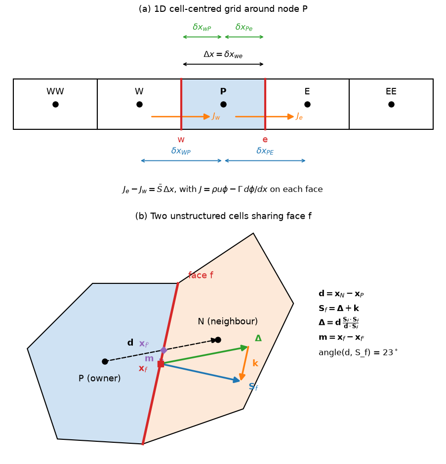

# Finite Volume Discretization on General Meshes

[The Finite Volume Method](intro.md) introduced the integral balance, the conservation property and the 1D convection–diffusion equation on a uniform grid. Industrial meshes are 2D or 3D, unstructured, and made of cells of mixed shape (hexahedra, tetrahedra, prisms, polyhedra) whose faces are neither aligned with the coordinate axes nor perpendicular to the lines joining cell centres. This note describes how each term of the transport equation is discretized on such a mesh: the geometric quantities a code stores, gradient reconstruction, the diffusion flux with non-orthogonal correction, skewness correction, source linearization, the unsteady term, assembly into a sparse matrix and the treatment of boundary faces. The convective face value is the subject of [Convection Schemes](convection_schemes.md), and the coupling of pressure and velocity is in [Pressure–Velocity Coupling](pressure_velocity_coupling.md).

## Problem Statement

Discretize the generic transport equation

$$
\frac{\partial (\rho\phi)}{\partial t} +
\nabla\cdot(\rho\mathbf{u}\phi) = \nabla\cdot(\Gamma\nabla\phi) + S_\phi
$$

on a mesh of $N$ polyhedral cells with arbitrary connectivity. The unknowns are the values $\phi_P$ at the cell centroids, interpreted as cell averages to second order. The mass flux through every face is given (in a flow solver it comes from the pressure–velocity coupling), and every boundary face carries a boundary condition. The aim is a linear system $\mathbf{A}\boldsymbol\phi = \mathbf{b}$, one row per cell, whose solution is second-order accurate on smooth meshes and remains consistent, bounded and solvable by iterative methods when the mesh is non-orthogonal, skewed or stretched.

The difficulties are geometric. On a general mesh the vector $\mathbf{d}$ from the owner centroid to the neighbour centroid is not parallel to the face normal (non-orthogonality), and it does not pass through the face centroid (skewness). A two-point difference $(\phi_N - \phi_P)/|\mathbf{d}|$ is then not the normal gradient at the face, and linear interpolation along $\mathbf{d}$ does not give the value at the face centroid. Corrections for both need gradients at the cell centres, which must themselves be reconstructed from cell values.

## Cell and Face Geometry

For a cell $P$ with faces $f$, a code precomputes:

- the face area vector $`\mathbf{S}_f = \int_f\mathbf{n}\,dS`$, whose magnitude is the face area and whose direction is the unit normal of a plane face. For a polygonal face it is computed by splitting the face into triangles about an approximate centre and summing $`\tfrac{1}{2}(\mathbf{x}_j - \mathbf{x}_c)\times(\mathbf{x}_{j+1} - \mathbf{x}_c)`$;
- the face centroid $\mathbf{x}_f$, the area-weighted mean of the triangle centroids;
- the cell volume, from the divergence theorem applied to $\nabla\cdot\mathbf{x} = 3$,

```math
V_P = \frac{1}{3}\sum_f \mathbf{x}_f\cdot\mathbf{S}_f
```

- the cell centroid $\mathbf{x}_P$, the volume-weighted mean of the centroids of the pyramids formed by each face and an approximate cell centre.

For a closed cell the face area vectors sum to zero, $\sum_f\mathbf{S}_f = \mathbf{0}$. This geometric identity means a uniform field produces zero net flux and zero gradient, and codes check it as part of mesh validation.

Each interior face is stored once, with an owner cell and a neighbour cell. By convention $\mathbf{S}_f$ points from the owner $P$ to the neighbour $N$, and $\mathbf{d}_f = \mathbf{x}_N - \mathbf{x}_P$. A flux computed on the face is added to the owner's balance and subtracted from the neighbour's, which makes the scheme conservative by construction.



Panel (b) shows two cells that share a face. The non-orthogonality angle $\theta$ between $\mathbf{d}$ and $`\mathbf{S}_f`$ is 23° here, and $`\mathbf{d}`$ crosses the face at $`\mathbf{x}_{f'}`$, a distance $|\mathbf{m}|$ from the face centroid $\mathbf{x}_f$. The vectors $\boldsymbol\Delta$ and $\mathbf{k}$ are the decomposition used for the diffusion flux below.

With midpoint integration on each face, the balance of cell $P$ is

```math
\frac{\partial (\rho\phi)_P}{\partial t}V_P + \sum_f F_f\,\phi_f = \sum_f \Gamma_f\,(\nabla\phi)_f\cdot\mathbf{S}_f + \bar S_P V_P,
\qquad
F_f = (\rho\mathbf{u})_f\cdot\mathbf{S}_f
```

where $F_f$ is the mass flux leaving $P$ through $f$. For an axis-aligned rectangle with faces $w$, $e$, $s$, $n$ the face area vectors are $(-\Delta y, 0)$, $(\Delta y, 0)$, $(0, -\Delta x)$ and $(0, \Delta x)$ per unit depth, and the incompressible continuity equation $\sum_f\mathbf{u}_f\cdot\mathbf{S}_f = 0$ becomes $(u_e - u_w)\Delta y + (v_n - v_s)\Delta x = 0$.

## Face Interpolation

The value at the face is interpolated linearly along $\mathbf{d}$,

```math
\phi_{f'} = w_f\,\phi_P + (1 - w_f)\,\phi_N,
\qquad
w_f = \frac{(\mathbf{x}_N - \mathbf{x}_f)\cdot\mathbf{S}_f}{\mathbf{d}_f\cdot\mathbf{S}_f}
```

The weight is the fraction of the distance between the centroids, measured along the face normal, that lies on the neighbour side of the face; it is $1/2$ on a uniform grid. The result is second order at $\mathbf{x}_{f'}$, the point where $\mathbf{d}$ meets the face, not at the face centroid. The same weights interpolate the diffusion coefficient when it varies smoothly. When $\Gamma$ jumps across the face, as at the interface between two materials, the flux through the two half-distances behaves like two resistances in series and the correct face value is the harmonic mean

```math
\Gamma_f = \frac{|\mathbf{x}_f - \mathbf{x}_P| + |\mathbf{x}_N - \mathbf{x}_f|}{|\mathbf{x}_f - \mathbf{x}_P|/\Gamma_P + |\mathbf{x}_N - \mathbf{x}_f|/\Gamma_N}
```

(Patankar 1980). The arithmetic mean overestimates the flux, and in the limit of an insulating cell it gives a finite conductance instead of zero.

## Gradient Reconstruction

Cell-centre gradients are needed for the non-orthogonal and skewness corrections, for second-order convection schemes on unstructured meshes, and for derived quantities such as the strain rate. Two methods are standard.

### Green–Gauss

The divergence theorem applied to $\nabla\phi$ gives $`\int_V\nabla\phi\,dV = \oint\phi\,\mathbf{n}\,dS`$, so

```math
(\nabla\phi)_P \approx \frac{1}{V_P}\sum_f \phi_f\,\mathbf{S}_f
```

If $\phi$ is linear and $\phi_f$ is its exact value at each face centroid, the formula is exact, because $`\sum_f(\mathbf{a}\cdot\mathbf{x}_f)\mathbf{S}_f = \mathbf{a}V_P`$ for a closed polyhedron. In practice $`\phi_f`$ is interpolated. With the linear interpolation above it is evaluated at $`\mathbf{x}_{f'}`$, so on a skewed mesh the gradient of a linear field is no longer exact and the error does not vanish with refinement unless the skewness does. A few fixed-point iterations of the skewness correction below restore consistency. A node-based variant interpolates vertex values from the surrounding cells and integrates them over each face; it is more accurate on tetrahedral meshes at the cost of a wider stencil.

### Least Squares

The least-squares gradient fits a linear function through the neighbour values. It minimizes

```math
\sum_{N\in\mathcal{N}(P)} w_N\left(\phi_N - \phi_P - \mathbf{g}\cdot\mathbf{d}_N\right)^2
```

over $\mathbf{g}$, with $\mathbf{d}_N = \mathbf{x}_N - \mathbf{x}_P$ and weights $w_N$, commonly $1/|\mathbf{d}_N|^2$. Setting the derivative to zero gives a $3\times3$ system per cell,

```math
\mathbf{G}_P\,(\nabla\phi)_P = \sum_N w_N\,\mathbf{d}_N\,(\phi_N - \phi_P),
\qquad
\mathbf{G}_P = \sum_N w_N\,\mathbf{d}_N\mathbf{d}_N^{T}
```

$\mathbf{G}_P$ depends only on the geometry and is inverted once. The method is exact for linear fields on any mesh, needs no face values, and is first-order accurate for general smooth fields, the same as Green–Gauss. Its weakness is on highly stretched cells next to curved walls, where the close wall-normal neighbours and the distant tangential neighbours enter the fit with very different leverage and the unweighted gradient can be badly wrong; the weighting has to be chosen with care there (Mavriplis 2003).

For convection schemes the reconstructed gradient is usually limited so that the extrapolated face values stay within the range of the neighbouring cell values (Barth and Jespersen 1989), which is the multidimensional analogue of the TVD limiters in [Convection Schemes](convection_schemes.md).

## Diffusion Flux on Non-Orthogonal Meshes

The diffusive flux through face $f$ is $\Gamma_f(\nabla\phi)_f\cdot\mathbf{S}_f$. On an orthogonal mesh $\mathbf{S}_f$ is parallel to $\mathbf{d}$ and the two-point difference is the normal gradient:

```math
(\nabla\phi)_f\cdot\mathbf{S}_f = |\mathbf{S}_f|\, \frac{\phi_N - \phi_P}{|\mathbf{d}|}
```

This involves only $\phi_P$ and $\phi_N$, so it goes into the matrix with a positive coefficient and preserves diagonal dominance.

On a non-orthogonal mesh the two-point difference only measures the gradient along $\mathbf{d}$. Split the face area vector into a part along $\mathbf{d}$ and a remainder,

$$
\mathbf{S}_f = \boldsymbol\Delta + \mathbf{k},
\qquad \boldsymbol\Delta \parallel \mathbf{d}
$$

and treat the first part implicitly and the second explicitly:

```math
(\nabla\phi)_f\cdot\mathbf{S}_f \approx \underbrace{|\boldsymbol\Delta|\,\frac{\phi_N - \phi_P}{|\mathbf{d}|}}_{\text{implicit, orthogonal part}} + \underbrace{\mathbf{k}\cdot(\nabla\phi)_f}_{\text{explicit non-orthogonal correction}}
```

where $(\nabla\phi)_f = w_f(\nabla\phi)_P + (1 - w_f)(\nabla\phi)_N$ is interpolated from the reconstructed cell gradients of the previous iteration. Jasak (1996) compared three choices of $\boldsymbol\Delta$, with $\theta$ the angle between $\mathbf{d}$ and $\mathbf{S}_f$:

| Approach | $\boldsymbol\Delta$ | $\lvert\boldsymbol\Delta\rvert$ | Behaviour as $\theta$ grows |
| --- | --- | --- | --- |
| minimum correction | $`\dfrac{\mathbf{d}\cdot\mathbf{S}_f}{\mathbf{d}\cdot\mathbf{d}}\,\mathbf{d}`$ | $\lvert\mathbf{S}_f\rvert\cos\theta$ | implicit part shrinks; $\mathbf{k}$ is perpendicular to $\mathbf{d}$ and as small as possible |
| orthogonal correction | $`\dfrac{\lvert\mathbf{S}_f\rvert}{\lvert\mathbf{d}\rvert}\,\mathbf{d}`$ | $\lvert\mathbf{S}_f\rvert$ | implicit part independent of $\theta$ |
| over-relaxed | $`\dfrac{\mathbf{S}_f\cdot\mathbf{S}_f}{\mathbf{d}\cdot\mathbf{S}_f}\,\mathbf{d}`$ | $\lvert\mathbf{S}_f\rvert/\cos\theta$ | implicit part grows; $\mathbf{k}$ is perpendicular to $\mathbf{S}_f$ |

All three are exact for a linear field if the gradient is exact, because $\boldsymbol\Delta\cdot\nabla\phi = |\boldsymbol\Delta|(\phi_N - \phi_P)/|\mathbf{d}|$ for any $\boldsymbol\Delta$ parallel to $\mathbf{d}$. They differ in how much of the flux is implicit. Jasak found the over-relaxed approach the most robust: the explicit part is the smallest relative to the implicit one, the matrix gains diagonal weight as the mesh distorts, and the iterations converge best. It is the default in several finite volume codes.

Because the correction is explicit, a steady solution satisfies the full non-orthogonal discretization only when the outer iterations have converged. In transient solvers each time step contains a fixed number of non-orthogonal corrector loops, which recompute the gradient and the correction and re-solve. Above a non-orthogonality of about 70° the explicit term can dominate the implicit one and destabilize the iterations. Codes then limit the correction to a fraction of the implicit part, trading accuracy for robustness; a mesh that needs this should be improved where possible ([Mesh Quality](../../../practice/mesh_generation/mesh_quality.md)).

## Skewness Correction

Linear interpolation along $\mathbf{d}$ gives the value at $\mathbf{x}_{f'}$, but the midpoint rule needs it at the face centroid $\mathbf{x}_f$. With $`\mathbf{m} = \mathbf{x}_f - \mathbf{x}_{f'}`$, a first-order Taylor correction is

```math
\phi_f = \phi_{f'} + \mathbf{m}\cdot(\nabla\phi)_{f'},
\qquad
(\nabla\phi)_{f'} = w_f(\nabla\phi)_P + (1 - w_f)(\nabla\phi)_N
```

Without it, the interpolation error is $`O(|\mathbf{m}|\,|\nabla\phi|)`$, which is first order when $|\mathbf{m}|$ scales with the cell size and does not vanish relative to the other errors under refinement. The correction matters most for the face values of convection and Green–Gauss gradients on tetrahedral and polyhedral meshes and around non-conformal interfaces. It is explicit, like the non-orthogonal correction, and is iterated with it.

## Source Linearization

A source term that depends on $\phi$ is linearized about the current iterate,

```math
\bar S_P V_P \approx \left(S_c + S_p\,\phi_P\right)V_P,
\qquad
S_p \le 0
```

The constant part $S_c V_P$ goes into $b_P$, and $-S_p V_P$ is added to $a_P$. A negative slope adds to the diagonal and strengthens diagonal dominance; a positive slope would subtract from it and can produce a singular or indefinite matrix and negative values of positive quantities. The rule from Patankar (1980) is a Newton linearization when the slope is negative,

```math
S_p = \left(\frac{dS}{d\phi}\right)^{*},
\qquad
S_c = S^{*} - \left(\frac{dS}{d\phi}\right)^{*}\phi^{*}
\qquad
\text{if } \left(\frac{dS}{d\phi}\right)^{*} < 0
```

and $`S_c = S^{*}`$, $`S_p = 0`$ (a fully explicit source) when the slope is positive, where the star denotes the previous iterate. Destruction terms of turbulence models, such as $`-\rho\varepsilon`$ in the $k$ equation written as $`-(\rho\varepsilon^{*}/k^{*})\,k`$, are treated this way to keep $`k`$ positive.

## Unsteady Term

For a transient problem the time derivative is discretized at each cell. Fully implicit (backward) Euler gives

```math
\frac{(\rho\phi)_P^{n+1} - (\rho\phi)_P^{n}}{\Delta t}V_P \quad\Rightarrow\quad a_P \mathrel{+}= \frac{\rho_P V_P}{\Delta t}, \quad b_P \mathrel{+}= \frac{\rho_P V_P}{\Delta t}\phi_P^{n}
```

with the convection, diffusion and source terms all evaluated at $n + 1$. It is first order in time, unconditionally stable for linear problems, and bounded. The second-order backward differentiation formula (BDF2) replaces the bracket by $(3\phi^{n+1} - 4\phi^{n} + \phi^{n-1})/(2\Delta t)$ and adds $3\rho V/(2\Delta t)$ to $a_P$. Crank–Nicolson averages the spatial terms at $n$ and $n + 1$; it is second order but loses boundedness at large time steps. In every implicit scheme the time term adds to the diagonal, so a smaller $\Delta t$ makes the system easier to solve. Explicit schemes need no matrix but are limited by the Courant number $C = |u|\Delta t/\Delta x$ and the diffusion number $\Gamma\Delta t/(\rho\Delta x^2)$. The choice and accuracy of time-integration schemes are covered in [Time Integration](../cfd/time_integration.md).

For steady problems solved iteratively, the same diagonal increase is applied as implicit under-relaxation with a factor $0 < \alpha \le 1$,

```math
\frac{a_P}{\alpha}\phi_P = \sum_{nb} a_{nb}\phi_{nb} + b_P + \frac{1 - \alpha}{\alpha}a_P\,\phi_P^{\mathrm{old}}
```

which leaves the converged solution unchanged and acts like a local pseudo-time step.

## Assembly into a Sparse Matrix

Assembly loops over cells for volume terms and over faces for fluxes. With first-order upwind convection and the implicit part of diffusion, it reads:

```text
A = 0, b = 0
for each cell P:
    A[P,P] += rho_P V_P / dt - S_p,P V_P
    b[P]   += S_c,P V_P + rho_P V_P / dt * phi_P_old
for each interior face f with owner O and neighbour N:
    F   = mass flux from O to N through f
    aD  = Gamma_f |Delta_f| / |d_f|
    A[O,O] += aD + max(F, 0);   A[O,N] += -aD + min(F, 0)
    A[N,N] += aD + max(-F, 0);  A[N,O] += -aD - max(F, 0)
    c = explicit part of the flux out of O (non-orthogonal correction,
        deferred correction of the convection scheme)
    b[O] -= c;  b[N] += c
for each boundary face b with owner P:
    add the boundary-condition terms to A[P,P] and b[P]
```

Each interior face contributes four matrix entries and one explicit flux, and the explicit flux is added to one cell and subtracted from the other, so the assembled equations conserve $\phi$ exactly. The matrix has one row per cell and $N + 2N_f$ non-zero entries for $N_f$ interior faces: 7 per row on a hexahedral mesh, 5 on a tetrahedral mesh. Many codes store it face by face, as a diagonal array and one lower and one upper coefficient per face, which uses the owner–neighbour lists directly.

The matrix is symmetric when only diffusion is implicit, and it is then positive definite with Dirichlet boundaries, so conjugate gradients or algebraic multigrid apply. Convection makes it non-symmetric; with upwind coefficients it is still an M-matrix (positive diagonal, non-positive off-diagonals, diagonally dominant), which guarantees a bounded solution and convergence of Jacobi and Gauss–Seidel iterations. Higher-order convection schemes are applied by deferred correction to preserve these properties. Solver choices are in [Direct and Iterative Solvers](../cfd/direct_and_iterative_solvers.md).

## Boundary Faces

A boundary face $b$ has only an owner $P$. With $\mathbf{d}_b = \mathbf{x}_b - \mathbf{x}_P$ the vector from the cell centroid to the face centroid, the common cases are:

| Condition | Diffusion flux | Convection flux $F_b\phi_b$ | Matrix contribution |
| --- | --- | --- | --- |
| fixed value $\phi_b$ (Dirichlet) | $`\Gamma_b\lvert\boldsymbol\Delta_b\rvert(\phi_b - \phi_P)/\lvert\mathbf{d}_b\rvert`$ plus the non-orthogonal correction | $\phi_b$ at an inflow, $\phi_P$ at an outflow | $a_P$ += $`\Gamma_b\lvert\boldsymbol\Delta_b\rvert/\lvert\mathbf{d}_b\rvert`$, $b_P$ += the same times $\phi_b$; inflow convection goes to $b_P$ |
| fixed flux $q_b$ (Neumann) | $q_b\lvert\mathbf{S}_b\rvert$ | $\phi_b = \phi_P + q_b\lvert\mathbf{d}_b\rvert/\Gamma_b$ | explicit, into $b_P$ |
| zero gradient (outflow) | 0 | $\phi_P$ | $F_b$ added to $a_P$ |
| symmetry plane | 0 normal flux of scalars | 0 (no mass flux) | none for scalars; the normal velocity component is set to zero |

The distance $|\mathbf{d}_b|$ is about half the cell size, which gives the factor 2 in the 1D boundary conductance of [The Finite Volume Method](intro.md). The physical choice of boundary conditions for flow problems (inlets, outlets, walls, far field) is discussed in [Boundary Conditions](../cfd/boundary_conditions.md).

## Mesh Quality and Discretization Error

| Mesh measure | Definition | Effect on the discretization |
| --- | --- | --- |
| non-orthogonality | angle $\theta$ between $\mathbf{d}$ and $\mathbf{S}_f$ | larger explicit diffusion correction; slower or unstable outer iterations above about 70° |
| skewness | $\lvert\mathbf{m}\rvert$ relative to $\lvert\mathbf{d}\rvert$ | first-order interpolation error without correction |
| aspect ratio | ratio of the largest to the smallest cell dimension | stiff, poorly conditioned matrices; least-squares gradients sensitive to weighting |
| volume ratio of neighbours | $V_N/V_P$ | interpolation and gradient errors grow with abrupt size changes; keep below about 1.2–1.5 per layer in regions of interest |

The thresholds are rules of thumb; [Mesh Quality](../../../practice/mesh_generation/mesh_quality.md) gives the definitions used by meshing tools.

## Pitfalls

- Ignoring non-orthogonality. The two-point difference along $\mathbf{d}$ is then a different operator from the normal gradient and the error does not vanish under refinement of a uniformly distorted mesh.
- Treating the non-orthogonal correction implicitly by adding $\mathbf{k}\cdot\nabla\phi$ contributions of distant cells to the matrix. This destroys the M-matrix property; keep it explicit and iterate.
- Arithmetic averaging of a discontinuous diffusion coefficient across a material interface.
- A positive source slope $S_p$ in the matrix, which can make the system singular and drive positive quantities negative.
- Forgetting that the skewness and non-orthogonal corrections lag by one iteration, so a transient run with too few corrector loops is less accurate than its formal order.

## Key Takeaways

- A finite volume code stores face area vectors, face and cell centroids, volumes, and owner–neighbour lists; every flux is computed once per face.
- Green–Gauss and least-squares gradients are both exact for linear fields on suitable meshes; least squares needs no face values but is sensitive on stretched cells.
- On non-orthogonal meshes the diffusion flux splits into an implicit part along $\mathbf{d}$ and an explicit correction $\mathbf{k}\cdot(\nabla\phi)_f$; the over-relaxed split is the most robust.
- Skewness moves the interpolation point away from the face centroid and is corrected with the gradient.
- Sources are linearized with $S_p \le 0$ and time terms add to the diagonal, both helping diagonal dominance.
- Assembly by faces gives a sparse matrix with one row per cell and two off-diagonal entries per interior face.

## Related Scripts

- [Control-Volume Stencil](../../../scripts/plots/control_volume_stencil/): draws the notation of the finite volume method: a 1D cell-centred grid with nodes W, P, E and faces w, e, and two unstructured 2D cells with the face area vector, the vector between the cell centroids and the split of the face area vector used to correct the diffusion flux on non-orthogonal meshes.
- [1D Finite-Volume Convection–Diffusion](../../../scripts/algorithms/fvm_convection_diffusion_1d/): solves steady 1D convection–diffusion with the finite volume method using central, upwind, hybrid, power-law and QUICK face values, and compares each with the exponential exact solution.
- [Backward-Facing Step Flow (SIMPLE Algorithm)](../../../scripts/simulations/backward_facing_step_simple/): solves steady 2D laminar incompressible flow over a backward-facing step with the finite volume method and the SIMPLE pressure–velocity coupling algorithm.
- [Lid-Driven Cavity Flow Simulation](../../../scripts/simulations/lid_driven_cavity/): solves the 2D incompressible Navier-Stokes equations for flow in a square cavity driven by a moving lid at a Reynolds number of 100 and animates the velocity field.
- [Raindrops on a Pond: Shallow-Water Ripples](../../../scripts/simulations/shallow_water_ripples/): simulates raindrops falling on a square basin of still water by solving the 2D shallow-water equations with a conservative finite-volume scheme, and animates the free surface as shaded relief.
- [Rayleigh-Taylor Instability](../../../scripts/simulations/rayleigh_taylor_instability/): simulates the Rayleigh-Taylor instability of heavy fluid resting on light fluid in a tall 2D box and animates how a rippled interface grows into rising bubbles and falling mushroom-shaped spikes.
- [Supersonic Forward-Facing Step](../../../scripts/simulations/supersonic_forward_facing_step/): solves the 2D compressible Euler equations for a Mach 3 stream that meets a forward-facing step in a wind tunnel, the benchmark of Woodward and Colella (1984), and animates the shock pattern that forms.
- [Checkerboard Pressure on a Collocated Grid](../../../scripts/plots/checkerboard_pressure/): shows why a collocated finite-volume grid with linearly interpolated face pressures cannot see a checkerboard pressure field: the cell pressure gradient and the pressure equation built from it both vanish for $p_i = (-1)^i$.
- [SIMPLE in a 1D Converging Nozzle](../../../scripts/algorithms/simple_1d_nozzle/): solves steady, incompressible, frictionless flow through a converging nozzle with the SIMPLE and SIMPLEC pressure–velocity coupling algorithms on a staggered grid, and compares the converged mass flow and pressure with Bernoulli's equation.
- [Sod Shock Tube](../../../scripts/simulations/sod_shock_tube/): animates Sod's shock tube, the standard test of compressible-flow solvers, computed with a first-order Godunov scheme and a second-order MUSCL–Hancock scheme and compared with the exact Riemann solution at every frame.

## Exercises

**Exercise 1.** A rectangular cell has $\Delta x = 0.1$ m and $\Delta y = 0.05$ m. The face velocities are $u_w = 1.0$ m/s, $u_e = 1.2$ m/s and $v_s = 0.3$ m/s. Use the discrete continuity equation to find $v_n$ on the top face.

<details>
<summary>Answer</summary>

$(u_e - u_w)\Delta y + (v_n - v_s)\Delta x = 0$, so

```math
v_n = v_s - (u_e - u_w)\frac{\Delta y}{\Delta x} = 0.3 - 0.2 \times 0.5 = 0.2 \text{ m/s}
```

The extra outflow through the right face ($0.2 \times 0.05 = 0.01$ m²/s per unit depth) is balanced by a reduced outflow through the top.

</details>

**Exercise 2.** On a non-uniform 1D grid, cell centres lie at $x_P = 0$ and $x_N = 0.3$, the face is at $x_f = 0.1$, and $\phi_P = 2$, $\phi_N = 5$. Compute the linearly interpolated face value. What does first-order upwinding give if the flow goes from $P$ to $N$?

<details>
<summary>Answer</summary>

The weight is $w_f = (x_N - x_f)/(x_N - x_P) = 2/3$, so

```math
\phi_f = w_f\phi_P + (1 - w_f)\phi_N = \frac{2}{3}(2) + \frac{1}{3}(5) = 3.0
```

The simple average $(\phi_P + \phi_N)/2 = 3.5$ would be wrong here, because the face is not midway. Upwinding takes the upstream value, $\phi_f = \phi_P = 2$.

</details>

**Exercise 3.** Steady 1D heat conduction, $\frac{d}{dx}\left(k\frac{dT}{dx}\right) = 0$, in a rod of length $L = 0.5$ m, with $k = 1000$ W/(m K), cross-section $A = 10^{-2}$ m², $T_A = 100$ °C at $x = 0$ and $T_B = 500$ °C at $x = L$. Use 5 equal cells with the boundary temperatures applied on the end faces. Assemble the finite volume equations, solve them, and check the heat flow through the rod.

<details>
<summary>Answer</summary>

$\delta x = 0.1$ m and the neighbour coefficient is $a = kA/\delta x = 100$ W/K. A boundary face lies half a cell from the cell centre, so its coefficient is $2a = 200$ W/K.

- Interior cells 2 to 4: $`200\,T_P = 100\,T_W + 100\,T_E`$.
- Cell 1: $`300\,T_1 = 100\,T_2 + 200\,T_A`$.
- Cell 5: $`300\,T_5 = 100\,T_4 + 200\,T_B`$.

Solving gives $T = (140, 220, 300, 380, 460)$ °C, which matches the exact linear profile $T = 100 + 800x$ at the cell centres.

Heat flow through the left face: $200 \times (140 - 100) = 8000$ W. Through the right face: $200 \times (500 - 460) = 8000$ W. Both equal $kA(T_B - T_A)/L = 8000$ W. Summing all cell equations cancels the interior face fluxes pairwise, which is the discrete form of global conservation.

</details>

**Exercise 4.** A face has $\mathbf{S}_f = (0.1, 0)$ m² and the centroids are separated by $\mathbf{d} = (0.2, 0.05)$ m. The field is linear, $\phi = \phi_0 + \mathbf{g}\cdot\mathbf{x}$ with $\mathbf{g} = (4, 8)$ m⁻¹. (a) Find the non-orthogonality angle. (b) For the minimum-correction, orthogonal-correction and over-relaxed approaches compute $\boldsymbol\Delta$, $\mathbf{k}$, the implicit part $|\boldsymbol\Delta|(\phi_N - \phi_P)/|\mathbf{d}|$ and the correction $\mathbf{k}\cdot\mathbf{g}$, and compare their sum with the exact $\mathbf{g}\cdot\mathbf{S}_f$.

<details>
<summary>Answer</summary>

(a) $\cos\theta = \mathbf{d}\cdot\mathbf{S}_f/(|\mathbf{d}||\mathbf{S}_f|) = 0.02/(0.2062 \times 0.1)$, so $\theta = 14.0^\circ$.

(b) $\phi_N - \phi_P = \mathbf{g}\cdot\mathbf{d} = 1.2$ and the exact value is $\mathbf{g}\cdot\mathbf{S}_f = 0.4$.

| Approach | $\boldsymbol\Delta$ | $\mathbf{k}$ | implicit part | correction | sum |
| --- | --- | --- | --- | --- | --- |
| minimum correction | (0.0941, 0.0235) | (0.0059, −0.0235) | 0.565 | −0.165 | 0.400 |
| orthogonal correction | (0.0970, 0.0243) | (0.0030, −0.0243) | 0.582 | −0.182 | 0.400 |
| over-relaxed | (0.1000, 0.0250) | (0, −0.0250) | 0.600 | −0.200 | 0.400 |

All three are exact for a linear field with an exact gradient. Without the correction the flux would be 41% to 50% too large. The over-relaxed split puts the largest share into the implicit part, and its $\mathbf{k}$ is perpendicular to $\mathbf{S}_f$.

</details>

**Exercise 5.** A cell has the source $S(\phi) = 3 - 2\phi^2$ (per unit volume) and the previous iterate is $`\phi^{*} = 2`$. Linearize the source, state what is added to $`a_P`$ and $`b_P`$ for a cell of volume $`V_P`$, and explain why the alternative $`S_c = S^{*}`$, $S_p = 0$ is worse here.

<details>
<summary>Answer</summary>

$`S^{*} = 3 - 8 = -5`$ and $`(dS/d\phi)^{*} = -4\phi^{*} = -8 < 0`$, so

```math
S_p = -8, \qquad S_c = S^{*} - (dS/d\phi)^{*}\phi^{*} = -5 + 16 = 11
```

Check: $`S_c + S_p\phi^{*} = 11 - 16 = -5 = S^{*}`$. The matrix gets $a_P$ += $8V_P$ and $b_P$ += $11V_P$.

The explicit alternative puts $-5V_P$ into $b_P$ and nothing into $a_P$. It gives the same converged solution, but it ignores how strongly the source falls as $\phi$ rises, so the iterations converge more slowly and can overshoot. The Newton linearization adds to the diagonal and makes the matrix more diagonally dominant.

</details>

## References

- H. Jasak, *Error Analysis and Estimation for the Finite Volume Method with Applications to Fluid Flows*, PhD thesis, Imperial College of Science, Technology and Medicine, University of London, 1996.
- H. K. Versteeg, W. Malalasekera, *An Introduction to Computational Fluid Dynamics: The Finite Volume Method*, 2nd ed., Pearson Prentice Hall, 2007. Chapter 11.
- J. H. Ferziger, M. Perić, R. L. Street, *Computational Methods for Fluid Dynamics*, 4th ed., Springer, 2020.
- F. Moukalled, L. Mangani, M. Darwish, *The Finite Volume Method in Computational Fluid Dynamics: An Advanced Introduction with OpenFOAM and Matlab*, Springer, 2016.
- S. V. Patankar, *Numerical Heat Transfer and Fluid Flow*, Hemisphere, 1980.
- I. Demirdžić, S. Muzaferija, "Numerical method for coupled fluid flow, heat transfer and stress analysis using unstructured moving meshes with cells of arbitrary topology", *Computer Methods in Applied Mechanics and Engineering*, 125, 235–255, 1995.
- T. J. Barth, D. C. Jespersen, "The design and application of upwind schemes on unstructured meshes", AIAA Paper 89-0366, 1989.
- D. J. Mavriplis, "Revisiting the least-squares procedure for gradient reconstruction on unstructured meshes", AIAA Paper 2003-3986, 2003.
