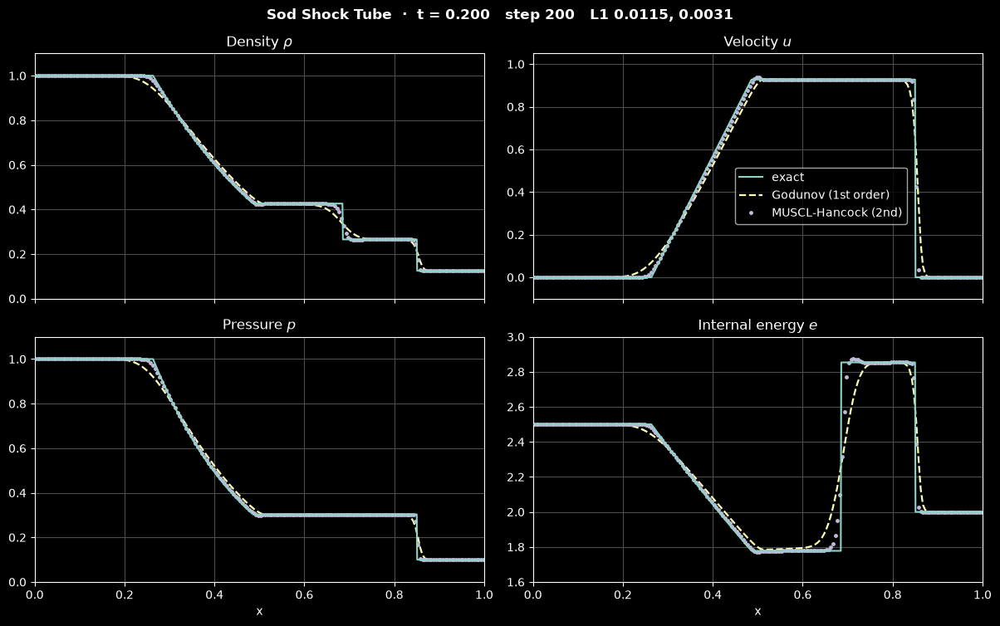

# Riemann Solvers and Godunov Methods

Compressible flow solvers for shocks have to compute fluxes between cells whose states can differ by a discontinuity. Godunov's idea was to treat every cell face as a small shock tube: the two adjacent cell averages define a Riemann problem, and its solution tells the face which waves cross it and therefore what flux to use. This note derives the wave structure of the 1D Euler equations, Godunov's method, the exact Riemann solver, the approximate solvers that replace it in practice (Rusanov, HLL, HLLC and Roe), second-order extensions with MUSCL reconstruction, and the time-step limit, using Sod's shock tube as the running test. The physics of the waves is in [Shock Waves and Expansion Fans](../../fluid_mechanics/compressible_flow/shock_waves.md); the finite-volume framework is in [Finite Volume Discretization](./discretization.md), and limiters for scalar convection are in [Convection Schemes](./convection_schemes.md).

## Problem Statement

The 1D Euler equations for an inviscid, non-conducting ideal gas in conservation form are

```math
\frac{\partial \mathbf{U}}{\partial t} + \frac{\partial \mathbf{F}(\mathbf{U})}{\partial x} = 0,
\qquad
\mathbf{U} = \begin{pmatrix} \rho \\ \rho u \\ E \end{pmatrix},
\qquad
\mathbf{F}(\mathbf{U}) = \begin{pmatrix} \rho u \\ \rho u^2 + p \\ (E + p)\,u \end{pmatrix}
```

with density $\rho$, velocity $u$, total energy per unit volume $E = \rho e + \frac{1}{2}\rho u^2$, specific internal energy $e$, and the equation of state $p = (\gamma - 1)\rho e$ with ratio of specific heats $\gamma$ ($\gamma = 1.4$ for air). The sound speed is $c = \sqrt{\gamma p/\rho}$.

The **Riemann problem** is this system on $-\infty < x < \infty$ with piecewise-constant initial data,

```math
\mathbf{U}(x, 0) = \begin{cases} \mathbf{U}_L, & x < 0, \\ \mathbf{U}_R, & x > 0. \end{cases}
```

Its solution depends only on $\xi = x/t$. Solutions with discontinuities are weak solutions, which satisfy the integral form of the conservation laws, and across a discontinuity moving at speed $S$ they obey the Rankine–Hugoniot conditions $\mathbf{F}(\mathbf{U}_R) - \mathbf{F}(\mathbf{U}_L) = S(\mathbf{U}_R - \mathbf{U}_L)$. Weak solutions are not unique; the physical one also satisfies an entropy condition, which rules out expansion shocks.

The numerical task is to compute cell averages $`\mathbf{U}_i^n`$ on a grid of cells $`[x_{i-1/2}, x_{i+1/2}]`$ of width $\Delta x$ at times $t^n$ for general initial and boundary data. A scheme is acceptable when it is conservative (so that, by the Lax–Wendroff theorem, a convergent scheme converges to a weak solution), converges to the entropy solution, captures shocks in a few cells without spurious oscillations, keeps density and pressure positive, and is accurate to second order or more where the solution is smooth. The difficulties are that the flux at a face depends on the waves arriving from both sides, that the waves can be discontinuous, and that no linear scheme of order higher than one is free of oscillations (Godunov's theorem).

## Characteristics and Wave Structure

For smooth solutions the system can be written in quasi-linear form $`\partial_t \mathbf{U} + \mathbf{A}(\mathbf{U})\,\partial_x \mathbf{U} = 0`$ with Jacobian $\mathbf{A} = \partial\mathbf{F}/\partial\mathbf{U}$. Its eigenvalues and right eigenvectors are

```math
\lambda_1 = u - c, \quad \lambda_2 = u, \quad \lambda_3 = u + c,
\qquad
\mathbf{K}_1 = \begin{pmatrix} 1 \\ u - c \\ H - uc \end{pmatrix},
\quad
\mathbf{K}_2 = \begin{pmatrix} 1 \\ u \\ \tfrac{1}{2}u^2 \end{pmatrix},
\quad
\mathbf{K}_3 = \begin{pmatrix} 1 \\ u + c \\ H + uc \end{pmatrix}
```

with total specific enthalpy $H = (E + p)/\rho$. The system is strictly hyperbolic: information travels along three families of characteristics, two acoustic ($u \pm c$) and one convected with the flow ($u$). The solution of a Riemann problem consists of three waves separating four constant states, $`\mathbf{U}_L`$, $`\mathbf{U}_{*L}`$, $\mathbf{U}_{*R}$ and $\mathbf{U}_R$:

| Wave | Family | What jumps | What is continuous | Speed |
| --- | --- | --- | --- | --- |
| Shock | 1 or 3 | $\rho$, $u$, $p$, entropy | mass, momentum and energy fluxes in the shock frame | $S$ from Rankine–Hugoniot; characteristics converge into it |
| Contact discontinuity | 2 | $\rho$, $e$, entropy | $u$ and $p$ | $u^*$; characteristics run parallel to it |
| Rarefaction fan | 1 or 3 | nothing: smooth, self-similar | entropy, a Riemann invariant | spreads between head $u_K \mp c_K$ and tail $`u^* \mp c_{*K}`$ |

The middle (star) region has the same pressure $`p^*`$ and velocity $`u^*`$ on both sides of the contact. A wave of family 1 or 3 is a shock if $p^* > p_K$ (the gas is compressed) and a rarefaction if $p^* \le p_K$.

For Sod's problem, $(\rho, u, p) = (1, 0, 1)$ on the left and $(0.125, 0, 0.1)$ on the right, the solution is a left rarefaction, a contact and a right shock with $p^* = 0.30313$ and $u^* = 0.92745$. At $t = 0.2$ with the diaphragm at $x = 0.5$, the rarefaction occupies $0.263 < x < 0.486$, the contact is at $x = 0.685$ and the shock at $x = 0.850$.

## Godunov's Method

Godunov (1959) assumed the solution to be piecewise constant over each cell at $t^n$, solved the resulting Riemann problems at all faces exactly, and averaged the result over each cell at $t^{n+1}$. Integrating the conservation law over $[x_{i-1/2}, x_{i+1/2}] \times [t^n, t^{n+1}]$ gives the exact update

```math
\mathbf{U}_i^{n+1} = \mathbf{U}_i^n - \frac{\Delta t}{\Delta x}\left(\mathbf{F}_{i+1/2} - \mathbf{F}_{i-1/2}\right),
\qquad
\mathbf{F}_{i+1/2} = \mathbf{F}\left(\mathbf{U}_{i+1/2}(0)\right)
```

where $\mathbf{U}_{i+1/2}(\xi)$ is the exact solution of the Riemann problem with data $`\mathbf{U}_i^n`$, $`\mathbf{U}_{i+1}^n`$, evaluated on the face $\xi = 0$. Because that solution is self-similar, the face state is constant in time as long as no wave from a neighbouring face reaches it, which holds for

```math
\Delta t \le \frac{\Delta x}{S_{\max}^n},
\qquad S_{\max}^n = \max_i\left(|u_i^n| + c_i^n\right)
```

(strictly, $S_{\max}$ is the fastest wave speed of the face Riemann problems, which can exceed the largest $|u| + c$ of the cell averages). The scheme is first-order accurate, conservative, and upwind in the sense that every wave is taken from the side it comes from. It is the starting point of all the schemes below, which change either the Riemann solver or the piecewise-constant data.

## The Exact Riemann Solver

The star pressure is the root of the pressure function of Toro (2009, chapter 4):

```math
f(p) = f_L(p) + f_R(p) + u_R - u_L = 0,
\qquad
f_K(p) =
\begin{cases}
(p - p_K)\left(\dfrac{A_K}{p + B_K}\right)^{1/2}, & p > p_K \ \ \text{(shock)}, \\[2ex]
\dfrac{2c_K}{\gamma - 1}\left[\left(\dfrac{p}{p_K}\right)^{(\gamma - 1)/2\gamma} - 1\right], & p \le p_K \ \ \text{(rarefaction)},
\end{cases}
```

with $A_K = 2/((\gamma + 1)\rho_K)$ and $B_K = (\gamma - 1)p_K/(\gamma + 1)$, for $K = L, R$. The shock branch comes from the Rankine–Hugoniot conditions and the rarefaction branch from the isentropic relation and the Riemann invariant $u + 2c/(\gamma - 1)$. Once $p^*$ is known,

```math
u^* = \tfrac{1}{2}(u_L + u_R) + \tfrac{1}{2}\left[f_R(p^*) - f_L(p^*)\right]
```

The function $f$ is monotonically increasing and concave, so Newton's method converges from any positive starting value; Toro's primitive-variable estimate $`p_0 = \max\left(\varepsilon,\ \tfrac{1}{2}(p_L + p_R) - \tfrac{1}{8}(u_R - u_L)(\rho_L + \rho_R)(c_L + c_R)\right)`$ is a good one. For Sod's problem $p_0 = 0.55$ and the iterates are 0.24554, 0.29841, 0.30310 and 0.30313. A positive solution exists only if $u_R - u_L < 2(c_L + c_R)/(\gamma - 1)$; otherwise the two rarefactions leave a vacuum between them.

The solution is then sampled at $\xi$: on the side of the contact $`\xi < u^*`$ or $`\xi > u^*`$, the state is undisturbed ahead of the wave, equal to the star state behind it (Rankine–Hugoniot density behind a shock, isentropic density $\rho_K(p^*/p_K)^{1/\gamma}$ behind a rarefaction), or the fan state inside a rarefaction. The shock speed of the right wave, for example, is

```math
S_R = u_R + c_R\left[\frac{\gamma + 1}{2\gamma}\frac{p^*}{p_R} + \frac{\gamma - 1}{2\gamma}\right]^{1/2}
```

which is 1.7522 for Sod's problem. The exact solver is robust and gives the least diffusive first-order scheme, but every face needs a Newton iteration with fractional powers, and it is specific to the ideal-gas equation of state. Approximate solvers avoid both problems.

## Approximate Riemann Solvers

Most of the flux comes from the waves that cross the face, and a first-order scheme smears the details of the fan anyway, so it is enough to model the Riemann solution with a few waves. The solvers below need estimates of the slowest and fastest signal speeds, $S_L$ and $S_R$. The simplest are those of Davis (1988),

$$
S_L = \min(u_L - c_L,\ u_R - c_R),
\qquad S_R = \max(u_L + c_L,\ u_R + c_R)
$$

Estimates built from the Roe averages, due to Einfeldt, make HLL positivity-preserving (Einfeldt et al. 1991); pressure-based estimates from an approximate $p^*$ (Toro 2009, chapter 10) are sharper for strong shocks.

### Rusanov (Local Lax–Friedrichs)

The Rusanov flux uses a single speed $S^+ = \max(|S_L|, |S_R|)$:

```math
\mathbf{F}_{i+1/2} = \tfrac{1}{2}\left(\mathbf{F}_L + \mathbf{F}_R\right) - \tfrac{1}{2}S^+\left(\mathbf{U}_R - \mathbf{U}_L\right)
```

It is a central flux plus scalar dissipation proportional to the fastest wave speed. It is very robust, needs no knowledge of the eigenstructure, and extends to any hyperbolic system, which makes it common in high-order discontinuous Galerkin codes. All waves receive the dissipation of the fastest one, so contacts and slow waves are smeared most.

### HLL

Harten, Lax and van Leer (1983) assumed two waves of speeds $S_L$ and $S_R$ enclosing one constant intermediate state. Applying the integral conservation law to the wave fan gives that state as $`\mathbf{U}^{\mathrm{hll}} = (S_R\mathbf{U}_R - S_L\mathbf{U}_L - \mathbf{F}_R + \mathbf{F}_L)/(S_R - S_L)`$, and the flux

```math
\mathbf{F}^{\mathrm{hll}} =
\begin{cases}
\mathbf{F}_L, & 0 \le S_L, \\[1ex]
\dfrac{S_R\mathbf{F}_L - S_L\mathbf{F}_R + S_LS_R\left(\mathbf{U}_R - \mathbf{U}_L\right)}{S_R - S_L}, & S_L < 0 < S_R, \\[2ex]
\mathbf{F}_R, & 0 \ge S_R.
\end{cases}
```

HLL is upwind for supersonic faces, positivity-preserving with suitable speed estimates, and resolves isolated shocks well. With $S_L = -S_R$ it reduces to Rusanov. Its single intermediate state cannot represent the density jump at a contact or the velocity jump at a shear layer, which it diffuses.

### HLLC

Toro, Spruce and Speares (1994) restored the missing middle wave. The contact moves at

```math
S_* = \frac{p_R - p_L + \rho_L u_L(S_L - u_L) - \rho_R u_R(S_R - u_R)}{\rho_L(S_L - u_L) - \rho_R(S_R - u_R)}
```

and the two star states, obtained from the Rankine–Hugoniot conditions across the outer waves with $u = S_*$ and equal pressures on both sides, are

```math
\mathbf{U}_{*K} = \rho_K\frac{S_K - u_K}{S_K - S_*}
\begin{pmatrix}
1 \\ S_* \\ \dfrac{E_K}{\rho_K} + (S_* - u_K)\left(S_* + \dfrac{p_K}{\rho_K(S_K - u_K)}\right)
\end{pmatrix},
\qquad K = L, R
```

The flux is $\mathbf{F}_L$ for $S_L \ge 0$, $`\mathbf{F}_L + S_L(\mathbf{U}_{*L} - \mathbf{U}_L)`$ for $`S_L < 0 \le S_*`$, $`\mathbf{F}_R + S_R(\mathbf{U}_{*R} - \mathbf{U}_R)`$ for $`S_* < 0 < S_R`$, and $`\mathbf{F}_R`$ for $`S_R \le 0`$. A stationary contact ($`u_L = u_R = 0`$, $`p_L = p_R`$) gives $`S_* = 0`$ and the exact flux $(0, p, 0)$, so it is preserved exactly. In multiple dimensions the tangential velocity is carried with the contact, which resolves slip lines. HLLC is the default in many compressible codes.

### Roe

Roe (1981) replaced the nonlinear problem with the linear one $`\partial_t \mathbf{U} + \tilde{\mathbf{A}}\,\partial_x \mathbf{U} = 0`$ for a constant matrix $\tilde{\mathbf{A}}(\mathbf{U}_L, \mathbf{U}_R)$ chosen so that $\mathbf{F}_R - \mathbf{F}_L = \tilde{\mathbf{A}}(\mathbf{U}_R - \mathbf{U}_L)$ holds exactly; this makes an isolated shock or contact an exact solution of the linearized problem. For the Euler equations $\tilde{\mathbf{A}}$ is the Jacobian evaluated at the Roe averages

```math
\tilde u = \frac{\sqrt{\rho_L}\,u_L + \sqrt{\rho_R}\,u_R}{\sqrt{\rho_L} + \sqrt{\rho_R}},
\qquad
\tilde H = \frac{\sqrt{\rho_L}\,H_L + \sqrt{\rho_R}\,H_R}{\sqrt{\rho_L} + \sqrt{\rho_R}},
\qquad
\tilde c^2 = (\gamma - 1)\left(\tilde H - \tfrac{1}{2}\tilde u^2\right)
```

and the flux is

```math
\mathbf{F}^{\mathrm{roe}} = \tfrac{1}{2}\left(\mathbf{F}_L + \mathbf{F}_R\right) - \tfrac{1}{2}\sum_{k=1}^{3}\tilde\alpha_k\,|\tilde\lambda_k|\,\tilde{\mathbf{K}}_k
```

with $\tilde\lambda_k$ and $\tilde{\mathbf{K}}_k$ the eigenvalues and eigenvectors above evaluated with the averages, and the wave strengths $\tilde\alpha_k$ the coefficients of $\mathbf{U}_R - \mathbf{U}_L = \sum_k \tilde\alpha_k\tilde{\mathbf{K}}_k$:

```math
\tilde\alpha_2 = \frac{\gamma - 1}{\tilde c^2}\left[\Delta U_1(\tilde H - \tilde u^2) + \tilde u\,\Delta U_2 - \Delta U_3\right],
\quad
\tilde\alpha_1 = \frac{\Delta U_1(\tilde u + \tilde c) - \Delta U_2 - \tilde c\,\tilde\alpha_2}{2\tilde c},
\quad
\tilde\alpha_3 = \Delta U_1 - \tilde\alpha_1 - \tilde\alpha_2
```

The linearized solution consists of discontinuities only. At a transonic rarefaction, where an acoustic eigenvalue changes sign inside the fan, $|\tilde\lambda| \approx 0$ removes all dissipation for that wave and the scheme can keep an entropy-violating expansion shock. Harten's entropy fix (1983) replaces $|\tilde\lambda|$ by $(\tilde\lambda^2 + \delta^2)/(2\delta)$ when $|\tilde\lambda| < \delta$, with $\delta$ a small fraction of $|\tilde u| + \tilde c$ or a value based on the wave speeds on both sides. Roe's flux resolves contacts and shocks as sharply as the exact solver at a fraction of the cost, but as a linearization it is not positivity-preserving: for strong expansions such as the 123 problem of Toro (two rarefactions moving apart) it can produce negative density or pressure, where HLL-type fluxes stay positive (Einfeldt et al. 1991).

### Comparison


The figure shows the first-order Godunov scheme on 100 cells with five face fluxes. All five give nearly the same rarefaction and shock; they differ at the contact (top right), where the exact solver, Roe and HLLC give the same profile, HLL spreads the jump further, and Rusanov spreads it furthest. In Toro's test 3, a blast wave with a pressure ratio of $10^5$, the shocked shell between contact and shock is 0.047 wide at $t = 0.012$, less than five cells, so no first-order scheme reaches its density of 6: the peak is about 4.4 for the contact-resolving fluxes and 3.7 for Rusanov.


Under refinement the L1 density error of every solver falls with slopes between 0.45 and 0.66, less than first order because a contact smears over a width that grows like $`\sqrt{t\,\Delta x}`$, which gives an L1 error of order $\Delta x^{1/2}$; shocks and rarefactions converge at first order. Rusanov needs roughly twice as many cells as HLLC or Roe for the same error on Sod's problem.

| Solver | Waves modelled | Contact and shear | Positivity | Entropy fix | Relative cost |
| --- | --- | --- | --- | --- | --- |
| Exact | three, nonlinear | exact | yes (vacuum detected) | not needed | highest (Newton iteration per face) |
| Rusanov | one speed | smeared most | yes | not needed | lowest |
| HLL | two | smeared | yes, with suitable speeds | not needed | low |
| HLLC | three | resolved | yes, with suitable speeds | not needed | low |
| Roe | three, linearized | resolved | no | needed at sonic points | moderate (eigen-decomposition) |

## Higher Order: MUSCL Reconstruction

By Godunov's theorem, second order without oscillations requires a nonlinear scheme. Van Leer's MUSCL approach (1979) keeps the Riemann solver and replaces the piecewise-constant data by limited linear reconstructions. In each cell,

```math
\mathbf{U}_i(x) = \mathbf{U}_i + \frac{x - x_i}{\Delta x}\,\boldsymbol{\Delta}_i,
\qquad
\boldsymbol{\Delta}_i = \phi\left(\mathbf{U}_i - \mathbf{U}_{i-1},\ \mathbf{U}_{i+1} - \mathbf{U}_i\right)
```

where the limiter $\phi$ (minmod, van Leer, monotonised central or superbee, applied componentwise) returns zero at extrema and a slope bounded by the neighbouring differences elsewhere; the limiters and the TVD conditions they satisfy are derived for scalar convection in [Convection Schemes](./convection_schemes.md). The face values $`\mathbf{U}_{i+1/2}^L = \mathbf{U}_i + \tfrac12\boldsymbol\Delta_i`$ and $`\mathbf{U}_{i+1/2}^R = \mathbf{U}_{i+1} - \tfrac12\boldsymbol\Delta_{i+1}`$ are passed to the Riemann solver. Reconstructing primitive variables $(\rho, u, p)$ keeps the pressure positive more easily, and reconstructing characteristic variables gives the cleanest results for strong waves.

Second order in time follows in one of two ways:

1. MUSCL–Hancock (Toro 2009, chapter 14): evolve both face values of every cell by half a time step with the physical flux, $`\bar{\mathbf{U}}_i^{L,R} = \mathbf{U}_i^{L,R} + \frac{\Delta t}{2\Delta x}\left[\mathbf{F}(\mathbf{U}_i^L) - \mathbf{F}(\mathbf{U}_i^R)\right]`$, then solve the Riemann problems with the evolved values and apply the Godunov update once. One flux evaluation per step, stable for $C \le 1$.
2. Method of lines: treat the reconstructed-flux difference as $d\mathbf{U}_i/dt = L(\mathbf{U})$ and integrate with a strong-stability-preserving Runge–Kutta scheme. Heun's method (SSP-RK2) $`\mathbf{U}^{(1)} = \mathbf{U}^n + \Delta t L(\mathbf{U}^n)`$, $`\mathbf{U}^{n+1} = \tfrac12\mathbf{U}^n + \tfrac12\left[\mathbf{U}^{(1)} + \Delta t L(\mathbf{U}^{(1)})\right]`$ is a convex combination of forward-Euler steps, so it keeps the TVD property that a forward-Euler step of the limited scheme has, which for MUSCL with the usual limiters requires $C \le 1/2$. It extends directly to unstructured meshes and to higher orders (WENO reconstruction with SSP-RK3); see [Time Integration](../cfd/time_integration.md).



The Sod shock-tube simulation runs both a first-order Godunov scheme and MUSCL–Hancock with the van Leer limiter, both with HLLC fluxes, on 200 cells. At $t = 0.2$ the first-order scheme spreads the contact over 15 cells and the shock over 5, MUSCL–Hancock over 5 and 2, and the L1 density error falls from 0.0115 to 0.0031. The limiter leaves a small overshoot in the internal energy just behind the contact.

## Time Step and CFL Condition

For the Euler equations the CFL number is based on the fastest signal speed,

```math
C = \frac{\Delta t\,\max_i\left(|u_i| + c_i\right)}{\Delta x} \le C_{\max}
```

$C_{\max} = 1$ for the first-order Godunov scheme and for MUSCL–Hancock in 1D, with $C = 0.8$–0.9 used in practice. MUSCL reconstruction with SSP-RK2 is TVD for $C \le 1/2$ with the usual limiters, and the forward-step simulation uses 0.45. In 2D an unsplit finite-volume scheme needs $`\Delta t\left[(|u| + c)/\Delta x + (|v| + c)/\Delta y\right] \le C_{\max}`$, roughly half the 1D time step on square cells. Two details matter in practice. At the start of a shock-tube run the cell averages are at rest, so $\max(|u| + c)$ underestimates the speed of the waves about to form (in Sod's problem $`u^* + c_{*R} = 2.19`$ behind the shock against $c_L = 1.18$ initially); codes either use a reduced CFL number for the first few steps or estimate the speeds from the face Riemann problems. And a fixed time step, convenient for animations, must be checked against the CFL limit every step.

## The Sod Problem and Other Tests

Sod (1978) compared the finite-difference schemes of the time on this problem, and it remains the first test of any compressible solver because it contains all three wave types with moderate strengths and an exact solution. What to look for:

- the plateau values $p^* = 0.30313$, $u^* = 0.92745$, $\rho_{*L} = 0.42632$ and $\rho_{*R} = 0.26557$;
- the number of cells over which the contact and the shock are spread, and whether the spreading of the contact grows in time (it does for every first-order scheme);
- oscillations at the shock and at the tail of the rarefaction, and overshoots of internal energy at the contact;
- correct shock position, which tests conservation: a non-conservative scheme puts the shock in the wrong place.

The five tests of Toro (2009, chapter 4) probe the weaknesses that Sod's problem does not:

| Test | Left state $(\rho, u, p)$ | Right state $(\rho, u, p)$ | $p^*$ | What it probes |
| --- | --- | --- | --- | --- |
| 1 (Sod) | (1, 0, 1) | (0.125, 0, 0.1) | 0.30313 | basic wave capturing |
| 2 (123 problem) | (1, −2, 0.4) | (1, 2, 0.4) | 0.00189 | near-vacuum, positivity |
| 3 | (1, 0, 1000) | (1, 0, 0.01) | 460.894 | strong shock, thin shell |
| 4 | (1, 0, 0.01) | (1, 0, 100) | 46.0950 | strong shock, mirrored |
| 5 | (5.99924, 19.5975, 460.894) | (5.99242, −6.19633, 46.0950) | 1691.64 | collision of two strong shocks |

Toro also uses a modified Sod problem with $u_L = 0.75$, whose left rarefaction is transonic and exposes a missing entropy fix as a jump inside the fan.

## Multidimensional Problems

In 2D and 3D the same machinery is applied face by face: the states on both sides of a face are rotated into face-normal and tangential components, the 1D Riemann problem is solved in the normal direction, and the tangential momentum is carried with the contact. The [Supersonic Forward-Facing Step](../../../scripts/simulations/supersonic_forward_facing_step/) simulation does exactly this for the Mach 3 wind-tunnel problem of Woodward and Colella (1984): MUSCL reconstruction of the primitive variables with the monotonised-central limiter, HLLC fluxes, SSP-RK2 with a CFL limit of 0.45, reflecting ghost cells at the walls, and a fallback to first order where the reconstruction would produce a negative density or pressure. Its tests run the same solver on Sod's problem along both axes against the exact solution. Grid-aligned shocks in 2D can show the carbuncle instability with contact-resolving fluxes such as Roe and HLLC; hybrid fluxes that switch to HLL near strong shocks are a common remedy.

## Key Takeaways

- The Riemann problem of the Euler equations produces three waves: two acoustic waves (shocks or rarefactions) and a contact, separating star states with common $`p^*`$ and $`u^*`$.
- Godunov's method solves a Riemann problem at every face; it is conservative, upwind and first order, with the time step limited by $C = \Delta t\max(|u| + c)/\Delta x \le 1$.
- The exact solver finds $p^*$ by Newton iteration on Toro's pressure function; it is the reference, but approximate solvers are cheaper and more general.
- Rusanov and HLL smear contacts; HLLC and Roe resolve them. Roe needs an entropy fix and can fail in near-vacuum flows; HLL-type fluxes keep positivity.
- Second order without oscillations requires limited reconstruction (MUSCL) with MUSCL–Hancock or SSP Runge–Kutta time stepping.
- Discontinuous solutions converge at less than first order in L1 for any scheme; compare schemes at fixed resolution on standard tests such as Sod's.

## Related Scripts

- [Sod Shock Tube](../../../scripts/simulations/sod_shock_tube/): animates Sod's shock tube, the standard test of compressible-flow solvers, computed with a first-order Godunov scheme and a second-order MUSCL–Hancock scheme and compared with the exact Riemann solution at every frame.
- [Riemann Solver Comparison](../../../scripts/algorithms/riemann_solver_comparison/): compares five Riemann solvers inside the same first-order Godunov finite-volume scheme for the 1D Euler equations: the exact solver, Rusanov (local Lax–Friedrichs), HLL, HLLC and Roe with Harten's entropy fix.
- [Supersonic Forward-Facing Step](../../../scripts/simulations/supersonic_forward_facing_step/): solves the 2D compressible Euler equations for a Mach 3 stream that meets a forward-facing step in a wind tunnel, the benchmark of Woodward and Colella (1984), and animates the shock pattern that forms.
- [TVD Limiters for Linear Advection](../../../scripts/algorithms/tvd_limiters_advection/): advects a Gaussian, a square wave and a triangle once around a periodic domain with first-order upwind, Lax–Wendroff and flux-limited TVD schemes, and shows the trade-off that Godunov's theorem forces on linear schemes.

## Exercises

**Exercise 1.** For Sod's problem ($\gamma = 1.4$) with $p^* = 0.30313$ and $u^* = 0.92745$, compute the sound speeds $c_L$ and $c_R$, the speeds of the head and tail of the rarefaction, the shock speed, and the positions of all waves at $t = 0.2$ for a diaphragm at $x = 0.5$.

<details>
<summary>Answer</summary>

$c_L = \sqrt{1.4} = 1.1832$ and $c_R = \sqrt{1.4 \times 0.1/0.125} = 1.0583$.

The head moves at $u_L - c_L = -1.1832$. Behind the fan, $`c_{*L} = c_L(p^*/p_L)^{(\gamma - 1)/2\gamma} = 1.1832 \times 0.30313^{1/7} = 0.9977`$, so the tail moves at $`u^* - c_{*L} = -0.0703`$.

The shock speed is $S_R = 1.0583\sqrt{(2.4/2.8)(3.0313) + 0.4/2.8} = 1.7522$.

At $t = 0.2$: head at $0.5 - 0.2366 = 0.2634$, tail at $0.4859$, contact at $0.5 + 0.1855 = 0.6855$, shock at $0.8504$.

</details>

**Exercise 2.** At the diaphragm of Sod's problem at $t = 0$, compute the mass flux given by (a) the Rusanov flux with Davis speeds and (b) the HLL flux with the same speeds. Explain why they coincide here. The exact Godunov mass flux is 0.3954; which is more diffusive?

<details>
<summary>Answer</summary>

Both states are at rest, so $S_L = \min(-c_L, -c_R) = -1.1832$ and $S_R = 1.1832$. The physical mass fluxes vanish.

(a) Rusanov: $`-\tfrac12 S^+(\rho_R - \rho_L) = -\tfrac12 \times 1.1832 \times (0.125 - 1) = 0.5177`$.

(b) HLL: $`S_LS_R(\rho_R - \rho_L)/(S_R - S_L) = (-1.4)(-0.875)/2.3664 = 0.5177`$.

With $S_L = -S_R$ the HLL formula reduces to the Rusanov formula. Both overestimate the exact mass flux 0.3954 by 31 %; the excess is numerical diffusion of density from the dense to the light gas, which is what smears the contact.

</details>

**Exercise 3.** Compute the Roe averages $\tilde u$, $\tilde H$ and $\tilde c$ for the two Sod states, and the eigenvalues of the Roe matrix. Is an entropy fix needed at this face?

<details>
<summary>Answer</summary>

$H_L = (E_L + p_L)/\rho_L = (2.5 + 1)/1 = 3.5$ and $H_R = (0.25 + 0.1)/0.125 = 2.8$. With $\sqrt{\rho_L} = 1$ and $\sqrt{\rho_R} = 0.35355$: $\tilde u = 0$ and $\tilde H = (3.5 + 0.35355 \times 2.8)/1.35355 = 3.3172$, so $\tilde c = \sqrt{0.4 \times 3.3172} = 1.1519$.

The eigenvalues are $-1.1519$, $0$ and $1.1519$. The zero eigenvalue belongs to the contact, which needs no fix (a stationary contact is a correct solution). The acoustic eigenvalues are far from zero, so Harten's fix does not act. The fix matters only at a face inside a transonic rarefaction, where $u - c$ or $u + c$ changes sign.

</details>

**Exercise 4.** Starting from Toro's primitive-variable estimate, carry out the Newton iteration for $p^*$ in Sod's problem. Which branch of $f_L$ and $f_R$ applies at each iterate?

<details>
<summary>Answer</summary>

$`p_0 = \tfrac12(1 + 0.1) - \tfrac18 \times 0 = 0.55`$. Newton's method $p_{k+1} = p_k - f(p_k)/f'(p_k)$ gives 0.24554, 0.29841, 0.30310 and 0.30313, where the relative change falls below $10^{-6}$.

At $p_0 = 0.55$ we have $p < p_L = 1$ (rarefaction branch for the left wave) and $p > p_R = 0.1$ (shock branch for the right wave). Every later iterate lies between 0.1 and 1, so the branches stay the same: a left rarefaction and a right shock.

</details>

**Exercise 5.** A Sod simulation uses 200 cells on $[0, 1]$ and a fixed time step. The fastest signal in the exact solution is $`u^* + c_{*R} = 2.19`$ just behind the shock. What is the largest time step for $C = 0.9$, and how many steps reach $t = 0.2$? If the time step were instead chosen from the initial cell averages, $`\Delta t = 0.9\,\Delta x/c_L`$, what CFL number would the waves actually see once the shock has formed?

<details>
<summary>Answer</summary>

$\Delta x = 0.005$, so $\Delta t = 0.9 \times 0.005/2.19 = 2.05 \times 10^{-3}$, and $t = 0.2$ takes 98 steps (the simulation in this repository uses $\Delta t = 10^{-3}$, CFL 0.44, and 200 steps).

From the initial data, $\Delta t = 0.9 \times 0.005/1.1832 = 3.80 \times 10^{-3}$. Behind the shock the CFL number would then be $2.19 \times 3.80 \times 10^{-3}/0.005 = 1.67$, above the stability limit of 1. This is why codes reduce the CFL number in the first steps or recompute the time step from the current solution every step.

</details>

## References

- Godunov, S. K. "A difference method for numerical calculation of discontinuous solutions of the equations of hydrodynamics." *Matematicheskii Sbornik*, 47(89), 271–306, 1959.
- Sod, G. A. "A survey of several finite difference methods for systems of nonlinear hyperbolic conservation laws." *Journal of Computational Physics*, 27(1), 1–31, 1978.
- van Leer, B. "Towards the ultimate conservative difference scheme. V. A second-order sequel to Godunov's method." *Journal of Computational Physics*, 32(1), 101–136, 1979.
- Roe, P. L. "Approximate Riemann solvers, parameter vectors, and difference schemes." *Journal of Computational Physics*, 43(2), 357–372, 1981.
- Harten, A. "High resolution schemes for hyperbolic conservation laws." *Journal of Computational Physics*, 49(3), 357–393, 1983.
- Harten, A., Lax, P. D., and van Leer, B. "On upstream differencing and Godunov-type schemes for hyperbolic conservation laws." *SIAM Review*, 25(1), 35–61, 1983.
- Davis, S. F. "Simplified second-order Godunov-type methods." *SIAM Journal on Scientific and Statistical Computing*, 9(3), 445–473, 1988.
- Einfeldt, B., Munz, C. D., Roe, P. L., and Sjögreen, B. "On Godunov-type methods near low densities." *Journal of Computational Physics*, 92(2), 273–295, 1991.
- Toro, E. F., Spruce, M., and Speares, W. "Restoration of the contact surface in the HLL-Riemann solver." *Shock Waves*, 4(1), 25–34, 1994.
- Toro, E. F. *Riemann Solvers and Numerical Methods for Fluid Dynamics: A Practical Introduction*, 3rd ed. Springer, 2009.
- LeVeque, R. J. *Finite Volume Methods for Hyperbolic Problems*. Cambridge University Press, 2002.
