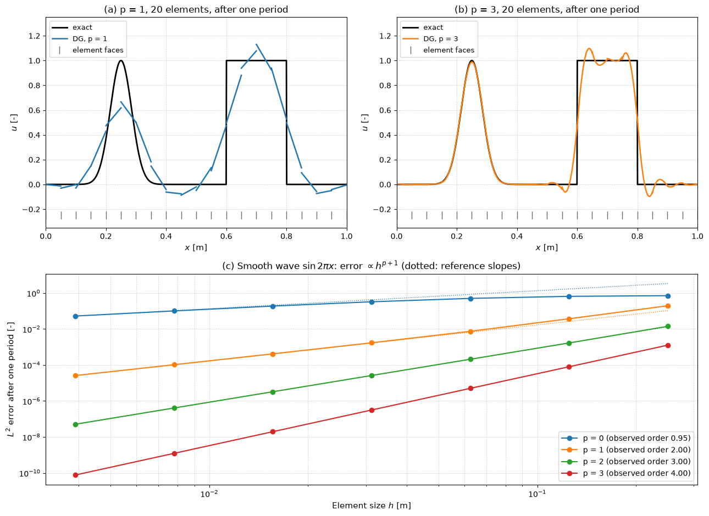

# High-Order Methods: Spectral and Discontinuous Galerkin

Second-order finite volume and finite difference schemes are the workhorses of industrial CFD because they are robust on any mesh and on any solution, smooth or not. When the solution is smooth and must be resolved over many wavelengths, as in direct and large-eddy simulation of turbulence, aeroacoustics, wave propagation and long-time integration of vortical flows, their error falls too slowly with the number of unknowns, and high-order methods reach the same accuracy with far fewer degrees of freedom. This note covers the two main families: spectral methods, which expand the solution in global Fourier or Chebyshev series and converge faster than any power of the number of unknowns, and discontinuous Galerkin (DG) methods, which use high-degree polynomials inside each element of an unstructured mesh and couple neighbouring elements through numerical fluxes. The spectral element method sits between them.

The note builds on the modified-wavenumber analysis in [Systematic Finite-Difference Discretization](../fdm/discretization.md#modified-wavenumber-analysis) and on the Galerkin method in [Finite Element Method](../fem/intro.md). The numerical fluxes used by DG are those of [Riemann Solvers](../fvm/riemann_solvers.md).

## Problem Statement

Consider a smooth solution of an evolution equation, with the periodic linear advection equation as the model,

```math
\frac{\partial u}{\partial t} + a\, \frac{\partial u}{\partial x} = 0,
\qquad x \in [0, L) \text{ periodic},
\qquad u(x, 0) = u_0(x)
```

and the related task of computing $\partial u/\partial x$ from samples of $u$. The question is how to reach a prescribed error $\varepsilon$ (in the derivative, or in $u$ after a given time) with the smallest number of degrees of freedom $N$ and the least work. A method of order $p$ has an error of about $CN^{-p}$, so it needs $N \approx (C/\varepsilon)^{1/p}$ unknowns per dimension and $N^d$ in $d$ dimensions. A spectral method for an analytic solution has an error of about $Ce^{-\alpha N}$ and needs $N \approx \alpha^{-1}\ln(C/\varepsilon)$. What makes this hard:

- spectral accuracy requires smooth (analytic) solutions and simple, usually periodic or box-shaped, domains;
- products of the unknowns in nonlinear terms create wavenumbers the grid cannot represent (aliasing), which can destabilize the computation;
- at discontinuities and under-resolved features every high-order expansion oscillates (the Gibbs phenomenon) and the convergence rate collapses;
- explicit time steps shrink faster than for low-order methods: like $N^{-2}$ for Chebyshev advection and $h/(2p + 1)$ for DG.

## Order Versus Cost

The [Spectral vs Finite-Difference Differentiation](../../../scripts/algorithms/spectral_vs_finite_difference/) script differentiates $f(x) = e^{\sin x}$ on $[0, 2\pi)$. The number of points needed for a maximum error below $10^{-6}$ is:

| Method | Points in 1D | Points in 3D |
| --- | --- | --- |
| Central differences, 2nd order | 5176 | $1.4 \times 10^{11}$ |
| Central differences, 4th order | 190 | $6.9 \times 10^{6}$ |
| Fourier spectral | 16 | 4096 |

The cost per point of the high-order methods is larger (a wider stencil, an FFT, or a dense element operator), but it is nowhere near the factors in the table. For under-resolved or discontinuous solutions the advantage disappears, which is why high-order methods are used where the physics is smooth and the resolution requirement is set by the range of scales.


Panels (a) and (b) show the same errors on log–log and on semilog axes. The finite-difference errors are straight lines of slope $-2$ and $-4$ on the log–log plot (algebraic convergence); the Fourier error is close to a straight line on the semilog plot (exponential convergence) and reaches round-off, $3 \times 10^{-15}$, at $N = 32$. Chebyshev collocation of the non-periodic function $e^x\sin 4x$ on $[-1, 1]$ behaves the same way. Panels (c) and (d) are discussed under non-smooth solutions below.

## Fourier Spectral Methods

### Collocation and FFT Differentiation

On $N$ equispaced points $x_j = 2\pi j/N$ (for even $N$), the discrete Fourier transform

```math
\hat u_k = \frac{1}{N}\sum_{j=0}^{N-1} u_j\,e^{-\mathrm{i}kx_j},
\qquad
I_N u(x) = \sum_{k=-N/2}^{N/2} {}^{\prime}\ \hat u_k\,e^{\mathrm{i}kx}
```

defines the trigonometric interpolant $I_N u$, which matches $u$ at every grid point (the prime means that the two Nyquist terms $k = \pm N/2$ are halved). Its derivative has coefficients $\mathrm{i}k\hat u_k$. The algorithm is:

1. compute $\hat u_k$ with the FFT, $O(N\log N)$ operations;
2. multiply by $\mathrm{i}k$, and set the Nyquist coefficient $k = N/2$ to zero, because the derivative $-(N/2)\sin(Nx/2)$ of the Nyquist mode $\cos(Nx/2)$ vanishes at every grid point;
3. transform back with the inverse FFT.

The same operation is a dense matrix,

```math
D_{ij} = \tfrac12(-1)^{i-j}\cot\left(\frac{x_i - x_j}{2}\right) \quad (i \ne j), \qquad D_{ii} = 0
```

which is the limit of central finite-difference stencils as their width grows to the whole grid. In the language of the modified wavenumber, $k_{\mathrm{eff}} = k$ exactly for all $|k| < N/2$: there is no dispersion error for any resolved mode. Fourier methods with collocation of the nonlinear terms in physical space are called pseudo-spectral methods; Fourier–Galerkin methods compute the same terms in coefficient space.

### Spectral Accuracy

The error of the spectral derivative is set by the coefficients the grid cannot carry. If $u$ has $m - 1$ continuous derivatives and an $m$-th derivative of bounded variation, then $|\hat u_k| = O(|k|^{-m-1})$ and the derivative error is $O(N^{-m+1})$: the method is as accurate as the function is smooth. If $u$ is analytic in the strip $`|\mathrm{Im}\,x| < \sigma`$, then $|\hat u_k| = O(e^{-\sigma|k|})$ and the error falls like $e^{-\sigma N/2}$, which is the exponential convergence of panel (b). The function $e^{\sin x}$ is analytic in the whole complex plane, so its coefficients decay even faster than exponentially.

### Aliasing and the 3/2 Rule

On $N$ grid points the modes $e^{\mathrm{i}kx}$ and $e^{\mathrm{i}(k \pm N)x}$ take the same values, so any wavenumber outside $[-N/2, N/2)$ is indistinguishable from one inside. A quadratic term such as $`u\,\partial u/\partial x`$ in the Navier–Stokes equations produces wavenumbers up to $k_1 + k_2$, twice the largest one represented; computed pointwise on the grid, these are folded back onto resolved modes. The product $\cos 5x\cos 6x = (\cos x + \cos 11x)/2$ on 16 points shows mode 11 appearing at $11 - 16 = -5$, with the spurious coefficient $|\hat c_5| = 0.25$. Aliasing errors do not decrease with time and can feed an instability in under-resolved turbulence simulations.

The two standard remedies remove the aliased part of quadratic terms exactly:

- The **3/2 rule** pads the coefficients of both factors with zeros to $M \ge 3N/2$ points, transforms them, multiplies on the finer grid, transforms back and keeps the $N$ original modes. The aliases of the retained modes then fall on the padded, discarded modes. In the example the coefficient at $k = 5$ becomes zero while $|\hat c_1| = 0.25$ is unchanged.
- The **2/3 rule** truncates every field to the modes $|k| \le N/3$ and multiplies on the original grid. The [Decaying 2D Turbulence](../../../scripts/simulations/decaying_2d_turbulence/) simulation uses this rule.

The rules, due to Orszag (1971), cost a factor of about $(3/2)^d$ in the transforms. Skew-symmetric and other split forms of the convection term reduce, but do not remove, aliasing-driven instability.

### Non-Smooth Solutions and the Gibbs Phenomenon

For $f = |\sin x|$ the coefficients decay only like $k^{-2}$ and $f'$ has jumps at $x = 0$ and $\pi$. Panel (c) shows that the Fourier method then converges at the same rate as finite differences: the RMS error of $f'$ falls like $N^{-1/2}$ for all three methods, with errors between $7.1 \times 10^{-3}$ and $9.9 \times 10^{-3}$ at $N = 8193$. Panel (d) shows the Fourier derivative oscillating on both sides of each jump. The overshoot near a jump of a truncated Fourier series tends to about 9% of the jump height and does not shrink as $N$ grows; it only becomes narrower. A finite-difference derivative smears the jump over a cell instead. This is why spectral methods are rarely used for flows with shocks without additional filtering or shock capturing.

## Chebyshev Collocation for Non-Periodic Problems

Most domains are not periodic. Polynomial interpolation on equispaced points diverges for many smooth functions (the Runge phenomenon), but interpolation on points clustered near the ends converges exponentially. The Chebyshev–Gauss–Lobatto points are

```math
x_j = \cos\left(\frac{\pi j}{N}\right), \quad j = 0, \dots, N,
\qquad
T_k(\cos\theta) = \cos(k\theta)
```

The substitution $x = \cos\theta$ turns a Chebyshev series $\sum a_kT_k(x)$ into a Fourier cosine series in $\theta$, so the FFT applies and the convergence theory carries over. The derivative of the interpolant is again a matrix,

```math
D_{ij} = \frac{c_i}{c_j}\,\frac{(-1)^{i+j}}{x_i - x_j} \quad (i \ne j),
\qquad
D_{ii} = -\sum_{j \ne i} D_{ij},
\qquad
c_0 = c_N = 2, \ c_j = 1 \text{ otherwise}
```

Boundary conditions are imposed by deleting or replacing the rows of the boundary points. For example, $u'' = e^{4x}$ on $[-1, 1]$ with $u(\pm1) = 0$ is solved by deleting the first and last rows and columns of $D^2$; with the matrix from the script the maximum error is $2.2 \times 10^{-4}$ for $N = 8$, $1.1 \times 10^{-7}$ for $N = 12$, $1.9 \times 10^{-11}$ for $N = 16$ and $4 \times 10^{-15}$ for $N = 20$.

The price is the clustering: the smallest spacing near the ends is $O(N^{-2})$, and the eigenvalues of the second-derivative matrix grow like $0.048N^4$ (3175 for $N = 16$). Explicit time steps must therefore scale like $N^{-2}$ for advection and $N^{-4}$ for diffusion, so diffusion terms are treated implicitly. Chebyshev methods are used in the wall-normal direction of channel and boundary-layer DNS, combined with Fourier series in the periodic directions.

## The Spectral Element Method

The spectral element method (Patera 1984) splits the domain into elements, as in the finite element method, and uses a high-degree Lagrange basis on the Gauss–Lobatto–Legendre (GLL) points inside each element. The solution is continuous across element boundaries. Using the same GLL points for quadrature makes the mass matrix diagonal, and tensor-product bases on quadrilaterals and hexahedra let the element operators be applied in $O(p^{d+1})$ operations per element instead of $O(p^{2d})$. Convergence can be obtained by refining the mesh (h-refinement, algebraic rate $h^{p}$ in $H^1$) or by raising the degree (p-refinement, exponential for analytic solutions). The method combines spectral accuracy with geometric flexibility and is widely used for incompressible DNS and LES in complex geometries.

## Discontinuous Galerkin Methods

### Element-Local Polynomial Spaces

Divide the domain into elements $I_k = [x_{k-1/2}, x_{k+1/2}]$ of size $h$ and let the approximation space contain all functions that are polynomials of degree at most $p$ on each element, with no continuity required between elements:

```math
V_h^p = \{v : v|_{I_k} \in \mathcal{P}^p(I_k) \text{ for every } k\}
```

Each element carries $p + 1$ unknowns, and the solution has two values at every face, $u^-$ from the left element and $u^+$ from the right. DG methods were introduced by Reed and Hill (1973) for neutron transport and developed for nonlinear conservation laws by Cockburn and Shu.

### Weak Form With a Numerical Flux

For the conservation law $u_t + f(u)_x = 0$, multiply by a test function $v \in V_h^p$, integrate over one element and integrate by parts:

```math
\int_{I_k} \frac{\partial u_h}{\partial t}\,v\,dx - \int_{I_k} f(u_h)\,\frac{\partial v}{\partial x}\,dx + \hat f_{k+1/2}\,v(x_{k+1/2}^-) - \hat f_{k-1/2}\,v(x_{k-1/2}^+) = 0
```

Because $u_h$ is double-valued at the faces, the face flux is replaced by a **numerical flux** $\hat f(u^-, u^+)$, exactly as in a finite volume method. It must be consistent, $\hat f(u, u) = f(u)$, and for stability it should be upwind-biased. For linear advection $f = au$ the upwind flux is $`\hat f = a\,u^-`$ for $a > 0$ (and $`a\,u^+`$ for $a < 0$). For nonlinear systems the local Lax–Friedrichs (Rusanov) flux

```math
\hat f(u^-, u^+) = \tfrac12\left(f(u^-) + f(u^+)\right) - \tfrac12\lambda_{\max}\left(u^+ - u^-\right)
```

or a Roe or HLLC flux is used, with $\lambda_{\max}$ the largest local wave speed; see [Riemann Solvers](../fvm/riemann_solvers.md). With $p = 0$ the DG method is exactly the first-order finite volume method with the same flux, so DG can be seen as a finite volume method that carries a polynomial inside each cell instead of reconstructing one from neighbours.

### Mass Matrix and the Semi-Discrete System

With the Legendre polynomials $P_m$ as basis on the reference element $\xi \in [-1, 1]$, $x = x_k + (h/2)\xi$, the expansion $`u_h = \sum_{m=0}^{p} c_{k,m}(t)\,P_m(\xi)`$ gives a diagonal mass matrix, because $`\int_{-1}^1 P_mP_n\,d\xi = 2\delta_{mn}/(2m + 1)`$. For linear advection with the upwind flux,

```math
\frac{h}{2m + 1}\frac{dc_{k,m}}{dt} = a\sum_{n=0}^{p} S_{mn}\,c_{k,n} - \left[\hat f_{k+1/2} - (-1)^m\,\hat f_{k-1/2}\right],
\qquad
S_{mn} = \int_{-1}^{1} P_m'(\xi)\,P_n(\xi)\,d\xi
```

with $`\hat f_{k+1/2} = a\,u_h(x_{k+1/2}^-) = a\sum_n c_{k,n}`$. With a nodal (Lagrange) basis the element mass matrix is dense but still local, so the global mass matrix is block-diagonal and is inverted element by element. This locality is the practical strength of DG: explicit time stepping needs no global linear solve, all work is element-local plus one flux evaluation per face, and the method parallelizes well and adapts naturally to different $p$ in different elements and to non-conforming meshes.

### Stability and Accuracy for Linear Advection

Choosing $v = u_h$ and summing over elements gives, for the upwind flux,

```math
\frac{d}{dt}\| u_h\|^2 = -|a|\sum_{\text{faces}} \left(u^+ - u^-\right)^2 \le 0
```

so the scheme is energy-stable, and it dissipates energy through the jumps at the faces; the central flux $\hat f = a(u^- + u^+)/2$ conserves the energy exactly. For smooth solutions on uniform meshes the upwind DG error is $O(h^{p+1})$ in $L^2$; the general theory guarantees $O(h^{p+1/2})$, which is sharp on some non-uniform meshes. The method is combined with explicit strong-stability-preserving Runge–Kutta (SSP-RK) schemes, whose stable time step behaves like $`\Delta t \le C\,h/(|a|(2p + 1))`$.



The [Discontinuous Galerkin Linear Advection](../../../scripts/algorithms/dg_linear_advection/) script uses this scheme with SSP-RK3. Panel (c) shows the $L^2$ error of $\sin 2\pi x$ after one period: on 256 elements it is $5.3 \times 10^{-2}$, $2.6 \times 10^{-5}$, $5.1 \times 10^{-8}$ and $7.7 \times 10^{-11}$ for $p = 0, 1, 2, 3$, with observed orders 0.95, 2.00, 3.00 and 4.00. Panels (a) and (b) advect a Gaussian and a square pulse on 20 elements. With $p = 1$ (40 unknowns) the Gaussian loses a third of its height; with $p = 3$ (80 unknowns) it is almost exact. The total $`\int u_h\,dx`$ is conserved to $3 \times 10^{-15}$, and the upwind flux removes 20% ($p = 1$) and 3.5% ($p = 3$) of $`\|u_h\|^2`$ over the period.

### h- and p-Refinement

The error of a DG or spectral element solution behaves like $Ch^{p+1}$ for a fixed degree, so it can be reduced by refining the mesh or by raising $p$. With $K$ elements in 1D there are $K(p + 1)$ unknowns. For an analytic solution, increasing $p$ on a fixed mesh gives exponential convergence in the number of unknowns; near a singularity or a steep layer, small elements are more effective. The combination, hp-adaptivity, refines $h$ where the solution is rough and $p$ where it is smooth, using smoothness indicators such as the decay rate of the local Legendre coefficients.

### Discontinuities, Gibbs Oscillations and Limiting

A high-degree polynomial cannot represent a discontinuity without oscillating, and the square pulse in panel (b) shows over- and undershoots of about 10% next to each jump (the solution ranges over $[-0.097, 1.098]$ instead of $[0, 1]$). In linear problems the oscillations stay bounded; in nonlinear problems with shocks they can produce negative densities or pressures and destroy the solution. Three families of remedies are used:

1. Slope limiters (minmod, the TVB limiter of Cockburn and Shu) detect troubled cells and reduce the polynomial in them to a limited linear function, which makes the scheme total-variation bounded at the cost of local accuracy.
2. WENO and Hermite-WENO limiters rebuild the polynomial in troubled cells from the cell averages of neighbours, keeping high order in smooth regions.
3. Artificial viscosity, for example sub-cell shock capturing driven by the decay of the highest modal coefficients (Persson and Peraire 2006), spreads the shock over a few sub-cell lengths inside one element.

Positivity-preserving limiters are added for the Euler equations. Shock capturing in second-order finite volume methods is covered in [Convection Schemes](../fvm/convection_schemes.md).

## Comparison of Methods

| Method | Geometry | Convergence for smooth solutions | Discontinuities | Main cost |
| --- | --- | --- | --- | --- |
| High-order finite differences | structured, mapped grids | algebraic, $h^p$ | oscillate; need filters or WENO | wide stencils, boundary closures |
| Compact finite differences | structured grids | algebraic, $h^4$ to $h^6$, small constants | oscillate; need filters | tridiagonal solve per line |
| Fourier spectral | periodic boxes | exponential | Gibbs; global effect | FFTs, de-aliasing |
| Chebyshev spectral | boxes, non-periodic directions | exponential | Gibbs | dense operators, $N^{-2}$ time steps |
| Spectral element | unstructured, continuous | $h^p$, exponential in $p$ | Gibbs within elements | element operators, tensor products |
| Discontinuous Galerkin | unstructured, discontinuous | $h^{p+1}$, exponential in $p$ | local; limiters, artificial viscosity | more unknowns per element, small $\Delta t$ |

## Pitfalls

- High order is not high accuracy on an under-resolved grid. Measure the resolution in points per wavelength of the smallest important scale, not only the formal order.
- Without de-aliasing or a split form, pseudo-spectral and DG simulations of under-resolved turbulence can blow up even though every linear stability condition is met.
- A single discontinuity spoils global spectral accuracy everywhere; in DG it spoils only the elements around it, but they still need limiting.
- The explicit time step of high-degree methods is small ($N^{-2}$ for Chebyshev, $h/(2p + 1)$ for DG), and the time-integration error must be kept below the spatial error, otherwise the observed order is that of the time integrator.
- Curved boundaries need curved (high-order) elements; representing a curved wall by straight-sided elements limits the accuracy to second order regardless of $p$.
- Quadrature must be exact enough for the nonlinear flux terms (over-integration), or aliasing appears in DG as well.

## Key Takeaways

- For smooth solutions, the number of unknowns needed for a given accuracy falls dramatically with the order: about 5200, 190 and 16 points for second-order, fourth-order and spectral differentiation of $e^{\sin x}$ to $10^{-6}$.
- Fourier collocation differentiates every resolved mode exactly and converges exponentially for analytic periodic functions; Chebyshev collocation extends this to non-periodic intervals.
- Quadratic nonlinearities alias onto resolved modes; the 3/2 padding rule or the 2/3 truncation rule removes the aliasing error.
- DG combines element-local polynomials with numerical fluxes: $p = 0$ is a finite volume method, and for smooth solutions the error falls as $h^{p+1}$.
- At discontinuities all high-order expansions oscillate; spectral methods lose accuracy globally, DG locally, and limiters or artificial viscosity are needed.

## Related Scripts

- [Spectral vs Finite-Difference Differentiation](../../../scripts/algorithms/spectral_vs_finite_difference/): differentiates a smooth periodic function with the Fourier spectral method and with second- and fourth-order central finite differences, and shows that the spectral error falls exponentially with the number of points while the finite-difference errors fall algebraically.
- [Discontinuous Galerkin Linear Advection](../../../scripts/algorithms/dg_linear_advection/): solves the 1D periodic linear advection equation $`u_t + a\,u_x = 0`$ with the discontinuous Galerkin (DG) method, using Legendre polynomials of degree $p = 0$ to 3 in every element, an upwind numerical flux and the three-stage SSP Runge–Kutta method, and confirms that the error falls as $h^{p+1}$.
- [Finite-Difference Stencils](../../../scripts/algorithms/finite_difference_stencils/): computes finite-difference weights for any set of stencil offsets by solving the Taylor-series (Vandermonde) system, then measures how the error of each stencil depends on the grid spacing and how well it represents each Fourier wavenumber.
- [Decaying 2D Turbulence](../../../scripts/simulations/decaying_2d_turbulence/): simulates freely decaying two-dimensional turbulence in a doubly periodic box and animates how a random vorticity field organises itself into coherent vortices that merge into ever larger ones.
- [2D Schrödinger Equation Simulation](../../../scripts/simulations/schroedinger_equation/): solves the time-dependent Schrödinger equation for a free particle in two dimensions with the split-step Fourier method and animates the probability density of the spreading wavepacket as a 3D surface.

## Exercises

**Exercise 1.** Sample $u = \sin x + \cos 2x$ on $N = 4$ points $x_j = j\pi/2$. Compute the Fourier spectral derivative and compare it with the exact derivative at the grid points. What happens to the $\cos 2x$ term, and why is the result still exact at the nodes?

<details>
<summary>Answer</summary>

On four points, $k = 2$ is the Nyquist wavenumber, so $\cos 2x$ is the Nyquist mode and its derivative coefficient is set to zero. The $\sin x$ term is differentiated exactly, so the spectral derivative is $\cos x_j = (1, 0, -1, 0)$.

The exact derivative is $\cos x - 2\sin 2x$, and $\sin 2x_j = \sin(j\pi) = 0$ at every node, so the exact nodal values are also $(1, 0, -1, 0)$. Setting the Nyquist derivative to zero is exactly right on the grid; the information lost is between the nodes.

</details>

**Exercise 2.** On a grid of $N = 8$ points, compute $\sin^2 3x$ pointwise. At which wavenumber does its $\cos 6x$ component appear? How large must a padded grid be to compute the product without aliasing, and which modes does the 2/3 rule keep?

<details>
<summary>Answer</summary>

$\sin^2 3x = (1 - \cos 6x)/2$. On 8 points, $k = 6$ is indistinguishable from $6 - 8 = -2$, so the computed product has coefficients $-0.25$ at $k = \pm 2$, as if it contained $-\tfrac12\cos 2x$, which it does not.

With 3/2 padding the product is computed on $M = 12$ points, where $k = 6$ is the Nyquist mode of the fine grid; it is discarded on truncation back to 8 modes, and the retained modes $|k| \le 3$ are free of aliases. The 2/3 rule keeps $|k| \le 8/3$, that is $|k| \le 2$, on the original grid; $\sin 3x$ itself would then be filtered out.

</details>

**Exercise 3.** The script reports that 5176, 190 and 16 points are needed to differentiate $e^{\sin x}$ to $10^{-6}$ with second-order differences, fourth-order differences and the Fourier method. Using the asymptotic error laws $C_2N^{-2}$ and $C_4N^{-4}$ fitted at $N = 8192$ ($3.99 \times 10^{-7}$) and $N = 1024$ ($1.17 \times 10^{-9}$), predict the number of points needed for $10^{-10}$ with each finite-difference scheme.

<details>
<summary>Answer</summary>

$C_2 = 3.99 \times 10^{-7} \times 8192^2 = 26.8$, so $`N = (26.8/10^{-10})^{1/2} = 5.2 \times 10^{5}`$.

$C_4 = 1.17 \times 10^{-9} \times 1024^4 = 1286$, so $`N = (1286/10^{-10})^{1/4} = 1.9 \times 10^{3}`$.

Four more digits cost a factor 100 in points for the second-order scheme and a factor 10 for the fourth-order one. The Fourier method needs only 23 points for $10^{-10}$ (its error there is $2.4 \times 10^{-11}$), and it reaches round-off at $N = 28$.

</details>

**Exercise 4.** Write the $p = 1$ upwind DG equations for linear advection with $a > 0$ in the Legendre basis. Show that the equation for the cell average $c_{k,0}$ is a finite volume update with the face value taken from the left element's linear polynomial.

<details>
<summary>Answer</summary>

For $p = 1$, $S_{00} = S_{01} = 0$, $`S_{10} = \int_{-1}^1 1\,d\xi = 2`$ and $`S_{11} = \int_{-1}^1 \xi\,d\xi = 0`$. The face value from the left is $u_h(x_{k+1/2}^-) = c_{k,0} + c_{k,1}$. So

```math
\frac{dc_{k,0}}{dt} = -\frac{a}{h}\left[(c_{k,0} + c_{k,1}) - (c_{k-1,0} + c_{k-1,1})\right]
```

```math
\frac{dc_{k,1}}{dt} = \frac{3a}{h}\left[2c_{k,0} - (c_{k,0} + c_{k,1}) - (c_{k-1,0} + c_{k-1,1})\right]
```

The first equation is the finite volume update $`d\bar u_k/dt = -(\hat f_{k+1/2} - \hat f_{k-1/2})/h`$ with the upwind face value of a piecewise linear reconstruction. Unlike a MUSCL scheme, the slope $c_{k,1}$ is not reconstructed from neighbours but evolved by its own equation.

</details>

**Exercise 5.** Prove the energy identity $`d\|u_h\|^2/dt = -|a|\sum(u^+ - u^-)^2`$ for upwind DG applied to linear advection with $a > 0$ on a periodic domain, and show that the central flux conserves the energy.

<details>
<summary>Answer</summary>

Take $v = u_h$ in the element equation. The time term is $`\tfrac12\,d\|u_h\|^2_{I_k}/dt`$, and $`-a\int_{I_k} u_h\,\partial_x u_h\,dx = -\tfrac{a}{2}\left[(u^-_{k+1/2})^2 - (u^+_{k-1/2})^2\right]`$. Summing over elements and collecting the terms at each face, with $u^-$ and $u^+$ the values on its left and right, gives

```math
\frac12\frac{d}{dt}\| u_h\|^2 = \sum_{\text{faces}}\left[\frac{a}{2}\left((u^-)^2 - (u^+)^2\right) + \hat f\,(u^+ - u^-)\right]
```

For the upwind flux $\hat f = au^-$ each bracket is $`\tfrac{a}{2}\left((u^-)^2 - (u^+)^2 + 2u^-u^+ - 2(u^-)^2\right) = -\tfrac{a}{2}(u^+ - u^-)^2`$, which gives the identity. For the central flux $\hat f = a(u^- + u^+)/2$ each bracket is $`\tfrac{a}{2}\left((u^-)^2 - (u^+)^2 + (u^+)^2 - (u^-)^2\right) = 0`$, so the energy is conserved.

</details>

## References

- C. Canuto, M. Y. Hussaini, A. Quarteroni and T. A. Zang, *Spectral Methods: Fundamentals in Single Domains*, Springer, 2006.
- L. N. Trefethen, *Spectral Methods in MATLAB*, SIAM, 2000.
- J. P. Boyd, *Chebyshev and Fourier Spectral Methods*, 2nd ed., Dover, 2001.
- J. S. Hesthaven and T. Warburton, *Nodal Discontinuous Galerkin Methods: Algorithms, Analysis, and Applications*, Springer, 2008.
- G. E. Karniadakis and S. J. Sherwin, *Spectral/hp Element Methods for Computational Fluid Dynamics*, 2nd ed., Oxford University Press, 2005.
- S. A. Orszag, "On the elimination of aliasing in finite-difference schemes by filtering high-wavenumber components", *Journal of the Atmospheric Sciences*, 28(6), 1074, 1971.
- A. T. Patera, "A spectral element method for fluid dynamics: laminar flow in a channel expansion", *Journal of Computational Physics*, 54(3), 468–488, 1984.
- B. Cockburn and C.-W. Shu, "Runge–Kutta discontinuous Galerkin methods for convection-dominated problems", *Journal of Scientific Computing*, 16(3), 173–261, 2001.
- P.-O. Persson and J. Peraire, "Sub-cell shock capturing for discontinuous Galerkin methods", AIAA Paper 2006-112, 44th AIAA Aerospace Sciences Meeting, 2006.
- W. H. Reed and T. R. Hill, "Triangular mesh methods for the neutron transport equation", Los Alamos Scientific Laboratory Report LA-UR-73-479, 1973.
