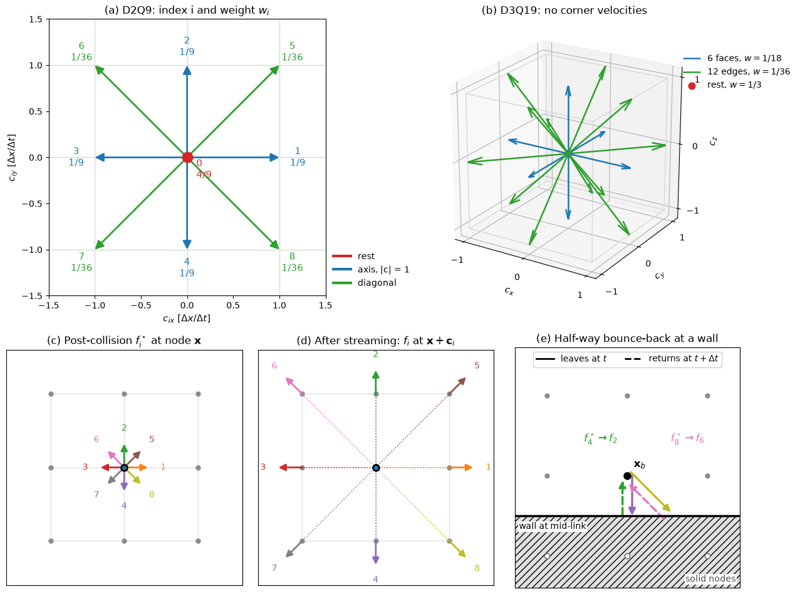
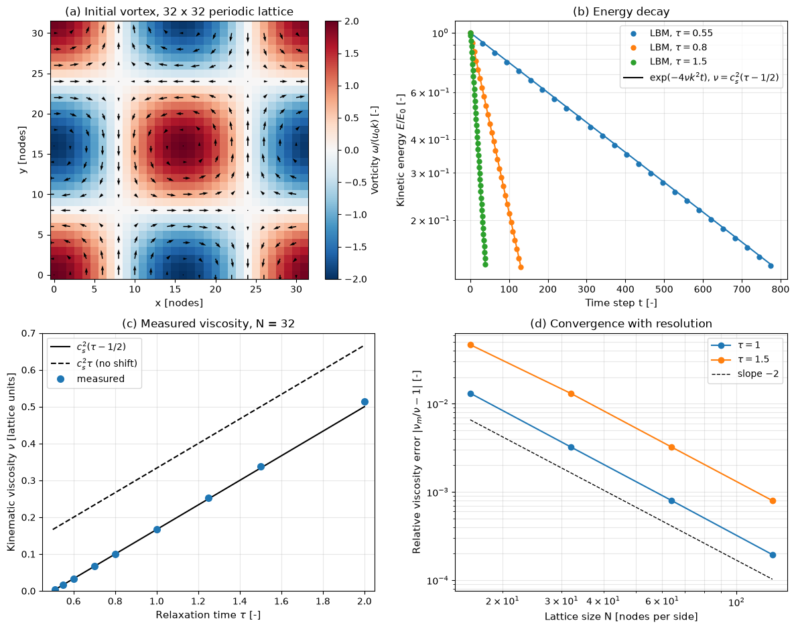

# From Boltzmann to Lattice Boltzmann

The lattice Boltzmann equation is a discretisation of the BGK Boltzmann equation in three steps. Velocity space is reduced to a few discrete velocities by a Hermite expansion and Gauss–Hermite quadrature. Space and time are then discretised along the characteristics of these velocities, so that one time step moves each population exactly to a neighbouring node. Finally, a change of variables makes the scheme explicit and second-order accurate and shifts the relaxation time by $\Delta t/2$. This note derives each step, lists the standard velocity sets, and ends with the second-order equilibrium used in every lattice Boltzmann code. The kinetic background is in [The Boltzmann Equation](boltzmann_equation.md); the resulting algorithm is in [The Lattice Boltzmann Algorithm](lattice_boltzmann_algorithm.md).

## Problem Statement

Start from the isothermal BGK equation for $f(\mathbf{x}, \boldsymbol{\xi}, t)$ with relaxation time $\tau_0$ and reference temperature $T_0$, $c_s^2 = RT_0$:

$$
\frac{\partial f}{\partial t} + \boldsymbol{\xi} \cdot \nabla
f = -\frac{1}{\tau_0}\left(f - f^{\mathrm{eq}}\right)
$$

Its Chapman–Enskog limit is the weakly compressible Navier–Stokes system with $p = c_s^2\rho$ and $\nu = c_s^2\tau_0$. The task is to replace $f$ by $Q$ functions $f_i(\mathbf{x}, t)$, attached to discrete velocities $\mathbf{c}_i$ on a lattice of spacing $\Delta x$ with time step $\Delta t$, such that:

- the moments $\rho$, $\rho\mathbf{u}$ and the momentum flux $\mathbf{\Pi}$ of the equilibrium are reproduced exactly, and the third moment well enough that the Chapman–Enskog analysis still gives the Navier–Stokes viscous stress;
- every $\mathbf{c}_i \Delta t$ is a lattice vector, so streaming needs no interpolation;
- the update is explicit and second-order accurate in $\Delta x$ and $\Delta t$.

The unknowns of the construction are the velocity set $\lbrace \mathbf{c}_i, w_i \rbrace$, the discrete equilibrium $f_i^{\mathrm{eq}}(\rho, \mathbf{u})$ and the relation between $\tau_0$ and the lattice relaxation time $\tau$.

## Which Moments Must Be Kept

The Chapman–Enskog expansion uses the equilibrium moments up to third order:

```math
\int f^{\mathrm{eq}} \, d^3\xi = \rho,
\qquad \int \xi_\alpha f^{\mathrm{eq}} \, d^3\xi = \rho u_\alpha,
\qquad \int \xi_\alpha \xi_\beta f^{\mathrm{eq}} \, d^3\xi = \rho c_s^2
\delta_{\alpha\beta} + \rho u_\alpha u_\beta
```

and $`\int \xi_\alpha\xi_\beta\xi_\gamma f^{\mathrm{eq}} \, d^3\xi = \rho c_s^2(u_\alpha\delta_{\beta\gamma} + u_\beta\delta_{\alpha\gamma} + u_\gamma\delta_{\alpha\beta}) + \rho u_\alpha u_\beta u_\gamma`$, whose divergence produces the viscous stress. Nothing else of the continuous velocity dependence of $f$ matters for isothermal hydrodynamics. A discrete set of velocities can therefore work, provided its sums reproduce these integrals.

## Hermite Expansion of the Equilibrium

Measure velocities in units of $c_s$, $\hat{\boldsymbol{\xi}} = \boldsymbol{\xi}/c_s$ and $\hat{\mathbf{u}} = \mathbf{u}/c_s$, and define the Gaussian weight function in $D$ dimensions

$$
\omega(\hat{\boldsymbol{\xi}}) = \frac{1}{(2\pi)^{D/2}}
e^{-|\hat{\boldsymbol{\xi}}|^2/2}
$$

The Hermite polynomials orthogonal with respect to $\omega$ are $H^{(0)} = 1$, $`H^{(1)}_\alpha = \hat\xi_\alpha`$, $`H^{(2)}_{\alpha\beta} = \hat\xi_\alpha\hat\xi_\beta - \delta_{\alpha\beta}`$, and so on. Any $f$ with finite moments can be expanded as

```math
f(\hat{\boldsymbol{\xi}}) = \omega(\hat{\boldsymbol{\xi}}) \sum_{n=0}^{\infty}
\frac{1}{n!} \mathbf{a}^{(n)}: \mathbf{H}^{(n)}(\hat{\boldsymbol{\xi}}),
\qquad \mathbf{a}^{(n)} = \int f \, \mathbf{H}^{(n)} \, d^D\hat\xi
```

where $:$ denotes full contraction over the $n$ indices. The coefficient $\mathbf{a}^{(n)}$ is a combination of the moments of order up to $n$, and by orthogonality the moments of order $\le N$ depend only on the terms $n \le N$. For the isothermal Maxwellian the coefficients are $a^{(0)} = \rho$, $`a^{(1)}_\alpha = \rho\hat u_\alpha`$ and $`a^{(2)}_{\alpha\beta} = \rho\hat u_\alpha\hat u_\beta`$. Truncating after $n = 2$ gives

```math
f^{\mathrm{eq}} \approx \rho\, \omega(\hat{\boldsymbol{\xi}})
\left[1 + \hat{\boldsymbol{\xi}} \cdot \hat{\mathbf{u}} +
\frac{1}{2}\left((\hat{\boldsymbol{\xi}} \cdot
\hat{\mathbf{u}})^2 - |\hat{\mathbf{u}}|^2\right)\right]
```

which has exactly the density, momentum and momentum flux of the Maxwellian. The third moment loses the $\rho u_\alpha u_\beta u_\gamma$ term, which is the source of the $O(\mathrm{Ma}^3)$ error of lattice Boltzmann models (Shan, Yuan and Chen, 2006).

## Gauss–Hermite Quadrature

The moments needed above are integrals of $`\omega(\hat{\boldsymbol{\xi}})\,p(\hat{\boldsymbol{\xi}})`$, where $p$ is the quadratic bracket times a monomial of degree up to 3, so $p$ has degree at most 5. A Gauss–Hermite quadrature with abscissae $\hat{\boldsymbol{\xi}}_i$ and weights $w_i$,

```math
\int \omega(\hat{\boldsymbol{\xi}})\, p(\hat{\boldsymbol{\xi}}) \,
d^D\hat\xi = \sum_{i=0}^{Q-1} w_i\, p(\hat{\boldsymbol{\xi}}_i)
```

that is exact for all polynomials of degree $\le 5$ reproduces them exactly. Defining the discrete populations as

```math
f_i = \frac{w_i\, f(\hat{\boldsymbol{\xi}}_i)}{\omega(\hat{\boldsymbol{\xi}}_i)}
```

turns every required moment integral into a sum, $`\int \psi f \, d^D\hat\xi = \sum_i \psi(\hat{\boldsymbol{\xi}}_i) f_i`$.

In one dimension, the three-point Gauss–Hermite rule has abscissae $\hat\xi = 0, \pm\sqrt{3}$ with weights $2/3, 1/6, 1/6$ and is exact up to degree $2 \times 3 - 1 = 5$. Choosing the lattice velocity $`\Delta x/\Delta t = \sqrt{3}\,c_s`$ maps the abscissae to $c_i = 0, \pm\Delta x/\Delta t$, so that

$$
c_s = \frac{1}{\sqrt{3}} \frac{\Delta x}{\Delta t},
\qquad c_s^2 = \frac{1}{3} \quad \text{in lattice units } (\Delta x = \Delta t = 1)
$$

Evaluating the truncated equilibrium at the abscissae gives the **second-order lattice equilibrium**

$$
f_i^{\mathrm{eq}} = w_i \rho
\left[1 + \frac{\mathbf{c}_i \cdot \mathbf{u}}{c_s^2} +
\frac{(\mathbf{c}_i \cdot \mathbf{u})^2}{2c_s^4} -
\frac{\mathbf{u} \cdot \mathbf{u}}{2c_s^2}\right]
$$

which in lattice units reads $`f_i^{\mathrm{eq}} = w_i\rho\,[1 + 3\,\mathbf{c}_i\cdot\mathbf{u} + \frac{9}{2}(\mathbf{c}_i\cdot\mathbf{u})^2 - \frac{3}{2}|\mathbf{u}|^2]`$. Its moments are $\sum_i f_i^{\mathrm{eq}} = \rho$, $\sum_i \mathbf{c}_i f_i^{\mathrm{eq}} = \rho\mathbf{u}$ and $\sum_i \mathbf{c}_i\mathbf{c}_i f_i^{\mathrm{eq}} = \rho c_s^2\mathbf{I} + \rho\mathbf{u}\mathbf{u}$, all exact.

## Velocity Sets

Tensor products of the one-dimensional rule give D2Q9 in two dimensions and D3Q27 in three. The 27 velocities of D3Q27 are more than isothermal hydrodynamics needs, so the 19- and 15-velocity sets are obtained by removing velocities while keeping the moment conditions up to fifth order. They are not tensor products, but they satisfy the same conditions. In the names, D2Q9 means 9 velocities in 2 dimensions.

| Lattice | Velocity groups (lattice units) | Number | Weight $w_i$ |
| --- | --- | --- | --- |
| D1Q3 | $0$; $\pm 1$ | 1; 2 | 2/3; 1/6 |
| D2Q9 | $(0,0)$; $(\pm 1, 0), (0, \pm 1)$; $(\pm 1, \pm 1)$ | 1; 4; 4 | 4/9; 1/9; 1/36 |
| D3Q15 | rest; face neighbours $(\pm 1, 0, 0), \ldots$; corners $(\pm 1, \pm 1, \pm 1)$ | 1; 6; 8 | 2/9; 1/9; 1/72 |
| D3Q19 | rest; face neighbours; edge neighbours $(\pm 1, \pm 1, 0), \ldots$ | 1; 6; 12 | 1/3; 1/18; 1/36 |
| D3Q27 | rest; faces; edges; corners | 1; 6; 12; 8 | 8/27; 2/27; 1/54; 1/216 |

All five have $c_s^2 = 1/3$, and their weights satisfy the conditions that make the equilibrium moments exact:

```math
\sum_i w_i = 1, \qquad \sum_i w_i c_{i\alpha} = 0, \qquad \sum_i w_i c_{i\alpha} c_{i\beta} = c_s^2 \delta_{\alpha\beta}, \qquad \sum_i w_i c_{i\alpha} c_{i\beta} c_{i\gamma} = 0
```

```math
\sum_i w_i c_{i\alpha} c_{i\beta} c_{i\gamma} c_{i\delta} = c_s^4 \left(\delta_{\alpha\beta}\delta_{\gamma\delta} + \delta_{\alpha\gamma}\delta_{\beta\delta} + \delta_{\alpha\delta}\delta_{\beta\gamma}\right)
```

The fourth-order condition makes the viscous stress isotropic. It is the reason the square lattice needs the diagonal velocities: D2Q5 (rest plus four axis directions) cannot satisfy it and gives an anisotropic viscosity. D3Q19 is the usual choice for 3D flow; D3Q27 is preferred for turbulent flows at higher Reynolds number and for some advanced collision models, at 40% more memory.



Panel (a) shows the D2Q9 velocities in the counter-clockwise ordering used throughout these notes, $i = 0$ (rest), 1 to 4 (east, north, west, south), 5 to 8 (north-east, north-west, south-west, south-east), with their weights. Panel (b) shows that D3Q19 has the six face and twelve edge neighbours of D3Q27 but not the eight corners. Panels (c) to (e) belong to [the algorithm](lattice_boltzmann_algorithm.md).

## The Discrete-Velocity Boltzmann Equation

With the populations $f_i$ defined at the abscissae, the BGK equation becomes $Q$ advection equations with constant velocities, coupled only through the local collision term:

$$
\frac{\partial f_i}{\partial t} + \mathbf{c}_i \cdot \nabla
f_i = -\frac{1}{\tau_0}\left(f_i - f_i^{\mathrm{eq}}\right) + F_i,
\qquad i = 0, \ldots, Q - 1
$$

where $F_i$ is the discrete form of the force term $-\mathbf{a} \cdot \nabla_{\boldsymbol{\xi}} f$. Its Hermite expansion to second order is

```math
F_i = w_i\left[\frac{\mathbf{c}_i - \mathbf{u}}{c_s^2} +
\frac{(\mathbf{c}_i \cdot \mathbf{u})\,\mathbf{c}_i}{c_s^4}\right] \cdot \mathbf{F}
```

with force density $\mathbf{F} = \rho\mathbf{a}$. It satisfies $\sum_i F_i = 0$ and $\sum_i \mathbf{c}_i F_i = \mathbf{F}$. This discrete-velocity Boltzmann equation can be solved with any PDE method (finite differences, finite volumes on unstructured meshes); the lattice Boltzmann method is the special choice that integrates it exactly along its characteristics.

## Integration Along Characteristics

Each equation is an advection at velocity $\mathbf{c}_i$, so along the characteristic $\mathbf{x} + \mathbf{c}_i s$ it reduces to an ordinary differential equation. With $\Omega_i = -(f_i - f_i^{\mathrm{eq}})/\tau_0 + F_i$, integration over one time step gives exactly

```math
f_i(\mathbf{x} + \mathbf{c}_i\Delta t, t + \Delta t) -
f_i(\mathbf{x}, t) = \int_0^{\Delta t} \Omega_i(\mathbf{x} + \mathbf{c}_i s, t + s) \,
ds
```

If $\mathbf{c}_i\Delta t$ is a lattice vector, which holds by construction since $\Delta x/\Delta t$ is the lattice speed, the left-hand side connects two lattice nodes and needs no interpolation: this is the streaming step. Only the integral of the collision term is approximated.

The rectangle rule, $`\int_0^{\Delta t} \Omega_i \, ds \approx \Delta t\, \Omega_i(\mathbf{x}, t)`$, gives an explicit but only first-order scheme. The trapezoidal rule is second order,

$$
f_i(\mathbf{x} + \mathbf{c}_i\Delta t, t + \Delta t) -
f_i(\mathbf{x}, t) = \frac{\Delta t}{2}\left[\Omega_i(\mathbf{x}, t) +
\Omega_i(\mathbf{x} + \mathbf{c}_i\Delta t, t + \Delta t)\right]
$$

but implicit, because $\Omega_i$ at the new time depends on the unknown $f_i$. The implicitness is removed by the change of variables (He, Shan and Doolen, 1998)

$$
\bar{f}_i = f_i - \frac{\Delta t}{2}\Omega_i = f_i +
\frac{\Delta t}{2\tau_0}\left(f_i - f_i^{\mathrm{eq}}\right) - \frac{\Delta t}{2} F_i
$$

Moving the new-time collision term to the left gives $`\bar{f}_i(\mathbf{x} + \mathbf{c}_i\Delta t, t + \Delta t) = \bar{f}_i(\mathbf{x}, t) + \Delta t\,\Omega_i(\mathbf{x}, t)`$. Since $\bar f_i - f_i^{\mathrm{eq}} = (1 + \Delta t/(2\tau_0))(f_i - f_i^{\mathrm{eq}}) - (\Delta t/2)F_i$, the collision term can be expressed in terms of $\bar f_i$, and the result is the **lattice Boltzmann equation**

```math
\bar{f}_i(\mathbf{x} + \mathbf{c}_i\Delta t, t + \Delta t) = \bar{f}_i(\mathbf{x}, t) -
\frac{\Delta t}{\tau}\left[\bar{f}_i(\mathbf{x}, t) - f_i^{\mathrm{eq}}(\mathbf{x},
t)\right] + \left(1 - \frac{\Delta t}{2\tau}\right)\Delta t\, F_i
```

with the lattice relaxation time

$$
\tau = \tau_0 + \frac{\Delta t}{2}
\qquad \Longrightarrow
\qquad \nu = c_s^2 \tau_0 = c_s^2\left(\tau - \frac{\Delta t}{2}\right)
$$

The scheme is explicit, second-order accurate, and uses only $\bar f_i$; in practice the bar is dropped. Two details follow from the change of variables:

- The density is unchanged, $\sum_i \bar f_i = \rho$, because collisions conserve mass and $\sum_i F_i = 0$. The momentum is shifted by half a force step, $\sum_i \mathbf{c}_i \bar f_i = \rho\mathbf{u} - \mathbf{F}\Delta t/2$, so the physical velocity is $\rho\mathbf{u} = \sum_i \mathbf{c}_i \bar f_i + \mathbf{F}\Delta t/2$.
- The forcing term carries the factor $1 - \Delta t/(2\tau)$. Together with the half-step velocity, this is the forcing scheme of Guo, Zheng and Shi (2002), described in [the algorithm note](lattice_boltzmann_algorithm.md#body-forces).

The $\Delta t/2$ shift of the viscosity is not a small correction. At $\tau = 0.6$ in lattice units, using $\nu = c_s^2\tau$ instead of $c_s^2(\tau - 1/2)$ overestimates the viscosity by a factor of 6. The Taylor–Green vortex in the figure below decays at the rate predicted by $c_s^2(\tau - 1/2)$ for every $\tau$.



Panel (b) shows the kinetic energy decaying as $\exp(-4\nu k^2 t)$, and panel (c) shows that the fitted viscosity lies on $c_s^2(\tau - 1/2)$, far from the unshifted line $c_s^2\tau$. The remaining discrepancy, up to 3% at $\tau = 2$ on a $32 \times 32$ lattice, decreases as $1/N^2$ (panel d).

## Summary of the Discretisation

| Step | Continuous object | Discrete replacement | What is kept exactly | Error |
| --- | --- | --- | --- | --- |
| Equilibrium | Maxwellian | Hermite series truncated at second order | $\rho$, $\rho\mathbf{u}$, $\mathbf{\Pi}^{\mathrm{eq}}$ | $O(\mathrm{Ma}^3)$ in the viscous stress |
| Velocity space | $\boldsymbol{\xi} \in \mathbb{R}^D$ | $Q$ Gauss–Hermite abscissae $\mathbf{c}_i$ | moments of degree $\le 5$ with weight $\omega$ | higher moments (heat flux, Burnett terms) |
| Space and time | $\mathbf{x}$, $t$ | lattice with $\Delta x = \lvert\mathbf{c}_i\rvert\Delta t$ for axis velocities | streaming along characteristics | $O(\Delta x^2)$, $O(\Delta t^2)$ |
| Collision integral | $`\int_0^{\Delta t} \Omega_i \, ds`$ | trapezoidal rule with variable change | conservation of $\rho$ and $\rho\mathbf{u}$ | $O(\Delta t^2)$; $\tau = \tau_0 + \Delta t/2$ |

## Key Takeaways

- Only the equilibrium moments up to third order matter for isothermal hydrodynamics, so the continuous velocity space can be replaced by a quadrature exact for polynomials of degree 5.
- The three-point Gauss–Hermite rule in each direction gives the abscissae $`0, \pm\sqrt{3}\,c_s`$, hence $c_s^2 = 1/3$ in lattice units and the weights 4/9, 1/9 and 1/36 of D2Q9.
- The second-order equilibrium $`f_i^{\mathrm{eq}} = w_i\rho[1 + \mathbf{c}_i\cdot\mathbf{u}/c_s^2 + (\mathbf{c}_i\cdot\mathbf{u})^2/(2c_s^4) - |\mathbf{u}|^2/(2c_s^2)]`$ has exact density, momentum and momentum flux.
- Streaming is exact along characteristics. The trapezoidal rule with the variable change $`\bar f_i = f_i - \Delta t\,\Omega_i/2`$ makes the scheme explicit and second order, with $\tau = \tau_0 + \Delta t/2$ and $\nu = c_s^2(\tau - \Delta t/2)$.
- The same variable change explains the half-force shift in the velocity and the factor $1 - \Delta t/(2\tau)$ in the forcing term.

## Related Scripts

- [Lattice Velocity Sets](../../../scripts/plots/lattice_velocity_sets/): draws the D2Q9 and D3Q19 velocity sets with their indices and weights, the streaming step on a small lattice, and half-way bounce-back at a wall.
- [LBM Taylor–Green Decay](../../../scripts/algorithms/lbm_taylor_green_decay/): measures the viscosity of the D2Q9 BGK lattice Boltzmann scheme from the decay of a Taylor–Green vortex and compares it with $\nu = c_s^2(\tau - 1/2)$.
- [Maxwell-Boltzmann Speed Distribution of N₂ Molecules](../../../scripts/plots/probability_distribution_function_of_nitrogen_molecules/): plots the Maxwell-Boltzmann speed distribution of nitrogen (N₂) molecules at 300 K, 600 K, 900 K and 1200 K, and marks the most probable, mean and root-mean-square speed on each curve.
- [Lattice Boltzmann Cylinder Flow Simulation](../../../scripts/simulations/lattice_boltzmann_cylinder_flow/): simulates 2D flow past a circular cylinder with the lattice Boltzmann method (D2Q9 lattice, BGK collision operator) and animates the velocity magnitude and the vorticity with Matplotlib.
- [LBM Poiseuille Validation](../../../scripts/algorithms/lbm_poiseuille_validation/): validates a D2Q9 BGK lattice Boltzmann solver against the exact solution for body-force-driven channel flow with half-way bounce-back walls.

## Exercises

**Exercise 1.** A D2Q9 simulation uses $\Delta x = 1$ mm and $\Delta t = 0.1$ ms. How many distinct particle speeds does the set contain, what are they in m/s, and what is the speed of sound of the simulated fluid?

<details>
<summary>Answer</summary>

The lattice speed is $c = \Delta x/\Delta t = 10^{-3}/10^{-4} = 10$ m/s. The set has three distinct speeds: 0 for the rest population, $c = 10$ m/s for the four axis directions and $`\sqrt{2}\,c \approx 14.14`$ m/s for the four diagonals. The speed of sound is $c_s = c/\sqrt{3} \approx 5.77$ m/s. The simulated fluid is far more compressible than air or water, which is acceptable only as long as the flow speed stays well below 5.77 m/s.

</details>

**Exercise 2.** At one D2Q9 node, with the populations in the counter-clockwise order of the figure, the values in lattice units are $f = (0.40, 0.12, 0.10, 0.08, 0.10, 0.03, 0.02, 0.02, 0.03)$. Compute $\rho$ and $\mathbf{u}$.

<details>
<summary>Answer</summary>

The velocities are $c_0 = (0,0)$, $c_1 = (1,0)$, $c_2 = (0,1)$, $c_3 = (-1,0)$, $c_4 = (0,-1)$, $c_5 = (1,1)$, $c_6 = (-1,1)$, $c_7 = (-1,-1)$, $c_8 = (1,-1)$.

- $\rho = \sum_i f_i = 0.90$.
- $\rho u_x = f_1 - f_3 + f_5 - f_6 - f_7 + f_8 = 0.12 - 0.08 + 0.03 - 0.02 - 0.02 + 0.03 = 0.06$.
- $\rho u_y = f_2 - f_4 + f_5 + f_6 - f_7 - f_8 = 0.10 - 0.10 + 0.03 + 0.02 - 0.02 - 0.03 = 0$.

So $\mathbf{u} = (0.06/0.90, 0) \approx (0.0667, 0)$ in lattice units.

</details>

**Exercise 3.** For the one-dimensional rule with abscissae $0, \pm\sqrt{3}$ and weights $2/3, 1/6, 1/6$, compare $\sum_i w_i \hat\xi_i^n$ with $`\int \omega(\hat\xi)\,\hat\xi^n \, d\hat\xi`$ for $n = 0, 2, 4, 6$. (The Gaussian moments are 1, 1, 3 and 15; odd moments vanish on both sides.) Why is exactness up to degree 5 enough for the Navier–Stokes equations, but not for a thermal model?

<details>
<summary>Answer</summary>

| $n$ | Quadrature $\sum_i w_i \hat\xi_i^n$ | Gaussian moment |
| --- | --- | --- |
| 0 | $2/3 + 2 \times 1/6 = 1$ | 1 |
| 2 | $2 \times (1/6) \times 3 = 1$ | 1 |
| 4 | $2 \times (1/6) \times 9 = 3$ | 3 |
| 6 | $2 \times (1/6) \times 27 = 9$ | 15 |

The rule is exact up to $n = 4$ (and, trivially, $n = 5$) and fails at $n = 6$.

The isothermal Chapman–Enskog analysis needs the equilibrium moments up to third order. The equilibrium is $\omega$ times a quadratic, so these integrands are $\omega$ times polynomials of degree at most 5, which the rule integrates exactly. A thermal model must also reproduce the energy flux, a third-order moment of the peculiar velocity whose own equilibrium needs third- and fourth-order Hermite terms. That raises the required degree beyond 5, so larger velocity sets are needed.

</details>

**Exercise 4.** Verify that D3Q19 contains one rest velocity, 6 velocities of length 1 and 12 of length $\sqrt{2}$ (lattice units), and that with weights $1/3$, $1/18$ and $1/36$ it satisfies $\sum_i w_i = 1$ and $\sum_i w_i c_{i\alpha} c_{i\beta} = \frac{1}{3}\delta_{\alpha\beta}$.

<details>
<summary>Answer</summary>

The face neighbours $\pm\mathbf{e}_x, \pm\mathbf{e}_y, \pm\mathbf{e}_z$ have squared length 1, and the twelve edge neighbours have exactly two entries equal to $\pm 1$, so squared length 2. Every vector appears together with its negative, so the odd moments vanish.

The weights sum to $1/3 + 6/18 + 12/36 = 1$.

For $\alpha = \beta = x$: the face vectors $\pm\mathbf{e}_x$ contribute $2 \times 1/18 = 1/9$. The edge vectors with a nonzero $x$ entry are $(\pm 1, \pm 1, 0)$ and $(\pm 1, 0, \pm 1)$, eight vectors contributing $8 \times 1/36 = 2/9$. The total is $1/3$, and $y$ and $z$ give the same by symmetry.

For $\alpha = x$, $\beta = y$: only $(\pm 1, \pm 1, 0)$ contribute. $(1,1,0)$ and $(-1,-1,0)$ give $+1/36$ each, while $(1,-1,0)$ and $(-1,1,0)$ give $-1/36$ each, so the sum is zero.

</details>

**Exercise 5.** Using $\bar f_i = f_i - \frac{\Delta t}{2}\Omega_i$ with $\Omega_i = -(f_i - f_i^{\mathrm{eq}})/\tau_0 + F_i$, show that $\sum_i \bar f_i = \rho$ and $`\sum_i \mathbf{c}_i \bar f_i = \rho\mathbf{u} - \mathbf{F}\Delta t/2`$. A fluid with $`\rho = 1`$ feels a force density $`F_x = 10^{-4}`$ (lattice units). If a code reports $`\sum_i c_{ix}\bar f_i/\rho`$ as the velocity, how large is its error?

<details>
<summary>Answer</summary>

$f_i^{\mathrm{eq}}$ has the same $\rho$ and $\rho\mathbf{u}$ as $f_i$, so $\sum_i \Omega_i = \sum_i F_i = 0$ and $\sum_i \mathbf{c}_i\Omega_i = \sum_i \mathbf{c}_i F_i = \mathbf{F}$. Hence $\sum_i \bar f_i = \rho$ and $\sum_i \mathbf{c}_i \bar f_i = \rho\mathbf{u} - \frac{\Delta t}{2}\mathbf{F}$.

The reported velocity is therefore too low by $F_x\Delta t/(2\rho) = 5 \times 10^{-5}$ at every time step, whatever the flow history. In a body-force-driven channel with $u_{\max} = 0.01$ this is a 0.5% error. If the same velocity is also used in $f_i^{\mathrm{eq}}$ and $F_i$, the scheme is no longer the second-order forcing of Guo et al. (2002).

</details>

## References

- X. He and L.-S. Luo, "Theory of the lattice Boltzmann method: From the Boltzmann equation to the lattice Boltzmann equation", *Physical Review E* 56(6), 6811–6817, 1997.
- X. He, X. Shan and G. D. Doolen, "Discrete Boltzmann equation model for nonideal gases", *Physical Review E* 57(1), R13–R16, 1998.
- X. Shan, X.-F. Yuan and H. Chen, "Kinetic theory representation of hydrodynamics: a way beyond the Navier–Stokes equation", *Journal of Fluid Mechanics* 550, 413–441, 2006.
- Y. H. Qian, D. d'Humières and P. Lallemand, "Lattice BGK models for Navier-Stokes equation", *Europhysics Letters* 17(6), 479–484, 1992.
- Z. Guo, C. Zheng and B. Shi, "Discrete lattice effects on the forcing term in the lattice Boltzmann method", *Physical Review E* 65, 046308, 2002.
- T. Krüger, H. Kusumaatmaja, A. Kuzmin, O. Shardt, G. Silva and E. M. Viggen, *The Lattice Boltzmann Method: Principles and Practice*, Springer, 2017.
- S. Succi, *The Lattice Boltzmann Equation for Fluid Dynamics and Beyond*, Oxford University Press, 2001.
