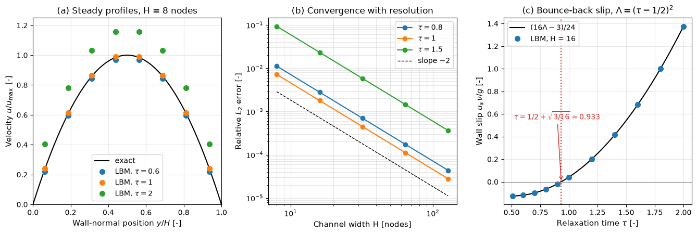

# The Lattice Boltzmann Algorithm

This note turns the lattice Boltzmann equation into a working solver. It gives the collide-and-stream algorithm as numbered steps and pseudocode, the moments that define the macroscopic fields, the standard boundary conditions (periodic, full-way and half-way bounce-back, moving walls, Zou–He velocity and pressure boundaries, outflow), the Guo forcing scheme for body forces, the stability limits of the BGK collision, and the multiple- and two-relaxation-time collision operators that relax them. The derivation of the equation is in [From Boltzmann to Lattice Boltzmann](from_boltzmann_to_lattice_boltzmann.md); unit conversion, parameter choice and a complete implementation are in [The Lattice Boltzmann Method in Practice](practical_lbm.md).

## Problem Statement

Given a uniform lattice of spacing $\Delta x$ covering the domain, a time step $\Delta t$, a velocity set (D2Q9 or D3Q19), a relaxation time $\tau$, a body force density $\mathbf{F}$, initial fields $\rho_0(\mathbf{x})$ and $\mathbf{u}_0(\mathbf{x})$, and boundary conditions (walls, possibly moving; prescribed inflow velocity or pressure; outflow; periodic directions), advance the populations $f_i(\mathbf{x}, t)$ by

```math
f_i(\mathbf{x} + \mathbf{c}_i\Delta t, t + \Delta t) = f_i(\mathbf{x}, t) -
\frac{\Delta t}{\tau}\left[f_i(\mathbf{x}, t) - f_i^{\mathrm{eq}}(\mathbf{x},
t)\right] + \left(1 - \frac{\Delta t}{2\tau}\right)\Delta t\, F_i(\mathbf{x}, t)
```

until a final time is reached or, for steady problems, until $\lVert\mathbf{u}^{n+k} - \mathbf{u}^n\rVert/\lVert\mathbf{u}^n\rVert$ over $k$ steps falls below a tolerance (for example $10^{-8}$ over 100 steps). The outputs are $\rho$, $\mathbf{u}$, the pressure $p = c_s^2\rho$ and, if needed, the stress.

Two things make this harder than the equation suggests. Boundary conditions are specified for $\mathbf{u}$ or $p$, but the solver needs values for the populations that stream in from outside the fluid, and there are more of those than macroscopic conditions. The BGK collision also has a narrow stability margin when $\tau$ approaches $\Delta t/2$, which is exactly where high Reynolds numbers push it.

## Equilibrium, Moments and Viscosity

All formulas below are in lattice units, $\Delta x = \Delta t = 1$ and $c_s^2 = 1/3$. The D2Q9 velocities are numbered counter-clockwise: $`\mathbf{c}_0 = (0, 0)`$; $`\mathbf{c}_{1,2,3,4} = (1,0), (0,1), (-1,0), (0,-1)`$; $`\mathbf{c}_{5,6,7,8} = (1,1), (-1,1), (-1,-1), (1,-1)`$, with weights $`4/9`$, $`1/9`$ and $`1/36`$. The opposite of direction $`i`$ is $`\bar\imath`$, with $`\mathbf{c}_{\bar\imath} = -\mathbf{c}_i`$: $\bar\imath = (0, 3, 4, 1, 2, 7, 8, 5, 6)$. The equilibrium is

```math
f_i^{\mathrm{eq}}(\rho, \mathbf{u}) = w_i\rho\left[1 + 3\,\mathbf{c}_i \cdot
\mathbf{u} + \frac{9}{2}(\mathbf{c}_i \cdot \mathbf{u})^2 -
\frac{3}{2}|\mathbf{u}|^2\right]
```

The macroscopic fields are moments of the populations:

$$
\rho = \sum_i f_i,
\qquad \rho\mathbf{u} = \sum_i \mathbf{c}_i f_i + \frac{\Delta t}{2}\mathbf{F},
\qquad p = c_s^2\rho
$$

The viscous stress needs no velocity gradients. It is proportional to the non-equilibrium part of the second moment:

$$
\boldsymbol{\sigma}' = -\left(1 - \frac{\Delta t}{2\tau}\right) \sum_i
\mathbf{c}_i\mathbf{c}_i \left(f_i - f_i^{\mathrm{eq}}\right)
$$

which makes wall shear stress and strain rate available locally at every node. The kinematic viscosity is $\nu = c_s^2(\tau - \Delta t/2)$, so in lattice units $\tau = 3\nu + 1/2$.

## The Collide–Stream Algorithm

One time step consists of a local collision at every node and a streaming step that copies each post-collision population to the neighbour it points at. Boundary conditions supply the populations that streaming leaves undefined.

1. Initialise $f_i(\mathbf{x}, 0) = f_i^{\mathrm{eq}}(\rho_0, \mathbf{u}_0)$. This starts the flow with zero viscous stress; for a smooth start, add the Chapman–Enskog non-equilibrium part $`-\tau w_i \rho\, (\mathbf{c}_i\mathbf{c}_i - c_s^2\mathbf{I}) : \nabla\mathbf{u}_0 / c_s^2`$.
2. Compute the moments $\rho$ and $\mathbf{u}$ at every fluid node, including the half-force term.
3. Compute $f_i^{\mathrm{eq}}(\rho, \mathbf{u})$ and the forcing term $F_i$.
4. Collide: $`f_i^\star = f_i - \frac{\Delta t}{\tau}(f_i - f_i^{\mathrm{eq}}) + (1 - \frac{\Delta t}{2\tau})\Delta t\, F_i`$.
5. Stream: $f_i(\mathbf{x} + \mathbf{c}_i\Delta t, t + \Delta t) = f_i^\star(\mathbf{x}, t)$.
6. Apply boundary conditions: set every population that streamed in from a solid node or from outside the domain.
7. Check convergence or write output, and return to step 2.

```text
f = equilibrium(rho0, u0)                         # Q values per node
for n in 0, 1, 2, ...:
    rho = sum_i f[i]
    u   = (sum_i c[i] * f[i] + 0.5 * F) / rho
    feq = equilibrium(rho, u)
    S   = guo_source(u, F)
    fpost = f - (f - feq) / tau + (1 - 0.5 / tau) * S      # local, no neighbours
    for i in 0..Q-1:
        f[i](x + c[i]) = fpost[i](x)                       # pure data movement
    for each population i entering fluid node x from a solid node:
        f[i](x) = fpost[opposite(i)](x) + moving_wall_term  # bounce-back
    apply inlet and outlet conditions (Zou-He, extrapolation)
```

The collision is local and does all the arithmetic. Streaming moves data and is exact. Practical codes differ in details:

- Push streaming writes post-collision values to neighbours; pull streaming reads pre-collision values from neighbours and collides afterwards. Which is faster depends on the hardware and the memory layout.
- Two population arrays (old and new) are the simplest. In-place patterns such as the AA pattern or the swap algorithm halve the memory.
- Codes fuse collision and streaming into one loop, so each population is read and written once per step.

The cylinder script in the [practical note](practical_lbm.md) applies its inlet and outlet conditions before the collision instead of after streaming; both orders are consistent as long as each population that enters the fluid is defined exactly once per step.

## Boundary Conditions

After streaming, every population that should have come from a solid node or from outside the domain is unknown. At a straight wall in D2Q9 these are three populations per node, while the no-slip condition gives only two equations. Each boundary scheme is a rule for filling in the unknown populations.

### Periodic Boundaries

Populations leaving through one side re-enter through the opposite side. With array storage this is a cyclic shift, which `np.roll` implements. Periodic boundaries are exact and are used for homogeneous directions, such as the streamwise direction of a fully developed channel.

### Bounce-Back Walls

Bounce-back reverses every population that hits a wall. A molecule that bounces back along its incoming direction has zero mean tangential velocity at the wall, which produces no-slip.

In **half-way bounce-back** the wall lies halfway between the last fluid node $\mathbf{x}_b$ and the first solid node. A population $f_i^\star(\mathbf{x}_b, t)$ that would stream into the wall travels half a link, reflects, and arrives back at $\mathbf{x}_b$ after one time step in the opposite direction:

$$
f_{\bar\imath}(\mathbf{x}_b, t + \Delta t) = f_i^\star(\mathbf{x}_b, t)
$$

Panel (e) of the [lattice figure](from_boltzmann_to_lattice_boltzmann.md#velocity-sets) shows this for the south and south-east populations. Half-way bounce-back conserves mass exactly, needs no information except the solid mask, and is second-order accurate for walls aligned with the lattice. With BGK collisions the wall is not exactly at the mid-link: its effective position depends on $\tau$, which appears as a slip velocity. For plane Poiseuille flow driven by a body force $g$ the computed profile is the exact parabola plus a uniform slip

```math
u_s = \frac{g}{\nu}\, \frac{16\Lambda - 3}{24},
\qquad \Lambda = \left(\tau - \frac{1}{2}\right)^2
```

in lattice units. The slip vanishes at $\tau = 1/2 + \sqrt{3/16} \approx 0.933$. Relative to the centreline velocity $g H^2/(8\nu)$ it decreases as $1/H^2$, so the method stays second order for every $\tau$.



Panel (a) shows that at $\tau = 2$ the whole profile on a channel only 8 nodes wide is shifted upwards by the wall slip, while at $\tau = 0.6$ and $\tau = 1$ it is close to exact. Panel (b) shows the relative $L_2$ error falling with slope $-2$ for every $\tau$ (observed orders 2.000), and panel (c) shows the measured slip on the curve $(16\Lambda - 3)/24$, with the zero at $\tau \approx 0.933$.

In **full-way bounce-back** the populations stream into the solid node, are reversed there instead of colliding, and stream back on the next step. The wall is again approximately halfway, but each population spends an extra time step in the solid, which makes the scheme less accurate for unsteady flows. Its advantage is simplicity: the solid nodes only need a reversal, with no direction-dependent logic at the fluid nodes. The cylinder script uses it.

On curved walls both variants follow a staircase of lattice links, which is only first-order accurate in the wall position. Interpolated bounce-back (Bouzidi, Firdaouss and Lallemand, 2001) uses the actual distance $q\Delta x$ from the fluid node to the wall along each link and restores second order.

### Moving Walls

A wall moving with velocity $\mathbf{u}_w$ adds momentum to the reflected population:

$$
f_{\bar\imath}(\mathbf{x}_b, t + \Delta t) = f_i^\star(\mathbf{x}_b, t) - 2 w_i \rho_w
\frac{\mathbf{c}_i \cdot \mathbf{u}_w}{c_s^2}
$$

where $\rho_w$ is the density at the wall, usually taken as the density of $\mathbf{x}_b$ or as the reference density. The lid of a driven cavity is the standard example; the [practical note](practical_lbm.md#a-compact-numpy-implementation) implements it.

### Zou–He Velocity and Pressure Boundaries

Zou and He (1997) impose a velocity or density at a straight inlet or outlet by assuming that the non-equilibrium part of each unknown population equals that of its opposite, normal to the boundary. For a left boundary ($x = 0$) in D2Q9, the unknown populations after streaming are $f_1$, $f_5$ and $f_8$. Mass conservation and the prescribed normal velocity $u_x$ give the density from the known populations,

$$
\rho = \frac{f_0 + f_2 + f_4 + 2\left(f_3 + f_6 + f_7\right)}{1 - u_x}
$$

and the unknowns are

$$
f_1 = f_3 + \frac{2}{3}\rho u_x,
\qquad f_5 = f_7 - \frac{1}{2}\left(f_2 - f_4\right) + \frac{1}{6}\rho u_x +
\frac{1}{2}\rho u_y,
\qquad f_8 = f_6 + \frac{1}{2}\left(f_2 - f_4\right) + \frac{1}{6}\rho u_x -
\frac{1}{2}\rho u_y
$$

The resulting populations have exactly the prescribed velocity $(u_x, u_y)$. For a pressure boundary the density $\rho_{\mathrm{in}} = p_{\mathrm{in}}/c_s^2$ is given instead, the normal velocity follows from the same mass balance, $u_x = 1 - [f_0 + f_2 + f_4 + 2(f_3 + f_6 + f_7)]/\rho_{\mathrm{in}}$, usually with $u_y = 0$, and the three formulas above complete the populations. Other boundaries follow by rotating the indices. The cylinder script uses the simpler rule $f_i = f_i^{\mathrm{eq}} + (f_{\bar\imath} - f_{\bar\imath}^{\mathrm{eq}})$ for all three unknowns, which bounces back the non-equilibrium part along every link but omits the transverse correction $\pm\frac{1}{2}(f_2 - f_4)$ of Zou and He.

### Outflow

A common outflow condition copies the unknown populations from the neighbouring interior column, a zero-gradient extrapolation. It is simple and works if vortices leave the domain smoothly, but it reflects pressure waves. A Zou–He pressure condition fixes the outlet pressure and is the usual choice for internal flows driven by a pressure difference.

## Body Forces

A body force density $\mathbf{F}$, such as gravity or a mean pressure gradient in a periodic channel, enters through the source term of Guo, Zheng and Shi (2002):

```math
F_i = w_i\left[\frac{\mathbf{c}_i - \mathbf{u}}{c_s^2} +
\frac{(\mathbf{c}_i \cdot \mathbf{u})\,\mathbf{c}_i}{c_s^4}\right] \cdot \mathbf{F}
```

with the factor $1 - \Delta t/(2\tau)$ in the collision and the velocity $\rho\mathbf{u} = \sum_i \mathbf{c}_i f_i + \mathbf{F}\Delta t/2$, used both as output and in $f_i^{\mathrm{eq}}$. The source has zero mass, momentum $\mathbf{F}$, and the second moment $\mathbf{u}\mathbf{F} + \mathbf{F}\mathbf{u}$ needed for a Galilean-invariant stress. Simpler schemes that add $`w_i\,\mathbf{c}_i \cdot \mathbf{F}/c_s^2`$ to the collision without the half-force velocity introduce errors of order $\Delta t$ in the stress. A periodic channel with a uniform $\mathbf{F}$ replaces a pressure-driven channel exactly, because a uniform pressure gradient and a uniform body force enter the momentum equation in the same way. The Poiseuille validation above uses this set-up.

## Stability and Accuracy Limits

The viscosity $\nu = c_s^2(\tau - \Delta t/2)$ must be positive, so $\tau > \Delta t/2$. The BGK collision is linearly stable at rest for every $\tau > 1/2$, but at finite velocity the unstable range grows as $\tau$ approaches $1/2$ (Lallemand and Luo, 2000). In practice BGK runs at $\tau$ below about 0.51 need either a smooth, well-resolved flow or a more robust collision operator.

The Mach number $\mathrm{Ma} = |\mathbf{u}|/c_s$ must stay small: the equilibrium is truncated at $O(u^2)$, density variations grow as $\mathrm{Ma}^2$, and the error in the viscous stress grows as $\mathrm{Ma}^3$. Velocities $|\mathbf{u}| \lesssim 0.1$ in lattice units ($\mathrm{Ma} \lesssim 0.17$) are common; values approaching $c_s = 0.577$ are unstable.

For a flow with Reynolds number $\mathrm{Re} = U L/\nu$ resolved by $N = L/\Delta x$ nodes, these two limits combine to

```math
\tau - \frac{1}{2} = \frac{3\,U_{\mathrm{lb}}\,N}{\mathrm{Re}}
```

where $U_{\mathrm{lb}}$ is the velocity in lattice units. At fixed Mach number, higher Re pushes $\tau$ towards $1/2$ unless $N$ grows in proportion. Accuracy also degrades at large $\tau$: the bounce-back slip grows as $(\tau - 1/2)^2$, and the viscosity error of the Taylor–Green test grows as $((\tau - 1/2)/N)^2$. Values $0.5 < \tau \lesssim 1$ are the usual working range.

## Beyond BGK: MRT and TRT

The BGK operator relaxes all moments of $f_i$ at the same rate $1/\tau$. Only the shear-stress moments determine the viscosity; the others, including the energy, heat-flux-like and higher "ghost" moments, can relax at different rates to improve stability and accuracy.

The multiple-relaxation-time (MRT) operator transforms the populations to $Q$ moments $\mathbf{m} = \mathbf{M}\mathbf{f}$ with an invertible matrix $\mathbf{M}$, relaxes each moment with its own rate, and transforms back:

$$
\mathbf{f}^\star = \mathbf{f} -
\mathbf{M}^{-1}\mathbf{S}\left(\mathbf{m} - \mathbf{m}^{\mathrm{eq}}\right),
\qquad \mathbf{S} = \mathrm{diag}(s_0, \ldots, s_{Q-1})
$$

The rate of the shear moments sets $\nu = c_s^2(1/s_\nu - 1/2)$, the rate of the energy moment sets the bulk viscosity, and the remaining rates are free. The D2Q9 moment basis and its stability analysis are given by Lallemand and Luo (2000), and the D3Q15 and D3Q19 versions by d'Humières et al. (2002). MRT tolerates $\tau$ closer to 1/2 than BGK and costs somewhat more per step because of the two moment transformations.

The two-relaxation-time (TRT) operator (Ginzburg, Verhaeghe and d'Humières, 2008) is the simplest useful case. It splits each population into a symmetric and an antisymmetric part with respect to its opposite direction,

$$
f_i^{+} = \frac{f_i + f_{\bar\imath}}{2},
\qquad f_i^{-} = \frac{f_i - f_{\bar\imath}}{2}
$$

and relaxes them with $\tau^+$ and $\tau^-$. The symmetric rate sets the viscosity, $\nu = c_s^2(\tau^+ - 1/2)$. Steady solutions depend on the second rate only through the "magic" parameter

$$
\Lambda = \left(\tau^+ -\frac{1}{2}\right)\left(\tau^- -\frac{1}{2}\right)
$$

BGK is the special case $\tau^+ = \tau^-$, with $\Lambda = (\tau - 1/2)^2$, the parameter of the slip formula above. TRT can choose $\Lambda = 3/16$ to put bounce-back walls exactly halfway in Poiseuille flow at any viscosity, or $\Lambda = 1/4$ for the best stability. TRT costs almost the same as BGK.

Other robust operators include regularised BGK, which removes the non-hydrodynamic part of $f_i^{\mathrm{neq}}$ before colliding (Latt and Chopard, 2006), and cumulant and entropic collisions; Krüger et al. (2017) compare them.

## Key Takeaways

- One step is a local BGK collision, an exact streaming step, and boundary rules for the populations that enter the fluid. $\rho$, $\mathbf{u}$ and the stress are moments at each node.
- Half-way bounce-back puts no-slip walls at mid-link, conserves mass and is second order on aligned walls. With BGK its wall position depends on $\tau$: the Poiseuille slip $(g/\nu)(16\Lambda - 3)/24$ vanishes at $\tau \approx 0.933$.
- Moving walls add $`-2w_i\rho_w\,\mathbf{c}_i \cdot \mathbf{u}_w/c_s^2`$ to the reflected population. Zou–He boundaries impose velocity or pressure by bouncing back the non-equilibrium part.
- Guo forcing needs both the factor $1 - \Delta t/(2\tau)$ and the half-force term in the velocity.
- BGK requires $\tau > 1/2$ and $\mathrm{Ma} \ll 1$, and loses stability as $\tau \to 1/2$. MRT and TRT keep the viscosity of BGK while tuning the other relaxation rates for stability and wall accuracy.

## Related Scripts

- [LBM Poiseuille Validation](../../../scripts/algorithms/lbm_poiseuille_validation/): validates a D2Q9 BGK lattice Boltzmann solver against the exact solution for body-force-driven channel flow with half-way bounce-back walls.
- [Lattice Velocity Sets](../../../scripts/plots/lattice_velocity_sets/): draws the D2Q9 and D3Q19 velocity sets with their indices and weights, the streaming step on a small lattice, and half-way bounce-back at a wall.
- [LBM Taylor–Green Decay](../../../scripts/algorithms/lbm_taylor_green_decay/): measures the viscosity of the D2Q9 BGK lattice Boltzmann scheme from the decay of a Taylor–Green vortex and compares it with $\nu = c_s^2(\tau - 1/2)$.
- [Lattice Boltzmann Cylinder Flow Simulation](../../../scripts/simulations/lattice_boltzmann_cylinder_flow/): simulates 2D flow past a circular cylinder with the lattice Boltzmann method (D2Q9 lattice, BGK collision operator) and animates the velocity magnitude and the vorticity with Matplotlib.

## Exercises

**Exercise 1.** Evaluate the D2Q9 equilibrium for $\rho = 1$ and $\mathbf{u} = (0.1, 0)$ in lattice units. Check that $\sum_i f_i^{\mathrm{eq}} = \rho$, $`\sum_i \mathbf{c}_i f_i^{\mathrm{eq}} = \rho\mathbf{u}`$ and $`\sum_i c_{ix}^2 f_i^{\mathrm{eq}} = \rho c_s^2 + \rho u_x^2`$.

<details>
<summary>Answer</summary>

The bracket is $`1 + 3(\mathbf{c}_i \cdot \mathbf{u}) + 4.5(\mathbf{c}_i \cdot \mathbf{u})^2 - 1.5\,|\mathbf{u}|^2`$ with $|\mathbf{u}|^2 = 0.01$.

| $\mathbf{c}_i$ | $w_i$ | $\mathbf{c}_i \cdot \mathbf{u}$ | $f_i^{\mathrm{eq}}$ |
| --- | --- | --- | --- |
| $(0,0)$ | 4/9 | 0 | 0.437778 |
| $(1,0)$ | 1/9 | 0.1 | 0.147778 |
| $(-1,0)$ | 1/9 | -0.1 | 0.081111 |
| $(0,\pm 1)$ | 1/9 | 0 | 0.109444 each |
| $(1,\pm 1)$ | 1/36 | 0.1 | 0.036944 each |
| $(-1,\pm 1)$ | 1/36 | -0.1 | 0.020278 each |

- The populations sum to 1.000000.
- The $x$-momentum is $0.147778 - 0.081111 + 2(0.036944 - 0.020278) = 0.1$, and the $y$-momentum is 0 by symmetry.
- $\sum_i c_{ix}^2 f_i^{\mathrm{eq}} = 0.147778 + 0.081111 + 2(0.036944 + 0.020278) = 0.343333 = 1/3 + 0.01$.

</details>

**Exercise 2.** Compute $f_1^\star$ for $f_1 = 0.12$ and $f_1^{\mathrm{eq}} = 0.11$ with $\tau = 1$ and with $\tau = 0.8$ (no force). What does $\tau < 1$ do, and what viscosity corresponds to each case?

<details>
<summary>Answer</summary>

- With $\tau = 1$, $f_1^\star = 0.12 - (0.12 - 0.11) = 0.11 = f_1^{\mathrm{eq}}$. The population relaxes fully to equilibrium in one step, and $\nu = (1 - 0.5)/3 \approx 0.167$.
- With $\tau = 0.8$, $f_1^\star = 0.12 - 1.25 \times 0.01 = 0.1075$. The population overshoots past equilibrium (over-relaxation, $1 < 1/\tau < 2$), and $\nu = 0.3/3 = 0.1$.

Smaller $\tau$ gives lower viscosity. As $\tau \to 1/2$ the relaxation factor $1/\tau \to 2$, the populations oscillate about equilibrium with almost no damping, $\nu \to 0$ and BGK becomes unstable.

</details>

**Exercise 3.** Derive the Zou–He density formula for a left velocity inlet. Write $\rho = \sum_i f_i$ and $\rho u_x = \sum_i c_{ix} f_i$, separate the known populations ($f_0, f_2, f_3, f_4, f_6, f_7$) from the unknown ones ($f_1, f_5, f_8$), and eliminate the unknowns.

<details>
<summary>Answer</summary>

The unknowns all have $c_{ix} = +1$, the known $f_3, f_6, f_7$ have $c_{ix} = -1$, and $f_0, f_2, f_4$ have $c_{ix} = 0$. Then

```math
\rho = (f_0 + f_2 + f_4) + (f_3 + f_6 + f_7) + (f_1 + f_5 + f_8), \qquad \rho u_x = (f_1 + f_5 + f_8) - (f_3 + f_6 + f_7)
```

Eliminating $f_1 + f_5 + f_8$ from the first equation with the second gives $\rho = f_0 + f_2 + f_4 + 2(f_3 + f_6 + f_7) + \rho u_x$, so $\rho(1 - u_x) = f_0 + f_2 + f_4 + 2(f_3 + f_6 + f_7)$. The individual unknowns then follow from the $y$-momentum and the bounce-back of the non-equilibrium part normal to the boundary, $f_1 - f_1^{\mathrm{eq}} = f_3 - f_3^{\mathrm{eq}}$.

</details>

**Exercise 4.** Show that the Guo source term satisfies $\sum_i F_i = 0$ and $\sum_i \mathbf{c}_i F_i = \mathbf{F}$ for any $\mathbf{u}$, using only the lattice moment conditions $\sum_i w_i = 1$, $`\sum_i w_i \mathbf{c}_i = 0`$, $`\sum_i w_i \mathbf{c}_i\mathbf{c}_i = c_s^2\mathbf{I}`$ and $`\sum_i w_i c_{i\alpha}c_{i\beta}c_{i\gamma} = 0`$.

<details>
<summary>Answer</summary>

Write $F_i = w_i[(\mathbf{c}_i - \mathbf{u}) \cdot \mathbf{F}/c_s^2 + (\mathbf{c}_i \cdot \mathbf{u})(\mathbf{c}_i \cdot \mathbf{F})/c_s^4]$.

Zeroth moment: $\sum_i w_i(\mathbf{c}_i - \mathbf{u}) \cdot \mathbf{F} = -\mathbf{u} \cdot \mathbf{F}$, and $`\sum_i w_i (\mathbf{c}_i \cdot \mathbf{u})(\mathbf{c}_i \cdot \mathbf{F}) = c_s^2\, \mathbf{u} \cdot \mathbf{F}`$. Hence $\sum_i F_i = -\mathbf{u} \cdot \mathbf{F}/c_s^2 + \mathbf{u} \cdot \mathbf{F}/c_s^2 = 0$.

First moment, component $\alpha$: $\sum_i w_i c_{i\alpha}(c_{i\beta} - u_\beta)F_\beta/c_s^2 = c_s^2 F_\alpha/c_s^2 = F_\alpha$, because $\sum_i w_i c_{i\alpha} = 0$. The last term contains $\sum_i w_i c_{i\alpha}c_{i\beta}c_{i\gamma} = 0$. Hence $\sum_i \mathbf{c}_i F_i = \mathbf{F}$. Numerically, for D2Q9 with $\mathbf{u} = (0.1, 0)$ and $\mathbf{F} = (1, 0)$ the sums are $-1.5 \times 10^{-16}$ and $(1, 0)$.

</details>

**Exercise 5.** A body-force-driven channel of width $H = 50$ lattice units uses half-way bounce-back walls, $\tau = 0.8$ and $g = 10^{-5}$. Solving $`\nu\, d^2u/dy^2 = -g`$ with walls at $y = 0$ and $y = H$ gives $`u(y) = g\,y(H - y)/(2\nu)`$. Compute $u_{\max}$, the Mach number based on it, the Reynolds number based on the mean velocity and $H$, and the bounce-back slip relative to $u_{\max}$.

<details>
<summary>Answer</summary>

$\nu = (0.8 - 0.5)/3 = 0.1$. At $y = H/2$, $u_{\max} = gH^2/(8\nu) = 10^{-5} \times 2500/0.8 = 0.03125$, so $\mathrm{Ma} = 0.03125\sqrt{3} \approx 0.054$. The mean of a parabola is $\bar{u} = \frac{2}{3}u_{\max} \approx 0.02083$, so $\mathrm{Re} = \bar{u}H/\nu \approx 10.4$.

With $\Lambda = 0.3^2 = 0.09$, the slip is $u_s = (g/\nu)(16 \times 0.09 - 3)/24 = 10^{-4} \times (-0.065) = -6.5 \times 10^{-6}$, or $-2.1 \times 10^{-4}$ of $u_{\max}$. The fluid nodes are at $y_j = j + 1/2$, so the comparison must measure $y$ from the mid-link wall, not from the first fluid node.

</details>

## References

- T. Krüger, H. Kusumaatmaja, A. Kuzmin, O. Shardt, G. Silva and E. M. Viggen, *The Lattice Boltzmann Method: Principles and Practice*, Springer, 2017.
- Q. Zou and X. He, "On pressure and velocity boundary conditions for the lattice Boltzmann BGK model", *Physics of Fluids* 9(6), 1591–1598, 1997.
- Z. Guo, C. Zheng and B. Shi, "Discrete lattice effects on the forcing term in the lattice Boltzmann method", *Physical Review E* 65, 046308, 2002.
- M. Bouzidi, M. Firdaouss and P. Lallemand, "Momentum transfer of a Boltzmann-lattice fluid with boundaries", *Physics of Fluids* 13(11), 3452–3459, 2001.
- P. Lallemand and L.-S. Luo, "Theory of the lattice Boltzmann method: Dispersion, dissipation, isotropy, Galilean invariance, and stability", *Physical Review E* 61(6), 6546–6562, 2000.
- D. d'Humières, I. Ginzburg, M. Krafczyk, P. Lallemand and L.-S. Luo, "Multiple-relaxation-time lattice Boltzmann models in three dimensions", *Philosophical Transactions of the Royal Society A* 360, 437–451, 2002.
- I. Ginzburg, F. Verhaeghe and D. d'Humières, "Two-relaxation-time lattice Boltzmann scheme: about parametrization, velocity, pressure and mixed boundary conditions", *Communications in Computational Physics* 3(2), 427–478, 2008.
- X. He, Q. Zou, L.-S. Luo and M. Dembo, "Analytic solutions of simple flows and analysis of nonslip boundary conditions for the lattice Boltzmann BGK model", *Journal of Statistical Physics* 87(1–2), 115–136, 1997.
- J. Latt and B. Chopard, "Lattice Boltzmann method with regularized pre-collision distribution functions", *Mathematics and Computers in Simulation* 72(2–6), 165–168, 2006.
- S. Chen and G. D. Doolen, "Lattice Boltzmann method for fluid flows", *Annual Review of Fluid Mechanics* 30, 329–364, 1998.
